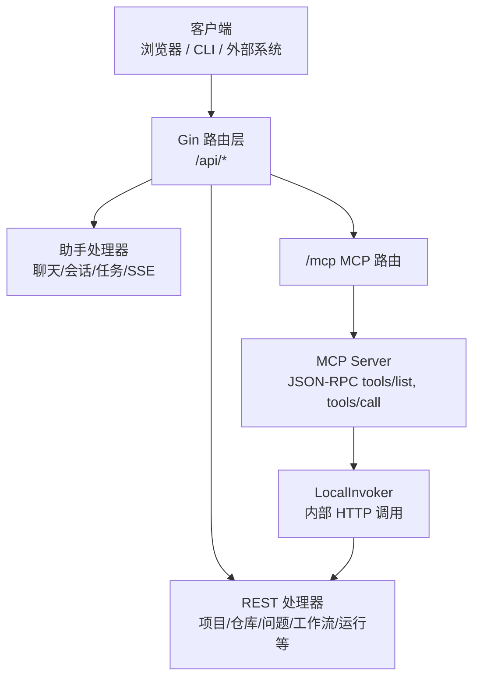
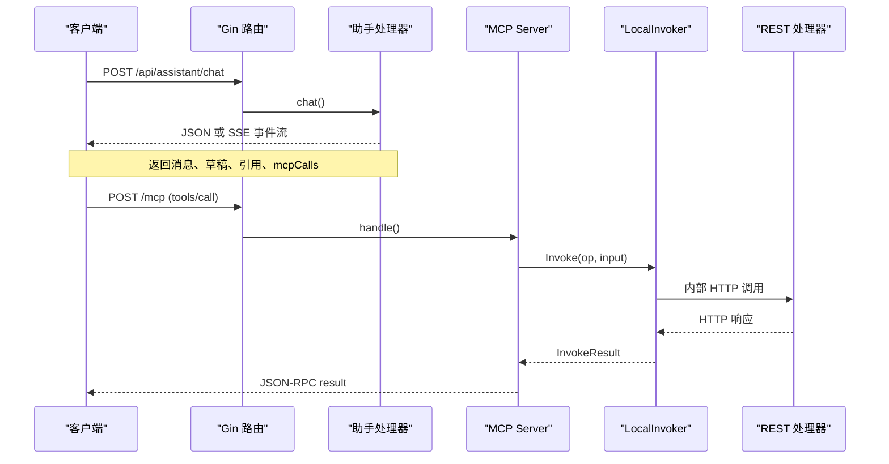
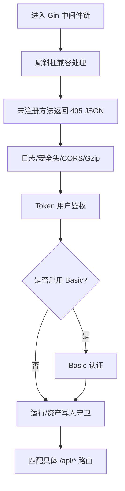
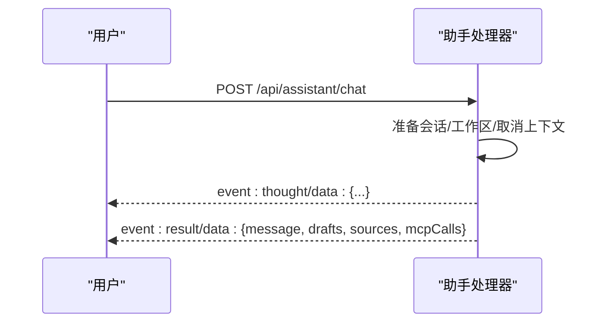
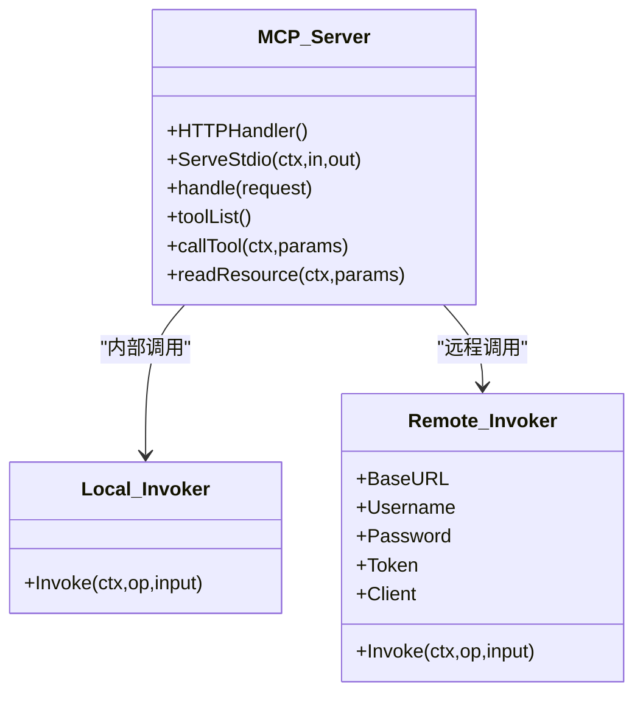
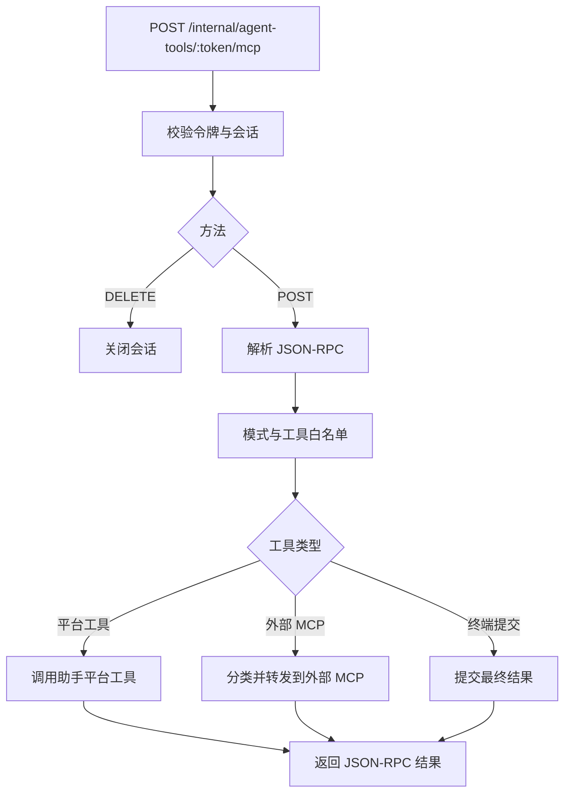
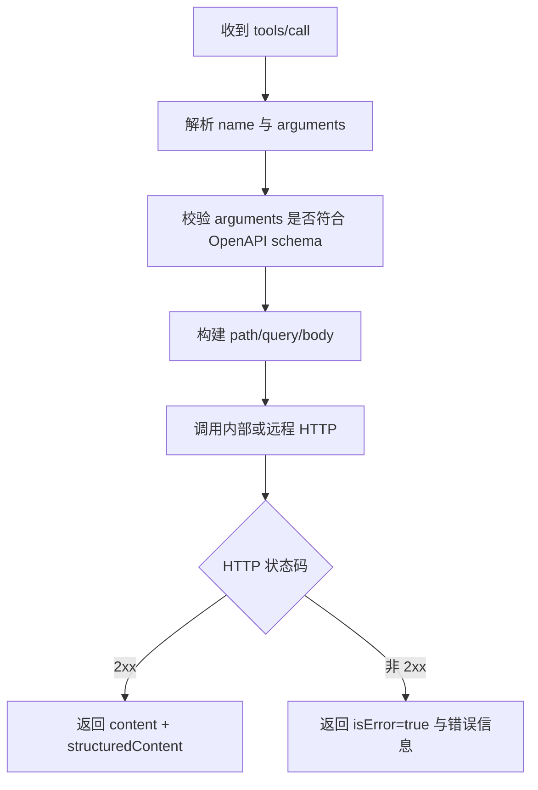
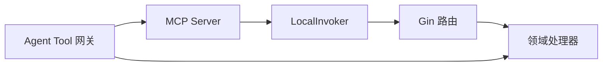

# API 参考

<cite>
**本文引用的文件**   
- [openapi.yaml](file://docs/api/openapi.yaml)
- [server.go](file://internal/httpapi/server.go)
- [trailing_slash_compat.go](file://internal/httpapi/trailing_slash_compat.go)
- [assistant.go](file://internal/httpapi/assistant.go)
- [assistant_live.go](file://internal/httpapi/assistant_live.go)
- [agent_tool_mcp.go](file://internal/httpapi/agent_tool_mcp.go)
- [schema.go](file://internal/mcpserver/schema.go)
- [server.go](file://internal/mcpserver/server.go)
- [client.go](file://internal/mcpclient/client.go)
</cite>

## 目录
1. [简介](#简介)
2. [项目结构](#项目结构)
3. [核心组件](#核心组件)
4. [架构总览](#架构总览)
5. [详细组件分析](#详细组件分析)
6. [依赖关系分析](#依赖关系分析)
7. [性能与可靠性](#性能与可靠性)
8. [故障排查指南](#故障排查指南)
9. [结论](#结论)
10. [附录：REST 端点速查](#附录rest-端点速查)

## 简介
本 API 参考文档面向 LoopForge 平台的 RESTful API、SSE 实时流、MCP（Model Context Protocol）工具调用以及认证方式。平台公开控制面 API 通过 OpenAPI 3.1 契约定义，并通过 `/api/capabilities` 暴露公共操作清单和 MCP 传输入口；同时提供 `/mcp` 的 Streamable HTTP 接口，供模型或 CLI 以 JSON-RPC 形式调用平台能力。

- 认证方式
  - Bearer Token：个人 API Token。
  - Cookie：浏览器会话 `agentflow_user`。
  - Basic Auth：遗留部署级基础认证。
- 安全策略
  - 默认全局启用 Bearer/Cookie 认证；可选开启 Basic Auth。
  - 写操作受运行写入守卫和资源写入守卫保护。
  - 内部端点（如 OTLP、工作区检查点、Runner 管理平面）有额外访问限制。

**章节来源**
- [openapi.yaml:1-16](file://docs/api/openapi.yaml#L1-L16)
- [server.go:202-225](file://internal/httpapi/server.go#L202-L225)

## 项目结构
LoopForge 的 API 由 Gin 路由装配、领域处理器和 MCP 服务组成：
- `internal/httpapi/server.go`：统一注册 REST 路由、中间件、能力与 OpenAPI 暴露。
- `docs/api/openapi.yaml`：公开的 REST 契约，包含路径、请求体、响应、安全方案和错误类型。
- `internal/mcpserver/server.go`：实现 MCP Server，将公开 Operation 映射为 JSON-RPC 工具。
- `internal/httpapi/agent_tool_mcp.go`：Agent Tool MCP 网关，封装会话、模式、审批与外部 MCP 转发。
- `internal/httpapi/assistant.go`、`assistant_live.go`：助手聊天、草稿、SSE 生成流与会话状态。

**图表来源**
- [server.go:227-644](file://internal/httpapi/server.go#L227-L644)
- [server.go:179-308](file://internal/mcpserver/server.go#L179-L308)

**章节来源**
- [server.go:227-644](file://internal/httpapi/server.go#L227-L644)
- [openapi.yaml:1-32](file://docs/api/openapi.yaml#L1-L32)

## 核心组件
- REST 控制器
  - 健康检查、能力清单、OpenAPI 下载。
  - 用户与平台账户、Token 管理。
  - 业务域、项目、仓库、问题、任务、Agent、规则、技能、MCP 服务器、Dockerfile、环境、沙箱、工作流、运行、预览、同步、调度、可观测性、页面反馈、知识库等。
- 助手与 SSE
  - `/api/assistant/chat` 支持 JSON 或 `text/event-stream`。
  - 会话列表、读取标记、分叉、沙箱选择、定时任务。
- MCP 工具
  - `/mcp` 暴露 JSON-RPC 工具目录与调用。
  - Agent Tool MCP 网关提供会话隔离、模式约束、审批与外部 MCP 转发。

**章节来源**
- [openapi.yaml:48-532](file://docs/api/openapi.yaml#L48-L532)
- [openapi.yaml:823-2399](file://docs/api/openapi.yaml#L823-L2399)
- [openapi.yaml:3500-3603](file://docs/api/openapi.yaml#L3500-L3603)

## 架构总览
下图展示一次典型的“助手聊天 → 草稿 → MCP 工具调用”流程：

**图表来源**
- [assistant.go:374-394](file://internal/httpapi/assistant.go#L374-L394)
- [server.go:179-308](file://internal/mcpserver/server.go#L179-L308)
- [server.go:84-114](file://internal/mcpserver/server.go#L84-L114)

**章节来源**
- [assistant.go:374-394](file://internal/httpapi/assistant.go#L374-L394)
- [server.go:179-308](file://internal/mcpserver/server.go#L179-L308)

## 详细组件分析

### REST API 认证与安全
- 全局安全方案
  - `bearerAuth`：Bearer Token。
  - `cookieAuth`：Cookie `agentflow_user`。
  - `basicAuth`：Basic Auth（可选）。
- 中间件顺序
  - 预检尾斜杠兼容、NoMethod 统一 405 JSON。
  - 日志、安全头、CORS、Gzip。
  - Token 用户访问鉴权。
  - 可选 Basic Auth。
  - 运行写入守卫、资产写入守卫。

**图表来源**
- [server.go:202-225](file://internal/httpapi/server.go#L202-L225)
- [trailing_slash_compat.go:11-55](file://internal/httpapi/trailing_slash_compat.go#L11-L55)

**章节来源**
- [openapi.yaml:604-614](file://docs/api/openapi.yaml#L604-L614)
- [server.go:202-225](file://internal/httpapi/server.go#L202-L225)
- [trailing_slash_compat.go:11-55](file://internal/httpapi/trailing_slash_compat.go#L11-L55)

### 助手聊天与 SSE 实时流
- `/api/assistant/chat`
  - 使用当前登录用户的 CodeBuddy Key。
  - 支持 `Accept: text/event-stream` 返回 SSE 事件流；否则返回单条 JSON。
  - 返回消息、草稿、引用、内部 MCP 调用结果。
- SSE 行为
  - 设置 `Content-Type: text/event-stream; charset=utf-8`。
  - 禁用缓存、保持连接。
  - 事件格式为 `event:` + `data:` 行。

**图表来源**
- [assistant.go:352-394](file://internal/httpapi/assistant.go#L352-L394)

**章节来源**
- [openapi.yaml:62-164](file://docs/api/openapi.yaml#L62-L164)
- [assistant.go:352-394](file://internal/httpapi/assistant.go#L352-L394)

### MCP 协议与工具调用
- 入口
  - `/mcp`：Streamable HTTP，仅接受 POST 与 DELETE。
  - 删除用于清理长连接；POST 接收 JSON-RPC。
- 标准方法
  - `initialize`：协商协议版本、能力、服务端信息、指令。
  - `ping`：心跳。
  - `tools/list`：列出公开 Operation 作为工具。
  - `tools/call`：调用工具，参数按 OpenAPI 输入校验。
  - `resources/list`、`resources/templates/list`、`resources/read`：资源模板与读取。
- 工具输入
  - 从 OpenAPI Operation 解析 `path`、`query`、`body`。
  - 自动拼接 URL、编码 Body、注入上游认证头。
- 结果
  - 文本内容 `content`，结构化数据 `structuredContent`，错误标志 `isError`。

**图表来源**
- [server.go:179-308](file://internal/mcpserver/server.go#L179-L308)
- [server.go:84-164](file://internal/mcpserver/server.go#L84-L164)

**章节来源**
- [server.go:179-308](file://internal/mcpserver/server.go#L179-L308)
- [schema.go:47-51](file://internal/mcpserver/schema.go#L47-L51)

### Agent Tool MCP 网关
- 用途
  - 为 CLI/Provider 提供会话化 MCP 网关，支持模式（报告、澄清、助手、定时）、工具白名单、审批与外部 MCP 转发。
- 关键方法
  - `initialize`：返回协议版本、能力、服务端信息与模式指令。
  - `tools/list`：根据会话构建工具目录。
  - `tools/call`：校验会话、模式、工具名、参数，执行平台工具或外部 MCP。
  - `notifications/cancelled`：通知取消，终止等待审批的工具调用。
- 安全
  - 令牌校验、会话过期、关闭状态。
  - 模式限制（例如只读澄清、助手草稿提交）。
  - 外部 MCP 名称白名单与读写判断。

**图表来源**
- [agent_tool_mcp.go:58-143](file://internal/httpapi/agent_tool_mcp.go#L58-L143)
- [agent_tool_mcp.go:193-312](file://internal/httpapi/agent_tool_mcp.go#L193-L312)
- [agent_tool_mcp.go:314-359](file://internal/httpapi/agent_tool_mcp.go#L314-L359)
- [agent_tool_mcp.go:361-481](file://internal/httpapi/agent_tool_mcp.go#L361-L481)

**章节来源**
- [agent_tool_mcp.go:58-143](file://internal/httpapi/agent_tool_mcp.go#L58-L143)
- [agent_tool_mcp.go:193-312](file://internal/httpapi/agent_tool_mcp.go#L193-L312)
- [agent_tool_mcp.go:314-359](file://internal/httpapi/agent_tool_mcp.go#L314-L359)
- [agent_tool_mcp.go:361-481](file://internal/httpapi/agent_tool_mcp.go#L361-L481)

### WebSocket 接口说明
- 平台公开 API 主要采用 REST 与 SSE，而非传统 WebSocket。
- 相关实时交互包括：
  - `/api/assistant/chat` 的 SSE 事件流。
  - `/api/issues/{id}/chat-clarify` 的 SSE 恢复与思考事件。
  - Runner 管理与任务事件通道在内部使用，不对外暴露 WebSocket。
- 若需实时交互，请使用 SSE 或 MCP Streamable HTTP。

**章节来源**
- [openapi.yaml:62-164](file://docs/api/openapi.yaml#L62-L164)
- [openapi.yaml:1302-1351](file://docs/api/openapi.yaml#L1302-L1351)
- [assistant.go:374-394](file://internal/httpapi/assistant.go#L374-L394)

### MCP 工具调用格式与参数定义
- JSON-RPC 请求
  - `jsonrpc`: `"2.0"`
  - `method`: `initialize` / `ping` / `tools/list` / `tools/call` / `resources/*`
  - `params`: 与方法对应的参数对象
  - `id`: 请求标识
- 工具参数
  - `name`: 工具名（对应公开 Operation）
  - `arguments`: 对象，包含 `path`、`query`、`body`
- 工具输入校验
  - 基于 OpenAPI Operation 的 schema 进行校验。
  - 自动填充路径参数、查询参数与请求体。
- 工具输出
  - `content`: 文本数组
  - `structuredContent`: 结构化数据（当响应可解析为 JSON）
  - `isError`: 非 2xx 响应标记为错误

**图表来源**
- [server.go:346-400](file://internal/mcpserver/server.go#L346-L400)
- [schema.go:47-51](file://internal/mcpserver/schema.go#L47-L51)

**章节来源**
- [server.go:346-400](file://internal/mcpserver/server.go#L346-L400)
- [schema.go:47-51](file://internal/mcpserver/schema.go#L47-L51)

## 依赖关系分析
- REST 路由与处理器
  - 所有 `/api/*` 路由在 `server.go` 中集中注册。
  - 领域处理器（项目、仓库、问题、工作流、运行、预览、同步、调度等）通过依赖注入共享存储、引擎、同步服务、调度器、通知服务等。
- MCP 与 REST 的关系
  - MCP Server 通过 `LocalInvoker` 直接调用 Gin 路由，复用同一套 REST 逻辑。
  - Agent Tool MCP 网关进一步封装会话、模式、审批与外部 MCP 转发。
- 外部依赖
  - 认证客户端、仓库存储、引擎、同步服务、调度服务、通知服务、运行时能力检测。

**图表来源**
- [server.go:227-644](file://internal/httpapi/server.go#L227-L644)
- [server.go:179-308](file://internal/mcpserver/server.go#L179-L308)
- [agent_tool_mcp.go:58-143](file://internal/httpapi/agent_tool_mcp.go#L58-L143)

**章节来源**
- [server.go:227-644](file://internal/httpapi/server.go#L227-L644)
- [server.go:179-308](file://internal/mcpserver/server.go#L179-L308)
- [agent_tool_mcp.go:58-143](file://internal/httpapi/agent_tool_mcp.go#L58-L143)

## 性能与可靠性
- SSE 与长连接
  - 助手聊天与澄清任务支持 SSE，适合长时间运行的 AI 推理过程。
  - 建议客户端正确处理断线重连与事件去重。
- 并发与限流
  - 助手生成存在并发限制（重复生成返回 429）。
  - SkillHub 代理返回 429/502/504 表示外部不可用或超时。
- 资源保护
  - 运行与工作区操作需要租约与权限校验。
  - 资产删除受引用关系保护，避免误删。

**章节来源**
- [openapi.yaml:62-164](file://docs/api/openapi.yaml#L62-L164)
- [openapi.yaml:1703-1723](file://docs/api/openapi.yaml#L1703-L1723)
- [assistant.go:352-394](file://internal/httpapi/assistant.go#L352-L394)

## 故障排查指南
- 常见 HTTP 状态码
  - 400：请求参数无效。
  - 401：未认证或认证失败。
  - 403：无权限或操作被禁用。
  - 404：资源不存在。
  - 409：状态冲突（并发更新、引用保护）。
  - 429：速率限制或已有生成进行中。
  - 500：内部服务器错误。
  - 502：上游服务错误（SSO、SkillHub、外部 MCP）。
  - 504：上游超时（AI 分析、外部服务）。
- 调试建议
  - 使用 `/api/capabilities` 确认可用操作与 MCP 入口。
  - 使用 `/api/openapi.yaml` 获取最新契约。
  - 对 SSE 接口设置正确的 Accept 头并处理事件流。
  - 对 MCP 调用先执行 `initialize` 与 `tools/list`，再调用 `tools/call`。

**章节来源**
- [openapi.yaml:3818-3882](file://docs/api/openapi.yaml#L3818-L3882)
- [server.go:703-718](file://internal/httpapi/server.go#L703-L718)

## 结论
LoopForge 的 API 体系以 OpenAPI 契约为核心，结合 Gin 路由、领域处理器与 MCP Server，提供一致的 REST 与 JSON-RPC 工具调用体验。SSE 用于长时任务实时反馈，MCP 将平台能力暴露给模型与 CLI。通过严格的认证、权限与写入保护，平台在保证灵活性的同时确保安全性与稳定性。

## 附录：REST 端点速查
以下按功能分组列出主要端点，完整字段请参考 OpenAPI 契约。

- 系统与能力
  - GET `/api/health`
  - GET `/api/capabilities`
  - GET `/api/openapi.yaml`
  - GET `/api/bootstrap`
- 认证与用户
  - GET `/api/auth/current`
  - POST `/api/auth/password`
  - GET `/api/auth/setup`
  - POST `/api/auth/register`
  - GET/POST `/api/auth/local`
  - OAuth 相关：`/api/auth/gongfeng*`、`/api/auth/github*`
  - GET/POST `/api/auth/exchange`
  - POST `/api/auth/logout`
  - GET `/api/auth/photo[/spec/username]`
  - GET/POST `/api/auth/tokens`
  - DELETE `/api/auth/tokens/:id`
  - GET `/api/users`
  - PUT `/api/users/:id/credentials`
  - 平台账户：`/api/platform/accounts*`、`/api/platform/codebuddy-key`
- 业务域与项目
  - GET/PUT `/api/business-domains`
  - GET `/api/business-domain-report`
  - PUT `/api/projects/:id/business-domain`
  - GET `/api/projects/:id/business-domain/history`
  - GET/POST/PUT `/api/projects`
  - GET/DELETE `/api/projects/:id`
  - POST `/api/projects/:id/restore`
- 仓库与问题
  - GET/POST/PUT/DELETE `/api/repositories`
  - GET `/api/repositories/:id`
  - GET/POST/PUT `/api/issues`
  - POST `/api/issues/import-tapd`
  - GET/DELETE `/api/issues/:id`
  - POST `/api/issues/:id/comments`
  - GET `/api/issues/:id/runs`
  - POST/GET `/api/issues/:id/chat-clarify`
  - POST `/api/issues/:id/chat-clarify/cancel`
  - POST `/api/issues/:id/clarification`
  - POST `/api/issues/:id/reopen`
  - POST `/api/issues/:id/dispatch`
  - POST `/api/chat-clarify`
  - POST `/api/chat-clarify/cancel`
- 任务与资产
  - GET `/api/tasks[/:id]`
  - GET/PUT `/api/agents[/:id]`
  - GET/PUT/DELETE `/api/rules`
  - GET/PUT/DELETE `/api/skills[/:id/files*]`
  - GET/PUT/DELETE `/api/mcp-servers[/:id/files*]`
  - GET `/api/executors`
  - GET `/api/executor-models`
  - GET/PUT/DELETE `/api/dockerfiles`
  - GET/PUT/DELETE `/api/environments`
  - GET/PUT/DELETE `/api/sandboxes`
- 工作流与运行
  - GET/PUT `/api/workflows[/:id]`
  - GET `/api/workflows/:id/revisions[/:revisionId]`
  - POST `/api/workflows/:id/publish`
  - POST `/api/workflows/:id/clone`
  - GET `/api/workflow-metrics`
  - GET/POST `/api/runs[/:id]`
  - GET `/api/runs/:id/telemetry`
  - GET `/api/runs/:id/logs[/txt]`
  - 工作区与终端：`/api/runs/:id/workspace*`
  - 浏览器：`/api/runs/:id/browser*`
  - 预览：`/api/runs/:id/preview*`
  - 控制：`/api/runs/:id/control`
  - 评估：`/api/runs/:id/eval*`
- 同步与调度
  - `/api/sync/config`、`/api/sync/now`、`/api/sync/logs`、`/api/sync/status`、`/api/sync/create`
  - `/api/shared-schedule-tasks[/:id/versions]`
  - `/api/schedule-jobs[/:id]`
  - `/api/schedule-job-executions[/dashboard]`
- 可观测性与反馈
  - GET `/api/analytics`
  - GET `/api/observability/spec`
  - POST `/api/otel/*path`
  - `/api/page-feedback[/:id[/images/:imageId]]`

**章节来源**
- [openapi.yaml:48-532](file://docs/api/openapi.yaml#L48-L532)
- [openapi.yaml:823-2399](file://docs/api/openapi.yaml#L823-L2399)
- [openapi.yaml:3500-3603](file://docs/api/openapi.yaml#L3500-L3603)
- [server.go:227-644](file://internal/httpapi/server.go#L227-L644)