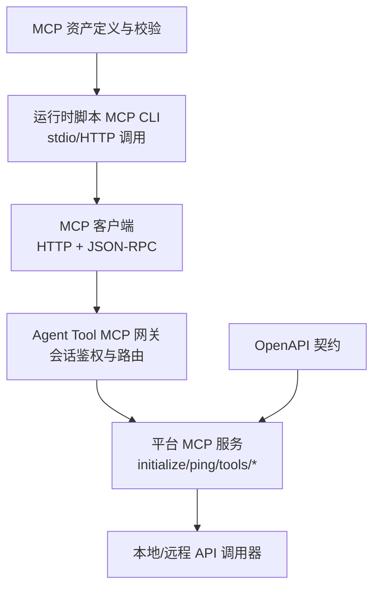
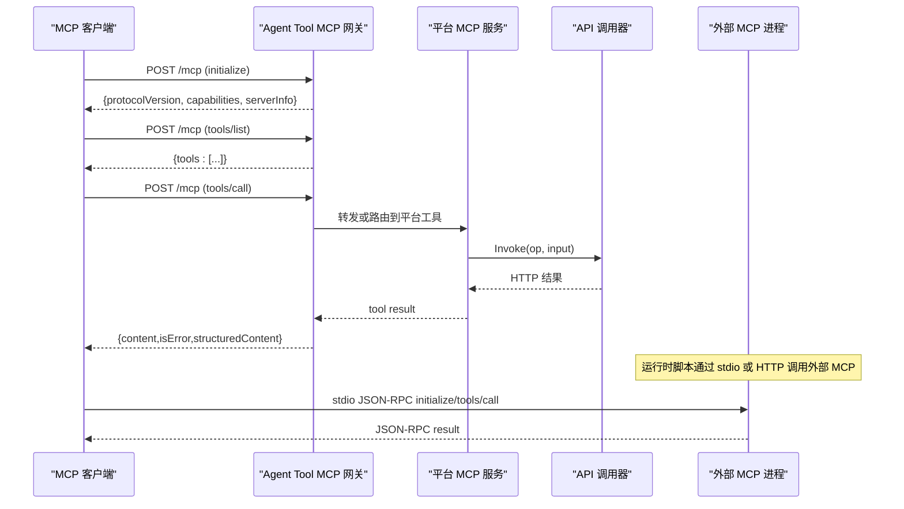
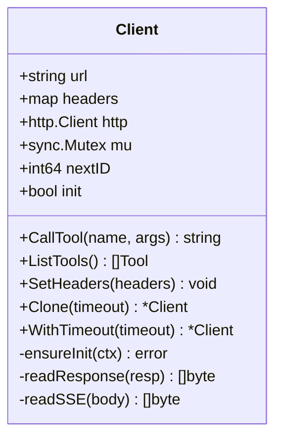
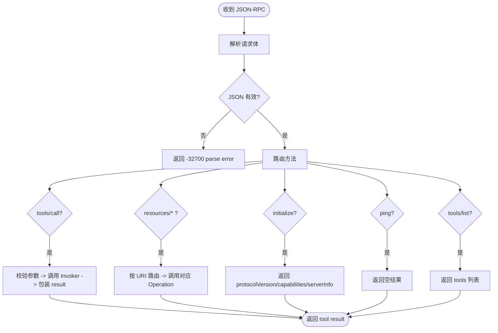
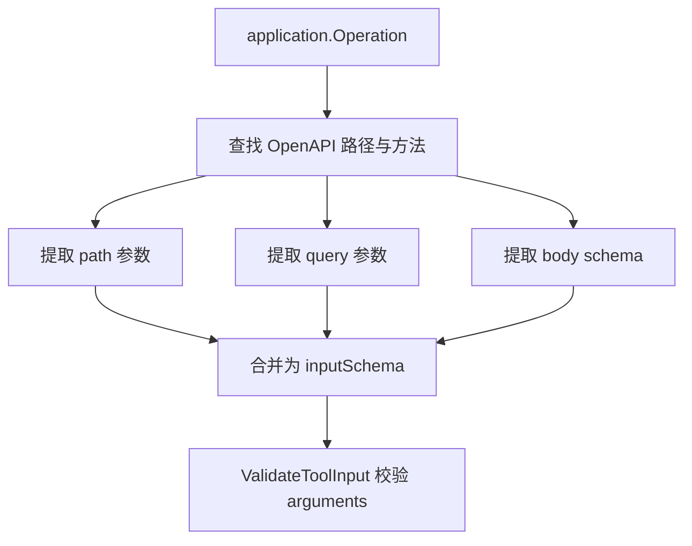
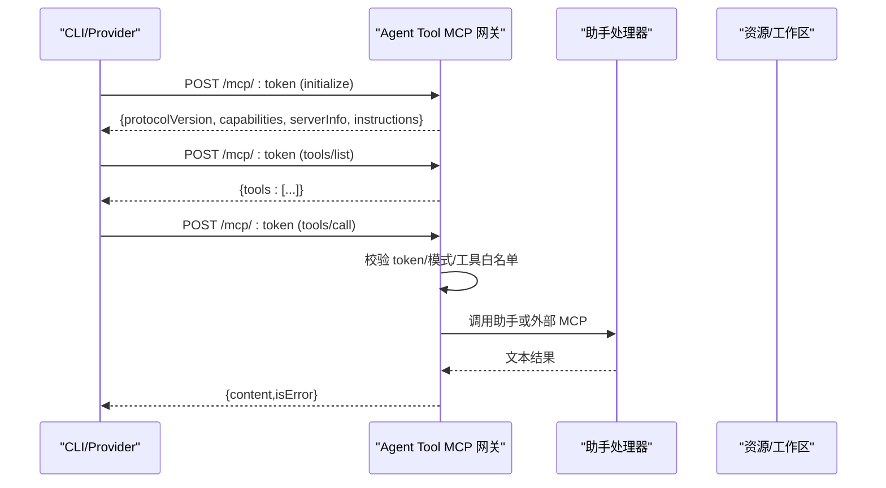
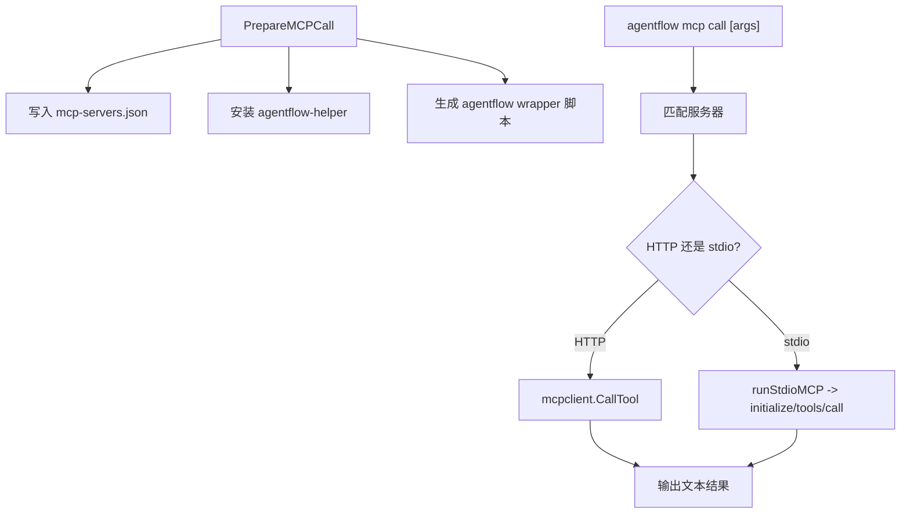
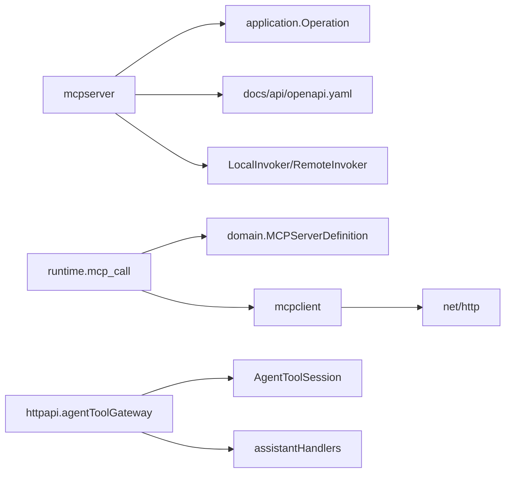

# MCP 协议规范

<cite>
**本文引用的文件**   
- [internal/mcpclient/client.go](file://internal/mcpclient/client.go)
- [internal/mcpserver/server.go](file://internal/mcpserver/server.go)
- [internal/mcpserver/schema.go](file://internal/mcpserver/schema.go)
- [internal/httpapi/agent_tool_mcp.go](file://internal/httpapi/agent_tool_mcp.go)
- [internal/runtime/mcp_call.go](file://internal/runtime/mcp_call.go)
- [internal/domain/assets.go](file://internal/domain/assets.go)
- [docs/api/openapi.yaml](file://docs/api/openapi.yaml)
</cite>

## 目录
1. [简介](#简介)
2. [项目结构](#项目结构)
3. [核心组件](#核心组件)
4. [架构总览](#架构总览)
5. [详细组件分析](#详细组件分析)
6. [依赖关系分析](#依赖关系分析)
7. [性能与可靠性](#性能与可靠性)
8. [故障排查指南](#故障排查指南)
9. [结论](#结论)
10. [附录：协议消息与错误码](#附录协议消息与错误码)

## 简介
本文件面向 MCP（Model Context Protocol）在 LoopForge 中的实现，系统性说明协议的消息格式、会话管理、工具注册机制、版本兼容性、握手流程、心跳机制、连接状态管理、安全与认证、以及调试方法。文档同时给出协议交互序列图、类图和流程图，帮助读者从高层到代码层理解 MCP 的完整生命周期。

## 项目结构
LoopForge 对 MCP 的支持由以下模块共同组成：
- 客户端 HTTP 调用封装：负责 JSON-RPC 2.0 请求、SSE 响应解析、初始化与通知。
- 服务端 HTTP 处理器：提供 Streamable HTTP 入口，处理 initialize/ping/tools/list/tools/call/resources/* 等方法。
- 工具输入 Schema 生成器：基于 OpenAPI 契约动态生成 MCP 工具的 inputSchema，并校验参数。
- 会话网关：为 Agent Tool 模式提供带鉴权、权限控制、审批和审计的工具路由。
- 运行时 CLI：在沙箱中通过 stdio 或 HTTP 调用外部 MCP，并提供 agentflow mcp call/tools/list 等命令。
- 资产定义与校验：描述 MCP 服务器配置、传输方式、作用域与安全约束。

**图表来源** 
- [internal/mcpclient/client.go:16-33](file://internal/mcpclient/client.go#L16-L33)
- [internal/httpapi/agent_tool_mcp.go:58-92](file://internal/httpapi/agent_tool_mcp.go#L58-L92)
- [internal/mcpserver/server.go:179-209](file://internal/mcpserver/server.go#L179-L209)
- [internal/runtime/mcp_call.go:382-420](file://internal/runtime/mcp_call.go#L382-L420)
- [internal/domain/assets.go:73-95](file://internal/domain/assets.go#L73-L95)
- [docs/api/openapi.yaml:1-16](file://docs/api/openapi.yaml#L1-L16)

**章节来源**
- [internal/mcpclient/client.go:16-33](file://internal/mcpclient/client.go#L16-L33)
- [internal/httpapi/agent_tool_mcp.go:58-92](file://internal/httpapi/agent_tool_mcp.go#L58-L92)
- [internal/mcpserver/server.go:179-209](file://internal/mcpserver/server.go#L179-L209)
- [internal/runtime/mcp_call.go:382-420](file://internal/runtime/mcp_call.go#L382-L420)
- [internal/domain/assets.go:73-95](file://internal/domain/assets.go#L73-L95)
- [docs/api/openapi.yaml:1-16](file://docs/api/openapi.yaml#L1-L16)

## 核心组件
- MCP 客户端：最小化 Streamable HTTP 客户端，发送 JSON-RPC 2.0 请求，支持 SSE 流式响应；自动执行 initialize 与 notifications/initialized；提供 CallTool 与 ListTools。
- MCP 服务端：实现 Streamable HTTP 端点，处理 initialize/ping/tools/list/tools/call/resources/*，返回结构化 tool result 与资源读取结果。
- 工具 Schema 生成：基于 OpenAPI 契约生成 inputSchema，支持 path/query/body 字段推导与校验。
- Agent Tool 网关：为不同 Agent Tool 模式提供工具目录、权限控制、写入审批、审计与诊断。
- 运行时 MCP CLI：在沙箱环境中准备 MCP 配置、安装辅助程序，并通过 stdio 或 HTTP 调用外部 MCP。
- MCP 资产定义：描述 MCP 服务器的传输方式、URL/command、环境变量、作用域、超时与认证类型。

**章节来源**
- [internal/mcpclient/client.go:16-33](file://internal/mcpclient/client.go#L16-L33)
- [internal/mcpserver/server.go:179-209](file://internal/mcpserver/server.go#L179-L209)
- [internal/mcpserver/schema.go:47-91](file://internal/mcpserver/schema.go#L47-L91)
- [internal/httpapi/agent_tool_mcp.go:58-92](file://internal/httpapi/agent_tool_mcp.go#L58-L92)
- [internal/runtime/mcp_call.go:55-105](file://internal/runtime/mcp_call.go#L55-L105)
- [internal/domain/assets.go:73-95](file://internal/domain/assets.go#L73-L95)

## 架构总览
下图展示 MCP 在 LoopForge 中的端到端交互：客户端发起 initialize，随后进行 tools/list 与 tools/call；平台侧通过 LocalInvoker/RemoteInvoker 调用内部 REST API；运行时脚本可通过 stdio 或 HTTP 调用外部 MCP。

**图表来源** 
- [internal/mcpclient/client.go:267-349](file://internal/mcpclient/client.go#L267-L349)
- [internal/httpapi/agent_tool_mcp.go:114-143](file://internal/httpapi/agent_tool_mcp.go#L114-L143)
- [internal/mcpserver/server.go:270-308](file://internal/mcpserver/server.go#L270-L308)
- [internal/mcpserver/server.go:84-164](file://internal/mcpserver/server.go#L84-L164)
- [internal/runtime/mcp_call.go:600-648](file://internal/runtime/mcp_call.go#L600-L648)

## 详细组件分析

### MCP 客户端（Streamable HTTP）
- 职责：构造 JSON-RPC 2.0 请求，设置 Content-Type/Accept，携带自定义 Header（如认证），解析 JSON 或 SSE 响应。
- 关键行为：
  - ensureInit：首次调用前发送 initialize，成功后发送 notifications/initialized；失败不阻断后续调用。
  - CallTool：发送 tools/call，解析 content 文本块，若 isError 则返回错误。
  - ListTools：发送 tools/list，返回工具列表及其 schema。
  - readResponse/readSSE：根据 Content-Type 选择普通 JSON 或 SSE 流式数据，提取第一条带 id 的 RPC 响应。

**图表来源** 
- [internal/mcpclient/client.go:16-33](file://internal/mcpclient/client.go#L16-L33)
- [internal/mcpclient/client.go:97-192](file://internal/mcpclient/client.go#L97-L192)
- [internal/mcpclient/client.go:202-265](file://internal/mcpclient/client.go#L202-L265)
- [internal/mcpclient/client.go:267-349](file://internal/mcpclient/client.go#L267-L349)
- [internal/mcpclient/client.go:351-389](file://internal/mcpclient/client.go#L351-L389)

**章节来源**
- [internal/mcpclient/client.go:16-33](file://internal/mcpclient/client.go#L16-L33)
- [internal/mcpclient/client.go:97-192](file://internal/mcpclient/client.go#L97-L192)
- [internal/mcpclient/client.go:202-265](file://internal/mcpclient/client.go#L202-L265)
- [internal/mcpclient/client.go:267-349](file://internal/mcpclient/client.go#L267-L349)
- [internal/mcpclient/client.go:351-389](file://internal/mcpclient/client.go#L351-L389)

### MCP 服务端（平台工具与资源）
- 职责：实现 Streamable HTTP 端点，处理 initialize/ping/tools/list/tools/call/resources/*，将工具调用映射到 application.Operation，并通过 Invoker 调用内部或远程 API。
- 关键行为：
  - HTTPHandler：限制 POST/DELETE，解析 JSON-RPC，返回错误或成功响应，设置 MCP-Protocol-Version。
  - handle：分发方法，initialize 返回协议版本与能力，ping 返回空结果，tools/list 返回工具列表，tools/call 调用 callTool。
  - callTool：解析 name/arguments，校验输入，构建 ToolInput，调用 invoker.Invoke，包装为 tool result。
  - resourceTemplates/read：暴露 agentflow://runs/{runId}/artifacts/{artifactId} 与 logs 资源模板，按 URI 路由到 runs_artifact_get/runs_logs_download。

**图表来源** 
- [internal/mcpserver/server.go:179-209](file://internal/mcpserver/server.go#L179-L209)
- [internal/mcpserver/server.go:270-308](file://internal/mcpserver/server.go#L270-L308)
- [internal/mcpserver/server.go:346-400](file://internal/mcpserver/server.go#L346-L400)
- [internal/mcpserver/server.go:411-455](file://internal/mcpserver/server.go#L411-L455)

**章节来源**
- [internal/mcpserver/server.go:179-209](file://internal/mcpserver/server.go#L179-L209)
- [internal/mcpserver/server.go:270-308](file://internal/mcpserver/server.go#L270-L308)
- [internal/mcpserver/server.go:346-400](file://internal/mcpserver/server.go#L346-L400)
- [internal/mcpserver/server.go:411-455](file://internal/mcpserver/server.go#L411-L455)

### 工具输入 Schema 生成与校验
- 职责：基于 OpenAPI 契约生成 MCP 工具的 inputSchema，并在调用前校验参数。
- 关键行为：
  - ToolInputSchema：从 OpenAPI 路径与方法中提取 path/query/body 字段，生成 properties/required。
  - contractOperation/queryParameterSchema：匹配 OpenAPI 路径与方法，收集 query 参数。
  - ValidateToolInput/validateInputValue：递归校验 allOf/anyOf/oneOf、object/array/string/integer/number/boolean、enum、additionalProperties。

**图表来源** 
- [internal/mcpserver/schema.go:47-91](file://internal/mcpserver/schema.go#L47-L91)
- [internal/mcpserver/schema.go:93-143](file://internal/mcpserver/schema.go#L93-L143)
- [internal/mcpserver/schema.go:145-261](file://internal/mcpserver/schema.go#L145-L261)

**章节来源**
- [internal/mcpserver/schema.go:47-91](file://internal/mcpserver/schema.go#L47-L91)
- [internal/mcpserver/schema.go:93-143](file://internal/mcpserver/schema.go#L93-L143)
- [internal/mcpserver/schema.go:145-261](file://internal/mcpserver/schema.go#L145-L261)

### Agent Tool MCP 网关（会话与权限）
- 职责：为 Agent Tool 模式提供 MCP 网关，处理 initialize/ping/tools/list/tools/call/agentflow/nativeApproval，并进行会话鉴权、模式检查、工具白名单与写入审批。
- 关键行为：
  - ServeHTTP：校验 token，限制 POST/DELETE，解析 JSON-RPC，返回错误或成功响应。
  - handleRPC：区分 methods，initialize 返回协议版本与 instructions，tools/list 返回工具目录，tools/call 进入 callTool。
  - callTool：校验 session 状态、模式、工具名允许性，必要时触发审批或拒绝只写工具。
  - dispatch：根据工具 kind（workspace/agentflow/browser/tapd 等）路由到具体处理逻辑。

**图表来源** 
- [internal/httpapi/agent_tool_mcp.go:58-92](file://internal/httpapi/agent_tool_mcp.go#L58-L92)
- [internal/httpapi/agent_tool_mcp.go:94-143](file://internal/httpapi/agent_tool_mcp.go#L94-L143)
- [internal/httpapi/agent_tool_mcp.go:193-312](file://internal/httpapi/agent_tool_mcp.go#L193-L312)
- [internal/httpapi/agent_tool_mcp.go:361-481](file://internal/httpapi/agent_tool_mcp.go#L361-L481)

**章节来源**
- [internal/httpapi/agent_tool_mcp.go:58-92](file://internal/httpapi/agent_tool_mcp.go#L58-L92)
- [internal/httpapi/agent_tool_mcp.go:94-143](file://internal/httpapi/agent_tool_mcp.go#L94-L143)
- [internal/httpapi/agent_tool_mcp.go:193-312](file://internal/httpapi/agent_tool_mcp.go#L193-L312)
- [internal/httpapi/agent_tool_mcp.go:361-481](file://internal/httpapi/agent_tool_mcp.go#L361-L481)

### 运行时 MCP CLI（stdio/HTTP 调用）
- 职责：在沙箱中准备 MCP 配置与辅助程序，提供 agentflow mcp call/tools/list 命令，通过 stdio 或 HTTP 调用外部 MCP。
- 关键行为：
  - PrepareMCPCall：写入 mcp-servers.json 与 helper 脚本，注入 AGENTFLOW_BIN 与配置路径。
  - RunMCPCallCLI/mcpCallMain：解析子命令，call 调用工具，tools 列出工具名，list 列出可用服务器。
  - stdioMCPCall/runStdioMCP：启动外部进程，发送 initialize/notifications/initialized/tools/call，读取 JSON-RPC 结果。
  - authorizationHeader：检查 Headers 中是否存在 Authorization，用于 GitHub Token 认证提示。

**图表来源** 
- [internal/runtime/mcp_call.go:55-105](file://internal/runtime/mcp_call.go#L55-L105)
- [internal/runtime/mcp_call.go:382-420](file://internal/runtime/mcp_call.go#L382-L420)
- [internal/runtime/mcp_call.go:427-472](file://internal/runtime/mcp_call.go#L427-L472)
- [internal/runtime/mcp_call.go:600-648](file://internal/runtime/mcp_call.go#L600-L648)

**章节来源**
- [internal/runtime/mcp_call.go:55-105](file://internal/runtime/mcp_call.go#L55-L105)
- [internal/runtime/mcp_call.go:382-420](file://internal/runtime/mcp_call.go#L382-L420)
- [internal/runtime/mcp_call.go:427-472](file://internal/runtime/mcp_call.go#L427-L472)
- [internal/runtime/mcp_call.go:600-648](file://internal/runtime/mcp_call.go#L600-L648)

### MCP 资产定义与校验
- 职责：描述 MCP 服务器定义、传输方式、作用域、超时与认证类型，并提供校验函数。
- 关键行为：
  - MCPServerDefinition：包含 ID/name/url/command/transport/environment/headers/authType/timeoutSec 等字段。
  - ValidateMCPServer/validateMCPTransport/validateMCPStdio/validateMCPScope/validateMCPAuth：校验必填字段、URL/command、相对路径、scope 与 authType。

**章节来源**
- [internal/domain/assets.go:73-95](file://internal/domain/assets.go#L73-L95)
- [internal/domain/assets.go:302-410](file://internal/domain/assets.go#L302-L410)

## 依赖关系分析
- 客户端依赖 HTTP 标准库与 JSON 编解码，无业务耦合。
- 服务端依赖 application.Operation 与 OpenAPI 契约，通过 Invoker 解耦内部/远程 API。
- 网关依赖会话管理与助手处理器，间接依赖数据库与工作区。
- 运行时依赖 domain.MCPServerDefinition 与 mcpclient，通过环境变量注入配置。

**图表来源** 
- [internal/mcpclient/client.go:16-33](file://internal/mcpclient/client.go#L16-L33)
- [internal/mcpserver/server.go:171-177](file://internal/mcpserver/server.go#L171-L177)
- [internal/mcpserver/schema.go:47-91](file://internal/mcpserver/schema.go#L47-L91)
- [internal/httpapi/agent_tool_mcp.go:58-92](file://internal/httpapi/agent_tool_mcp.go#L58-L92)
- [internal/runtime/mcp_call.go:55-105](file://internal/runtime/mcp_call.go#L55-L105)
- [internal/domain/assets.go:73-95](file://internal/domain/assets.go#L73-L95)

**章节来源**
- [internal/mcpclient/client.go:16-33](file://internal/mcpclient/client.go#L16-L33)
- [internal/mcpserver/server.go:171-177](file://internal/mcpserver/server.go#L171-L177)
- [internal/mcpserver/schema.go:47-91](file://internal/mcpserver/schema.go#L47-L91)
- [internal/httpapi/agent_tool_mcp.go:58-92](file://internal/httpapi/agent_tool_mcp.go#L58-L92)
- [internal/runtime/mcp_call.go:55-105](file://internal/runtime/mcp_call.go#L55-L105)
- [internal/domain/assets.go:73-95](file://internal/domain/assets.go#L73-L95)

## 性能与可靠性
- 客户端：
  - 使用 http.Client 默认超时（60 秒），可克隆并设置 WithTimeout。
  - SSE 读取限制缓冲区大小，避免大响应阻塞。
- 服务端：
  - JSON 解码限制 4MB，防止恶意大请求。
  - 工具结果包装时限制结构化内容大小（RemoteInvoker 中 32MB）。
- 运行时：
  - stdio MCP 调用设置上下文超时（默认 60 秒），进程结束后清理管道与进程。
  - 辅助脚本与配置文件以受控权限写入，避免权限提升。

[本节为通用指导，无需引用具体文件]

## 故障排查指南
- 常见错误码：
  - -32700：JSON 解析错误（parse error）。
  - -32601：方法未找到（method not found）。
  - -32602：参数无效（invalid tool call / invalid session）。
  - -32000：网关或工具执行失败（gateway failed / tool error）。
- 排查步骤：
  - 确认 initialize 已成功，且 notifications/initialized 已发送。
  - 检查 tools/list 返回的工具名称是否与 tools/call 一致。
  - 查看 JSON-RPC 响应中的 error.code 与 error.message。
  - 对于 stdio MCP，检查进程 stderr 输出与退出码。
  - 对于 HTTP MCP，检查网关返回的 HTTP 状态码与响应体。

**章节来源**
- [internal/mcpserver/server.go:195-209](file://internal/mcpserver/server.go#L195-L209)
- [internal/mcpserver/server.go:270-308](file://internal/mcpserver/server.go#L270-L308)
- [internal/runtime/mcp_call.go:660-677](file://internal/runtime/mcp_call.go#L660-L677)
- [internal/mcpclient/client.go:170-192](file://internal/mcpclient/client.go#L170-L192)

## 结论
LoopForge 的 MCP 实现围绕 Streamable HTTP 与 JSON-RPC 2.0 展开，提供稳定的握手、工具目录、工具调用与资源读取能力。通过 OpenAPI 契约驱动的工具 Schema 生成与校验，确保参数安全与一致性。Agent Tool 网关在会话层面提供鉴权、模式控制与写入审批，运行时 CLI 则在沙箱中安全地桥接外部 MCP。整体设计兼顾可扩展性与安全性，适合在生产环境中集成多种 MCP 服务器。

[本节为总结，无需引用具体文件]

## 附录：协议消息与错误码

### 协议消息格式
- JSON-RPC 2.0 基础字段：jsonrpc、id、method、params、result、error。
- 常用方法：
  - initialize：客户端声明协议版本与能力，服务端返回 protocolVersion、capabilities、serverInfo、instructions。
  - ping：心跳检测，返回空结果。
  - tools/list：返回工具列表，每个工具包含 name、description、inputSchema、outputSchema、annotations。
  - tools/call：调用工具，返回 content（text 块）、isError、structuredContent。
  - resources/list/templates/read：资源模板与读取，URI 格式为 agentflow://runs/{runId}/artifacts/{artifactId} 或 logs。

**章节来源**
- [internal/mcpclient/client.go:70-95](file://internal/mcpclient/client.go#L70-L95)
- [internal/mcpserver/server.go:250-268](file://internal/mcpserver/server.go#L250-L268)
- [internal/mcpserver/server.go:270-308](file://internal/mcpserver/server.go#L270-L308)
- [internal/mcpserver/server.go:411-455](file://internal/mcpserver/server.go#L411-L455)

### 错误码规范
- -32700：JSON 解析错误（parse error）。
- -32601：方法未找到（method not found）。
- -32602：参数无效（invalid tool call / invalid session）。
- -32000：网关或工具执行失败（gateway failed / tool error）。

**章节来源**
- [internal/mcpserver/server.go:195-209](file://internal/mcpserver/server.go#L195-L209)
- [internal/mcpserver/server.go:270-308](file://internal/mcpserver/server.go#L270-L308)
- [internal/httpapi/agent_tool_mcp.go:83-143](file://internal/httpapi/agent_tool_mcp.go#L83-L143)
- [internal/runtime/mcp_call.go:660-677](file://internal/runtime/mcp_call.go#L660-L677)

### 扩展点设计
- 工具 Schema 扩展：通过新增 OpenAPI 路径与方法，自动生成 inputSchema。
- 资源模板扩展：在 resourceTemplates 中添加新的 URI 模板。
- 工具分类扩展：在 dispatch 中增加新的 tool.kind 分支。
- 认证扩展：在 validateMCPAuth 中支持新的 authType。

**章节来源**
- [internal/mcpserver/schema.go:47-91](file://internal/mcpserver/schema.go#L47-L91)
- [internal/mcpserver/server.go:411-416](file://internal/mcpserver/server.go#L411-L416)
- [internal/httpapi/agent_tool_mcp.go:361-481](file://internal/httpapi/agent_tool_mcp.go#L361-L481)
- [internal/domain/assets.go:391-410](file://internal/domain/assets.go#L391-L410)