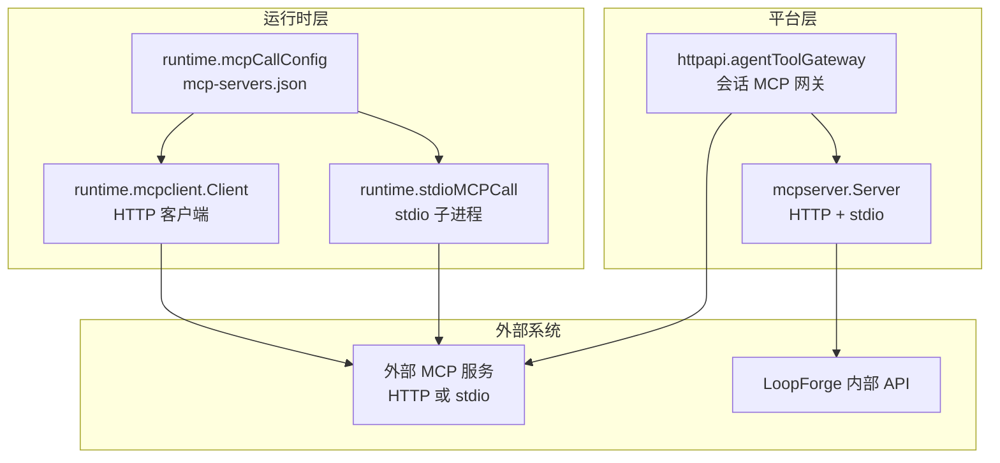
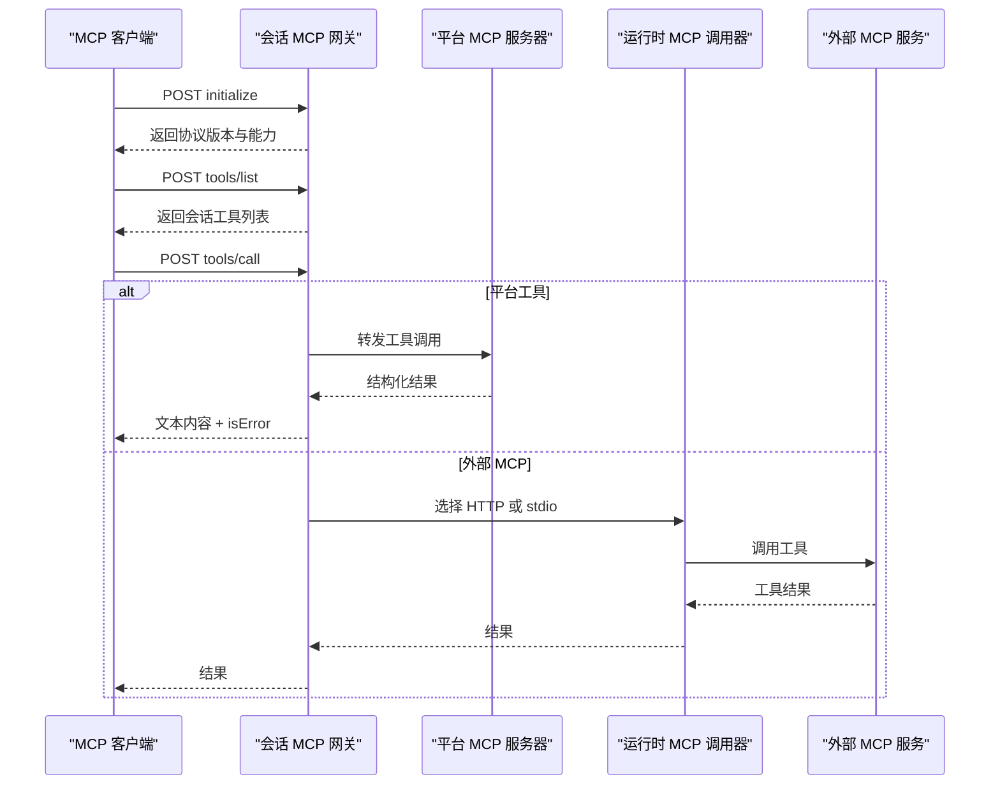
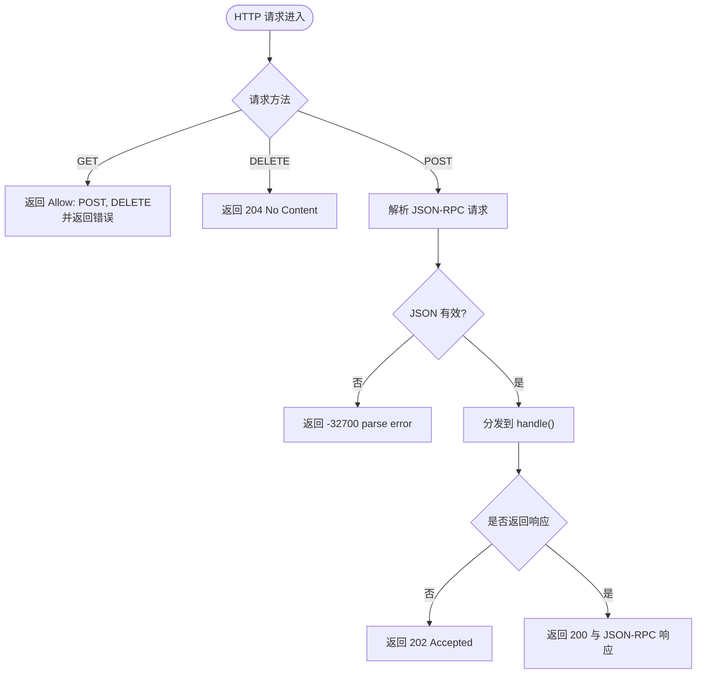
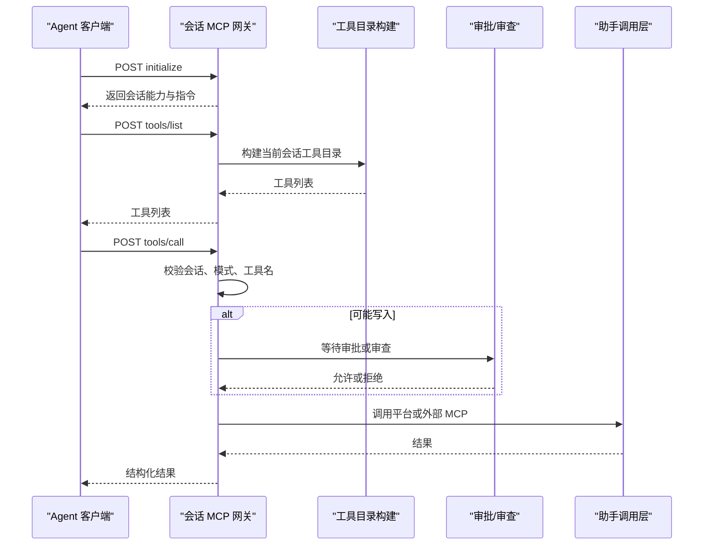
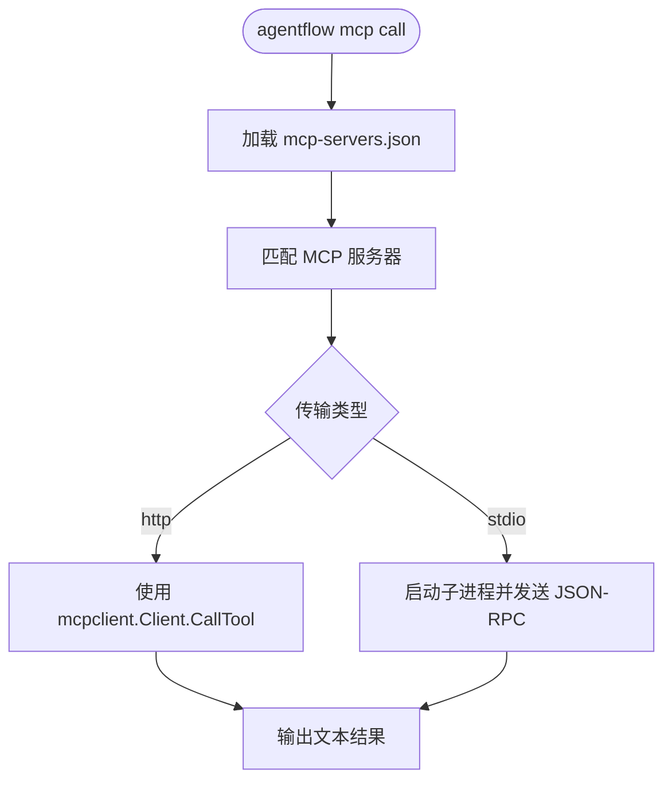
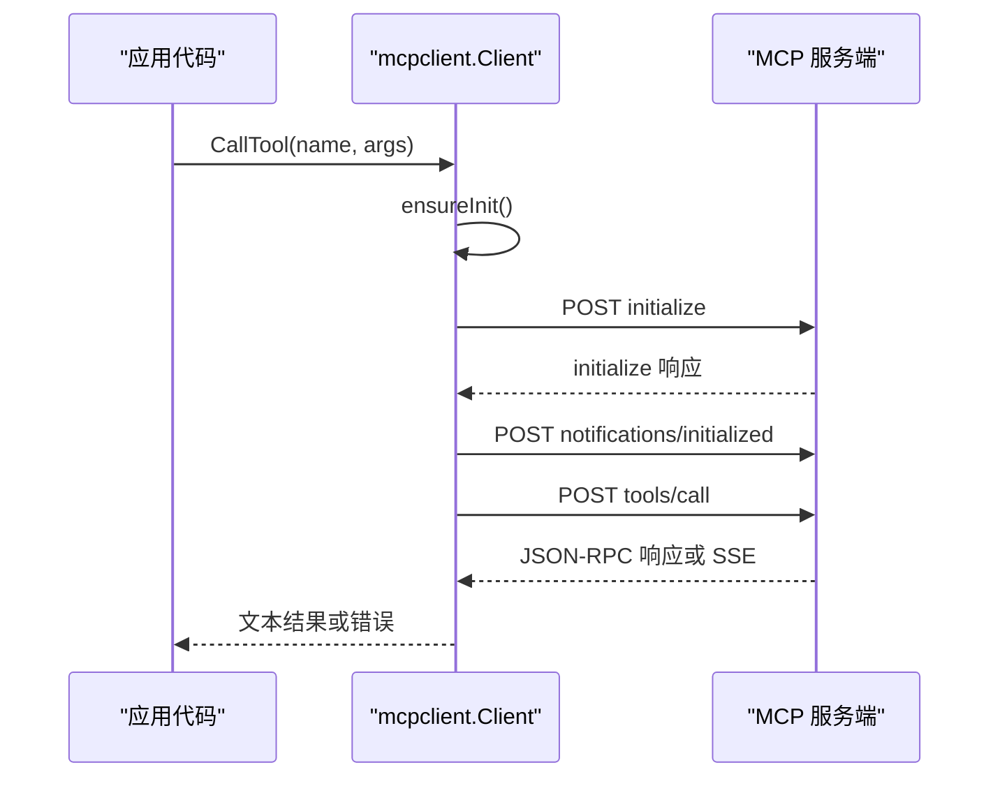
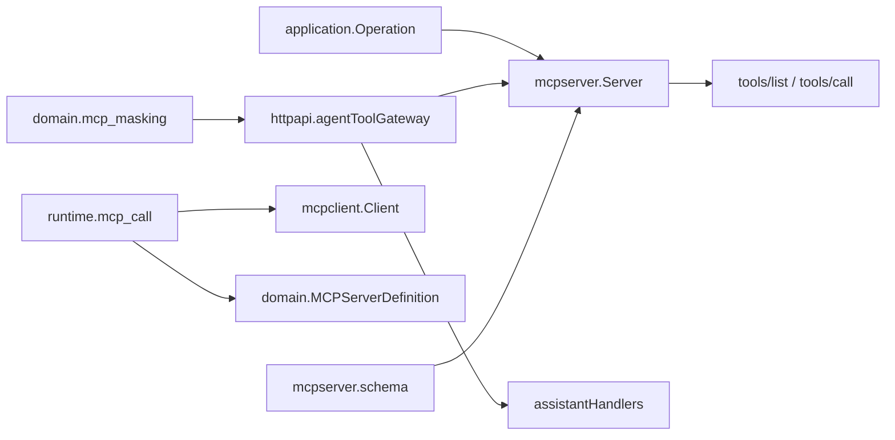
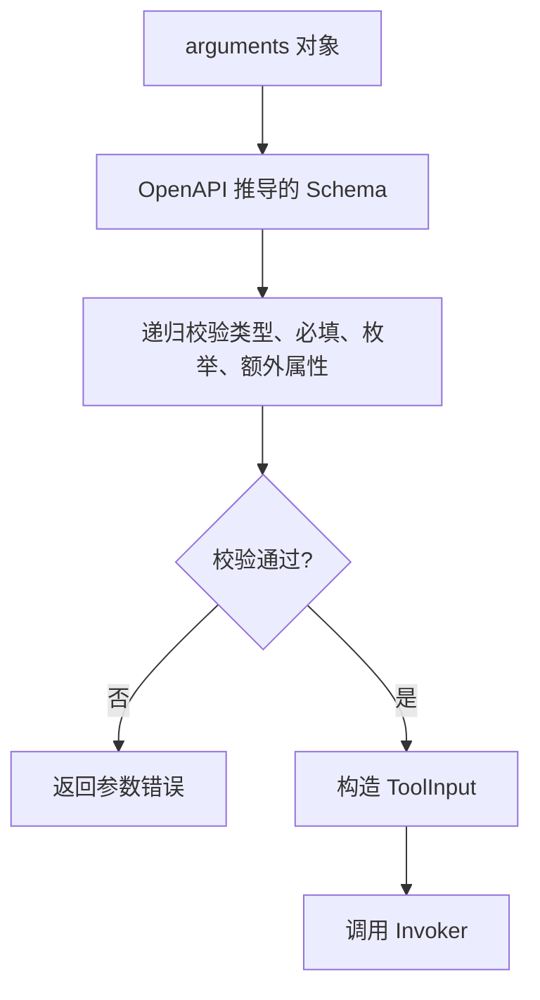
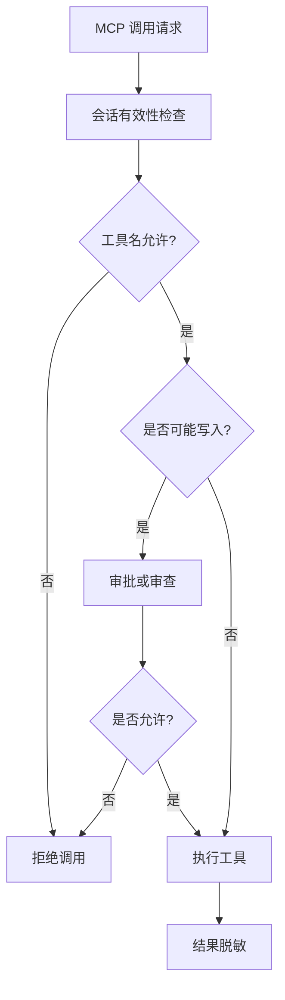

# MCP 接口

<cite>
**本文引用的文件**   
- [internal/mcpserver/server.go](file://internal/mcpserver/server.go)
- [internal/mcpserver/schema.go](file://internal/mcpserver/schema.go)
- [internal/mcpclient/client.go](file://internal/mcpclient/client.go)
- [internal/httpapi/agent_tool_mcp.go](file://internal/httpapi/agent_tool_mcp.go)
- [internal/runtime/mcp_call.go](file://internal/runtime/mcp_call.go)
- [internal/domain/mcp_masking.go](file://internal/domain/mcp_masking.go)
</cite>

## 目录
1. [简介](#简介)
2. [项目结构](#项目结构)
3. [核心组件](#核心组件)
4. [架构总览](#架构总览)
5. [详细组件分析](#详细组件分析)
6. [依赖关系分析](#依赖关系分析)
7. [性能与资源限制](#性能与资源限制)
8. [工具定义、参数验证与错误处理](#工具定义参数验证与错误处理)
9. [安全性考虑](#安全性考虑)
10. [客户端集成示例](#客户端集成示例)
11. [调试技巧](#调试技巧)
12. [结论](#结论)

## 简介
本文件系统化文档化 LoopForge 中的 MCP（Model Context Protocol）实现，覆盖以下目标：
- MCP 服务器的连接建立、工具注册、方法调用等核心协议。
- HTTP 传输与 stdio 传输的实现方式。
- 工具定义来源、参数校验、错误处理和安全性策略。
- MCP 客户端集成方式和调试建议。

LoopForge 的 MCP 能力由三层组成：
- 平台侧 MCP 服务器：将内部业务操作暴露为 MCP 工具。
- 会话侧 MCP 网关：为 Agent 会话提供受限、可审计的工具路由。
- 运行时 MCP 调用器：在脚本、门禁或 Hook 中通过 `agentflow mcp` 调用外部 MCP 服务。

## 项目结构
MCP 相关代码主要分布在以下包：
- `internal/mcpserver`：平台 MCP 服务器实现，包含 HTTP 和 stdio 两种传输。
- `internal/mcpclient`：Streamable HTTP MCP 客户端，用于脚本侧调用远程 MCP。
- `internal/httpapi`：Agent 会话 MCP 网关，负责鉴权、权限控制、审批和遥测。
- `internal/runtime`：运行时 MCP 配置生成、stdio 子进程通信和 `agentflow mcp` CLI。
- `internal/domain`：MCP 凭据脱敏与敏感字段恢复。

**图表来源**
- [internal/mcpserver/server.go:179-248](file://internal/mcpserver/server.go#L179-L248)
- [internal/httpapi/agent_tool_mcp.go:58-143](file://internal/httpapi/agent_tool_mcp.go#L58-L143)
- [internal/runtime/mcp_call.go:58-105](file://internal/runtime/mcp_call.go#L58-L105)
- [internal/runtime/mcp_call.go:551-647](file://internal/runtime/mcp_call.go#L551-L647)
- [internal/mcpclient/client.go:16-33](file://internal/mcpclient/client.go#L16-L33)

**章节来源**
- [internal/mcpserver/server.go:179-248](file://internal/mcpserver/server.go#L179-L248)
- [internal/httpapi/agent_tool_mcp.go:58-143](file://internal/httpapi/agent_tool_mcp.go#L58-L143)
- [internal/runtime/mcp_call.go:58-105](file://internal/runtime/mcp_call.go#L58-L105)
- [internal/mcpclient/client.go:16-33](file://internal/mcpclient/client.go#L16-L33)

## 核心组件
- **平台 MCP 服务器**：实现 JSON-RPC 2.0 的 `initialize`、`ping`、`tools/list`、`tools/call`、`resources/list`、`resources/templates/list`、`resources/read`，并提供 HTTP Streamable 端点和 stdio 流式处理器。
- **会话 MCP 网关**：基于 token 的会话隔离，支持 `initialize`、`ping`、`tools/list`、`tools/call`、`notifications/cancelled`，并对写入类 MCP 调用进行审批或审查。
- **运行时 MCP 调用器**：生成 `mcp-servers.json`，支持 HTTP 和 stdio 两种传输；提供 `agentflow mcp call/tools/list` 命令行。
- **MCP 客户端**：轻量 HTTP 客户端，自动完成 `initialize`、发送 `notifications/initialized`，并解析 SSE 或普通 JSON 响应。
- **参数校验与工具定义**：从 OpenAPI 契约推导 MCP 工具的输入 Schema，并在调用前严格校验。
- **凭据脱敏**：对外暴露 MCP 服务器配置时隐藏敏感值，编辑时恢复掩码占位。

**章节来源**
- [internal/mcpserver/server.go:270-308](file://internal/mcpserver/server.go#L270-L308)
- [internal/httpapi/agent_tool_mcp.go:94-143](file://internal/httpapi/agent_tool_mcp.go#L94-L143)
- [internal/runtime/mcp_call.go:382-471](file://internal/runtime/mcp_call.go#L382-L471)
- [internal/mcpclient/client.go:97-192](file://internal/mcpclient/client.go#L97-L192)
- [internal/mcpserver/schema.go:47-91](file://internal/mcpserver/schema.go#L47-L91)
- [internal/domain/mcp_masking.go:14-35](file://internal/domain/mcp_masking.go#L14-L35)

## 架构总览
LoopForge 的 MCP 架构分为三类参与者：
1. **平台 MCP 服务器**：把 `application.Operation` 映射为 MCP 工具，并通过 HTTP 或 stdio 暴露。
2. **会话 MCP 网关**：为 Agent 会话提供受限工具目录，拦截写操作，必要时进入审批流程。
3. **运行时 MCP 调用器**：在沙箱或本地环境中启动外部 MCP 子进程，或通过 HTTP 调用外部 MCP。

**图表来源**
- [internal/httpapi/agent_tool_mcp.go:94-143](file://internal/httpapi/agent_tool_mcp.go#L94-L143)
- [internal/mcpserver/server.go:270-308](file://internal/mcpserver/server.go#L270-L308)
- [internal/runtime/mcp_call.go:427-471](file://internal/runtime/mcp_call.go#L427-L471)
- [internal/mcpclient/client.go:97-192](file://internal/mcpclient/client.go#L97-L192)

## 详细组件分析

### 平台 MCP 服务器
平台 MCP 服务器是 LoopForge 内部业务操作的 MCP 门面。它：
- 维护一个由 `application.PublicOperations()` 生成的工具目录。
- 将每个 Operation 转换为 MCP 工具描述，包括名称、描述、输入 Schema 和注解。
- 支持 HTTP Streamable 和 stdio 两种传输。
- 支持 `resources/read`，将 `agentflow://runs/{runId}/artifacts/{artifactId}` 和 `agentflow://runs/{runId}/logs` 映射到内部 API。

#### HTTP 传输
- 仅接受 `POST` 和 `DELETE`。
- `GET` 返回允许的方法提示。
- `DELETE` 表示取消长连接。
- 请求体使用 JSON-RPC 2.0，最大读取 4MB。
- 成功响应设置 `MCP-Protocol-Version` 头。
- 未处理的 notification 返回 `202 Accepted`。

#### stdio 传输
- 逐行读取 JSON-RPC 消息。
- 解析失败时返回 JSON-RPC parse error。
- 支持上下文取消。
- 提供 `ServeRemoteStdio`，从环境变量读取远端 LoopForge API 地址和认证信息。

**图表来源**
- [internal/mcpserver/server.go:179-209](file://internal/mcpserver/server.go#L179-L209)
- [internal/mcpserver/server.go:212-239](file://internal/mcpserver/server.go#L212-L239)

**章节来源**
- [internal/mcpserver/server.go:179-248](file://internal/mcpserver/server.go#L179-L248)
- [internal/mcpserver/server.go:270-308](file://internal/mcpserver/server.go#L270-L308)
- [internal/mcpserver/server.go:418-455](file://internal/mcpserver/server.go#L418-L455)

### 会话 MCP 网关
会话 MCP 网关运行在 Agent 会话上下文中，负责：
- 基于 token 的会话查找与失效检查。
- 支持 `initialize`、`ping`、`tools/list`、`tools/call`、`notifications/cancelled`。
- 根据会话模式决定工具目录和权限。
- 对可能写入外部系统的 MCP 调用进行审批或审查。
- 记录诊断事件，包括工具调用耗时、失败原因和用户信息。

**图表来源**
- [internal/httpapi/agent_tool_mcp.go:62-92](file://internal/httpapi/agent_tool_mcp.go#L62-L92)
- [internal/httpapi/agent_tool_mcp.go:94-143](file://internal/httpapi/agent_tool_mcp.go#L94-L143)
- [internal/httpapi/agent_tool_mcp.go:193-312](file://internal/httpapi/agent_tool_mcp.go#L193-L312)
- [internal/httpapi/agent_tool_mcp.go:361-481](file://internal/httpapi/agent_tool_mcp.go#L361-L481)

**章节来源**
- [internal/httpapi/agent_tool_mcp.go:58-143](file://internal/httpapi/agent_tool_mcp.go#L58-L143)
- [internal/httpapi/agent_tool_mcp.go:193-312](file://internal/httpapi/agent_tool_mcp.go#L193-L312)
- [internal/httpapi/agent_tool_mcp.go:361-481](file://internal/httpapi/agent_tool_mcp.go#L361-L481)

### 运行时 MCP 调用器
运行时 MCP 调用器负责在脚本、门禁或 Hook 中调用 MCP：
- 生成 `mcp-servers.json`，包含已绑定 MCP 服务器。
- 支持 HTTP 和 stdio 两种传输。
- 提供 `agentflow mcp call`、`agentflow mcp tools`、`agentflow mcp list`。
- stdio 模式下启动外部命令，执行 JSON-RPC 初始化、通知和工具调用。
- HTTP 模式下复用 `mcpclient.Client`。

**图表来源**
- [internal/runtime/mcp_call.go:58-105](file://internal/runtime/mcp_call.go#L58-L105)
- [internal/runtime/mcp_call.go:382-471](file://internal/runtime/mcp_call.go#L382-L471)
- [internal/runtime/mcp_call.go:551-647](file://internal/runtime/mcp_call.go#L551-L647)

**章节来源**
- [internal/runtime/mcp_call.go:58-105](file://internal/runtime/mcp_call.go#L58-L105)
- [internal/runtime/mcp_call.go:382-471](file://internal/runtime/mcp_call.go#L382-L471)
- [internal/runtime/mcp_call.go:551-647](file://internal/runtime/mcp_call.go#L551-L647)

### MCP 客户端
`mcpclient.Client` 是一个最小化的 Streamable HTTP MCP 客户端：
- 自动发起 `initialize`，并发送 `notifications/initialized`。
- 支持 `ListTools` 和 `CallTool`。
- 支持自定义 HTTP 超时、Header 克隆和 Clone。
- 支持 SSE 响应，按 `data:` 行拼接 JSON-RPC 响应。
- 将 MCP 工具结果中的 text 块合并为字符串。

**图表来源**
- [internal/mcpclient/client.go:97-192](file://internal/mcpclient/client.go#L97-L192)
- [internal/mcpclient/client.go:267-349](file://internal/mcpclient/client.go#L267-L349)
- [internal/mcpclient/client.go:351-389](file://internal/mcpclient/client.go#L351-L389)

**章节来源**
- [internal/mcpclient/client.go:16-33](file://internal/mcpclient/client.go#L16-L33)
- [internal/mcpclient/client.go:97-192](file://internal/mcpclient/client.go#L97-L192)
- [internal/mcpclient/client.go:267-389](file://internal/mcpclient/client.go#L267-L389)

## 依赖关系分析
- `mcpserver.Server` 依赖 `application.Operation` 作为工具元数据。
- `httpapi.agentToolGateway` 依赖 `assistantHandlers` 和会话状态，负责权限、审批和诊断。
- `runtime.mcp_call` 依赖 `domain.MCPServerDefinition`、`mcpclient.Client` 和操作系统进程管理。
- `mcpserver.schema` 依赖 OpenAPI 文档生成工具输入 Schema。
- `domain.mcp_masking` 被 MCP 服务器配置公开逻辑使用，避免泄露凭据。

**图表来源**
- [internal/mcpserver/server.go:171-177](file://internal/mcpserver/server.go#L171-L177)
- [internal/httpapi/agent_tool_mcp.go:502-504](file://internal/httpapi/agent_tool_mcp.go#L502-L504)
- [internal/runtime/mcp_call.go:58-105](file://internal/runtime/mcp_call.go#L58-L105)
- [internal/mcpserver/schema.go:47-91](file://internal/mcpserver/schema.go#L47-L91)
- [internal/domain/mcp_masking.go:14-35](file://internal/domain/mcp_masking.go#L14-L35)

**章节来源**
- [internal/mcpserver/server.go:171-177](file://internal/mcpserver/server.go#L171-L177)
- [internal/httpapi/agent_tool_mcp.go:502-504](file://internal/httpapi/agent_tool_mcp.go#L502-L504)
- [internal/runtime/mcp_call.go:58-105](file://internal/runtime/mcp_call.go#L58-L105)
- [internal/mcpserver/schema.go:47-91](file://internal/mcpserver/schema.go#L47-L91)
- [internal/domain/mcp_masking.go:14-35](file://internal/domain/mcp_masking.go#L14-L35)

## 性能与资源限制
- HTTP 请求体限制为 4MB。
- stdio 扫描缓冲区默认 64KB，最大 4MB。
- 远端 HTTP 响应体限制为 32MB。
- 客户端默认 HTTP 超时为 60 秒，可通过 `WithTimeout` 调整。
- stdio MCP 调用默认超时为 60 秒，可通过 `timeoutSec` 配置。
- SSE 响应读取限制为 4MB，避免无限流占用内存。

这些限制适合 MCP 工具调用的典型负载，但大文件、大量日志或超长 JSON 需要谨慎处理。

**章节来源**
- [internal/mcpserver/server.go:196-197](file://internal/mcpserver/server.go#L196-L197)
- [internal/mcpserver/server.go:213-214](file://internal/mcpserver/server.go#L213-L214)
- [internal/mcpserver/server.go:159-160](file://internal/mcpserver/server.go#L159-L160)
- [internal/mcpclient/client.go:31-32](file://internal/mcpclient/client.go#L31-L32)
- [internal/mcpclient/client.go:361-362](file://internal/mcpclient/client.go#L361-L362)
- [internal/runtime/mcp_call.go:601-604](file://internal/runtime/mcp_call.go#L601-L604)

## 工具定义、参数验证与错误处理

### 工具定义来源
平台 MCP 工具来自 `application.PublicOperations()`，每个 Operation 对应一个内部 HTTP 操作。工具描述包含：
- 名称。
- 描述，附加 HTTP 方法与路径。
- 输入 Schema，由 OpenAPI 契约推导。
- 注解，包括只读、破坏性、幂等提示。

**章节来源**
- [internal/mcpserver/server.go:171-177](file://internal/mcpserver/server.go#L171-L177)
- [internal/mcpserver/server.go:323-344](file://internal/mcpserver/server.go#L323-L344)

### 参数验证
参数验证基于 OpenAPI 契约：
- 路径参数必须存在且非空。
- 查询参数可从 OpenAPI 参数定义推导。
- 请求体从 `application/json` schema 推导。
- 支持 `allOf`、`anyOf`、`oneOf`、数组、枚举、整数、数字、布尔值。
- 禁止未声明的额外属性。

**图表来源**
- [internal/mcpserver/schema.go:47-91](file://internal/mcpserver/schema.go#L47-L91)
- [internal/mcpserver/schema.go:145-260](file://internal/mcpserver/schema.go#L145-L260)
- [internal/mcpserver/server.go:346-380](file://internal/mcpserver/server.go#L346-L380)

**章节来源**
- [internal/mcpserver/schema.go:47-91](file://internal/mcpserver/schema.go#L47-L91)
- [internal/mcpserver/schema.go:145-260](file://internal/mcpserver/schema.go#L145-L260)
- [internal/mcpserver/server.go:346-380](file://internal/mcpserver/server.go#L346-L380)

### 错误处理
MCP 层错误分为两类：
1. **JSON-RPC 层错误**：如 parse error、method not found、invalid tool call。
2. **工具层错误**：如参数无效、未知工具、Invoker 调用失败、HTTP 非 2xx。

工具调用结果统一封装为：
- `content`：文本块列表。
- `isError`：根据 HTTP 状态码或显式错误标记。
- `structuredContent`：若响应可解析为 JSON，则附带原始结构化数据。

**章节来源**
- [internal/mcpserver/server.go:270-308](file://internal/mcpserver/server.go#L270-L308)
- [internal/mcpserver/server.go:382-409](file://internal/mcpserver/server.go#L382-L409)
- [internal/httpapi/agent_tool_mcp.go:94-143](file://internal/httpapi/agent_tool_mcp.go#L94-L143)

## 安全性考虑
LoopForge 的 MCP 安全模型包含多层防护：

### 会话隔离
- 会话 MCP 网关通过 token 查找会话。
- 会话过期或关闭后拒绝调用。
- 非 `tools/call` 方法会加锁读取工具目录，避免并发修改。

### 工具白名单
- 会话工具目录由当前会话模式决定。
- 某些模式只允许只读 MCP。
- 外部 MCP 工具名需通过允许规则检查。

### 写入审批
- 可能写入的 MCP 调用会被识别。
- 非自动写入模式需要人工审批。
- 审查模式下会触发助手动作审查。

### 凭据脱敏
- 公开 MCP 服务器配置时，对 Header 和敏感环境变量值进行掩码。
- 编辑时恢复掩码占位，避免误删旧凭据。

**图表来源**
- [internal/httpapi/agent_tool_mcp.go:62-92](file://internal/httpapi/agent_tool_mcp.go#L62-L92)
- [internal/httpapi/agent_tool_mcp.go:193-312](file://internal/httpapi/agent_tool_mcp.go#L193-L312)
- [internal/httpapi/agent_tool_mcp.go:443-466](file://internal/httpapi/agent_tool_mcp.go#L443-L466)
- [internal/domain/mcp_masking.go:14-35](file://internal/domain/mcp_masking.go#L14-L35)

**章节来源**
- [internal/httpapi/agent_tool_mcp.go:62-92](file://internal/httpapi/agent_tool_mcp.go#L62-L92)
- [internal/httpapi/agent_tool_mcp.go:193-312](file://internal/httpapi/agent_tool_mcp.go#L193-L312)
- [internal/httpapi/agent_tool_mcp.go:443-466](file://internal/httpapi/agent_tool_mcp.go#L443-L466)
- [internal/domain/mcp_masking.go:14-35](file://internal/domain/mcp_masking.go#L14-L35)

## 客户端集成示例

### 使用 Go 客户端调用 MCP
适用于需要在 Go 应用中直接调用 MCP 的场景：
1. 创建客户端，传入 MCP 网关 URL 和请求头。
2. 首次调用会自动执行 `initialize`。
3. 调用 `ListTools` 获取工具列表。
4. 调用 `CallTool` 执行工具。
5. 处理返回的文本内容和错误。

参考路径：
- 客户端初始化与超时：[internal/mcpclient/client.go:27-33](file://internal/mcpclient/client.go#L27-L33)
- 工具调用流程：[internal/mcpclient/client.go:97-192](file://internal/mcpclient/client.go#L97-L192)
- 工具列表获取：[internal/mcpclient/client.go:202-265](file://internal/mcpclient/client.go#L202-L265)
- 初始化与通知：[internal/mcpclient/client.go:267-349](file://internal/mcpclient/client.go#L267-L349)

### 在脚本中使用 `agentflow mcp`
适用于 SOP 脚本、门禁或 Hook：
1. 确保环境注入 `AGENTFLOW_MCP_CONFIG` 和 `AGENTFLOW_BIN`。
2. 使用 `agentflow mcp list` 查看可用 MCP。
3. 使用 `agentflow mcp tools <server>` 查看工具名。
4. 使用 `agentflow mcp call <server> <tool> <json-args>` 调用工具。

参考路径：
- 环境变量注入：[internal/runtime/mcp_call.go:101-104](file://internal/runtime/mcp_call.go#L101-L104)
- CLI 入口：[internal/runtime/mcp_call.go:382-420](file://internal/runtime/mcp_call.go#L382-L420)
- 工具调用：[internal/runtime/mcp_call.go:427-471](file://internal/runtime/mcp_call.go#L427-L471)
- 工具列表：[internal/runtime/mcp_call.go:500-540](file://internal/runtime/mcp_call.go#L500-L540)

### 在浏览器或前端集成
前端不直接实现 MCP 协议，而是通过 LoopForge 提供的 MCP 管理界面：
- 添加自定义 MCP 服务器。
- 选择传输类型为 HTTP 或 stdio。
- 配置 URL、命令、Headers、环境变量和超时。
- 保存后供 Agent 会话使用。

参考路径：
- 前端 MCP 表单交互：[web/app.js:1195-1212](file://web/app.js#L1195-L1212)
- 保存自定义 MCP：[web/app/mcp.js:172-179](file://web/app/mcp.js#L172-L179)

**章节来源**
- [internal/mcpclient/client.go:27-33](file://internal/mcpclient/client.go#L27-L33)
- [internal/mcpclient/client.go:97-192](file://internal/mcpclient/client.go#L97-L192)
- [internal/mcpclient/client.go:202-265](file://internal/mcpclient/client.go#L202-L265)
- [internal/mcpclient/client.go:267-349](file://internal/mcpclient/client.go#L267-L349)
- [internal/runtime/mcp_call.go:101-104](file://internal/runtime/mcp_call.go#L101-L104)
- [internal/runtime/mcp_call.go:382-420](file://internal/runtime/mcp_call.go#L382-L420)
- [internal/runtime/mcp_call.go:427-471](file://internal/runtime/mcp_call.go#L427-L471)
- [internal/runtime/mcp_call.go:500-540](file://internal/runtime/mcp_call.go#L500-L540)
- [web/app.js:1195-1212](file://web/app.js#L1195-L1212)
- [web/app/mcp.js:172-179](file://web/app/mcp.js#L172-L179)

## 调试技巧

### 调试平台 MCP 服务器
- 检查 HTTP 请求方法是否为 `POST`。
- 检查 JSON-RPC 请求体是否合法。
- 检查 `initialize` 是否返回协议版本和能力。
- 检查 `tools/list` 是否返回预期工具。
- 检查 `tools/call` 的参数是否符合 OpenAPI 推导的 Schema。

参考路径：
- HTTP 处理器：[internal/mcpserver/server.go:179-209](file://internal/mcpserver/server.go#L179-L209)
- 方法分发：[internal/mcpserver/server.go:270-308](file://internal/mcpserver/server.go#L270-L308)
- 工具调用：[internal/mcpserver/server.go:346-380](file://internal/mcpserver/server.go#L346-L380)

### 调试会话 MCP 网关
- 确认 token 有效且会话未关闭。
- 检查工具名是否在会话工具目录中。
- 检查是否触发了写入审批。
- 查看诊断事件中的工具调用耗时和错误信息。

参考路径：
- 会话校验：[internal/httpapi/agent_tool_mcp.go:62-92](file://internal/httpapi/agent_tool_mcp.go#L62-L92)
- 工具调用入口：[internal/httpapi/agent_tool_mcp.go:193-312](file://internal/httpapi/agent_tool_mcp.go#L193-L312)
- 写入判断：[internal/httpapi/agent_tool_mcp.go:527-547](file://internal/httpapi/agent_tool_mcp.go#L527-L547)

### 调试运行时 MCP 调用
- 检查 `AGENTFLOW_MCP_CONFIG` 是否存在。
- 检查 `mcp-servers.json` 是否包含目标 MCP。
- 检查 HTTP 传输的 URL 和 Headers。
- 检查 stdio 传输的命令是否可执行。
- 检查子进程 stderr 输出。

参考路径：
- 配置加载：[internal/runtime/mcp_call.go:320-334](file://internal/runtime/mcp_call.go#L320-L334)
- HTTP 调用：[internal/runtime/mcp_call.go:458-466](file://internal/runtime/mcp_call.go#L458-L466)
- stdio 调用：[internal/runtime/mcp_call.go:600-647](file://internal/runtime/mcp_call.go#L600-L647)

### 调试 MCP 客户端
- 检查 `initialize` 是否成功。
- 检查 `notifications/initialized` 是否发送。
- 检查 SSE 响应是否正确拼接。
- 检查错误消息是否包含工具名和 JSON-RPC 错误码。

参考路径：
- 初始化流程：[internal/mcpclient/client.go:267-349](file://internal/mcpclient/client.go#L267-L349)
- SSE 读取：[internal/mcpclient/client.go:351-389](file://internal/mcpclient/client.go#L351-L389)
- 工具调用错误：[internal/mcpclient/client.go:141-192](file://internal/mcpclient/client.go#L141-L192)

**章节来源**
- [internal/mcpserver/server.go:179-209](file://internal/mcpserver/server.go#L179-L209)
- [internal/mcpserver/server.go:270-308](file://internal/mcpserver/server.go#L270-L308)
- [internal/mcpserver/server.go:346-380](file://internal/mcpserver/server.go#L346-L380)
- [internal/httpapi/agent_tool_mcp.go:62-92](file://internal/httpapi/agent_tool_mcp.go#L62-L92)
- [internal/httpapi/agent_tool_mcp.go:193-312](file://internal/httpapi/agent_tool_mcp.go#L193-L312)
- [internal/httpapi/agent_tool_mcp.go:527-547](file://internal/httpapi/agent_tool_mcp.go#L527-L547)
- [internal/runtime/mcp_call.go:320-334](file://internal/runtime/mcp_call.go#L320-L334)
- [internal/runtime/mcp_call.go:458-466](file://internal/runtime/mcp_call.go#L458-L466)
- [internal/runtime/mcp_call.go:600-647](file://internal/runtime/mcp_call.go#L600-L647)
- [internal/mcpclient/client.go:267-349](file://internal/mcpclient/client.go#L267-L349)
- [internal/mcpclient/client.go:351-389](file://internal/mcpclient/client.go#L351-L389)
- [internal/mcpclient/client.go:141-192](file://internal/mcpclient/client.go#L141-L192)

## 结论
LoopForge 的 MCP 实现以“平台 MCP 服务器 + 会话 MCP 网关 + 运行时 MCP 调用器”为核心，既支持 HTTP Streamable 也支持 stdio 传输。工具定义来源于内部 OpenAPI 契约，参数校验严格，错误处理分层清晰。安全性方面，通过会话隔离、工具白名单、写入审批和凭据脱敏形成多重防护。对于集成方，Go 客户端适合程序化调用，`agentflow mcp` 适合脚本和自动化场景，前端则通过 MCP 管理界面完成配置。