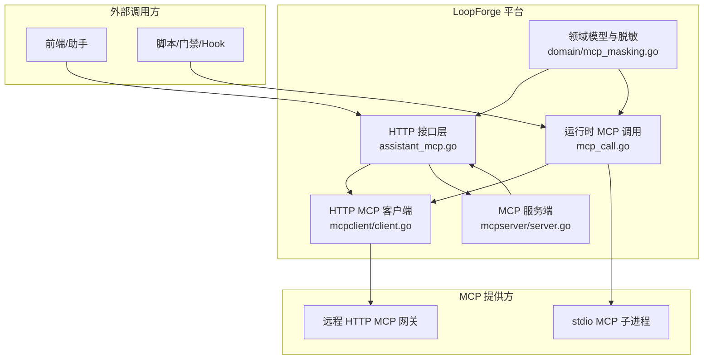
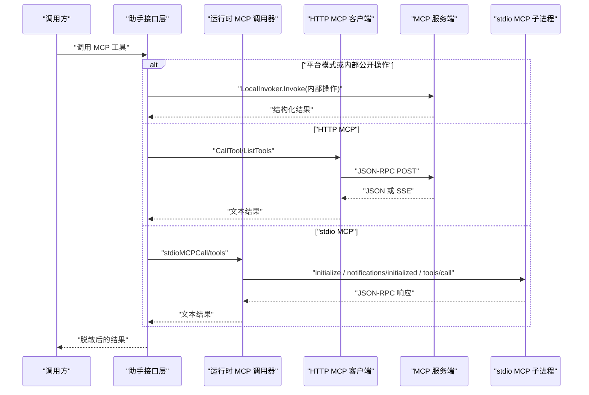
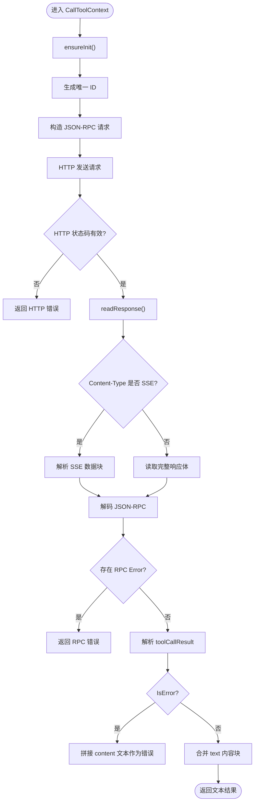
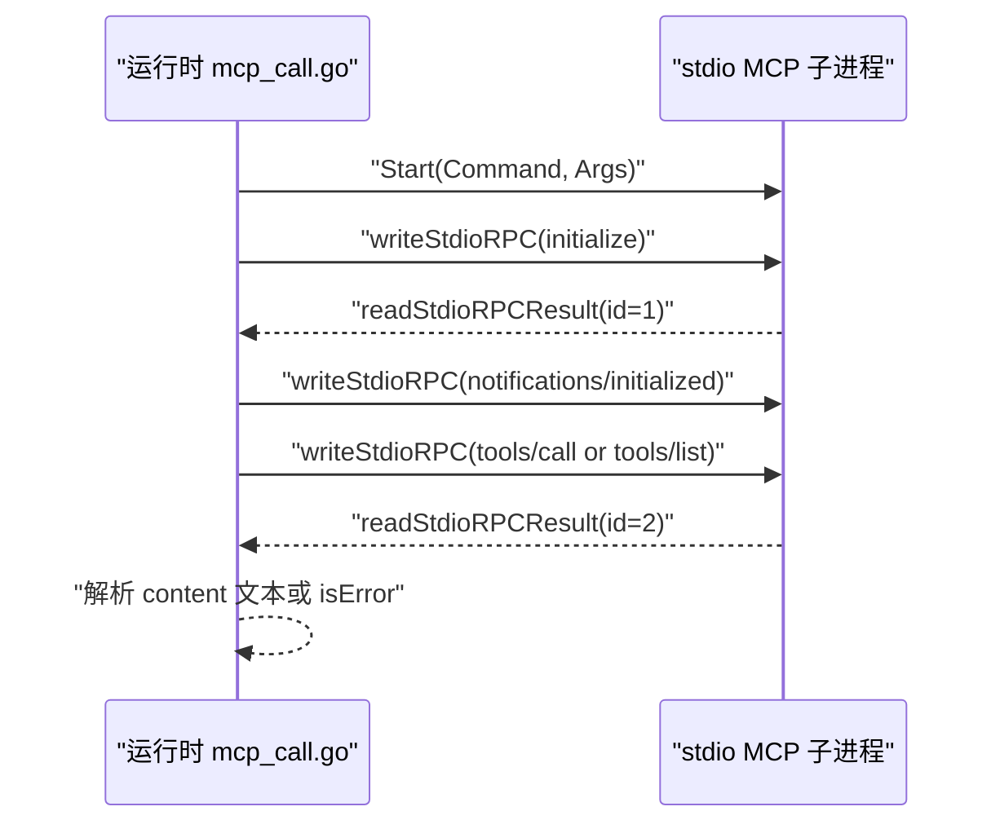
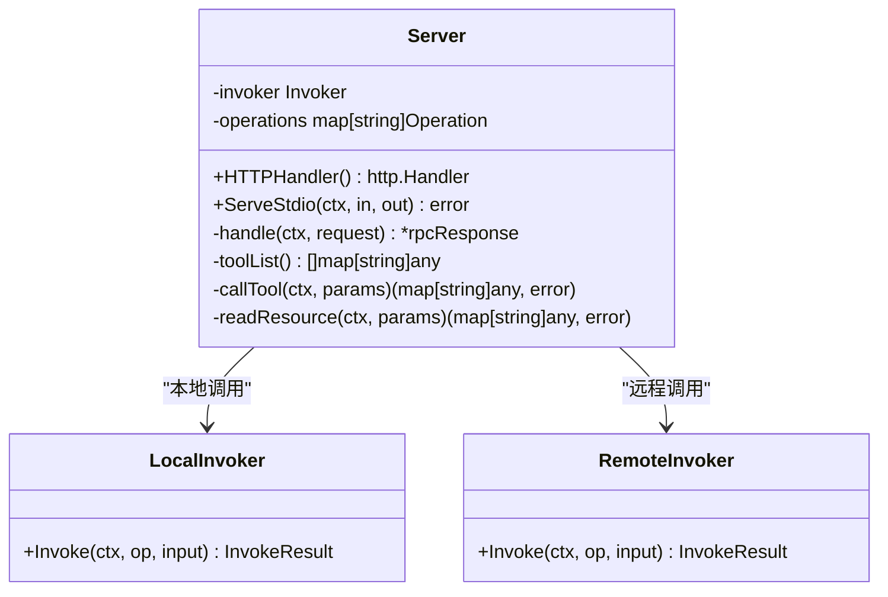
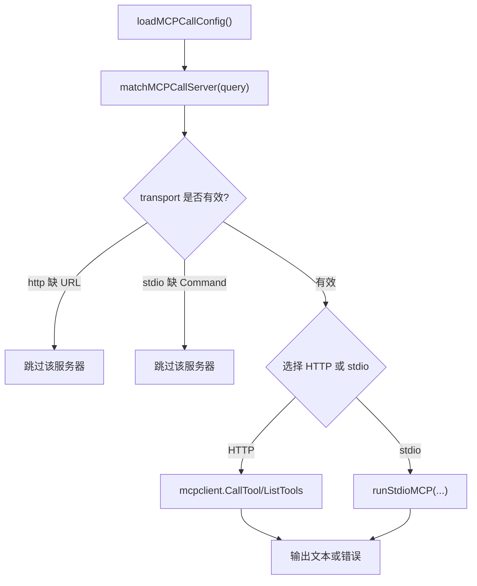
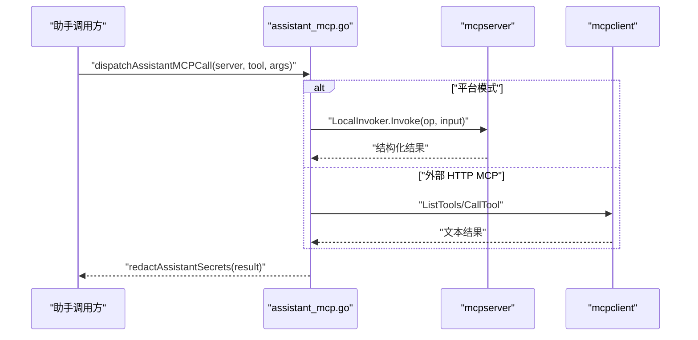
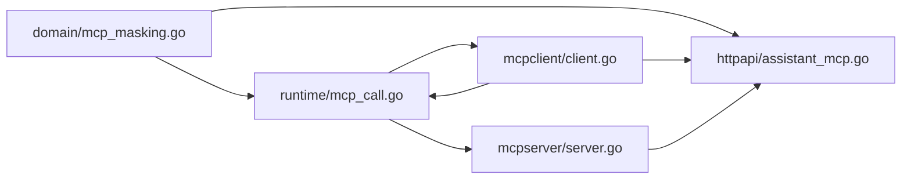

# 传输层实现

<cite>
**本文引用的文件**   
- [internal/mcpclient/client.go](file://internal/mcpclient/client.go)
- [internal/mcpserver/server.go](file://internal/mcpserver/server.go)
- [internal/runtime/mcp_call.go](file://internal/runtime/mcp_call.go)
- [internal/httpapi/assistant_mcp.go](file://internal/httpapi/assistant_mcp.go)
- [internal/domain/mcp_masking.go](file://internal/domain/mcp_masking.go)
- [internal/domain/mcp_test.go](file://internal/domain/mcp_test.go)
- [internal/runtime/mcp_call_stdio_rpc_test.go](file://internal/runtime/mcp_call_stdio_rpc_test.go)
- [internal/runtime/mcp_call_config_servers_test.go](file://internal/runtime/mcp_call_config_servers_test.go)
</cite>

## 目录
1. [引言](#引言)
2. [项目结构](#项目结构)
3. [核心组件](#核心组件)
4. [架构总览](#架构总览)
5. [详细组件分析](#详细组件分析)
6. [依赖关系分析](#依赖关系分析)
7. [性能与超时](#性能与超时)
8. [监控、日志与可观测性](#监控日志与可观测性)
9. [故障排除指南](#故障排除指南)
10. [集成最佳实践](#集成最佳实践)
11. [结论](#结论)

## 引言
本文聚焦 LoopForge 中 MCP（Model Context Protocol）传输层的实现，重点说明 HTTP 传输与 stdio 传输两种方式的架构、连接管理、消息路由、序列化/反序列化、超时处理、错误处理策略，以及配置选项、性能优化和故障排除方法。文档同时覆盖客户端与服务端在工具调用、工具列表、初始化流程中的交互路径，并给出面向集成者的代码级参考路径和最佳实践。

## 项目结构
MCP 传输相关代码分布在以下模块：
- `internal/mcpclient`：HTTP Streamable MCP 客户端，负责 JSON-RPC 请求构造、SSE 响应解析、初始化握手与工具调用。
- `internal/mcpserver`：MCP 服务端，提供 HTTP Handler 与 stdio 服务，将 MCP 工具映射到平台内部操作或远程 API。
- `internal/runtime`：运行时脚本侧的 MCP 调用入口，负责加载配置、启动子进程 stdio MCP、执行 HTTP MCP 调用、参数绑定与别名匹配。
- `internal/httpapi`：助手接口层，对外暴露 MCP 调用能力，并在“平台模式”下直接调用内部公开操作。
- `internal/domain`：MCP 定义、校验与敏感信息脱敏逻辑。

**图示来源**
- [internal/httpapi/assistant_mcp.go:73-90](file://internal/httpapi/assistant_mcp.go#L73-L90)
- [internal/runtime/mcp_call.go:382-472](file://internal/runtime/mcp_call.go#L382-L472)
- [internal/mcpclient/client.go:97-192](file://internal/mcpclient/client.go#L97-L192)
- [internal/mcpserver/server.go:179-239](file://internal/mcpserver/server.go#L179-L239)
- [internal/domain/mcp_masking.go:14-49](file://internal/domain/mcp_masking.go#L14-L49)

**章节来源**
- [internal/httpapi/assistant_mcp.go:1-17](file://internal/httpapi/assistant_mcp.go#L1-L17)
- [internal/runtime/mcp_call.go:1-25](file://internal/runtime/mcp_call.go#L1-L25)
- [internal/mcpclient/client.go:1-14](file://internal/mcpclient/client.go#L1-L14)
- [internal/mcpserver/server.go:1-19](file://internal/mcpserver/server.go#L1-L19)
- [internal/domain/mcp_masking.go:1-12](file://internal/domain/mcp_masking.go#L1-L12)

## 核心组件
- **HTTP MCP 客户端**：封装 JSON-RPC 2.0 请求、自动初始化握手、SSE 流式响应解析、工具调用与工具列表查询。支持动态设置请求头、克隆客户端并设置超时。
- **MCP 服务端**：实现 Streamable HTTP 与 stdio 两种接入方式；将 MCP 方法分发到工具列表、工具调用、资源读取等；支持本地 HTTP Handler 调用与远程 API 调用。
- **运行时 MCP 调用器**：负责加载 `mcp-servers.json`、匹配服务器别名、根据 transport 选择 HTTP 或 stdio 通道、启动子进程、发送 initialize 与 notifications/initialized、执行 tools/call 或 tools/list。
- **助手接口层**：对外暴露 MCP 调用能力，支持“平台模式”直接调用内部公开操作，并对结果进行项目隔离、敏感信息脱敏与审计观察。
- **领域模型与脱敏**：对 MCP 服务器的 URL、命令、认证头、环境变量等进行校验与脱敏，避免敏感信息泄露。

**章节来源**
- [internal/mcpclient/client.go:16-33](file://internal/mcpclient/client.go#L16-L33)
- [internal/mcpserver/server.go:166-177](file://internal/mcpserver/server.go#L166-L177)
- [internal/runtime/mcp_call.go:55-105](file://internal/runtime/mcp_call.go#L55-L105)
- [internal/httpapi/assistant_mcp.go:73-90](file://internal/httpapi/assistant_mcp.go#L73-L90)
- [internal/domain/mcp_masking.go:14-49](file://internal/domain/mcp_masking.go#L14-L49)

## 架构总览
MCP 传输层采用“双通道 + 统一工具语义”的设计：
- HTTP 通道：基于 Streamable HTTP，使用 JSON-RPC 2.0，Accept 支持 `application/json, text/event-stream`，服务端可选择返回普通 JSON 或 SSE 流。
- stdio 通道：通过子进程标准输入输出逐行交换 JSON-RPC 消息，适合本地 MCP 工具。

**图示来源**
- [internal/httpapi/assistant_mcp.go:73-90](file://internal/httpapi/assistant_mcp.go#L73-L90)
- [internal/httpapi/assistant_mcp.go:323-368](file://internal/httpapi/assistant_mcp.go#L323-L368)
- [internal/runtime/mcp_call.go:427-472](file://internal/runtime/mcp_call.go#L427-L472)
- [internal/mcpclient/client.go:97-192](file://internal/mcpclient/client.go#L97-L192)
- [internal/mcpserver/server.go:179-239](file://internal/mcpserver/server.go#L179-L239)

## 详细组件分析

### HTTP 传输客户端
- **连接建立与初始化**：首次调用前执行 `initialize`，成功后发送 `notifications/initialized`；即使初始化失败也继续后续调用，保证非致命错误不影响工具调用。
- **请求构造**：为每个工具调用生成递增 ID，设置 `Content-Type: application/json` 与 `Accept: application/json, text/event-stream`，并注入自定义请求头。
- **响应解析**：优先判断 Content-Type，若为 SSE，则按事件块收集 data 行，找到带 id 且包含 result 或 error 的消息后返回；否则直接读取完整响应体。
- **错误处理**：区分 HTTP 状态码、JSON-RPC error、工具返回 isError 与 content 文本；包装错误信息便于上层诊断。
- **超时控制**：默认 60 秒，可通过 `WithTimeout` 覆盖；Clone 可复制 URL 与头部并设置新超时。

**图示来源**
- [internal/mcpclient/client.go:97-192](file://internal/mcpclient/client.go#L97-L192)
- [internal/mcpclient/client.go:267-349](file://internal/mcpclient/client.go#L267-L349)
- [internal/mcpclient/client.go:351-389](file://internal/mcpclient/client.go#L351-L389)

**章节来源**
- [internal/mcpclient/client.go:16-33](file://internal/mcpclient/client.go#L16-L33)
- [internal/mcpclient/client.go:97-192](file://internal/mcpclient/client.go#L97-L192)
- [internal/mcpclient/client.go:267-349](file://internal/mcpclient/client.go#L267-L349)
- [internal/mcpclient/client.go:351-389](file://internal/mcpclient/client.go#L351-L389)

### stdio 传输客户端
- **进程生命周期**：根据配置启动子进程，设置工作目录与环境变量，分别获取 stdin/stdout/stderr；在函数结束时关闭管道并等待进程退出。
- **协议握手**：先发送 `initialize`，读取对应 id 的响应；再发送 `notifications/initialized`；最后发送目标方法（如 `tools/call`）。
- **消息读写**：writeStdioRPC 写入单行 JSON；readStdioRPCResult 扫描 stdout 直到匹配 id 的响应，忽略通知与其他 id 的响应；若进程提前退出，返回 stderr 内容辅助定位问题。
- **超时控制**：默认 60 秒，可由配置项 `timeoutSec` 覆盖；上下文取消优先于其他错误。

**图示来源**
- [internal/runtime/mcp_call.go:600-648](file://internal/runtime/mcp_call.go#L600-L648)
- [internal/runtime/mcp_call.go:650-677](file://internal/runtime/mcp_call.go#L650-L677)

**章节来源**
- [internal/runtime/mcp_call.go:600-648](file://internal/runtime/mcp_call.go#L600-L648)
- [internal/runtime/mcp_call.go:650-677](file://internal/runtime/mcp_call.go#L650-L677)
- [internal/runtime/mcp_call_stdio_rpc_test.go:12-65](file://internal/runtime/mcp_call_stdio_rpc_test.go#L12-L65)

### MCP 服务端
- **HTTP Handler**：仅接受 POST 与 DELETE；POST 请求限制 Body 大小，解析 JSON-RPC 请求后交由 handle 分发；未异步处理的请求返回 202 Accepted，同步返回 200 OK 并携带协议版本头。
- **stdio 服务**：逐行读取输入，解析 JSON-RPC，handle 后编码输出；支持 context 取消。
- **方法分发**：支持 initialize、ping、tools/list、tools/call、resources/list、resources/templates/list、resources/read；未知方法返回 -32601。
- **工具调用**：将 MCP 工具名映射到内部 Operation，构建 ToolInput，调用 Invoker（本地或远程），并将结果转换为 MCP content 与 structuredContent。

**图示来源**
- [internal/mcpserver/server.go:166-177](file://internal/mcpserver/server.go#L166-L177)
- [internal/mcpserver/server.go:179-239](file://internal/mcpserver/server.go#L179-L239)
- [internal/mcpserver/server.go:270-308](file://internal/mcpserver/server.go#L270-L308)
- [internal/mcpserver/server.go:346-409](file://internal/mcpserver/server.go#L346-L409)

**章节来源**
- [internal/mcpserver/server.go:179-239](file://internal/mcpserver/server.go#L179-L239)
- [internal/mcpserver/server.go:270-308](file://internal/mcpserver/server.go#L270-L308)
- [internal/mcpserver/server.go:346-409](file://internal/mcpserver/server.go#L346-L409)

### 运行时 MCP 调用器
- **配置加载**：从环境变量注入的路径读取 `mcp-servers.json`，解析 servers 列表。
- **服务器匹配**：支持按 ID、MarketID、Name、Aliases 匹配；多匹配返回错误提示。
- **传输选择**：transport 默认为 stdio；http 必须提供 URL，stdio 必须提供 Command；不满足条件的条目被跳过。
- **调用流程**：HTTP 走 mcpclient；stdio 启动子进程并执行 initialize、notifications/initialized、目标方法。
- **别名与身份**：自动生成别名（ID、MarketID、Name、URL 基名、mcp- 前缀展开），便于用户以多种方式引用服务器。

**图示来源**
- [internal/runtime/mcp_call.go:320-334](file://internal/runtime/mcp_call.go#L320-L334)
- [internal/runtime/mcp_call.go:336-371](file://internal/runtime/mcp_call.go#L336-L371)
- [internal/runtime/mcp_call.go:427-472](file://internal/runtime/mcp_call.go#L427-L472)
- [internal/runtime/mcp_call.go:600-648](file://internal/runtime/mcp_call.go#L600-L648)

**章节来源**
- [internal/runtime/mcp_call.go:320-334](file://internal/runtime/mcp_call.go#L320-L334)
- [internal/runtime/mcp_call.go:336-371](file://internal/runtime/mcp_call.go#L336-L371)
- [internal/runtime/mcp_call.go:427-472](file://internal/runtime/mcp_call.go#L427-L472)
- [internal/runtime/mcp_call.go:600-648](file://internal/runtime/mcp_call.go#L600-L648)

### 助手接口层与平台模式
- **调度逻辑**：若 server 指向平台（agentflow/agentflow-platform/platform），且 tool 为空或 tools/list，或 tool 属于内部公开操作，则走 callAssistantPlatform；否则走 callAssistantMCP。
- **平台模式**：直接调用内部公开操作，支持只读/写入控制、危险写入确认、SOP 延迟执行、字段过滤与项目隔离检查。
- **外部 MCP**：仅允许 HTTP/SSE 传输；不支持在助手上下文中启动 stdio 命令；通过 mcpclient 调用远程 MCP。
- **敏感信息保护**：对用户密钥进行结果脱敏，避免泄露。

**图示来源**
- [internal/httpapi/assistant_mcp.go:73-90](file://internal/httpapi/assistant_mcp.go#L73-L90)
- [internal/httpapi/assistant_mcp.go:92-236](file://internal/httpapi/assistant_mcp.go#L92-L236)
- [internal/httpapi/assistant_mcp.go:323-368](file://internal/httpapi/assistant_mcp.go#L323-L368)
- [internal/httpapi/assistant_mcp.go:399-407](file://internal/httpapi/assistant_mcp.go#L399-L407)

**章节来源**
- [internal/httpapi/assistant_mcp.go:73-90](file://internal/httpapi/assistant_mcp.go#L73-L90)
- [internal/httpapi/assistant_mcp.go:92-236](file://internal/httpapi/assistant_mcp.go#L92-L236)
- [internal/httpapi/assistant_mcp.go:323-368](file://internal/httpapi/assistant_mcp.go#L323-L368)
- [internal/httpapi/assistant_mcp.go:399-407](file://internal/httpapi/assistant_mcp.go#L399-L407)

## 依赖关系分析
- **耦合度**：
  - `mcpclient` 与 `http.Client` 解耦，仅依赖 JSON 编解码与网络库。
  - `mcpserver` 通过 `Invoker` 接口解耦具体实现（LocalInvoker/RemoteInvoker）。
  - `runtime` 依赖 `domain` 的配置结构与脱敏逻辑，并通过 `mcpclient` 复用 HTTP 调用。
  - `httpapi` 组合 `mcpserver` 与 `mcpclient`，承担权限、项目隔离与敏感信息保护。
- **外部依赖**：
  - HTTP 传输依赖远端 MCP 网关。
  - stdio 传输依赖外部命令（如 npx、Python 脚本等）。
- **潜在循环依赖**：当前模块划分清晰，未见循环导入；`runtime` 不反向依赖 `httpapi`。

**图示来源**
- [internal/domain/mcp_masking.go:14-49](file://internal/domain/mcp_masking.go#L14-L49)
- [internal/runtime/mcp_call.go:18-20](file://internal/runtime/mcp_call.go#L18-L20)
- [internal/httpapi/assistant_mcp.go:12-17](file://internal/httpapi/assistant_mcp.go#L12-L17)
- [internal/mcpclient/client.go:1-14](file://internal/mcpclient/client.go#L1-L14)
- [internal/mcpserver/server.go:1-19](file://internal/mcpserver/server.go#L1-L19)

**章节来源**
- [internal/runtime/mcp_call.go:18-20](file://internal/runtime/mcp_call.go#L18-L20)
- [internal/httpapi/assistant_mcp.go:12-17](file://internal/httpapi/assistant_mcp.go#L12-L17)
- [internal/mcpclient/client.go:1-14](file://internal/mcpclient/client.go#L1-L14)
- [internal/mcpserver/server.go:1-19](file://internal/mcpserver/server.go#L1-L19)

## 性能与超时
- **HTTP 客户端超时**：默认 60 秒，可通过 `WithTimeout` 调整；Clone 可复制 URL 与头部并设置新超时。
- **stdio 超时**：默认 60 秒，可由配置项 `timeoutSec` 覆盖；上下文取消优先。
- **Body 限制**：服务端 HTTP 解析限制 4MB，防止恶意大请求；stdio 读取缓冲上限 4MB。
- **SSE 解析**：按事件块累积 data 行，遇到空行触发一次 RPC 消息解析，避免内存无限增长。
- **并发与锁**：客户端使用互斥锁保护 nextID 自增，确保请求 ID 唯一。

建议：
- 对长耗时工具调用，显式设置较短超时以避免阻塞。
- 对高频工具调用，复用 Client 实例以减少连接开销。
- 对 SSE 流式响应，合理设置 Scanner Buffer 上限，避免 OOM。

**章节来源**
- [internal/mcpclient/client.go:27-33](file://internal/mcpclient/client.go#L27-L33)
- [internal/mcpclient/client.go:53-68](file://internal/mcpclient/client.go#L53-L68)
- [internal/mcpclient/client.go:351-389](file://internal/mcpclient/client.go#L351-L389)
- [internal/mcpserver/server.go:195-208](file://internal/mcpserver/server.go#L195-L208)
- [internal/mcpserver/server.go:212-239](file://internal/mcpserver/server.go#L212-L239)
- [internal/runtime/mcp_call.go:600-606](file://internal/runtime/mcp_call.go#L600-L606)

## 监控、日志与可观测性
- **日志记录**：
  - stdio MCP 子进程 stderr 会被捕获并在退出时返回，便于定位外部工具错误。
  - HTTP 客户端与服务器在错误路径上返回结构化错误信息，便于上层记录。
- **指标建议**：
  - 统计 HTTP 与 stdio 调用的成功/失败率、平均耗时、P95/P99 耗时。
  - 统计 SSE 流式响应的事件数与数据块大小分布。
  - 统计各 MCP 服务器的调用次数与错误类型分布。
- **可观测性增强点**：
  - 在 `CallToolContext` 与 `ListToolsContext` 处埋点记录请求 ID、Method、耗时。
  - 在 `readStdioRPCResult` 处记录 stderr 摘要与进程退出码。
  - 在服务端 `handle` 处记录 Method、Params 摘要与响应状态。

[本节为通用指导，不直接分析具体文件]

## 故障排除指南
常见问题与排查步骤：
- **HTTP 网关返回非 2xx**：
  - 检查 URL、Headers、AuthType 与 TimeoutSec 配置。
  - 查看客户端错误信息中的 HTTP 状态码与响应体摘要。
  - 参考路径：[internal/mcpclient/client.go:141-149](file://internal/mcpclient/client.go#L141-L149)
- **SSE 无数据或解析失败**：
  - 确认服务端返回 `text/event-stream` 且包含 `data:` 行。
  - 检查 `readSSE` 是否找到带 id 且包含 result/error 的消息。
  - 参考路径：[internal/mcpclient/client.go:351-389](file://internal/mcpclient/client.go#L351-L389)
- **stdio MCP 进程提前退出**：
  - 检查 Command、Args、CWD、Environment 是否正确。
  - 查看 stderr 输出，通常包含缺失 Token 或其他启动错误。
  - 参考路径：[internal/runtime/mcp_call.go:600-648](file://internal/runtime/mcp_call.go#L600-L648)、[internal/runtime/mcp_call_stdio_rpc_test.go:36-42](file://internal/runtime/mcp_call_stdio_rpc_test.go#L36-L42)
- **工具参数校验失败**：
  - 确认 arguments 为 JSON 对象，且符合 ToolInputSchema。
  - 参考路径：[internal/mcpserver/server.go:346-379](file://internal/mcpserver/server.go#L346-L379)
- **敏感信息泄露风险**：
  - 使用 PublicMCPServer 对 Headers 与 Environment 进行脱敏。
  - 参考路径：[internal/domain/mcp_masking.go:14-49](file://internal/domain/mcp_masking.go#L14-L49)

**章节来源**
- [internal/mcpclient/client.go:141-149](file://internal/mcpclient/client.go#L141-L149)
- [internal/mcpclient/client.go:351-389](file://internal/mcpclient/client.go#L351-L389)
- [internal/runtime/mcp_call.go:600-648](file://internal/runtime/mcp_call.go#L600-L648)
- [internal/runtime/mcp_call_stdio_rpc_test.go:36-42](file://internal/runtime/mcp_call_stdio_rpc_test.go#L36-L42)
- [internal/mcpserver/server.go:346-379](file://internal/mcpserver/server.go#L346-L379)
- [internal/domain/mcp_masking.go:14-49](file://internal/domain/mcp_masking.go#L14-L49)

## 集成最佳实践
- **配置组织**：
  - 使用 `mcp-servers.json` 集中管理 MCP 服务器，明确 transport、url/command、headers、environment、timeoutSec。
  - 利用别名简化调用，如 ID、MarketID、Name、URL 基名。
  - 参考路径：[internal/runtime/mcp_call.go:107-140](file://internal/runtime/mcp_call.go#L107-L140)、[internal/runtime/mcp_call.go:196-220](file://internal/runtime/mcp_call.go#L196-L220)
- **安全与脱敏**：
  - 对 Headers 与 Environment 中的敏感值进行脱敏，避免泄露。
  - 使用 `${secret:NAME}` 引用机制，避免明文存储凭证。
  - 参考路径：[internal/domain/mcp_masking.go:14-49](file://internal/domain/mcp_masking.go#L14-L49)
- **超时与重试**：
  - 为 HTTP 与 stdio 设置合理超时，避免长时间阻塞。
  - 对幂等工具可考虑重试策略，但需结合业务语义。
  - 参考路径：[internal/mcpclient/client.go:53-68](file://internal/mcpclient/client.go#L53-L68)、[internal/runtime/mcp_call.go:600-606](file://internal/runtime/mcp_call.go#L600-L606)
- **错误处理**：
  - 区分 HTTP 错误、JSON-RPC 错误、工具 isError 与 content 文本。
  - 记录 stderr 与响应摘要，便于快速定位问题。
  - 参考路径：[internal/mcpclient/client.go:156-191](file://internal/mcpclient/client.go#L156-L191)、[internal/runtime/mcp_call.go:660-677](file://internal/runtime/mcp_call.go#L660-L677)
- **平台模式与外部 MCP**：
  - 平台模式用于内部公开操作，具备更强的权限与审计能力。
  - 外部 MCP 仅支持 HTTP/SSE，避免在助手上下文中启动 stdio 命令。
  - 参考路径：[internal/httpapi/assistant_mcp.go:73-90](file://internal/httpapi/assistant_mcp.go#L73-L90)、[internal/httpapi/assistant_mcp.go:323-368](file://internal/httpapi/assistant_mcp.go#L323-L368)

**章节来源**
- [internal/runtime/mcp_call.go:107-140](file://internal/runtime/mcp_call.go#L107-L140)
- [internal/runtime/mcp_call.go:196-220](file://internal/runtime/mcp_call.go#L196-L220)
- [internal/domain/mcp_masking.go:14-49](file://internal/domain/mcp_masking.go#L14-L49)
- [internal/mcpclient/client.go:53-68](file://internal/mcpclient/client.go#L53-L68)
- [internal/runtime/mcp_call.go:600-606](file://internal/runtime/mcp_call.go#L600-L606)
- [internal/mcpclient/client.go:156-191](file://internal/mcpclient/client.go#L156-L191)
- [internal/runtime/mcp_call.go:660-677](file://internal/runtime/mcp_call.go#L660-L677)
- [internal/httpapi/assistant_mcp.go:73-90](file://internal/httpapi/assistant_mcp.go#L73-L90)
- [internal/httpapi/assistant_mcp.go:323-368](file://internal/httpapi/assistant_mcp.go#L323-L368)

## 结论
LoopForge 的 MCP 传输层通过 HTTP 与 stdio 双通道实现了统一的工具调用语义。HTTP 通道基于 Streamable HTTP 与 JSON-RPC 2.0，支持 SSE 流式响应；stdio 通道通过子进程标准 IO 交换消息。运行时层负责配置加载、服务器匹配、传输选择与进程管理；服务端将 MCP 方法映射到内部操作或远程 API；客户端负责初始化握手、请求构造与响应解析。整体设计强调安全性（敏感信息脱敏）、可控性（超时与上下文取消）与可观测性（错误信息与 stderr 捕获）。集成时应遵循配置规范、安全脱敏、合理超时与错误处理的最佳实践，以获得稳定可靠的 MCP 传输体验。