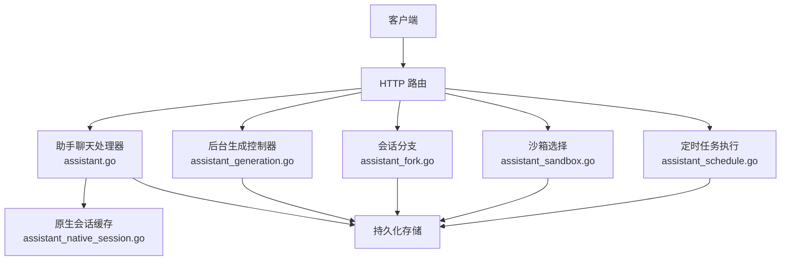
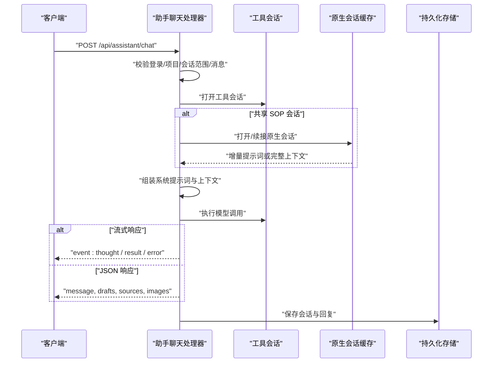
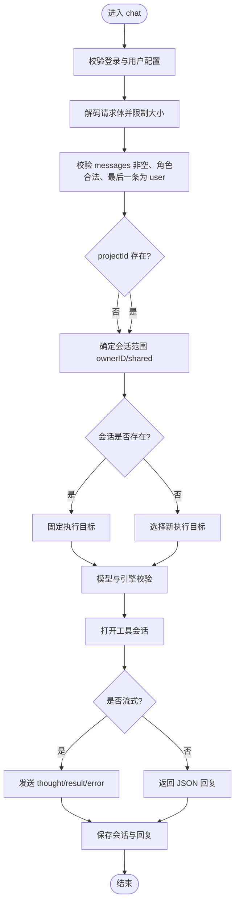
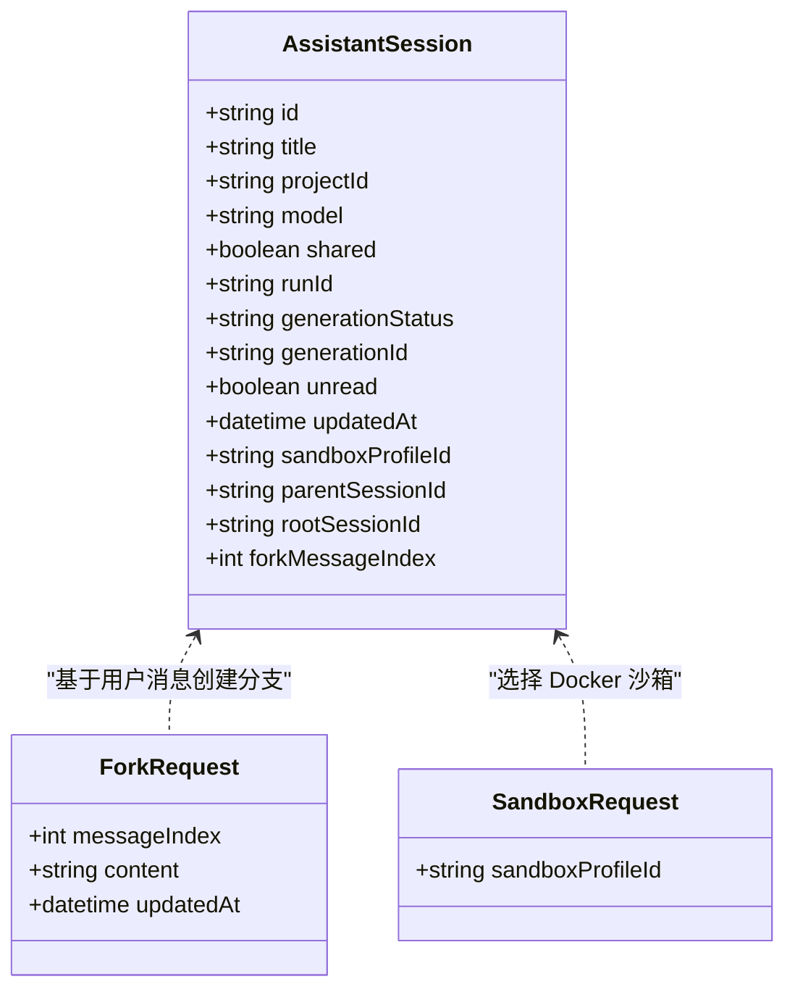
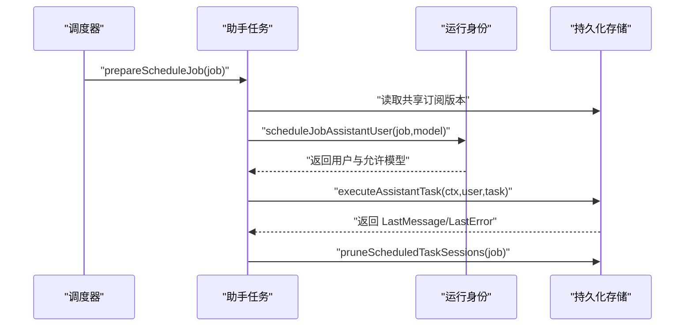
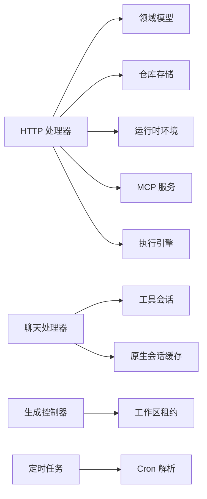

# 助手 API

<cite>
**本文引用的文件**   
- [openapi.yaml](file://docs/api/openapi.yaml)
- [assistant.go](file://internal/httpapi/assistant.go)
- [assistant_generation.go](file://internal/httpapi/assistant_generation.go)
- [assistant_native_session.go](file://internal/httpapi/assistant_native_session.go)
- [assistant_fork.go](file://internal/httpapi/assistant_fork.go)
- [assistant_schedule.go](file://internal/httpapi/assistant_schedule.go)
- [assistant_cron.go](file://internal/httpapi/assistant_cron.go)
- [assistant_sandbox.go](file://internal/httpapi/assistant_sandbox.go)
</cite>

## 目录
1. [简介](#简介)
2. [项目结构](#项目结构)
3. [核心组件](#核心组件)
4. [架构总览](#架构总览)
5. [详细组件分析](#详细组件分析)
6. [依赖关系分析](#依赖关系分析)
7. [性能与可靠性](#性能与可靠性)
8. [故障排查指南](#故障排查指南)
9. [结论](#结论)
10. [附录：端点速查](#附录端点速查)

## 简介
本文件面向调用方，系统化说明 LoopForge 平台“助手”相关 REST API，重点覆盖：
- 聊天对话：`POST /api/assistant/chat` 的请求格式、响应结构、流式事件、错误码。
- 会话管理：会话创建、读取、更新、删除、分支创建、沙箱选择。
- 消息处理：消息校验、共享会话一致性、附件与来源引用。
- 任务调度：助手定时任务的配置、执行、监控接口。
- 认证与权限：Cookie/Bearer/Basic 认证、项目访问控制、模型与凭据限制。
- 最佳实践：流式客户端实现、并发保护、重试与取消策略。

该文档同时给出代码级架构图和流程图，帮助开发者快速定位实现位置并理解数据流向。

## 项目结构
助手 API 主要位于后端 HTTP 层 `internal/httpapi`，并通过 OpenAPI 规范对外暴露契约。关键文件职责如下：
- `docs/api/openapi.yaml`：公开 REST 契约，定义路径、请求体、响应体和状态码。
- `internal/httpapi/assistant.go`：聊天入口、会话上下文准备、工具会话、流式输出、草稿解析与保存。
- `internal/httpapi/assistant_generation.go`：后台生成任务生命周期、取消、重定向（steer）、工作区租约续期。
- `internal/httpapi/assistant_native_session.go`：共享会话的原生会话缓存与增量续接。
- `internal/httpapi/assistant_fork.go`：编辑用户消息并创建分支，复制附件，继承草稿历史。
- `internal/httpapi/assistant_schedule.go`：定时任务提示词渲染、运行身份选择、固定会话策略。
- `internal/httpapi/assistant_cron.go`：Cron 表达式解析与下次触发时间计算。
- `internal/httpapi/assistant_sandbox.go`：普通会话的沙箱环境选择。

**图表来源**
- [assistant.go:102-793](file://internal/httpapi/assistant.go#L102-L793)
- [assistant_generation.go:21-453](file://internal/httpapi/assistant_generation.go#L21-L453)
- [assistant_native_session.go:57-164](file://internal/httpapi/assistant_native_session.go#L57-L164)
- [assistant_fork.go:17-114](file://internal/httpapi/assistant_fork.go#L17-L114)
- [assistant_sandbox.go:11-49](file://internal/httpapi/assistant_sandbox.go#L11-L49)
- [assistant_schedule.go:38-109](file://internal/httpapi/assistant_schedule.go#L38-L109)

**章节来源**
- [openapi.yaml:62-487](file://docs/api/openapi.yaml#L62-L487)
- [assistant.go:84-100](file://internal/httpapi/assistant.go#L84-L100)

## 核心组件
- 聊天处理器：负责登录校验、项目校验、会话范围判定、消息校验、执行目标选择、模型与 Effort 校验、工具会话打开、流式或 JSON 响应、草稿解析与保存、活动日志与图片资源收集。
- 生成控制器：负责异步生成任务创建、取消、查询、流式事件、工作区租约续期、失败诊断、转派 steer、转录提交。
- 原生会话缓存：为共享 SOP 会话提供本地进程级续接，支持增量提示词与断点恢复。
- 分支与编辑：基于用户消息索引创建分支，复制附件，标记继承草稿；编辑主会话消息时同步共享主会话。
- 定时任务：渲染提示词、选择运行身份、按 Cron 或间隔调度、固定会话策略、清理历史会话。
- 沙箱选择：仅对普通项目会话生效，空值表示跟随项目默认，非空值覆盖 Main Bot 的选择。

**章节来源**
- [assistant.go:102-793](file://internal/httpapi/assistant.go#L102-L793)
- [assistant_generation.go:21-453](file://internal/httpapi/assistant_generation.go#L21-L453)
- [assistant_native_session.go:57-164](file://internal/httpapi/assistant_native_session.go#L57-L164)
- [assistant_fork.go:17-114](file://internal/httpapi/assistant_fork.go#L17-L114)
- [assistant_schedule.go:38-109](file://internal/httpapi/assistant_schedule.go#L38-L109)
- [assistant_sandbox.go:11-49](file://internal/httpapi/assistant_sandbox.go#L11-L49)

## 架构总览
助手 API 的调用链可概括为：
1. 客户端发起 `/api/assistant/chat` 请求，携带 `messages` 等字段。
2. 服务器校验登录、项目、会话范围、消息合法性。
3. 根据是否共享会话、是否已有执行目标，决定新建或复用 CLI 原生会话。
4. 打开工具会话，组装系统提示词与上下文，执行模型调用。
5. 若客户端请求流式响应，则通过 SSE 推送 thought/result/error 等事件；否则返回最终 JSON。
6. 将回复消息、草稿、来源、图片等资源持久化到会话记录。

**图表来源**
- [assistant.go:102-793](file://internal/httpapi/assistant.go#L102-L793)
- [assistant_native_session.go:57-164](file://internal/httpapi/assistant_native_session.go#L57-L164)

**章节来源**
- [assistant.go:102-793](file://internal/httpapi/assistant.go#L102-L793)

## 详细组件分析

### 聊天端点 `/api/assistant/chat`
- 方法：POST
- 认证：Bearer Token、Cookie、Basic（OpenAPI 全局安全定义）
- 请求体关键字段：
  - `messages`：必填数组，至少一条消息；每条消息包含 `role`（user/assistant）、`content`（非空），可选作者与发言人信息。
  - `projectId`：可选项目标识。
  - `sessionId`：可选会话 ID；为空时服务端生成。
  - `model`：可选模型 ID；可通过前缀切换 CLI 引擎。
  - `updatedAt`：可选更新时间戳，用于共享会话一致性。
  - `executionTarget`、`effort`、`executor`、`approvalMode`、`runId`、`spaceId`、`mcpServerIds`：高级选项，影响执行机器、努力等级、审批模式、MCP 服务器选择等。
- 响应体关键字段：
  - `message`：助手回复文本。
  - `sessionId`：会话 ID。
  - `drafts`：最多 12 个草稿对象，每个含 `tool`、`path`、`query`、`body` 等。
  - `sources`：来源引用数组，含路径、行号、文本片段。
  - `images`：图片附件列表。
  - `mcpCalls`：内部后续请求数组，最多 3 项，服务端已执行后返回最终结果。
- 流式响应：
  - 当请求头 `Accept: text/event-stream` 或内部 sink 存在时启用。
  - 事件类型包括 `thought`、`result`、`error`、`runtime_mode` 等。
  - 服务器设置 `Content-Type: text/event-stream; charset=utf-8`、`Cache-Control: no-cache`、`Connection: keep-alive`、`X-Accel-Buffering: no`。
- 错误码：
  - 400：未登录、缺少消息、消息角色或内容无效、最后一条不是 user、项目不存在、模型/努力等级不合法、共享会话被伪造、工作区模式冲突等。
  - 401：未认证。
  - 403：无权访问共享会话或项目。
  - 404：项目或会话不存在。
  - 409：会话执行机器已固定、共享会话已更新、生成进行中、工作区环境冻结、引擎切换拒绝等。
  - 429：同一会话已有生成在进行中。
  - 502：模型失败或草稿无效、工具会话启动失败、未提交回复等。
  - 504：生成取消或超时。

**图表来源**
- [assistant.go:102-793](file://internal/httpapi/assistant.go#L102-L793)

**章节来源**
- [openapi.yaml:62-164](file://docs/api/openapi.yaml#L62-L164)
- [assistant.go:102-793](file://internal/httpapi/assistant.go#L102-L793)

### 会话管理
- 列出会话：`GET /api/assistant/sessions`
  - 返回最近的个人对话与授权共享 SOP 讨论，不含消息正文。
  - 字段包括 `id`、`title`、`projectId`、`model`、`shared`、`runId`、`generationStatus`、`generationId`、`unread`、`updatedAt`。
- 读取会话：`GET /api/assistant/sessions/{id}`
  - 返回包含消息的完整会话。
- 更新会话：`PUT /api/assistant/sessions/{id}`
  - 可更新标题、项目、初始沙箱选择、模型、消息体等。
  - 共享会话需传入 `updatedAt`，保留已有消息体与归属，生成中禁止编辑。
- 删除会话：`DELETE /api/assistant/sessions/{id}`
  - 同时删除匹配的 CodeBuddy CLI 转录。
- 分支创建：`POST /api/assistant/sessions/{id}/fork`
  - 基于用户消息索引创建分支，保留原会话与已执行变更。
  - 继承草稿为只读历史；活跃生成中禁止分支。
  - 返回包含 `parentSessionId`、`rootSessionId`、`forkMessageIndex` 的新分支。
- 沙箱选择：`PUT /api/assistant/sessions/{id}/sandbox`
  - 仅普通项目会话可用；空值跟随项目默认，非空值覆盖 Main Bot 选择。
  - 生成中或绑定工作区返回 409。

**图表来源**
- [openapi.yaml:197-396](file://docs/api/openapi.yaml#L197-L396)
- [assistant_fork.go:17-114](file://internal/httpapi/assistant_fork.go#L17-L114)
- [assistant_sandbox.go:11-49](file://internal/httpapi/assistant_sandbox.go#L11-L49)

**章节来源**
- [openapi.yaml:197-396](file://docs/api/openapi.yaml#L197-L396)
- [assistant_fork.go:17-114](file://internal/httpapi/assistant_fork.go#L17-L114)
- [assistant_sandbox.go:11-49](file://internal/httpapi/assistant_sandbox.go#L11-L49)

### 消息处理
- 消息校验：
  - `messages` 必须非空，每条消息 `role` 只能是 `user` 或 `assistant`，`content` 不能为空。
  - 最后一条消息必须是 `user`。
  - 共享会话不允许伪造 assistant 回复。
- 来源与附件：
  - 回复可附带 `sources` 与 `images`，分别表示源码引用与媒体附件。
  - 分支创建时会复制附件到新会话所有者目录。
- 活动与使用统计：
  - 每次轮次记录活动事件与模型使用量，用于展示与计费。

**章节来源**
- [assistant.go:120-133](file://internal/httpapi/assistant.go#L120-L133)
- [assistant.go:714-784](file://internal/httpapi/assistant.go#L714-L784)
- [assistant_fork.go:115-145](file://internal/httpapi/assistant_fork.go#L115-L145)

### 任务调度
- 列出任务：`GET /api/assistant/tasks`
  - 可按 `projectId` 过滤，返回当前用户的助手定时提示词。
- 保存任务：`PUT /api/assistant/tasks`
  - 必填 `name`、`prompt`、`projectId`；可选 `cron`、`intervalSec`、`enabled`、`model`、`notifications`。
  - `cron` 为 Asia/Shanghai 时区的 5 字段表达式；若设置则忽略 `intervalSec`。
- 删除任务：`DELETE /api/assistant/tasks/{id}`
- 立即执行：`POST /api/assistant/tasks/{id}/run`
  - 返回 202 表示执行已开始；若用户已有生成进行中返回 429。
- 执行流程：
  - 渲染提示词（支持共享订阅版本）。
  - 选择运行身份（优先个人凭据，其次平台共享 Key）。
  - 按固定会话策略追加或新建会话。
  - 调用助手任务执行器，记录最后消息与错误。

**图表来源**
- [assistant_schedule.go:38-109](file://internal/httpapi/assistant_schedule.go#L38-L109)
- [assistant_schedule.go:114-170](file://internal/httpapi/assistant_schedule.go#L114-L170)

**章节来源**
- [openapi.yaml:397-487](file://docs/api/openapi.yaml#L397-L487)
- [assistant_schedule.go:38-109](file://internal/httpapi/assistant_schedule.go#L38-L109)
- [assistant_cron.go:10-15](file://internal/httpapi/assistant_cron.go#L10-L15)

### 认证与权限
- 认证方式：
  - Bearer Token、Cookie、Basic（OpenAPI 全局安全定义）。
- 权限控制：
  - 聊天与会话操作要求登录。
  - 共享 SOP 会话需要项目访问权限。
  - 沙箱选择仅适用于普通项目会话。
  - 定时任务运行身份优先个人凭据，其次平台共享 Key；无凭据时报错。
- 模型与凭据：
  - 模型 ID 可通过前缀切换 CLI 引擎（如 codex、claude-code）。
  - 平台共享 Key 仅允许管理员配置的模型列表。

**章节来源**
- [openapi.yaml:13-16](file://docs/api/openapi.yaml#L13-L16)
- [assistant.go:102-144](file://internal/httpapi/assistant.go#L102-L144)
- [assistant_schedule.go:114-170](file://internal/httpapi/assistant_schedule.go#L114-L170)

### 最佳实践示例
- 流式客户端：
  - 设置 `Accept: text/event-stream`。
  - 监听 `thought` 事件显示进度，`result` 事件接收最终回复，`error` 事件处理失败。
  - 避免在流式连接上并行发送同一会话的消息。
- 并发保护：
  - 同一会话在同一时刻只能有一个生成在进行中；收到 429 应退避重试。
- 分支与编辑：
  - 分支前确保原会话没有活跃生成；编辑时需传入最新的 `updatedAt`。
- 沙箱选择：
  - 空字符串表示跟随项目默认；非空字符串需为项目拥有的或共享的 Docker 沙箱。
- 定时任务：
  - 优先配置个人凭据；若无，则联系平台管理员配置共享 Key。
  - 使用 cron 表达式时注意 Asia/Shanghai 时区。

[本节为通用指导，不直接分析具体文件]

## 依赖关系分析
助手 API 的依赖关系如下：
- HTTP 层依赖领域模型（domain）、仓库（repo）、运行时（runtime）、MCP 服务（mcpserver）、引擎（engine）。
- 聊天处理器依赖工具会话、原生会话缓存、通知处理器、身份处理器。
- 生成控制器依赖工作区租约、诊断记录、活动日志。
- 定时任务依赖 Cron 解析、共享订阅版本、项目成员权限。

**图表来源**
- [assistant.go:18-24](file://internal/httpapi/assistant.go#L18-L24)
- [assistant_generation.go:3-16](file://internal/httpapi/assistant_generation.go#L3-L16)
- [assistant_schedule.go:3-11](file://internal/httpapi/assistant_schedule.go#L3-L11)

**章节来源**
- [assistant.go:18-24](file://internal/httpapi/assistant.go#L18-L24)
- [assistant_generation.go:3-16](file://internal/httpapi/assistant_generation.go#L3-L16)
- [assistant_schedule.go:3-11](file://internal/httpapi/assistant_schedule.go#L3-L11)

## 性能与可靠性
- 请求体限制：聊天请求体最大 32MB，分支/编辑请求体最大 128KB。
- 流式响应：SSE 事件实时推送，避免长轮询开销。
- 并发控制：同一会话的生成互斥，防止重复执行。
- 诊断与重试：模型失败、工具会话失败、未提交回复等场景有重试与诊断记录。
- 工作区租约：后台生成任务每 500ms 续租工作区，丢失则终止生成。
- 原生会话缓存：共享 SOP 会话支持增量续接，减少重复上下文构建。

**章节来源**
- [assistant.go:29-30](file://internal/httpapi/assistant.go#L29-L30)
- [assistant.go:374-390](file://internal/httpapi/assistant.go#L374-L390)
- [assistant.go:149-153](file://internal/httpapi/assistant.go#L149-L153)
- [assistant_generation.go:296-315](file://internal/httpapi/assistant_generation.go#L296-L315)
- [assistant_native_session.go:57-107](file://internal/httpapi/assistant_native_session.go#L57-L107)

## 故障排查指南
- 400 错误：
  - 检查是否登录、是否配置 CodeBuddy API Key。
  - 检查 `messages` 是否为空、角色是否正确、最后一条是否为 user。
  - 检查 `projectId` 是否存在。
- 401 错误：
  - 检查 Bearer Token 或 Cookie 是否有效。
- 403 错误：
  - 检查是否有权访问共享 SOP 会话或项目。
  - 检查沙箱选择是否仅适用于普通项目会话。
- 404 错误：
  - 检查项目或会话 ID 是否存在。
- 409 错误：
  - 检查会话执行机器是否已固定。
  - 检查共享会话是否已更新。
  - 检查工作区环境是否已冻结。
- 429 错误：
  - 同一会话已有生成在进行中，等待后重试。
- 502 错误：
  - 模型失败或草稿无效；查看诊断信息与重试次数。
- 504 错误：
  - 生成取消或超时；检查客户端连接与服务端日志。

**章节来源**
- [assistant.go:102-176](file://internal/httpapi/assistant.go#L102-L176)
- [assistant.go:233-243](file://internal/httpapi/assistant.go#L233-L243)
- [assistant.go:407-417](file://internal/httpapi/assistant.go#L407-L417)
- [assistant_generation.go:393-423](file://internal/httpapi/assistant_generation.go#L393-L423)

## 结论
LoopForge 助手 API 提供了完整的聊天对话、会话管理、消息处理与任务调度能力。通过 OpenAPI 规范明确定义了请求与响应结构，后端实现覆盖了流式响应、并发控制、诊断记录、原生会话缓存等关键特性。调用方应遵循认证与权限要求，合理使用流式接口，并注意并发保护与错误处理。

[本节为总结性内容，不直接分析具体文件]

## 附录：端点速查
- `POST /api/assistant/chat`：聊天对话，支持流式响应。
- `GET /api/assistant/models`：列出可用模型。
- `GET /api/assistant/sessions`：列出会话。
- `GET /api/assistant/sessions/{id}`：读取会话。
- `PUT /api/assistant/sessions/{id}`：更新会话。
- `DELETE /api/assistant/sessions/{id}`：删除会话。
- `PUT /api/assistant/sessions/{id}/sandbox`：选择沙箱。
- `POST /api/assistant/sessions/{id}/fork`：创建分支。
- `GET /api/assistant/tasks`：列出任务。
- `PUT /api/assistant/tasks`：保存任务。
- `DELETE /api/assistant/tasks/{id}`：删除任务。
- `POST /api/assistant/tasks/{id}/run`：立即执行任务。

**章节来源**
- [openapi.yaml:62-487](file://docs/api/openapi.yaml#L62-L487)