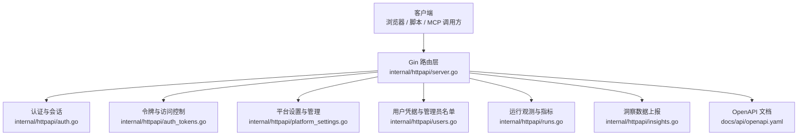
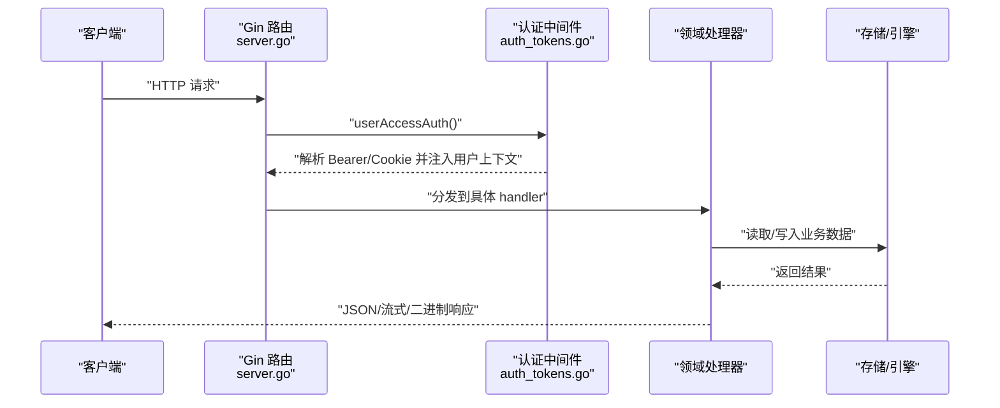
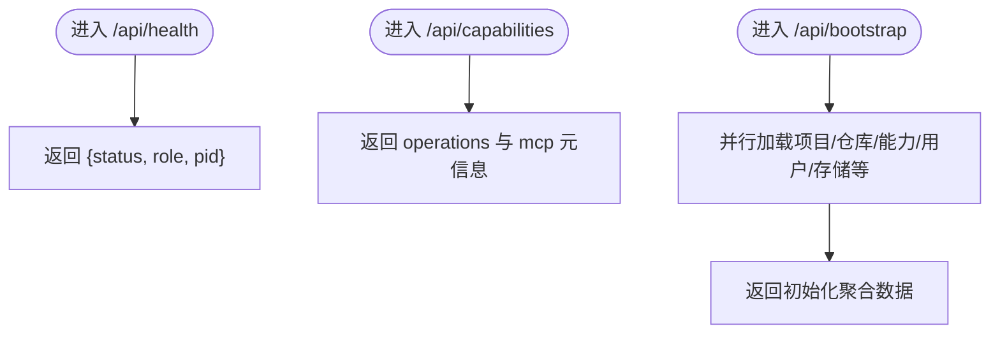
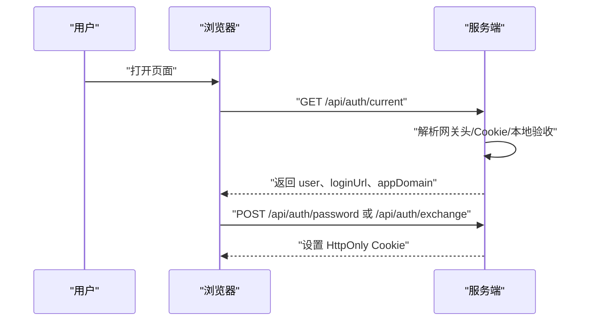
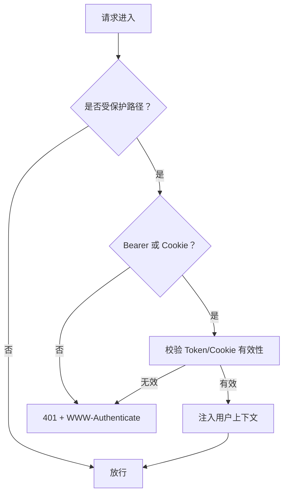
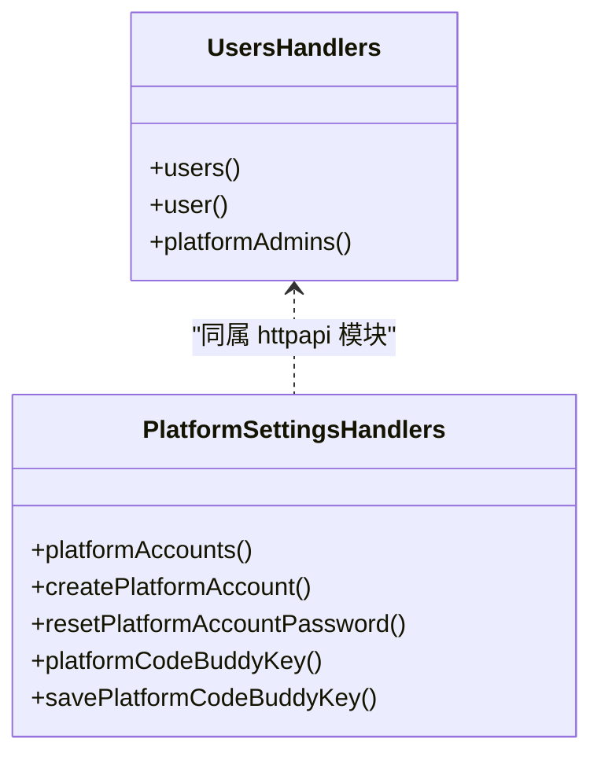
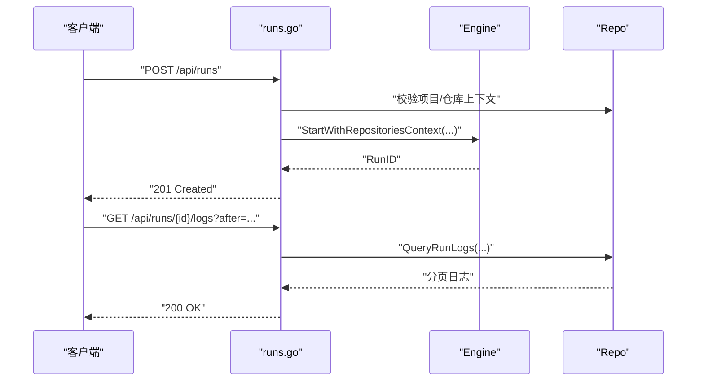
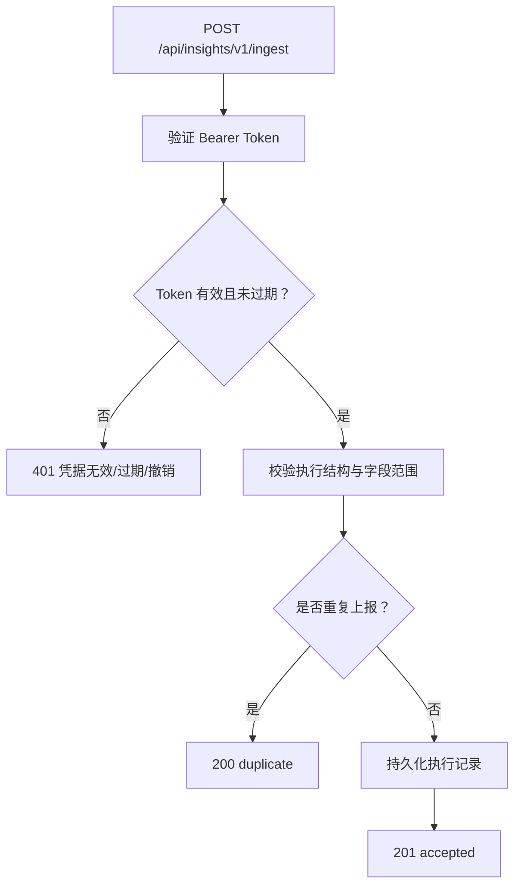
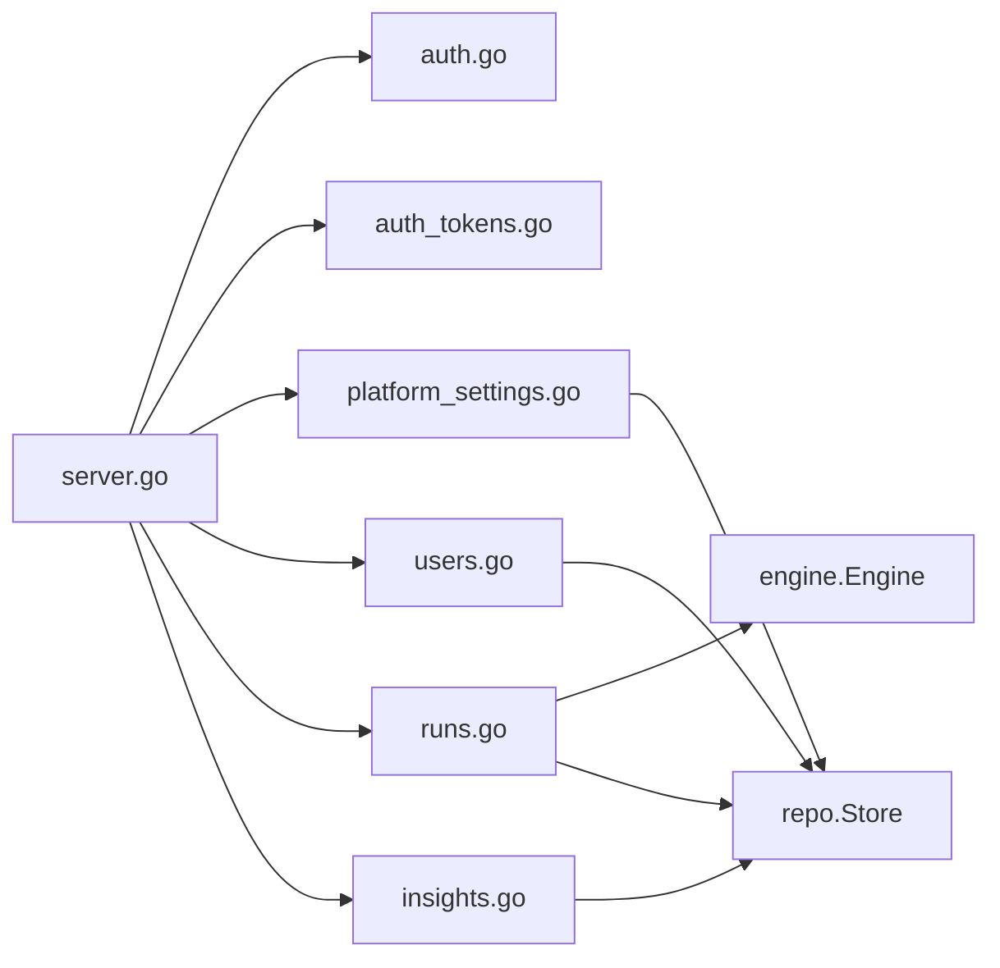

# 系统 API

<cite>
**本文引用的文件**   
- [README.md](file://README.md)
- [server.go](file://internal/httpapi/server.go)
- [auth.go](file://internal/httpapi/auth.go)
- [auth_tokens.go](file://internal/httpapi/auth_tokens.go)
- [platform_settings.go](file://internal/httpapi/platform_settings.go)
- [users.go](file://internal/httpapi/users.go)
- [insights.go](file://internal/httpapi/insights.go)
- [runs.go](file://internal/httpapi/runs.go)
- [openapi.yaml](file://docs/api/openapi.yaml)
</cite>

## 目录
1. [引言](#引言)
2. [项目结构](#项目结构)
3. [核心组件](#核心组件)
4. [架构总览](#架构总览)
5. [详细组件分析](#详细组件分析)
6. [依赖关系分析](#依赖关系分析)
7. [性能与容量特性](#性能与容量特性)
8. [故障排查指南](#故障排查指南)
9. [结论](#结论)
10. [附录：系统级接口清单](#附录系统级接口清单)

## 引言
本文件面向系统管理员、平台集成方和运维人员，聚焦 LoopForge 的系统级 HTTP/MCP 接口，覆盖健康检查、能力发现、初始化引导、用户认证、令牌管理、平台设置、运行观测、指标与分析、以及外部数据上报等基础设施能力。文档以当前后端实现为准，重点解释控制面入口、鉴权模型、权限边界、错误语义与安全建议，帮助读者在不深入源码的情况下完成系统集成与运维排障。

## 项目结构
LoopForge 的 HTTP API 由 Gin 路由集中装配，按领域拆分为多个 handler 集合；系统级能力集中在以下位置：
- 路由与服务装配：`internal/httpapi/server.go`
- 认证与会话：`internal/httpapi/auth.go`
- 令牌与访问控制：`internal/httpapi/auth_tokens.go`
- 平台管理与共享密钥：`internal/httpapi/platform_settings.go`
- 用户凭据与平台管理员名单：`internal/httpapi/users.go`
- 运行观测与指标：`internal/httpapi/runs.go`
- 洞察数据上报：`internal/httpapi/insights.go`
- OpenAPI 规范：`docs/api/openapi.yaml`

**图示来源**
- [server.go:98-225](file://internal/httpapi/server.go#L98-L225)
- [auth.go:21-37](file://internal/httpapi/auth.go#L21-L37)
- [auth_tokens.go:22-63](file://internal/httpapi/auth_tokens.go#L22-L63)
- [platform_settings.go:18-37](file://internal/httpapi/platform_settings.go#L18-L37)
- [users.go:15-25](file://internal/httpapi/users.go#L15-L25)
- [runs.go:19-25](file://internal/httpapi/runs.go#L19-L25)
- [insights.go:21-24](file://internal/httpapi/insights.go#L21-L24)

**章节来源**
- [README.md:72-93](file://README.md#L72-L93)
- [server.go:98-225](file://internal/httpapi/server.go#L98-L225)

## 核心组件
- 服务装配与中间件：统一注册健康检查、能力发现、Bootstrap、MCP、CORS、压缩、Basic Auth、用户令牌访问控制、写保护等。
- 认证与会话：支持网关透传身份、Cookie 会话、本地验收登录、头像获取与回跳地址校验。
- 令牌管理：个人 Token 的创建、撤销、前缀展示与哈希存储；受保护路径强制 Bearer 或 Cookie。
- 平台设置：平台管理员账号列表、成员账号创建与密码重置、平台共享 CodeBuddy Key 与允许模型列表。
- 用户凭据：当前用户 CLI Base URL 与代理凭据更新；平台管理员名单维护。
- 运行观测：运行查询、日志、遥测、制品下载、审批/拒绝/重试/暂停/恢复/取消等控制面操作。
- 洞察上报：项目级数据源 Token 管理、执行记录上报与校验。

**章节来源**
- [server.go:202-225](file://internal/httpapi/server.go#L202-L225)
- [auth.go:79-105](file://internal/httpapi/auth.go#L79-L105)
- [auth_tokens.go:37-91](file://internal/httpapi/auth_tokens.go#L37-L91)
- [platform_settings.go:39-101](file://internal/httpapi/platform_settings.go#L39-L101)
- [users.go:27-66](file://internal/httpapi/users.go#L27-L66)
- [runs.go:27-69](file://internal/httpapi/runs.go#L27-L69)
- [insights.go:47-113](file://internal/httpapi/insights.go#L47-L113)

## 架构总览
系统对外暴露三类入口：
- REST API：JSON 为主，部分流式响应（SSE）与二进制下载。
- MCP Streamable HTTP：无状态 JSON-RPC 2.0 工具调用入口。
- 内部端点：Worker 信号、OTLP 采集、Runner 控制面等不对外稳定暴露。

**图示来源**
- [server.go:202-225](file://internal/httpapi/server.go#L202-L225)
- [auth_tokens.go:37-63](file://internal/httpapi/auth_tokens.go#L37-L63)

**章节来源**
- [server.go:636-649](file://internal/httpapi/server.go#L636-L649)

## 详细组件分析

### 健康检查与能力发现
- 健康检查：`GET /api/health` 返回实例角色与进程 ID，适合探针与负载均衡器探测。
- 能力发现：`GET /api/capabilities` 返回公共 HTTP/MCP 操作清单与 MCP 入口信息，供客户端动态适配。
- Bootstrap：`GET /api/bootstrap` 一次性拉取 Studio 初始化所需的项目、仓库、Agent、规则、Skill、MCP、执行器、Dockerfile、环境、沙箱、工作流、同步配置、调度任务、用户与存储信息等。

**图示来源**
- [server.go:699-711](file://internal/httpapi/server.go#L699-L711)
- [server.go:720-784](file://internal/httpapi/server.go#L720-L784)

**章节来源**
- [server.go:699-711](file://internal/httpapi/server.go#L699-L711)
- [server.go:720-784](file://internal/httpapi/server.go#L720-L784)

### 用户认证与会话
- 会话有效期：浏览器 Cookie 最长 `authSessionTTL`，过期后自动清理，避免“半失效”状态。
- 身份来源优先级：
  1) 网关透传员工身份（需可选 Secret 校验）；
  2) 业务 Cookie；
  3) 本地验收登录（仅直连 loopback）。
- 安全回跳：return_url 仅允许本站或 AppDomain 及其子域，防止开放重定向。
- 头像接口：`GET /api/auth/photo` 支持远程头像或本地首字母 SVG。

**图示来源**
- [auth.go:21-33](file://internal/httpapi/auth.go#L21-L33)
- [auth.go:120-170](file://internal/httpapi/auth.go#L120-L170)
- [auth.go:212-282](file://internal/httpapi/auth.go#L212-L282)

**章节来源**
- [auth.go:21-33](file://internal/httpapi/auth.go#L21-L33)
- [auth.go:79-105](file://internal/httpapi/auth.go#L79-L105)
- [auth.go:120-170](file://internal/httpapi/auth.go#L120-L170)
- [auth.go:212-282](file://internal/httpapi/auth.go#L212-L282)

### 令牌管理与访问控制
- 访问控制中间件：当启用 `AGENTFLOW_AUTH_REQUIRED=true` 时，对受保护路径要求 Bearer 或 Cookie；未通过则返回 `401` 并携带 `WWW-Authenticate: Bearer realm="AgentFlow"`。
- 受保护路径判定：排除健康检查、认证流程、头像、Runner 控制面等；MCP 入口 `/mcp` 视为受保护。
- 个人 Token：
  - 仅支持浏览器交互创建与撤销，不允许 Bearer 自行续造。
  - 明文仅展示一次，支持有效期与最近使用时间。
  - 存储为 SHA-256 哈希，前端仅见前缀。
- 用户解析：优先从上下文/Bearer/Cookie 解析用户，必要时回填数据库字段。

**图示来源**
- [auth_tokens.go:37-91](file://internal/httpapi/auth_tokens.go#L37-L91)
- [auth_tokens.go:93-138](file://internal/httpapi/auth_tokens.go#L93-L138)
- [auth_tokens.go:200-308](file://internal/httpapi/auth_tokens.go#L200-L308)

**章节来源**
- [auth_tokens.go:37-91](file://internal/httpapi/auth_tokens.go#L37-L91)
- [auth_tokens.go:93-138](file://internal/httpapi/auth_tokens.go#L93-L138)
- [auth_tokens.go:200-308](file://internal/httpapi/auth_tokens.go#L200-L308)

### 平台设置与管理员管理
- 平台管理员名单：仅平台管理员可读写；支持授予/撤销 admin 角色。
- 成员账号管理：
  - 列出成员账号与注册开关。
  - 创建本地账号（用户名、密码、是否管理员），首次加入欢迎项目。
  - 重置密码账号（仅密码账号，不支持为第三方登录账号添加密码）。
- 平台共享 CodeBuddy Key：
  - GET 显示是否存在并可按需刷新模型目录；PUT 保存 Key、网络环境与允许模型列表；DELETE 清除。
  - 模型 ID 白名单校验，空值与重复项去重，数量限制。

**图示来源**
- [users.go:15-125](file://internal/httpapi/users.go#L15-L125)
- [platform_settings.go:39-273](file://internal/httpapi/platform_settings.go#L39-L273)

**章节来源**
- [users.go:15-125](file://internal/httpapi/users.go#L15-L125)
- [platform_settings.go:18-37](file://internal/httpapi/platform_settings.go#L18-L37)
- [platform_settings.go:39-101](file://internal/httpapi/platform_settings.go#L39-L101)
- [platform_settings.go:113-150](file://internal/httpapi/platform_settings.go#L113-L150)
- [platform_settings.go:187-273](file://internal/httpapi/platform_settings.go#L187-L273)

### 运行观测、日志与性能指标
- 运行列表与创建：支持按负责人过滤；创建时需具备项目写权限，并绑定默认仓库上下文。
- 运行详情与控制：查看运行、删除、审批/拒绝/重试/拒绝重试/暂停/恢复/刷新 SOP/通过等。
- 日志与遥测：分页查询日志与遥测事件，导出纯文本日志；制品下载带 ETag。
- 分析与指标：
  - `GET /api/analytics`：按来源、项目、工作流、范围、用户、Issue 来源、粒度、时间区间统计。
  - `GET /api/workflow-metrics`：工作流维度指标。

**图示来源**
- [runs.go:71-145](file://internal/httpapi/runs.go#L71-L145)
- [runs.go:146-312](file://internal/httpapi/runs.go#L146-L312)

**章节来源**
- [runs.go:27-69](file://internal/httpapi/runs.go#L27-L69)
- [runs.go:71-145](file://internal/httpapi/runs.go#L71-L145)
- [runs.go:146-312](file://internal/httpapi/runs.go#L146-L312)

### 洞察数据上报与数据源管理
- 数据源管理：项目维度的数据源 Token 创建、撤销与列表；Token 前缀展示，哈希存储。
- 上报接口：`POST /api/insights/v1/ingest`，使用 Bearer Token 鉴权，严格校验执行类型、时间、用量与成本字段。
- 幂等与冲突：重复上报返回 `duplicate` 状态码；已过期或撤销的 Token 返回 `401`。

**图示来源**
- [insights.go:47-113](file://internal/httpapi/insights.go#L47-L113)
- [insights.go:159-210](file://internal/httpapi/insights.go#L159-L210)
- [insights.go:211-285](file://internal/httpapi/insights.go#L211-L285)

**章节来源**
- [insights.go:47-113](file://internal/httpapi/insights.go#L47-L113)
- [insights.go:159-210](file://internal/httpapi/insights.go#L159-L210)
- [insights.go:211-285](file://internal/httpapi/insights.go#L211-L285)

## 依赖关系分析
- 路由层依赖所有领域 handler，并通过 deps 注入 repo、engine、sync、schedule、authClient 等基础能力。
- 认证中间件在路由层统一生效，区分受保护路径与公开路径。
- runs 与 insights 分别依赖 engine 与 repo，提供运行控制与洞察数据入库。
- platform_settings 与 users 依赖 repo 进行平台级配置与用户凭据管理。

**图示来源**
- [server.go:38-96](file://internal/httpapi/server.go#L38-L96)
- [runs.go:19-25](file://internal/httpapi/runs.go#L19-L25)
- [insights.go:21-24](file://internal/httpapi/insights.go#L21-L24)
- [platform_settings.go:18-37](file://internal/httpapi/platform_settings.go#L18-L37)
- [users.go:15-25](file://internal/httpapi/users.go#L15-L25)

**章节来源**
- [server.go:38-96](file://internal/httpapi/server.go#L38-L96)

## 性能与容量特性
- 请求体上限：普通 JSON 请求体上限 2 MiB；洞察上报单独限制 1 MiB。
- 列表接口：除运行日志/遥测外均为完整数组，无通用分页；日志与遥测支持 after/before 游标分页。
- 压缩：服务可对普通响应启用 gzip；SSE、OTLP 与显式 `text/event-stream` 不压缩。
- 并发加载：Bootstrap 并行加载项目、仓库、能力、用户、存储等数据，减少首屏延迟。
- 流式输出：运行 SSE、遥测与日志流式消费，降低大对象传输压力。

[本节为通用指导，不直接分析具体文件]

## 故障排查指南
- 401 未认证：
  - 检查是否启用 `AGENTFLOW_AUTH_REQUIRED=true`。
  - 确认 Bearer Token 格式为 `Authorization: Bearer afp_<token>`，或浏览器 Cookie 存在且未过期。
  - 检查 `WWW-Authenticate: Bearer realm="AgentFlow"` 提示。
- 403 禁止：
  - 跨源请求被拒绝；异源请求返回 403。
  - 平台管理接口需要平台管理员身份。
- 404 不存在：
  - 资源或子路径不存在；运行、日志、制品等需确认 ID。
- 405 方法不允许：
  - 路径存在但方法不支持；注意尾斜杠兼容逻辑。
- 409 冲突：
  - 版本冲突、状态不允许、重复派发、运行中资源阻止删除或调度器关闭。
- 500/504：
  - 底层存储/引擎错误通常映射为 400；AI 澄清超过 10 分钟可能返回 504。

**章节来源**
- [auth_tokens.go:37-63](file://internal/httpapi/auth_tokens.go#L37-L63)
- [server.go:202-225](file://internal/httpapi/server.go#L202-L225)
- [runs.go:146-312](file://internal/httpapi/runs.go#L146-L312)

## 结论
LoopForge 的系统级 API 以 Gin 路由为中心，围绕认证、令牌、平台设置、运行观测与洞察上报形成清晰的能力边界。生产部署应开启认证、配置 HTTPS 与反向代理，最小化暴露内部端点，并使用个人 Token 或网关身份进行系统集成。对于高吞吐场景，建议利用分页、流式与缓存策略，结合能力发现与 OpenAPI 规范进行自动化集成。

[本节为总结性内容，不直接分析具体文件]

## 附录：系统级接口清单
以下为系统级基础设施接口的概览，更详细的参数与示例请参考 OpenAPI 文档。

- 通用
  - `GET /api/health`：健康检查
  - `GET /api/capabilities`：能力发现
  - `GET /api/bootstrap`：Studio 初始化引导
  - `POST /mcp`：MCP Streamable HTTP 入口

- 认证与会话
  - `GET /api/auth/current`：当前用户
  - `POST /api/auth/password`：密码登录
  - `GET /api/auth/setup`：初始化状态
  - `POST /api/auth/register`：注册
  - `GET/POST /api/auth/local`：本地验收登录
  - `GET/POST /api/auth/exchange`：授权码兑换
  - `POST /api/auth/logout`：登出
  - `GET /api/auth/photo[/spec/username]`：头像
  - `GET/POST /api/auth/tokens`：个人 Token 列表与创建
  - `DELETE /api/auth/tokens/:id`：撤销个人 Token

- 用户与平台管理
  - `GET /api/users`：用户列表
  - `PUT /api/users/:id`：当前用户凭据更新
  - `GET /api/platform/admins`：平台管理员名单
  - `PUT /api/platform/admins`：授予/撤销平台管理员
  - `GET /api/platform/accounts`：成员账号列表
  - `POST /api/platform/accounts`：创建成员账号
  - `PUT /api/platform/accounts/:id/password`：重置密码账号密码
  - `GET/PUT/DELETE /api/platform/codebuddy-key`：平台共享 CodeBuddy Key

- 运行观测与指标
  - `GET /api/runs`：运行列表
  - `POST /api/runs`：创建运行
  - `GET /api/runs/:id`：运行详情
  - `DELETE /api/runs/:id`：删除运行
  - `GET /api/runs/:id/stream`：运行流式事件
  - `GET /api/runs/:id/logs[/logs.txt]`：日志
  - `GET /api/runs/:id/telemetry`：遥测
  - `GET /api/runs/:id/artifacts/:name`：制品下载
  - `POST /api/runs/:id/approve|reject|retry|decline-retry|cancel|pause|resume|refresh-sop|pass`：运行控制动作
  - `GET /api/analytics`：分析指标
  - `GET /api/workflow-metrics`：工作流指标

- 洞察数据上报
  - `GET/POST /api/insights/v1/sources`：数据源管理
  - `DELETE /api/insights/v1/sources/:id`：撤销数据源
  - `POST /api/insights/v1/ingest`：执行记录上报

**章节来源**
- [server.go:237-347](file://internal/httpapi/server.go#L237-L347)
- [server.go:515-585](file://internal/httpapi/server.go#L515-L585)
- [openapi.yaml](file://docs/api/openapi.yaml)