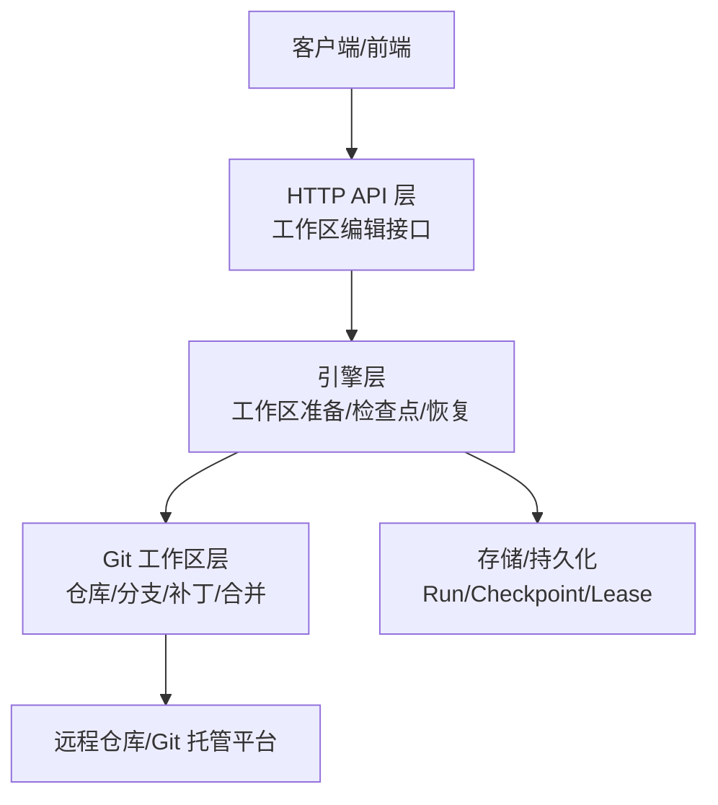
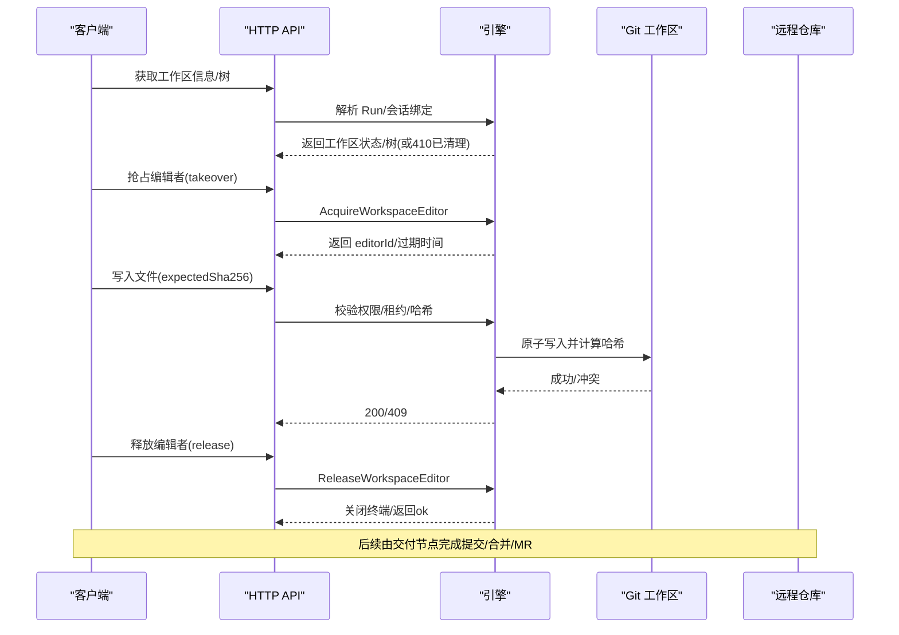
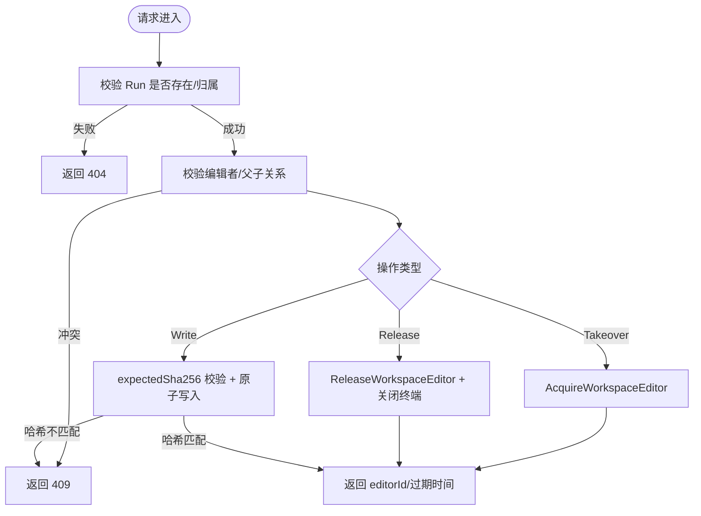
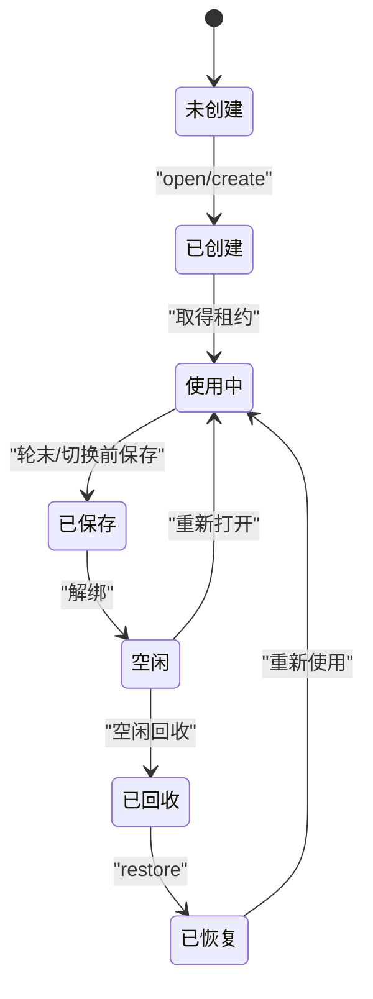
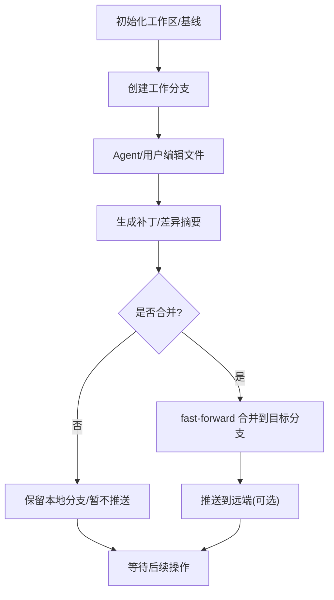
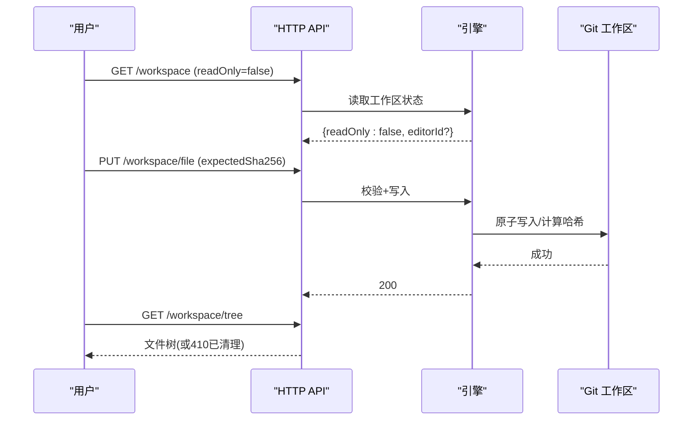
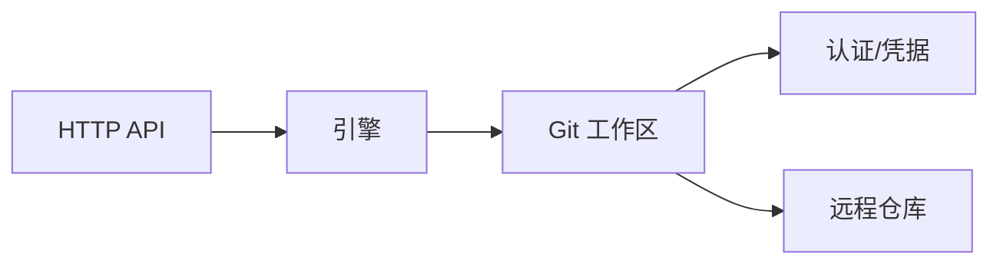

# 工作区操作

<cite>
**本文引用的文件**   
- [README.md](file://README.md)
- [conversation-workspaces.md](file://docs/conversation-workspaces.md)
- [collaboration.md](file://docs/api/collaboration.md)
- [sync.md](file://docs/api/sync.md)
- [run_workspace_edit.go](file://internal/httpapi/run_workspace_edit.go)
- [workspace_cases_test.go](file://internal/httpapi/workspace_cases_test.go)
- [workspace_http_cases_test.go](file://internal/httpapi/workspace_http_cases_test.go)
- [68-workspace-edit.test.mjs](file://e2e/api/68-workspace-edit.test.mjs)
- [repository_workspace.go](file://internal/engine/repository_workspace.go)
- [conversation_workspace.go](file://internal/engine/conversation_workspace.go)
- [workspace_checkpoint_stream.go](file://internal/engine/workspace_checkpoint_stream.go)
- [workspace_restore.go](file://internal/engine/workspace_restore.go)
- [gitwork.go](file://internal/gitwork/git.go)
- [gitwork_auth.go](file://internal/gitwork/auth.go)
- [gitwork_checkouts.go](file://internal/gitwork/checkouts.go)
- [gitwork_workbranch.go](file://internal/gitwork/workbranch.go)
- [gitwork_integrate.go](file://internal/gitwork/integrate.go)
- [gitwork_patch.go](file://internal/gitwork/patch.go)
</cite>

## 目录
1. [引言](#引言)
2. [项目结构](#项目结构)
3. [核心组件](#核心组件)
4. [架构总览](#架构总览)
5. [详细组件分析](#详细组件分析)
6. [依赖关系分析](#依赖关系分析)
7. [性能与一致性](#性能与一致性)
8. [故障排查指南](#故障排查指南)
9. [结论](#结论)

## 引言
本文件面向“工作区”的完整生命周期与协作流程，覆盖准备、编辑、提交、合并、冲突解决以及版本控制集成。内容聚焦以下目标：
- 工作区准备与切换：对话工作区与 SOP 运行工作区的创建、绑定、快照与恢复。
- 编辑与权限：谁可以编辑、如何抢占编辑权、并发写入保护与差异校验。
- 提交与合并：工作分支管理、补丁生成、MR/PR 提交流程与合入状态同步。
- 冲突与回滚：差异检测、冲突提示、恢复策略与清理机制。
- 协作机制：项目成员角色、会话与工作区绑定、只读与可写边界。
- 状态同步：工作区树、文件内容、差异与检查点（checkpoint）同步。

## 项目结构
围绕工作区的代码分布在多个层次：
- HTTP API 层：暴露工作区信息、文件读写、编辑者抢占与释放等接口。
- 引擎层：负责工作区准备、沙箱生命周期、检查点流式保存与恢复。
- Git 工作区层：封装仓库检出、分支管理、补丁与合并逻辑。
- 文档与测试：对外 API 说明、端到端用例与回归测试。

**图表来源**
- [run_workspace_edit.go:41-80](file://internal/httpapi/run_workspace_edit.go#L41-L80)
- [conversation_workspace.go:115-120](file://internal/engine/conversation_workspace.go#L115-L120)
- [repository_workspace.go:266-324](file://internal/engine/repository_workspace.go#L266-L324)

**章节来源**
- [README.md:38-50](file://README.md#L38-L50)
- [conversation-workspaces.md:1-12](file://docs/conversation-workspaces.md#L1-L12)

## 核心组件
- 工作区编辑 API
  - 获取工作区信息与树结构。
  - 抢占编辑者（takeover）、释放编辑者（release）。
  - 文件写入（write），带期望哈希校验防止丢失更新。
- 工作区准备与生命周期
  - 对话工作区与 SOP 工作区统一由引擎管理。
  - 检查点流式保存与恢复，支持空闲回收与重连。
- Git 工作区能力
  - 仓库检出、工作分支命名与隔离。
  - 补丁生成、合并到默认分支或集成分支。
  - SSH/HTTPS 凭据注入与主机公钥固定。

**章节来源**
- [run_workspace_edit.go:41-80](file://internal/httpapi/run_workspace_edit.go#L41-L80)
- [conversation-workspaces.md:13-23](file://docs/conversation-workspaces.md#L13-L23)
- [repository_workspace.go:266-324](file://internal/engine/repository_workspace.go#L266-L324)

## 架构总览
工作区操作贯穿“API → 引擎 → Git 工作区 → 远程仓库”，并在需要时通过检查点与恢复保证一致性。

**图表来源**
- [run_workspace_edit.go:53-75](file://internal/httpapi/run_workspace_edit.go#L53-L75)
- [workspace_cases_test.go:505-521](file://internal/httpapi/workspace_cases_test.go#L505-L521)
- [workspace_http_cases_test.go:77-83](file://internal/httpapi/workspace_http_cases_test.go#L77-L83)

## 详细组件分析

### 工作区编辑 API
- 能力
  - 获取工作区基本信息与文件树。
  - 抢占编辑者：用于标识当前编辑者，避免多端同时写入导致覆盖。
  - 释放编辑者：结束编辑会话，关闭相关终端。
  - 文件写入：基于 expectedSha256 的 compare-and-swap，确保并发安全。
- 权限与约束
  - 子 SOP 共享父任务工作区时，需从父任务侧操作；存在子节点时拒绝直接编辑。
  - 非项目成员或 viewer 无法编辑。
- 典型错误码
  - 404：Run 不存在。
  - 409：冲突（重复抢占、哈希不匹配、子 SOP 限制）。
  - 410：工作区已清理（树不可用）。

**图表来源**
- [run_workspace_edit.go:41-80](file://internal/httpapi/run_workspace_edit.go#L41-L80)
- [workspace_cases_test.go:505-521](file://internal/httpapi/workspace_cases_test.go#L505-L521)

**章节来源**
- [run_workspace_edit.go:41-80](file://internal/httpapi/run_workspace_edit.go#L41-L80)
- [workspace_cases_test.go:505-521](file://internal/httpapi/workspace_cases_test.go#L505-L521)
- [workspace_http_cases_test.go:77-83](file://internal/httpapi/workspace_http_cases_test.go#L77-L83)

### 工作区准备与生命周期（对话/SOP）
- 对话工作区
  - 按需打开，空目录起步，不预检仓库。
  - 会话绑定 workspaceRunId，支持跨环境切换与复用。
  - 每轮持有租约，轮末或切换前保存检查点；空闲回收前再次兜底保存。
- SOP 工作区
  - 每个 Run 拥有独立工作区；SOP 执行中通常只读，人工审批后可编辑。
  - 工作区清理后树接口返回 410，但基础信息仍可查询。
- 检查点与恢复
  - 检查点通过内部接口流式保存，失败时记录原因。
  - 恢复流程在后台进行，完成后通知上层。

**图表来源**
- [conversation-workspaces.md:24-39](file://docs/conversation-workspaces.md#L24-L39)
- [workspace_checkpoint_stream.go:93-93](file://internal/engine/workspace_checkpoint_stream.go#L93-L93)
- [workspace_restore.go:103-103](file://internal/engine/workspace_restore.go#L103-L103)

**章节来源**
- [conversation-workspaces.md:1-12](file://docs/conversation-workspaces.md#L1-L12)
- [conversation-workspaces.md:24-39](file://docs/conversation-workspaces.md#L24-L39)
- [workspace_checkpoint_stream.go:93-93](file://internal/engine/workspace_checkpoint_stream.go#L93-L93)
- [workspace_restore.go:103-103](file://internal/engine/workspace_restore.go#L103-L103)

### Git 工作区与版本控制集成
- 仓库检出与初始化
  - 工作区初始化为空仓库，必要时初始化基线提交。
  - 工作分支按规范命名，避免污染主分支。
- 分支与合并
  - 支持将变更合并到默认分支或集成分支，遵循项目策略。
  - 合并采用 fast-forward 策略，减少历史复杂度。
- 补丁与差异
  - 生成补丁摘要供审阅；若工作区已被占用则跳过应用，提示通过 git status/diff 查看。
- 凭据与安全
  - HTTPS Token 与 SSH 密钥注入，严格限定主机与端口。
  - 已知主机公钥固定，未知主机报错。

**图表来源**
- [repository_workspace.go:266-324](file://internal/engine/repository_workspace.go#L266-L324)
- [repository_workspace.go:464-464](file://internal/engine/repository_workspace.go#L464-L464)
- [repository_workspace.go:574-574](file://internal/engine/repository_workspace.go#L574-L574)
- [gitwork_patch.go:112-112](file://internal/gitwork/patch.go#L112-L112)
- [conversation-workspaces.md:13-23](file://docs/conversation-workspaces.md#L13-L23)

**章节来源**
- [repository_workspace.go:266-324](file://internal/engine/repository_workspace.go#L266-L324)
- [repository_workspace.go:464-464](file://internal/engine/repository_workspace.go#L464-L464)
- [repository_workspace.go:574-574](file://internal/engine/repository_workspace.go#L574-L574)
- [gitwork_patch.go:112-112](file://internal/gitwork/patch.go#L112-L112)
- [conversation-workspaces.md:13-23](file://docs/conversation-workspaces.md#L13-L23)

### 协作与权限模型
- 项目成员
  - 具备访问权限的成员（含 viewer）对会话有完整操作权限，但工作区写入仍需项目写权限。
  - 子 SOP 共享父任务工作区时，需在父任务侧操作。
- 会话与工作区绑定
  - 普通对话可绑定一个工作区，支持切换环境与复用。
  - 借用已结束 SOP 工作区时，登记到该 SOP 的需求。
- 凭据作用域
  - Git Token 与 SSH 密钥按本轮发言人注入，平台进程自身凭据不透传。

**章节来源**
- [conversation-workspaces.md:1-12](file://docs/conversation-workspaces.md#L1-L12)
- [conversation-workspaces.md:13-23](file://docs/conversation-workspaces.md#L13-L23)
- [run_workspace_edit.go:41-52](file://internal/httpapi/run_workspace_edit.go#L41-L52)

### 工作区状态同步与差异处理
- 状态同步
  - 工作区信息接口返回 readOnly 标志与编辑者信息。
  - 工作区清理后树接口返回 410，表示底层资源不可用。
- 差异处理
  - 写入时使用 expectedSha256 做 compare-and-swap，冲突返回 409。
  - 补丁摘要可用于审阅；若工作区被占用则跳过应用，提示通过 git status/diff 查看。

**章节来源**
- [workspace_cases_test.go:505-521](file://internal/httpapi/workspace_cases_test.go#L505-L521)
- [workspace_http_cases_test.go:77-83](file://internal/httpapi/workspace_http_cases_test.go#L77-L83)
- [gitwork_patch.go:112-112](file://internal/gitwork/patch.go#L112-L112)

### 端到端编辑流程示例
- 场景：SOP 在审批门暂停，用户编辑文件并查看差异，随后交还工作区继续流程。
- 要点
  - 抢占编辑者（takeover）为旧客户端兼容，实际可随时编辑。
  - 编辑不暂停 SOP；最终由交付节点完成提交/合并。
  - 任何非 viewer 成员均可编辑，content hash 防止丢失更新。

**图表来源**
- [68-workspace-edit.test.mjs:1-24](file://e2e/api/68-workspace-edit.test.mjs#L1-L24)
- [run_workspace_edit.go:53-80](file://internal/httpapi/run_workspace_edit.go#L53-L80)

**章节来源**
- [68-workspace-edit.test.mjs:1-24](file://e2e/api/68-workspace-edit.test.mjs#L1-L24)
- [run_workspace_edit.go:53-80](file://internal/httpapi/run_workspace_edit.go#L53-L80)

## 依赖关系分析
- HTTP API 依赖引擎的工作区编辑与检查点能力。
- 引擎依赖 Git 工作区模块进行仓库/分支/补丁/合并。
- Git 工作区依赖认证模块与远程仓库。

**图表来源**
- [run_workspace_edit.go:41-80](file://internal/httpapi/run_workspace_edit.go#L41-L80)
- [gitwork_auth.go:1-20](file://internal/gitwork/auth.go#L1-L20)
- [gitwork_checkouts.go:1-20](file://internal/gitwork/checkouts.go#L1-L20)

**章节来源**
- [run_workspace_edit.go:41-80](file://internal/httpapi/run_workspace_edit.go#L41-L80)
- [gitwork_auth.go:1-20](file://internal/gitwork/auth.go#L1-L20)
- [gitwork_checkouts.go:1-20](file://internal/gitwork/checkouts.go#L1-L20)

## 性能与一致性
- 并发写入保护
  - 通过 expectedSha256 实现 compare-and-swap，避免覆盖更新。
  - 编辑者抢占/释放机制协调多人编辑。
- 快照与恢复
  - 轮末/切换前保存检查点，空闲回收前兜底保存，降低数据丢失风险。
  - 恢复流程后台执行，不影响前台交互。
- Git 操作优化
  - fast-forward 合并减少历史复杂度。
  - 补丁摘要提升审阅效率。

[本节为通用指导，不直接分析具体文件]

## 故障排查指南
- 工作区树不可用（410）
  - 现象：GET /workspace/tree 返回 410。
  - 原因：工作区已清理或底层资源不可用。
  - 处理：重新打开工作区或恢复快照。
- 写入冲突（409）
  - 现象：PUT /workspace/file 返回 409。
  - 原因：expectedSha256 不匹配或编辑者冲突。
  - 处理：刷新文件内容/哈希后重试；必要时释放并重新抢占编辑者。
- 子 SOP 编辑限制
  - 现象：编辑子 SOP 工作区被拒。
  - 原因：子 SOP 共享父任务工作区，需在父任务侧操作。
  - 处理：切换到父任务工作区后再编辑。
- 检查点保存失败
  - 现象：检查点保存报错。
  - 原因：存储异常或快照上限。
  - 处理：查看 previousCheckpointError，稍后重试或调整配置。

**章节来源**
- [workspace_http_cases_test.go:77-83](file://internal/httpapi/workspace_http_cases_test.go#L77-L83)
- [workspace_cases_test.go:505-521](file://internal/httpapi/workspace_cases_test.go#L505-L521)
- [run_workspace_edit.go:41-52](file://internal/httpapi/run_workspace_edit.go#L41-L52)
- [workspace_checkpoint_stream.go:93-93](file://internal/engine/workspace_checkpoint_stream.go#L93-L93)

## 结论
工作区操作以“API 提供能力、引擎保障一致性、Git 工作区落地版本控制”为核心架构。通过编辑者抢占、哈希校验、检查点与恢复机制，系统在多人协作与长生命周期场景中保持稳定与可恢复。结合项目成员权限与会话绑定，既满足灵活协作，又确保关键路径的安全与可观测性。