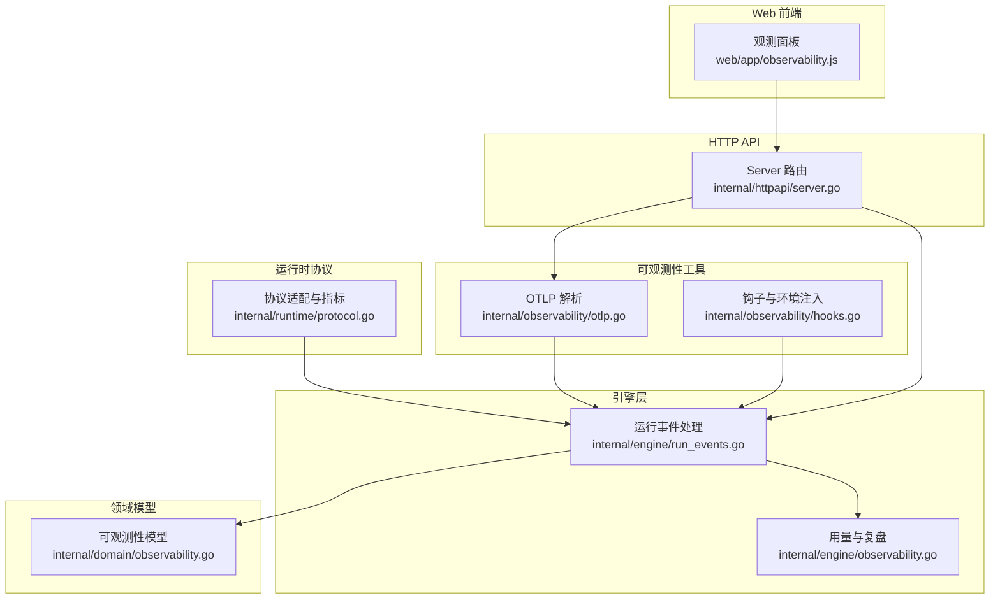
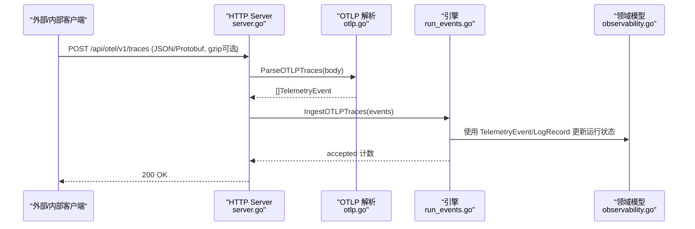
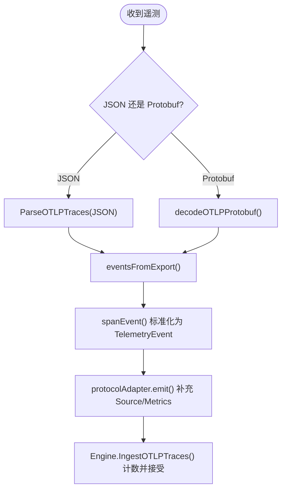
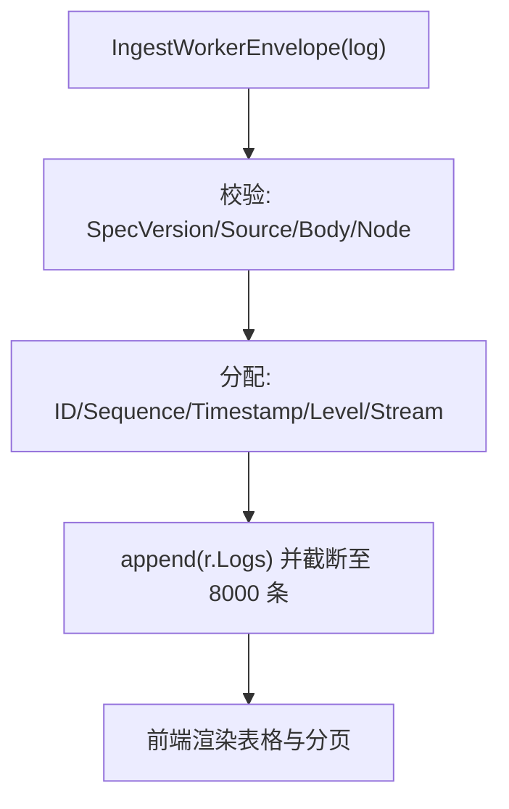
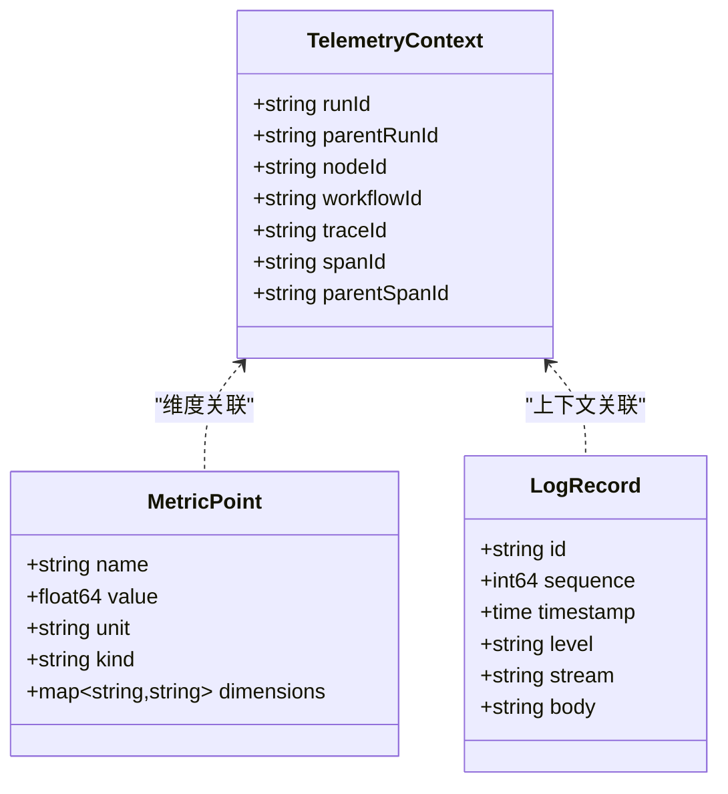
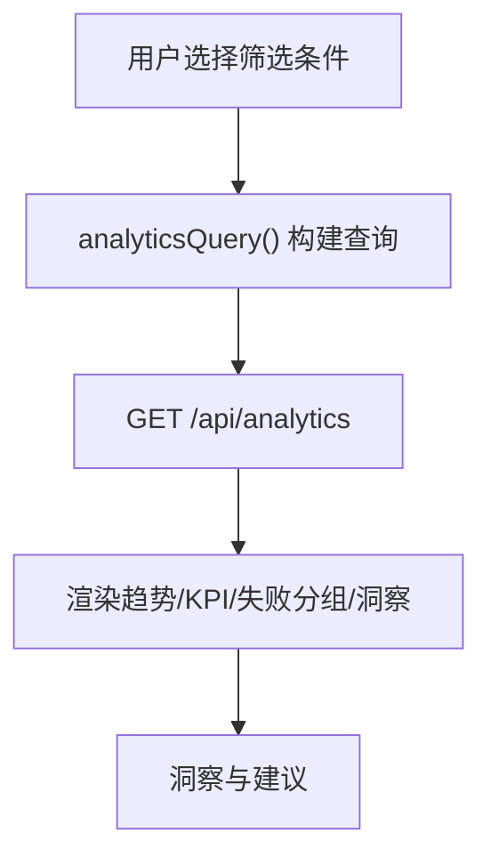
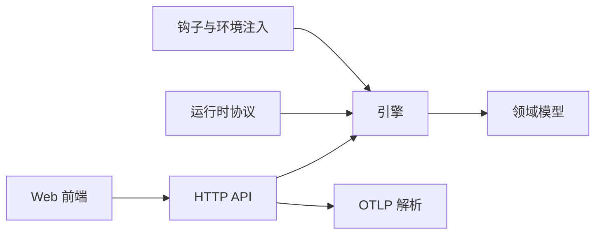

# 监控与分析

<cite>
**本文引用的文件**   
- [internal/domain/observability.go](file://internal/domain/observability.go)
- [internal/engine/run_events.go](file://internal/engine/run_events.go)
- [internal/engine/observability.go](file://internal/engine/observability.go)
- [internal/httpapi/server.go](file://internal/httpapi/server.go)
- [internal/observability/otlp.go](file://internal/observability/otlp.go)
- [internal/observability/hooks.go](file://internal/observability/hooks.go)
- [internal/runtime/protocol.go](file://internal/runtime/protocol.go)
- [web/app/observability.js](file://web/app/observability.js)
</cite>

## 目录
1. [简介](#简介)
2. [项目结构](#项目结构)
3. [核心组件](#核心组件)
4. [架构总览](#架构总览)
5. [详细组件分析](#详细组件分析)
6. [依赖关系分析](#依赖关系分析)
7. [性能与容量特性](#性能与容量特性)
8. [故障排查指南](#故障排查指南)
9. [结论](#结论)
10. [附录：接口与可视化示例](#附录接口与可视化示例)

## 简介
本章节面向运行监控、日志查询与分析统计能力，覆盖遥测数据收集、性能指标分析与执行追踪。文档说明以下关键能力：
- 遥测数据收集：统一事件模型、适配器协议、OTLP 追踪接入、工作器信封。
- 性能指标分析：Token、成本、耗时、缓存命中等指标的聚合与趋势展示。
- 执行追踪：按 Run/Node/Trace/Span 关联的端到端链路追踪与过滤。
- 日志分页查询：结构化日志记录、游标式序列号、分页与筛选。
- 事件过滤与数据分析：来源、阶段、错误分类、漏斗与洞察。
- 可视化与告警：前端观测面板、趋势图、KPI、失败分组与洞察提示。

## 项目结构
监控与分析相关代码主要分布在以下层次：
- 领域模型层：定义可观测性规范、上下文、指标点、工具/模型观察、日志记录与工作器信封。
- 引擎处理层：接收 OTLP 追踪、工作器信封，规范化事件，更新运行状态与日志，计算用量与复盘。
- HTTP API 层：暴露观测规格与 OTLP 上报入口。
- 可观测性工具层：OTLP 解析、钩子与环境注入。
- 运行时协议层：协议适配、指标生成、可见输出。
- Web 前端：观测面板、趋势图、筛选、分页、洞察与导出。

**图表来源**
- [internal/httpapi/server.go:786-817](file://internal/httpapi/server.go#L786-L817)
- [internal/engine/run_events.go:28-129](file://internal/engine/run_events.go#L28-L129)
- [internal/observability/otlp.go:59-100](file://internal/observability/otlp.go#L59-L100)
- [internal/runtime/protocol.go:114-128](file://internal/runtime/protocol.go#L114-L128)
- [internal/domain/observability.go:119-141](file://internal/domain/observability.go#L119-L141)

**章节来源**
- [internal/httpapi/server.go:786-817](file://internal/httpapi/server.go#L786-L817)
- [internal/engine/run_events.go:28-129](file://internal/engine/run_events.go#L28-L129)
- [internal/observability/otlp.go:59-100](file://internal/observability/otlp.go#L59-L100)
- [internal/runtime/protocol.go:114-128](file://internal/runtime/protocol.go#L114-L128)
- [internal/domain/observability.go:119-141](file://internal/domain/observability.go#L119-L141)

## 核心组件
- 领域模型
  - TelemetrySource/TelemetryContext：标识事件来源层与跨平台上下文（RunID、IssueID、TraceID/SpanID 等）。
  - MetricPoint：通用指标点（名称、值、单位、维度）。
  - ToolObservation/ModelObservation/ErrorObservation：工具调用、模型请求、错误观察。
  - LogRecord：独立、可游标寻址的诊断日志通道。
  - WorkerEnvelope：厂商无关的工作器入站契约（observation/log）。
- 引擎处理
  - IngestOTLPTraces：批量接收并计数已接受事件。
  - IngestWorkerEnvelope：校验并处理 observation/log，写入日志与运行状态。
  - 用量累计与 Loop 复盘：增量计算 Token/成本，生成自修正复盘产物。
- HTTP API
  - observabilitySpec：返回观测规格（类别、阶段、适配器描述）。
  - otel：OTLP v1/traces 上报入口（仅回环地址），支持 gzip。
- 可观测性工具
  - ParseOTLPTraces：JSON/Protobuf 双格式解析，映射为 TelemetryEvent。
  - CollectorTracesURL/InjectCodeBuddyEnv：构造采集端点与注入环境变量。
- 运行时协议
  - ObservabilitySpec：声明类别、阶段、必填上下文、指标约定与适配器能力。
  - usageMetrics：将 TokenUsage 转为 MetricPoint。
- Web 前端
  - 观测面板：概览/交付两个标签，趋势图、KPI、失败分组、洞察、用户/来源/时段筛选、分页与导出。

**章节来源**
- [internal/domain/observability.go:16-141](file://internal/domain/observability.go#L16-L141)
- [internal/engine/run_events.go:28-129](file://internal/engine/run_events.go#L28-L129)
- [internal/engine/observability.go:31-86](file://internal/engine/observability.go#L31-L86)
- [internal/httpapi/server.go:786-817](file://internal/httpapi/server.go#L786-L817)
- [internal/observability/otlp.go:59-100](file://internal/observability/otlp.go#L59-L100)
- [internal/observability/hooks.go:354-379](file://internal/observability/hooks.go#L354-L379)
- [internal/runtime/protocol.go:114-128](file://internal/runtime/protocol.go#L114-L128)
- [web/app/observability.js:1-1652](file://web/app/observability.js#L1-L1652)

## 架构总览
系统以“事件 + 日志”双通道实现可观测性：
- 事件通道：标准化 TelemetryEvent，用于指标聚合、失败分析、洞察生成。
- 日志通道：LogRecord，提供结构化、可分页、带序列号的诊断信息。

**图表来源**
- [internal/httpapi/server.go:790-817](file://internal/httpapi/server.go#L790-L817)
- [internal/observability/otlp.go:59-100](file://internal/observability/otlp.go#L59-L100)
- [internal/engine/run_events.go:28-49](file://internal/engine/run_events.go#L28-L49)
- [internal/domain/observability.go:119-141](file://internal/domain/observability.go#L119-L141)

## 详细组件分析

### 遥测数据收集与标准化
- 协议与规格
  - ObservabilitySpec 声明类别、阶段、必填上下文、指标约定与适配器能力。
  - AdapterDescriptor 描述各原生协议的适配能力与原始事件策略。
- 事件标准化
  - protocolAdapter.emit 填充 Source、SessionID、Metrics，并将 tool/model 事件转换为标准观察对象。
  - usageMetrics 将 TokenUsage 转为 MetricPoint 列表。
- OTLP 接入
  - ParseOTLPTraces 支持 JSON 与 Protobuf 两种格式，兼容字段缺失或异常时尽量解析已有字段。
  - spanEvent 根据 span.type/gen_ai.span.kind/codebuddy.span_type 推断 category/name/phase，并计算 durationMs。
- 工作器信封
  - WorkerEnvelope 统一 observation/log 入站；IngestWorkerEnvelope 校验 SpecVersion、Source、Body 长度、Node 存在性等。

**图表来源**
- [internal/observability/otlp.go:59-100](file://internal/observability/otlp.go#L59-L100)
- [internal/observability/otlp.go:103-163](file://internal/observability/otlp.go#L103-L163)
- [internal/runtime/protocol.go:158-180](file://internal/runtime/protocol.go#L158-L180)
- [internal/runtime/protocol.go:214-227](file://internal/runtime/protocol.go#L214-L227)
- [internal/engine/run_events.go:28-49](file://internal/engine/run_events.go#L28-L49)

**章节来源**
- [internal/runtime/protocol.go:114-128](file://internal/runtime/protocol.go#L114-L128)
- [internal/runtime/protocol.go:158-180](file://internal/runtime/protocol.go#L158-L180)
- [internal/runtime/protocol.go:214-227](file://internal/runtime/protocol.go#L214-L227)
- [internal/observability/otlp.go:59-100](file://internal/observability/otlp.go#L59-L100)
- [internal/observability/otlp.go:103-163](file://internal/observability/otlp.go#L103-L163)
- [internal/engine/run_events.go:28-49](file://internal/engine/run_events.go#L28-L49)

### 日志记录与分页查询
- 日志写入
  - IngestWorkerEnvelope 对 log 类型进行严格校验：Source.Layer/Adapter、Body 非空且不超过 64KB、Node 存在性检查。
  - 自动分配 ID、Sequence、Timestamp、Level、Stream，并追加到运行日志；超过阈值保留最近 8000 条。
- 日志模型
  - LogRecord 包含 specVersion、id、sequence、timestamp、level、stream、body、source、context、attributes。
- 前端分页
  - web/app/observability.js 提供观测量表卡片与分页控件，支持按责任人、来源、时段筛选后刷新列表。

**图表来源**
- [internal/engine/run_events.go:82-123](file://internal/engine/run_events.go#L82-L123)
- [internal/domain/observability.go:119-132](file://internal/domain/observability.go#L119-L132)
- [web/app/observability.js:513-518](file://web/app/observability.js#L513-L518)

**章节来源**
- [internal/engine/run_events.go:82-123](file://internal/engine/run_events.go#L82-L123)
- [internal/domain/observability.go:119-132](file://internal/domain/observability.go#L119-L132)
- [web/app/observability.js:513-518](file://web/app/observability.js#L513-L518)

### 性能指标分析与执行追踪
- 指标聚合
  - usageMetrics 将输入/输出/缓存/推理 Token 与成本 USD 转为计数器指标。
  - applyUsage 基于增量快照合并 TokenUsage，区分“真实零成本”与“成本未识别”。
- 执行追踪
  - TelemetryContext 携带 RunID/ParentRunID/NodeID/WorkflowID/TraceID/SpanID 等，支撑端到端链路。
  - OTLP 解析将 TraceID/SpanID/ParentSpanID 注入 Attributes，便于关联。
- 前端趋势与分位
  - obsTrendChart 绘制 Token/成本/成功率等趋势；obsPercentile 计算 P95/P90 等分位。
  - obsScopedView 汇总周期内成功/失败/取消、活跃、P95、平均耗时等 KPI。

**图表来源**
- [internal/domain/observability.go:25-68](file://internal/domain/observability.go#L25-L68)
- [internal/domain/observability.go:70-76](file://internal/domain/observability.go#L70-L76)
- [internal/domain/observability.go:119-132](file://internal/domain/observability.go#L119-L132)
- [internal/observability/otlp.go:138-162](file://internal/observability/otlp.go#L138-L162)
- [web/app/observability.js:141-145](file://web/app/observability.js#L141-L145)
- [web/app/observability.js:249-275](file://web/app/observability.js#L249-L275)

**章节来源**
- [internal/runtime/protocol.go:214-227](file://internal/runtime/protocol.go#L214-L227)
- [internal/engine/observability.go:31-86](file://internal/engine/observability.go#L31-L86)
- [internal/domain/observability.go:25-68](file://internal/domain/observability.go#L25-L68)
- [internal/observability/otlp.go:138-162](file://internal/observability/otlp.go#L138-L162)
- [web/app/observability.js:141-145](file://web/app/observability.js#L141-L145)
- [web/app/observability.js:249-275](file://web/app/observability.js#L249-L275)

### 事件过滤与数据分析方法
- 过滤器
  - 责任人、执行来源（internal/external）、需求来源（local/github）、时段（日/周/月/全部）组合筛选。
  - 前端 analyticsQuery 构建查询参数，后端按 scope/grain/tz 等返回聚合结果。
- 失败分析
  - 按错误码分组统计，识别凭据类错误并给出配置跳转建议。
- 漏斗与洞察
  - 交付漏斗定位最大流失环节；Token 环比变化归因到具体来源；缓存命中率与模型占比洞察。

**图表来源**
- [web/app/observability.js:384-399](file://web/app/observability.js#L384-L399)
- [web/app/observability.js:448-484](file://web/app/observability.js#L448-L484)
- [web/app/observability.js:709-795](file://web/app/observability.js#L709-L795)

**章节来源**
- [web/app/observability.js:384-399](file://web/app/observability.js#L384-L399)
- [web/app/observability.js:448-484](file://web/app/observability.js#L448-L484)
- [web/app/observability.js:709-795](file://web/app/observability.js#L709-L795)

### 监控数据的可视化展示与告警配置示例
- 可视化
  - 趋势图：按 Token/成本/成功率等指标绘制折线/面积图，支持点击切换时段。
  - KPI 卡片：运行数、成功率、P95、平均耗时、活跃数等。
  - 失败分组：按错误码聚合，高亮凭据问题并引导至设置页。
  - 洞察面板：Token 环比归因、缓存命中率、模型占比、交付漏斗等。
- 告警配置示例（概念性）
  - 基于前端洞察与失败分组，可在外部监控系统对接时，针对“凭据错误”“成功率低于阈值”“P95 超时”等规则触发告警。
  - 结合环境注入的 OTEL 环境变量，将追踪与日志发送到外部采集器，配合告警规则实现闭环。

[本节为概念性内容，不直接分析具体文件]

## 依赖关系分析
- 耦合与内聚
  - HTTP API 层仅负责路由与鉴权，业务逻辑集中在引擎层。
  - 引擎层通过领域模型解耦不同来源的事件与日志。
  - OTLP 解析与协议适配相互独立，便于扩展新适配器。
- 外部依赖
  - OTLP 上报需满足回环地址限制；支持 gzip 压缩。
  - 前端依赖状态 state.analytics 与 state.data 渲染观测面板。

**图表来源**
- [internal/httpapi/server.go:786-817](file://internal/httpapi/server.go#L786-L817)
- [internal/engine/run_events.go:28-129](file://internal/engine/run_events.go#L28-L129)
- [internal/observability/otlp.go:59-100](file://internal/observability/otlp.go#L59-L100)
- [internal/runtime/protocol.go:114-128](file://internal/runtime/protocol.go#L114-L128)
- [internal/observability/hooks.go:354-379](file://internal/observability/hooks.go#L354-L379)
- [web/app/observability.js:1-1652](file://web/app/observability.js#L1-L1652)

**章节来源**
- [internal/httpapi/server.go:786-817](file://internal/httpapi/server.go#L786-L817)
- [internal/engine/run_events.go:28-129](file://internal/engine/run_events.go#L28-L129)
- [internal/observability/otlp.go:59-100](file://internal/observability/otlp.go#L59-L100)
- [internal/runtime/protocol.go:114-128](file://internal/runtime/protocol.go#L114-L128)
- [internal/observability/hooks.go:354-379](file://internal/observability/hooks.go#L354-L379)
- [web/app/observability.js:1-1652](file://web/app/observability.js#L1-L1652)

## 性能与容量特性
- 日志容量控制
  - 单运行日志上限 8000 条，避免无限增长影响存储与渲染。
- 遥测体积限制
  - OTLP 上报体限制读取 16MB，防止超大负载阻塞服务。
- 指标增量计算
  - 基于 UsageCursor 增量合并 TokenUsage，减少重复计算与冗余存储。
- 前端渲染优化
  - 趋势窗口按粒度裁剪（周/月/全部），避免大数据量直绘。

**章节来源**
- [internal/engine/run_events.go:119-121](file://internal/engine/run_events.go#L119-L121)
- [internal/httpapi/server.go:809-815](file://internal/httpapi/server.go#L809-L815)
- [internal/engine/observability.go:31-86](file://internal/engine/observability.go#L31-L86)
- [web/app/observability.js:19-23](file://web/app/observability.js#L19-L23)

## 故障排查指南
- OTLP 上报失败
  - 确认路径后缀为 /v1/traces；仅允许回环地址访问；Content-Encoding=gzip 时需正确解压。
  - 若返回 400，检查 body 是否可读或格式非法。
- 工作器信封校验失败
  - 检查 SpecVersion 是否为 agentflow.observability/v1。
  - observation 必须包含 Source.Layer/Adapter 与 NodeID；log 必须包含 Body 且不超过 64KB。
- 日志未出现
  - 确认 Stream/Level 默认值已填充；Sequence 递增；Timestamp 为空时使用当前时间。
- 指标不更新
  - 检查 usageMetrics 是否生成对应 MetricPoint；applyUsage 是否检测到增量。
- 前端无数据
  - 检查 analyticsQuery 参数是否正确；scope/grain/tz 是否符合预期；state.analytics 是否加载成功。

**章节来源**
- [internal/httpapi/server.go:790-817](file://internal/httpapi/server.go#L790-L817)
- [internal/engine/run_events.go:54-123](file://internal/engine/run_events.go#L54-L123)
- [internal/runtime/protocol.go:214-227](file://internal/runtime/protocol.go#L214-L227)
- [web/app/observability.js:384-399](file://web/app/observability.js#L384-L399)

## 结论
本系统通过统一的 TelemetryEvent 与 LogRecord 双通道，实现了从执行器到前端的完整可观测性闭环。OTLP 与协议适配使多来源遥测数据得以标准化；引擎层负责指标聚合与日志持久化；前端提供丰富的可视化与洞察能力。建议在外部监控系统中对接告警规则，结合凭据检测、成功率与延迟阈值，形成自动化运维闭环。

[本节为总结性内容，不直接分析具体文件]

## 附录：接口与可视化示例

### 接口定义
- GET /api/observability/spec
  - 功能：返回观测规格（类别、阶段、必填上下文、指标约定、适配器描述）。
  - 响应：domain.ObservabilitySpec。
- POST /api/otel/v1/traces
  - 功能：接收 OTLP 追踪（JSON 或 Protobuf，支持 gzip）。
  - 限制：仅回环地址；请求体限读 16MB。
  - 响应：200 OK。

**章节来源**
- [internal/httpapi/server.go:786-817](file://internal/httpapi/server.go#L786-L817)
- [internal/runtime/protocol.go:114-128](file://internal/runtime/protocol.go#L114-L128)

### 可视化示例
- 趋势图
  - 指标：tokens/cost/rate/issues/runs。
  - 交互：点击点位切换时段；左右箭头翻页；粒度切换（日/周/月/全部）。
- KPI 卡片
  - 指标：运行总数、成功/失败/取消、活跃、P95、平均耗时、成功率。
- 失败分组
  - 按错误码聚合，识别凭据类错误并引导至设置页。
- 洞察
  - Token 环比归因、缓存命中率、模型占比、交付漏斗。

**章节来源**
- [web/app/observability.js:249-275](file://web/app/observability.js#L249-L275)
- [web/app/observability.js:383-383](file://web/app/observability.js#L383-L383)
- [web/app/observability.js:709-795](file://web/app/observability.js#L709-L795)