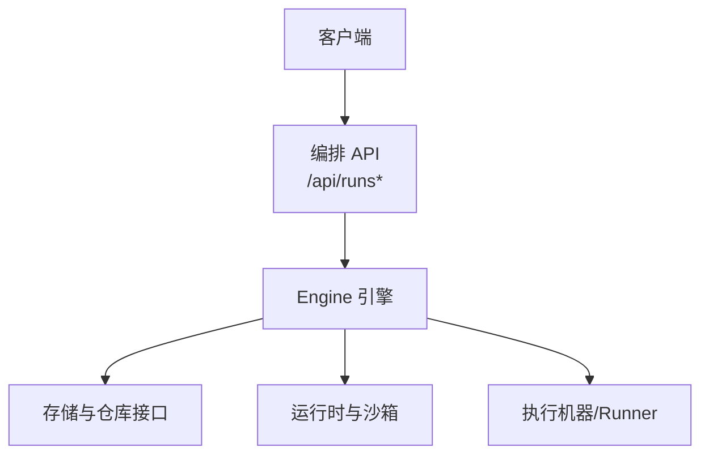
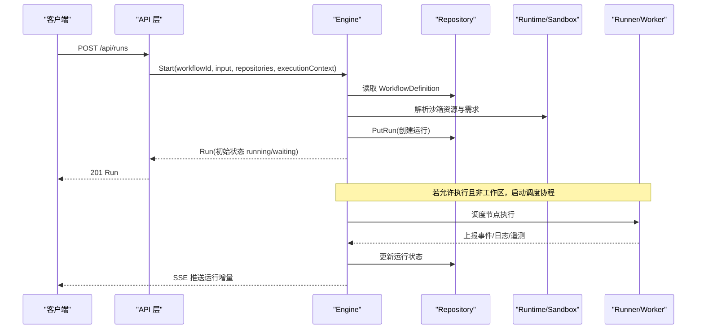
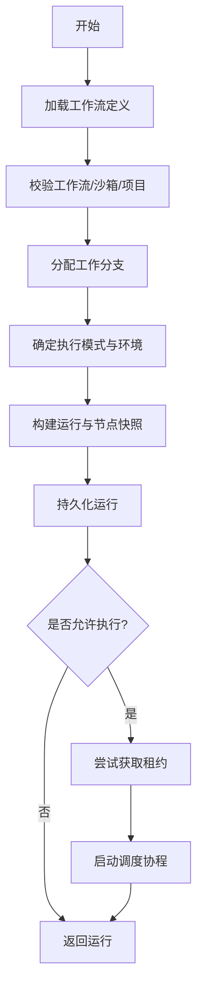
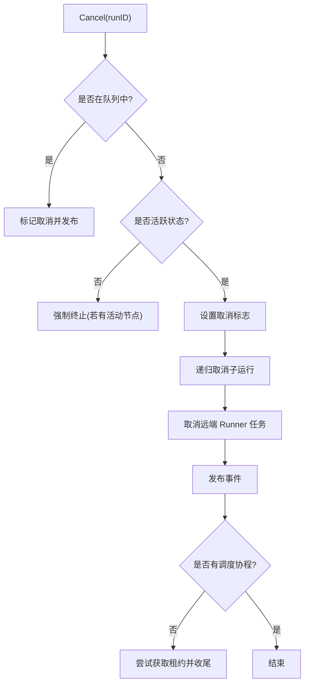
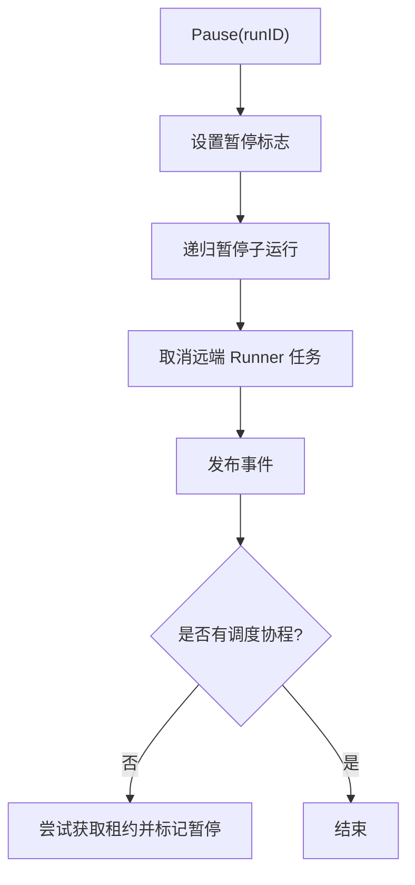
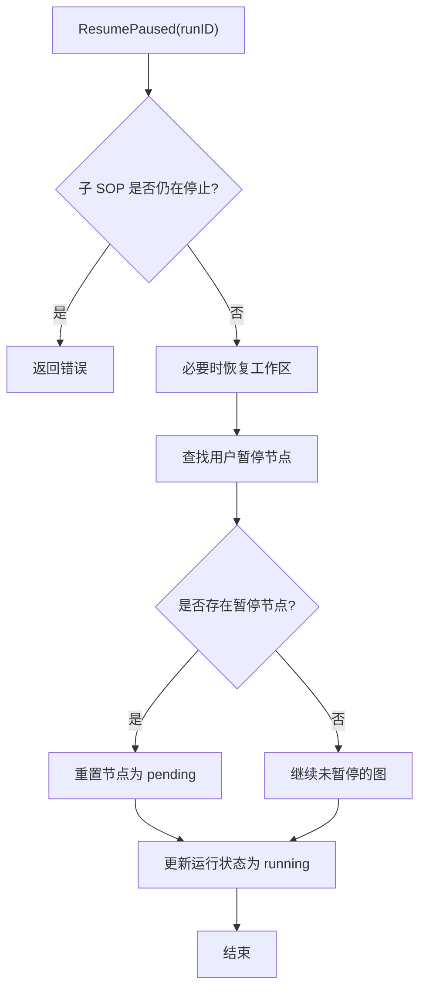
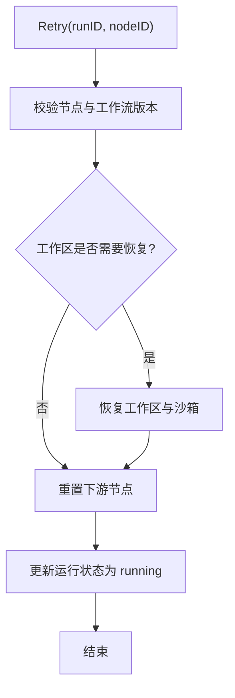
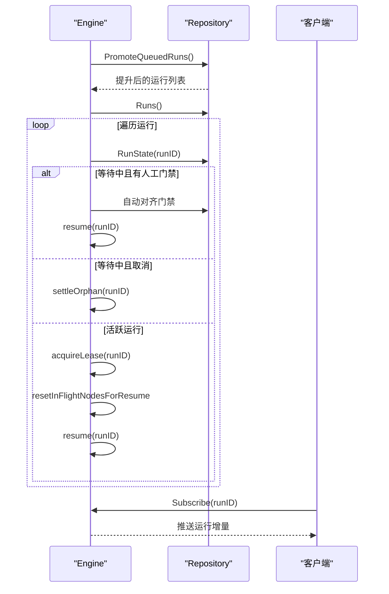
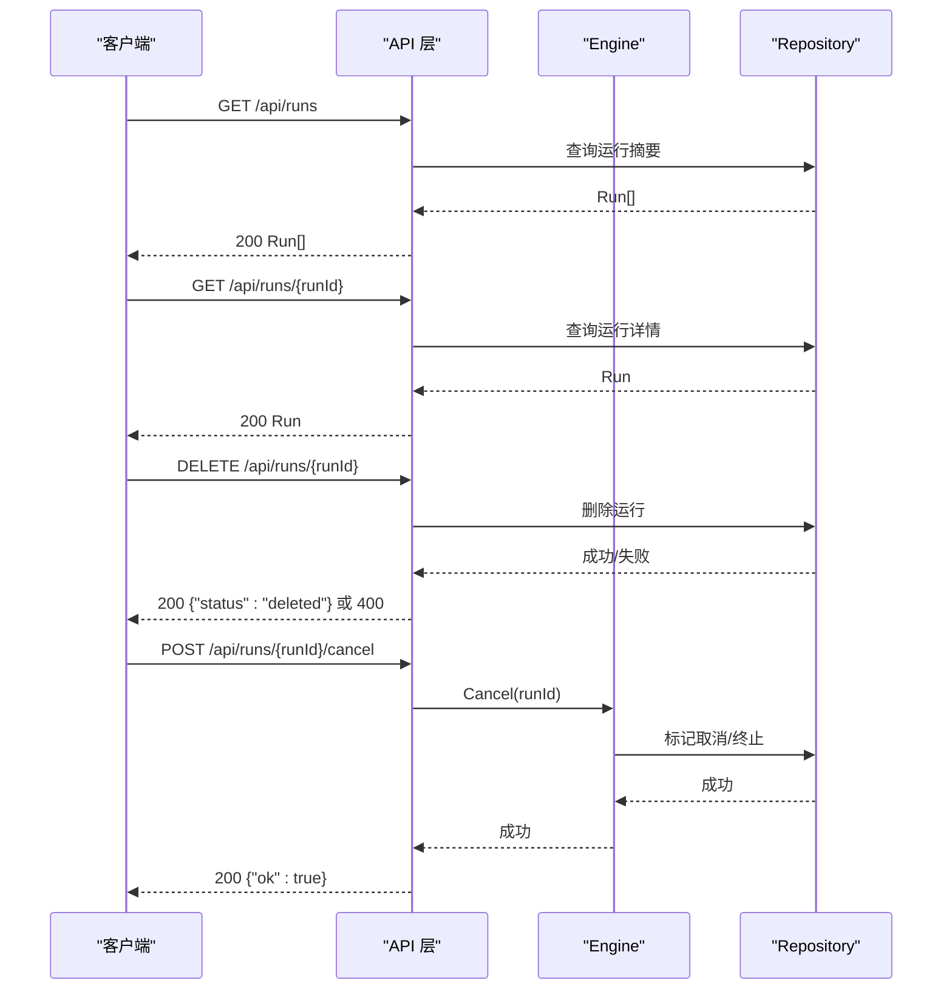
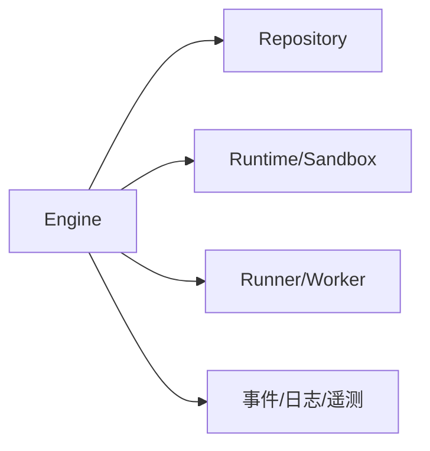

# 运行生命周期

<cite>
**本文引用的文件**   
- [run_start.go](file://internal/engine/run_start.go)
- [run_ops.go](file://internal/engine/run_ops.go)
- [run_state.go](file://internal/engine/run_state.go)
- [run_recovery.go](file://internal/engine/run_recovery.go)
- [orchestration.md](file://docs/api/orchestration.md)
</cite>

## 目录
1. [引言](#引言)
2. [项目结构](#项目结构)
3. [核心组件](#核心组件)
4. [架构总览](#架构总览)
5. [详细组件分析](#详细组件分析)
6. [依赖关系分析](#依赖关系分析)
7. [性能与资源特性](#性能与资源特性)
8. [故障排查指南](#故障排查指南)
9. [结论](#结论)

## 引言
本文面向“运行”这一核心概念，系统说明其创建、启动、暂停、恢复、终止等生命周期管理接口，并补充状态转换规则、权限验证、资源管理、调度参数配置、执行环境设置、查询/删除/取消流程、监控与错误处理示例。文档以引擎层实现为依据，同时结合编排 API 文档描述对外暴露的 HTTP 行为。

## 项目结构
围绕运行生命周期的关键代码集中在引擎模块：
- 运行创建与启动：`internal/engine/run_start.go`
- 运行控制操作（取消、暂停、重试、通过、拒绝、继续）：`internal/engine/run_ops.go`
- 运行状态更新、订阅与实例接管循环：`internal/engine/run_state.go`
- 运行恢复、租约、工作区绑定与清理：`internal/engine/run_recovery.go`
- 编排 API 文档（运行相关端点）：`docs/api/orchestration.md`

**图表来源**
- [run_start.go:37-209](file://internal/engine/run_start.go#L37-L209)
- [run_ops.go:47-138](file://internal/engine/run_ops.go#L47-L138)
- [run_state.go:66-152](file://internal/engine/run_state.go#L66-L152)
- [run_recovery.go:103-250](file://internal/engine/run_recovery.go#L103-L250)
- [orchestration.md:84-120](file://docs/api/orchestration.md#L84-L120)

**章节来源**
- [run_start.go:37-209](file://internal/engine/run_start.go#L37-L209)
- [run_ops.go:47-138](file://internal/engine/run_ops.go#L47-L138)
- [run_state.go:66-152](file://internal/engine/run_state.go#L66-L152)
- [run_recovery.go:103-250](file://internal/engine/run_recovery.go#L103-L250)
- [orchestration.md:84-120](file://docs/api/orchestration.md#L84-L120)

## 核心组件
- Engine：运行编排的核心对象，负责创建工作流快照、分配工作分支、选择执行模式、持久化运行、调度执行协程、处理控制命令、恢复中断运行、维护订阅推送。
- Repository/Store：运行状态、SOP、Issue/Task 关联、租约、事件、日志、遥测等数据的持久化与查询。
- Runtime/Sandbox：运行环境与沙箱资源的生命周期管理。
- Runner：远程或本地执行节点，承载具体节点任务。

**章节来源**
- [run_start.go:37-209](file://internal/engine/run_start.go#L37-L209)
- [run_ops.go:14-138](file://internal/engine/run_ops.go#L14-L138)
- [run_state.go:11-152](file://internal/engine/run_state.go#L11-L152)
- [run_recovery.go:14-101](file://internal/engine/run_recovery.go#L14-L101)

## 架构总览
运行生命周期由“控制面 + 执行面”共同完成：
- 控制面：接收 HTTP 请求，校验权限与业务约束，调用 Engine 方法，写入运行状态并发布事件。
- 执行面：Engine 在拥有租约后启动执行协程，驱动节点执行，必要时进入人工门禁或暂停状态，等待外部决策。

**图表来源**
- [run_start.go:37-209](file://internal/engine/run_start.go#L37-L209)
- [run_state.go:66-152](file://internal/engine/run_state.go#L66-L152)
- [orchestration.md:90-120](file://docs/api/orchestration.md#L90-L120)

## 详细组件分析

### 运行创建与启动
- 入口：`Engine.Start` 及其上下文重载方法，最终落到 `startWorkflowDefinition`。
- 主要步骤：
  - 校验工作流存在、通用模板项目要求、沙箱配置与资源需求。
  - 分配工作分支（支持从 Issue 推导默认分支）。
  - 确定执行模式（本地 Runner、云端池、云原生模式），并设置执行上下文。
  - 构建运行记录，初始化节点为 pending。
  - 持久化运行；若允许执行且非工作区，则尝试获取租约并启动执行协程。
- 关键约束：
  - 执行被禁用时返回错误。
  - 通用模板必须指定有效项目。
  - 工作区类型运行初始状态为 waiting，不立即执行。

**图表来源**
- [run_start.go:37-209](file://internal/engine/run_start.go#L37-L209)

**章节来源**
- [run_start.go:37-209](file://internal/engine/run_start.go#L37-L209)

### 运行取消
- 入口：`Engine.Cancel`。
- 行为：
  - 若处于队列中，直接标记取消并发布。
  - 若非活跃状态但仍有活动节点，强制终止。
  - 对活跃运行，设置取消标志，递归取消子运行，取消远端 Runner 任务，发布事件。
  - 若没有调度协程持有该运行，则尝试获取租约并收尾。
- 对外 API：`POST /api/runs/{runId}/cancel`。

**图表来源**
- [run_ops.go:47-104](file://internal/engine/run_ops.go#L47-L104)

**章节来源**
- [run_ops.go:47-104](file://internal/engine/run_ops.go#L47-L104)
- [orchestration.md:264-272](file://docs/api/orchestration.md#L264-L272)

### 运行暂停
- 入口：`Engine.Pause`。
- 行为：
  - 设置暂停标志，递归暂停子运行。
  - 取消远端 Runner 任务，发布事件。
  - 若没有调度协程，尝试获取租约并标记暂停。
- 语义：暂停不会终结运行或销毁工作区，而是停在人工决策点，便于补充上下文后继续。

**图表来源**
- [run_ops.go:106-138](file://internal/engine/run_ops.go#L106-L138)

**章节来源**
- [run_ops.go:106-138](file://internal/engine/run_ops.go#L106-L138)

### 运行恢复
- 入口：`Engine.ResumePaused` 与内部 `resumePaused`。
- 行为：
  - 先检查子 SOP 是否仍在停止当前任务，避免并发冲突。
  - 如需恢复对话工作区，则先执行恢复。
  - 查找用户暂停的节点，将其重置为 pending，清除中间态，保留必要上下文。
  - 若无可恢复节点但图已就绪，则直接继续运行。
  - 更新运行状态为 running，并发布恢复事件。
- 注意：普通审批门禁不受 ResumePaused 影响，需显式 Approve。

**图表来源**
- [run_ops.go:632-813](file://internal/engine/run_ops.go#L632-L813)

**章节来源**
- [run_ops.go:632-813](file://internal/engine/run_ops.go#L632-L813)

### 运行重试与通过/拒绝
- 重试：`Engine.Retry`/`RetryContext`，支持从指定节点重跑，保留上游成功结果，必要时恢复工作区与沙箱。
- 通过：`Engine.Pass`，将失败的脚本节点视为通过并继续下游，不重新执行该节点。
- 拒绝：`Engine.Reject`，按目标节点回退，重置下游节点，增加返工计数。

**图表来源**
- [run_ops.go:353-630](file://internal/engine/run_ops.go#L353-L630)

**章节来源**
- [run_ops.go:353-630](file://internal/engine/run_ops.go#L353-L630)

### 运行状态订阅与实例接管
- 订阅：`Engine.Subscribe` 提供运行状态的实时推送，基于轮询最新 revision 并推送增量。
- 实例接管：`Engine.StartClaimLoop` 周期性调用 `ResumeInterruptedRuns`，恢复服务重启遗留的运行。
- 恢复逻辑：
  - 提升队列中的运行。
  - 处理等待中的人工门禁与取消请求。
  - 对活跃运行进行租约检查与接管，必要时重置活动节点为 pending，继续执行。
  - 对工作区丢失的情况给出明确提示并收尾。

**图表来源**
- [run_state.go:66-152](file://internal/engine/run_state.go#L66-L152)
- [run_recovery.go:103-250](file://internal/engine/run_recovery.go#L103-L250)

**章节来源**
- [run_state.go:66-152](file://internal/engine/run_state.go#L66-L152)
- [run_recovery.go:103-250](file://internal/engine/run_recovery.go#L103-L250)

### 运行查询、删除与取消的完整流程
- 查询：
  - 列表：`GET /api/runs`，支持项目过滤与责任人筛选。
  - 详情：`GET /api/runs/{runId}`，包含节点快照、事件、制品元数据等。
  - 实时：`GET /api/runs/{runId}/stream`，SSE 推送运行增量与日志/遥测增量。
- 删除：
  - `DELETE /api/runs/{runId}`，成功返回 `{"status":"deleted"}`；不存在或不能删除通常返回 400。
- 取消：
  - `POST /api/runs/{runId}/cancel`，无需请求字段；取消运行。

**图表来源**
- [orchestration.md:84-120](file://docs/api/orchestration.md#L84-L120)
- [orchestration.md:118-120](file://docs/api/orchestration.md#L118-L120)
- [orchestration.md:264-272](file://docs/api/orchestration.md#L264-L272)
- [run_ops.go:47-104](file://internal/engine/run_ops.go#L47-L104)

**章节来源**
- [orchestration.md:84-120](file://docs/api/orchestration.md#L84-L120)
- [orchestration.md:118-120](file://docs/api/orchestration.md#L118-L120)
- [orchestration.md:264-272](file://docs/api/orchestration.md#L264-L272)
- [run_ops.go:47-104](file://internal/engine/run_ops.go#L47-L104)

## 依赖关系分析
- Engine 与 Repository：强耦合于运行状态、SOP、Issue/Task、租约、事件、日志、遥测等数据访问。
- Engine 与 Runtime/Sandbox：用于沙箱资源解析、环境释放、容器丢弃与工作区恢复。
- Engine 与 Runner：通过远端任务取消、会话恢复 ID 解析等方式协调执行。
- 控制面与执行面解耦：控制面可仅做状态变更与发布，执行面负责实际调度与节点执行。

**图表来源**
- [run_start.go:37-209](file://internal/engine/run_start.go#L37-L209)
- [run_ops.go:14-138](file://internal/engine/run_ops.go#L14-L138)
- [run_state.go:11-152](file://internal/engine/run_state.go#L11-L152)
- [run_recovery.go:14-101](file://internal/engine/run_recovery.go#L14-L101)

**章节来源**
- [run_start.go:37-209](file://internal/engine/run_start.go#L37-L209)
- [run_ops.go:14-138](file://internal/engine/run_ops.go#L14-L138)
- [run_state.go:11-152](file://internal/engine/run_state.go#L11-L152)
- [run_recovery.go:14-101](file://internal/engine/run_recovery.go#L14-L101)

## 性能与资源特性
- 运行状态订阅采用轻量轮询与增量推送，避免阻塞执行协程。
- 实例接管循环每 2 秒扫描一次，提升服务恢复后的收敛速度。
- 工作区与沙箱在重试或全量回放时可能丢弃旧容器，避免继承破坏的环境。
- 远端 Runner 任务取消与租约续期有重试与超时保护，防止长时间挂起。

[本节为一般性指导，不直接分析具体文件]

## 故障排查指南
- 运行无法启动：
  - 检查执行是否被禁用（ErrExecutionDisabled）。
  - 确认工作流与沙箱配置有效。
  - 通用模板需指定有效项目。
- 运行卡在 waiting：
  - 检查是否处于人工门禁或用户暂停状态。
  - 使用 `/api/runs/{runId}/approve` 或 `/api/runs/{runId}/resume` 推进。
- 运行取消无效：
  - 确认是否已有调度协程持有该运行；若无，Engine 会尝试获取租约并收尾。
- 工作区丢失：
  - 当绑定的工作区主机下线且存在代码改动时，运行会被标记为丢失并建议从头重跑。
- 实时流断开：
  - SSE 客户端断开即取消订阅；重连需显式传入 sequence 游标。

**章节来源**
- [run_start.go:71-103](file://internal/engine/run_start.go#L71-L103)
- [run_ops.go:47-138](file://internal/engine/run_ops.go#L47-L138)
- [run_recovery.go:20-64](file://internal/engine/run_recovery.go#L20-L64)
- [orchestration.md:128-150](file://docs/api/orchestration.md#L128-L150)

## 结论
运行生命周期由 Engine 统一编排，控制面负责权限与业务校验，执行面负责调度与节点执行。通过租约机制、工作区绑定、沙箱管理与远端 Runner 协作，系统在服务重启、实例迁移、工作区丢失等场景下具备较强的恢复能力。对外 API 提供了完整的运行创建、查询、删除、取消与人工动作能力，配合 SSE 实时流可实现端到端的运行监控与交互。