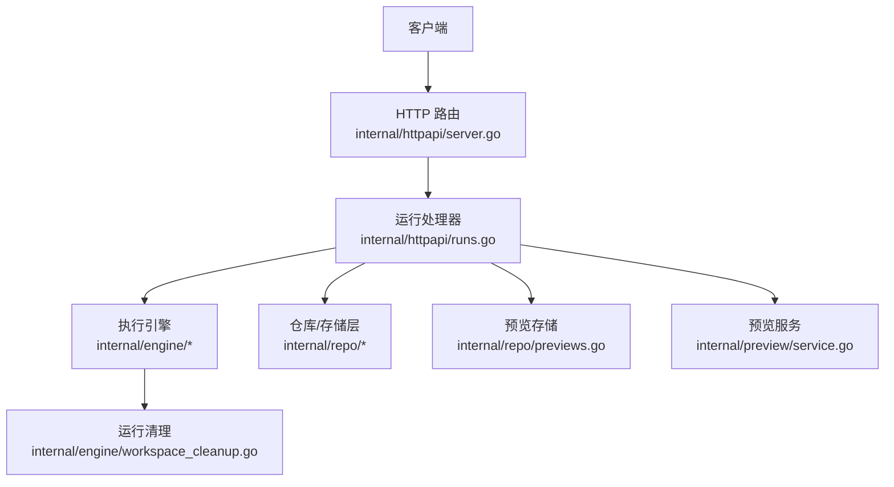
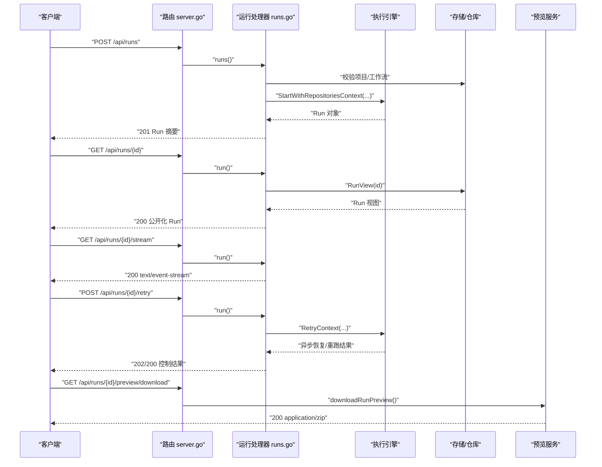
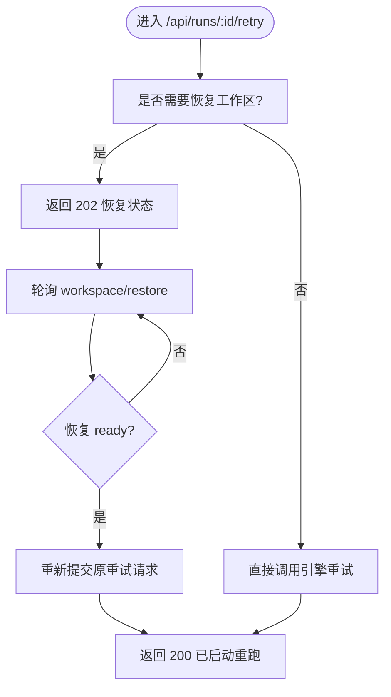
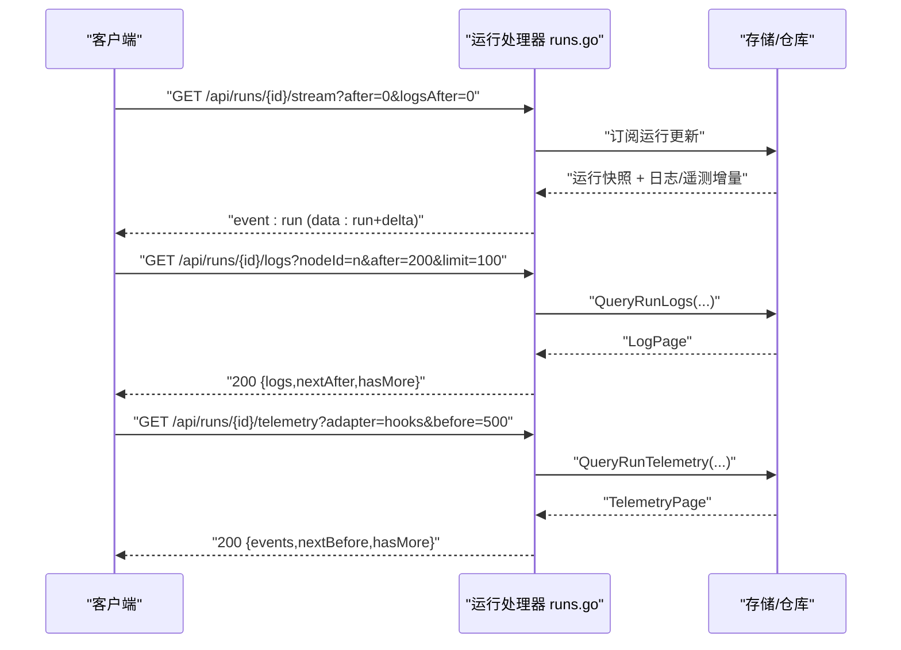
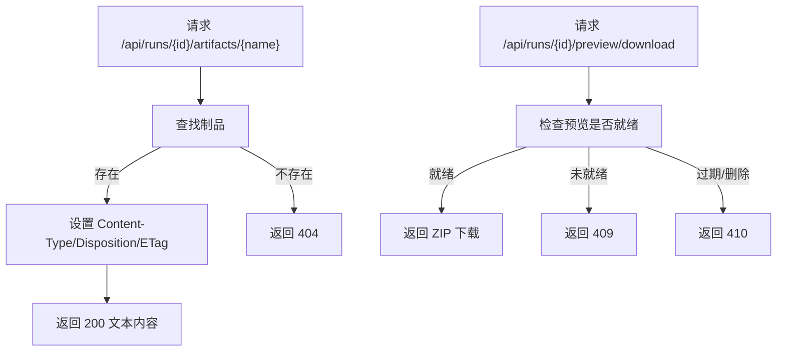
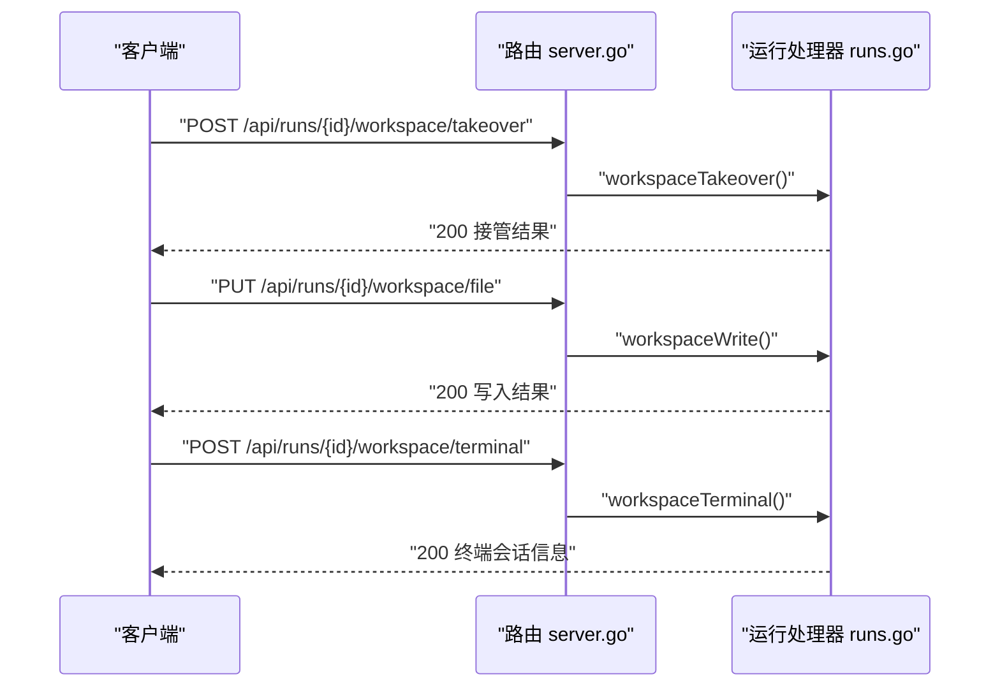
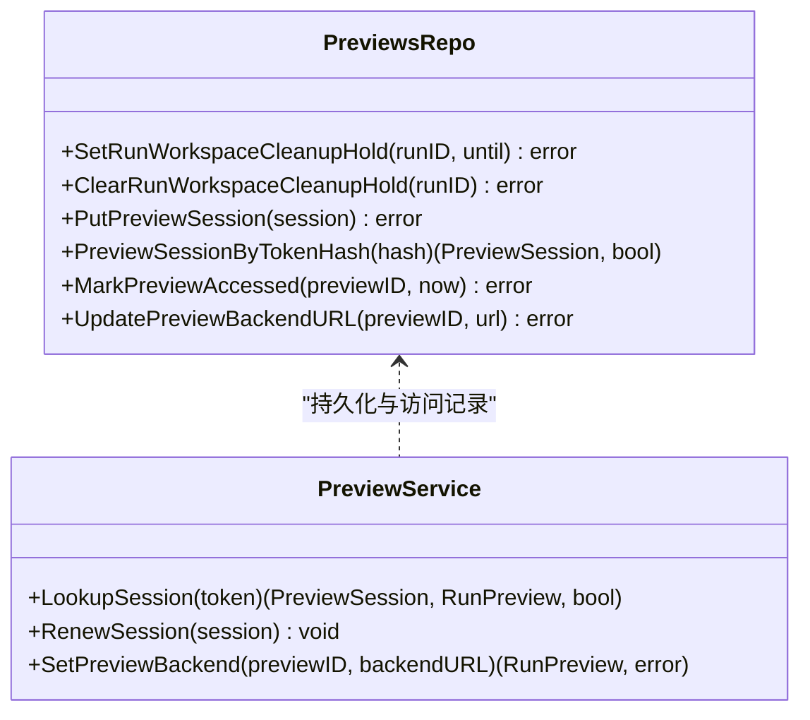
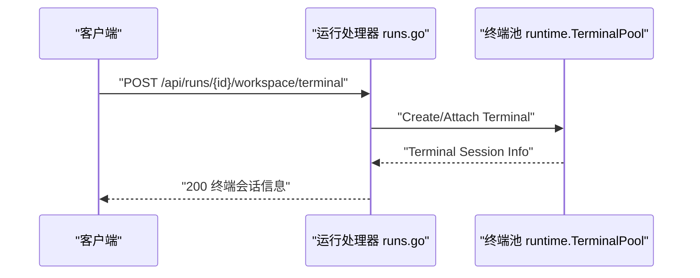
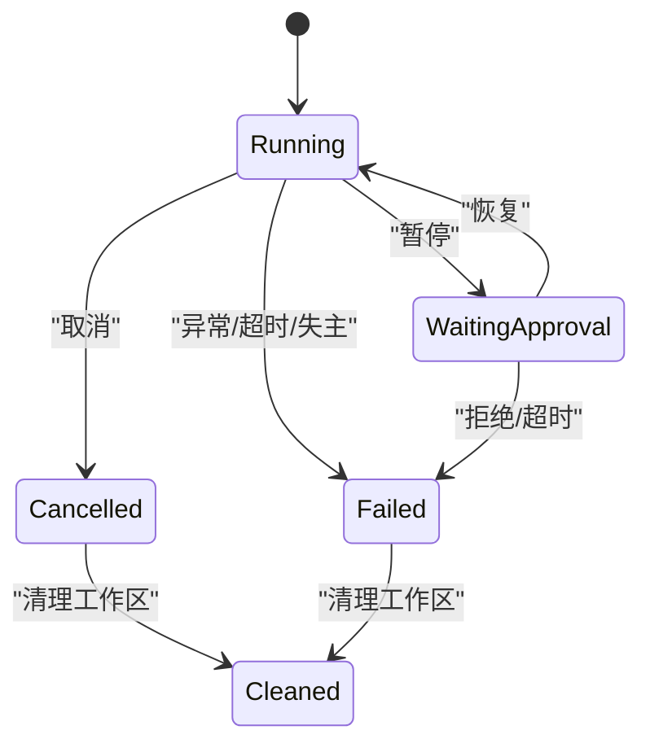
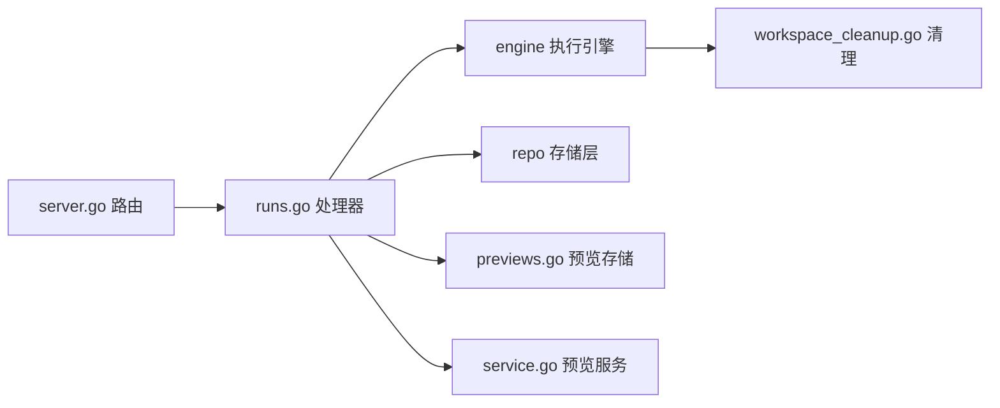

# 运行管理 API

<cite>
**本文引用的文件**   
- [README.md](file://docs/api/README.md)
- [orchestration.md](file://docs/api/orchestration.md)
- [server.go](file://internal/httpapi/server.go)
- [runs.go](file://internal/httpapi/runs.go)
- [previews.go](file://internal/repo/previews.go)
- [service.go](file://internal/preview/service.go)
- [node_outcome.go](file://internal/engine/node_outcome.go)
- [workspace_cleanup.go](file://internal/engine/workspace_cleanup.go)
</cite>

## 目录
1. [简介](#简介)
2. [项目结构](#项目结构)
3. [核心组件](#核心组件)
4. [架构总览](#架构总览)
5. [详细组件分析](#详细组件分析)
6. [依赖关系分析](#依赖关系分析)
7. [性能与扩展性](#性能与扩展性)
8. [故障排除指南](#故障排除指南)
9. [结论](#结论)
10. [附录：调用示例索引](#附录调用示例索引)

## 简介
本文件面向“运行管理 API”，聚焦工作流执行的启动、控制、监控，以及运行状态查询、进度跟踪、结果获取；同时覆盖工作区操作、预览服务、终端交互等扩展能力。文档基于 HTTP API 路由定义、编排文档、运行时处理器与引擎清理逻辑整理而成，帮助读者从接口契约到内部处理链路建立完整认知。

## 项目结构
运行管理相关代码主要分布在以下位置：
- HTTP 路由注册：`internal/httpapi/server.go`
- 运行处理器与数据裁剪：`internal/httpapi/runs.go`
- 编排与运行接口说明：`docs/api/orchestration.md`
- 公共 API 约定与认证：`docs/api/README.md`
- 预览服务存储与服务实现：`internal/repo/previews.go`、`internal/preview/service.go`
- 运行生命周期与清理：`internal/engine/node_outcome.go`、`internal/engine/workspace_cleanup.go`

**图表来源**
- [server.go:514-561](file://internal/httpapi/server.go#L514-L561)
- [runs.go:19-25](file://internal/httpapi/runs.go#L19-L25)
- [previews.go:225-267](file://internal/repo/previews.go#L225-L267)
- [service.go:614-656](file://internal/preview/service.go#L614-L656)
- [workspace_cleanup.go:494-534](file://internal/engine/workspace_cleanup.go#L494-L534)

**章节来源**
- [server.go:514-561](file://internal/httpapi/server.go#L514-L561)
- [README.md:11-62](file://docs/api/README.md#L11-L62)

## 核心组件
- 运行处理器 `runsHandlers`：负责 `/api/runs` 系列接口的请求解析、权限校验、参数转换、调用引擎或仓库，并返回公开化响应。
- 编排文档：描述 SOP、运行、日志、遥测、制品、人工动作、评测、指标与分析、定时任务等接口契约。
- 预览服务：提供运行预览的创建、会话、后端地址更新、下载归档等能力。
- 引擎清理：在运行取消、失主、终态时清理工作区、标记节点状态、发布事件。

**章节来源**
- [runs.go:19-25](file://internal/httpapi/runs.go#L19-L25)
- [orchestration.md:76-127](file://docs/api/orchestration.md#L76-L127)
- [previews.go:225-267](file://internal/repo/previews.go#L225-L267)
- [service.go:614-656](file://internal/preview/service.go#L614-L656)
- [workspace_cleanup.go:494-534](file://internal/engine/workspace_cleanup.go#L494-L534)

## 架构总览
运行管理 API 的典型调用路径如下：
- 启动运行：客户端 POST `/api/runs` → 路由分发 → 运行处理器校验项目与工作流 → 调用引擎启动 → 返回运行摘要。
- 查询运行：GET `/api/runs/{id}` → 读取运行视图 → 裁剪敏感字段 → 返回详情。
- 实时进度：GET `/api/runs/{id}/stream` → SSE 推送运行增量、日志增量、遥测增量。
- 日志与遥测：分页游标查询 `/logs`、`/telemetry`。
- 人工控制：approve、reject、retry、cancel、pause、resume、pass 等。
- 工作区操作：takeover/release/restore/use/write/terminal/tree/file/log/commit/diff/search。
- 预览服务：preview/download、update backend、session 创建与删除。
- 终端交互：通过 workspace terminal 接口发起交互式终端。

**图表来源**
- [server.go:514-561](file://internal/httpapi/server.go#L514-L561)
- [runs.go:71-145](file://internal/httpapi/runs.go#L71-L145)
- [runs.go:146-312](file://internal/httpapi/runs.go#L146-L312)
- [orchestration.md:128-150](file://docs/api/orchestration.md#L128-L150)

## 详细组件分析

### 运行启动与控制
- 启动运行：`POST /api/runs`
  - 输入包含 `workflowId`、可选 `input`、可选 `projectId`。
  - 成功返回 `201` 新运行摘要；执行被禁用返回 `403`；工作流/参数/引擎错误通常 `400`。
- 查询运行：`GET /api/runs/{id}`
  - 返回运行详情，artifact 仅元数据，telemetry/logs 不内嵌，events 最多最近 80 条。
- 删除运行：`DELETE /api/runs/{id}`
  - 成功返回 `{"status":"deleted"}`；不存在或不能删除通常 `400`。
- 人工动作：
  - approve、reject、retry、decline-retry、cancel、pause、resume、refresh-sop、pass。
  - 与 Issue 关联且执行被关闭/交付锁定的 run，在 approve/pass/reject/retry 时可能返回 `409`。
- 重试工作区恢复流程：
  - 当需要恢复工作区时，重试接口可返回 `202` 并附带恢复状态；后续轮询 `/api/runs/{id}/workspace/restore`。
  - 支持 `Prefer: respond-async` 将工作区恢复与节点重跑解耦。

**图表来源**
- [runs.go:266-298](file://internal/httpapi/runs.go#L266-L298)
- [orchestration.md:242-254](file://docs/api/orchestration.md#L242-L254)

**章节来源**
- [orchestration.md:90-127](file://docs/api/orchestration.md#L90-L127)
- [orchestration.md:214-273](file://docs/api/orchestration.md#L214-L273)
- [runs.go:71-145](file://internal/httpapi/runs.go#L71-L145)
- [runs.go:146-312](file://internal/httpapi/runs.go#L146-L312)

### 运行监控与进度跟踪
- SSE 实时运行：`GET /api/runs/{id}/stream?after={seq}&logsAfter={seq}`
  - 返回 `text/event-stream`，每个事件包含 `run`、`telemetryDelta`、`logDelta`。
  - 空闲心跳每 15 秒一次；断开即取消订阅；不支持 `Last-Event-ID`，重连需显式传 sequence。
- 日志分页：`GET /api/runs/{id}/logs`
  - 使用 sequence 游标，支持 `after`、`before`、`limit`、`nodeId`。
  - log body 最长 2000 字节。
- 遥测分页：`GET /api/runs/{id}/telemetry`
  - 支持 `adapter=all/空/hooks/otel/live/具体适配器名`。
  - 公共响应会裁剪 message、attributes、metrics、tool/modelOperation 详情。
- 原始日志导出：`GET /api/runs/{id}/logs.txt`
  - 文本下载，最多 20,000 条，按时间、节点、stream、正文输出。

**图表来源**
- [runs.go:170-206](file://internal/httpapi/runs.go#L170-L206)
- [orchestration.md:128-203](file://docs/api/orchestration.md#L128-L203)

**章节来源**
- [orchestration.md:128-203](file://docs/api/orchestration.md#L128-L203)
- [runs.go:170-206](file://internal/httpapi/runs.go#L170-L206)

### 结果获取与制品
- 制品下载：`GET /api/runs/{id}/artifacts/{artifactId}`
  - 返回制品原始文本内容，设置 `Content-Type`、`Content-Disposition: inline`、`ETag`。
  - 根据 media type 决定文件名后缀。
- 预览下载：`GET /api/runs/{id}/preview/download`
  - 返回 `application/zip`，文件名 `preview-{runId}.zip`。
  - 保留构建产物相对路径；不包含在线注入脚本；支持 Range；过期或删除返回 `410`。

**图表来源**
- [runs.go:240-249](file://internal/httpapi/runs.go#L240-L249)
- [orchestration.md:122-127](file://docs/api/orchestration.md#L122-L127)

**章节来源**
- [runs.go:240-249](file://internal/httpapi/runs.go#L240-L249)
- [orchestration.md:122-127](file://docs/api/orchestration.md#L122-L127)

### 工作区操作
- 工作区控制：
  - takeover/release：接管与释放工作区。
  - restore：触发工作区恢复；GET 查看恢复状态。
  - preparation：工作区准备（GET/POST）。
  - use：标记工作区活跃。
- 工作区读写：
  - file：写入文件。
  - terminal：发起终端交互。
  - tree/file/log/commit/diff/search：浏览目录、文件、日志、提交、差异、搜索。

**图表来源**
- [server.go:523-540](file://internal/httpapi/server.go#L523-L540)

**章节来源**
- [server.go:523-540](file://internal/httpapi/server.go#L523-L540)

### 预览服务
- 预览查询与下载：
  - GET `/api/runs/{id}/preview`：获取预览元数据。
  - GET `/api/runs/{id}/preview/download`：下载归档 ZIP。
- 预览会话：
  - POST `/api/runs/{id}/preview/session`：创建预览会话。
  - DELETE `/api/runs/{id}/preview/session/:sid`：删除会话。
- 后端地址更新：
  - PUT `/api/runs/{id}/preview/backend`：更新预览后端 URL。

**图表来源**
- [previews.go:225-267](file://internal/repo/previews.go#L225-L267)
- [service.go:614-656](file://internal/preview/service.go#L614-L656)

**章节来源**
- [previews.go:225-267](file://internal/repo/previews.go#L225-L267)
- [service.go:614-656](file://internal/preview/service.go#L614-L656)
- [server.go:557-561](file://internal/httpapi/server.go#L557-L561)

### 终端交互
- 终端入口：`POST /api/runs/{id}/workspace/terminal`
  - 由运行处理器转发至终端池，创建交互式终端会话。
- 典型用途：
  - 调试运行环境、执行临时命令、交互式排查问题。

**图表来源**
- [server.go:531-531](file://internal/httpapi/server.go#L531-L531)
- [runs.go:19-25](file://internal/httpapi/runs.go#L19-L25)

**章节来源**
- [server.go:531-531](file://internal/httpapi/server.go#L531-L531)
- [runs.go:19-25](file://internal/httpapi/runs.go#L19-L25)

### 运行生命周期与资源清理
- 节点取消/暂停：
  - 节点取消后状态为 `cancelled`，活动消息提示“已由用户取消”。
  - 暂停后状态为 `waiting_approval`，活动消息提示“已由用户暂停，等待补充信息”；脚本节点继续后从头执行。
- 孤儿运行结算：
  - 对无主运行及其进行中的节点标记失败或取消，并发布 `run.cancelled` 或 `run.failed` 事件。
  - 若状态为取消，则清理工作区。

**图表来源**
- [node_outcome.go:186-209](file://internal/engine/node_outcome.go#L186-L209)
- [workspace_cleanup.go:507-530](file://internal/engine/workspace_cleanup.go#L507-L530)

**章节来源**
- [node_outcome.go:186-209](file://internal/engine/node_outcome.go#L186-L209)
- [workspace_cleanup.go:494-534](file://internal/engine/workspace_cleanup.go#L494-L534)

## 依赖关系分析
- HTTP 路由层：集中注册 `/api/runs` 系列接口，统一分发到运行处理器。
- 运行处理器：封装业务校验、参数解析、公开化响应裁剪，调用引擎与仓库。
- 预览服务：独立于运行控制，专注预览资产的生命周期与会话管理。
- 引擎清理：保障运行终态一致性，避免僵尸工作区。

**图表来源**
- [server.go:514-561](file://internal/httpapi/server.go#L514-L561)
- [runs.go:19-25](file://internal/httpapi/runs.go#L19-L25)
- [previews.go:225-267](file://internal/repo/previews.go#L225-L267)
- [service.go:614-656](file://internal/preview/service.go#L614-L656)
- [workspace_cleanup.go:494-534](file://internal/engine/workspace_cleanup.go#L494-L534)

**章节来源**
- [server.go:514-561](file://internal/httpapi/server.go#L514-L561)
- [runs.go:19-25](file://internal/httpapi/runs.go#L19-L25)

## 性能与扩展性
- 列表接口不分页：运行列表、SOP 列表、指标列表均为完整数组，适合中小规模数据；大数据量场景建议结合过滤参数缩小范围。
- 日志/遥测分页：使用 sequence 游标，默认 limit 100，最大 200；合理分页可减少单次响应体积。
- SSE 心跳：空闲时每 15 秒发送心跳，便于客户端检测连接存活。
- 制品与预览下载：支持 Range 与 ETag，利于浏览器缓存与断点续传。
- 预览归档：ZIP 下载不延长预览保留期限，避免无限增长。

[本节为通用指导，不直接分析具体文件]

## 故障排除指南
- 401 未认证：检查 Token 或 Cookie；生产环境启用认证后，REST API 与 MCP 使用 `Authorization: Bearer afp_<token>`。
- 403 禁止：异源请求、实例禁用执行、缺少项目写权限。
- 404 不存在：运行、制品、预览、SOP 等资源不存在。
- 409 冲突：版本冲突、状态不允许、重复派发、运行中资源阻止删除、调度器关闭、并发修改失败。
- 500 服务器错误：流式输出不受支持或澄清执行器失败。
- 504 网关超时：AI 澄清超过 10 分钟。
- 预览下载 409/410：预览尚未就绪或已过期/删除。
- 工作区恢复失败：轮询 `/api/runs/{id}/workspace/restore`，查看 `error` 字段；必要时重新发起恢复或重试。

**章节来源**
- [README.md:21-62](file://docs/api/README.md#L21-L62)
- [orchestration.md:122-127](file://docs/api/orchestration.md#L122-L127)
- [orchestration.md:242-254](file://docs/api/orchestration.md#L242-L254)

## 结论
运行管理 API 围绕“启动—控制—监控—结果—工作区—预览—终端”形成闭环。通过统一的 HTTP 路由、清晰的处理器职责、稳定的编排文档与引擎清理机制，系统提供了稳定可扩展的运行管理能力。客户端应遵循认证与通用状态码约定，合理使用分页与 SSE，关注工作区恢复与预览生命周期，以获得最佳体验。

[本节为总结，不直接分析具体文件]

## 附录：调用示例索引
- 启动运行：参考编排文档中的 `POST /api/runs` 示例。
- 查询运行：参考编排文档中的 `GET /api/runs/{runId}` 说明。
- 实时流：参考编排文档中的 `GET /api/runs/{runId}/stream` 示例。
- 日志分页：参考编排文档中的 `GET /api/runs/{runId}/logs` 示例。
- 制品下载：参考编排文档中的 `GET /api/runs/{runId}/artifacts/{artifactId}` 示例。
- 预览下载：参考编排文档中的 `GET /api/runs/{runId}/preview/download` 说明。
- 定时任务：参考编排文档中的 `POST /api/schedule-jobs` 与 `POST /api/schedule-jobs/{id}/run` 示例。

**章节来源**
- [orchestration.md:90-127](file://docs/api/orchestration.md#L90-L127)
- [orchestration.md:128-203](file://docs/api/orchestration.md#L128-L203)
- [orchestration.md:345-422](file://docs/api/orchestration.md#L345-L422)