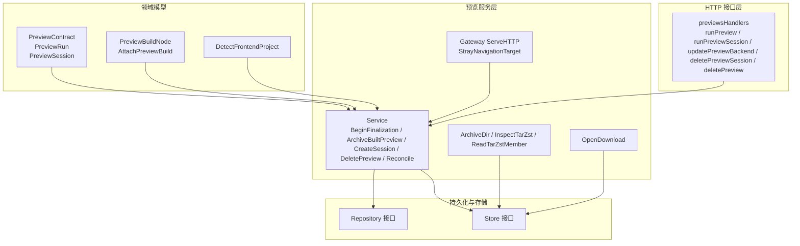
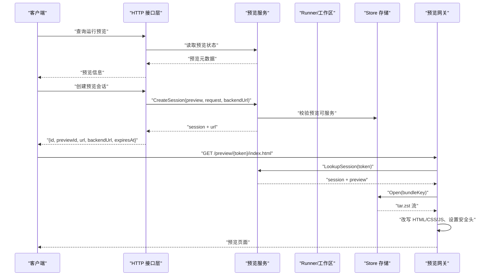
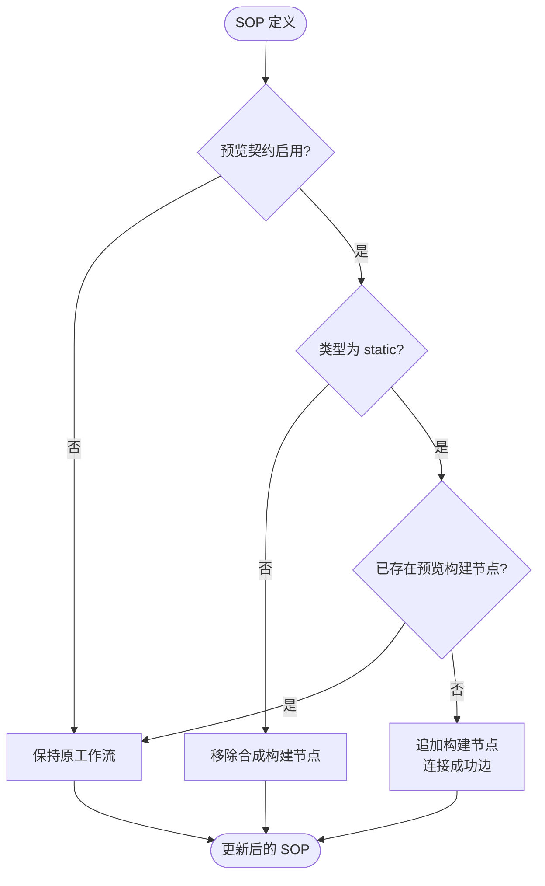
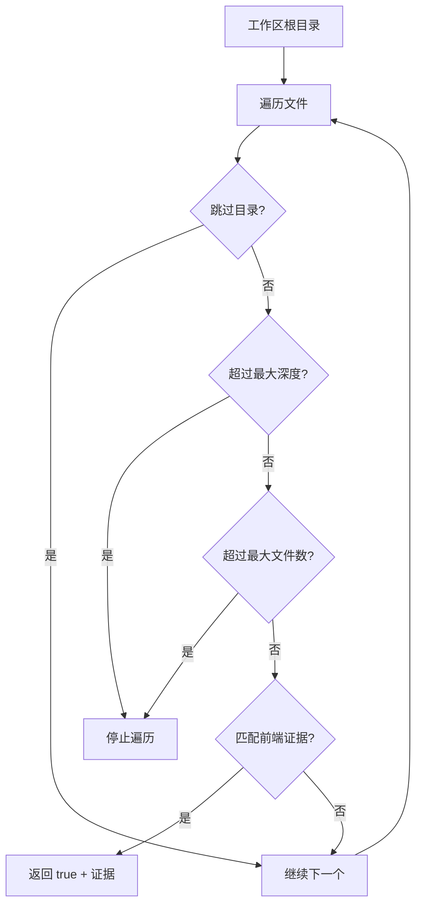
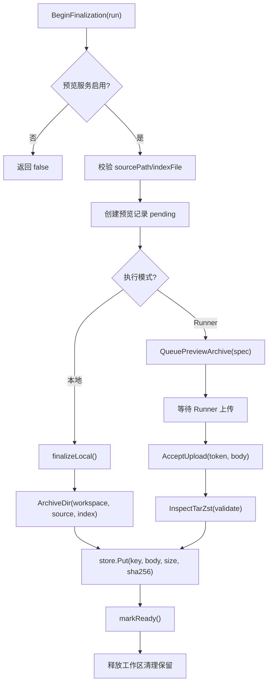
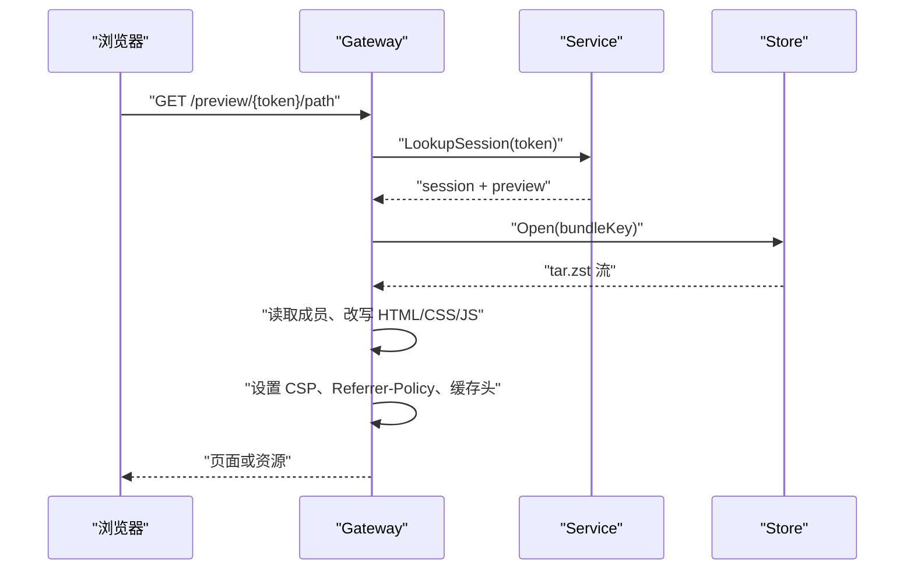
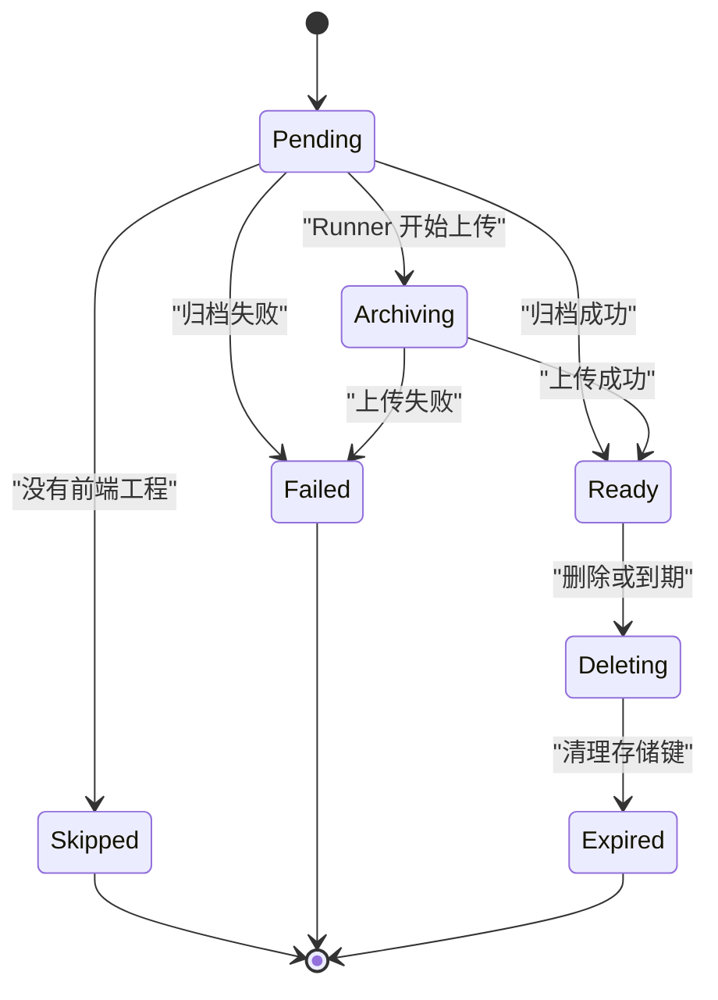
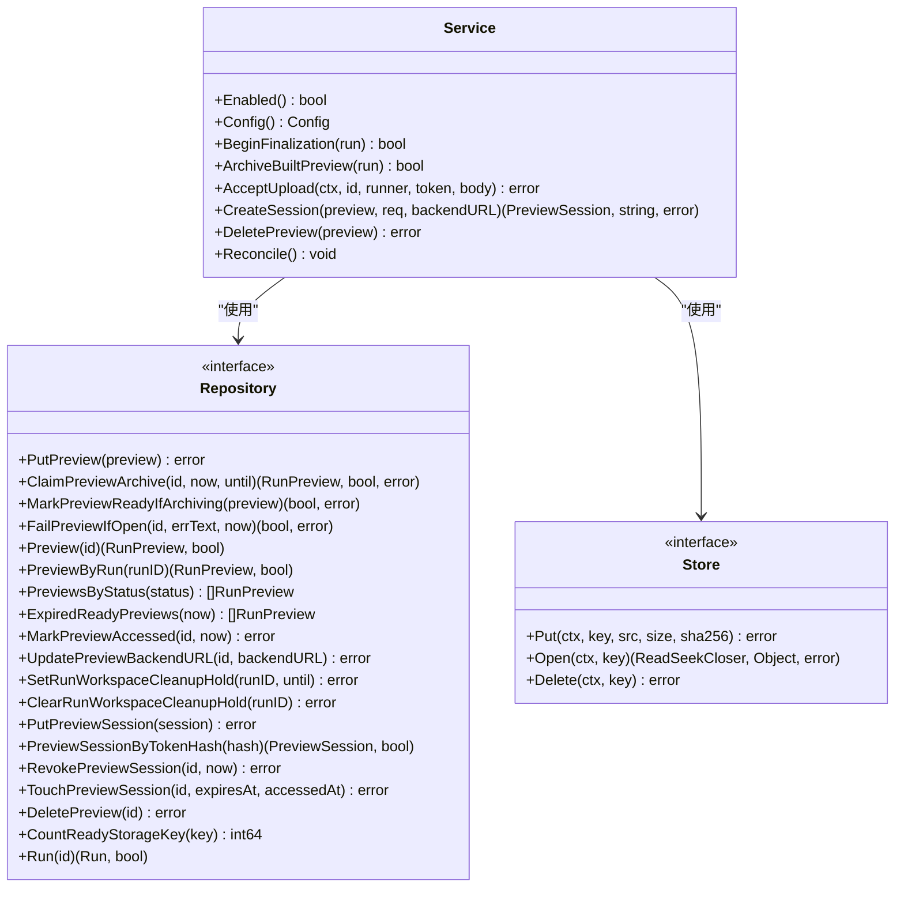

# 预览服务

<cite>
**本文引用的文件**   
- [internal/domain/preview.go](file://internal/domain/preview.go)
- [internal/domain/preview_build.go](file://internal/domain/preview_build.go)
- [internal/domain/preview_detect.go](file://internal/domain/preview_detect.go)
- [internal/httpapi/run_preview.go](file://internal/httpapi/run_preview.go)
- [internal/preview/service.go](file://internal/preview/service.go)
- [internal/preview/gateway.go](file://internal/preview/gateway.go)
- [internal/preview/config.go](file://internal/preview/config.go)
- [internal/preview/store.go](file://internal/preview/store.go)
- [internal/preview/repository.go](file://internal/preview/repository.go)
- [internal/preview/path.go](file://internal/preview/path.go)
- [internal/preview/archive.go](file://internal/preview/archive.go)
- [internal/preview/download.go](file://internal/preview/download.go)
</cite>

## 目录
1. [简介](#简介)
2. [项目结构](#项目结构)
3. [核心组件](#核心组件)
4. [架构总览](#架构总览)
5. [详细组件分析](#详细组件分析)
6. [依赖关系分析](#依赖关系分析)
7. [性能与资源特性](#性能与资源特性)
8. [配置选项与环境变量](#配置选项与环境变量)
9. [故障排除指南](#故障排除指南)
10. [结论](#结论)

## 简介
本文件系统性说明 LoopForge 的静态站点预览能力，覆盖构建、归档、部署、访问控制、缓存策略、清理机制以及管理接口。预览服务以“运行级”为单位生成可独立托管的静态站点压缩包，通过带令牌的安全路径对外提供隔离访问，并在会话过期后自动回收资源。

## 项目结构
预览相关代码主要分布在两个层次：
- 领域模型层：定义预览契约、状态、会话、构建节点注入等稳定数据结构。
- 服务实现层：负责构建触发、归档、存储、网关路由、下载转换和生命周期管理。

**图表来源**
- [internal/domain/preview.go:45-269](file://internal/domain/preview.go#L45-L269)
- [internal/domain/preview_build.go:8-164](file://internal/domain/preview_build.go#L8-L164)
- [internal/domain/preview_detect.go:113-219](file://internal/domain/preview_detect.go#L113-L219)
- [internal/httpapi/run_preview.go:15-226](file://internal/httpapi/run_preview.go#L15-L226)
- [internal/preview/service.go:34-755](file://internal/preview/service.go#L34-L755)
- [internal/preview/gateway.go:43-429](file://internal/preview/gateway.go#L43-L429)
- [internal/preview/archive.go:26-545](file://internal/preview/archive.go#L26-L545)
- [internal/preview/download.go:22-185](file://internal/preview/download.go#L22-L185)
- [internal/preview/repository.go:9-42](file://internal/preview/repository.go#L9-L42)
- [internal/preview/store.go:11-69](file://internal/preview/store.go#L11-L69)

**章节来源**
- [internal/domain/preview.go:45-269](file://internal/domain/preview.go#L45-L269)
- [internal/preview/service.go:34-755](file://internal/preview/service.go#L34-L755)

## 核心组件
- PreviewContract：描述是否启用预览、站点类型（当前仅支持 static）、执行器、模型、源目录、入口文件、SPA 回退、保留期等。
- RunPreview：持久化的预览元数据，包含状态、存储键、内容摘要、压缩大小、展开大小、文件数、入口文件、后端地址、所有者 Runner、错误文本、访问时间和过期时间。
- PreviewSession：短生命周期的访问授权，数据库只保存 token 哈希；创建时选择后端地址并返回公开预览 URL。
- Service：预览服务的核心编排者，负责开始收尾、本地归档、Runner 上传、标记就绪、会话创建、撤销、删除、对账清理。
- Gateway：预览内容的 HTTP 网关，解析安全路径、校验会话、按需改写 HTML/CSS/JS、设置严格安全头、处理 SPA 历史 API。
- Archive：将工作区静态目录打包为 tar.zst，限制文件数、压缩大小、展开大小，拒绝特殊文件。
- Download：把已归档的 tar.zst 转换为 ZIP 供下载，不注入预览脚本。
- Repository/Store：抽象预览元数据和二进制包存储，便于跨进程和跨平台使用。

**章节来源**
- [internal/domain/preview.go:45-269](file://internal/domain/preview.go#L45-L269)
- [internal/preview/service.go:34-755](file://internal/preview/service.go#L34-L755)
- [internal/preview/gateway.go:43-429](file://internal/preview/gateway.go#L43-L429)
- [internal/preview/archive.go:26-545](file://internal/preview/archive.go#L26-L545)
- [internal/preview/download.go:22-185](file://internal/preview/download.go#L22-L185)
- [internal/preview/repository.go:9-42](file://internal/preview/repository.go#L9-L42)
- [internal/preview/store.go:11-69](file://internal/preview/store.go#L11-L69)

## 架构总览
预览流程分为三个阶段：
1. 构建与归档阶段：SOP 中注入预览构建节点，或运行结束时触发收尾；由 Runner 或控制面归档静态站点为 tar.zst，写入 Store。
2. 访问阶段：客户端调用接口获取预览会话，得到 /preview/{token}/ 形式的公开链接；Gateway 校验会话并按需改写页面。
3. 清理阶段：到期预览被标记为过期并释放存储键；删除操作同样会清理未共享的存储对象。

**图表来源**
- [internal/httpapi/run_preview.go:43-146](file://internal/httpapi/run_preview.go#L43-L146)
- [internal/preview/service.go:589-621](file://internal/preview/service.go#L589-L621)
- [internal/preview/gateway.go:43-78](file://internal/preview/gateway.go#L43-L78)
- [internal/preview/store.go:18-24](file://internal/preview/store.go#L18-L24)

## 详细组件分析

### 预览契约与构建节点注入
- PreviewContract 提供默认值、规范化、校验方法，确保当前仅支持静态站点、CodeBuddy 执行器和有效模型。
- AttachPreviewBuild 保证当契约启用且为静态类型时，在 SOP 末尾追加一个系统构建节点，并把成功边连接到所有成功汇点。
- StripPreviewBuild 从目录输出中移除合成节点，避免把引擎注入步骤暴露到外部目录。
- PreviewBuildAgent 和 Prompt 指导 CodeBuddy 完成前端工程识别、依赖安装、生产构建、相对资源根配置、产物放置和失败重试。

**图表来源**
- [internal/domain/preview_build.go:30-58](file://internal/domain/preview_build.go#L30-L58)
- [internal/domain/preview_build.go:60-97](file://internal/domain/preview_build.go#L60-L97)
- [internal/domain/preview_build.go:107-129](file://internal/domain/preview_build.go#L107-L129)

**章节来源**
- [internal/domain/preview.go:45-165](file://internal/domain/preview.go#L45-L165)
- [internal/domain/preview_build.go:8-164](file://internal/domain/preview_build.go#L8-L164)

### 前端工程检测
DetectFrontendProject 通过扫描工作区判断是否存在前端工程或已构建静态站点，避免在后端仓库里编造预览页。检测依据包括：
- 已知前端配置文件：Vite、Webpack、Rspack、Next、Nuxt、Angular、Svelte、Astro、Vue、Remix 等。
- package.json 中的前端依赖或脚本关键字。
- index.html/index.htm 入口文件。
- 跳过 node_modules、.git、构建缓存等目录，并限制最大深度和文件数量。

**图表来源**
- [internal/domain/preview_detect.go:113-219](file://internal/domain/preview_detect.go#L113-L219)

**章节来源**
- [internal/domain/preview_detect.go:11-219](file://internal/domain/preview_detect.go#L11-L219)

### 预览归档与上传
Service.BeginFinalization 根据运行快照中的预览契约创建预览记录，并根据执行模式决定归档方式：
- 本地模式：直接在工作区上打包 tar.zst，写入 Store，标记就绪。
- Runner 模式：生成一次性上传令牌，Runner 将 tar.zst 上传到控制面，控制面验证后再写入 Store。

归档过程严格限制：
- 文件数上限。
- 压缩大小上限。
- 展开大小上限。
- 拒绝符号链接、设备、管道、套接字、硬链接等特殊文件。
- 必须包含配置的入口文件。

**图表来源**
- [internal/preview/service.go:75-215](file://internal/preview/service.go#L75-L215)
- [internal/preview/service.go:236-344](file://internal/preview/service.go#L236-L344)
- [internal/preview/archive.go:26-101](file://internal/preview/archive.go#L26-L101)
- [internal/preview/archive.go:237-309](file://internal/preview/archive.go#L237-L309)

**章节来源**
- [internal/preview/service.go:75-382](file://internal/preview/service.go#L75-L382)
- [internal/preview/archive.go:26-309](file://internal/preview/archive.go#L26-L309)

### 预览访问与会话
预览公开路径为 /preview/{token}/，其中 token 是 32 位十六进制字符串。Gateway.ServeHTTP 的流程如下：
1. 解析路径并提取 token。
2. LookupSession 校验会话是否存活。
3. 根据 rel 或入口文件读取 tar.zst 成员。
4. 对 HTML/CSS/JS 进行必要改写：注入 base、后端拦截脚本、历史 shim、根相对资源前缀。
5. 设置严格安全响应头：Referrer-Policy、Permissions-Policy、Content-Security-Policy、Cache-Control。
6. 对非 HTML 资源启用长期不可变缓存，HTML 使用 no-cache。

**图表来源**
- [internal/preview/gateway.go:43-78](file://internal/preview/gateway.go#L43-L78)
- [internal/preview/gateway.go:192-221](file://internal/preview/gateway.go#L192-L221)
- [internal/preview/gateway.go:236-361](file://internal/preview/gateway.go#L236-L361)
- [internal/preview/path.go:27-57](file://internal/preview/path.go#L27-L57)

**章节来源**
- [internal/preview/gateway.go:43-429](file://internal/preview/gateway.go#L43-L429)
- [internal/preview/path.go:22-112](file://internal/preview/path.go#L22-L112)

### 预览下载
OpenDownload 将已归档的 tar.zst 转换为 ZIP 供下载，不注入预览脚本，也不依赖工作区。它会对压缩包再次校验文件数和展开大小，并确保入口文件存在。

**章节来源**
- [internal/preview/download.go:22-185](file://internal/preview/download.go#L22-L185)

### 生命周期与清理
Service.Reconcile 定期处理：
- pending/archiving 状态的预览：检查超时、尝试本地归档。
- 已到期的 ready 预览：标记 deleting/expired，并删除未被其他预览引用的存储键。
- 删除预览：标记 deleting，删除共享存储键，删除记录。

此外，预览就绪后会清除工作区清理保留，让运行工作区正常回收。

**图表来源**
- [internal/preview/service.go:524-583](file://internal/preview/service.go#L524-L583)
- [internal/preview/service.go:665-695](file://internal/preview/service.go#L665-L695)

**章节来源**
- [internal/preview/service.go:524-695](file://internal/preview/service.go#L524-L695)

## 依赖关系分析
预览服务依赖以下抽象：
- Repository：预览元数据、会话、运行、工作区清理保留、blob 引用计数。
- Store：内容寻址的二进制包读写。
- Host：工作区路径、工作区事实、队列归档任务、取消归档、释放工作区、追加运行事件。

**图表来源**
- [internal/preview/service.go:21-55](file://internal/preview/service.go#L21-L55)
- [internal/preview/repository.go:9-42](file://internal/preview/repository.go#L9-L42)
- [internal/preview/store.go:18-24](file://internal/preview/store.go#L18-L24)

**章节来源**
- [internal/preview/repository.go:9-42](file://internal/preview/repository.go#L9-L42)
- [internal/preview/store.go:18-24](file://internal/preview/store.go#L18-L24)
- [internal/preview/service.go:21-55](file://internal/preview/service.go#L21-L55)

## 性能与资源特性
- 归档压缩：使用 zstd 流式压缩，同时计算 SHA-256，避免重复存储相同内容。
- 资源限制：默认最大文件数 20,000，最大压缩大小 100MB，最大展开大小 500MB；可通过环境变量调整，但受硬上限保护。
- 访问缓存：HTML 使用 no-cache；静态资源如 JS/CSS/图片等使用 public immutable 长缓存，减少重复请求。
- SPA 支持：通过检测 history.pushState/replaceState 判断是否使用客户端路由，并注入历史 shim，使 SPA 在预览路径下正常工作。
- 内存友好：ReadTarZstMember 只读取目标成员，不展开整个归档；下载转换也按流处理。

**章节来源**
- [internal/preview/archive.go:76-101](file://internal/preview/archive.go#L76-L101)
- [internal/preview/archive.go:429-481](file://internal/preview/archive.go#L429-L481)
- [internal/preview/gateway.go:192-221](file://internal/preview/gateway.go#L192-L221)
- [internal/preview/gateway.go:483-545](file://internal/preview/gateway.go#L483-L545)

## 配置选项与环境变量
预览服务通过环境变量加载配置，关键项如下：

| 环境变量 | 含义 | 默认值或约束 |
| --- | --- | --- |
| AGENTFLOW_PREVIEW_PUBLIC_SCHEME | 公开协议，http 或 https | 若未设置则根据 PublicURL 或请求推断 |
| AGENTFLOW_PREVIEW_PUBLIC_URL | 公开预览主机，例如 https://loopforge.example.com | 忽略 path/query，用于生成 PublicHost/PublicScheme |
| AGENTFLOW_PREVIEW_FRAME_ANCESTORS | CSP frame-ancestors 白名单 | 默认 'self' |
| AGENTFLOW_PREVIEW_MAX_FILES | 单个预览归档最大文件数 | 默认 20,000；硬上限 50,000 |
| AGENTFLOW_PREVIEW_MAX_COMPRESSED | 单个预览归档最大压缩大小 | 默认 100MB；硬上限 500MB |
| AGENTFLOW_PREVIEW_MAX_EXPANDED | 单个预览归档最大展开大小 | 默认 500MB；硬上限 2GB |
| AGENTFLOW_PREVIEW_TTL | 预览默认保留时长 | 默认 30 天；最大允许 30 天 |
| AGENTFLOW_PREVIEW_FINALIZE_TIMEOUT | 预览收尾超时 | 默认 15 分钟 |
| AGENTFLOW_PREVIEW_SESSION_TTL | 预览会话有效期 | 默认 30 分钟 |

这些配置影响：
- 公开 URL 生成：PublicURL 会覆盖 PublicScheme 和 PublicHost。
- 安全策略：FrameAncestors 影响 CSP frame-ancestors。
- 资源保护：MaxFiles、MaxCompressed、MaxExpanded 防止恶意或异常构建耗尽资源。
- 生命周期：TTL 控制预览保留时间；FinalizeTimeout 控制归档超时；SessionTTL 控制会话有效期。

**章节来源**
- [internal/preview/config.go:11-75](file://internal/preview/config.go#L11-L75)
- [internal/preview/config.go:115-131](file://internal/preview/config.go#L115-L131)

## 故障排除指南

### 预览未启用
- 现象：查询预览接口返回“preview is not enabled”。
- 原因：预览服务未初始化或未启用。
- 处理：确认服务已启动并启用预览功能。

**章节来源**
- [internal/httpapi/run_preview.go:43-48](file://internal/httpapi/run_preview.go#L43-L48)

### 运行不存在
- 现象：查询预览接口返回“run not found”。
- 原因：运行 ID 无效或已被删除。
- 处理：确认运行仍存在且权限正确。

**章节来源**
- [internal/httpapi/run_preview.go:49-53](file://internal/httpapi/run_preview.go#L49-L53)

### 预览不存在
- 现象：查询预览接口返回“preview not found”。
- 原因：该运行未启用预览，或预览尚未生成。
- 处理：检查 SOP 是否启用预览契约，或等待构建完成。

**章节来源**
- [internal/httpapi/run_preview.go:113-117](file://internal/httpapi/run_preview.go#L113-L117)

### 预览未就绪
- 现象：创建会话返回“preview is not ready”。
- 原因：预览状态不是 ready，或存储键为空。
- 处理：查看预览状态和错误文本，确认归档成功。

**章节来源**
- [internal/preview/service.go:589-592](file://internal/preview/service.go#L589-L592)

### 后端地址无效
- 现象：创建会话或更新后端地址返回错误，状态码为 400 或 409。
- 原因：backendUrl 不是无凭据的 http(s) 原点。
- 处理：使用 NormalizePreviewBackendURL 校验，确保 scheme 为 http/https，不包含用户信息。

**章节来源**
- [internal/httpapi/run_preview.go:124-137](file://internal/httpapi/run_preview.go#L124-L137)
- [internal/domain/preview.go:176-189](file://internal/domain/preview.go#L176-L189)

### 预览会话过期
- 现象：访问 /preview/{token}/ 返回“preview session expired”。
- 原因：会话已过期或被撤销。
- 处理：重新创建会话；如需延长有效期，应重新创建而非无限续期。

**章节来源**
- [internal/preview/gateway.go:43-58](file://internal/preview/gateway.go#L43-L58)

### 找不到入口文件
- 现象：归档或下载时报错“missing index file”。
- 原因：sourcePath/indexFile 指定的入口不存在。
- 处理：确认构建产物位于预期目录，且入口文件名正确。

**章节来源**
- [internal/preview/archive.go:58-60](file://internal/preview/archive.go#L58-L60)
- [internal/preview/archive.go:297-299](file://internal/preview/archive.go#L297-L299)
- [internal/preview/download.go:127-129](file://internal/preview/download.go#L127-L129)

### 超出资源限制
- 现象：归档或下载时报错“exceeded size or file limits”。
- 原因：文件数、压缩大小或展开大小超过配置上限。
- 处理：优化构建产物体积，或调整 AGENTFLOW_PREVIEW_MAX_* 环境变量。

**章节来源**
- [internal/preview/archive.go:143-149](file://internal/preview/archive.go#L143-L149)
- [internal/preview/archive.go:276-281](file://internal/preview/archive.go#L276-L281)
- [internal/preview/download.go:118-120](file://internal/preview/download.go#L118-L120)

### 工作区没有前端工程
- 现象：预览被跳过，错误文本提示“工作区没有前端工程，已跳过预览”。
- 原因：DetectFrontendProject 未发现前端配置、依赖或入口文件。
- 处理：在前端仓库中添加 Vite/webpack/Next 等配置，或确保已有静态站点入口。

**章节来源**
- [internal/preview/service.go:384-406](file://internal/preview/service.go#L384-L406)
- [internal/domain/preview_detect.go:113-163](file://internal/domain/preview_detect.go#L113-L163)

### 预览路径不安全
- 现象：归档或访问时报错“unsafe path”或“path traversal”。
- 原因：sourcePath、indexFile 或 archive member 包含绝对路径、../、编码绕过等。
- 处理：使用 SanitizeRelPath/SanitizeArchiveMember 校验路径，确保相对路径且不含穿越片段。

**章节来源**
- [internal/preview/path.go:59-111](file://internal/preview/path.go#L59-L111)

### 预览归档超时
- 现象：reconcile 后将预览标记为失败，错误文本包含“finalization timed out”。
- 原因：归档任务超过 FinalizationTimeout 或上传令牌过期。
- 处理：检查工作区可用性、Runner 上传速度，或增大超时配置。

**章节来源**
- [internal/preview/service.go:541-554](file://internal/preview/service.go#L541-L554)

## 结论
LoopForge 的预览服务以运行级为单位提供安全的静态站点预览能力。它通过严格的契约校验、资源限制、内容寻址存储和会话令牌机制，实现预览环境的隔离、访问控制和资源回收。构建阶段可由 SOP 自动注入，也可在运行结束时触发；访问阶段通过 /preview/{token}/ 提供隔离路径，并对 HTML/CSS/JS 做最小化改写以兼容 SPA。配置项集中在环境变量中，便于在不同部署环境中调整容量、安全和生命周期策略。遇到常见问题时，可优先检查预览状态、后端地址合法性、入口文件存在性、资源限制和工作区前端工程检测。