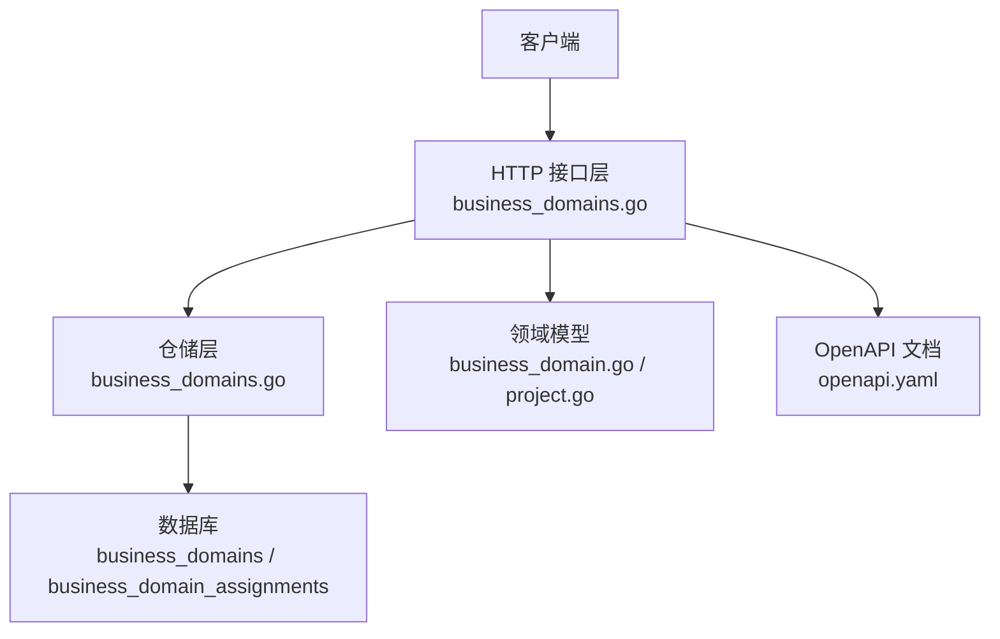
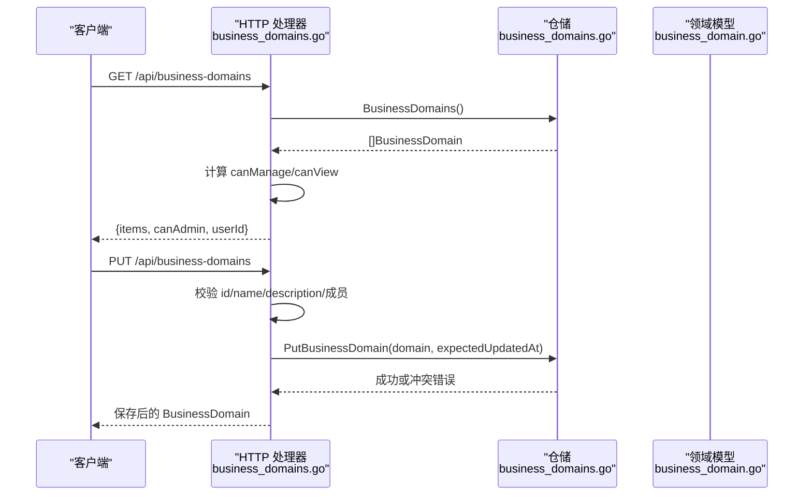
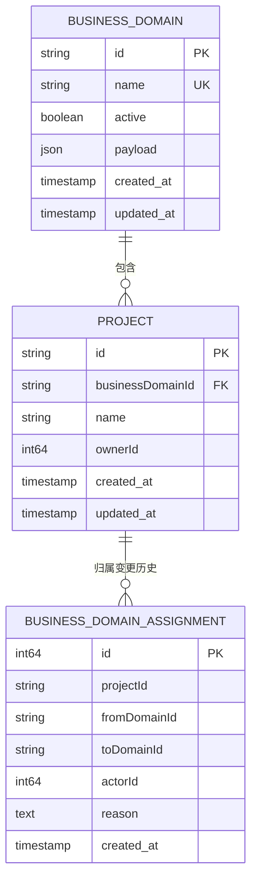
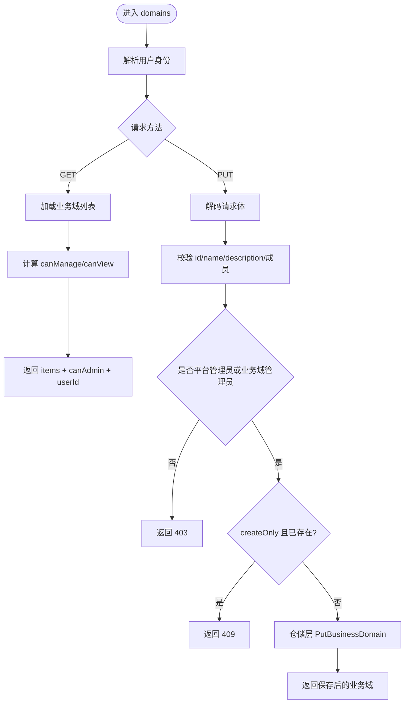
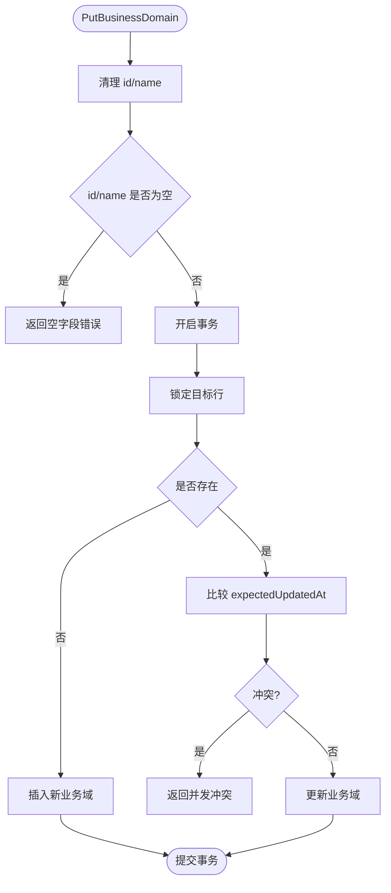
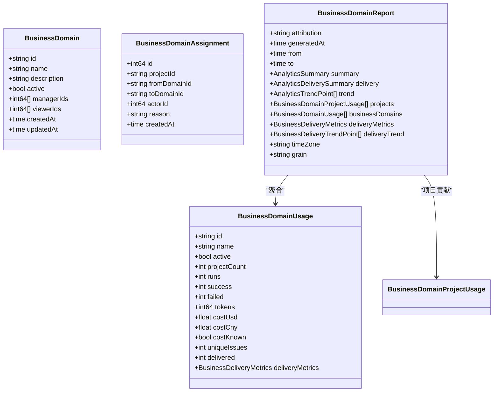
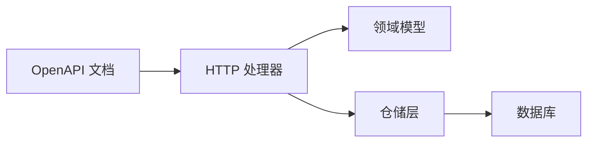

# 业务域 API

<cite>
**本文引用的文件**   
- [internal/domain/business_domain.go](file://internal/domain/business_domain.go)
- [internal/domain/project.go](file://internal/domain/project.go)
- [internal/httpapi/business_domains.go](file://internal/httpapi/business_domains.go)
- [internal/httpapi/business_permissions.go](file://internal/httpapi/business_permissions.go)
- [internal/repo/business_domains.go](file://internal/repo/business_domains.go)
- [docs/api/openapi.yaml](file://docs/api/openapi.yaml)
</cite>

## 目录
1. [简介](#简介)
2. [项目结构](#项目结构)
3. [核心概念与数据模型](#核心概念与数据模型)
4. [架构总览](#架构总览)
5. [接口定义](#接口定义)
6. [权限与继承机制](#权限与继承机制)
7. [业务域与项目的关系映射](#业务域与项目的关系映射)
8. [详细组件分析](#详细组件分析)
9. [依赖关系分析](#依赖关系分析)
10. [性能与缓存特性](#性能与缓存特性)
11. [配置示例与最佳实践](#配置示例与最佳实践)
12. [故障排查](#故障排查)
13. [结论](#结论)

## 简介
本文件文档化 LoopForge 中“业务域”这一业务维度的管理接口、权限模型以及与项目的归属关系。业务域用于对运行、交付和成本等指标进行跨项目聚合统计，它独立于项目执行权限：拥有业务域查看或管理权限的用户可以查看对应业务域的汇总报表，但不会因此获得项目代码、仓库或运行操作的直接执行权限。

当前实现提供以下能力：
- 获取业务域列表，并返回每个业务域的查看/管理权限提示。
- 创建或更新业务域，支持管理员与领域管理员的差异化权限。
- 将项目归属到某个业务域，并记录变更历史。
- 按业务域维度查询聚合报表，包括交付指标、趋势和项目贡献。

需要特别说明的是：当前代码未暴露独立的 `DELETE /business-domains/:id` 端点；业务域的生命周期主要通过 `PUT /api/business-domains` 的 `active` 字段控制启用/停用，并通过名称唯一性、并发控制和平台管理员权限保护写入。

## 项目结构
围绕业务域的代码主要分布在四层：
- 领域层：定义业务域、项目归属、使用量与交付指标等数据结构。
- HTTP 接口层：处理 `/api/business-domains` 与 `/api/business-domain-report` 请求，校验参数、鉴权、调用仓储。
- 仓储层：负责业务域持久化、项目归属变更与报表数据组装。
- OpenAPI 文档：对外暴露的接口契约。

**图表来源**
- [internal/httpapi/business_domains.go:35-117](file://internal/httpapi/business_domains.go#L35-L117)
- [internal/repo/business_domains.go:34-94](file://internal/repo/business_domains.go#L34-L94)
- [internal/domain/business_domain.go:6-25](file://internal/domain/business_domain.go#L6-L25)
- [docs/api/openapi.yaml:823-950](file://docs/api/openapi.yaml#L823-L950)

**章节来源**
- [internal/httpapi/business_domains.go:1-322](file://internal/httpapi/business_domains.go#L1-L322)
- [internal/repo/business_domains.go:1-95](file://internal/repo/business_domains.go#L1-L95)
- [internal/domain/business_domain.go:1-99](file://internal/domain/business_domain.go#L1-L99)
- [docs/api/openapi.yaml:823-950](file://docs/api/openapi.yaml#L823-L950)

## 核心概念与数据模型
### 业务域
业务域是一个可管理的统计维度，包含稳定标识、名称、描述、启用状态、管理员列表和查看者列表。它不直接控制项目执行权限，而是控制“谁可以看到该业务域的统计信息”。

关键字段：
- `id`：稳定标识，由字母数字开头，允许短横线与下划线，长度受正则限制。
- `name`：显示名称，具有唯一索引。
- `description`：说明文本。
- `active`：是否启用。
- `managerIds`：业务域管理员用户 ID 列表。
- `viewerIds`：业务域查看者用户 ID 列表。
- `createdAt` / `updatedAt`：创建与更新时间。

**章节来源**
- [internal/domain/business_domain.go:6-15](file://internal/domain/business_domain.go#L6-L15)
- [docs/api/openapi.yaml:4199-4210](file://docs/api/openapi.yaml#L4199-L4210)

### 项目归属与变更历史
项目通过 `businessDomainId` 字段关联到业务域。每次归属变更会记录一条变更历史，包括操作人、原因、从哪个业务域改到哪个业务域。

关键字段：
- `projectId`：项目标识。
- `fromDomainId`：变更前业务域。
- `toDomainId`：变更后业务域。
- `actorId`：操作人。
- `reason`：变更原因。
- `createdAt`：变更记录时间。

**章节来源**
- [internal/domain/business_domain.go:17-25](file://internal/domain/business_domain.go#L17-L25)
- [internal/repo/business_domains.go:22-32](file://internal/repo/business_domains.go#L22-L32)

### 项目模型中的业务域字段
项目模型中包含可选的 `businessDomainId`，表示该项目当前归属的业务域。项目还包含所有者、成员、工作流、仓库等信息，但这些属于项目执行与协作权限范畴，与业务域统计维度解耦。

**章节来源**
- [internal/domain/project.go:9-43](file://internal/domain/project.go#L9-L43)

## 架构总览
业务域 API 的请求路径集中在两个主端点：
- `/api/business-domains`：列表与保存。
- `/api/business-domain-report`：按业务域维度聚合报表。
- `/api/projects/{projectId}/business-domain`：设置项目的主业务域。
- `/api/projects/{projectId}/business-domain/history`：读取项目业务域变更历史。

**图表来源**
- [internal/httpapi/business_domains.go:35-117](file://internal/httpapi/business_domains.go#L35-L117)
- [internal/repo/business_domains.go:61-94](file://internal/repo/business_domains.go#L61-L94)
- [internal/domain/business_domain.go:6-15](file://internal/domain/business_domain.go#L6-L15)

## 接口定义
### 获取业务域列表
- **方法**：GET
- **路径**：`/api/business-domains`
- **认证**：根据系统认证策略决定是否必须登录；若已登录，会返回当前用户 ID。
- **响应体**：
  - `items`：业务域数组，每项包含 `domain`、`canManage`、`canView`。
  - `canAdmin`：当前用户是否为平台管理员。
  - `userId`：当前用户 ID。

权限语义：
- `canManage`：平台管理员或业务域管理员。
- `canView`：平台管理员、业务域管理员或业务域查看者。

**章节来源**
- [internal/httpapi/business_domains.go:35-48](file://internal/httpapi/business_domains.go#L35-L48)
- [docs/api/openapi.yaml:823-845](file://docs/api/openapi.yaml#L823-L845)

### 创建或更新业务域
- **方法**：PUT
- **路径**：`/api/business-domains`
- **查询参数**：
  - `createOnly`：当为 `true` 时，如果目标 `id` 已存在则返回 409，不执行更新。
- **请求体**：`BusinessDomain`。
- **成功响应**：保存后的 `BusinessDomain`。
- **常见错误**：
  - 400：标识格式非法、名称为空、描述过长、成员无效或不重复。
  - 401：未认证且系统要求认证。
  - 403：非平台管理员且不是该业务域管理员，或尝试修改只有平台管理员能改的字段。
  - 409：名称重复、并发更新冲突、`createOnly=true` 时目标已存在。

校验规则要点：
- `id` 必须符合正则，不能是保留值 `all` 或 `unclassified`。
- `name` 长度不超过 100。
- `description` 长度不超过 2000。
- `managerIds` 与 `viewerIds` 必须是不重复的有效用户 ID。
- 非平台管理员不能修改 `active` 和 `managerIds`。

**章节来源**
- [internal/httpapi/business_domains.go:50-117](file://internal/httpapi/business_domains.go#L50-L117)
- [internal/repo/business_domains.go:59-94](file://internal/repo/business_domains.go#L59-L94)
- [docs/api/openapi.yaml:846-870](file://docs/api/openapi.yaml#L846-L870)

### 删除业务域
当前代码未实现 `DELETE /business-domains/:id`。业务域的“删除”通常通过以下方式表达：
- 将 `active` 设为 `false`，使业务域停用。
- 在组织治理层面，不再分配新项目，并在前端隐藏或禁用编辑。
- 如需物理清理，应结合内部运维流程，而不是通过公开 API。

**章节来源**
- [internal/httpapi/business_domains.go:50-117](file://internal/httpapi/business_domains.go#L50-L117)
- [docs/api/openapi.yaml:823-870](file://docs/api/openapi.yaml#L823-L870)

### 获取业务域报表
- **方法**：GET
- **路径**：`/api/business-domain-report`
- **查询参数**：
  - `businessDomainId`：业务域 ID、`all` 或 `unclassified`，默认 `all`。
  - `from` / `to`：RFC3339 时间范围。
  - `grain`：`day`、`week`、`month`，默认 `day`。
  - `timeZone`：IANA 时区，默认 `UTC`。
- **响应体**：`BusinessDomainReport`，包含归属口径、生成时间、时间范围、摘要、交付摘要、趋势、项目贡献、业务域分布、交付指标、交付趋势、时区和粒度。

可见性规则：
- `all`：返回调用者可查看的业务域集合。
- `unclassified`：仅包含未归属项目，且调用者必须是平台管理员或项目所有者。
- 指定具体业务域：必须存在且调用者有查看权限。

**章节来源**
- [internal/httpapi/business_domains.go:118-172](file://internal/httpapi/business_domains.go#L118-L172)
- [docs/api/openapi.yaml:870-902](file://docs/api/openapi.yaml#L870-L902)

### 设置项目业务域
- **方法**：PUT
- **路径**：`/api/projects/{projectId}/business-domain`
- **请求体**：
  - `businessDomainId`：目标业务域 ID，空字符串表示清除归属。
  - `expectedDomainId`：期望的当前归属，用于并发保护。
  - `reason`：变更原因，最大长度 500。
- **成功响应**：更新后的项目。
- **常见错误**：
  - 400：参数非法。
  - 401：未认证。
  - 403：非项目所有者或非平台管理员。
  - 404：项目不存在。
  - 409：项目归属已变化，需刷新后重试。

**章节来源**
- [docs/api/openapi.yaml:903-930](file://docs/api/openapi.yaml#L903-L930)

### 读取项目业务域变更历史
- **方法**：GET
- **路径**：`/api/projects/{projectId}/business-domain/history`
- **响应体**：最近 100 条变更历史，按时间倒序。
- **常见错误**：
  - 401：未认证。
  - 403：非项目所有者或非平台管理员。
  - 404：项目不存在。

**章节来源**
- [docs/api/openapi.yaml:931-950](file://docs/api/openapi.yaml#L931-L950)

## 权限与继承机制
### 身份解析
业务域接口通过 `businessDomainIdentity` 解析当前请求的身份：
- 如果系统不强制认证，已登录用户会被视为平台管理员。
- 如果系统强制认证，则返回真实用户 ID 和平台管理员标志。

这决定了后续“能否管理业务域”“能否查看业务域汇总”的判断基础。

**章节来源**
- [internal/httpapi/business_permissions.go:7-19](file://internal/httpapi/business_permissions.go#L7-L19)

### 业务域查看权限
对于单个业务域：
- 平台管理员：始终可查看所有业务域。
- 业务域管理员：可查看并管理该业务域。
- 业务域查看者：可查看该业务域，但不能管理。

判断逻辑：
- `canManage`：平台管理员或 `managerIds` 包含当前用户。
- `canView`：平台管理员、`managerIds` 包含当前用户，或 `viewerIds` 包含当前用户。

**章节来源**
- [internal/httpapi/business_domains.go:29-34](file://internal/httpapi/business_domains.go#L29-L34)

### 业务域写入权限
- 平台管理员：可创建、启用/停用、修改管理员列表。
- 业务域管理员：可修改名称、描述、查看者列表，但不能修改 `active` 和 `managerIds`。
- 其他用户：无写入权限。

并发保护：
- 更新时使用 `expectedUpdatedAt` 做比较交换，避免覆盖他人更新。
- 名称具有唯一索引，重复名称返回 409。

**章节来源**
- [internal/httpapi/business_domains.go:71-110](file://internal/httpapi/business_domains.go#L71-L110)
- [internal/repo/business_domains.go:61-94](file://internal/repo/business_domains.go#L61-L94)

### 项目归属权限
- 项目所有者：可为未归属项目设置业务域。
- 平台管理员：可转移或清除已有归属。
- 目标业务域必须存在且有效。
- 变更会记录历史，便于审计。

**章节来源**
- [docs/api/openapi.yaml:903-930](file://docs/api/openapi.yaml#L903-L930)

## 业务域与项目的关系映射
### 关系类型
业务域与项目是“一对多”的关系：一个业务域可以包含多个项目，一个项目当前只归属于一个业务域。项目模型中的 `businessDomainId` 即为该映射键。

**图表来源**
- [internal/repo/business_domains.go:11-32](file://internal/repo/business_domains.go#L11-L32)
- [internal/domain/project.go:9-43](file://internal/domain/project.go#L9-L43)
- [internal/domain/business_domain.go:17-25](file://internal/domain/business_domain.go#L17-L25)

### 报表中的多对多视角
虽然项目只归属一个业务域，但报表接口支持按业务域聚合多个项目，并按业务域维度展示项目贡献、交付指标和趋势。因此，从报表视角看，业务域与项目呈现“聚合分组”关系。

**章节来源**
- [internal/httpapi/business_domains.go:156-166](file://internal/httpapi/business_domains.go#L156-L166)
- [internal/domain/business_domain.go:27-98](file://internal/domain/business_domain.go#L27-L98)

## 详细组件分析
### HTTP 处理器：业务域列表与保存
处理器负责：
- 解析用户身份。
- 列表请求：加载所有业务域，并为每个业务域计算 `canManage` 与 `canView`。
- 保存请求：校验输入、检查权限、验证成员、执行乐观锁更新、返回保存结果。

**图表来源**
- [internal/httpapi/business_domains.go:35-117](file://internal/httpapi/business_domains.go#L35-L117)

**章节来源**
- [internal/httpapi/business_domains.go:35-117](file://internal/httpapi/business_domains.go#L35-L117)

### 仓储层：业务域持久化
仓储层使用 JSON 列存储业务域详情，并通过事务保证一致性：
- 读取现有行。
- 校验 `expectedUpdatedAt`，防止并发覆盖。
- 新建或更新业务域。
- 维护 `createdAt` 与 `updatedAt`。

**图表来源**
- [internal/repo/business_domains.go:61-94](file://internal/repo/business_domains.go#L61-L94)

**章节来源**
- [internal/repo/business_domains.go:34-94](file://internal/repo/business_domains.go#L34-L94)

### 领域模型：业务域与报表结构
领域模型定义了业务域、项目归属、使用量、交付指标和报表结构。这些结构贯穿 HTTP 层与仓储层，是 API 契约的核心载体。

**图表来源**
- [internal/domain/business_domain.go:6-98](file://internal/domain/business_domain.go#L6-L98)

**章节来源**
- [internal/domain/business_domain.go:6-98](file://internal/domain/business_domain.go#L6-L98)

## 依赖关系分析
### 组件耦合
- HTTP 处理器依赖领域模型与仓储层。
- 仓储层依赖数据库表结构与 JSON 序列化。
- 权限判断依赖统一的身份解析函数。
- OpenAPI 文档与领域模型保持契约一致。

**图表来源**
- [docs/api/openapi.yaml:823-950](file://docs/api/openapi.yaml#L823-L950)
- [internal/httpapi/business_domains.go:1-322](file://internal/httpapi/business_domains.go#L1-L322)
- [internal/repo/business_domains.go:1-95](file://internal/repo/business_domains.go#L1-L95)

**章节来源**
- [internal/httpapi/business_domains.go:1-322](file://internal/httpapi/business_domains.go#L1-L322)
- [internal/repo/business_domains.go:1-95](file://internal/repo/business_domains.go#L1-L95)
- [docs/api/openapi.yaml:823-950](file://docs/api/openapi.yaml#L823-L950)

## 性能与缓存特性
业务域报表接口实现了轻量级内存缓存：
- 缓存 TTL 为 10 秒。
- 同一时刻并发请求共享一次计算。
- 缓存 key 包含业务域选择、时间范围、粒度、时区、可见项目集合以及业务域与项目快照。
- 失败结果不缓存，避免错误扩散。

这意味着高频打开报表时，后端不会每次都重新计算完整聚合，但仍保证不同权限、不同筛选条件不会复用彼此的结果。

**章节来源**
- [internal/httpapi/business_domains.go:210-321](file://internal/httpapi/business_domains.go#L210-L321)

## 配置示例与最佳实践
### 业务域配置建议
- 为每个产品线或业务团队创建一个业务域，例如支付、风控、客服、通用后台等。
- 使用稳定的 `id`，避免使用 `all` 或 `unclassified`。
- 将业务域管理员设置为该领域的负责人或平台管理员。
- 将需要查看统计但不具备管理权限的成员加入 `viewerIds`。
- 使用 `active=false` 停用不再使用的业务域，而不是直接删除。

### 项目归属最佳实践
- 新项目创建后尽快归属到合适的业务域。
- 项目所有者只能为未归属项目设置业务域。
- 平台管理员可转移或清除已有归属，适合治理场景。
- 填写 `reason`，便于审计与回溯。
- 遇到 409 时，先刷新项目当前归属再重试。

### 报表使用建议
- 使用 `businessDomainId=all` 查看自己可看到的所有业务域汇总。
- 使用 `businessDomainId=unclassified` 查看未归属项目，适合治理盘点。
- 使用 `grain=day/week/month` 调整趋势粒度。
- 使用 `timeZone` 匹配业务所在时区，注意交付趋势与 MR 趋势使用该时区。

[本节为通用指导，不直接分析具体代码文件]

## 故障排查
### 400 错误：参数或成员校验失败
可能原因：
- `id` 不符合正则或为保留值。
- `name` 为空或过长。
- `description` 过长。
- `managerIds` 或 `viewerIds` 包含无效用户、重复用户或负数。

排查步骤：
- 检查 `id` 是否符合“字母数字开头，最多 64 位，允许短横线与下划线”。
- 检查 `name` 是否在 1–100 字之间。
- 检查 `description` 是否不超过 2000 字。
- 检查成员 ID 是否有效且不重复。

**章节来源**
- [internal/httpapi/business_domains.go:54-94](file://internal/httpapi/business_domains.go#L54-L94)

### 403 错误：权限不足
可能原因：
- 非平台管理员尝试修改 `active` 或 `managerIds`。
- 非业务域管理员尝试保存业务域。
- 非项目所有者或非平台管理员尝试设置项目业务域。
- 非平台管理员或非项目所有者查看项目业务域历史。

排查步骤：
- 确认当前用户是否为平台管理员。
- 确认当前用户是否在业务域管理员列表中。
- 确认当前用户是否为项目所有者。
- 确认目标业务域是否存在且可访问。

**章节来源**
- [internal/httpapi/business_domains.go:71-80](file://internal/httpapi/business_domains.go#L71-L80)
- [docs/api/openapi.yaml:903-950](file://docs/api/openapi.yaml#L903-L950)

### 409 错误：冲突或重复
可能原因：
- 名称重复。
- 并发更新业务域，`expectedUpdatedAt` 不匹配。
- `createOnly=true` 时目标业务域已存在。
- 项目归属已变化，需刷新后重试。

排查步骤：
- 先获取当前业务域或项目信息。
- 使用最新 `updatedAt` 或 `expectedDomainId` 重试。
- 如果是 `createOnly`，更换新的 `id`。

**章节来源**
- [internal/httpapi/business_domains.go:66-110](file://internal/httpapi/business_domains.go#L66-L110)
- [internal/repo/business_domains.go:79-94](file://internal/repo/business_domains.go#L79-L94)
- [docs/api/openapi.yaml:903-930](file://docs/api/openapi.yaml#L903-L930)

### 404 错误：资源不存在
可能原因：
- 查询的业务域不存在。
- 项目不存在。

排查步骤：
- 确认业务域 ID 是否正确。
- 确认项目 ID 是否存在。
- 确认业务域未被停用且仍存在于系统中。

**章节来源**
- [internal/httpapi/business_domains.go:135-149](file://internal/httpapi/business_domains.go#L135-L149)
- [docs/api/openapi.yaml:903-950](file://docs/api/openapi.yaml#L903-L950)

## 结论
LoopForge 的业务域 API 以“统计维度”为核心，将项目归属、成员权限与报表聚合解耦。业务域本身不授予项目执行权限，而是决定谁能看到哪些业务域的统计数据。通过平台管理员、业务域管理员和业务域查看者的三层权限模型，系统既能满足治理需求，又能避免权限过度扩散。

当前实现重点在于：
- 使用 `PUT /api/business-domains` 统一管理业务域生命周期。
- 使用 `PUT /api/projects/{projectId}/business-domain` 管理项目归属。
- 使用 `GET /api/business-domain-report` 获取按业务域聚合的交付与成本报表。
- 使用 `GET /api/projects/{projectId}/business-domain/history` 审计归属变更。

在实际使用中，建议优先建立清晰的业务域划分，规范项目归属流程，并结合报表接口持续观察交付效率与成本分布。

[本节为总结性内容，不直接分析具体代码文件]