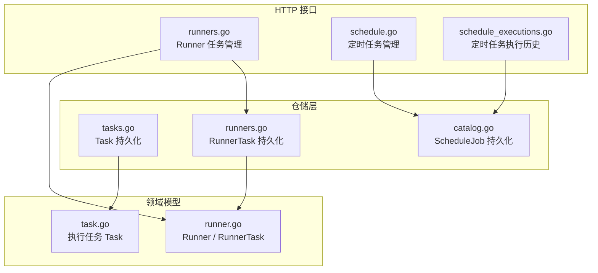
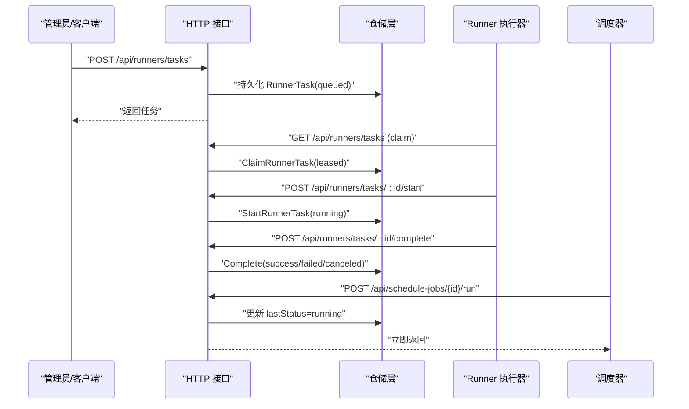
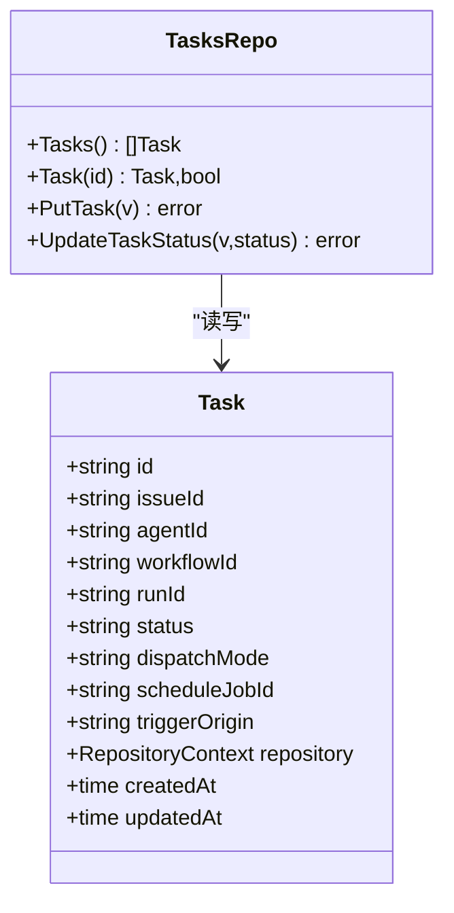
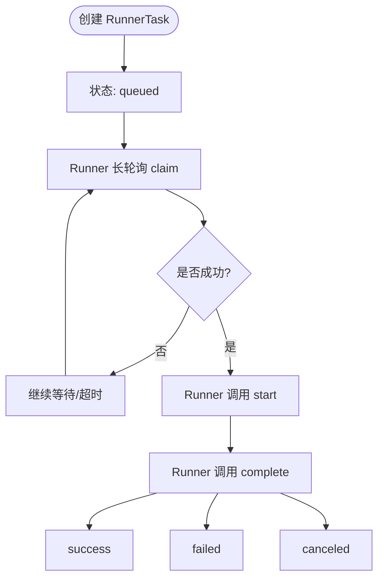
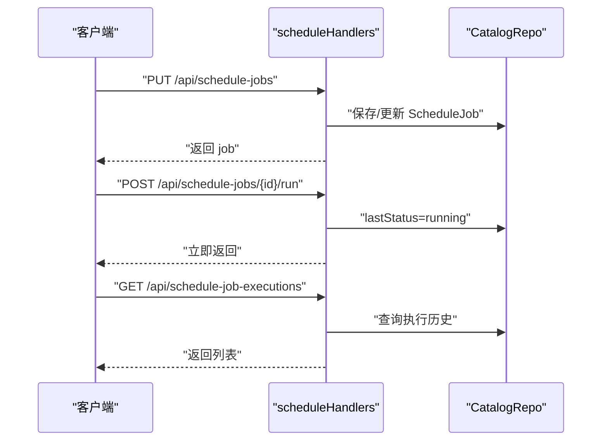
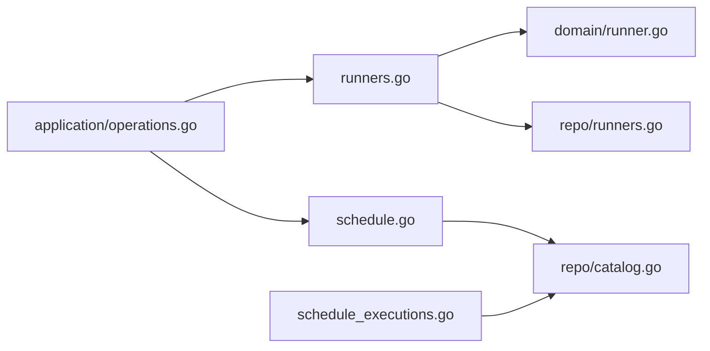

# 任务管理 API

<cite>
**本文引用的文件**   
- [internal/domain/task.go](file://internal/domain/task.go)
- [internal/repo/tasks.go](file://internal/repo/tasks.go)
- [internal/application/operations.go](file://internal/application/operations.go)
- [internal/httpapi/runners.go](file://internal/httpapi/runners.go)
- [internal/repo/runners.go](file://internal/repo/runners.go)
- [internal/domain/runner.go](file://internal/domain/runner.go)
- [internal/httpapi/schedule.go](file://internal/httpapi/schedule.go)
- [internal/httpapi/shared_schedules.go](file://internal/httpapi/shared_schedules.go)
- [internal/httpapi/schedule_executions.go](file://internal/httpapi/schedule_executions.go)
- [internal/repo/catalog.go](file://internal/repo/catalog.go)
- [e2e/api/50-platform.test.mjs](file://e2e/api/50-platform.test.mjs)
</cite>

## 目录
1. [简介](#简介)
2. [项目结构](#项目结构)
3. [核心组件](#核心组件)
4. [架构总览](#架构总览)
5. [详细组件分析](#详细组件分析)
6. [依赖关系分析](#依赖关系分析)
7. [性能与并发特性](#性能与并发特性)
8. [监控指标与可观测性](#监控指标与可观测性)
9. [故障排除指南](#故障排除指南)
10. [结论](#结论)

## 简介
本文件面向“任务管理”相关能力，覆盖以下范围：
- 执行任务模型、任务队列、调度与执行生命周期。
- 任务创建、查询、取消等管理接口。
- 任务类型（SOP 工作流任务、CLI Runner 任务、定时任务）。
- 执行环境、依赖关系、重试机制、并发控制与资源分配。
- 结果收集、事件上报与运行期监控。
- 配置模板、监控指标与排错建议。

需要特别说明的是：仓库中公开操作清单包含 `/api/tasks` 的列表与详情接口；而 CLI Runner 的任务队列通过 `/api/runners/tasks` 暴露。定时任务则通过 `/api/schedule-jobs` 与 `/api/schedule-job-executions` 暴露。三者共同构成 LoopForge 的任务体系。

## 项目结构
围绕任务管理的代码主要分布在以下层次：
- 领域模型：任务、Runner、RunnerTask、调度任务等。
- 仓储层：持久化任务、Runner、调度任务及其执行历史。
- HTTP 接口层：对外暴露任务与 Runner 的管理端点。
- 应用层：公开能力清单与 MCP 契约。
- 测试与端到端用例：验证任务与调度行为。

**图表来源**
- [internal/httpapi/runners.go:35-75](file://internal/httpapi/runners.go#L35-L75)
- [internal/httpapi/schedule.go:26-54](file://internal/httpapi/schedule.go#L26-L54)
- [internal/httpapi/schedule_executions.go:15-46](file://internal/httpapi/schedule_executions.go#L15-L46)
- [internal/domain/task.go:5-18](file://internal/domain/task.go#L5-L18)
- [internal/domain/runner.go:147-397](file://internal/domain/runner.go#L147-L397)
- [internal/repo/tasks.go:16-38](file://internal/repo/tasks.go#L16-L38)
- [internal/repo/runners.go:522-581](file://internal/repo/runners.go#L522-L581)
- [internal/repo/catalog.go:691-722](file://internal/repo/catalog.go#L691-L722)

**章节来源**
- [internal/httpapi/runners.go:35-75](file://internal/httpapi/runners.go#L35-L75)
- [internal/httpapi/schedule.go:26-54](file://internal/httpapi/schedule.go#L26-L54)
- [internal/httpapi/schedule_executions.go:15-46](file://internal/httpapi/schedule_executions.go#L15-L46)
- [internal/domain/task.go:5-18](file://internal/domain/task.go#L5-L18)
- [internal/domain/runner.go:147-397](file://internal/domain/runner.go#L147-L397)
- [internal/repo/tasks.go:16-38](file://internal/repo/tasks.go#L16-L38)
- [internal/repo/runners.go:522-581](file://internal/repo/runners.go#L522-L581)
- [internal/repo/catalog.go:691-722](file://internal/repo/catalog.go#L691-L722)

## 核心组件
- 执行任务 Task：表示一次 SOP 或关联执行的轻量任务记录，包含状态、触发来源、调度来源、仓库上下文等。
- Runner 与 RunnerTask：Runner 是远端执行机器，RunnerTask 是持久化的 CLI 任务，支持 claim/lease/start/complete 等状态机。
- 定时任务 ScheduleJob：支持间隔或 cron 调度，支持两类任务：SOP 触发任务与 AI Prompt 任务。
- 仓储层：提供 Task、RunnerTask、ScheduleJob 的增删改查与事务一致性保障。
- HTTP 接口：暴露任务与 Runner 的管理端点，以及定时任务的 CRUD 与执行历史查询。

**章节来源**
- [internal/domain/task.go:5-18](file://internal/domain/task.go#L5-L18)
- [internal/domain/runner.go:147-397](file://internal/domain/runner.go#L147-L397)
- [internal/repo/tasks.go:16-38](file://internal/repo/tasks.go#L16-L38)
- [internal/repo/runners.go:522-581](file://internal/repo/runners.go#L522-L581)
- [internal/httpapi/schedule.go:26-54](file://internal/httpapi/schedule.go#L26-L54)

## 架构总览
下图展示三类任务在系统中的交互关系：
- 管理面（用户）通过 HTTP 接口创建、查询、取消任务。
- Runner 通过长轮询/心跳/租约机制领取并执行 RunnerTask。
- 调度器按策略触发 SOP 或 AI 任务，产生执行历史。

**图表来源**
- [internal/httpapi/runners.go:733-796](file://internal/httpapi/runners.go#L733-L796)
- [internal/repo/runners.go:522-581](file://internal/repo/runners.go#L522-L581)
- [internal/httpapi/schedule.go:30-54](file://internal/httpapi/schedule.go#L30-L54)

## 详细组件分析

### 执行任务 Task 模型与持久化
- Task 字段包括 ID、IssueID、AgentID、WorkflowID、RunID、Status、DispatchMode、ScheduleJobID、TriggerOrigin、Repository、时间戳等。
- 仓储层提供 Tasks()、Task(id)、PutTask()、UpdateTaskStatus() 等方法，保证幂等创建与状态更新。

**图表来源**
- [internal/domain/task.go:5-18](file://internal/domain/task.go#L5-L18)
- [internal/repo/tasks.go:16-46](file://internal/repo/tasks.go#L16-L46)

**章节来源**
- [internal/domain/task.go:5-18](file://internal/domain/task.go#L5-L18)
- [internal/repo/tasks.go:16-46](file://internal/repo/tasks.go#L16-L46)

### Runner 与 RunnerTask 任务队列
- RunnerTask 状态机：queued → leased → running → success/failed/canceled。
- 关键流程：
  - 管理端 POST /api/runners/tasks 创建任务。
  - Runner 通过 GET /api/runners/tasks 进行长轮询领取任务（claim），成功后进入 leased。
  - Runner 调用 start 将任务置为 running。
  - Runner 完成时调用 complete 提交结果。
- 并发控制：
  - 使用数据库事务与行锁实现“唯一赢家”领取。
  - 租约（lease）过期由后台清理器回收，避免僵尸任务。
- 重试机制：
  - MaxAttempts 限制最大尝试次数；attempt 自增。
  - 失败后根据策略回退到 queued 或标记 failed。
- 资源分配：
  - Runner 声明支持的 Provider 与运行时能力，任务按 provider 匹配。
  - Runner 可设置 maxConcurrency 与 per-provider runtime 状态。

**图表来源**
- [internal/httpapi/runners.go:733-796](file://internal/httpapi/runners.go#L733-L796)
- [internal/repo/runners.go:522-581](file://internal/repo/runners.go#L522-L581)
- [internal/domain/runner.go:25-46](file://internal/domain/runner.go#L25-L46)

**章节来源**
- [internal/httpapi/runners.go:733-796](file://internal/httpapi/runners.go#L733-L796)
- [internal/repo/runners.go:522-581](file://internal/repo/runners.go#L522-L581)
- [internal/domain/runner.go:25-46](file://internal/domain/runner.go#L25-L46)

### 定时任务 ScheduleJob 与执行历史
- 定时任务支持两种模式：
  - SOP 触发任务：扫描 Issue 并分发 SOP，可选 maxDispatch。
  - AI Prompt 任务：跳过 SOP 分发，直接执行 CodeBuddy 提示词。
- 时序控制：intervalSec 或 5 字段 cron（Asia/Shanghai）。
- 权限控制：基于 ProjectID 与 OwnerUserID 校验访问权限。
- 执行历史：/api/schedule-job-executions 返回最近执行记录，含状态、错误、耗时、AI 摘要与关联 runs。

**图表来源**
- [internal/httpapi/schedule.go:30-54](file://internal/httpapi/schedule.go#L30-L54)
- [internal/httpapi/schedule_executions.go:15-46](file://internal/httpapi/schedule_executions.go#L15-L46)
- [internal/repo/catalog.go:691-722](file://internal/repo/catalog.go#L691-L722)

**章节来源**
- [internal/httpapi/schedule.go:30-54](file://internal/httpapi/schedule.go#L30-L54)
- [internal/httpapi/shared_schedules.go:47-74](file://internal/httpapi/shared_schedules.go#L47-L74)
- [internal/httpapi/schedule_executions.go:15-46](file://internal/httpapi/schedule_executions.go#L15-L46)
- [internal/repo/catalog.go:691-722](file://internal/repo/catalog.go#L691-L722)

### 公开操作清单中的任务接口
- 公开能力清单定义了 tasks_list 与 tasks_get，对应 GET /api/tasks 与 GET /api/tasks/{id}。
- 这些接口用于查看执行任务（Task）的列表与详情，属于只读能力。

**章节来源**
- [internal/application/operations.go:52-53](file://internal/application/operations.go#L52-L53)

### 端到端任务与调度用例
- 端到端测试覆盖了定时任务启用、手动触发、状态检查与关联 Run 的成功路径。
- 也覆盖了 Studio 助手任务的创建、编辑、删除与禁用场景。

**章节来源**
- [e2e/api/50-platform.test.mjs:98-120](file://e2e/api/50-platform.test.mjs#L98-L120)

## 依赖关系分析
- HTTP 接口依赖领域模型与仓储层：
  - runners.go 依赖 domain.Runner/RunnerTask 与 repo.RunnersRepo。
  - schedule.go 依赖 domain.ScheduleJob 与 repo.CatalogRepo。
- 仓储层封装数据库事务与行锁，确保任务领取、状态更新的原子性。
- 公开操作清单作为 MCP 契约，描述对外能力边界。

**图表来源**
- [internal/httpapi/runners.go:35-75](file://internal/httpapi/runners.go#L35-L75)
- [internal/httpapi/schedule.go:26-54](file://internal/httpapi/schedule.go#L26-L54)
- [internal/httpapi/schedule_executions.go:15-46](file://internal/httpapi/schedule_executions.go#L15-L46)
- [internal/application/operations.go:52-53](file://internal/application/operations.go#L52-L53)

**章节来源**
- [internal/httpapi/runners.go:35-75](file://internal/httpapi/runners.go#L35-L75)
- [internal/httpapi/schedule.go:26-54](file://internal/httpapi/schedule.go#L26-L54)
- [internal/httpapi/schedule_executions.go:15-46](file://internal/httpapi/schedule_executions.go#L15-L46)
- [internal/application/operations.go:52-53](file://internal/application/operations.go#L52-L53)

## 性能与并发特性
- 任务领取并发控制：
  - 使用数据库事务与行锁保证“唯一赢家”，避免重复领取。
  - 后台清理器定期扫描租约过期任务，恢复为可领取状态。
- Runner 长轮询与心跳：
  - 长轮询降低延迟，心跳维持 Runner 在线状态。
  - 离线阈值与租约 TTL 决定任务恢复与下线判定。
- 资源分配：
  - Runner 声明支持的 Provider 与运行时能力，任务按 Provider 匹配。
  - Runner 可设置 maxConcurrency 与 per-provider runtime 状态。
- 重试机制：
  - RunnerTask.MaxAttempts 限制最大尝试次数；attempt 自增。
  - 失败后根据策略回退到 queued 或标记 failed。

**章节来源**
- [internal/repo/runners.go:522-581](file://internal/repo/runners.go#L522-L581)
- [internal/httpapi/runners.go:159-175](file://internal/httpapi/runners.go#L159-L175)
- [internal/domain/runner.go:25-46](file://internal/domain/runner.go#L25-L46)

## 监控指标与可观测性
- 定时任务执行历史：
  - /api/schedule-job-executions 返回最近执行记录，包含状态、错误、耗时、AI 摘要与关联 runs。
- Runner 任务状态：
  - 通过 RunnerTask 的状态字段观察任务生命周期。
- 公开能力清单：
  - /api/capabilities 列出所有公开能力，便于外部系统发现。

**章节来源**
- [internal/httpapi/schedule_executions.go:15-46](file://internal/httpapi/schedule_executions.go#L15-L46)
- [internal/domain/runner.go:25-46](file://internal/domain/runner.go#L25-L46)
- [internal/application/operations.go:17-21](file://internal/application/operations.go#L17-L21)

## 故障排除指南
- 任务无法领取：
  - 检查 Runner 是否在线且支持对应 Provider。
  - 确认 Runner 已正确注册并发送心跳。
  - 查看后台清理器是否因租约过期回收了任务。
- 任务长时间处于 leased：
  - 检查 Runner 是否调用了 start 将任务置为 running。
  - 若 Runner 崩溃，后台清理器会回收租约并重新可领取。
- 定时任务未触发：
  - 检查 ScheduleJob 的 enabled 标志与 timing 配置。
  - 查看执行历史 /api/schedule-job-executions 的状态与错误信息。
- 权限问题：
  - 确认当前用户对目标 ProjectID 有访问权限。
  - 对于已删除项目的 Job，仅原 Owner 可管理。

**章节来源**
- [internal/httpapi/runners.go:159-175](file://internal/httpapi/runners.go#L159-L175)
- [internal/httpapi/schedule.go:30-54](file://internal/httpapi/schedule.go#L30-L54)
- [internal/httpapi/shared_schedules.go:47-74](file://internal/httpapi/shared_schedules.go#L47-L74)

## 结论
LoopForge 的任务体系以 Task、RunnerTask 与 ScheduleJob 为核心，分别覆盖 SOP 执行、CLI 任务与定时调度。通过 HTTP 接口暴露管理面能力，结合仓储层的事务与行锁保证并发安全，配合 Runner 的长轮询、心跳与租约机制实现可靠的任务分发与执行。定时任务提供灵活的时序控制与执行历史查询，便于监控与排障。整体设计强调幂等、可观测与可扩展，适合在生产环境中稳定运行。