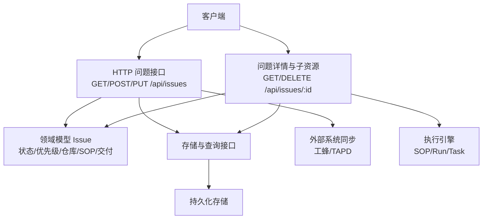
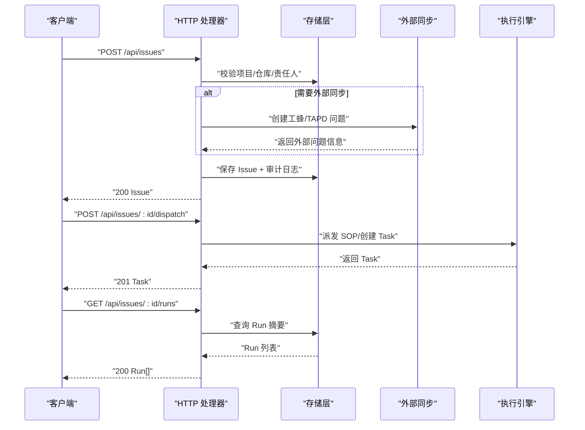
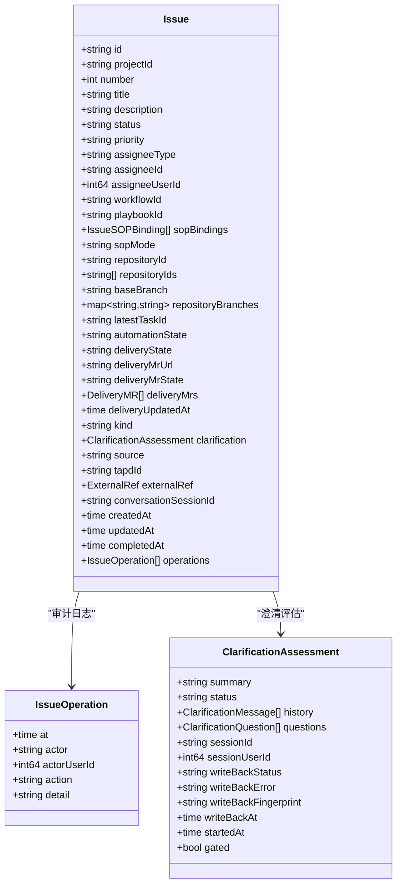
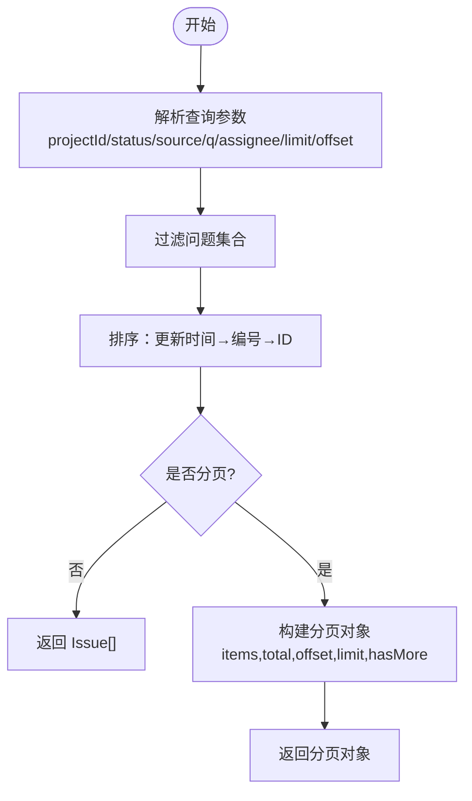

# 问题追踪 API

<cite>
**本文引用的文件**   
- [internal/httpapi/issues.go](file://internal/httpapi/issues.go)
- [internal/httpapi/issue_routes.go](file://internal/httpapi/issue_routes.go)
- [internal/domain/issue.go](file://internal/domain/issue.go)
- [docs/api/collaboration.md](file://docs/api/collaboration.md)
- [e2e/api/20-issues.test.mjs](file://e2e/api/20-issues.test.mjs)
</cite>

## 目录
1. [简介](#简介)
2. [项目结构](#项目结构)
3. [核心组件](#核心组件)
4. [架构总览](#架构总览)
5. [详细接口说明](#详细接口说明)
6. [依赖关系分析](#依赖关系分析)
7. [性能与扩展性](#性能与扩展性)
8. [故障排查](#故障排查)
9. [结论](#结论)

## 简介
本文面向“问题（Issue）”的完整生命周期管理，覆盖创建、查询、更新、删除等核心操作，并说明状态流转、优先级、标签式过滤、关联工作流与工作分支、执行记录、代码变更交付闭环等能力。重点文档化以下端点：
- GET /api/issues：获取问题列表，支持按项目、状态、来源、责任人、全文搜索与分页。
- POST /api/issues：创建本地或同步到外部系统的问题。
- PUT /api/issues：整体更新问题字段，保留审计日志与外部绑定。
- DELETE /api/issues/:id：删除问题，支持强制模式清理仍在运行的执行历史。

此外还涵盖评论、运行记录、澄清、派发 SOP、重开、关闭、重新同步 TAPD 等子资源接口，帮助理解问题在平台中的全链路角色。

## 项目结构
问题追踪相关实现主要分布在 HTTP 层、领域模型与文档中：
- HTTP 路由与处理器：`internal/httpapi/issues.go`、`internal/httpapi/issue_routes.go`
- 领域模型与业务规则：`internal/domain/issue.go`
- 对外 API 文档：`docs/api/collaboration.md`
- 端到端测试用例：`e2e/api/20-issues.test.mjs`

图示来源
- [internal/httpapi/issues.go:151-360](file://internal/httpapi/issues.go#L151-L360)
- [internal/httpapi/issue_routes.go:16-379](file://internal/httpapi/issue_routes.go#L16-L379)
- [internal/domain/issue.go:9-69](file://internal/domain/issue.go#L9-L69)

章节来源
- [internal/httpapi/issues.go:151-360](file://internal/httpapi/issues.go#L151-L360)
- [internal/httpapi/issue_routes.go:16-379](file://internal/httpapi/issue_routes.go#L16-L379)
- [internal/domain/issue.go:9-69](file://internal/domain/issue.go#L9-L69)
- [docs/api/collaboration.md:75-144](file://docs/api/collaboration.md#L75-L144)

## 核心组件
- 领域模型 Issue：承载问题标题、描述、状态、优先级、责任人、工作流、仓库、分支、澄清、交付、外部引用、审计日志等。
- HTTP 处理器 issuesHandlers：统一处理列表、新建/更新、详情、评论、运行、澄清、派发、关闭/重开、删除等。
- 子资源路由 issueRoutes：将 /api/issues/:id 下的子路径映射到具体处理方法。
- 外部同步与执行：通过 sync 与 engine 关联外部跟踪系统与 SOP 执行。

关键职责划分：
- 列表与过滤：解析 query，过滤、排序、分页。
- 新建/更新：校验项目、仓库、责任人、SOP 绑定；必要时创建外部问题；写入审计日志。
- 详情与子资源：返回问题视图、评论、运行摘要、澄清会话、派发任务等。
- 删除：先清理可删除的执行历史，再删除问题；冲突时返回明确阻塞原因。

章节来源
- [internal/domain/issue.go:9-69](file://internal/domain/issue.go#L9-L69)
- [internal/httpapi/issues.go:35-40](file://internal/httpapi/issues.go#L35-L40)
- [internal/httpapi/issue_routes.go:444-457](file://internal/httpapi/issue_routes.go#L444-L457)

## 架构总览
下图展示问题从请求进入、领域校验、存储、外部同步到执行与交付的整体流程。

图示来源
- [internal/httpapi/issues.go:210-359](file://internal/httpapi/issues.go#L210-L359)
- [internal/httpapi/issue_routes.go:307-331](file://internal/httpapi/issue_routes.go#L307-L331)
- [internal/httpapi/issue_routes.go:37-51](file://internal/httpapi/issue_routes.go#L37-L51)

## 详细接口说明

### GET /api/issues：获取问题列表
- 功能：根据关联 run 刷新 task/issue 状态后返回匹配的问题。
- 查询参数：
  - projectId：按项目过滤
  - status：逗号分隔的状态 OR 过滤
  - source：逗号分隔的来源 OR 过滤（local/gongfeng/tapd）
  - q：全文搜索，标题支持忽略大小写、空格、标点及多关键词顺序模糊匹配，同时支持 id/编号/外部 ID
  - limit：分页上限，默认 50，最大 200
  - offset：分页偏移，默认 0
- 响应形态：
  - 不传 limit：直接返回 Issue[]
  - 传入 limit：返回 {items,total,offset,limit,hasMore}
- 排序：优先按更新时间倒序，其次按编号倒序，最后按 ID 倒序。

使用示例
- 获取项目 backlog 问题：GET /api/issues?projectId=platform&status=backlog
- 模糊搜索：GET /api/issues?q=审计+日志
- 分页：GET /api/issues?limit=50&offset=0

章节来源
- [docs/api/collaboration.md:87-96](file://docs/api/collaboration.md#L87-L96)
- [internal/httpapi/issues.go:151-208](file://internal/httpapi/issues.go#L151-L208)
- [internal/httpapi/issues.go:661-691](file://internal/httpapi/issues.go#L661-L691)

### POST /api/issues：创建问题
- 语义：POST 与 PUT 语义相同，按 id 新建或整体更新；未提供 id 则新建。
- 必填字段：projectId、title
- 默认值：status 默认为 backlog，priority 默认为 medium
- 仓库与分支：
  - repositoryId：单仓库场景
  - repositoryIds：多仓库场景
  - baseBranch：继续已有功能分支；留空表示从主分支新建
  - repositoryBranches：按仓库指定已有分支，优先于 baseBranch
- 外部同步：
  - syncTarget 为 gongfeng 或 tapd 时，服务会创建外部问题并回填 externalRef/source
  - 工蜂要求绑定仓库
- 责任人：
  - assigneeUserId 必须指向有效用户
  - 新建时若未指定，可能回退为当前用户
- 审计日志：新建时记录 create 操作
- 成功响应：200 返回 Issue

使用示例
- 创建本地需求：POST /api/issues，包含 projectId、title、kind=requirement、repositoryId、workflowId
- 同步到工蜂：POST /api/issues，包含 syncTarget=gongfeng、repositoryId

章节来源
- [docs/api/collaboration.md:98-119](file://docs/api/collaboration.md#L98-L119)
- [internal/httpapi/issues.go:210-359](file://internal/httpapi/issues.go#L210-L359)
- [internal/httpapi/issues.go:856-872](file://internal/httpapi/issues.go#L856-L872)

### PUT /api/issues：更新问题
- 语义：整体更新，未提供的字段继承原值；Operations 审计日志由服务端覆盖。
- 字段合并策略：
  - 空 ProjectID/Title/LatestTaskID/Source/ExternalRef/RepositoryIDs/BaseBranch/Kind/SOPMode/AssigneeID/AssigneeType/AssigneeUserID/WorkflowID/SOPBindings/PlaybookID/Clarification 等字段会继承现有值
  - Operations 始终保留服务端副本
- 仓库与分支：
  - 显式 baseBranch 为空表示恢复自动新建分支
  - repositoryBranches 优先；省略映射会继承仍绑定仓库的分支；显式 {} 清空全部选择
- 责任人：必须存在有效用户
- 外部绑定：更新时保留 tracker 绑定
- 审计日志：当关键字段变化时记录 update 操作，detail 包含状态、标题、描述、责任人、SOP、TAPD ID、分支等差异摘要

使用示例
- 修改优先级：PUT /api/issues，携带 id、priority=high
- 切换工作流：PUT /api/issues，携带 workflowId

章节来源
- [internal/httpapi/issues.go:363-418](file://internal/httpapi/issues.go#L363-L418)
- [internal/httpapi/issues.go:544-582](file://internal/httpapi/issues.go#L544-L582)
- [e2e/api/20-issues.test.mjs:55-64](file://e2e/api/20-issues.test.mjs#L55-L64)

### DELETE /api/issues/:id：删除问题
- 行为：
  - 先清理已结算的 Run（可通过 force=true 强制删除）
  - 再删除问题
- 冲突处理：
  - 如果仍有执行历史或处于忙碌状态，返回 409，并附带 deletionRequiresForce 或 deletionBlock 原因
  - 找不到问题时返回 404
- 成功：返回 204 No Content

使用示例
- 普通删除：DELETE /api/issues/{issueId}
- 强制删除：DELETE /api/issues/{issueId}?force=true

章节来源
- [internal/httpapi/issue_routes.go:333-379](file://internal/httpapi/issue_routes.go#L333-L379)
- [e2e/api/20-issues.test.mjs:73-78](file://e2e/api/20-issues.test.mjs#L73-L78)

### GET /api/issues/:id：问题详情
- 响应：{issue, comments}
- 权限：读取无需项目写权限；写操作需项目写权限

章节来源
- [internal/httpapi/issue_routes.go:16-23](file://internal/httpapi/issue_routes.go#L16-L23)
- [internal/httpapi/issues.go:459-478](file://internal/httpapi/issues.go#L459-L478)

### POST /api/issues/:id/comments：添加评论
- 请求：IssueComment，body 必填，authorType 默认 member
- 响应：200 {"ok":true}
- 错误：404 问题不存在；400 存储错误

章节来源
- [internal/httpapi/issue_routes.go:25-35](file://internal/httpapi/issue_routes.go#L25-L35)
- [docs/api/collaboration.md:131-140](file://docs/api/collaboration.md#L131-L140)

### GET /api/issues/:id/runs：问题执行记录
- 返回该问题的所有历史 Run 摘要，按时间倒序
- 摘要省略 artifacts、遥测、日志、事件和 workflow snapshot，截断部分文本

章节来源
- [internal/httpapi/issue_routes.go:37-51](file://internal/httpapi/issue_routes.go#L37-L51)
- [docs/api/collaboration.md:142-144](file://docs/api/collaboration.md#L142-L144)

### POST /api/issues/:id/chat-clarify：AI 澄清
- 行为：后台任务执行，浏览器断开不影响；SSE 支持查看思考过程；GET 同一路径可重新接入
- 取消：POST /api/issues/:id/chat-clarify/cancel 取消当前实例上的澄清任务
- 结果：JSON 或 SSE 事件 open/thought/done/error

章节来源
- [docs/api/collaboration.md:163-196](file://docs/api/collaboration.md#L163-L196)
- [internal/httpapi/issue_routes.go:155-170](file://internal/httpapi/issue_routes.go#L155-L170)

### POST /api/issues/:id/dispatch：派发 SOP
- 请求体可选，支持 rerun 与 workflowId
- 首次手动派发创建 primary task；已执行过必须显式 rerun:true
- 状态检查：已运行、澄清未通过、交付锁定、外部问题已关闭等返回 409
- 成功：201 返回 Task

章节来源
- [docs/api/collaboration.md:200-222](file://docs/api/collaboration.md#L200-L222)
- [internal/httpapi/issue_routes.go:307-331](file://internal/httpapi/issue_routes.go#L307-L331)

### POST /api/issues/:id/reopen：重开已交付问题
- 成功：200 返回更新后的 Issue
- 失败：409 无法重开；404 问题不存在

章节来源
- [docs/api/collaboration.md:224-226](file://docs/api/collaboration.md#L224-L226)
- [internal/httpapi/issue_routes.go:172-184](file://internal/httpapi/issue_routes.go#L172-L184)

### POST /api/issues/:id/close：关闭问题
- 行为：设置 closed 状态；若之前非手动关闭，记录 close 审计日志
- 冲突：正在执行 SOP 时返回 409

章节来源
- [internal/httpapi/issue_routes.go:186-211](file://internal/httpapi/issue_routes.go#L186-L211)

### POST /api/issues/:id/resync-tapd：重新同步 TAPD
- 仅 TAPD 来源且配置了同步时可用
- 成功后记录 resync-tapd 审计日志

章节来源
- [internal/httpapi/issue_routes.go:213-234](file://internal/httpapi/issue_routes.go#L213-L234)

### GET/PUT /api/issues/:id/sops：SOP 绑定与 Playbook
- GET：返回 playbookId、playbooks、bindings
- PUT：设置 playbookId 与 bindings；若 without SOP 且设置了 workflow，则启用 SOP 并标记 eligible

章节来源
- [internal/httpapi/issue_routes.go:251-305](file://internal/httpapi/issue_routes.go#L251-L305)

## 依赖关系分析

### 数据模型与状态流转
Issue 的核心字段包括：
- 标识与归属：id、projectId、number
- 内容：title、description
- 状态：backlog/todo/in_progress/in_review/done/blocked/closed/cancelled
- 优先级：priority（默认 medium）
- 责任人：assigneeType、assigneeId、assigneeUserId
- 工作流与 SOP：workflowId、playbookId、sopBindings、sopMode
- 仓库与分支：repositoryId、repositoryIds、baseBranch、repositoryBranches
- 交付：deliveryState、deliveryMrUrl、deliveryMrState、deliveryMrs、deliveryUpdatedAt
- 外部引用：source、externalRef、tapdId
- 澄清：clarification（summary/status/history/questions/writeBack*）
- 审计：operations（create/update/close/reopen/dispatch）

图示来源
- [internal/domain/issue.go:9-69](file://internal/domain/issue.go#L9-L69)
- [internal/domain/issue.go:95-101](file://internal/domain/issue.go#L95-L101)
- [internal/domain/issue.go:152-169](file://internal/domain/issue.go#L152-L169)

### 过滤器与搜索
- 过滤维度：project、status、source、assignee
- 搜索：q 支持标题模糊匹配、id/编号/外部 ID 精确包含
- 排序：updatedAt 倒序、number 倒序、id 倒序

图示来源
- [internal/httpapi/issues.go:151-208](file://internal/httpapi/issues.go#L151-L208)
- [internal/httpapi/issues.go:661-691](file://internal/httpapi/issues.go#L661-L691)

### 与执行记录、代码变更的关联
- 执行记录：GET /api/issues/:id/runs 返回与该问题关联的 Run 摘要，便于回溯 SOP 执行情况。
- 代码变更：
  - 通过 repositoryIds/baseBranch/repositoryBranches 绑定仓库与分支
  - 交付字段 deliveryState/deliveryMrUrl/deliveryMrState/deliveryMrs 反映 MR 合入与基线集成状态
  - 派发 SOP 后，引擎创建 Task/Run，最终可能产生 MR 并更新交付状态

章节来源
- [internal/httpapi/issue_routes.go:37-51](file://internal/httpapi/issue_routes.go#L37-L51)
- [internal/domain/issue.go:32-51](file://internal/domain/issue.go#L32-L51)

## 性能与扩展性
- 列表查询：
  - 默认返回数组，适合看板；分页模式限制最大 200，避免大结果集拖慢前端
  - 过滤在内存中进行，适用于中小规模数据集；大规模建议结合后端索引优化
- 搜索：
  - 标题模糊匹配采用归一化与分词策略，兼顾中英文与数字
  - 外部 ID 与编号纳入搜索范围，提升定位效率
- 审计日志：
  - 每次 create/update/close/reopen/dispatch 追加操作，最多保留 200 条，控制体积增长

章节来源
- [internal/httpapi/issues.go:22-25](file://internal/httpapi/issues.go#L22-L25)
- [internal/httpapi/issues.go:717-745](file://internal/httpapi/issues.go#L717-L745)
- [internal/domain/issue.go:103-120](file://internal/domain/issue.go#L103-L120)

## 故障排查
常见问题与定位要点：
- 404 问题不存在：检查 id 是否正确；子资源方法不支持也会返回 404
- 400 参数错误：
  - projectId/title 缺失
  - assigneeUserId 无效
  - repository 不属于项目
  - syncTarget 非法或外部同步未配置
- 409 冲突：
  - 关闭或删除时仍有执行历史或忙碌状态
  - 派发 SOP 时已运行或交付锁定
- 删除失败：
  - 返回 deletionRequiresForce 或 deletionBlock，根据提示使用 force=true 或解决阻塞原因

章节来源
- [internal/httpapi/issue_routes.go:333-379](file://internal/httpapi/issue_routes.go#L333-L379)
- [internal/httpapi/issues.go:272-295](file://internal/httpapi/issues.go#L272-L295)
- [docs/api/collaboration.md:200-226](file://docs/api/collaboration.md#L200-L226)

## 结论
本 API 围绕 Issue 构建了完整的生命周期管理能力：
- 列表与筛选：支持多维度过滤与模糊搜索，满足看板与批量操作需求
- 创建与更新：灵活支持本地与外部同步，严格校验项目/仓库/责任人，保留审计日志
- 详情与子资源：评论、运行、澄清、派发、关闭/重开、重新同步 TAPD、SOP 绑定
- 删除：安全清理执行历史，支持强制模式并提供明确冲突原因
- 关联关系：与工作流、仓库分支、执行记录、MR 交付闭环紧密耦合，形成从需求到交付的闭环