# 项目基础管理

<cite>
**本文引用的文件**   
- [projects.go](file://internal/httpapi/projects.go)
- [project_delete_test.go](file://internal/httpapi/project_delete_test.go)
- [project_write_access.go](file://internal/httpapi/project_write_access.go)
- [project.go](file://internal/domain/project.go)
- [projects.go](file://internal/repo/projects.go)
- [openapi.yaml](file://docs/api/openapi.yaml)
- [operations.go](file://internal/application/operations.go)
- [catalog_test.go](file://internal/httpapi/catalog_test.go)
</cite>

## 目录
1. [简介](#简介)
2. [项目结构](#项目结构)
3. [核心组件](#核心组件)
4. [架构总览](#架构总览)
5. [详细接口分析](#详细接口分析)
6. [依赖关系分析](#依赖关系分析)
7. [性能与一致性](#性能与一致性)
8. [故障排查指南](#故障排查指南)
9. [结论](#结论)

## 简介
本文面向“项目”这一核心业务实体，系统说明其创建、配置、删除与恢复等基础管理能力。内容覆盖：
- 项目元数据：标识、名称、描述、颜色、默认仓库、所有者、成员、运行评估策略、TAPD 工作区与迭代、SOP 绑定与工作流。
- 权限控制：平台管理员、项目所有者、非 viewer 成员的写入权限。
- 状态管理：软删除与恢复、ID 占用保护。
- 初始化流程：新项目默认 SOP 与工作流绑定、默认 MCP 服务初始化。
- 错误处理：参数校验、冲突、未授权、禁止访问、资源不存在等状态码与语义。

## 项目结构
项目相关能力分布在以下层次：
- HTTP 层：路由与请求处理逻辑集中在 `internal/httpapi/projects.go`。
- 领域模型：项目数据结构、公开响应脱敏、成员结构定义在 `internal/domain/project.go`。
- 仓储层：项目读写、成员聚合、归档/恢复事务在 `internal/repo/projects.go`。
- API 契约：OpenAPI 文档中定义了 `/api/projects` 系列端点及状态码语义，见 `docs/api/openapi.yaml`。
- 应用操作清单：将项目相关操作注册到平台可观测的操作类型中，见 `internal/application/operations.go`。

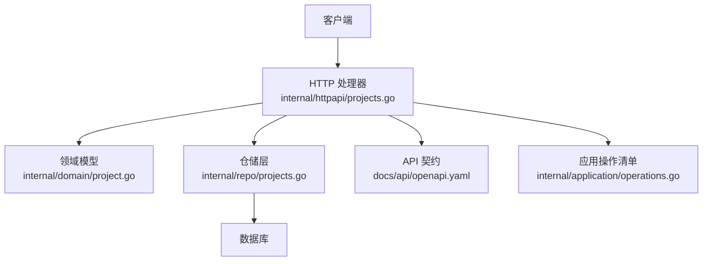

**图表来源**
- [projects.go:18-165](file://internal/httpapi/projects.go#L18-L165)
- [project.go:9-43](file://internal/domain/project.go#L9-L43)
- [projects.go:20-80](file://internal/repo/projects.go#L20-L80)
- [openapi.yaml:951-1037](file://docs/api/openapi.yaml#L951-L1037)
- [operations.go:26-32](file://internal/application/operations.go#L26-L32)

**章节来源**
- [projects.go:18-165](file://internal/httpapi/projects.go#L18-L165)
- [project.go:9-43](file://internal/domain/project.go#L9-L43)
- [projects.go:20-80](file://internal/repo/projects.go#L20-L80)
- [openapi.yaml:951-1037](file://docs/api/openapi.yaml#L951-L1037)
- [operations.go:26-32](file://internal/application/operations.go#L26-L32)

## 核心组件
- 项目领域模型：包含项目 ID、Key、名称、描述、颜色、工作流 ID、SOP 绑定、默认仓库、所有者、成员、运行评估策略、TAPD 集成字段、时间戳以及软删除标记。
- 公开响应脱敏：对外返回的项目对象会移除敏感字段（如 Git Token、CodeBuddy API Key）。
- 项目成员：每个成员由用户 ID 与角色组成，角色包括 maintainer、member、viewer。
- 项目仓储：提供项目列表、单条查询、批量成员授权、归档/恢复、保存项目与成员、以及写锁保护的事务写入。

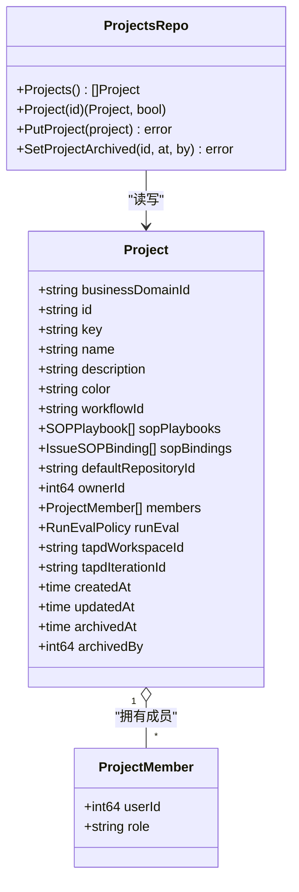

**图表来源**
- [project.go:9-43](file://internal/domain/project.go#L9-L43)
- [project.go:61-64](file://internal/domain/project.go#L61-L64)
- [projects.go:20-80](file://internal/repo/projects.go#L20-L80)
- [projects.go:150-165](file://internal/repo/projects.go#L150-L165)
- [projects.go:125-148](file://internal/repo/projects.go#L125-L148)

**章节来源**
- [project.go:9-43](file://internal/domain/project.go#L9-L43)
- [project.go:61-64](file://internal/domain/project.go#L61-L64)
- [projects.go:20-80](file://internal/repo/projects.go#L20-L80)
- [projects.go:125-165](file://internal/repo/projects.go#L125-L165)

## 架构总览
项目管理的 HTTP 入口统一由 `projectsHandlers.projects` 处理 GET/PUT/POST，单条项目详情由 `projectsHandlers.project` 处理，删除与恢复分别由 `deleteProject` 与 `restoreProject` 处理。所有变更最终通过 `repo.PutProject` 或 `repo.SetProjectArchived` 持久化。

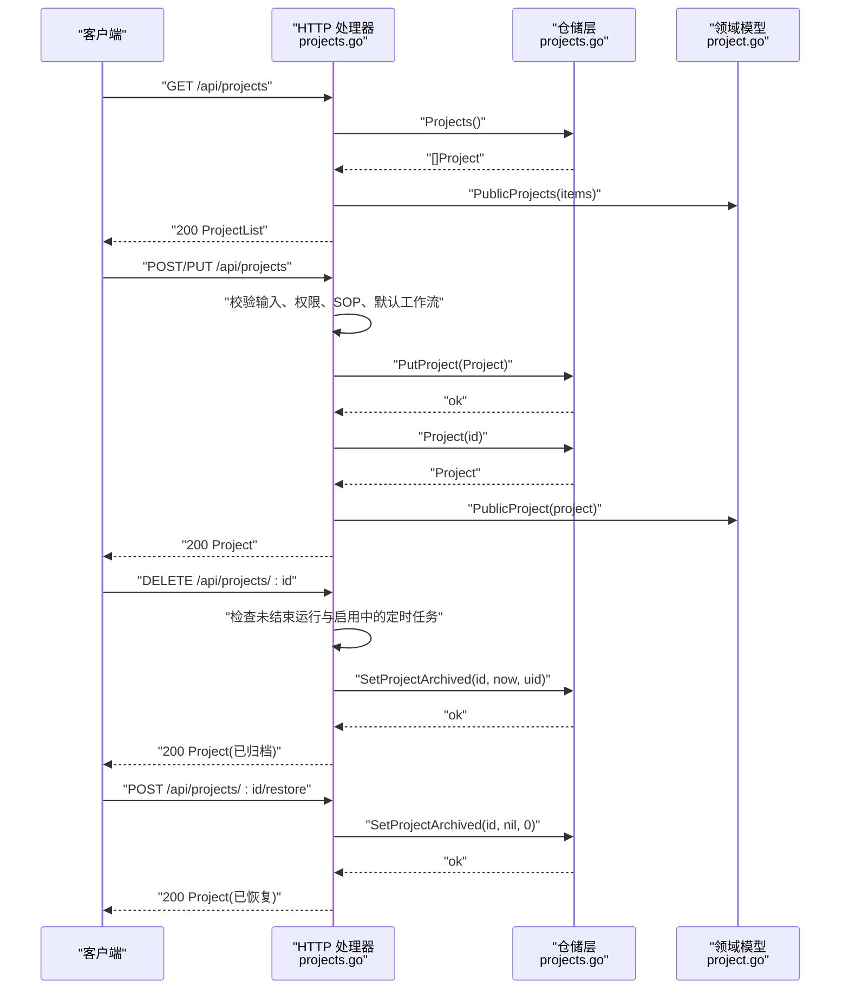

**图表来源**
- [projects.go:18-165](file://internal/httpapi/projects.go#L18-L165)
- [projects.go:212-251](file://internal/httpapi/projects.go#L212-L251)
- [projects.go:125-165](file://internal/repo/projects.go#L125-L165)
- [project.go:45-59](file://internal/domain/project.go#L45-L59)

**章节来源**
- [projects.go:18-165](file://internal/httpapi/projects.go#L18-L165)
- [projects.go:212-251](file://internal/httpapi/projects.go#L212-L251)
- [projects.go:125-165](file://internal/repo/projects.go#L125-L165)
- [project.go:45-59](file://internal/domain/project.go#L45-L59)

## 详细接口分析

### GET /api/projects — 获取项目列表
- 功能：返回当前可见的活跃项目列表；已归档项目不会出现在列表中。
- 权限：若启用了认证，则需登录；列表结果会脱敏敏感字段。
- 成功响应：200，数组形式的公开项目对象。
- 失败响应：401 未授权。

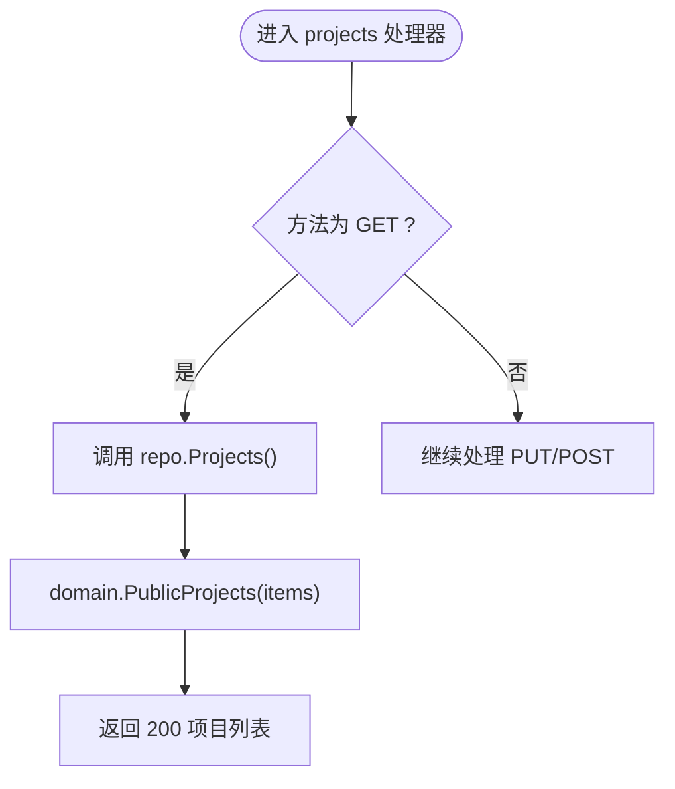

**图表来源**
- [projects.go:18-23](file://internal/httpapi/projects.go#L18-L23)
- [projects.go:20-58](file://internal/repo/projects.go#L20-L58)
- [project.go:45-59](file://internal/domain/project.go#L45-L59)

**章节来源**
- [projects.go:18-23](file://internal/httpapi/projects.go#L18-L23)
- [projects.go:20-58](file://internal/repo/projects.go#L20-L58)
- [project.go:45-59](file://internal/domain/project.go#L45-L59)
- [openapi.yaml:951-959](file://docs/api/openapi.yaml#L951-L959)

### POST /api/projects — 创建项目
- 功能：创建一个新项目；若未显式指定工作流 ID，则自动绑定通用后端交付 SOP。
- 必填字段：id、name。
- 权限：
  - 若未登录且允许匿名创建，则不强制身份。
  - 若需要认证，则新建项目的 owner 必须为当前用户；平台管理员不受此限制。
- 默认行为：
  - 新项目的 workflowId 默认为通用后端交付工作流。
  - 新项目会尝试确保默认的 MCP 服务并重新配置同步。
- 成功响应：200，返回公开项目对象。
- 失败响应：
  - 400 缺少必填字段、所有者或成员引用无效、默认仓库不属于该项目、SOP 绑定异常。
  - 401 未登录。
  - 403 非平台管理员时不允许设置非当前用户的 owner。

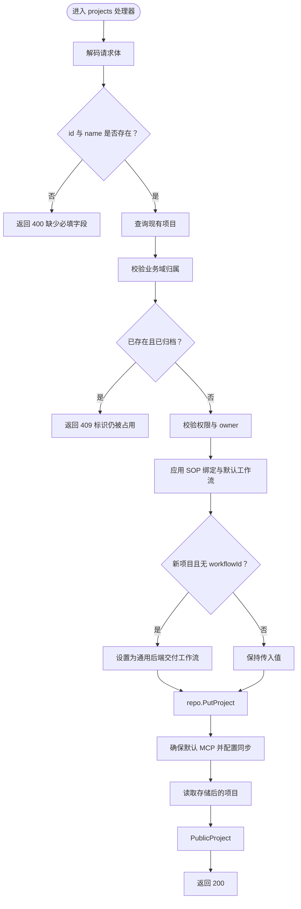

**图表来源**
- [projects.go:24-165](file://internal/httpapi/projects.go#L24-L165)
- [catalog_test.go:624-636](file://internal/httpapi/catalog_test.go#L624-L636)

**章节来源**
- [projects.go:24-165](file://internal/httpapi/projects.go#L24-L165)
- [catalog_test.go:624-636](file://internal/httpapi/catalog_test.go#L624-L636)
- [openapi.yaml:960-983](file://docs/api/openapi.yaml#L960-L983)

### PUT /api/projects — 更新项目
- 功能：更新已有项目的元数据、成员、SOP 绑定、默认仓库、运行评估策略、TAPD 集成字段等。
- 必填字段：id、name。
- 权限：
  - 非平台管理员时，只有项目 owner 可以修改项目设置。
  - 不允许通过请求体直接设置 archivedAt/archivedBy。
- 业务规则：
  - 业务域归属只能通过专用接口调整，直接传 businessDomainId 会被拒绝。
  - 若项目已归档，则更新会返回 409。
  - 成员必须引用存在的用户且唯一；默认仓库必须属于该项目。
  - 若未传入 RunEval，则继承旧值；否则规范化策略。
- 成功响应：200，返回公开项目对象。
- 失败响应：
  - 400 参数校验失败、业务域归属非法、成员或仓库引用无效。
  - 401 未登录。
  - 403 非 owner 或非平台管理员。
  - 409 项目已归档。

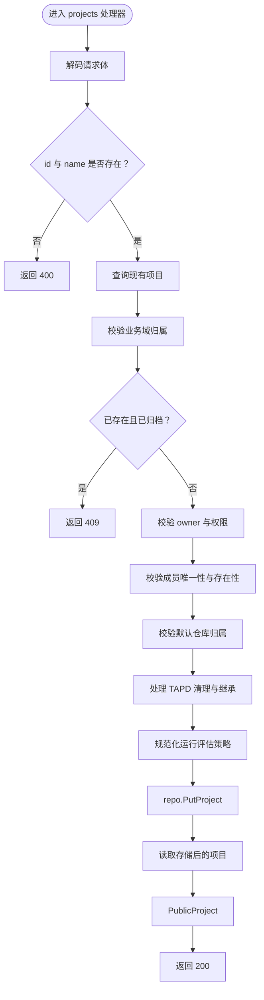

**图表来源**
- [projects.go:24-165](file://internal/httpapi/projects.go#L24-L165)

**章节来源**
- [projects.go:24-165](file://internal/httpapi/projects.go#L24-L165)
- [openapi.yaml:972-983](file://docs/api/openapi.yaml#L972-L983)

### GET /api/projects/:id — 获取项目详情
- 功能：根据项目 ID 获取单个项目详情；返回公开项目对象。
- 权限：若启用了认证，则需登录；详情接口本身不做额外权限判断。
- 成功响应：200，公开项目对象。
- 失败响应：
  - 401 未登录。
  - 404 项目不存在。

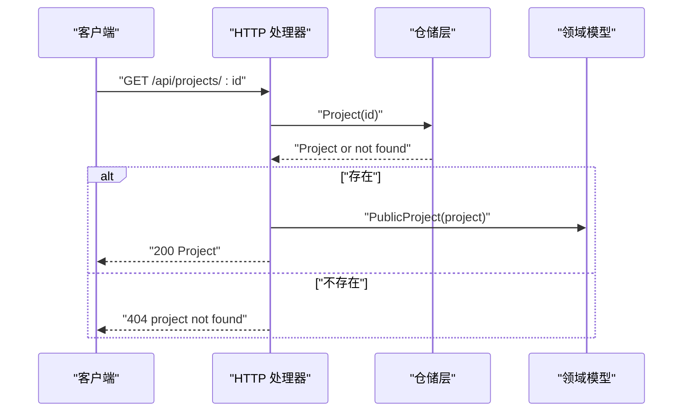

**图表来源**
- [projects.go:203-210](file://internal/httpapi/projects.go#L203-L210)
- [projects.go:60-80](file://internal/repo/projects.go#L60-L80)
- [project.go:45-59](file://internal/domain/project.go#L45-L59)

**章节来源**
- [projects.go:203-210](file://internal/httpapi/projects.go#L203-L210)
- [projects.go:60-80](file://internal/repo/projects.go#L60-L80)
- [project.go:45-59](file://internal/domain/project.go#L45-L59)
- [openapi.yaml:984-999](file://docs/api/openapi.yaml#L984-L999)

### DELETE /api/projects/:id — 软删除项目
- 功能：将项目标记为已归档（软删除）；项目从列表与同步中隐藏，但需求、运行记录与设置保留，ID 继续被占用。
- 权限：仅项目 owner 或平台管理员可执行。
- 前置条件：
  - 不能存在未结束的运行。
  - 不能有启用中的定时任务。
- 成功响应：200，返回已归档项目对象。
- 失败响应：
  - 401 未登录。
  - 403 非 owner 或非平台管理员。
  - 404 项目不存在或已归档。
  - 409 存在未结束运行或启用中的定时任务。

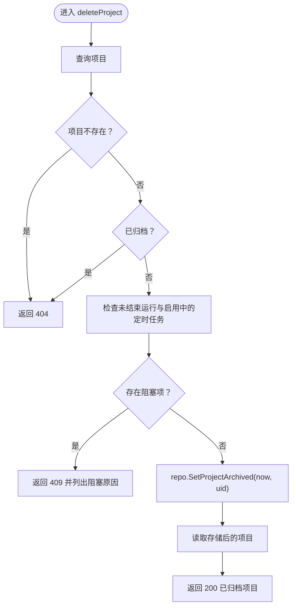

**图表来源**
- [projects.go:212-236](file://internal/httpapi/projects.go#L212-L236)
- [projects.go:274-299](file://internal/httpapi/projects.go#L274-L299)
- [projects.go:125-148](file://internal/repo/projects.go#L125-L148)

**章节来源**
- [projects.go:212-236](file://internal/httpapi/projects.go#L212-L236)
- [projects.go:274-299](file://internal/httpapi/projects.go#L274-L299)
- [project_delete_test.go:57-111](file://internal/httpapi/project_delete_test.go#L57-L111)
- [openapi.yaml:1000-1018](file://docs/api/openapi.yaml#L1000-L1018)

### POST /api/projects/:id/restore — 恢复项目
- 功能：恢复一个已归档的项目；恢复后项目重新出现在列表中。
- 权限：仅项目 owner 或平台管理员可执行。
- 成功响应：200，返回已恢复项目对象。
- 失败响应：
  - 401 未登录。
  - 403 非 owner 或非平台管理员。
  - 404 项目不存在。

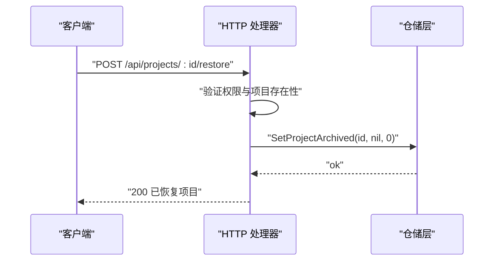

**图表来源**
- [projects.go:238-251](file://internal/httpapi/projects.go#L238-L251)
- [projects.go:253-271](file://internal/httpapi/projects.go#L253-L271)
- [projects.go:125-148](file://internal/repo/projects.go#L125-L148)

**章节来源**
- [projects.go:238-251](file://internal/httpapi/projects.go#L238-L251)
- [projects.go:253-271](file://internal/httpapi/projects.go#L253-L271)
- [project_delete_test.go:102-111](file://internal/httpapi/project_delete_test.go#L102-L111)
- [openapi.yaml:1019-1037](file://docs/api/openapi.yaml#L1019-L1037)

### 项目模板与初始化流程
- 新项目默认工作流：如果创建项目时未指定 workflowId，则自动绑定通用后端交付 SOP（LoopForge），保证需求与交付流程开箱即用。
- 默认 MCP 服务：新项目创建成功后，系统会尝试确保默认的 MCP 服务并重新配置同步。
- 测试用例验证了默认工作流绑定与默认 MCP 初始化行为。

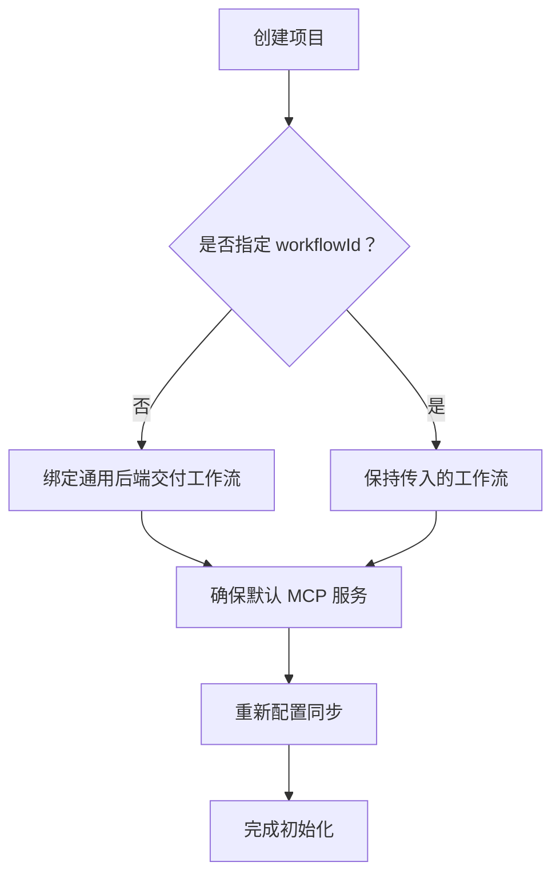

**图表来源**
- [projects.go:92-97](file://internal/httpapi/projects.go#L92-L97)
- [projects.go:155-161](file://internal/httpapi/projects.go#L155-L161)
- [catalog_test.go:624-636](file://internal/httpapi/catalog_test.go#L624-L636)

**章节来源**
- [projects.go:92-97](file://internal/httpapi/projects.go#L92-L97)
- [projects.go:155-161](file://internal/httpapi/projects.go#L155-L161)
- [catalog_test.go:624-636](file://internal/httpapi/catalog_test.go#L624-L636)

### 权限与成员管理
- 项目写入权限：平台管理员、项目 owner、以及非 viewer 的成员可以修改项目相关内容。
- 项目所有者验证：
  - 创建项目时，若非平台管理员，owner 必须为当前用户。
  - 更新项目时，若非平台管理员，只有 owner 可修改项目设置。
  - 删除与恢复项目时，仅 owner 或平台管理员可执行。
- 成员管理：
  - 成员必须引用存在的用户且唯一。
  - 成员角色为空时默认 member；viewer 角色不具备写入权限。
  - 默认仓库必须属于该项目。

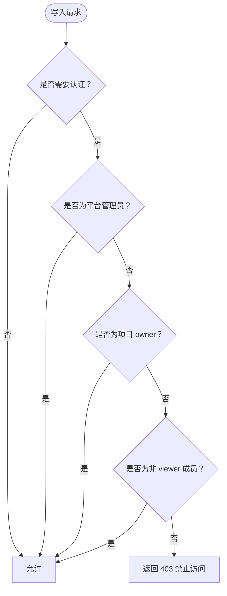

**图表来源**
- [project_write_access.go:15-68](file://internal/httpapi/project_write_access.go#L15-L68)
- [projects.go:50-70](file://internal/httpapi/projects.go#L50-L70)
- [projects.go:104-122](file://internal/httpapi/projects.go#L104-L122)

**章节来源**
- [project_write_access.go:15-68](file://internal/httpapi/project_write_access.go#L15-L68)
- [projects.go:50-70](file://internal/httpapi/projects.go#L50-L70)
- [projects.go:104-122](file://internal/httpapi/projects.go#L104-L122)

### SOP 绑定与默认工作流配置
- SOPPlaybooks：按需求组合命名（例如完整需求、仅后端），每条需求可选择其中一个组合；它不是项目级单一链。
- SOPBindings：遗留的单 playbook 绑定；当 SOPPlaybooks 为空时，仍暴露该绑定作为默认组合以兼容旧项目。
- 默认工作流：
  - 若存在默认 playbook 且包含绑定，则使用第一个绑定的 workflowId。
  - 若未传入任何 SOP 绑定，则保持原有值。
  - 新项目若无 workflowId，则自动绑定通用后端交付工作流。

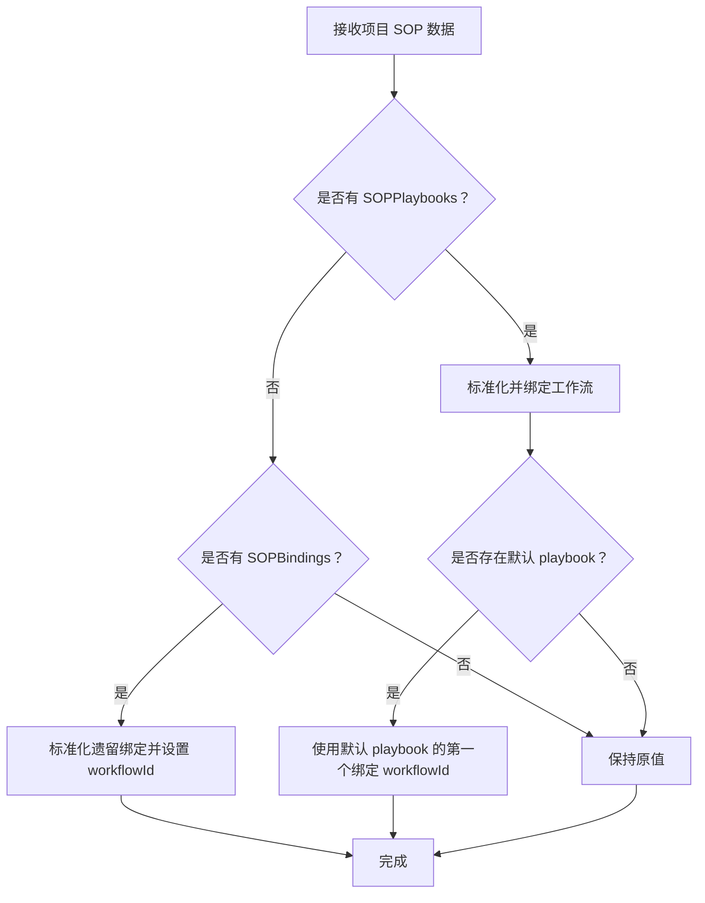

**图表来源**
- [projects.go:168-201](file://internal/httpapi/projects.go#L168-L201)
- [project.go:16-22](file://internal/domain/project.go#L16-L22)

**章节来源**
- [projects.go:168-201](file://internal/httpapi/projects.go#L168-L201)
- [project.go:16-22](file://internal/domain/project.go#L16-L22)

### 错误处理与状态码定义
- 400 参数错误：
  - 缺少必填字段（id、name）。
  - 业务域归属非法。
  - 所有者或成员引用无效。
  - 默认仓库不属于该项目。
  - SOP 绑定异常。
- 401 未授权：
  - 需要认证但未登录。
- 403 禁止访问：
  - 非 owner 或非平台管理员修改项目设置。
  - 非 owner 或非平台管理员删除或恢复项目。
  - 非项目成员、非 owner、非平台管理员写入项目内容。
- 404 资源不存在：
  - 项目不存在或已归档。
- 409 冲突：
  - 项目已归档但仍尝试创建或更新。
  - 存在未结束运行或启用中的定时任务时删除项目。

**章节来源**
- [projects.go:32-47](file://internal/httpapi/projects.go#L32-L47)
- [projects.go:56-69](file://internal/httpapi/projects.go#L56-L69)
- [projects.go:221-228](file://internal/httpapi/projects.go#L221-L228)
- [project_delete_test.go:68-95](file://internal/httpapi/project_delete_test.go#L68-L95)
- [openapi.yaml:968-983](file://docs/api/openapi.yaml#L968-L983)
- [openapi.yaml:1000-1018](file://docs/api/openapi.yaml#L1000-L1018)

## 依赖关系分析
- HTTP 处理器依赖仓储层进行项目读写与成员聚合。
- 领域模型提供公开响应脱敏与成员结构定义。
- OpenAPI 文档定义了端点契约与状态码语义。
- 应用操作清单将项目相关操作注册到平台可观测的操作类型中。

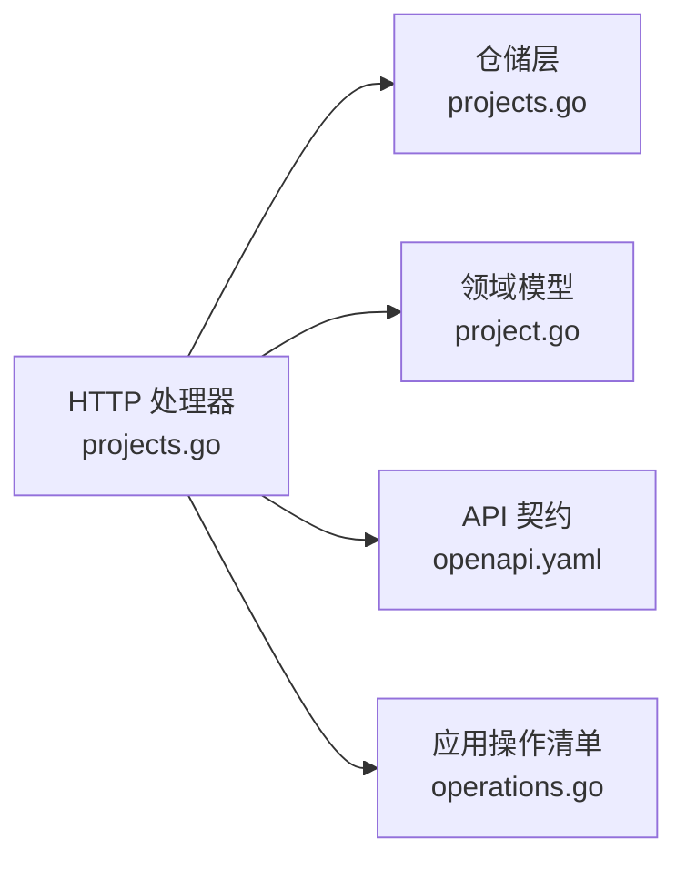

**图表来源**
- [projects.go:18-165](file://internal/httpapi/projects.go#L18-L165)
- [projects.go:20-80](file://internal/repo/projects.go#L20-L80)
- [project.go:9-43](file://internal/domain/project.go#L9-L43)
- [openapi.yaml:951-1037](file://docs/api/openapi.yaml#L951-L1037)
- [operations.go:26-32](file://internal/application/operations.go#L26-L32)

**章节来源**
- [projects.go:18-165](file://internal/httpapi/projects.go#L18-L165)
- [projects.go:20-80](file://internal/repo/projects.go#L20-L80)
- [project.go:9-43](file://internal/domain/project.go#L9-L43)
- [openapi.yaml:951-1037](file://docs/api/openapi.yaml#L951-L1037)
- [operations.go:26-32](file://internal/application/operations.go#L26-L32)

## 性能与一致性
- 列表查询：项目列表会加载成员信息并按名称排序；对大型数据集需注意成员表关联的性能。
- 写入事务：项目保存与成员更新在同一事务中执行，保证成员与项目主记录的一致性。
- 归档/恢复：使用写锁与事务更新 payload，避免并发修改导致的状态不一致。
- 默认初始化：新项目创建后会触发默认 MCP 服务与同步配置，可能引入额外 I/O；建议在批量创建场景下考虑异步或批处理优化。

[本节为通用指导，不直接分析具体文件]

## 故障排查指南
- 无法创建或更新项目：
  - 检查是否缺少必填字段（id、name）。
  - 检查是否尝试直接设置业务域归属（应通过专用接口）。
  - 检查所有者或成员是否引用存在的用户。
  - 检查默认仓库是否属于该项目。
- 删除项目失败：
  - 检查是否存在未结束的运行。
  - 检查是否有启用中的定时任务。
  - 确认当前用户是否为项目 owner 或平台管理员。
- 恢复项目失败：
  - 确认项目是否存在且已归档。
  - 确认当前用户是否为项目 owner 或平台管理员。
- 项目列表不包含预期项目：
  - 检查项目是否已被归档。
  - 检查项目列表是否过滤了已归档项目。

**章节来源**
- [projects.go:32-47](file://internal/httpapi/projects.go#L32-L47)
- [projects.go:221-228](file://internal/httpapi/projects.go#L221-L228)
- [project_delete_test.go:68-111](file://internal/httpapi/project_delete_test.go#L68-L111)

## 结论
项目基础管理围绕 HTTP 处理器、领域模型与仓储层协作实现，提供了完整的创建、更新、查询、软删除与恢复能力。系统在权限控制、SOP 绑定、默认工作流初始化、成员管理与错误处理方面具备明确的业务规则与实现细节。通过 OpenAPI 契约与应用操作清单，项目相关能力可被平台统一治理与观测。

[本节为总结性内容，不直接分析具体文件]