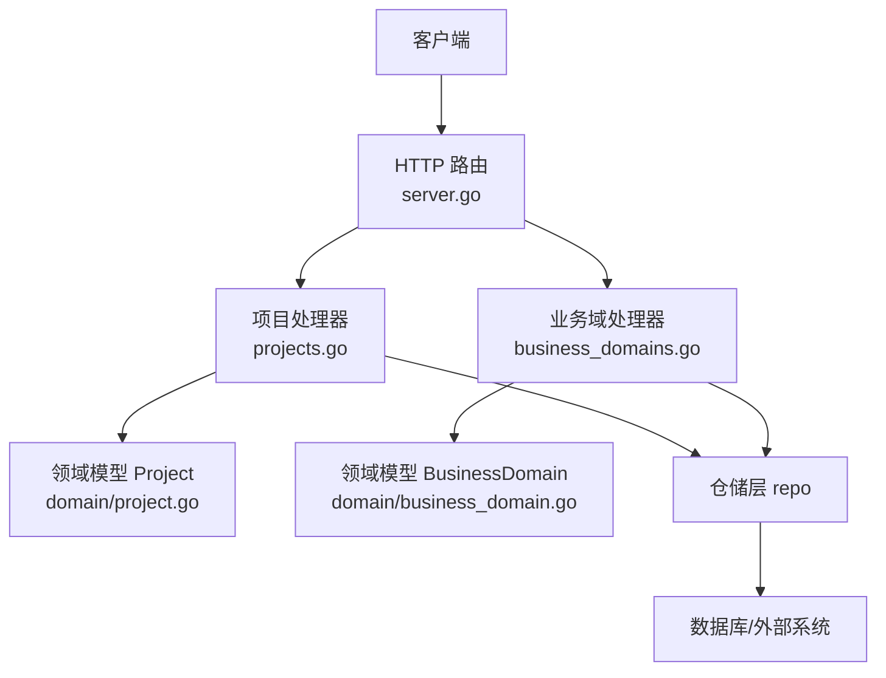
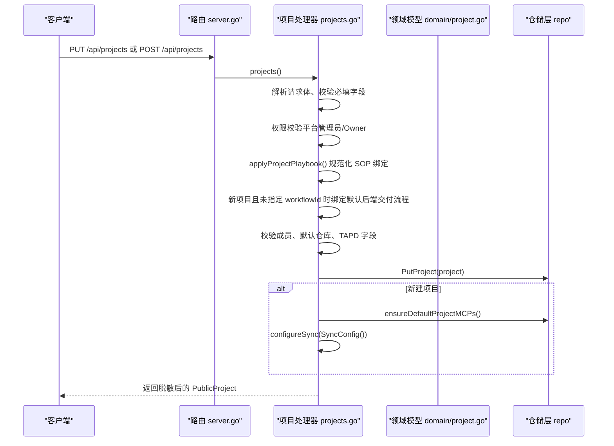
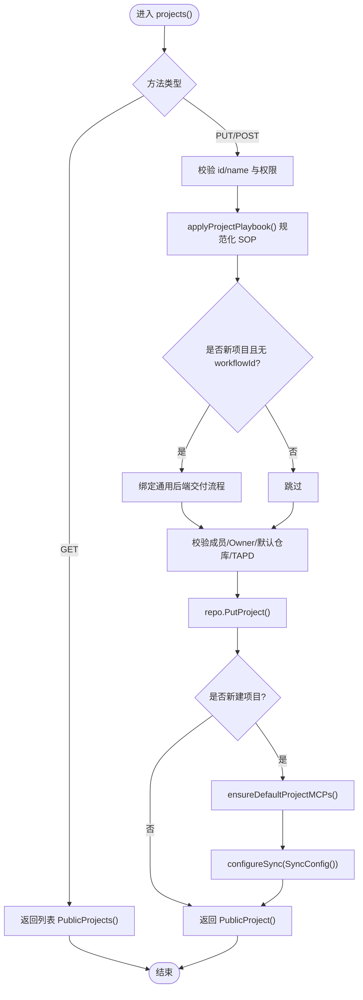
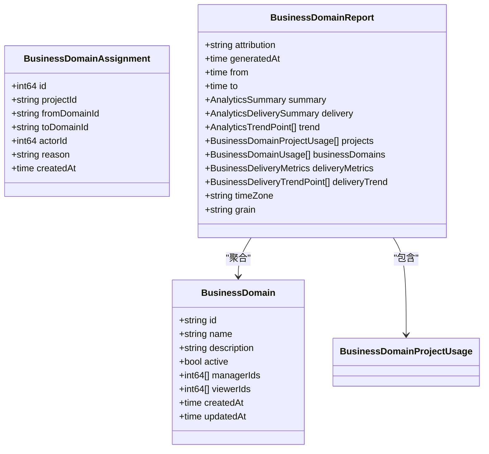
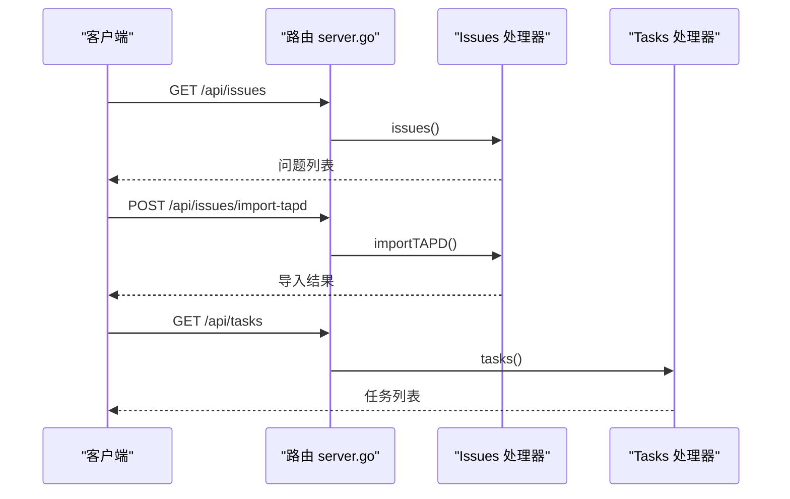
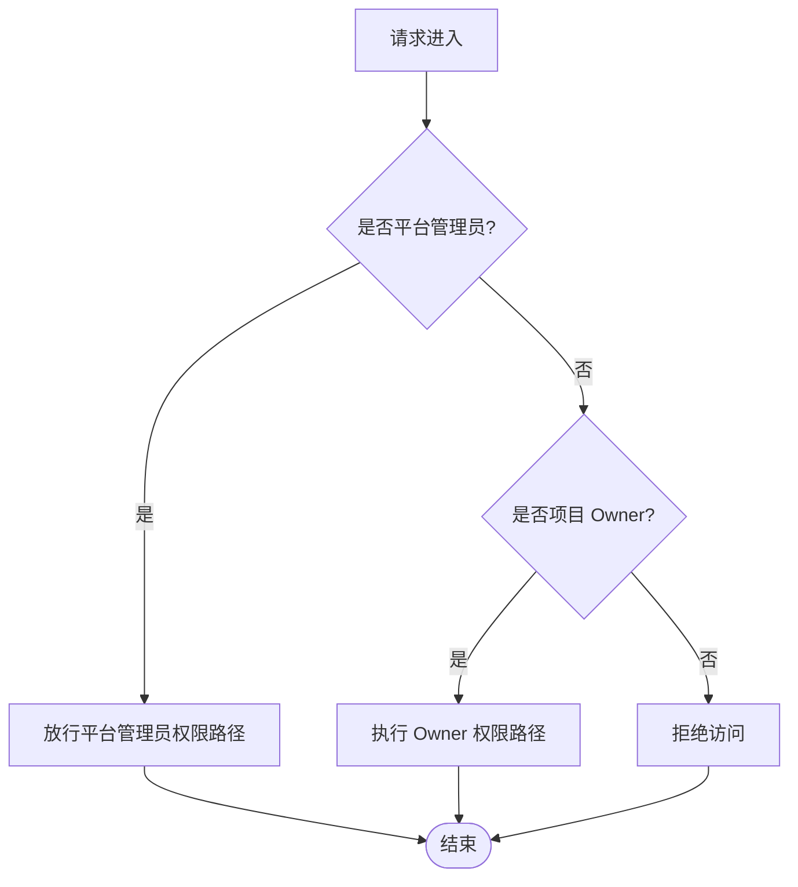
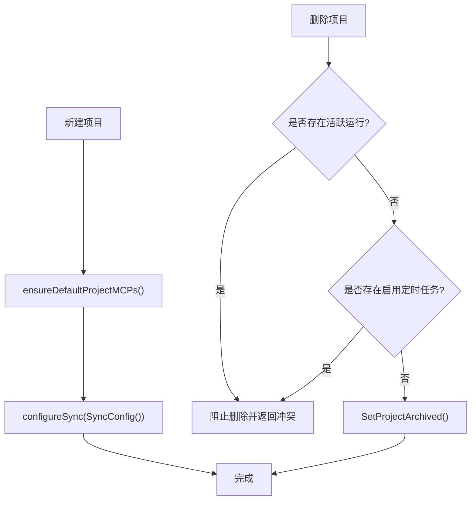
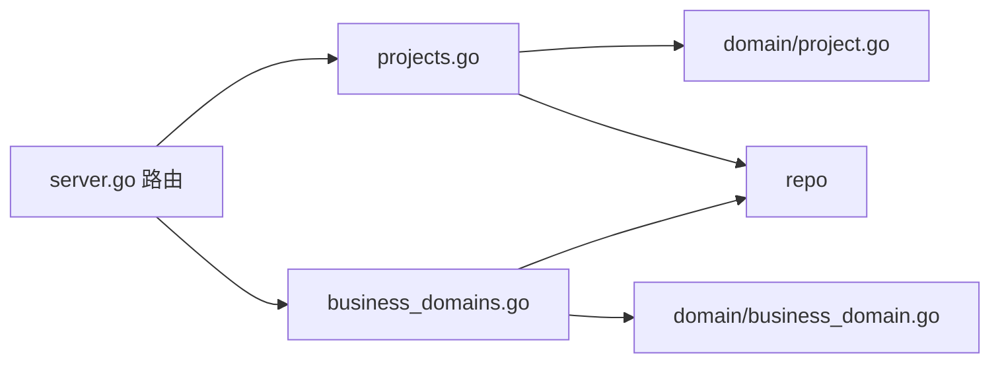

# 项目管理 API

<cite>
**本文引用的文件**   
- [internal/httpapi/server.go](file://internal/httpapi/server.go)
- [internal/httpapi/projects.go](file://internal/httpapi/projects.go)
- [internal/domain/project.go](file://internal/domain/project.go)
- [internal/application/operations.go](file://internal/application/operations.go)
- [internal/httpapi/business_domains.go](file://internal/httpapi/business_domains.go)
- [internal/domain/business_domain.go](file://internal/domain/business_domain.go)
</cite>

## 目录
1. [引言](#引言)
2. [项目结构](#项目结构)
3. [核心组件](#核心组件)
4. [架构总览](#架构总览)
5. [详细组件分析](#详细组件分析)
6. [依赖关系分析](#依赖关系分析)
7. [性能与一致性](#性能与一致性)
8. [故障排查指南](#故障排查指南)
9. [结论](#结论)

## 引言
本文件面向“项目管理 API”，覆盖项目的创建、配置、成员管理、业务域归属、问题追踪与任务管理的 CRUD 能力，并说明权限模型、访问控制、协作功能、数据同步、状态管理与批量操作等实现要点。文档以代码仓库中的 HTTP 路由、领域模型与应用操作定义为依据，帮助读者快速理解接口职责、调用顺序与约束条件。

## 项目结构
本项目采用分层组织：HTTP 层负责路由与请求处理；领域层定义项目、仓库、业务域等核心实体；应用层描述操作语义与权限边界；仓储层（repo）负责持久化与聚合查询。

**图表来源**
- [internal/httpapi/server.go:340-380](file://internal/httpapi/server.go#L340-L380)
- [internal/httpapi/projects.go:18-165](file://internal/httpapi/projects.go#L18-L165)
- [internal/httpapi/business_domains.go:35-117](file://internal/httpapi/business_domains.go#L35-L117)
- [internal/domain/project.go:9-64](file://internal/domain/project.go#L9-L64)
- [internal/domain/business_domain.go:6-25](file://internal/domain/business_domain.go#L6-L25)

**章节来源**
- [internal/httpapi/server.go:340-380](file://internal/httpapi/server.go#L340-L380)

## 核心组件
- 项目处理器 projectsHandlers：提供项目列表、创建/更新、详情、软删除、恢复、业务域归属设置与历史查询。
- 业务域处理器 businessDomainsHandlers：提供业务域列表、创建/更新、报告查询，以及可见性与权限控制。
- 领域模型 Project/BusinessDomain：定义项目、仓库上下文、业务域及其报表数据结构。
- 应用操作 operations.go：声明业务域与项目相关操作的名称、方法与路径，用于权限与审计。

**章节来源**
- [internal/httpapi/projects.go:16-165](file://internal/httpapi/projects.go#L16-L165)
- [internal/httpapi/business_domains.go:22-117](file://internal/httpapi/business_domains.go#L22-L117)
- [internal/domain/project.go:9-64](file://internal/domain/project.go#L9-L64)
- [internal/domain/business_domain.go:6-25](file://internal/domain/business_domain.go#L6-L25)
- [internal/application/operations.go:24-29](file://internal/application/operations.go#L24-L29)

## 架构总览
以下序列图展示“创建或更新项目”的端到端流程，包括参数校验、权限检查、默认工作流绑定、成员与仓库校验、持久化与同步配置刷新。

**图表来源**
- [internal/httpapi/server.go:353-358](file://internal/httpapi/server.go#L353-L358)
- [internal/httpapi/projects.go:18-165](file://internal/httpapi/projects.go#L18-L165)
- [internal/domain/project.go:45-59](file://internal/domain/project.go#L45-L59)

## 详细组件分析

### 项目 CRUD 与生命周期
- 列表与详情
  - GET /api/projects：返回脱敏后的项目列表。
  - GET /api/projects/:id：返回单个项目详情。
- 创建与更新
  - PUT /api/projects、POST /api/projects：创建或更新项目。
  - 关键规则：
    - 必填 id 与 name；key 未提供时自动大写 id。
    - 业务域归属必须通过专用接口调整，禁止在项目中直接变更。
    - 新项目若未指定 workflowId，将绑定内置通用后端交付 SOP。
    - 成员与 Owner 必须为已存在用户；成员 ID 唯一。
    - 默认仓库必须属于该项目。
    - TAPDWorkspaceID/TAPDIterationID 支持清空或继承。
    - RunEval 策略会被规范化为有效值。
- 软删除与恢复
  - DELETE /api/projects/:id：仅当无活跃运行与启用定时任务时可归档。
  - POST /api/projects/:id/restore：恢复已归档项目。

**图表来源**
- [internal/httpapi/projects.go:18-165](file://internal/httpapi/projects.go#L18-L165)

**章节来源**
- [internal/httpapi/server.go:353-358](file://internal/httpapi/server.go#L353-L358)
- [internal/httpapi/projects.go:18-165](file://internal/httpapi/projects.go#L18-L165)
- [internal/domain/project.go:9-64](file://internal/domain/project.go#L9-L64)

### 业务域与项目归属
- 业务域管理
  - GET /api/business-domains：列出业务域，附带 canManage/canView 与当前用户信息。
  - PUT /api/business-domains：创建或更新业务域；createOnly=true 时仅允许不存在则创建。
  - GET /api/business-domain-report：按业务域维度汇总运行与交付指标，支持时间粒度与时区过滤。
- 项目归属
  - PUT /api/projects/:id/business-domain：设置项目主业务域，支持期望域比对与原因记录。
  - GET /api/projects/:id/business-domain/history：查看最近 100 条归属变更记录。

**图表来源**
- [internal/domain/business_domain.go:6-25](file://internal/domain/business_domain.go#L6-L25)
- [internal/domain/business_domain.go:84-98](file://internal/domain/business_domain.go#L84-L98)

**章节来源**
- [internal/httpapi/business_domains.go:35-117](file://internal/httpapi/business_domains.go#L35-L117)
- [internal/httpapi/business_domains.go:118-172](file://internal/httpapi/business_domains.go#L118-L172)
- [internal/httpapi/projects.go:301-360](file://internal/httpapi/projects.go#L301-L360)
- [internal/domain/business_domain.go:6-25](file://internal/domain/business_domain.go#L6-L25)
- [internal/domain/business_domain.go:84-98](file://internal/domain/business_domain.go#L84-L98)

### 问题追踪与任务管理
- 问题追踪 Issues
  - GET /api/issues、PUT /api/issues、POST /api/issues：列表、批量更新与创建。
  - POST /api/issues/import-tapd：从 TAPD 导入问题。
  - /api/issues/:id 子树：评论、运行、澄清、重开、关闭、重新同步 TAPD、需求关联、SOP 操作、调度等。
- 任务 Tasks
  - GET /api/tasks、GET /api/tasks/:id：任务列表与详情。

**图表来源**
- [internal/httpapi/server.go:364-382](file://internal/httpapi/server.go#L364-L382)
- [internal/httpapi/server.go:424-425](file://internal/httpapi/server.go#L424-L425)

**章节来源**
- [internal/httpapi/server.go:364-382](file://internal/httpapi/server.go#L364-L382)
- [internal/httpapi/server.go:424-425](file://internal/httpapi/server.go#L424-L425)

### 权限模型与访问控制
- 平台管理员
  - 可修改任意项目设置、迁移或清除项目业务域归属。
  - 可维护业务域状态与管理员。
- 项目 Owner
  - 可创建新项目（Owner 默认为当前用户）。
  - 可修改自己拥有的项目设置。
  - 可为未归属的项目设置首次业务域归属。
- 业务域可见性
  - 业务域管理员与查看者可通过 canView 判断是否可查看该业务域的报告。
  - 报告接口根据当前用户与可见范围过滤项目集合。

**图表来源**
- [internal/httpapi/projects.go:50-70](file://internal/httpapi/projects.go#L50-L70)
- [internal/httpapi/projects.go:253-271](file://internal/httpapi/projects.go#L253-L271)
- [internal/httpapi/business_domains.go:32-34](file://internal/httpapi/business_domains.go#L32-L34)

**章节来源**
- [internal/httpapi/projects.go:50-70](file://internal/httpapi/projects.go#L50-L70)
- [internal/httpapi/projects.go:253-271](file://internal/httpapi/projects.go#L253-L271)
- [internal/httpapi/business_domains.go:32-34](file://internal/httpapi/business_domains.go#L32-L34)

### 数据同步与状态管理
- 新建项目后自动初始化默认 MCP 服务，并触发同步配置刷新。
- 项目软删除前检查活跃运行与启用定时任务，确保无副作用后再归档。
- 业务域报告具备短期缓存与并发合并机制，避免重复计算。

**图表来源**
- [internal/httpapi/projects.go:155-160](file://internal/httpapi/projects.go#L155-L160)
- [internal/httpapi/projects.go:212-236](file://internal/httpapi/projects.go#L212-L236)
- [internal/httpapi/projects.go:274-299](file://internal/httpapi/projects.go#L274-L299)

**章节来源**
- [internal/httpapi/projects.go:155-160](file://internal/httpapi/projects.go#L155-L160)
- [internal/httpapi/projects.go:212-236](file://internal/httpapi/projects.go#L212-L236)
- [internal/httpapi/projects.go:274-299](file://internal/httpapi/projects.go#L274-L299)

### 批量操作与最佳实践
- 项目创建/更新
  - 使用 PUT /api/projects 进行幂等更新；POST /api/projects 用于新建。
  - 建议一次性提交完整成员列表与 SOP 绑定，避免多次覆盖。
- 业务域报告
  - 合理选择 grain（day/week/month）与时间范围，减少大区间聚合开销。
- 问题导入
  - 使用 POST /api/issues/import-tapd 批量导入 TAPD 问题，注意目标项目与迭代 ID 的正确性。

[本节为通用指导，不直接分析具体文件]

## 依赖关系分析
- HTTP 路由集中注册所有 API，项目与业务域路由位于同一分组。
- 项目处理器依赖领域模型 Project 与仓储层 repo。
- 业务域处理器依赖领域模型 BusinessDomain 与仓储层 repo，并实现报告缓存。

**图表来源**
- [internal/httpapi/server.go:348-358](file://internal/httpapi/server.go#L348-L358)
- [internal/httpapi/projects.go:1-14](file://internal/httpapi/projects.go#L1-L14)
- [internal/httpapi/business_domains.go:1-20](file://internal/httpapi/business_domains.go#L1-L20)
- [internal/domain/project.go:1-7](file://internal/domain/project.go#L1-L7)
- [internal/domain/business_domain.go:1-3](file://internal/domain/business_domain.go#L1-L3)

**章节来源**
- [internal/httpapi/server.go:348-358](file://internal/httpapi/server.go#L348-L358)

## 性能与一致性
- 业务域报告缓存
  - 短 TTL（约 10 秒）与并发合并，避免热点报表重复计算。
  - 缓存键包含业务域与项目元数据哈希，确保写入后立即失效。
- 项目 SOP 绑定规范化
  - 通过 applyProjectPlaybook 统一 legacy 绑定与新 playbook，降低不一致风险。
- 项目归档前置检查
  - 先检查活跃运行与启用定时任务，避免后台继续对不可见项目执行动作。

**章节来源**
- [internal/httpapi/business_domains.go:210-321](file://internal/httpapi/business_domains.go#L210-L321)
- [internal/httpapi/projects.go:168-201](file://internal/httpapi/projects.go#L168-L201)
- [internal/httpapi/projects.go:274-299](file://internal/httpapi/projects.go#L274-L299)

## 故障排查指南
- 400 错误
  - 项目缺少 id/name、成员或 Owner 引用无效用户、默认仓库不属于项目、TAPD 字段非法。
  - 业务域标识格式不符、名称为空、管理员/查看者重复或不存在。
- 401/403 错误
  - 未登录或权限不足：非 Owner 或非平台管理员尝试修改项目设置。
  - 非平台管理员尝试调整业务域状态或管理员。
- 404 错误
  - 项目不存在；业务域不存在。
- 409 冲突
  - 项目已归档但标识仍被占用；业务域标识已存在或并发更新冲突。
- 删除失败
  - 存在活跃运行或启用定时任务，需先停止再删除。

**章节来源**
- [internal/httpapi/projects.go:32-47](file://internal/httpapi/projects.go#L32-L47)
- [internal/httpapi/projects.go:50-70](file://internal/httpapi/projects.go#L50-L70)
- [internal/httpapi/projects.go:104-122](file://internal/httpapi/projects.go#L104-L122)
- [internal/httpapi/projects.go:212-236](file://internal/httpapi/projects.go#L212-L236)
- [internal/httpapi/business_domains.go:57-109](file://internal/httpapi/business_domains.go#L57-L109)

## 结论
项目管理 API 围绕项目全生命周期与业务域治理展开，提供清晰的权限边界与一致的状态管理。通过 SOP 绑定规范化、项目归档前置检查与业务域报告缓存，系统在易用性与性能之间取得平衡。对于问题追踪与任务管理，API 提供了丰富的子资源与集成入口，便于与外部系统协同。建议在批量操作中尽量一次提交完整配置，并在删除前确保无活跃运行与定时任务，以获得稳定可靠的体验。