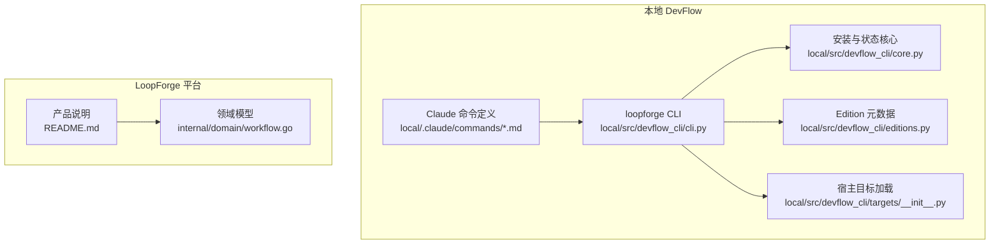
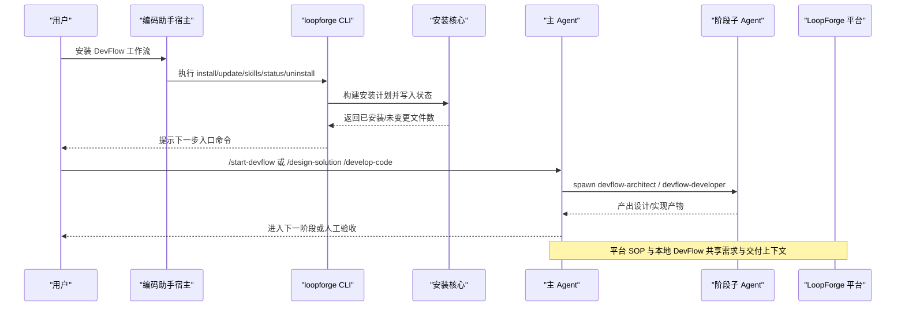
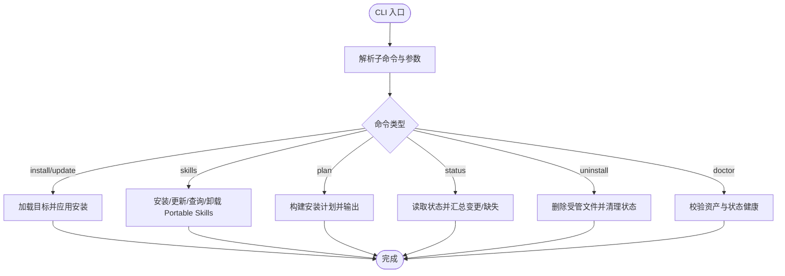
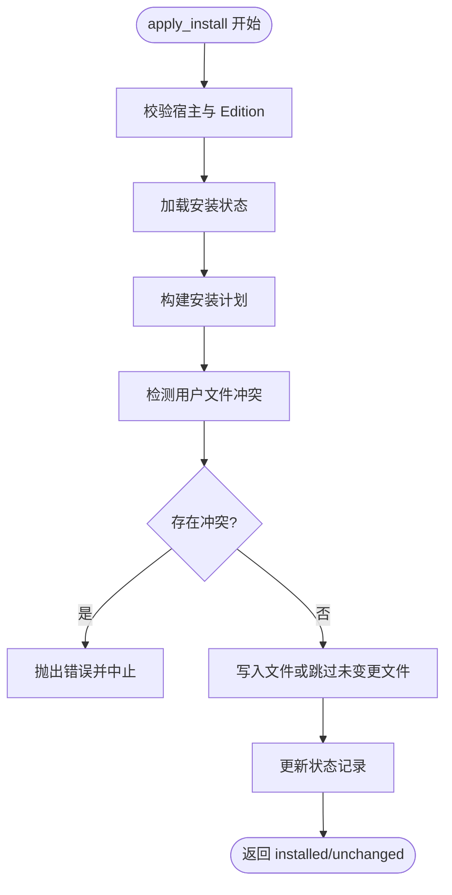
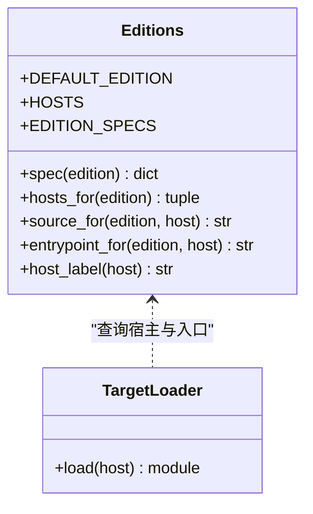
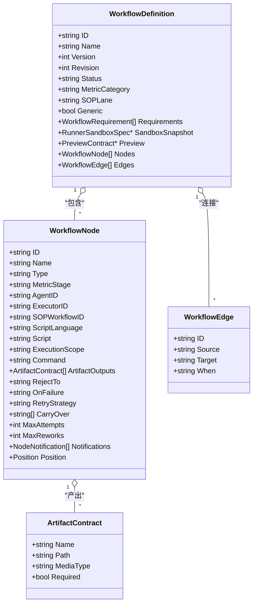
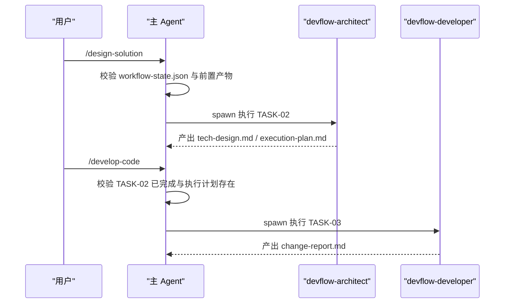
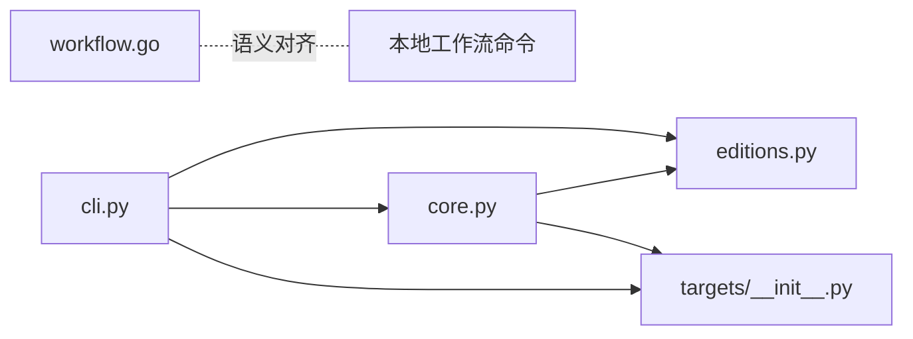

# DevFlow 工作流

<cite>
**本文引用的文件**   
- [README.md](file://README.md)
- [workflow.go](file://internal/domain/workflow.go)
- [cli.py](file://local/src/devflow_cli/cli.py)
- [core.py](file://local/src/devflow_cli/core.py)
- [editions.py](file://local/src/devflow_cli/editions.py)
- [__init__.py](file://local/src/devflow_cli/targets/__init__.py)
- [develop-code.md](file://local/.claude/commands/develop-code.md)
- [design-solution.md](file://local/.claude/commands/design-solution.md)
</cite>

## 目录
1. [简介](#简介)
2. [项目结构](#项目结构)
3. [核心组件](#核心组件)
4. [架构总览](#架构总览)
5. [详细组件分析](#详细组件分析)
6. [依赖关系分析](#依赖关系分析)
7. [性能与可观测性](#性能与可观测性)
8. [故障排查指南](#故障排查指南)
9. [结论](#结论)
10. [附录](#附录)

## 简介
DevFlow 工作流是 LoopForge 在本地编码助手（如 Claude Code、CodeBuddy、Codex、Cursor、Pi、DeepSeek Harness、Hermes Agent、Qoder）中提供的一套“从需求到交付”的可重复开发流程。它通过安装器把标准技能、命令和状态管理注入宿主环境，由主 Agent 协调“需求分析 → 方案设计 → 代码实现 → 代码审查 → 测试验证 → 人工验收”等阶段，并产出结构化产物与运行证据。平台侧的 SOP 引擎则负责更通用的节点编排、沙箱执行、人工审批与指标统计；本地 DevFlow 与之互补：前者面向团队级可复用流水线，后者面向单开发者在 IDE/CLI 中的快速落地。

## 项目结构
围绕 DevFlow 工作流，仓库中与本地工作流直接相关的代码集中在 `local/` 下的 Python CLI 与宿主适配层，同时平台侧的领域模型定义了工作流、节点、边、制品契约与运行指标等通用概念。

**图示来源**
- [cli.py:13-81](file://local/src/devflow_cli/cli.py#L13-L81)
- [core.py:16-17](file://local/src/devflow_cli/core.py#L16-L17)
- [editions.py:6-46](file://local/src/devflow_cli/editions.py#L6-L46)
- [__init__.py:4-5](file://local/src/devflow_cli/targets/__init__.py#L4-L5)
- [workflow.go:39-177](file://internal/domain/workflow.go#L39-L177)
- [README.md:137-183](file://README.md#L137-L183)

**章节来源**
- [README.md:38-51](file://README.md#L38-L51)
- [README.md:137-183](file://README.md#L137-L183)
- [cli.py:13-81](file://local/src/devflow_cli/cli.py#L13-L81)
- [core.py:16-17](file://local/src/devflow_cli/core.py#L16-L17)
- [editions.py:6-46](file://local/src/devflow_cli/editions.py#L6-L46)
- [workflow.go:39-177](file://internal/domain/workflow.go#L39-L177)

## 核心组件
- 本地 CLI 入口：解析子命令、参数与输出格式，统一调度安装、更新、计划预览、状态检查、卸载与健康诊断。
- 安装与状态核心：维护 `.devflow/install-state.json`，计算文件摘要，比较差异，安全写入或回滚，支持 Classic 与 Portable 两种 Edition。
- Edition 元数据：声明支持的宿主、入口命令、源码根路径，以及 Classic/Portable 的差异。
- 宿主目标加载：按宿主名动态导入具体安装逻辑，扩展新宿主时只需新增模块。
- 平台工作流领域模型：定义 WorkflowDefinition、WorkflowNode、WorkflowEdge、ArtifactContract、SOPCheckpoint、WorkflowMetrics 等，用于描述模板、运行快照与指标。
- 主 Agent 命令：Claude 命令文档定义 `/design-solution` 与 `/develop-code` 等分阶段入口，驱动 devflow-architect 与 devflow-developer 等子 Agent。

**章节来源**
- [cli.py:13-81](file://local/src/devflow_cli/cli.py#L13-L81)
- [core.py:77-94](file://local/src/devflow_cli/core.py#L77-L94)
- [core.py:259-365](file://local/src/devflow_cli/core.py#L259-L365)
- [editions.py:6-46](file://local/src/devflow_cli/editions.py#L6-L46)
- [__init__.py:4-5](file://local/src/devflow_cli/targets/__init__.py#L4-L5)
- [workflow.go:39-177](file://internal/domain/workflow.go#L39-L177)
- [develop-code.md:1-45](file://local/.claude/commands/develop-code.md#L1-L45)
- [design-solution.md:1-45](file://local/.claude/commands/design-solution.md#L1-L45)

## 架构总览
DevFlow 工作流分为两层：
- 本地层：loopforge CLI 将 DevFlow 技能与命令安装到宿主项目的约定目录，主 Agent 通过命令启动各阶段子 Agent，读写 `workflow-state.json` 与产物目录。
- 平台层：SOP 引擎以 WorkflowDefinition 为蓝图，按节点类型（Agent、Script、Human gate、Sub-SOP、Preview build）编排执行，记录运行状态、制品与指标。

**图示来源**
- [cli.py:84-227](file://local/src/devflow_cli/cli.py#L84-L227)
- [core.py:259-365](file://local/src/devflow_cli/core.py#L259-L365)
- [develop-code.md:23-44](file://local/.claude/commands/develop-code.md#L23-L44)
- [design-solution.md:23-44](file://local/.claude/commands/design-solution.md#L23-L44)
- [README.md:137-183](file://README.md#L137-L183)

## 详细组件分析

### 本地 CLI 与安装流程
CLI 暴露以下能力：
- install/update：按宿主与 Edition 安装或更新完整工作流。
- skills install/update/status/uninstall：管理 Portable Agent Skills。
- plan：只读预览将要写入的文件清单。
- status：查看当前安装状态、变更或缺失文件。
- uninstall：清理受管文件，保留用户修改内容。
- doctor：校验资产完整性与安装健康度。

**图示来源**
- [cli.py:13-81](file://local/src/devflow_cli/cli.py#L13-L81)
- [cli.py:84-227](file://local/src/devflow_cli/cli.py#L84-L227)

**章节来源**
- [cli.py:13-81](file://local/src/devflow_cli/cli.py#L13-L81)
- [cli.py:84-227](file://local/src/devflow_cli/cli.py#L84-L227)

### 安装核心与状态管理
安装核心维护 `.devflow/install-state.json`，关键行为包括：
- 定位资产根目录，支持环境变量覆盖。
- 快照项目文件，排除运行时产物与缓存。
- 对比旧状态与新计划，检测冲突并拒绝非强制写入。
- 安全写入文件并记录 SHA-256，支持增量更新与回滚。
- 卸载时仅删除受管且未被用户修改的文件，保留用户改动。

**图示来源**
- [core.py:259-365](file://local/src/devflow_cli/core.py#L259-L365)
- [core.py:77-94](file://local/src/devflow_cli/core.py#L77-L94)
- [core.py:97-106](file://local/src/devflow_cli/core.py#L97-L106)
- [core.py:430-442](file://local/src/devflow_cli/core.py#L430-L442)

**章节来源**
- [core.py:16-17](file://local/src/devflow_cli/core.py#L16-L17)
- [core.py:62-74](file://local/src/devflow_cli/core.py#L62-L74)
- [core.py:97-106](file://local/src/devflow_cli/core.py#L97-L106)
- [core.py:259-365](file://local/src/devflow_cli/core.py#L259-L365)
- [core.py:430-442](file://local/src/devflow_cli/core.py#L430-L442)

### Edition 与宿主目标
Edition 元数据集中声明：
- DEFAULT_EDITION 默认使用 Classic。
- HOSTS 支持所有主流宿主。
- EDITION_SPECS 区分 Portable 与 Classic 的源码根、宿主集合与入口命令。
- source_for/entrypoint_for/host_label/spec/hosts_for 提供统一查询接口。

目标加载通过 `targets.__init__.py` 动态导入 `devflow_cli.targets.<host>`，便于扩展新宿主而不改动 CLI 主干。

**图示来源**
- [editions.py:6-76](file://local/src/devflow_cli/editions.py#L6-L76)
- [__init__.py:4-5](file://local/src/devflow_cli/targets/__init__.py#L4-L5)

**章节来源**
- [editions.py:6-76](file://local/src/devflow_cli/editions.py#L6-L76)
- [__init__.py:4-5](file://local/src/devflow_cli/targets/__init__.py#L4-L5)

### 平台工作流领域模型
平台侧的 WorkflowDefinition 描述了 SOP 模板的结构：
- Nodes：包含 Agent、Script、Approval、SOP 等节点类型，支持失败策略、重试、制品契约、位置信息、通知绑定等。
- Edges：定义节点间的成功流转。
- Requirements：声明外部依赖（如 Git Token、MCP），在采用模板前进行预检。
- SandboxSnapshot/Preview：冻结沙箱与前端交付契约，避免运行中编辑影响历史执行。
- Metrics：聚合运行次数、成功率、重做率、时长、Token 用量、工具调用与制品数量。

**图示来源**
- [workflow.go:39-177](file://internal/domain/workflow.go#L39-L177)
- [workflow.go:87-101](file://internal/domain/workflow.go#L87-L101)
- [workflow.go:139-177](file://internal/domain/workflow.go#L139-L177)

**章节来源**
- [workflow.go:39-177](file://internal/domain/workflow.go#L39-L177)
- [workflow.go:87-101](file://internal/domain/workflow.go#L87-L101)
- [workflow.go:139-177](file://internal/domain/workflow.go#L139-L177)

### 主 Agent 命令与阶段编排
Claude 命令文档定义了独立阶段的入口：
- `/design-solution`：单独执行 TASK-02 方案设计，spawn devflow-architect，产出技术方案与执行计划。
- `/develop-code`：单独执行 TASK-03 代码实现，spawn devflow-developer，产出变更报告。

这些命令依赖 `workflow-state.json` 与产物目录，确保前置条件满足后再进入下一阶段。

**图示来源**
- [design-solution.md:1-45](file://local/.claude/commands/design-solution.md#L1-L45)
- [develop-code.md:1-45](file://local/.claude/commands/develop-code.md#L1-L45)

**章节来源**
- [design-solution.md:1-45](file://local/.claude/commands/design-solution.md#L1-L45)
- [develop-code.md:1-45](file://local/.claude/commands/develop-code.md#L1-L45)

## 依赖关系分析
- CLI 依赖 Editions 与 Targets 决定安装源与宿主入口。
- Core 依赖 Editions 与 Targets 构建计划，并维护状态文件。
- 平台领域模型与本地工作流通过“需求 → 设计 → 实现 → 审查 → 测试 → 验收”的阶段语义对齐，但实现边界不同：本地侧重宿主集成与产物组织，平台侧重节点编排、沙箱与审批。

**图示来源**
- [cli.py:1-10](file://local/src/devflow_cli/cli.py#L1-L10)
- [core.py:1-13](file://local/src/devflow_cli/core.py#L1-L13)
- [editions.py:1-76](file://local/src/devflow_cli/editions.py#L1-L76)
- [__init__.py:1-6](file://local/src/devflow_cli/targets/__init__.py#L1-L6)
- [workflow.go:39-177](file://internal/domain/workflow.go#L39-L177)

**章节来源**
- [cli.py:1-10](file://local/src/devflow_cli/cli.py#L1-L10)
- [core.py:1-13](file://local/src/devflow_cli/core.py#L1-L13)
- [editions.py:1-76](file://local/src/devflow_cli/editions.py#L1-L76)
- [__init__.py:1-6](file://local/src/devflow_cli/targets/__init__.py#L1-L6)
- [workflow.go:39-177](file://internal/domain/workflow.go#L39-L177)

## 性能与可观测性
- 安装过程通过快照与摘要比对减少不必要写入，提升增量更新效率。
- 状态文件记录每个文件的 SHA-256，便于快速判断变更或缺失。
- 平台侧 WorkflowMetrics 提供运行次数、成功率、重做率、平均时长、Token 用量、工具调用与制品数量的聚合指标，有助于评估工作流稳定性与成本。

[本节为通用指导，不直接分析具体文件]

## 故障排查指南
- 安装资产缺失：使用 `loopforge doctor` 检查资产完整性，确认 `skills/manifest.json`、`skills/devflow/SKILL.md` 与宿主目录存在。
- 状态损坏或版本不支持：当 `.devflow/install-state.json` 无法解析或版本不匹配时，CLI 会抛出错误；建议重新安装或清理状态后重试。
- 用户文件冲突：安装或更新检测到用户修改文件时会拒绝写入，需手动解决冲突或使用 `--force` 覆盖。
- 宿主或 Edition 不支持：CLI 会提示可用宿主与 Edition 组合，例如 Pi 仅支持 Portable。
- 卸载后残留：卸载仅删除受管且未被修改的文件，用户修改内容会被保留并列出。

**章节来源**
- [core.py:430-442](file://local/src/devflow_cli/core.py#L430-L442)
- [core.py:77-94](file://local/src/devflow_cli/core.py#L77-L94)
- [core.py:259-365](file://local/src/devflow_cli/core.py#L259-L365)
- [core.py:368-407](file://local/src/devflow_cli/core.py#L368-L407)
- [cli.py:213-227](file://local/src/devflow_cli/cli.py#L213-L227)

## 结论
DevFlow 工作流通过本地 CLI 与平台 SOP 引擎形成互补：本地层聚焦宿主集成、技能安装与阶段化产物组织，平台层聚焦节点编排、沙箱执行、人工审批与指标统计。两者共享“需求 → 设计 → 实现 → 审查 → 测试 → 验收”的工作语义，使团队既能用 Chat 快速探索，也能用 SOP 稳定交付。对于开发者而言，推荐先通过 loopforge CLI 安装与诊断，再结合 Claude 命令逐步推进各阶段；对于团队而言，可将成熟流程沉淀为平台 SOP，实现跨项目复用与可视化治理。

[本节为总结性内容，不直接分析具体文件]

## 附录
- 快速开始：参考 README 的安装与试用说明，先运行脚本拉取镜像并启动服务，再配置模型密钥与 GitHub 授权。
- 本地工作流：README 提供了 LoopForge Local 的使用方式与宿主支持矩阵，可在 Claude Code、CodeBuddy、Codex、Cursor、Pi、DeepSeek Harness、Hermes Agent、Qoder 中启用。
- 平台 SOP：README 对 SOP 节点类型、人工审批与运行证据进行了概述，可作为理解平台侧工作流的入口。

**章节来源**
- [README.md:72-133](file://README.md#L72-L133)
- [README.md:193-219](file://README.md#L193-L219)
- [README.md:137-183](file://README.md#L137-L183)