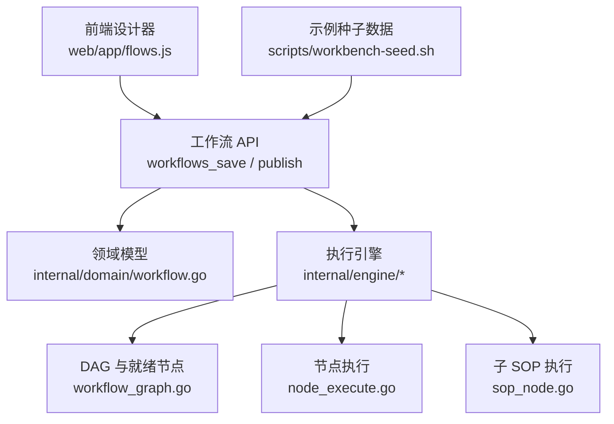
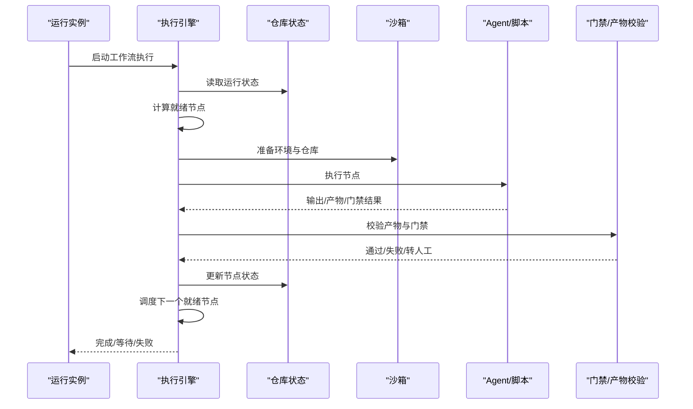
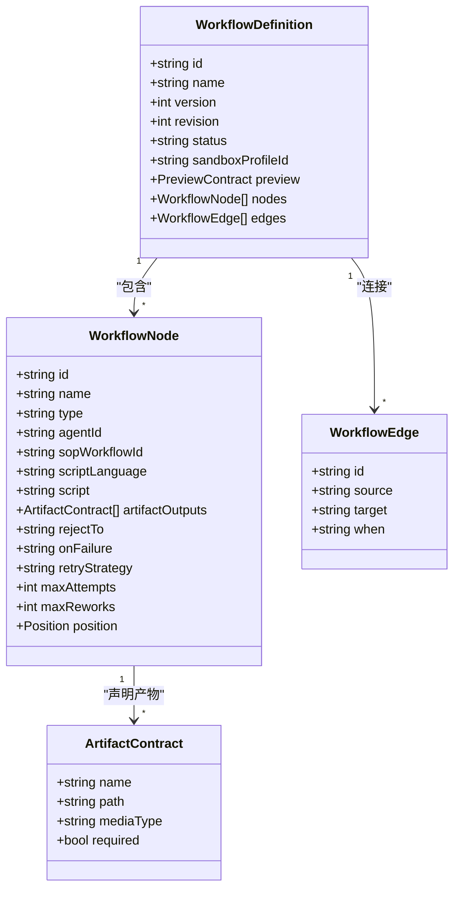
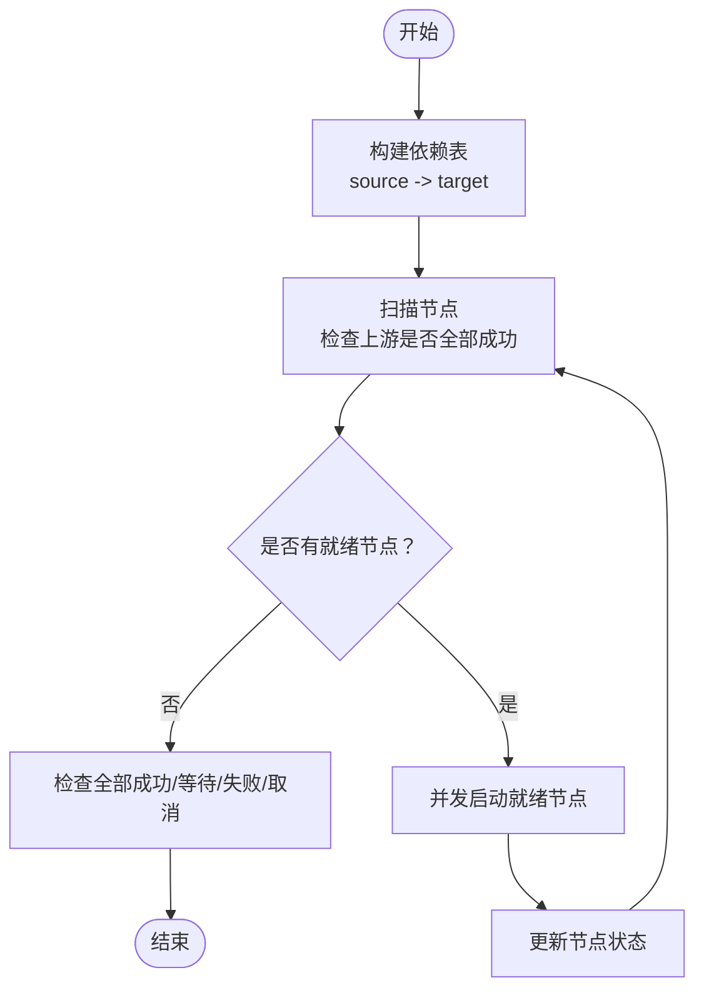
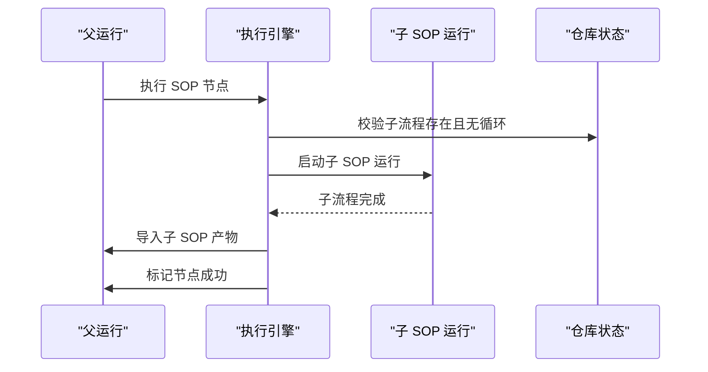
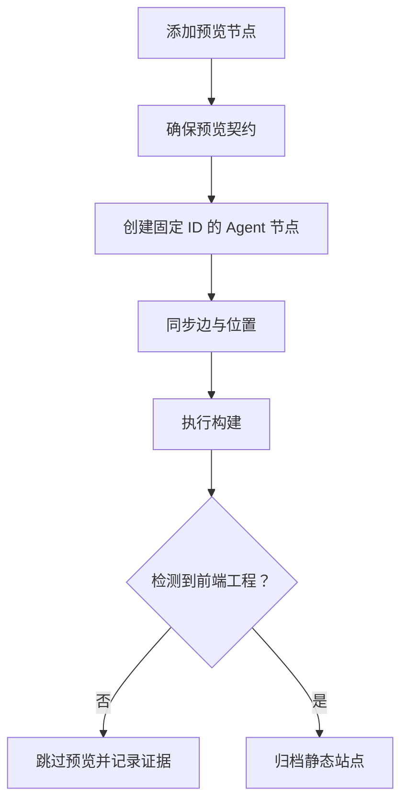
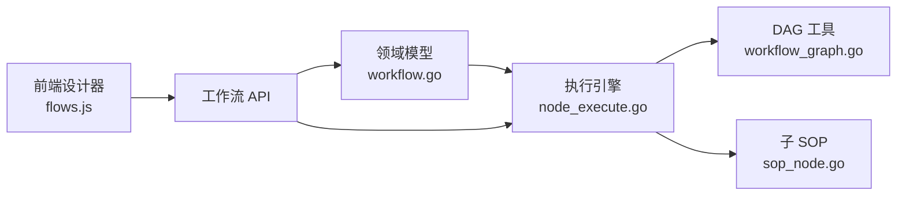
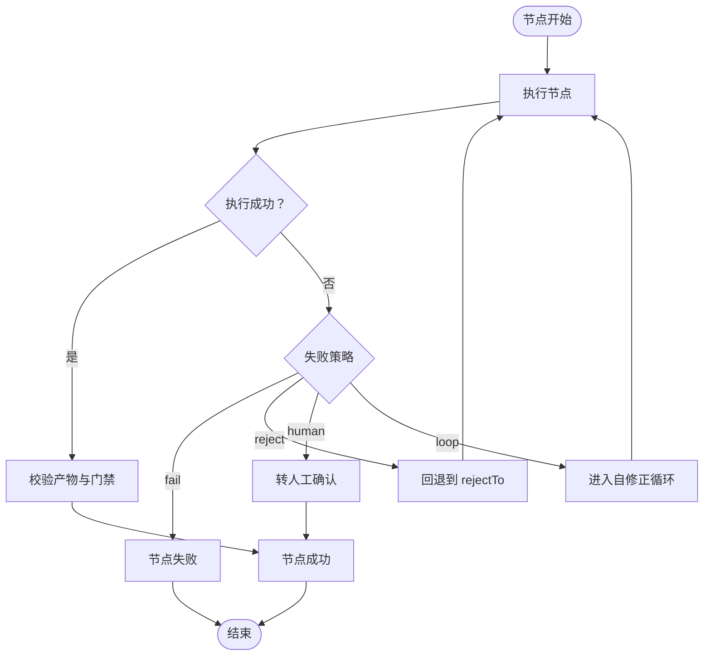
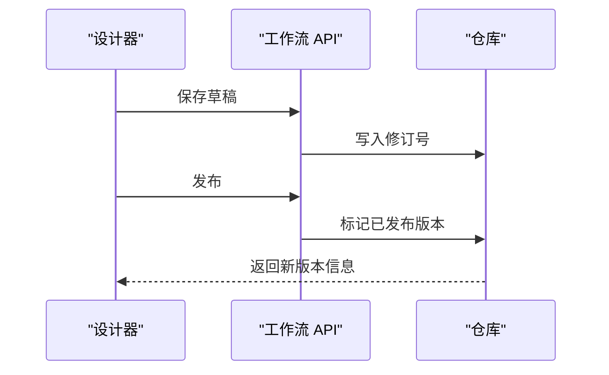

# SOP 工作流

<cite>
**本文引用的文件**   
- [internal/domain/workflow.go](file://internal/domain/workflow.go)
- [internal/engine/workflow_graph.go](file://internal/engine/workflow_graph.go)
- [internal/engine/sop_node.go](file://internal/engine/sop_node.go)
- [internal/engine/node_execute.go](file://internal/engine/node_execute.go)
- [web/app/flows.js](file://web/app/flows.js)
- [web/index.html](file://web/index.html)
- [scripts/workbench-seed.sh](file://scripts/workbench-seed.sh)
</cite>

## 目录
1. [简介](#简介)
2. [项目结构](#项目结构)
3. [核心组件](#核心组件)
4. [架构总览](#架构总览)
5. [详细组件分析](#详细组件分析)
6. [依赖关系分析](#依赖关系分析)
7. [性能与可靠性](#性能与可靠性)
8. [可视化设计器使用指南](#可视化设计器使用指南)
9. [错误处理与重试机制](#错误处理与重试机制)
10. [版本控制、发布与复用](#版本控制发布与复用)
11. [最佳实践](#最佳实践)
12. [故障排查](#故障排查)
13. [结论](#结论)

## 简介
SOP 工作流是 LoopForge 中可复用的 AI 协作流程。它以“节点 + 边”的有向无环图描述任务，支持 Agent 智能体、脚本执行、人工门禁、子 SOP 嵌套以及前端预览构建等节点类型。工作流由前端可视化设计器编辑，后端引擎负责依赖调度、沙箱准备、Agent/脚本执行、门禁校验、产物交接和状态收敛。

该文档面向两类读者：
- 流程设计者：学习如何设计、配置、发布和复用 SOP。
- 平台开发者：理解工作流定义、依赖管理、执行引擎、错误处理和重试机制的实现细节。

## 项目结构
SOP 相关代码主要分布在以下位置：
- 领域模型：`internal/domain/workflow.go` 定义了工作流、节点、边、产物契约、版本快照等数据结构。
- 执行引擎：`internal/engine/workflow_graph.go` 负责 DAG 验证、就绪节点计算；`internal/engine/node_execute.go` 负责节点调度、环境准备、Agent/脚本执行、门禁和产物收集；`internal/engine/sop_node.go` 专门处理子 SOP 嵌套执行。
- 前端设计器：`web/app/flows.js` 提供新增/删除/连线/属性编辑/预览构建/SOP 复制/保存/发布等交互逻辑；`web/index.html` 提供 SOP 页面入口和运行弹窗。
- 示例数据：`scripts/workbench-seed.sh` 包含用于本地演示的前端/后端研发 SOP 种子数据。

**图表来源**
- [web/app/flows.js:190-211](file://web/app/flows.js#L190-L211)
- [internal/domain/workflow.go:39-180](file://internal/domain/workflow.go#L39-L180)
- [internal/engine/workflow_graph.go:11-32](file://internal/engine/workflow_graph.go#L11-L32)
- [internal/engine/node_execute.go:16-187](file://internal/engine/node_execute.go#L16-L187)
- [internal/engine/sop_node.go:18-155](file://internal/engine/sop_node.go#L18-L155)
- [scripts/workbench-seed.sh:96-109](file://scripts/workbench-seed.sh#L96-L109)

**章节来源**
- [internal/domain/workflow.go:39-180](file://internal/domain/workflow.go#L39-L180)
- [internal/engine/workflow_graph.go:11-32](file://internal/engine/workflow_graph.go#L11-L32)
- [internal/engine/node_execute.go:16-187](file://internal/engine/node_execute.go#L16-L187)
- [internal/engine/sop_node.go:18-155](file://internal/engine/sop_node.go#L18-L155)
- [web/app/flows.js:190-211](file://web/app/flows.js#L190-L211)
- [web/index.html:389-394](file://web/index.html#L389-L394)
- [scripts/workbench-seed.sh:96-109](file://scripts/workbench-seed.sh#L96-L109)

## 核心组件
- 工作流定义：包含 ID、名称、版本、修订号、状态、所属项目、沙箱配置、指标分类、角色链、通用模板标记、前置依赖、沙箱快照、预览契约、节点列表和边列表。
- 节点定义：支持 agent、script/command、approval、sop 四种类型，并携带产物契约、失败策略、重试策略、回滚目标、继承字段、最大尝试次数、最大返工次数、通知配置和画布位置。
- 边定义：描述上游节点到下游节点的跳转条件，当前实现以成功路径为主。
- 产物契约：声明节点输出的文件名、媒体类型和是否必填，用于下游消费和运行时校验。
- 版本快照：DefinitionRevision 对 workflow 或 agent 的定义做不可变快照，支持 diff 和恢复。

关键要点：
- 节点类型通过 `type` 字段区分，其中 `sop` 表示嵌套子流程，`approval` 表示人工门禁。
- 工作流必须满足 DAG 约束，循环依赖会被拒绝；受控返工应通过 `rejectTo` 配置。
- 产物契约允许上游节点显式声明下游需要读取的文件，避免隐式耦合。

**章节来源**
- [internal/domain/workflow.go:39-180](file://internal/domain/workflow.go#L39-L180)
- [internal/domain/workflow.go:87-101](file://internal/domain/workflow.go#L87-L101)
- [internal/domain/workflow.go:103-115](file://internal/domain/workflow.go#L103-L115)

## 架构总览
SOP 执行由引擎主循环驱动：
1. 加载运行上下文和工作流定义。
2. 根据边关系计算就绪节点。
3. 并发启动就绪节点，维护活跃节点集合。
4. 节点完成后更新状态，触发下游节点。
5. 所有节点成功则进入集成阶段；存在等待审批则暂停；存在失败则结束。

**图表来源**
- [internal/engine/node_execute.go:16-187](file://internal/engine/node_execute.go#L16-L187)
- [internal/engine/node_execute.go:316-570](file://internal/engine/node_execute.go#L316-L570)
- [internal/engine/node_execute.go:584-1052](file://internal/engine/node_execute.go#L584-L1052)

**章节来源**
- [internal/engine/node_execute.go:16-187](file://internal/engine/node_execute.go#L16-L187)

## 详细组件分析

### 工作流定义与节点类型
工作流定义包含元数据、沙箱配置、预览契约、节点和边。节点类型包括：
- Agent：调用外部执行器（如 CodeBuddy、Claude Code 等），可配置 Loop、门禁、产物契约。
- Script/Command：在沙箱中执行 Shell 或 Python 脚本。
- Human gate（approval）：等待人工批准或自动批准的门禁节点。
- Sub-SOP：引用另一个工作流作为子流程，支持产物交接。
- Preview build：内置静态站点构建节点，通常绑定特定 Agent 和产物契约。

**图表来源**
- [internal/domain/workflow.go:39-101](file://internal/domain/workflow.go#L39-L101)
- [internal/domain/workflow.go:139-180](file://internal/domain/workflow.go#L139-L180)

**章节来源**
- [internal/domain/workflow.go:39-180](file://internal/domain/workflow.go#L39-L180)

### 依赖管理与 DAG 验证
引擎通过边构建依赖表，仅当所有上游节点成功时才将下游节点加入就绪队列。同时使用拓扑排序检测循环依赖，确保工作流是有向无环图。

**图表来源**
- [internal/engine/workflow_graph.go:11-32](file://internal/engine/workflow_graph.go#L11-L32)
- [internal/engine/workflow_graph.go:240-274](file://internal/engine/workflow_graph.go#L240-L274)

**章节来源**
- [internal/engine/workflow_graph.go:11-32](file://internal/engine/workflow_graph.go#L11-L32)
- [internal/engine/workflow_graph.go:240-274](file://internal/engine/workflow_graph.go#L240-L274)

### 子 SOP 嵌套执行
子 SOP 节点会启动一个独立的运行实例，并在父流程的工作区中共享代码变更。引擎会：
- 校验子 SOP 引用是否存在且不构成循环。
- 限制最大嵌套深度。
- 将父流程上游产物按约定传递给子 SOP。
- 子 SOP 成功后导入其产物到父运行。

**图表来源**
- [internal/engine/sop_node.go:18-155](file://internal/engine/sop_node.go#L18-L155)
- [internal/engine/sop_node.go:157-187](file://internal/engine/sop_node.go#L157-L187)
- [internal/engine/sop_node.go:256-307](file://internal/engine/sop_node.go#L256-L307)

**章节来源**
- [internal/engine/sop_node.go:18-155](file://internal/engine/sop_node.go#L18-L155)
- [internal/engine/sop_node.go:157-187](file://internal/engine/sop_node.go#L157-L187)
- [internal/engine/sop_node.go:256-307](file://internal/engine/sop_node.go#L256-L307)

### 预览构建节点
预览构建节点是一个特殊的 Agent 节点，用于构建静态站点并归档预览。前端会自动创建固定 ID 的预览节点，并与工作流的预览契约同步。若工作区没有前端工程，引擎会跳过预览并记录原因。

**图表来源**
- [web/app/flows.js:1-54](file://web/app/flows.js#L1-L54)
- [web/app/flows.js:60-94](file://web/app/flows.js#L60-L94)
- [web/app/flows.js:194-202](file://web/app/flows.js#L194-L202)
- [internal/engine/node_execute.go:545-559](file://internal/engine/node_execute.go#L545-L559)
- [internal/engine/node_execute.go:1064-1108](file://internal/engine/node_execute.go#L1064-L1108)

**章节来源**
- [web/app/flows.js:1-54](file://web/app/flows.js#L1-L54)
- [web/app/flows.js:60-94](file://web/app/flows.js#L60-L94)
- [web/app/flows.js:194-202](file://web/app/flows.js#L194-L202)
- [internal/engine/node_execute.go:545-559](file://internal/engine/node_execute.go#L545-L559)
- [internal/engine/node_execute.go:1064-1108](file://internal/engine/node_execute.go#L1064-L1108)

## 依赖关系分析
- 领域层与工作流定义解耦：`domain.WorkflowDefinition` 只描述数据，不关心执行。
- 引擎层依赖领域模型和仓库接口：`workflowForRun` 从仓库获取最新工作流定义，并根据运行快照兼容旧数据。
- 前端与后端通过 API 交互：设计器保存草稿、发布新版本、复制模板。
- 子 SOP 与父运行共享工作区：子流程的改动直接反映在父流程后续节点中，无需远端分支合并。

**图表来源**
- [internal/domain/workflow.go:139-180](file://internal/domain/workflow.go#L139-L180)
- [internal/engine/node_execute.go:316-570](file://internal/engine/node_execute.go#L316-L570)
- [internal/engine/workflow_graph.go:41-58](file://internal/engine/workflow_graph.go#L41-L58)
- [internal/engine/sop_node.go:18-155](file://internal/engine/sop_node.go#L18-L155)
- [web/app/flows.js:1104-1217](file://web/app/flows.js#L1104-L1217)

**章节来源**
- [internal/domain/workflow.go:139-180](file://internal/domain/workflow.go#L139-L180)
- [internal/engine/workflow_graph.go:41-58](file://internal/engine/workflow_graph.go#L41-L58)
- [internal/engine/node_execute.go:316-570](file://internal/engine/node_execute.go#L316-L570)
- [web/app/flows.js:1104-1217](file://web/app/flows.js#L1104-L1217)

## 性能与可靠性
- 并发执行：就绪节点并发启动，避免串行瓶颈。
- 沙箱镜像缓存：首次构建 Docker 镜像后缓存，减少重复构建时间。
- 工作区重建优化：脚本节点可配置在工作区重建时重新执行，避免重复初始化。
- 会话恢复：Agent 会话丢失时自动丢弃旧会话并重试，避免卡死。
- 门禁命令合并：多条门禁命令合并为一次 shell 执行，避免多进程语法错误。

建议：
- 尽量使用产物契约而非隐式文件路径，便于下游稳定消费。
- 对长耗时脚本设置合理超时和重试策略。
- 使用子 SOP 拆分复杂流程，提高复用性和可观测性。
- 为 Agent 节点配置 Loop 和门禁，减少人工干预。

**章节来源**
- [internal/engine/node_execute.go:245-307](file://internal/engine/node_execute.go#L245-L307)
- [internal/engine/node_execute.go:1117-1155](file://internal/engine/node_execute.go#L1117-L1155)
- [internal/engine/node_execute.go:1166-1194](file://internal/engine/node_execute.go#L1166-L1194)

## 可视化设计器使用指南
### 基本操作
- 新建 SOP：点击“＋ 新建 SOP”，选择模板或空白开始。
- 添加节点：拖拽或点击添加 Agent、脚本、人工门禁、SOP 节点。
- 删除节点：选中节点后删除，自动清理连线和拒绝路由。
- 复制节点：复制节点但不复制连线。
- 连线：从上游节点拖到下游节点，默认成功路径。
- 属性编辑：右侧面板编辑节点名称、Agent、脚本、产物契约、失败策略、重试策略等。

### 节点配置选项
- Agent 节点：绑定角色、执行器、模型、Loop 轮数、门禁、产物契约。
- 脚本节点：选择 Shell 或 Python，编写脚本内容，可配置执行范围。
- 人工门禁：等待人工批准，支持自动批准场景。
- SOP 节点：选择子流程，声明要交给下一步的产物。
- 预览构建：自动创建固定 ID 节点，绑定静态站点构建契约。

### 实际工作流设计示例
本地种子数据提供了前后端研发 SOP 示例，包含方案、评审、实现、测试等节点，适合参考节点类型和连线方式。

**图表来源**
- [scripts/workbench-seed.sh:96-109](file://scripts/workbench-seed.sh#L96-L109)

**章节来源**
- [web/app/flows.js:190-211](file://web/app/flows.js#L190-L211)
- [web/app/flows.js:214-242](file://web/app/flows.js#L214-L242)
- [web/app/flows.js:1013-1067](file://web/app/flows.js#L1013-L1067)
- [scripts/workbench-seed.sh:96-109](file://scripts/workbench-seed.sh#L96-L109)

## 错误处理与重试机制
### 节点失败策略
- fail：节点失败，流程终止。
- reject：节点失败，回退到配置的 `rejectTo` 节点。
- human：节点失败，转人工确认。
- loop：Agent 节点失败后进入自修正循环，最多执行配置的迭代次数。

### 重试机制
- 最大尝试次数：每个节点可配置 `maxAttempts`，超过后失败或转人工。
- 最大返工次数：配合 `rejectTo` 实现受控返工。
- 会话丢失恢复：Agent 会话丢失时自动丢弃旧会话并重试。
- 中断恢复：沙箱中断或租约丢失时重新排队节点。

**图表来源**
- [internal/engine/node_execute.go:355-367](file://internal/engine/node_execute.go#L355-L367)
- [internal/engine/node_execute.go:955-1014](file://internal/engine/node_execute.go#L955-L1014)
- [internal/engine/node_execute.go:1117-1155](file://internal/engine/node_execute.go#L1117-L1155)

**章节来源**
- [internal/engine/node_execute.go:355-367](file://internal/engine/node_execute.go#L355-L367)
- [internal/engine/node_execute.go:955-1014](file://internal/engine/node_execute.go#L955-L1014)
- [internal/engine/node_execute.go:1117-1155](file://internal/engine/node_execute.go#L1117-L1155)

## 版本控制、发布与复用
### 版本控制
- 工作流具有 `version` 和 `revision` 字段，每次保存增加修订号。
- 发布操作将当前修订标记为已发布版本。
- 支持恢复历史修订，将旧定义恢复到当前工作流。

### 发布流程
- 前端点击“发布”按钮，调用发布 API。
- 后端校验修订号冲突，防止并发覆盖。
- 发布成功后更新工作流状态为 `published`。

### 复用机制
- 通用模板：平台提供的内置 SOP，所有项目可复制使用。
- 项目模板：本项目内的 SOP，可共享给其他项目。
- 复制功能：从现有 SOP 或通用模板复制为新 SOP，保留结构和节点。

**图表来源**
- [web/app/flows.js:1104-1217](file://web/app/flows.js#L1104-L1217)
- [internal/repo/catalog.go:827-844](file://internal/repo/catalog.go#L827-L844)

**章节来源**
- [web/app/flows.js:1104-1217](file://web/app/flows.js#L1104-L1217)
- [internal/repo/catalog.go:827-844](file://internal/repo/catalog.go#L827-L844)

## 最佳实践
- 明确产物契约：上游节点声明输出文件，下游节点依赖契约而非隐式路径。
- 合理使用子 SOP：将复杂流程拆分为多个子 SOP，提高复用性和可维护性。
- 配置门禁：对关键步骤配置命令门禁或 MR 门禁，确保质量。
- 控制重试：为不稳定步骤配置重试策略，但避免无限重试。
- 使用预览构建：前端需求建议启用预览构建，快速验证静态站点。
- 版本管理：频繁保存草稿，正式发布前充分测试。

## 故障排查
常见问题及解决方案：
- 节点未找到：检查节点 ID 是否唯一，边是否正确指向目标节点。
- 循环依赖：移除循环边，使用 `rejectTo` 实现受控返工。
- 产物缺失：检查产物契约是否匹配，确认上游节点确实生成了文件。
- 子 SOP 循环：检查子流程引用是否形成循环，注意嵌套深度限制。
- 预览构建跳过：确认工作区包含前端工程，或接受跳过提示。
- 发布冲突：重新加载工作流，合并修改后再发布。

**章节来源**
- [internal/engine/workflow_graph.go:155-184](file://internal/engine/workflow_graph.go#L155-L184)
- [internal/engine/sop_node.go:157-187](file://internal/engine/sop_node.go#L157-L187)
- [internal/engine/node_execute.go:545-559](file://internal/engine/node_execute.go#L545-L559)

## 结论
SOP 工作流系统通过清晰的领域模型、健壮的 DAG 验证、灵活的节点类型和完善的错误处理机制，为 AI 协作提供了可靠的基础设施。前端设计器降低了使用门槛，后端引擎保证了执行效率和稳定性。通过版本控制、发布和复用机制，团队可以高效地沉淀和共享最佳实践。