# 工作流设计器

<cite>
**本文引用的文件**   
- [flows.js](file://web/app/flows.js)
- [flow-viewport.js](file://web/app/flow-viewport.js)
- [flow-palette.js](file://web/app/flow-palette.js)
- [flow-history.js](file://web/app/flow-history.js)
- [flow-canvas.css](file://web/app/flow-canvas.css)
- [index.html](file://web/index.html)
- [flow-designer.test.mjs](file://e2e/unit/flow-designer.test.mjs)
</cite>

## 目录
1. [简介](#简介)
2. [项目结构](#项目结构)
3. [核心组件](#核心组件)
4. [架构总览](#架构总览)
5. [详细组件分析](#详细组件分析)
6. [依赖关系分析](#依赖关系分析)
7. [性能与体验优化](#性能与体验优化)
8. [使用教程](#使用教程)
9. [最佳实践](#最佳实践)
10. [保存、版本控制与协作](#保存版本控制与协作)
11. [故障排查](#故障排查)
12. [结论](#结论)

## 简介
本文件面向“工作流设计器”的可视化工作流编辑能力，围绕拖拽式界面、节点放置、连线配置、实时预览、画布操作、节点属性面板、依赖关系可视化、错误提示机制展开。同时提供使用教程、最佳实践、性能优化建议，以及工作流的保存、版本控制和协作编辑说明。

该设计器以浏览器端 JavaScript 为主，配合 CSS 主题和少量 HTML 容器，实现：
- 从左侧节点库拖入 Agent、脚本、子 SOP、人工门禁和预览构建节点
- 在画布上拖拽移动节点、缩放和平移
- 通过成功出口和失败打回端口进行连线
- 右侧属性面板编辑节点产物契约、重试策略、门禁和运行范围
- 检查模式展示入口、沙箱、产物契约等诊断信息
- 撤销重做、整理布局、最小地图导航和只读保护

## 项目结构
工作流设计器的前端代码集中在 `web/app` 下，主要模块如下：
- `flows.js`：流程状态、节点增删改、连线校验、渲染、菜单、属性面板、诊断检查、快捷键
- `flow-viewport.js`：画布平移、缩放、可视区域计算、最小地图、布局适配
- `flow-palette.js`：节点库、搜索过滤、拖放、SOP 切换器
- `flow-history.js`：基于图快照的撤销重做栈
- `flow-canvas.css`：设计器 UI、节点、连线、抽屉、AI 编排面板样式
- `index.html`：包含 `#flowView` 等容器元素

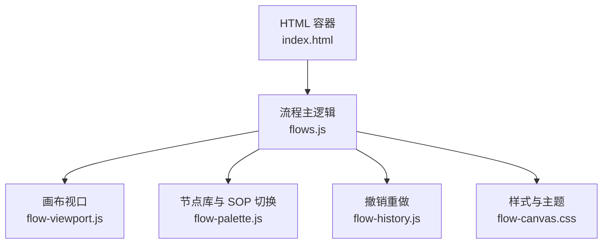

**图表来源**
- [index.html:406-406](file://web/index.html#L406-L406)
- [flows.js:325-338](file://web/app/flows.js#L325-L338)
- [flow-viewport.js:129-164](file://web/app/flow-viewport.js#L129-L164)
- [flow-palette.js:96-137](file://web/app/flow-palette.js#L96-L137)
- [flow-history.js:1-55](file://web/app/flow-history.js#L1-L55)
- [flow-canvas.css:1-25](file://web/app/flow-canvas.css#L1-L25)

**章节来源**
- [index.html:406-406](file://web/index.html#L406-L406)
- [flows.js:325-338](file://web/app/flows.js#L325-L338)
- [flow-viewport.js:1-169](file://web/app/flow-viewport.js#L1-L169)
- [flow-palette.js:1-212](file://web/app/flow-palette.js#L1-L212)
- [flow-history.js:1-56](file://web/app/flow-history.js#L1-L56)
- [flow-canvas.css:1-481](file://web/app/flow-canvas.css#L1-L481)

## 核心组件
- 流程主逻辑：负责节点生命周期、连线规则、属性面板、诊断检查、键盘交互、预览构建节点同步
- 画布视口：负责平移、缩放、可视区域、最小地图、自动适配
- 节点库：负责角色节点列表、搜索、拖放、SOP 切换
- 历史栈：负责图快照、撤销重做、合并连续修改
- 样式系统：定义设计器主题、节点、连线、抽屉、AI 编排面板、只读态

**章节来源**
- [flows.js:190-212](file://web/app/flows.js#L190-L212)
- [flows.js:388-396](file://web/app/flows.js#L388-L396)
- [flow-viewport.js:30-67](file://web/app/flow-viewport.js#L30-L67)
- [flow-palette.js:67-137](file://web/app/flow-palette.js#L67-L137)
- [flow-history.js:1-55](file://web/app/flow-history.js#L1-L55)
- [flow-canvas.css:198-263](file://web/app/flow-canvas.css#L198-L263)

## 架构总览
工作流设计器的运行时数据模型由 `state.workflow` 描述，包含节点数组、边数组和可选的预览构建契约。UI 层根据该数据渲染节点、连线和属性面板；用户交互通过事件回调更新状态并触发局部或全局重绘。

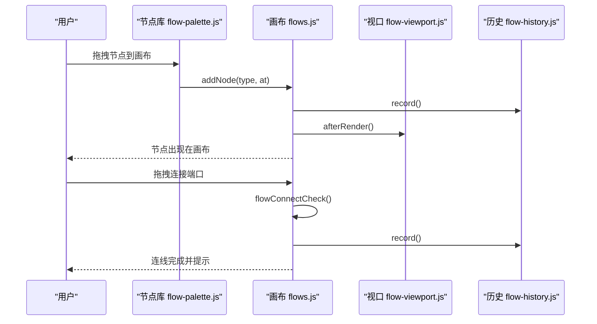

**图表来源**
- [flow-palette.js:96-108](file://web/app/flow-palette.js#L96-L108)
- [flows.js:190-212](file://web/app/flows.js#L190-L212)
- [flows.js:416-470](file://web/app/flows.js#L416-L470)
- [flow-viewport.js:123-128](file://web/app/flow-viewport.js#L123-L128)
- [flow-history.js:20-30](file://web/app/flow-history.js#L20-L30)

## 详细组件分析

### 拖拽式界面与节点放置
- 节点类型包括 Agent、脚本、子 SOP、人工门禁和预览构建
- 节点库支持搜索过滤、键盘回车选择、拖放到画布指定坐标
- 拖放时会将鼠标位置转换为画布世界坐标，并以网格对齐方式放置节点
- 新增节点后自动选中并打开属性面板

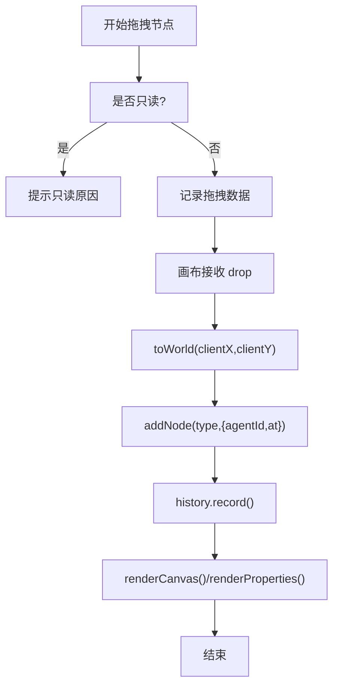

**图表来源**
- [flow-palette.js:96-108](file://web/app/flow-palette.js#L96-L108)
- [flow-viewport.js:22-22](file://web/app/flow-viewport.js#L22-L22)
- [flows.js:190-212](file://web/app/flows.js#L190-L212)
- [flow-history.js:20-30](file://web/app/flow-history.js#L20-L30)

**章节来源**
- [flow-palette.js:67-137](file://web/app/flow-palette.js#L67-L137)
- [flows.js:190-212](file://web/app/flows.js#L190-L212)

### 连线配置与依赖关系可视化
- 每个节点有“成功”出口和“失败打回”出口（预览构建节点无失败出口）
- 连线前会校验：不能连自己、不能重复依赖、不能形成循环依赖
- 失败打回目标保存在节点的 `rejectTo` 字段，并在画布中以虚线箭头显示
- 连线完成后会在底部 toast 中提示，并提供撤销入口

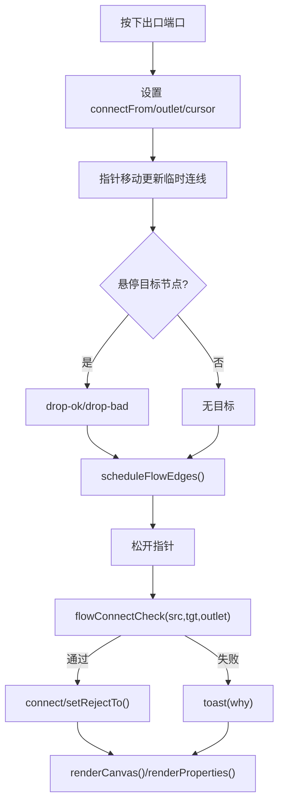

**图表来源**
- [flows.js:416-470](file://web/app/flows.js#L416-L470)
- [flows.js:532-565](file://web/app/flows.js#L532-L565)

**章节来源**
- [flows.js:404-486](file://web/app/flows.js#L404-L486)
- [flows.js:532-565](file://web/app/flows.js#L532-L565)

### 画布操作：缩放、平移、最小地图
- 滚轮缩放：按住 Ctrl/Cmd 或触控板滚动时按光标位置缩放
- 平移：左键或中键拖动空白区域
- 工具栏按钮：放大、缩小、重置缩放、适应全部节点
- 最小地图：显示当前可视区域矩形，可点击拖动视图中心
- 自动布局：首次打开工作流时自动 fit，后续根据抽屉宽度调整布局

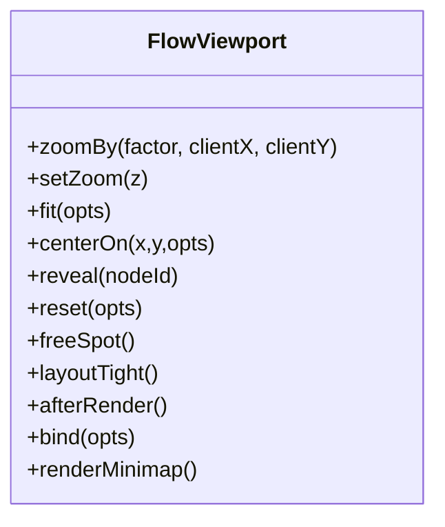

**图表来源**
- [flow-viewport.js:30-67](file://web/app/flow-viewport.js#L30-L67)
- [flow-viewport.js:129-164](file://web/app/flow-viewport.js#L129-L164)

**章节来源**
- [flow-viewport.js:1-169](file://web/app/flow-viewport.js#L1-L169)

### 节点属性面板与产物契约
- 双击节点或点击更多菜单进入属性面板
- 支持重命名、复制、删除节点
- 产物契约支持动态添加、删除，包含名称、路径、媒体类型、是否必需
- Agent 节点可配置任务书、重试 Loop、门禁命令、执行范围和干预点
- 子 SOP 节点可绑定其他工作流，并声明产物交给下一步

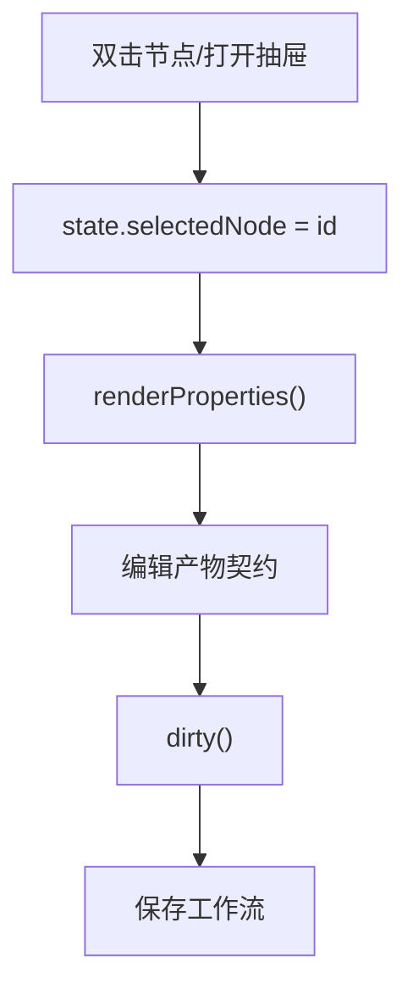

**图表来源**
- [flows.js:594-619](file://web/app/flows.js#L594-L619)
- [flows.js:658-671](file://web/app/flows.js#L658-L671)

**章节来源**
- [flows.js:567-619](file://web/app/flows.js#L567-L619)
- [flows.js:658-671](file://web/app/flows.js#L658-L671)

### 实时预览与 AI 编排
- 预览构建节点用于生成静态站点，默认使用 CodeBuddy 执行器
- 当工作流启用预览但未包含预览节点时，会自动同步插入并挂在成功路径末尾
- 预览模型可从代理模型目录获取，否则回退到内置候选列表
- AI 编排面板提供对话式引导、模型选择和构建状态反馈

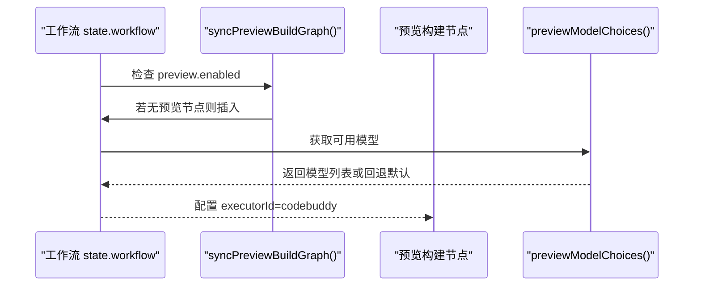

**图表来源**
- [flows.js:60-94](file://web/app/flows.js#L60-L94)
- [flows.js:17-29](file://web/app/flows.js#L17-L29)

**章节来源**
- [flows.js:1-94](file://web/app/flows.js#L1-L94)

### 依赖关系可视化与错误提示机制
- 检查模式汇总入口数量、沙箱配置、产物契约、失败打回目标等诊断项
- 多个节点但没有依赖时会提示并行启动风险
- 预览构建节点未接入上游会给出警告
- 子 SOP 引用自身或未找到时会报错
- 连线校验失败会直接 toast 提示原因

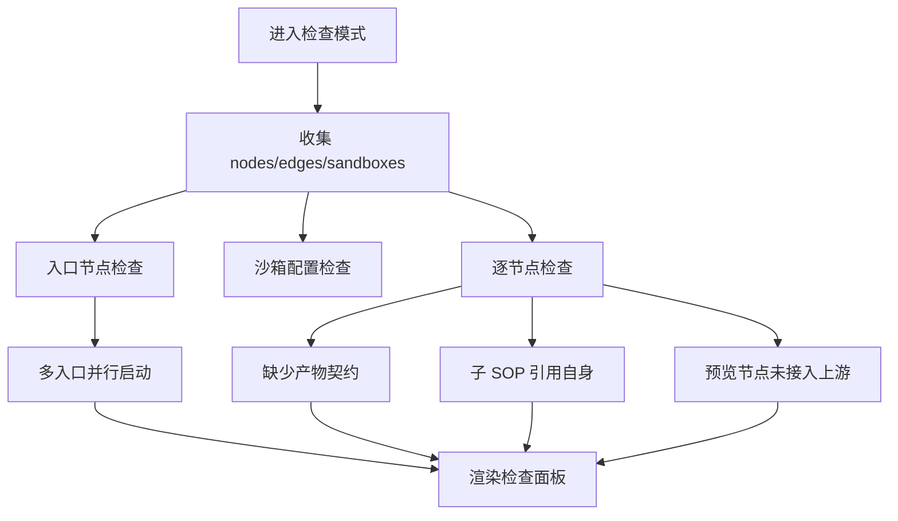

**图表来源**
- [flows.js:388-396](file://web/app/flows.js#L388-L396)

**章节来源**
- [flows.js:388-396](file://web/app/flows.js#L388-L396)

### 撤销重做与历史记录
- 历史栈仅保存图的快照（节点、边、预览），不保存元数据修改
- 同一 merge key 且在 500ms 内的多次修改会被合并为一次撤销
- 最大保留 50 条历史
- 切换工作流会清空历史栈

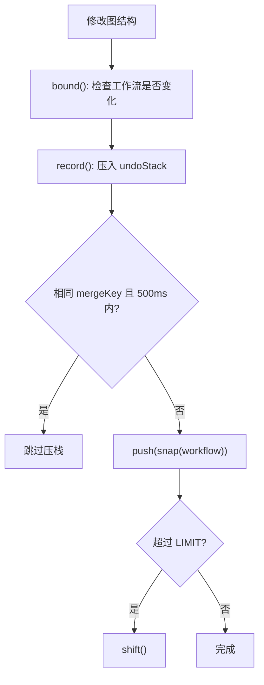

**图表来源**
- [flow-history.js:1-55](file://web/app/flow-history.js#L1-L55)

**章节来源**
- [flow-history.js:1-55](file://web/app/flow-history.js#L1-L55)

## 依赖关系分析
- `flows.js` 依赖 `flow-viewport.js` 进行画布坐标转换、可视区域计算和最小地图刷新
- `flows.js` 依赖 `flow-palette.js` 提供节点库渲染、拖放和 SOP 切换
- `flows.js` 依赖 `flow-history.js` 记录图结构变更
- `flow-canvas.css` 被所有前端组件共享，定义主题、节点、连线、抽屉和 AI 面板样式
- `index.html` 提供 `#flowView` 容器，作为设计器根节点

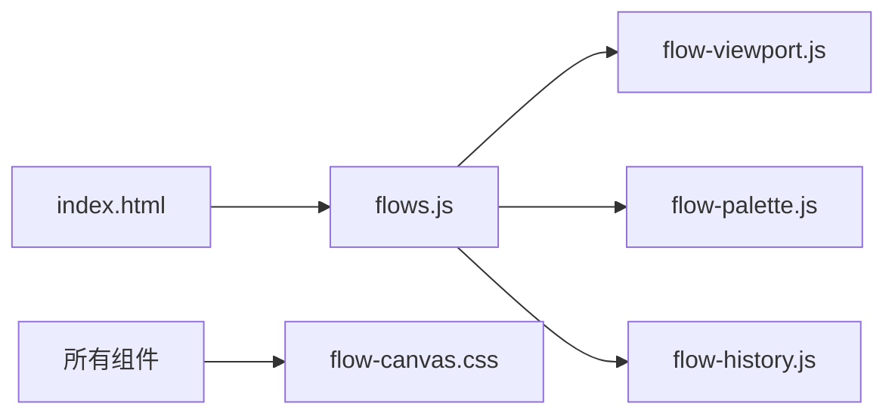

**图表来源**
- [index.html:406-406](file://web/index.html#L406-L406)
- [flows.js:325-338](file://web/app/flows.js#L325-L338)
- [flow-viewport.js:129-164](file://web/app/flow-viewport.js#L129-L164)
- [flow-palette.js:96-137](file://web/app/flow-palette.js#L96-L137)
- [flow-history.js:1-55](file://web/app/flow-history.js#L1-L55)
- [flow-canvas.css:1-25](file://web/app/flow-canvas.css#L1-L25)

**章节来源**
- [flows.js:325-338](file://web/app/flows.js#L325-L338)
- [flow-viewport.js:129-164](file://web/app/flow-viewport.js#L129-L164)
- [flow-palette.js:96-137](file://web/app/flow-palette.js#L96-L137)
- [flow-history.js:1-55](file://web/app/flow-history.js#L1-L55)
- [flow-canvas.css:1-25](file://web/app/flow-canvas.css#L1-L25)

## 性能与体验优化
- 使用 `requestAnimationFrame` 节流最小地图和连线重绘，避免频繁重排
- 节点尺寸缓存于 `flowNodeMetrics.cache`，拖拽和缩放时不强制布局
- 画布变换通过 CSS transform 应用，减少回流
- 自动折叠节点库以适应窄屏，减少遮挡
- 最小地图仅在可见时渲染，节省开销
- 历史合并减少大量按键操作的撤销条目数

**章节来源**
- [flows.js:487-509](file://web/app/flows.js#L487-L509)
- [flow-viewport.js:104-121](file://web/app/flow-viewport.js#L104-L121)
- [flow-viewport.js:92-101](file://web/app/flow-viewport.js#L92-L101)
- [flow-history.js:20-30](file://web/app/flow-history.js#L20-L30)

## 使用教程
- 打开工作流设计器：在页面中选择或新建一条 SOP，进入 `#flowView`
- 添加节点：从左侧节点库拖拽 Agent、脚本、子 SOP、人工门禁到画布；也可点击节点库项快速添加
- 移动节点：按住节点拖拽，释放即落位；支持网格对齐
- 连线：从节点右侧“成功”或“失败打回”端口拖到目标节点输入端口；连线失败会有明确提示
- 删除节点或连线：右键菜单删除节点，或悬停连线点击删除图标
- 属性面板：双击节点或点击更多菜单打开；编辑产物契约、重试策略、门禁和执行范围
- 画布操作：Ctrl/Cmd+滚轮缩放；按住空白区拖拽平移；使用右上角工具栏缩放、适应、重置
- 检查模式：切换到“配置检查”，查看入口、沙箱、产物契约和返工路径的诊断结果
- 撤销重做：使用工具栏按钮或快捷键 Ctrl/Cmd+Z/Y

**章节来源**
- [flows.js:190-212](file://web/app/flows.js#L190-L212)
- [flows.js:339-367](file://web/app/flows.js#L339-L367)
- [flows.js:416-470](file://web/app/flows.js#L416-L470)
- [flows.js:567-619](file://web/app/flows.js#L567-L619)
- [flow-viewport.js:129-164](file://web/app/flow-viewport.js#L129-L164)
- [flows.js:388-396](file://web/app/flows.js#L388-L396)
- [flow-history.js:31-43](file://web/app/flow-history.js#L31-L43)

## 最佳实践
- 明确每个节点的产物契约，确保下游能消费
- 对可能失败的步骤配置失败打回目标，避免整条流程中断
- 合理划分 Agent 角色，保持任务书清晰、门禁命令具体
- 使用“整理布局”功能让依赖层级更清晰
- 在预览构建节点之前确保上游节点稳定产出
- 使用检查模式提前发现入口过多、沙箱未选、产物缺失等问题
- 谨慎使用循环依赖，优先用失败打回表达返工路径

**章节来源**
- [flows.js:388-396](file://web/app/flows.js#L388-L396)
- [flows.js:409-415](file://web/app/flows.js#L409-L415)
- [flows.js:243-255](file://web/app/flows.js#L243-L255)

## 保存、版本控制与协作
- 保存状态：顶部保存按钮在有未保存更改时高亮，保存后恢复已同步状态
- 发布版本：工作流需要发布才能成为新版本；发布按钮在内容已发布时无效
- 只读保护：通用模板或其他项目的共享 SOP 默认只读，需复制到本项目再编辑
- 版本标识：头部显示版本号、步数和状态标签
- 协作编辑：工作流属于项目范畴，跨项目共享时为只读；平台管理员可对通用模板编辑

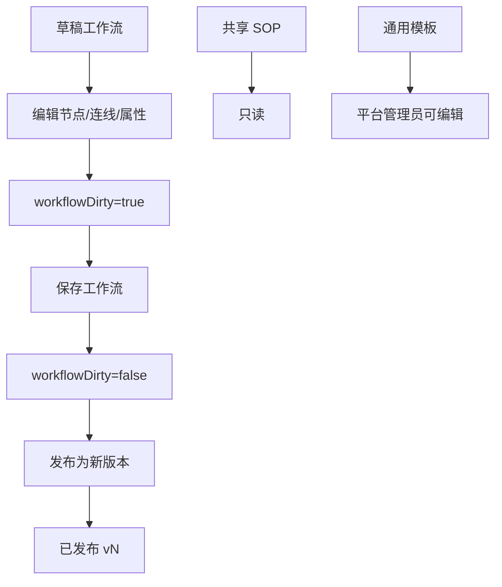

**图表来源**
- [flows.js:95-140](file://web/app/flows.js#L95-L140)

**章节来源**
- [flows.js:95-140](file://web/app/flows.js#L95-L140)

## 故障排查
- 无法拖拽节点：检查是否处于只读模式；只读时会提示原因
- 连线失败：常见原因包括连到自己、依赖已存在、形成循环依赖；预览构建节点没有失败出口
- 预览构建节点异常：确认上游节点已连线到预览节点；检查预览模型是否可用
- 检查模式报错：根据诊断项修复入口、沙箱、产物契约或失败打回目标
- 撤销无效：确认当前工作流未切换；历史栈按工作流隔离

**章节来源**
- [flows.js:95-99](file://web/app/flows.js#L95-L99)
- [flows.js:409-415](file://web/app/flows.js#L409-L415)
- [flows.js:388-396](file://web/app/flows.js#L388-L396)
- [flow-history.js:7-11](file://web/app/flow-history.js#L7-L11)

## 结论
工作流设计器通过清晰的模块分工实现了完整的可视化工作流编辑体验：节点库拖拽、画布缩放平移、连线校验、属性面板、检查模式和撤销重做共同构成高效的设计环境。结合预览构建节点和 AI 编排面板，用户可以在图形化界面中快速搭建、验证和迭代复杂工作流。遵循最佳实践并利用检查模式，可以显著提升工作流的稳定性和可维护性。