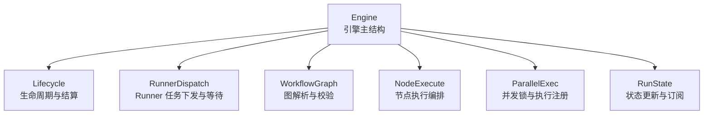
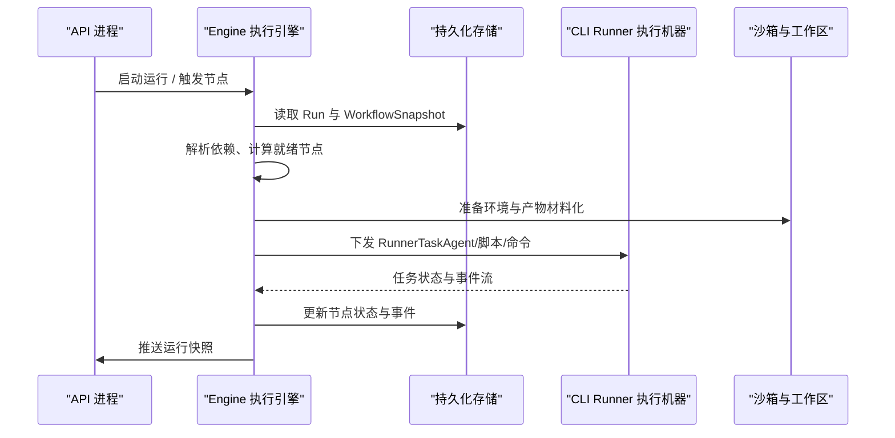
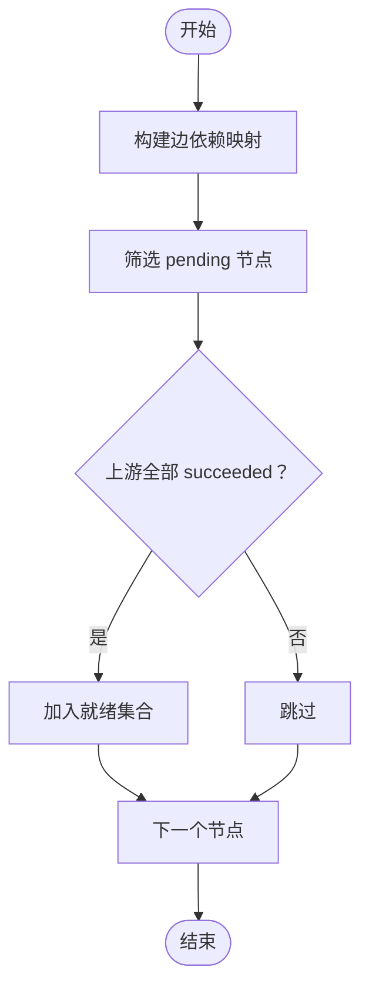
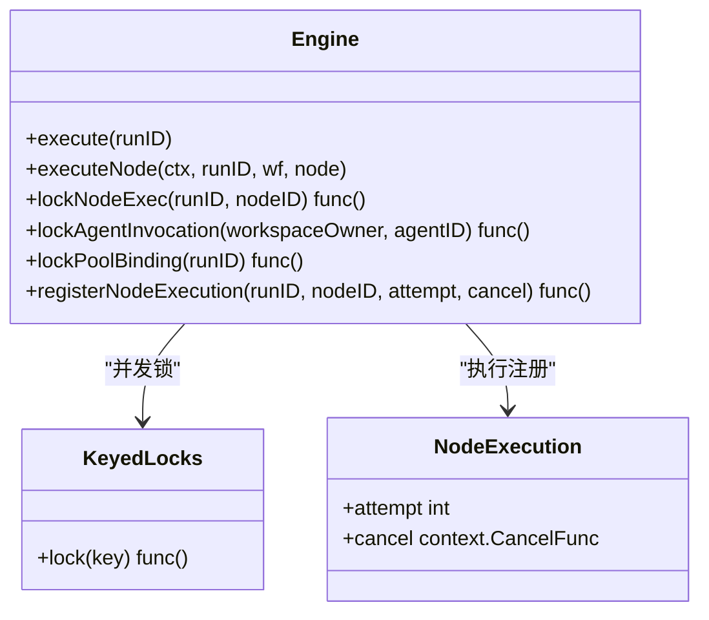
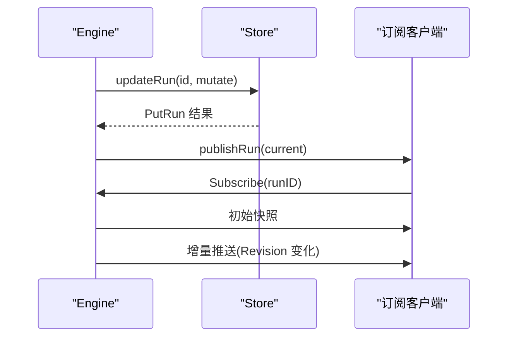
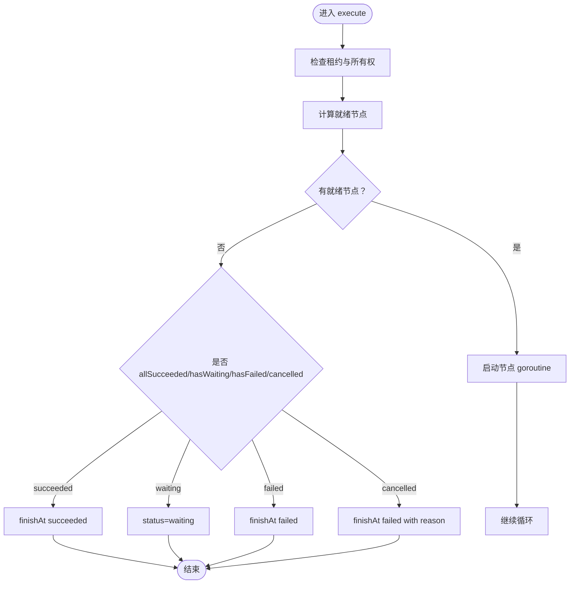
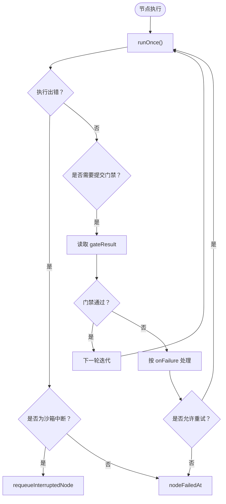
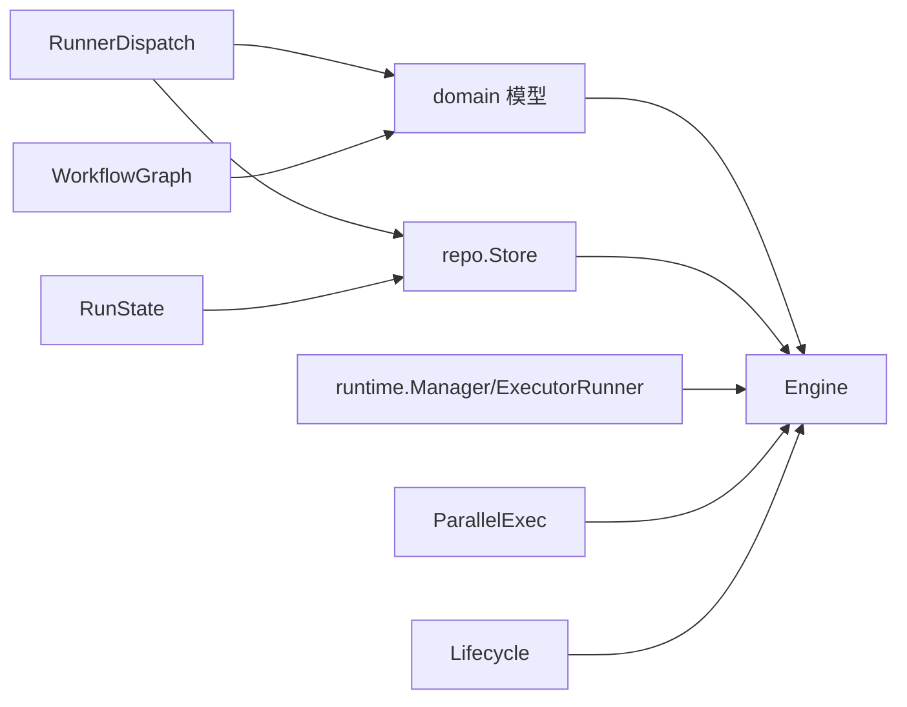
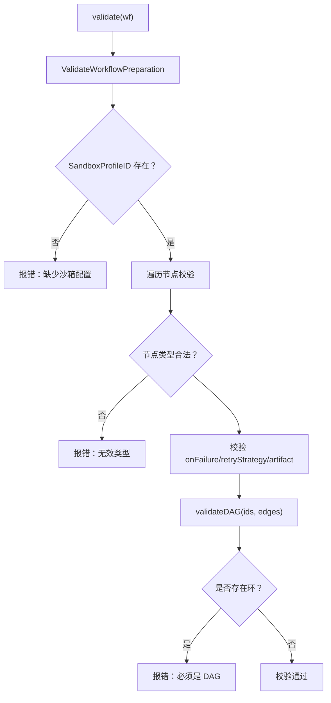

# 执行引擎

<cite>
**本文引用的文件**   
- [engine.go](file://internal/engine/engine.go)
- [lifecycle.go](file://internal/engine/lifecycle.go)
- [runner_dispatch.go](file://internal/engine/runner_dispatch.go)
- [workflow_graph.go](file://internal/engine/workflow_graph.go)
- [node_execute.go](file://internal/engine/node_execute.go)
- [parallel_exec.go](file://internal/engine/parallel_exec.go)
- [run_state.go](file://internal/engine/run_state.go)
- [recovery_test.go](file://internal/engine/recovery_test.go)
</cite>

## 目录
1. [引言](#引言)
2. [项目结构](#项目结构)
3. [核心组件](#核心组件)
4. [架构总览](#架构总览)
5. [详细组件分析](#详细组件分析)
6. [依赖关系分析](#依赖关系分析)
7. [性能与并发特性](#性能与并发特性)
8. [故障恢复与重试策略](#故障恢复与重试策略)
9. [监控、日志与可观测性](#监控日志与可观测性)
10. [安全机制：依赖解析、循环检测与嵌套限制](#安全机制依赖解析循环检测与嵌套限制)
11. [排错指南](#排错指南)
12. [结论](#结论)

## 引言
本文面向工作流执行引擎的技术文档，聚焦以下主题：
- 工作流解析与图校验
- 节点调度与并行执行
- 状态管理与租约控制
- 并发控制与锁粒度
- 执行生命周期、错误恢复与重试策略
- 资源管理（沙箱、工作区、产物）
- 执行监控、日志记录与性能分析
- 安全机制：依赖解析、循环检测、嵌套限制

该引擎以“运行实例”为最小调度单元，围绕 Run、WorkflowDefinition、NodeRun、RunnerTask 等核心领域模型组织代码，并通过持久化存储与执行机器 Runner 解耦控制面与执行面。

## 项目结构
执行引擎位于 `internal/engine`，关键文件职责如下：
- `engine.go`：引擎主结构体、初始化、后台维护、平台 MCP 绑定、预览服务集成。
- `lifecycle.go`：运行终止、孤儿结算、计划任务合入判断、中断恢复辅助。
- `runner_dispatch.go`：CLI Runner 任务下发、等待完成、事件桥接、清理与预览归档。
- `workflow_graph.go`：工作流定义解析、就绪节点计算、祖先/后代遍历、DAG 校验。
- `node_execute.go`：节点执行主流程、脚本/命令/审批/SOP 分支、门禁与循环。
- `parallel_exec.go`：按键锁、节点执行注册、并发协调。
- `run_state.go`：运行状态更新、订阅推送、租约续期、抢占恢复。
- `recovery_test.go`：中断恢复、孤儿结算、计划任务合入等行为的测试用例。

**图表来源**
- [engine.go:19-97](file://internal/engine/engine.go#L19-L97)
- [lifecycle.go:11-181](file://internal/engine/lifecycle.go#L11-L181)
- [runner_dispatch.go:17-800](file://internal/engine/runner_dispatch.go#L17-L800)
- [workflow_graph.go:11-275](file://internal/engine/workflow_graph.go#L11-L275)
- [node_execute.go:16-800](file://internal/engine/node_execute.go#L16-L800)
- [parallel_exec.go:10-158](file://internal/engine/parallel_exec.go#L10-L158)
- [run_state.go:11-180](file://internal/engine/run_state.go#L11-L180)

**章节来源**
- [engine.go:19-162](file://internal/engine/engine.go#L19-L162)
- [lifecycle.go:11-181](file://internal/engine/lifecycle.go#L11-L181)
- [runner_dispatch.go:17-800](file://internal/engine/runner_dispatch.go#L17-L800)
- [workflow_graph.go:11-275](file://internal/engine/workflow_graph.go#L11-L275)
- [node_execute.go:16-800](file://internal/engine/node_execute.go#L16-L800)
- [parallel_exec.go:10-158](file://internal/engine/parallel_exec.go#L10-L158)
- [run_state.go:11-180](file://internal/engine/run_state.go#L11-L180)

## 核心组件
- Engine：引擎主入口，持有仓库 Store、沙箱 Manager、Runner ExecutorRunner、运行中取消函数映射、运行环境缓存、观察队列、云池、锁表、订阅者、Runner 任务通知回调、平台 MCP 配置、预览服务等。
- WorkflowGraph：负责工作流定义解析、边依赖构建、就绪节点选择、祖先/后代遍历、DAG 校验。
- NodeExecute：节点执行编排，支持 script/command/approval/sop 类型，包含沙箱准备、产物材料化、门禁验证、Agent 循环与提交门禁。
- RunnerDispatch：将 Agent 或脚本任务下发到 CLI Runner，封装 RunnerTask，轮询并桥接事件，处理成功/失败/取消，以及清理和预览归档。
- ParallelExec：提供 keyedLocks 细粒度锁，保证同一节点、同一 Agent 调用、同一 Pool 绑定的互斥；注册节点执行以便跨实例协调。
- RunState：统一的状态写入、发布、订阅、租约续期、抢占恢复。
- Lifecycle：运行终止、孤儿结算、计划任务合入判断、中断恢复辅助。

**章节来源**
- [engine.go:19-162](file://internal/engine/engine.go#L19-L162)
- [workflow_graph.go:11-275](file://internal/engine/workflow_graph.go#L11-L275)
- [node_execute.go:16-800](file://internal/engine/node_execute.go#L16-L800)
- [runner_dispatch.go:17-800](file://internal/engine/runner_dispatch.go#L17-L800)
- [parallel_exec.go:10-158](file://internal/engine/parallel_exec.go#L10-L158)
- [run_state.go:11-180](file://internal/engine/run_state.go#L11-L180)
- [lifecycle.go:11-181](file://internal/engine/lifecycle.go#L11-L181)

## 架构总览
执行引擎采用“控制面 + 执行面”的分离架构：
- 控制面（Engine）负责工作流解析、节点调度、状态管理、并发控制、资源分配、监控与日志。
- 执行面（Runner）在用户指定的执行机器上执行 Agent CLI 或终端命令，返回产物与事件。

**图表来源**
- [runner_dispatch.go:169-316](file://internal/engine/runner_dispatch.go#L169-L316)
- [node_execute.go:316-800](file://internal/engine/node_execute.go#L316-L800)
- [run_state.go:66-128](file://internal/engine/run_state.go#L66-L128)

## 详细组件分析

### 工作流解析与图校验
- 就绪节点计算：基于边依赖，筛选所有上游节点均为 succeeded 且当前节点为 pending 的节点。
- 祖先/后代遍历：用于重放上游成功判定、影响范围分析。
- DAG 校验：使用 Kahn 算法进行拓扑排序，拒绝环；同时校验节点 ID 唯一性、类型合法性、onFailure/retryStrategy/artifact 约束。
- 工作流定义解析：优先使用 Run 的 WorkflowSnapshot，兼容旧快照；若未设置沙箱配置则回退默认 local。

**图表来源**
- [workflow_graph.go:11-32](file://internal/engine/workflow_graph.go#L11-L32)

**章节来源**
- [workflow_graph.go:11-275](file://internal/engine/workflow_graph.go#L11-L275)

### 节点调度与并行执行
- 调度主循环：周期性检查 Run 状态、取消/暂停请求、租约所有权、就绪节点集合；当无就绪节点但有进行中节点时等待唤醒。
- 并行执行：每个就绪节点启动独立 goroutine；通过 inflight 集合避免重复调度；节点完成后主动唤醒主循环。
- 并发锁：
  - 节点级锁：确保同一节点的多次尝试（重跑、接管、恢复）串行化。
  - Agent 调用锁：同一工作区所有者与 Agent 的 CLI 调用串行化，避免控制目录竞争。
  - Pool 绑定锁：同一 Run 的 Pool 绑定互斥，防止多个首节点争抢执行机器。
- 执行注册：记录节点执行 attempt 与 cancel，供 reconcile 逻辑对比持久化状态并取消过期执行。

**图表来源**
- [parallel_exec.go:26-75](file://internal/engine/parallel_exec.go#L26-L75)
- [parallel_exec.go:85-105](file://internal/engine/parallel_exec.go#L85-L105)
- [node_execute.go:16-187](file://internal/engine/node_execute.go#L16-L187)

**章节来源**
- [node_execute.go:16-187](file://internal/engine/node_execute.go#L16-L187)
- [parallel_exec.go:10-158](file://internal/engine/parallel_exec.go#L10-L158)

### 状态管理与租约控制
- 状态更新：updateRun/updateRunAtErr 统一写入 Run，合并待观察事件，发布到订阅者。
- 租约续期：心跳线程每 leaseTTL/3 续期，若被抢占或收到控制请求则退出。
- 抢占恢复：StartClaimLoop 定时扫描并 ResumeInterruptedRuns，重置 in-flight 节点为 pending，保留 waiting_approval 等终态。
- 订阅推送：Subscribe 返回通道，内部轮询最新 revision 并推送给慢客户端。

**图表来源**
- [run_state.go:11-64](file://internal/engine/run_state.go#L11-L64)
- [run_state.go:66-128](file://internal/engine/run_state.go#L66-L128)

**章节来源**
- [run_state.go:11-180](file://internal/engine/run_state.go#L11-L180)

### 执行生命周期
- 正常完成：allSucceeded 且无等待/失败节点时标记 succeeded；若为计划任务且需合入 integration，则先执行 integrateScheduledRun。
- 失败结算：hasFailed 且无可继续节点时标记 failed；cancelled 节点导致流水线无法继续。
- 强制终止：forceTerminate 将所有 running/pending_input/waiting_approval 节点置为 cancelled/failed，必要时清理工作区。
- 孤儿结算：ResumeInterruptedRuns 对已完成图进行 settleStatusForCompletedGraph，避免悬挂运行。

**图表来源**
- [node_execute.go:16-187](file://internal/engine/node_execute.go#L16-L187)
- [lifecycle.go:55-102](file://internal/engine/lifecycle.go#L55-L102)

**章节来源**
- [node_execute.go:16-187](file://internal/engine/node_execute.go#L16-L187)
- [lifecycle.go:55-181](file://internal/engine/lifecycle.go#L55-L181)

### 资源管理与产物处理
- 沙箱与工作区：根据 WorkflowSnapshot.SandboxSnapshot 或 SandboxProfileID 获取沙箱配置；Runner 模式下使用 staging 沙箱；Docker 驱动下构建镜像并绑定工作区。
- 仓库检出：prepareRepositories 一次性准备仓库上下文；Runner 支持直接在其 checkout 上合入，无需控制面克隆。
- 产物材料化：materializeInputs 将上游产物注入当前节点；若 Runner 支持 reportedOutputs，则通过输入/输出文件契约传递产物。
- 产物恢复：RestoreMissingWorkspaceArtifacts 恢复归档产物；dispatchRunnerScript/Task 成功后 restoreRunnerArtifacts 将产物落盘。

**章节来源**
- [node_execute.go:405-570](file://internal/engine/node_execute.go#L405-L570)
- [runner_dispatch.go:387-478](file://internal/engine/runner_dispatch.go#L387-L478)

### 错误恢复与重试策略
- 节点失败处理：failNode 区分 sandbox 中断与一般失败；sandbox 中断走 requeueInterruptedNode，普通失败走 nodeFailedAt。
- 重试策略：节点 retryStrategy 支持 targeted_fix/full_redo；Agent 循环由 Loop.Enabled/MaxIterations/OnExhausted 控制；门禁失败可触发 human 或 reject。
- 恢复语义：ResumeInterruptedRuns 重置 in-flight 节点为 pending，保留 session 以便 resume；approval gate 不重置。
- 计划任务合入：scheduledIntegratePending 阻止提前 settled；orphan 计划任务会恢复以完成合入。

**图表来源**
- [node_execute.go:355-367](file://internal/engine/node_execute.go#L355-L367)
- [node_execute.go:765-800](file://internal/engine/node_execute.go#L765-L800)
- [recovery_test.go:32-82](file://internal/engine/recovery_test.go#L32-L82)

**章节来源**
- [node_execute.go:355-800](file://internal/engine/node_execute.go#L355-L800)
- [recovery_test.go:32-398](file://internal/engine/recovery_test.go#L32-L398)

## 依赖关系分析
- Engine 依赖 domain 模型（Run、WorkflowDefinition、NodeRun、RepositoryContext 等）。
- Engine 依赖 repo.Store 进行 Run、Runner、Agent、Executor、Sandbox 等读写。
- Engine 依赖 runtime.Manager/ExecutorRunner 管理沙箱与执行器。
- RunnerDispatch 依赖 domain.RunnerTask/RunnerInvocation 与 repo 持久化 RunnerTask 及事件。
- WorkflowGraph 依赖 domain.WorkflowEdge/WorkflowNode 进行图解析与校验。
- ParallelExec 提供并发原语，被 NodeExecute 使用。
- RunState 与 Lifecycle 共同维护运行状态与生命周期终结。

**图表来源**
- [engine.go:19-97](file://internal/engine/engine.go#L19-L97)
- [runner_dispatch.go:169-316](file://internal/engine/runner_dispatch.go#L169-L316)
- [workflow_graph.go:11-275](file://internal/engine/workflow_graph.go#L11-L275)
- [parallel_exec.go:10-158](file://internal/engine/parallel_exec.go#L10-L158)
- [run_state.go:11-180](file://internal/engine/run_state.go#L11-L180)
- [lifecycle.go:11-181](file://internal/engine/lifecycle.go#L11-L181)

**章节来源**
- [engine.go:19-162](file://internal/engine/engine.go#L19-L162)
- [runner_dispatch.go:169-800](file://internal/engine/runner_dispatch.go#L169-L800)
- [workflow_graph.go:11-275](file://internal/engine/workflow_graph.go#L11-L275)
- [parallel_exec.go:10-158](file://internal/engine/parallel_exec.go#L10-L158)
- [run_state.go:11-180](file://internal/engine/run_state.go#L11-L180)
- [lifecycle.go:11-181](file://internal/engine/lifecycle.go#L11-L181)

## 性能与并发特性
- 细粒度锁：keyedLocks 按 (run,node)、(workspaceOwner,agent)、(pool,run) 维度加锁，避免全局阻塞。
- 并发执行：就绪节点并行启动 goroutine，inflight 集合避免重复调度；节点完成后主动唤醒主循环。
- 观察批处理：observationFlushLoop 批量刷新观察事件，减少频繁 IO。
- Runner 事件桥接：awaitRunnerTask 使用本地通知与数据库轮询结合，降低延迟与查询压力。
- 工作区共享：Runner 模式下共享 checkout，减少重复检出成本。

[本节为通用性能讨论，不直接分析具体文件]

## 监控、日志与可观测性
- 观察事件：Engine.observe 收集 TelemetryEvent，分类包括 sandbox、script、artifact、process、orchestration、mcp 等。
- 事件桥接：bridgeRunnerEventsToSink 将 RunnerTask 事件标准化后推送到 sink，避免控制面与执行面状态不一致。
- 订阅推送：publishRun 向订阅者推送最新 Run 快照，支持慢客户端丢消息保护。
- 日志记录：关键路径如 put run、resolve delivery MR、requireWorkBranchCapabilities 等均有日志输出。

**章节来源**
- [runner_dispatch.go:708-800](file://internal/engine/runner_dispatch.go#L708-L800)
- [run_state.go:154-180](file://internal/engine/run_state.go#L154-L180)
- [engine.go:90-97](file://internal/engine/engine.go#L90-L97)

## 安全机制：依赖解析、循环检测与嵌套限制
- 依赖解析：readyNodes 仅允许上游全部 succeeded 的节点执行，避免非法跳转。
- 循环检测：validateDAG 使用 Kahn 算法拒绝环；若需要受控返工，应使用 onFailure=reject 与 rejectTo 指定目标节点。
- 嵌套限制：validateNode 禁止 SOP 节点引用自身 workflow；SOP 节点必须提供 sopWorkflowId。
- 节点类型与字段校验：type 仅支持 agent/approval/sop/script/command；onFailure 仅支持 fail/reject/human/loop；retryStrategy 仅支持 targeted_fix/full_redo；artifact 名称唯一且路径合法。

**图表来源**
- [workflow_graph.go:155-275](file://internal/engine/workflow_graph.go#L155-L275)

**章节来源**
- [workflow_graph.go:155-275](file://internal/engine/workflow_graph.go#L155-L275)

## 排错指南
- 执行机器能力不足：requireWorkBranchCapabilities 会在 Git SSH、新建分支、已有分支等场景拒绝运行，提示升级 Runner。
- 执行环境不可重连：validateExecutionReconnect 检查 Runner 在线性与 Provider 支持，否则失败并重试到其他机器。
- Runner 任务消失：awaitRunnerTask 在 RunnerTask 不存在时报错，需检查持久化与事件桥接。
- 孤儿运行：ResumeInterruptedRuns 会重置 in-flight 节点为 pending，但不会改变 waiting_approval；若图已完成则 settle 为 succeeded/failed。
- 计划任务合入失败：integrateScheduledRun 失败会将 Run 标记为 failed，并附带“合入 integration 失败”原因。

**章节来源**
- [runner_dispatch.go:117-147](file://internal/engine/runner_dispatch.go#L117-L147)
- [runner_dispatch.go:493-531](file://internal/engine/runner_dispatch.go#L493-L531)
- [runner_dispatch.go:708-780](file://internal/engine/runner_dispatch.go#L708-L780)
- [recovery_test.go:32-398](file://internal/engine/recovery_test.go#L32-L398)

## 结论
该执行引擎通过清晰的分层与细粒度并发控制，实现了高可靠的工作流执行：
- 工作流解析与 DAG 校验确保安全与正确性。
- 节点调度与并行执行提升吞吐与响应速度。
- 状态管理与租约控制保障多实例下的强一致与可恢复性。
- 资源管理与产物处理支持灵活沙箱与产物传递。
- 监控与可观测性覆盖执行全链路，便于定位问题。
- 安全机制防止循环与非法嵌套，配合 rejectTo 实现受控返工。

建议在生产环境中：
- 合理配置沙箱与 Runner 能力，确保 Provider 支持与 Git 能力满足需求。
- 启用观察事件与 Runner 事件桥接，提升可观测性。
- 使用 onFailure=reject 与 rejectTo 设计可控返工路径，避免无限循环。
- 定期巡检孤儿运行与计划任务合入状态，确保系统健康。