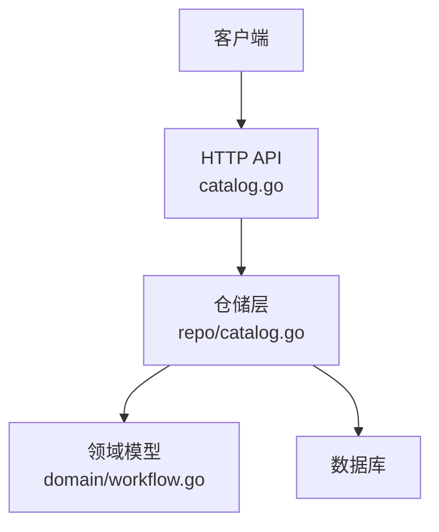
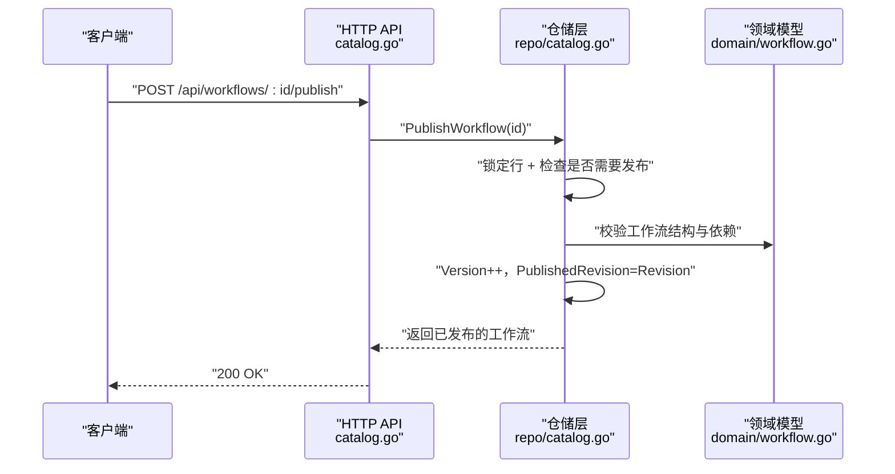
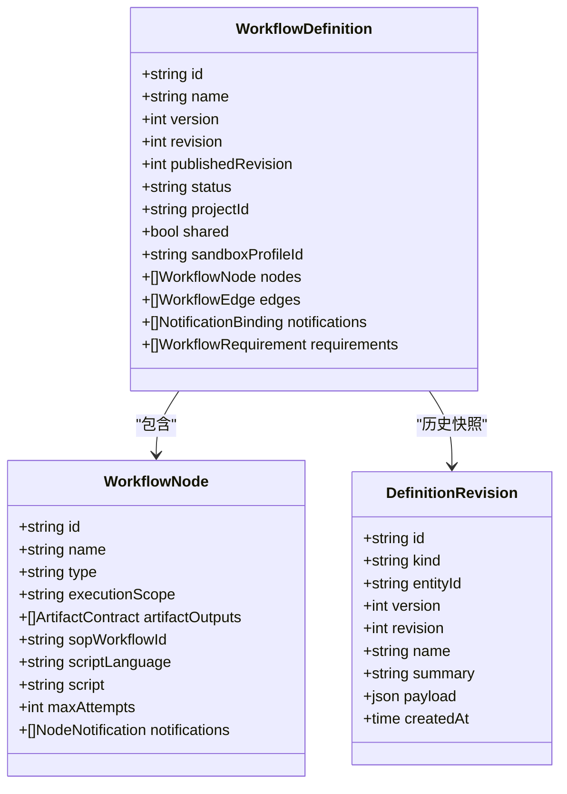
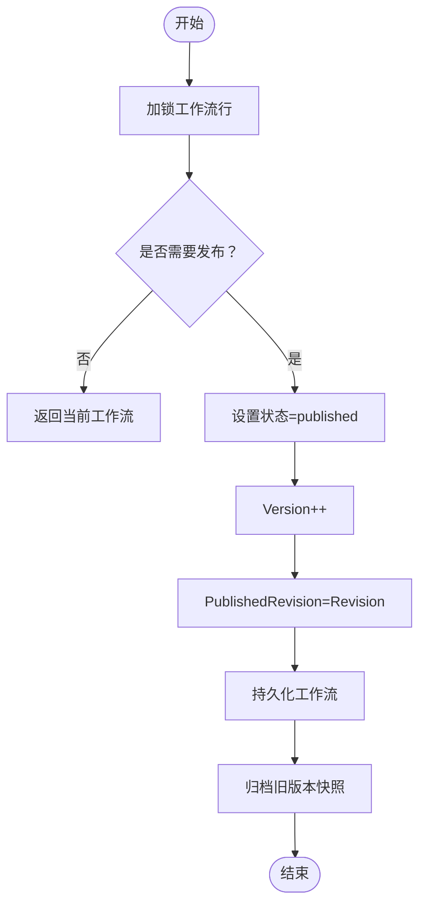
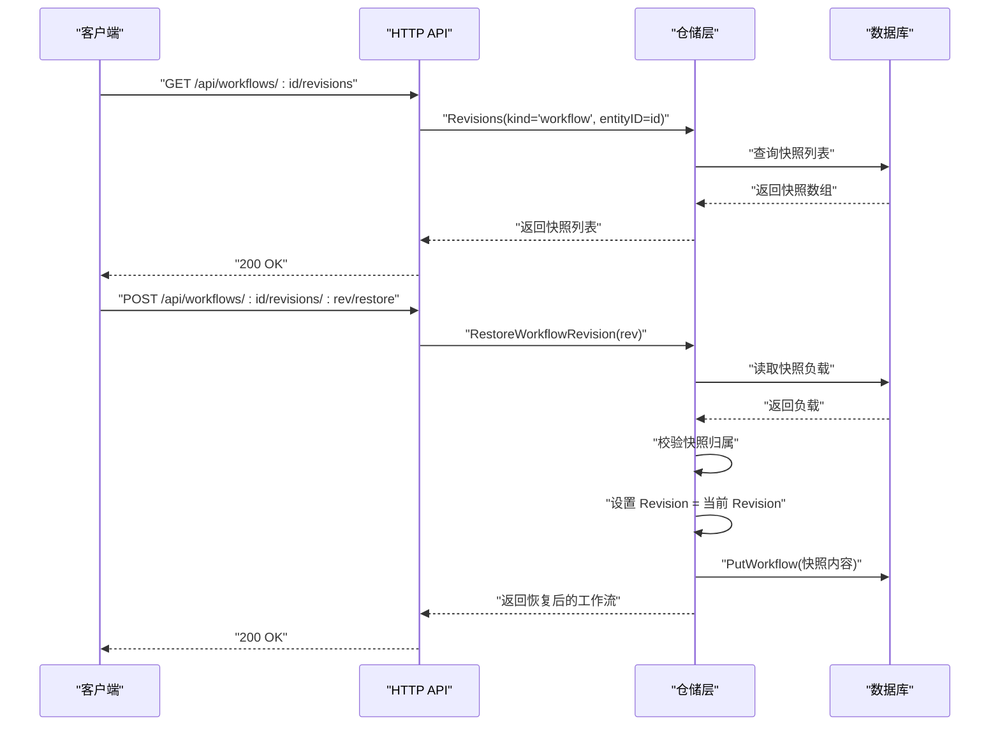
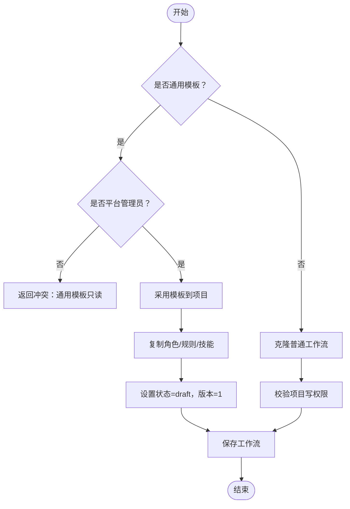
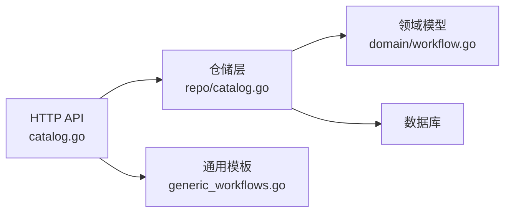

# 版本管理

<cite>
**本文引用的文件**   
- [catalog.go](file://internal/repo/catalog.go)
- [workflow.go](file://internal/domain/workflow.go)
- [catalog.go](file://internal/httpapi/catalog.go)
- [generic_workflows.go](file://internal/httpapi/generic_workflows.go)
- [revisions_test.go](file://internal/repo/revisions_test.go)
- [workflow_publish_test.go](file://internal/repo/workflow_publish_test.go)
- [10-catalog.test.mjs](file://e2e/api/10-catalog.test.mjs)
</cite>

## 目录
1. [引言](#引言)
2. [项目结构](#项目结构)
3. [核心组件](#核心组件)
4. [架构总览](#架构总览)
5. [详细组件分析](#详细组件分析)
6. [依赖关系分析](#依赖关系分析)
7. [性能与并发特性](#性能与并发特性)
8. [故障排查指南](#故障排查指南)
9. [结论](#结论)
10. [附录：API 与数据模型速查](#附录api-与数据模型速查)

## 引言
本文件聚焦工作流（SOP）的版本管理，覆盖创建、发布、版本控制与回滚机制；说明工作流的引用、依赖管理与冲突解决策略；阐述导入导出、模板复用与团队协作能力；并解释权限控制、审计日志与合规性要求。文档以代码仓库中的领域模型、仓储实现与 HTTP API 为依据，提供可追溯的图示与路径引用。

## 项目结构
围绕工作流版本管理的核心代码分布在三层：
- 领域层：定义工作流数据结构、节点、边、需求声明、版本快照等。
- 仓储层：负责工作流的持久化、版本快照归档、发布与回滚、并发锁与冲突检测。
- 接口层：暴露 REST API，处理克隆、发布、删除、版本查询与恢复等操作。

**图表来源**
- [catalog.go:1180-1343](file://internal/httpapi/catalog.go#L1180-L1343)
- [catalog.go:402-576](file://internal/repo/catalog.go#L402-L576)
- [workflow.go:139-180](file://internal/domain/workflow.go#L139-L180)

**章节来源**
- [catalog.go:1180-1343](file://internal/httpapi/catalog.go#L1180-L1343)
- [catalog.go:402-576](file://internal/repo/catalog.go#L402-L576)
- [workflow.go:139-180](file://internal/domain/workflow.go#L139-L180)

## 核心组件
- 工作流定义与工作流节点：包含节点类型、执行范围、产物契约、指标阶段、通知绑定等。
- 版本快照 DefinitionRevision：不可变的历史快照，用于差异对比与恢复。
- 仓储 CatalogRepo：封装工作流保存、发布、删除、克隆、版本快照归档与恢复。
- HTTP API catalogHandlers：对外暴露工作流生命周期操作，包括克隆、发布、删除、版本列表与恢复。

关键职责划分：
- domain.workflow.go：定义数据模型与校验规则。
- repo.catalog.go：实现版本控制、并发安全、冲突检测、快照归档与恢复。
- httpapi.catalog.go：路由解析、权限校验、请求解码与响应封装。

**章节来源**
- [workflow.go:10-20](file://internal/domain/workflow.go#L10-L20)
- [workflow.go:39-73](file://internal/domain/workflow.go#L39-L73)
- [workflow.go:103-115](file://internal/domain/workflow.go#L103-L115)
- [workflow.go:139-180](file://internal/domain/workflow.go#L139-L180)
- [catalog.go:402-576](file://internal/repo/catalog.go#L402-L576)
- [catalog.go:763-844](file://internal/repo/catalog.go#L763-L844)
- [catalog.go:1180-1343](file://internal/httpapi/catalog.go#L1180-L1343)

## 架构总览
工作流版本管理的关键流程如下：
- 创建工作流：通过 PUT /api/workflows 或克隆接口创建草稿版本。
- 发布工作流：POST /api/workflows/{id}/publish 将当前修订标记为已发布，递增版本。
- 版本快照：每次保存前对旧版本进行快照归档，保留历史差异。
- 回滚：POST /api/workflows/{id}/revisions/{rev}/restore 将指定快照恢复到当前工作流。
- 通用模板：内置模板只读，支持“采用”到项目内成为可编辑副本。

**图表来源**
- [catalog.go:1259-1278](file://internal/httpapi/catalog.go#L1259-L1278)
- [catalog.go:473-505](file://internal/repo/catalog.go#L473-L505)
- [workflow.go:139-180](file://internal/domain/workflow.go#L139-L180)

## 详细组件分析

### 工作流数据模型与校验
- WorkflowDefinition：包含 ID、名称、版本、修订号、状态、项目标识、沙箱配置、节点与边、通知绑定、需求声明等。
- WorkflowNode：支持脚本、审批、子工作流、代理等节点类型，具备执行范围、产物契约、重试策略、通知等。
- DefinitionRevision：不可变快照，记录实体类型、实体 ID、版本、修订、名称、摘要、负载与时间戳。
- 校验规则：
  - 指标阶段必须为受控值之一。
  - 沙箱配置文件需存在且有效。
  - 工作流准备与通知绑定需通过验证。

**图表来源**
- [workflow.go:139-180](file://internal/domain/workflow.go#L139-L180)
- [workflow.go:39-73](file://internal/domain/workflow.go#L39-L73)
- [workflow.go:103-115](file://internal/domain/workflow.go#L103-L115)

**章节来源**
- [workflow.go:75-85](file://internal/domain/workflow.go#L75-L85)
- [workflow.go:139-180](file://internal/domain/workflow.go#L139-L180)
- [workflow.go:103-115](file://internal/domain/workflow.go#L103-L115)

### 发布流程与幂等性
- 发布入口：POST /api/workflows/{id}/publish。
- 并发安全：使用行级锁确保并发发布不会重复递增版本。
- 幂等性：若工作流未变更或已处于已发布状态且 PublishedRevision 等于 Revision，则直接返回当前版本。
- 版本语义：
  - Version：面向用户的版本号，发布时递增。
  - Revision：内部修订号，每次保存递增。
  - PublishedRevision：指向已发布的修订号，发布时设置为当前 Revision。

**图表来源**
- [catalog.go:473-505](file://internal/repo/catalog.go#L473-L505)
- [catalog.go:507-567](file://internal/repo/catalog.go#L507-L567)

**章节来源**
- [catalog.go:473-505](file://internal/repo/catalog.go#L473-L505)
- [catalog.go:507-567](file://internal/repo/catalog.go#L507-L567)
- [workflow_publish_test.go:67-114](file://internal/repo/workflow_publish_test.go#L67-L114)

### 版本快照与回滚
- 快照归档：每次保存工作流前，调用 snapshotRevision 将旧版本归档到 definition_revisions。
- 版本限制：每个实体最多保留固定数量的历史快照，超出部分按时间顺序清理。
- 回滚流程：
  - 获取指定修订快照。
  - 校验快照属于目标工作流。
  - 将快照内容反序列化为工作流定义。
  - 设置 Revision 为当前工作流的 Revision，避免覆盖后续修改。
  - 调用 PutWorkflow 保存回滚结果。

**图表来源**
- [catalog.go:1186-1214](file://internal/httpapi/catalog.go#L1186-L1214)
- [catalog.go:819-844](file://internal/repo/catalog.go#L819-L844)
- [catalog.go:763-817](file://internal/repo/catalog.go#L763-L817)

**章节来源**
- [catalog.go:763-817](file://internal/repo/catalog.go#L763-L817)
- [catalog.go:819-844](file://internal/repo/catalog.go#L819-L844)
- [revisions_test.go:9-39](file://internal/repo/revisions_test.go#L9-L39)

### 克隆与模板复用
- 克隆接口：POST /api/workflows/{id}/clone，支持从普通工作流或通用模板克隆。
- 通用模板：
  - 平台内置模板只读，不能直接删除或编辑。
  - 支持“采用”到项目内，生成可编辑副本，同时复制角色、规则、技能等资源。
  - 克隆时禁止使用与内置模板冲突的 ID。
- 权限控制：
  - 非平台管理员无法编辑通用模板。
  - 克隆需要项目写权限。

**图表来源**
- [catalog.go:1279-1326](file://internal/httpapi/catalog.go#L1279-L1326)
- [generic_workflows.go:31-62](file://internal/httpapi/generic_workflows.go#L31-L62)

**章节来源**
- [catalog.go:1279-1326](file://internal/httpapi/catalog.go#L1279-L1326)
- [generic_workflows.go:31-62](file://internal/httpapi/generic_workflows.go#L31-L62)
- [10-catalog.test.mjs:186-227](file://e2e/api/10-catalog.test.mjs#L186-L227)

### 冲突解决策略
- 修订冲突：保存时若传入的 Revision 与存储的 Revision 不一致，返回冲突错误。
- 通用模板冲突：克隆时使用与内置模板相同的 ID 会返回冲突。
- 并发发布：通过行级锁保证并发发布幂等，不会重复递增版本。

**章节来源**
- [catalog.go:527-530](file://internal/repo/catalog.go#L527-L530)
- [catalog.go:473-487](file://internal/repo/catalog.go#L473-L487)
- [catalog.go:1293-1298](file://internal/httpapi/catalog.go#L1293-L1298)

### 引用与依赖管理
- 节点依赖外部能力：WorkflowRequirement 声明 Git Token、MCP 等前置条件，供前端预检清单展示。
- 通知绑定：工作流与节点可绑定通知，恢复时需校验通知访问权限。
- 沙箱依赖：工作流必须引用有效的沙箱配置，否则保存失败。

**章节来源**
- [workflow.go:27-37](file://internal/domain/workflow.go#L27-L37)
- [catalog.go:548-550](file://internal/repo/catalog.go#L548-L550)
- [catalog.go:1206-1208](file://internal/httpapi/catalog.go#L1206-L1208)

### 权限控制、审计日志与合规性
- 权限控制：
  - 通用模板编辑需平台管理员权限。
  - 克隆与删除需项目写权限。
  - 恢复含通知的工作流需通知访问权限。
- 审计日志：
  - 每次保存前归档旧版本快照，形成不可变历史。
  - 快照包含实体类型、实体 ID、版本、修订、名称、摘要、负载与时间戳。
- 合规性：
  - 版本快照保留上限，避免无限增长。
  - 沙箱与环境变量需通过校验，防止不安全配置。

**章节来源**
- [catalog.go:1225-1228](file://internal/httpapi/catalog.go#L1225-L1228)
- [catalog.go:1304-1306](file://internal/httpapi/catalog.go#L1304-L1306)
- [catalog.go:1206-1208](file://internal/httpapi/catalog.go#L1206-L1208)
- [catalog.go:763-817](file://internal/repo/catalog.go#L763-L817)

## 依赖关系分析
工作流版本管理的依赖关系如下：
- HTTP API 依赖仓储层完成业务逻辑。
- 仓储层依赖领域模型进行数据校验与规范化。
- 仓储层依赖数据库进行持久化与快照管理。
- 通用模板依赖资源复制逻辑，确保角色、规则、技能正确映射到项目副本。

**图表来源**
- [catalog.go:1180-1343](file://internal/httpapi/catalog.go#L1180-L1343)
- [catalog.go:402-576](file://internal/repo/catalog.go#L402-L576)
- [generic_workflows.go:31-62](file://internal/httpapi/generic_workflows.go#L31-L62)

**章节来源**
- [catalog.go:1180-1343](file://internal/httpapi/catalog.go#L1180-L1343)
- [catalog.go:402-576](file://internal/repo/catalog.go#L402-L576)
- [generic_workflows.go:31-62](file://internal/httpapi/generic_workflows.go#L31-L62)

## 性能与并发特性
- 并发安全：发布操作使用行级锁，确保并发幂等。
- 快照清理：超过最大保留数量的快照按时间顺序清理，避免数据库膨胀。
- 幂等保存：若工作流内容未变化，保存操作直接返回成功，不增加修订号。

**章节来源**
- [catalog.go:473-487](file://internal/repo/catalog.go#L473-L487)
- [catalog.go:794-817](file://internal/repo/catalog.go#L794-L817)
- [catalog.go:531-533](file://internal/repo/catalog.go#L531-L533)

## 故障排查指南
- 发布失败：
  - 检查工作流状态是否为 draft 或 PublishedRevision 不等于 Revision。
  - 确认工作流内容与沙箱配置有效。
- 回滚失败：
  - 确认快照存在且属于目标工作流。
  - 检查通知访问权限是否满足。
- 克隆失败：
  - 检查是否使用与内置模板冲突的 ID。
  - 确认项目写权限是否足够。
- 并发冲突：
  - 遇到修订冲突错误时，刷新工作流后重试保存。

**章节来源**
- [catalog.go:490-505](file://internal/repo/catalog.go#L490-L505)
- [catalog.go:829-844](file://internal/repo/catalog.go#L829-L844)
- [catalog.go:1293-1298](file://internal/httpapi/catalog.go#L1293-L1298)
- [catalog.go:527-530](file://internal/repo/catalog.go#L527-L530)

## 结论
工作流版本管理通过清晰的领域模型、严格的仓储实现与健壮的 HTTP API，实现了安全的创建、发布、版本控制与回滚。系统支持通用模板复用、资源复制与权限控制，并提供不可变的版本快照以满足审计与合规需求。并发安全与幂等性设计确保了在高并发场景下的稳定性。

## 附录：API 与数据模型速查
- 发布工作流：POST /api/workflows/{id}/publish
- 克隆工作流：POST /api/workflows/{id}/clone
- 删除工作流：DELETE /api/workflows/{id}
- 版本列表：GET /api/workflows/{id}/revisions
- 版本详情：GET /api/workflows/{id}/revisions/{rev}
- 恢复版本：POST /api/workflows/{id}/revisions/{rev}/restore

关键数据字段：
- WorkflowDefinition：id、name、version、revision、publishedRevision、status、projectId、sandboxProfileId、nodes、edges、notifications、requirements
- WorkflowNode：id、name、type、executionScope、artifactOutputs、sopWorkflowId、scriptLanguage、script、maxAttempts、notifications
- DefinitionRevision：kind、entityId、version、revision、name、summary、payload、createdAt

**章节来源**
- [catalog.go:1186-1343](file://internal/httpapi/catalog.go#L1186-L1343)
- [workflow.go:139-180](file://internal/domain/workflow.go#L139-L180)
- [workflow.go:39-73](file://internal/domain/workflow.go#L39-L73)
- [workflow.go:103-115](file://internal/domain/workflow.go#L103-L115)