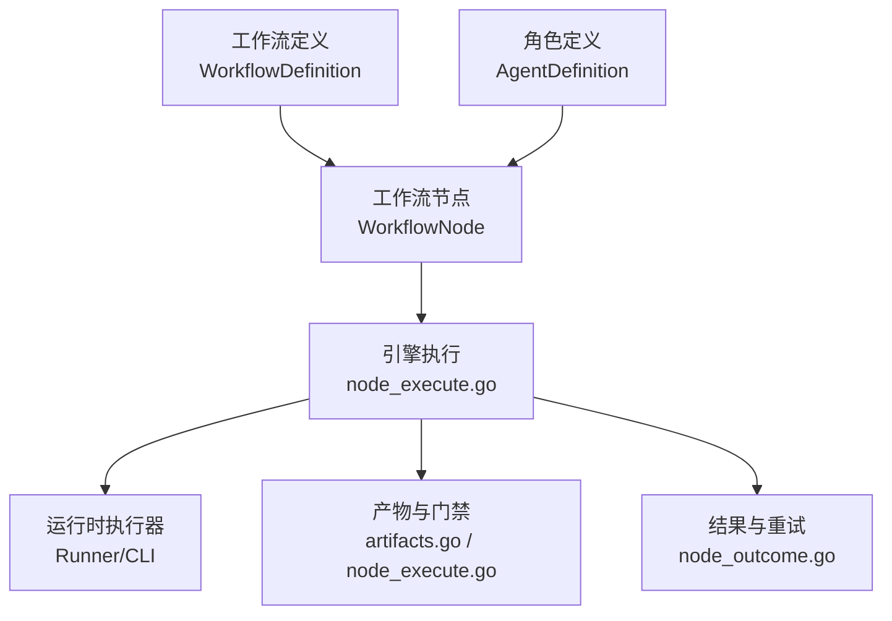
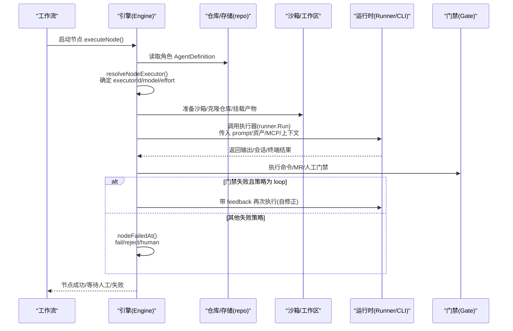
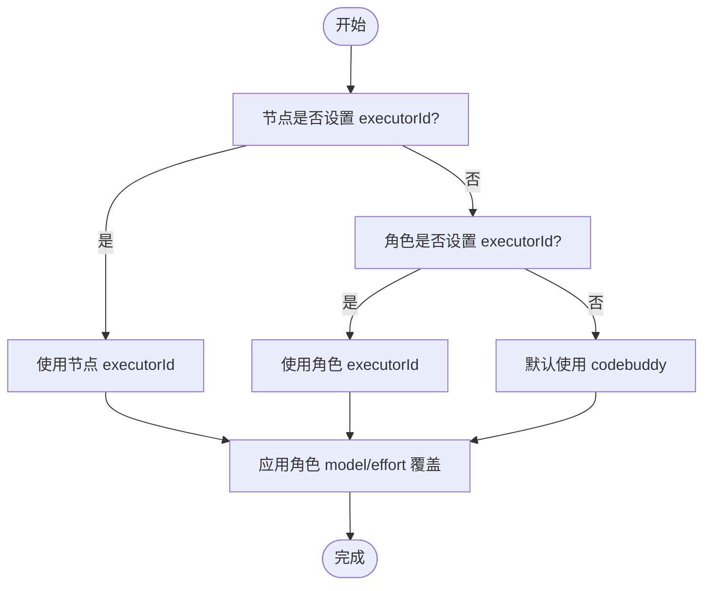
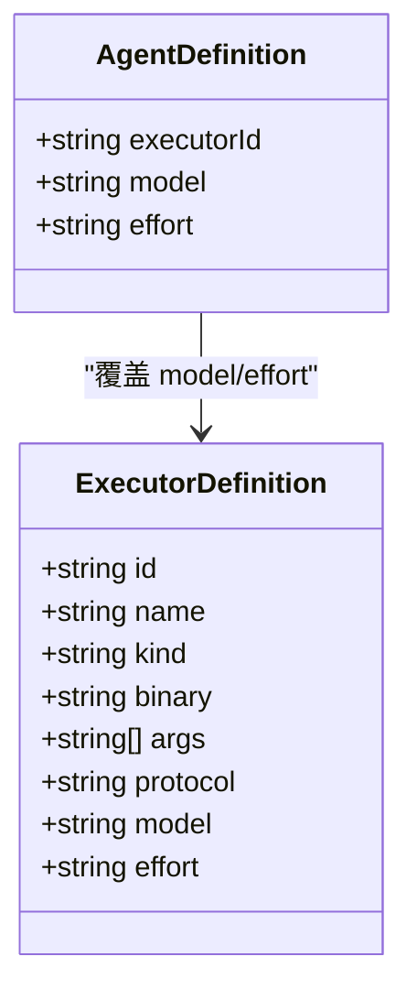
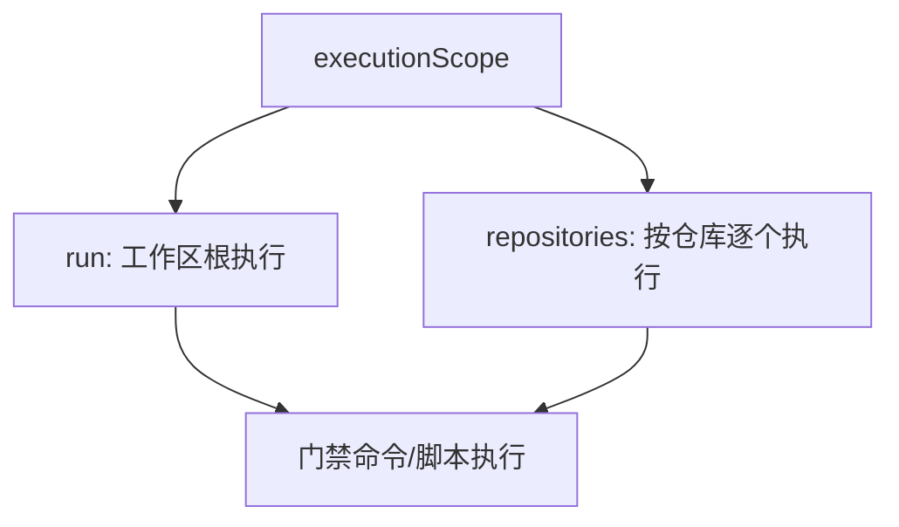
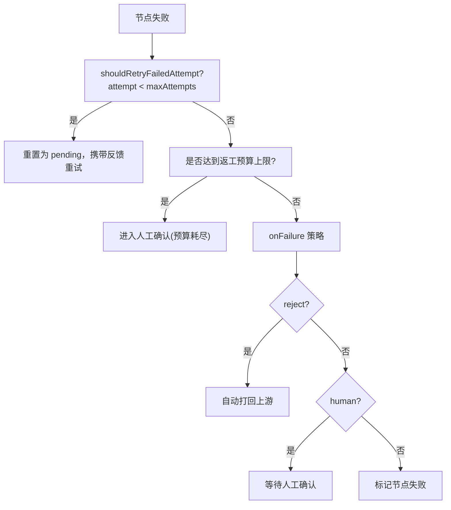
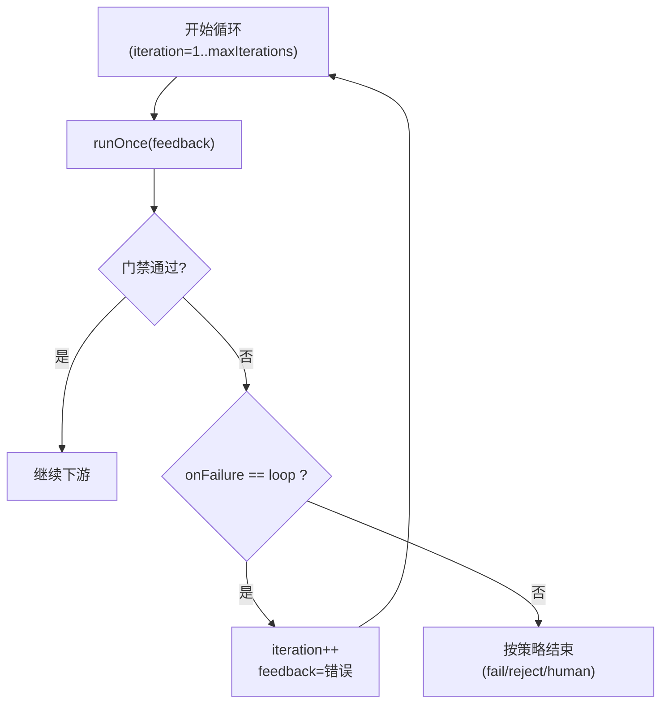
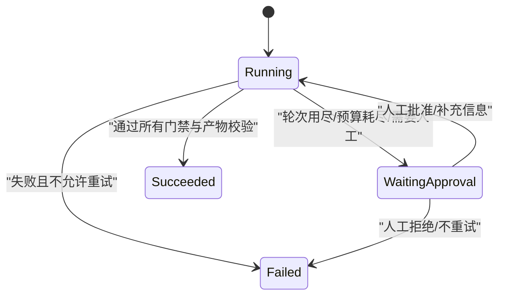
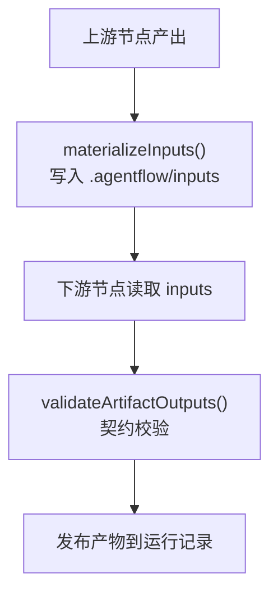
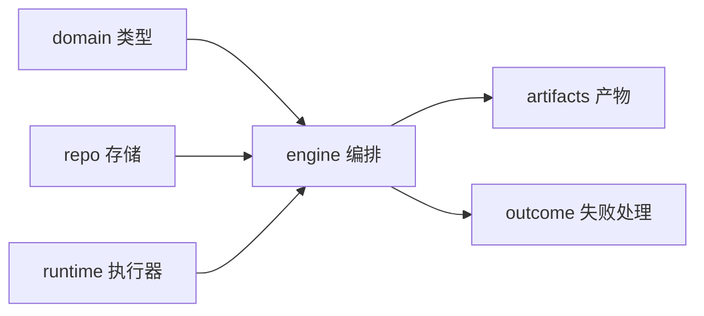

# Agent 节点

<cite>
**本文引用的文件**   
- [internal/domain/agent.go](file://internal/domain/agent.go)
- [internal/domain/workflow.go](file://internal/domain/workflow.go)
- [internal/engine/node_execute.go](file://internal/engine/node_execute.go)
- [internal/engine/node_outcome.go](file://internal/engine/node_outcome.go)
- [internal/engine/artifacts.go](file://internal/engine/artifacts.go)
- [internal/engine/observability.go](file://internal/engine/observability.go)
- [internal/engine/run_ops.go](file://internal/engine/run_ops.go)
- [internal/repo/catalog.go](file://internal/repo/catalog.go)
</cite>

## 目录
1. [简介](#简介)
2. [项目结构定位](#项目结构定位)
3. [核心组件](#核心组件)
4. [架构总览](#架构总览)
5. [详细组件分析](#详细组件分析)
6. [依赖关系分析](#依赖关系分析)
7. [性能与执行特性](#性能与执行特性)
8. [故障排查指南](#故障排查指南)
9. [结论](#结论)
10. [附录：配置项速查与常见模式](#附录配置项速查与常见模式)

## 简介
本文面向“Agent 节点”，即工作流中由 AI 代理执行的节点。文档围绕以下目标展开：
- 解释 Agent 节点的配置选项，包括 agentId、executorId、model、executionScope、retryStrategy、onFailure。
- 说明 Agent 角色定义与节点绑定的关系，以及模型、思考强度、MCP、产物契约和验证门禁的继承与覆盖规则。
- 深入讲解循环执行 loop 机制、失败处理 onExhausted、人工介入点 interventions。
- 给出实际配置示例与常见使用模式，帮助选择合适的执行器与模型。

## 项目结构定位
Agent 节点涉及领域模型、引擎编排、运行时调度与产物校验四个层面：
- 领域模型：AgentDefinition、WorkflowNode、VerificationGate、ArtifactContract 等类型定义。
- 引擎编排：executeNode、resolveNodeExecutor、loop 控制、门禁执行、失败处理。
- 运行时：通过 Runner 调用具体 CLI 执行器（如 Claude Code、Codex、CodeBuddy 等）。
- 产物与门禁：上游产物注入、产物契约校验、命令/MR 门禁、人工确认。

**图示来源**
- [internal/domain/workflow.go:39-73](file://internal/domain/workflow.go#L39-L73)
- [internal/domain/agent.go:61-94](file://internal/domain/agent.go#L61-L94)
- [internal/engine/node_execute.go:316-759](file://internal/engine/node_execute.go#L316-L759)
- [internal/engine/artifacts.go:25-92](file://internal/engine/artifacts.go#L25-L92)
- [internal/engine/node_outcome.go:50-117](file://internal/engine/node_outcome.go#L50-L117)

**章节来源**
- [internal/domain/workflow.go:39-73](file://internal/domain/workflow.go#L39-L73)
- [internal/domain/agent.go:61-94](file://internal/domain/agent.go#L61-L94)

## 核心组件
- AgentDefinition：可复用的 AI 角色定义，包含 prompt、rules、skills、mcpServers、platformMcp、knowledgeBase、hooks、executorId、model、effort、loop、interventions、artifactOutputs、verification 等。
- WorkflowNode：工作流中的单个节点，支持 type=agent/script/approval/sop，并携带 executorId、agentId、executionScope、retryStrategy、onFailure、maxAttempts、maxReworks、rejectTo、artifactOutputs 等。
- VerificationGate：验证门禁，支持 command/manual/mr，可配置 executionScope 与 onFailure。
- ArtifactContract：产物契约，声明 name/path/mediaType/required，用于产物注入与校验。

关键职责：
- AgentDefinition 提供“角色级”默认能力与策略；WorkflowNode 在“任务级”进行覆盖或增强。
- Engine 负责解析执行器、准备沙箱、注入产物、执行 Agent、运行门禁、处理失败与重试。

**章节来源**
- [internal/domain/agent.go:61-145](file://internal/domain/agent.go#L61-L145)
- [internal/domain/workflow.go:10-20](file://internal/domain/workflow.go#L10-L20)
- [internal/domain/workflow.go:39-73](file://internal/domain/workflow.go#L39-L73)
- [internal/domain/workflow.go:87-94](file://internal/domain/workflow.go#L87-L94)

## 架构总览
下图展示 Agent 节点从工作流到执行器的完整流程，包括执行器选择、产物注入、循环执行、门禁与失败处理。

**图示来源**
- [internal/engine/node_execute.go:316-759](file://internal/engine/node_execute.go#L316-L759)
- [internal/engine/node_execute.go:772-964](file://internal/engine/node_execute.go#L772-L964)
- [internal/engine/node_outcome.go:50-117](file://internal/engine/node_outcome.go#L50-L117)

## 详细组件分析

### 1) Agent 角色与工作流节点绑定
- 节点通过 agentId 引用一个已定义的 Agent 角色。
- 若节点未显式设置 executorId，则优先使用角色的 executorId；仍为空时回退到内置执行器 codebuddy。
- 若角色设置了 model 或 effort，会覆盖执行器默认值；节点也可覆盖 executorId，但 model/effort 来自角色。

**图示来源**
- [internal/engine/node_execute.go:189-224](file://internal/engine/node_execute.go#L189-L224)
- [internal/domain/agent.go:86-88](file://internal/domain/agent.go#L86-L88)

**章节来源**
- [internal/engine/node_execute.go:189-224](file://internal/engine/node_execute.go#L189-L224)
- [internal/domain/workflow.go:54-55](file://internal/domain/workflow.go#L54-L55)
- [internal/domain/agent.go:86-88](file://internal/domain/agent.go#L86-L88)

### 2) 模型选择与执行器配置
- 执行器种类包括 mock、claude-code、codex、codebuddy 等；平台还提供内置执行器映射。
- 当执行器为 CodeBuddy 且具备赞助模型时，引擎可能替换为赞助模型。
- 非 CodeBuddy 的 CLI 执行器（如 opencode、cursor、agy、kimi、pi、dsh、zcode）属于“个人凭据域”，需要责任人本地登录。

**图示来源**
- [internal/domain/agent.go:134-145](file://internal/domain/agent.go#L134-L145)
- [internal/engine/node_execute.go:727-730](file://internal/engine/node_execute.go#L727-L730)

**章节来源**
- [internal/domain/agent.go:10-25](file://internal/domain/agent.go#L10-L25)
- [internal/domain/agent.go:134-145](file://internal/domain/agent.go#L134-L145)
- [internal/engine/node_execute.go:727-730](file://internal/engine/node_execute.go#L727-L730)

### 3) 执行范围 executionScope
- 脚本节点与门禁命令支持 executionScope：run 或 repositories。
- run：在工作区根执行一次；repositories：对每个仓库检出分别执行。
- 该字段影响脚本与门禁命令的执行上下文与日志归属。

**图示来源**
- [internal/domain/workflow.go:62-62](file://internal/domain/workflow.go#L62-L62)
- [internal/domain/workflow.go:18-19](file://internal/domain/workflow.go#L18-L19)
- [internal/engine/node_execute.go:602-614](file://internal/engine/node_execute.go#L602-L614)
- [internal/engine/node_execute.go:935-936](file://internal/engine/node_execute.go#L935-L936)

**章节来源**
- [internal/domain/workflow.go:62-62](file://internal/domain/workflow.go#L62-L62)
- [internal/domain/workflow.go:18-19](file://internal/domain/workflow.go#L18-L19)
- [internal/engine/node_execute.go:602-614](file://internal/engine/node_execute.go#L602-L614)
- [internal/engine/node_execute.go:935-936](file://internal/engine/node_execute.go#L935-L936)

### 4) 重试策略 retryStrategy 与失败处理 onFailure
- retryStrategy：targeted_fix（仅修复失败项）、full_redo（完整重做），空值表示沿用默认。
- onFailure：fail、reject、human、loop（门禁失败时的行为）。
- 节点失败时，引擎根据 MaxAttempts、RejectTo、MaxReworks 与 onFailure 决定：
  - 自动重试（clean workspace，附带错误作为 feedback）
  - 打回上游（reject）
  - 转人工（human）
  - 直接失败（fail）

**图示来源**
- [internal/engine/node_outcome.go:50-117](file://internal/engine/node_outcome.go#L50-L117)
- [internal/engine/node_outcome.go:89-98](file://internal/engine/node_outcome.go#L89-L98)
- [internal/engine/node_outcome.go:144-166](file://internal/engine/node_outcome.go#L144-L166)

**章节来源**
- [internal/domain/workflow.go:67-67](file://internal/domain/workflow.go#L67-L67)
- [internal/engine/node_outcome.go:50-117](file://internal/engine/node_outcome.go#L50-L117)
- [internal/engine/node_outcome.go:89-98](file://internal/engine/node_outcome.go#L89-L98)
- [internal/engine/node_outcome.go:144-166](file://internal/engine/node_outcome.go#L144-L166)

### 5) 循环执行 loop 机制
- AgentLoopPolicy 控制单次 Agent 调用内的自修正循环：
  - enabled：是否启用
  - maxIterations：最大轮次
  - exitCondition：退出条件（all_gates_pass、executor_success）
  - onExhausted：耗尽后 fail 或 human
  - feedbackPrompt：自定义反馈提示模板
- 引擎在执行 Agent 后运行门禁；若门禁失败且 onFailure=loop，则将错误作为 feedback 再次执行 Agent，直到通过或达到 maxIterations。

**图示来源**
- [internal/domain/agent.go:112-121](file://internal/domain/agent.go#L112-L121)
- [internal/engine/node_execute.go:664-667](file://internal/engine/node_execute.go#L664-L667)
- [internal/engine/node_execute.go:772-964](file://internal/engine/node_execute.go#L772-L964)

**章节来源**
- [internal/domain/agent.go:112-121](file://internal/domain/agent.go#L112-L121)
- [internal/engine/node_execute.go:664-667](file://internal/engine/node_execute.go#L664-L667)
- [internal/engine/node_execute.go:772-964](file://internal/engine/node_execute.go#L772-L964)

### 6) 失败处理 with human intervention & rework budget
- 当 Agent 请求“rework”且上游节点仍有 MaxReworks 预算时，引擎自动打回上游。
- 若预算耗尽，节点进入 waiting_approval，等待人工决策（批准=接受当前结果继续下游）。
- 若对话轮次用尽（max turns），节点也进入 waiting_approval，提示是否重试本节点。

**图示来源**
- [internal/engine/node_outcome.go:68-86](file://internal/engine/node_outcome.go#L68-L86)
- [internal/engine/node_execute.go:974-1013](file://internal/engine/node_execute.go#L974-L1013)

**章节来源**
- [internal/engine/node_outcome.go:68-86](file://internal/engine/node_outcome.go#L68-L86)
- [internal/engine/node_execute.go:974-1013](file://internal/engine/node_execute.go#L974-L1013)

### 7) 产物输出与输入传递 artifactOutputs
- 上游节点可通过 ArtifactContract 声明产物；下游节点会自动收到 .agentflow/inputs/<source>/<name>.<ext> 的文件。
- 引擎会在节点成功后收集产物，校验契约（路径、必填、媒体类型），并发布到运行记录。
- 对于远程执行机器，产物可通过 reported outputs 机制回传，避免控制面重复读取。

**图示来源**
- [internal/engine/artifacts.go:25-92](file://internal/engine/artifacts.go#L25-L92)
- [internal/engine/artifacts.go:119-119](file://internal/engine/artifacts.go#L119-L119)
- [internal/engine/artifacts.go:240-240](file://internal/engine/artifacts.go#L240-L240)
- [internal/engine/node_execute.go:1027-1055](file://internal/engine/node_execute.go#L1027-L1055)

**章节来源**
- [internal/domain/workflow.go:87-94](file://internal/domain/workflow.go#L87-L94)
- [internal/engine/artifacts.go:25-92](file://internal/engine/artifacts.go#L25-L92)
- [internal/engine/artifacts.go:240-240](file://internal/engine/artifacts.go#L240-L240)
- [internal/engine/node_execute.go:1027-1055](file://internal/engine/node_execute.go#L1027-L1055)

### 8) 角色钩子 hooks 与执行范围
- AgentHook 支持事件（SessionStart、UserPromptSubmit、PreToolUse、PostToolUse、Stop），并可指定 language、script、timeoutSec。
- ExecutionScope 控制钩子在 Run 工作区根执行一次，还是对每个仓库检出各执行一次。

**章节来源**
- [internal/domain/agent.go:96-110](file://internal/domain/agent.go#L96-L110)

## 依赖关系分析
- 引擎依赖 repo 获取 AgentDefinition、ExecutorDefinition、SandboxProfile 等元数据。
- 引擎依赖 runtime 管理沙箱、执行 CLI、准备 MCP 资产、处理会话恢复。
- 引擎依赖 domain 类型定义工作流、节点、产物、门禁等数据结构。

**图示来源**
- [internal/engine/node_execute.go:316-759](file://internal/engine/node_execute.go#L316-L759)
- [internal/engine/artifacts.go:25-92](file://internal/engine/artifacts.go#L25-L92)
- [internal/engine/node_outcome.go:50-117](file://internal/engine/node_outcome.go#L50-L117)

**章节来源**
- [internal/repo/catalog.go:41-43](file://internal/repo/catalog.go#L41-L43)
- [internal/engine/node_execute.go:316-759](file://internal/engine/node_execute.go#L316-L759)

## 性能与执行特性
- 并行分支：引擎并发调度就绪节点，避免串行阻塞。
- 沙箱构建：首次 Docker 镜像构建会观察并记录耗时，后续复用缓存。
- 产物优化：远程执行机器支持 reported outputs，减少控制面 I/O。
- 门禁合并：多行门禁命令被合并为单进程执行，提升稳定性与性能。

[本节为通用指导，不直接分析具体文件]

## 故障排查指南
常见问题与定位要点：
- 执行器未找到：检查 executorId 是否存在或是否为 legacy 遗留值；引擎会尝试映射到内置执行器。
- 模型未生效：确认角色是否设置了 model；节点 executorId 不会覆盖 model/effort。
- 门禁失败但未自修正：检查门禁 onFailure 是否为 loop；否则将按 fail/reject/human 处理。
- 轮次用尽：节点状态变为 waiting_approval，需人工决定是否重试。
- 产物缺失：检查 ArtifactContract 的 path/name/required；查看 validateArtifactOutputs 的错误。
- 会话丢失：若 CLI 会话不可恢复，引擎会丢弃旧 sessionID 并重新开始节点。

**章节来源**
- [internal/engine/node_execute.go:189-224](file://internal/engine/node_execute.go#L189-L224)
- [internal/engine/node_execute.go:974-1013](file://internal/engine/node_execute.go#L974-L1013)
- [internal/engine/node_execute.go:1117-1155](file://internal/engine/node_execute.go#L1117-L1155)
- [internal/engine/artifacts.go:240-240](file://internal/engine/artifacts.go#L240-L240)
- [internal/engine/observability.go:171-201](file://internal/engine/observability.go#L171-L201)

## 结论
Agent 节点通过“角色定义 + 节点覆盖”的方式，灵活组合执行器、模型、门禁与产物契约。引擎在编排层实现循环自修正、失败重试、打回上游与人工介入，确保复杂 AI 任务的可靠性与可观测性。合理选择 executorId、model、executionScope、retryStrategy 与 onExhausted，是构建稳定 Agent 流水线的关键。

[本节为总结，不直接分析具体文件]

## 附录：配置项速查与常见模式

### 配置项速查
- 工作流节点 WorkflowNode
  - agentId：引用 Agent 角色
  - executorId：覆盖角色执行器
  - executionScope：run 或 repositories
  - retryStrategy：targeted_fix 或 full_redo
  - onFailure：fail、reject、human
  - maxAttempts：节点级最大尝试次数
  - maxReworks：允许打回上游的最大次数
  - rejectTo：打回的目标节点
  - artifactOutputs：节点级产物契约（可与角色合并）
- 角色定义 AgentDefinition
  - executorId：角色级执行器
  - model：模型名
  - effort：思考强度
  - mcpServers/platformMcp/knowledgeBase：工具与知识集成
  - hooks：生命周期脚本
  - loop：enabled、maxIterations、exitCondition、onExhausted、feedbackPrompt
  - interventions：before_execution/after_execution/before_publish/on_failure 人工介入点
  - verification：门禁列表
  - artifactOutputs：角色级产物契约

**章节来源**
- [internal/domain/workflow.go:39-73](file://internal/domain/workflow.go#L39-L73)
- [internal/domain/agent.go:61-145](file://internal/domain/agent.go#L61-L145)

### 常见使用模式
- 固定模型与执行器：在 AgentDefinition 设置 executorId 与 model，节点只写 agentId。
- 按仓库执行门禁：门禁命令设置 executionScope=repositories，确保每个仓库独立验证。
- 自修正+人工兜底：loop.enabled=true、maxIterations=3、onExhausted=human；门禁 onFailure=loop。
- 打回上游修复：节点设置 rejectTo=repair、onFailure=reject、maxReworks=2；Agent 使用 submit_gate_result decision=rework。
- 产物契约保障：上游声明 artifactOutputs，下游消费 .agentflow/inputs；必要时 required=true。

**章节来源**
- [internal/engine/node_execute.go:664-667](file://internal/engine/node_execute.go#L664-L667)
- [internal/engine/node_execute.go:772-964](file://internal/engine/node_execute.go#L772-L964)
- [internal/engine/artifacts.go:25-92](file://internal/engine/artifacts.go#L25-L92)