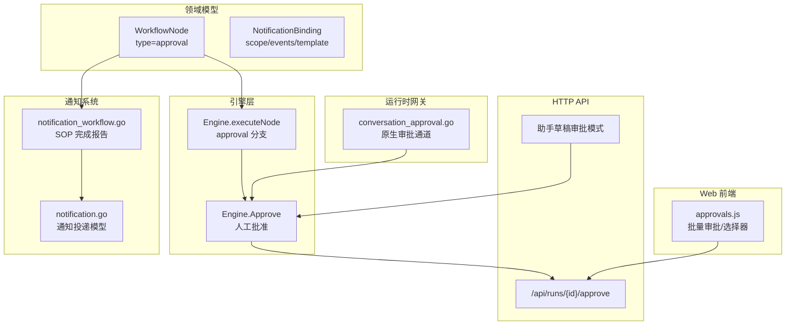
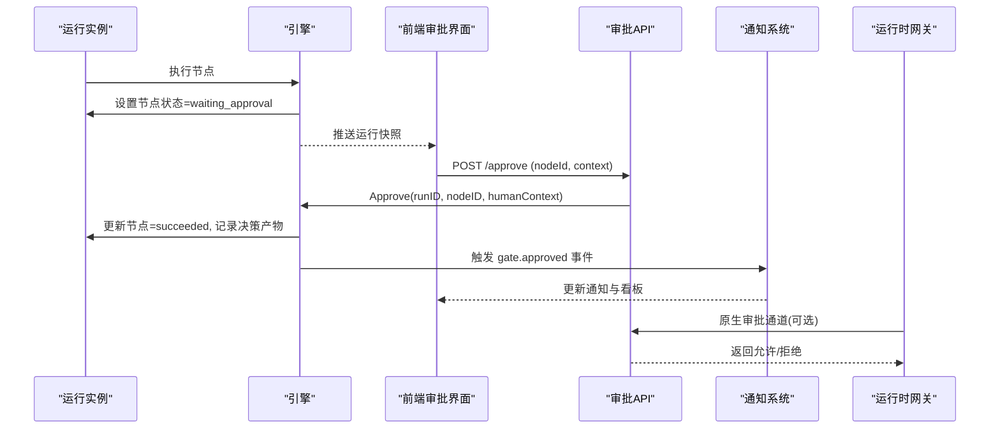
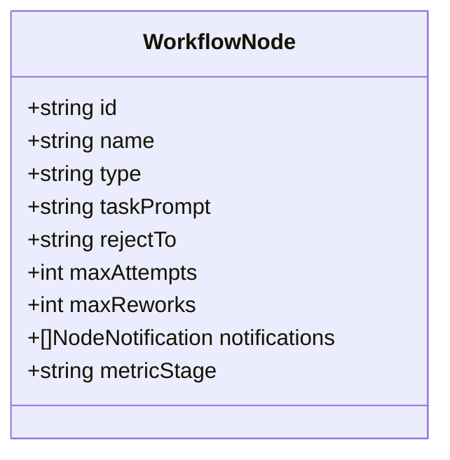
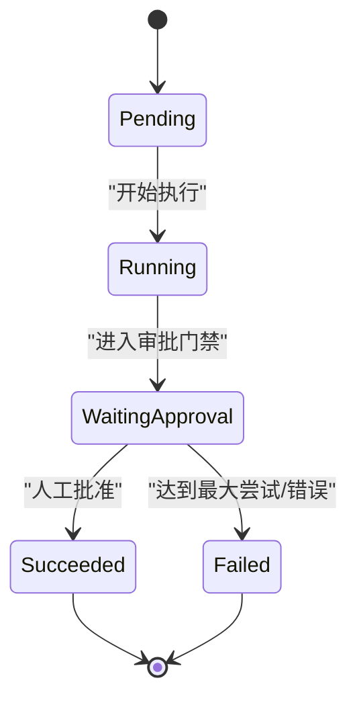
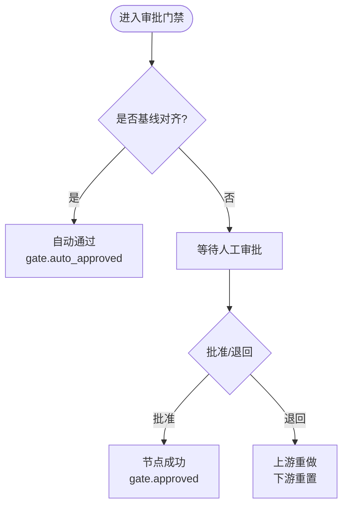
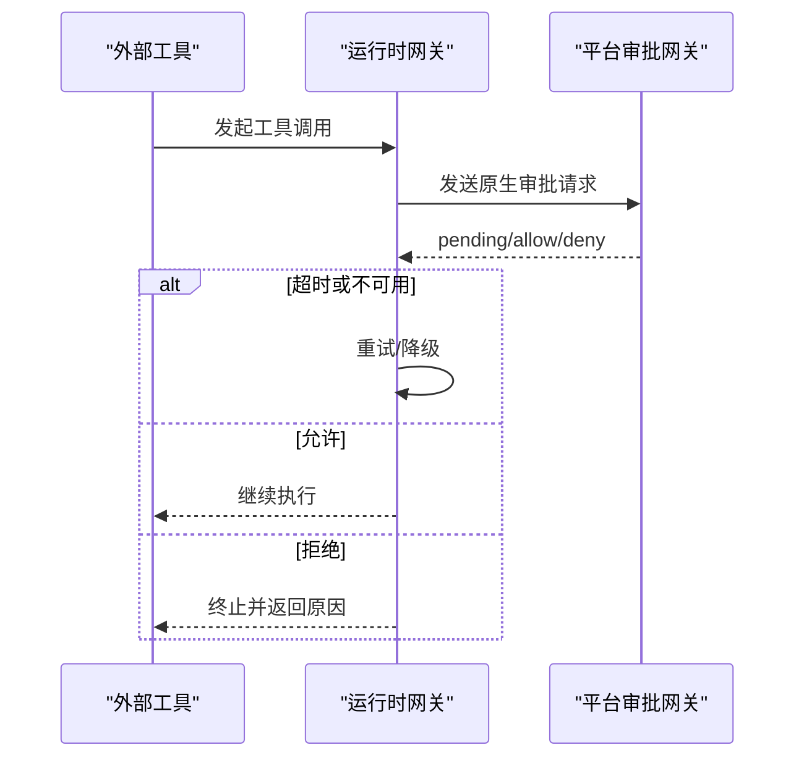
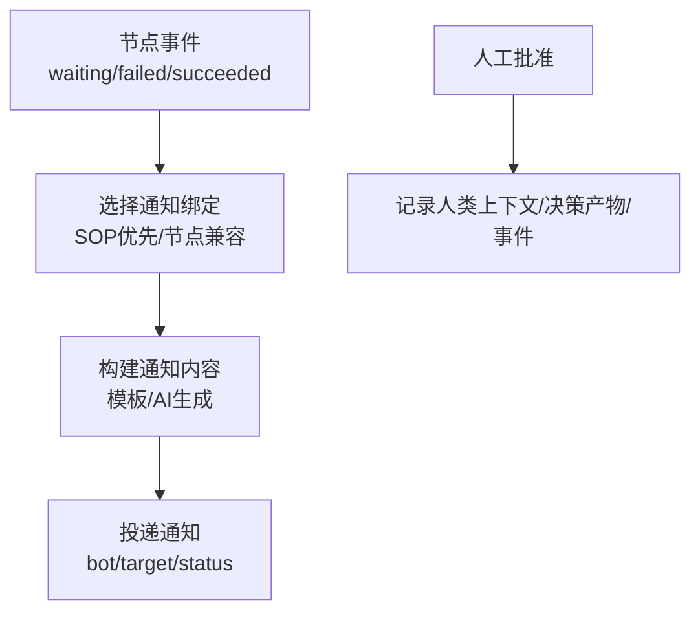
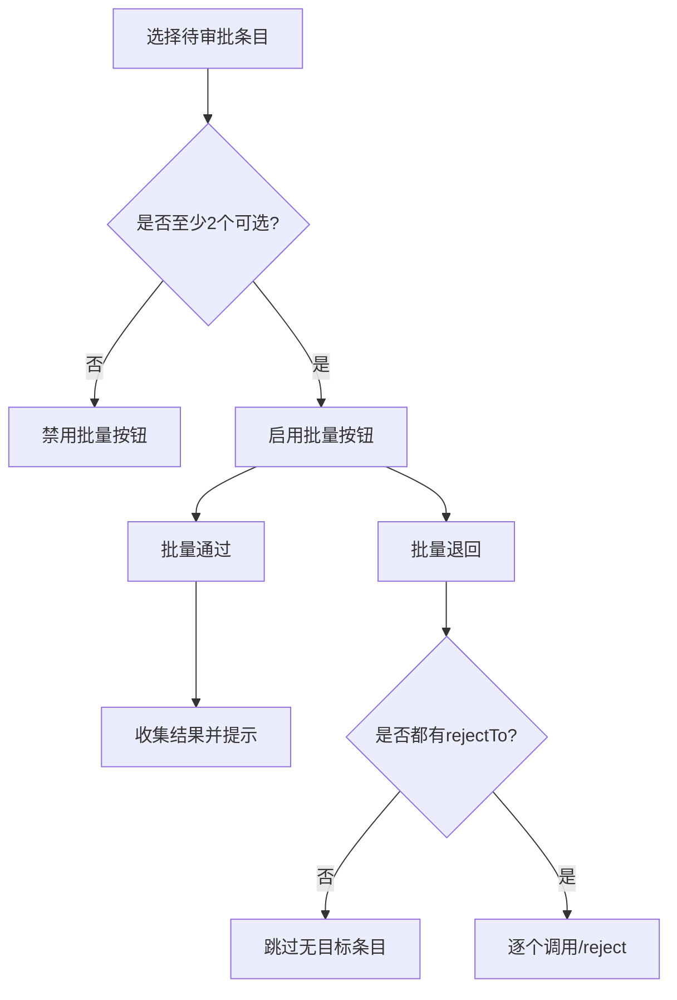
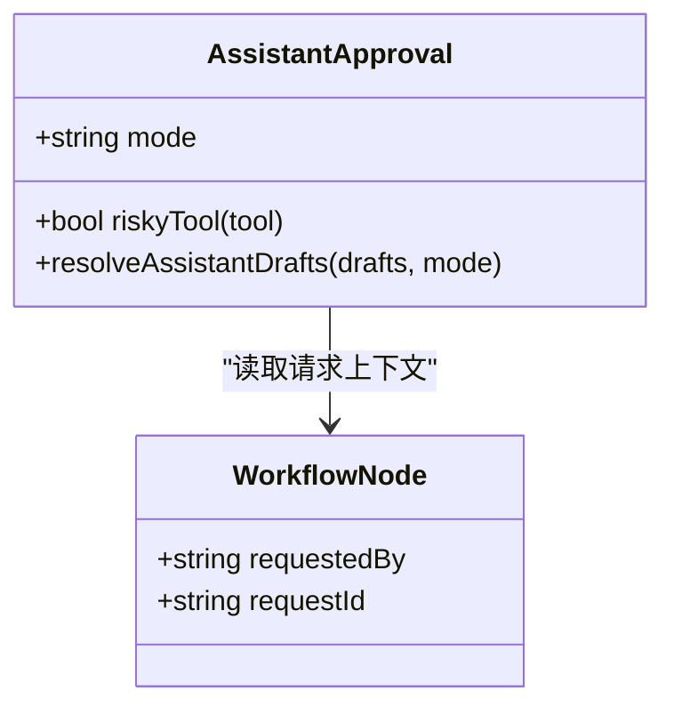
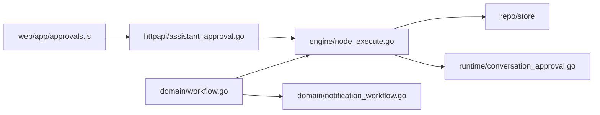

# 审批门禁节点

<cite>
**本文引用的文件**   
- [internal/domain/workflow.go](file://internal/domain/workflow.go)
- [internal/engine/node_execute.go](file://internal/engine/node_execute.go)
- [internal/engine/run_ops.go](file://internal/engine/run_ops.go)
- [internal/httpapi/assistant_approval.go](file://internal/httpapi/assistant_approval.go)
- [web/app/approvals.js](file://web/app/approvals.js)
- [internal/domain/notification_workflow.go](file://internal/domain/notification_workflow.go)
- [internal/domain/notification.go](file://internal/domain/notification.go)
- [internal/runtime/conversation_approval.go](file://internal/runtime/conversation_approval.go)
- [internal/engine/gate_test.go](file://internal/engine/gate_test.go)
- [internal/engine/run_ops_cases_test.go](file://internal/engine/run_ops_cases_test.go)
</cite>

## 目录
1. [简介](#简介)
2. [项目结构](#项目结构)
3. [核心组件](#核心组件)
4. [架构总览](#架构总览)
5. [详细组件分析](#详细组件分析)
6. [依赖关系分析](#依赖关系分析)
7. [性能与可扩展性](#性能与可扩展性)
8. [故障排查指南](#故障排查指南)
9. [结论](#结论)
10. [附录：配置示例与权限方案](#附录配置示例与权限方案)

## 简介
本文聚焦于 LoopForge 中的“人工审批门禁”（Approval Gate）能力，围绕以下目标展开：
- 解释审批门禁节点的配置项：审批人指定、审批条件、超时处理、自动决策规则。
- 说明审批流程的状态管理、通知机制、审批历史追踪与批量审批支持。
- 提供可操作的审批流程配置示例与权限控制方案。

在 LoopForge 中，SOP（标准作业流程）由多个节点组成，其中 type 为 approval 的节点即为人工审批门禁。当运行到达该节点时，引擎会暂停并等待人工确认；批准后继续执行下游节点，退回则回退到上游节点重做。

## 项目结构
与审批门禁相关的代码主要分布在以下模块：
- 领域模型：工作流定义、节点类型、通知绑定等。
- 引擎执行：节点调度、审批等待、批准/拒绝操作、事件记录。
- HTTP API：审批动作接口、助手草稿审批模式。
- Web 前端：待审批列表、批量审批、审批原因展示。
- 通知系统：SOP 完成报告、节点提醒、等待策略。
- 运行时网关：外部工具调用前的原生审批通道与超时重试。

**图表来源**
- [internal/domain/workflow.go:39-73](file://internal/domain/workflow.go#L39-L73)
- [internal/engine/node_execute.go:372-397](file://internal/engine/node_execute.go#L372-L397)
- [internal/engine/run_ops.go:140-175](file://internal/engine/run_ops.go#L140-L175)
- [internal/httpapi/assistant_approval.go:14-35](file://internal/httpapi/assistant_approval.go#L14-L35)
- [web/app/approvals.js:359-463](file://web/app/approvals.js#L359-L463)
- [internal/domain/notification_workflow.go:8-50](file://internal/domain/notification_workflow.go#L8-L50)
- [internal/domain/notification.go:27-79](file://internal/domain/notification.go#L27-L79)
- [internal/runtime/conversation_approval.go:146-224](file://internal/runtime/conversation_approval.go#L146-L224)

**章节来源**
- [internal/domain/workflow.go:39-73](file://internal/domain/workflow.go#L39-L73)
- [internal/engine/node_execute.go:372-397](file://internal/engine/node_execute.go#L372-L397)
- [internal/engine/run_ops.go:140-175](file://internal/engine/run_ops.go#L140-L175)
- [web/app/approvals.js:359-463](file://web/app/approvals.js#L359-L463)
- [internal/domain/notification_workflow.go:8-50](file://internal/domain/notification_workflow.go#L8-L50)
- [internal/domain/notification.go:27-79](file://internal/domain/notification.go#L27-L79)
- [internal/runtime/conversation_approval.go:146-224](file://internal/runtime/conversation_approval.go#L146-L224)

## 核心组件
- 工作流节点定义：approval 节点通过 WorkflowNode 描述，包含任务提示、拒绝回退目标、最大尝试次数、最大返工次数、通知配置等。
- 引擎执行器：在 executeNode 中识别 approval 节点，设置等待状态并进入 waitApproval；同时支持基线对齐场景的自动通过。
- 审批操作：Engine.Approve 将节点状态从 waiting_approval 改为 succeeded，记录人类上下文、决策产物和 gate.approved 事件。
- 助手草稿审批模式：confirm/assisted/auto 三种模式，决定平台写入或危险工具是否自动执行、独立审查或用户确认。
- 前端审批界面：展示待审批条目、审批原因、批量选择与批量通过/退回。
- 通知系统：SOP 完成报告与节点提醒，支持模板/AI 生成内容与等待策略。
- 运行时网关：外部工具调用前通过原生审批通道进行许可判断，具备超时与重试逻辑。

**章节来源**
- [internal/domain/workflow.go:39-73](file://internal/domain/workflow.go#L39-L73)
- [internal/engine/node_execute.go:372-397](file://internal/engine/node_execute.go#L372-L397)
- [internal/engine/run_ops.go:140-175](file://internal/engine/run_ops.go#L140-L175)
- [internal/httpapi/assistant_approval.go:14-35](file://internal/httpapi/assistant_approval.go#L14-L35)
- [web/app/approvals.js:359-463](file://web/app/approvals.js#L359-L463)
- [internal/domain/notification_workflow.go:8-50](file://internal/domain/notification_workflow.go#L8-L50)
- [internal/domain/notification.go:27-79](file://internal/domain/notification.go#L27-L79)
- [internal/runtime/conversation_approval.go:146-224](file://internal/runtime/conversation_approval.go#L146-L224)

## 架构总览
审批门禁的整体交互如下：
- SOP 运行到达 approval 节点后，引擎将其标记为 waiting_approval 并等待人工处理。
- 前端展示待审批卡片，支持查看审批原因、补充人类上下文、批量通过或退回。
- 后端 Approve 接口校验节点状态、记录决策产物与事件，推进流程。
- 通知系统根据 SOP 或节点配置生成完成报告与节点提醒。
- 外部工具调用可通过原生审批通道进行许可判断，具备超时与重试。

**图表来源**
- [internal/engine/node_execute.go:372-397](file://internal/engine/node_execute.go#L372-L397)
- [internal/engine/run_ops.go:140-175](file://internal/engine/run_ops.go#L140-L175)
- [web/app/approvals.js:359-463](file://web/app/approvals.js#L359-L463)
- [internal/domain/notification_workflow.go:8-50](file://internal/domain/notification_workflow.go#L8-L50)
- [internal/runtime/conversation_approval.go:146-224](file://internal/runtime/conversation_approval.go#L146-L224)

## 详细组件分析

### 审批门禁节点配置
- 节点类型：type=approval。
- 任务提示：taskPrompt，用于指导审批人检查的内容。
- 拒绝回退：rejectTo，指定不通过时回退的上游节点。
- 重试与返工：maxAttempts、maxReworks，控制节点尝试与上游返工次数。
- 通知配置：notifications，支持按节点或 SOP 级别配置通知绑定。
- 指标阶段：metricStage，用于统计归属（澄清/开发/测试/none）。

**图表来源**
- [internal/domain/workflow.go:39-73](file://internal/domain/workflow.go#L39-L73)

**章节来源**
- [internal/domain/workflow.go:39-73](file://internal/domain/workflow.go#L39-L73)

### 审批流程状态管理
- 初始状态：节点 pending → running → waiting_approval。
- 批准：节点状态变更为 succeeded，记录 FinishedAt、人类上下文与决策产物，触发 gate.approved 事件。
- 退回：上游节点被重新执行，下游重置；若未配置 rejectTo，则无法批量退回。
- 自动通过：基线对齐场景下，approval 节点可自动通过，无需人工确认。

**图表来源**
- [internal/engine/node_execute.go:372-397](file://internal/engine/node_execute.go#L372-L397)
- [internal/engine/run_ops.go:140-175](file://internal/engine/run_ops.go#L140-L175)

**章节来源**
- [internal/engine/node_execute.go:372-397](file://internal/engine/node_execute.go#L372-L397)
- [internal/engine/run_ops.go:140-175](file://internal/engine/run_ops.go#L140-L175)

### 审批条件与自动决策规则
- 基线对齐自动通过：当运行属于 align-only 场景时，approval 节点自动成功并记录 gate.auto_approved 事件。
- 助手草稿审批模式：
  - confirm：默认模式，所有平台写入或危险工具需用户确认。
  - assisted：独立模型审查通过后自动执行，否则降级为用户确认。
  - auto：全部草稿自动执行，但存在警告时降级为确认卡片。
- 危险工具分类：删除、发布、派发、启动类工具在 assisted 模式下被拦截转为草稿。

**图表来源**
- [internal/engine/node_execute.go:372-397](file://internal/engine/node_execute.go#L372-L397)
- [internal/httpapi/assistant_approval.go:14-35](file://internal/httpapi/assistant_approval.go#L14-L35)

**章节来源**
- [internal/engine/node_execute.go:372-397](file://internal/engine/node_execute.go#L372-L397)
- [internal/httpapi/assistant_approval.go:14-35](file://internal/httpapi/assistant_approval.go#L14-L35)

### 超时处理与重试
- 原生审批通道：外部工具调用前通过 AGENTFLOW_NATIVE_APPROVAL_URL 发起 RPC，支持超时、重试与不可用网关的降级处理。
- 前端批量审批：对同一组运行串行调用 /approve 或 /reject，逐条收集结果，不合并、不跳过校验。
- 节点重试与返工：maxAttempts 与 maxReworks 控制节点尝试次数与上游返工次数。

**图表来源**
- [internal/runtime/conversation_approval.go:146-224](file://internal/runtime/conversation_approval.go#L146-L224)
- [web/app/approvals.js:359-463](file://web/app/approvals.js#L359-L463)

**章节来源**
- [internal/runtime/conversation_approval.go:146-224](file://internal/runtime/conversation_approval.go#L146-L224)
- [web/app/approvals.js:359-463](file://web/app/approvals.js#L359-L463)

### 通知机制与审批历史追踪
- SOP 完成报告：根据 WorkflowDefinition.Notifications 或节点 Notifications 选择 Bot，生成完成报告，内容模式支持模板或 AI 生成。
- 节点提醒：针对 waiting/failed 状态生成 actionable 提醒，模板包含状态、需求、SOP、节点与错误信息。
- 审批历史：Approve 操作记录人类上下文、决策产物 decision.md 与 gate.approved 事件，便于审计与回溯。

**图表来源**
- [internal/domain/notification_workflow.go:8-50](file://internal/domain/notification_workflow.go#L8-L50)
- [internal/domain/notification.go:27-79](file://internal/domain/notification.go#L27-L79)
- [internal/engine/run_ops.go:140-175](file://internal/engine/run_ops.go#L140-L175)

**章节来源**
- [internal/domain/notification_workflow.go:8-50](file://internal/domain/notification_workflow.go#L8-L50)
- [internal/domain/notification.go:27-79](file://internal/domain/notification.go#L27-L79)
- [internal/engine/run_ops.go:140-175](file://internal/engine/run_ops.go#L140-L175)

### 批量审批支持
- 前端批量选择：基于运行 ID 与节点 ID 的组合键维护选中集合，至少两个可选条目才启用批量操作。
- 批量通过：对选中的运行逐个调用 /approve，收集成功与失败结果并提示。
- 批量退回：仅当每个运行都配置了 rejectTo 时才允许批量退回，否则提示跳过无目标的条目。

**图表来源**
- [web/app/approvals.js:359-463](file://web/app/approvals.js#L359-L463)

**章节来源**
- [web/app/approvals.js:359-463](file://web/app/approvals.js#L359-L463)

### 权限控制方案
- 审批人指定：通过 WorkflowNode.RequestedBy 与 RequestID 字段表达请求方与请求标识，结合项目角色与 SOP 配置确定审批人范围。
- 助手草稿审批：assisted 模式使用独立模型审查危险工具，auto 模式自动执行但保留警告降级；confirm 模式始终需要用户确认。
- 运行与工作区绑定：Approve 操作在工作区绑定的实例上执行，避免跨实例误批。

**图表来源**
- [internal/httpapi/assistant_approval.go:14-35](file://internal/httpapi/assistant_approval.go#L14-L35)
- [internal/domain/workflow.go:39-73](file://internal/domain/workflow.go#L39-L73)

**章节来源**
- [internal/httpapi/assistant_approval.go:14-35](file://internal/httpapi/assistant_approval.go#L14-L35)
- [internal/domain/workflow.go:39-73](file://internal/domain/workflow.go#L39-L73)

## 依赖关系分析
- 领域模型依赖：WorkflowNode 与 NotificationBinding 为审批门禁的基础数据结构。
- 引擎依赖：executeNode 依赖 domain.WorkflowNode 与 runtime 环境准备；Approve 依赖 repo 存储与事件系统。
- HTTP API 依赖：assistant_approval 依赖 repo 查询与 assistantDraft 解析。
- 前端依赖：approvals.js 依赖运行快照与审批接口。
- 通知依赖：notification_workflow 依赖 WorkflowDefinition 与 Run 快照。
- 运行时依赖：conversation_approval 依赖环境变量与 HTTP 客户端。

**图表来源**
- [internal/domain/workflow.go:39-73](file://internal/domain/workflow.go#L39-L73)
- [internal/engine/node_execute.go:372-397](file://internal/engine/node_execute.go#L372-L397)
- [internal/domain/notification_workflow.go:8-50](file://internal/domain/notification_workflow.go#L8-L50)
- [internal/httpapi/assistant_approval.go:14-35](file://internal/httpapi/assistant_approval.go#L14-L35)
- [web/app/approvals.js:359-463](file://web/app/approvals.js#L359-L463)
- [internal/runtime/conversation_approval.go:146-224](file://internal/runtime/conversation_approval.go#L146-L224)

**章节来源**
- [internal/domain/workflow.go:39-73](file://internal/domain/workflow.go#L39-L73)
- [internal/engine/node_execute.go:372-397](file://internal/engine/node_execute.go#L372-L397)
- [internal/domain/notification_workflow.go:8-50](file://internal/domain/notification_workflow.go#L8-L50)
- [internal/httpapi/assistant_approval.go:14-35](file://internal/httpapi/assistant_approval.go#L14-L35)
- [web/app/approvals.js:359-463](file://web/app/approvals.js#L359-L463)
- [internal/runtime/conversation_approval.go:146-224](file://internal/runtime/conversation_approval.go#L146-L224)

## 性能与可扩展性
- 并发执行：引擎并行执行就绪节点，审批门禁作为同步点确保人工介入。
- 观察与事件：审批操作触发 gate.approved 事件，便于观测与审计。
- 通知预算：SOP 完成报告按节点数量分配 AI 预算，避免单次生成过长。
- 重试与恢复：原生审批通道具备超时与重试逻辑，提升稳定性。

[本节为通用指导，不涉及具体文件分析]

## 故障排查指南
- 节点未处于 waiting_approval：Approve 接口会返回错误，需确认节点状态与期望。
- 工作区绑定限制：当前实例非工作区绑定实例时，Approve 会提示需在绑定实例上审批。
- 缺少 rejectTo：批量退回时需要每个运行都配置上游目标，否则跳过。
- 通知未送达：检查 NotificationBinding 的 botId、events、scope 与 contentMode 配置。
- 原生审批通道不可用：检查 AGENTFLOW_NATIVE_APPROVAL_URL 与网络连通性，关注超时与重试日志。

**章节来源**
- [internal/engine/run_ops.go:140-175](file://internal/engine/run_ops.go#L140-L175)
- [web/app/approvals.js:359-463](file://web/app/approvals.js#L359-L463)
- [internal/domain/notification_workflow.go:8-50](file://internal/domain/notification_workflow.go#L8-L50)
- [internal/runtime/conversation_approval.go:146-224](file://internal/runtime/conversation_approval.go#L146-L224)

## 结论
LoopForge 的人工审批门禁以 WorkflowNode.type=approval 为核心，配合引擎的状态机、通知系统与前端批量操作，形成完整的人工干预闭环。通过 taskPrompt、rejectTo、maxAttempts、maxReworks 等配置项，可灵活定义审批条件与回退策略；通过 confirm/assisted/auto 助手草稿审批模式，可实现不同风险级别的自动化与人工审查平衡。原生审批通道的超时与重试机制进一步提升了系统的健壮性。

[本节为总结性内容，不涉及具体文件分析]

## 附录：配置示例与权限方案

### 审批流程配置示例
- 基本审批门禁：
  - 节点：{id: "gate", type: "approval", taskPrompt: "检查测试报告与改动范围", rejectTo: "fix", maxAttempts: 1}
  - 边：fix → gate → after
- 带返工的审批门禁：
  - 节点：{id: "review", type: "approval", rejectTo: "implement", maxReworks: 2}
- 通知配置：
  - SOP 级别：Notifications[0].botId="xxx", events=["succeeded"], scope="run", contentMode="ai"
  - 节点级别：notifications[0].scope="node", events=["waiting","failed"], template="模板内容"

**章节来源**
- [internal/domain/workflow.go:39-73](file://internal/domain/workflow.go#L39-L73)
- [internal/domain/notification_workflow.go:8-50](file://internal/domain/notification_workflow.go#L8-L50)

### 权限控制方案
- 审批人指定：在 WorkflowNode 中使用 requestedBy 与 requestId 表达请求上下文，结合项目角色与 SOP 配置确定审批人范围。
- 助手草稿审批：
  - confirm：默认模式，所有平台写入或危险工具需用户确认。
  - assisted：独立模型审查通过后自动执行，否则降级为用户确认。
  - auto：全部草稿自动执行，但存在警告时降级为确认卡片。
- 运行与工作区绑定：Approve 操作在工作区绑定的实例上执行，避免跨实例误批。

**章节来源**
- [internal/httpapi/assistant_approval.go:14-35](file://internal/httpapi/assistant_approval.go#L14-L35)
- [internal/domain/workflow.go:39-73](file://internal/domain/workflow.go#L39-L73)
- [internal/engine/run_ops.go:140-175](file://internal/engine/run_ops.go#L140-L175)