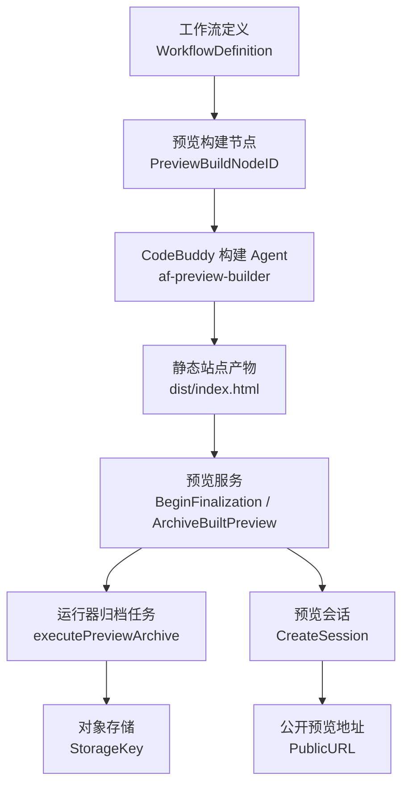
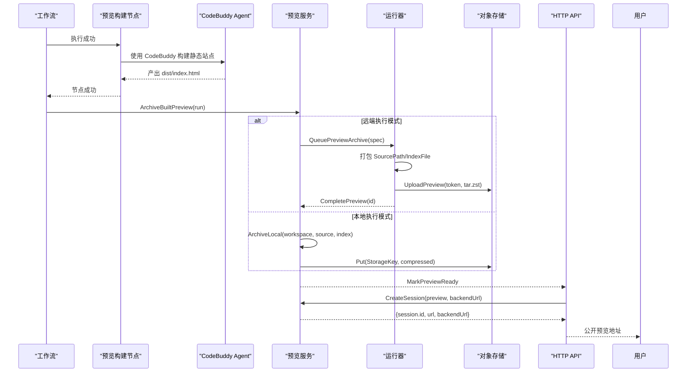
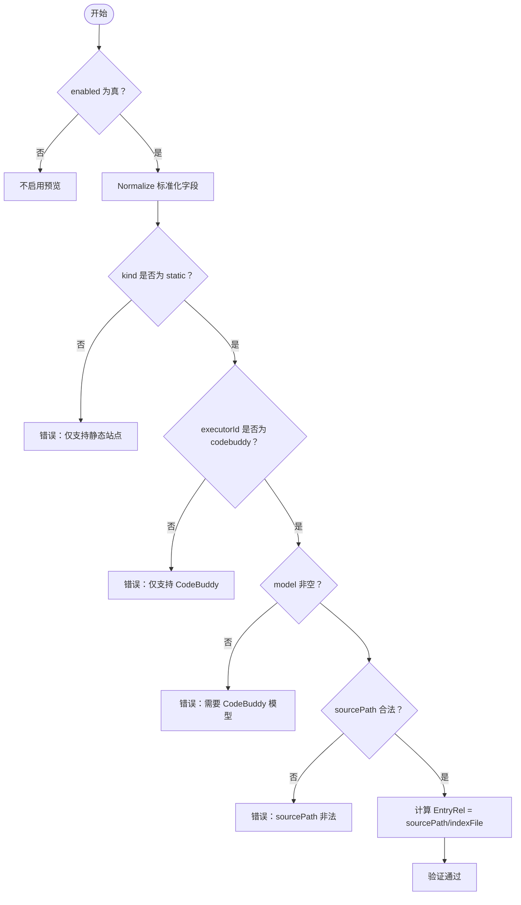
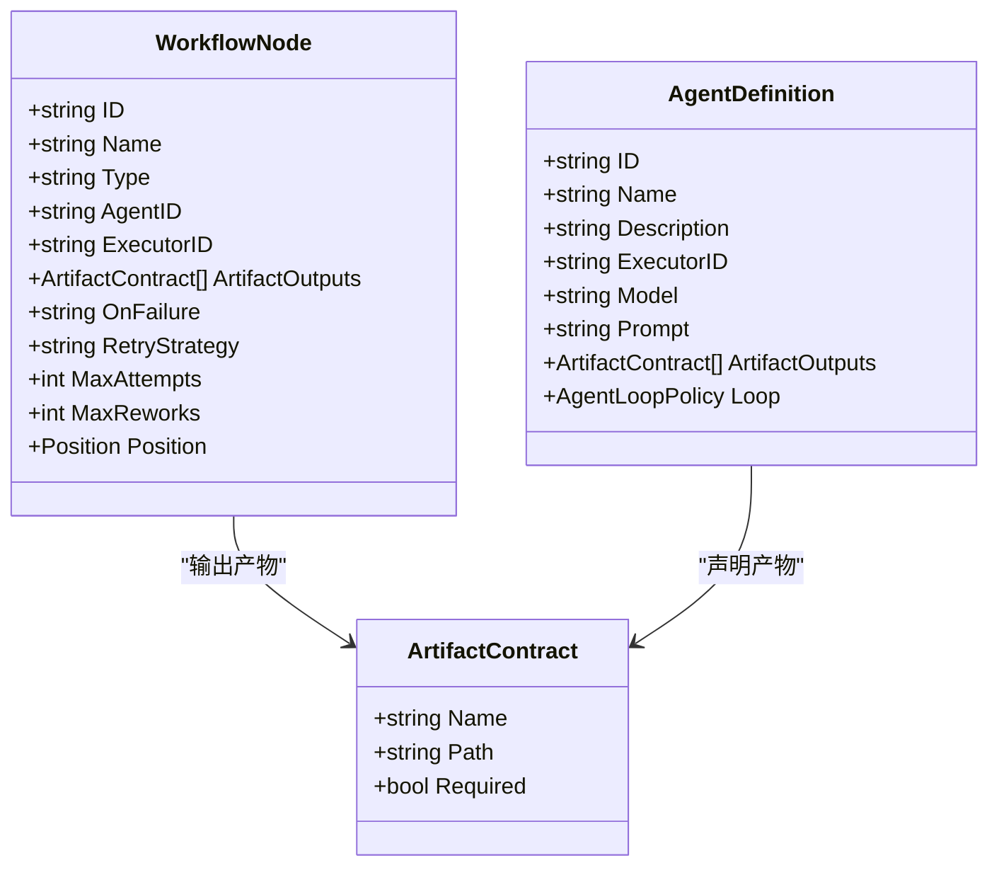
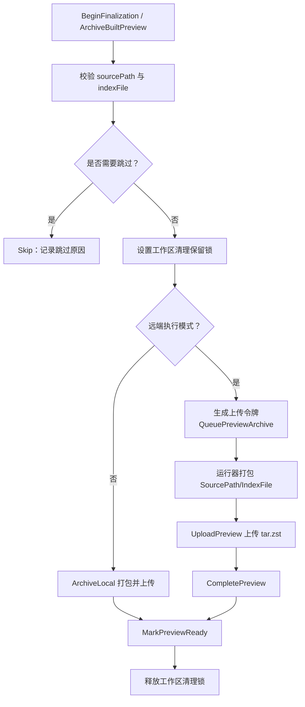
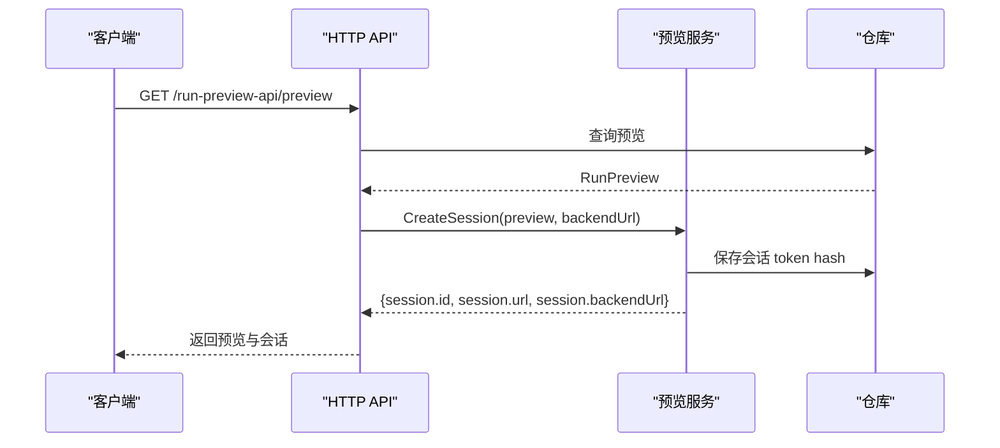
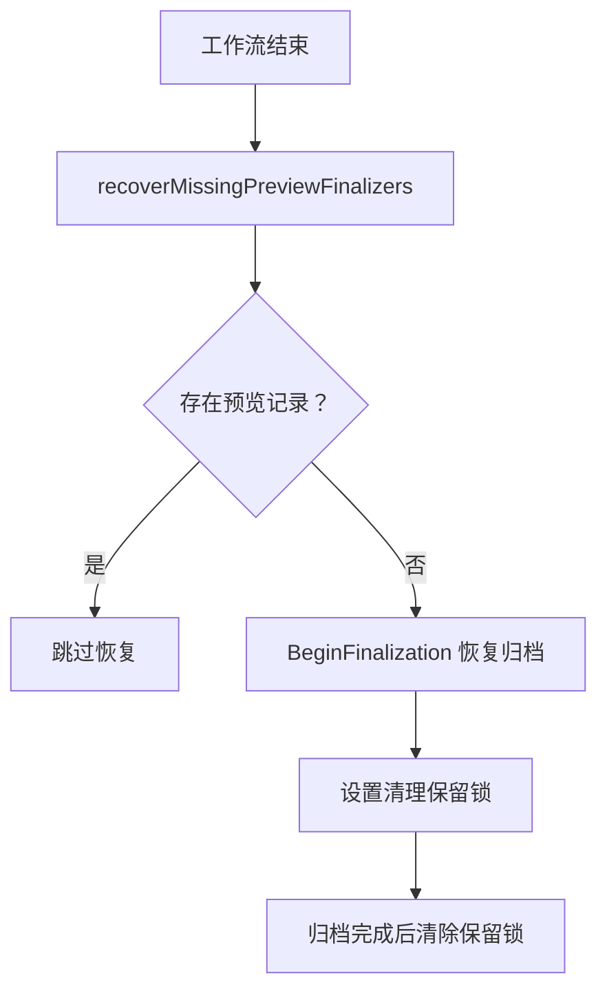
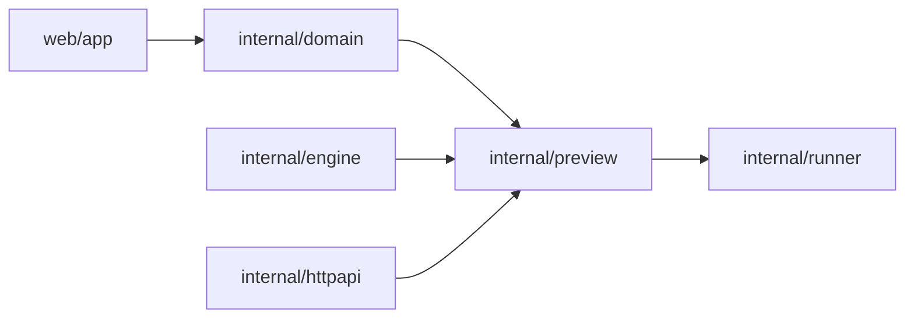

# 预览构建节点

<cite>
**本文引用的文件**   
- [internal/domain/preview.go](file://internal/domain/preview.go)
- [internal/domain/preview_build.go](file://internal/domain/preview_build.go)
- [internal/preview/service.go](file://internal/preview/service.go)
- [internal/runner/preview_archive.go](file://internal/runner/preview_archive.go)
- [internal/engine/workspace_cleanup.go](file://internal/engine/workspace_cleanup.go)
- [internal/httpapi/run_preview.go](file://internal/httpapi/run_preview.go)
- [web/app/flows.js](file://web/app/flows.js)
</cite>

## 目录
1. [简介](#简介)
2. [项目结构](#项目结构)
3. [核心组件](#核心组件)
4. [架构总览](#架构总览)
5. [详细组件分析](#详细组件分析)
6. [依赖关系分析](#依赖关系分析)
7. [性能与限制](#性能与限制)
8. [故障排查](#故障排查)
9. [结论](#结论)
10. [附录：配置示例与常见问题](#附录配置示例与常见问题)

## 简介
本文聚焦“预览构建节点”这一特殊静态站点构建能力，说明它在工作流中的注入方式、产物路径约定、构建环境约束、预览归档流程、预览地址生成机制以及常见问题的定位方法。该能力默认仅支持静态站点，并通过 CodeBuddy 执行器驱动 Agent 完成生产构建，随后由预览服务将产物打包、上传并对外提供带会话令牌的预览访问地址。

## 项目结构
预览构建相关代码分布在领域模型、预览服务、运行器归档和引擎清理等模块中：
- 领域模型定义预览契约、预览状态、预览会话、归档规格等数据结构。
- 预览服务负责生命周期管理、本地或远程归档、会话创建与地址生成。
- 运行器负责在远端执行机安全地打包并上传预览产物。
- 引擎在工作流结束时触发预览归档，并在清理工作区时保留必要的快照。
- Web 前端为预览构建节点提供可视化配置入口。

**图表来源**
- [internal/domain/preview.go:36-43](file://internal/domain/preview.go#L36-L43)
- [internal/domain/preview_build.go:60-97](file://internal/domain/preview_build.go#L60-L97)
- [internal/preview/service.go:75-214](file://internal/preview/service.go#L75-L214)
- [internal/runner/preview_archive.go:15-56](file://internal/runner/preview_archive.go#L15-L56)
- [internal/httpapi/run_preview.go:176-194](file://internal/httpapi/run_preview.go#L176-L194)

**章节来源**
- [internal/domain/preview.go:11-60](file://internal/domain/preview.go#L11-L60)
- [internal/domain/preview_build.go:8-78](file://internal/domain/preview_build.go#L8-L78)
- [internal/preview/service.go:21-56](file://internal/preview/service.go#L21-L56)
- [internal/runner/preview_archive.go:1-13](file://internal/runner/preview_archive.go#L1-L13)
- [web/app/flows.js:990-1003](file://web/app/flows.js#L990-L1003)

## 核心组件
- 预览契约（PreviewContract）：描述是否启用预览、站点类型、执行器、模型、源目录、入口文件、SPA 回退、保留时长等。
- 预览构建节点（PreviewBuildNodeID）：系统自动注入的 Agent 节点，用于用 CodeBuddy 构建静态站点。
- 预览服务（Preview Service）：负责记录待归档预览、调度本地或远端归档、标记就绪、创建会话、生成公开地址。
- 运行器归档（Runner Preview Archive）：在远端执行机安全打包并上传预览产物。
- 工作区清理恢复（Workspace Cleanup Recovery）：确保预览归档期间不提前删除工作区，并在崩溃后恢复缺失的归档任务。

**章节来源**
- [internal/domain/preview.go:45-69](file://internal/domain/preview.go#L45-L69)
- [internal/domain/preview_build.go:30-78](file://internal/domain/preview_build.go#L30-L78)
- [internal/preview/service.go:75-214](file://internal/preview/service.go#L75-L214)
- [internal/runner/preview_archive.go:15-56](file://internal/runner/preview_archive.go#L15-L56)
- [internal/engine/workspace_cleanup.go:120-154](file://internal/engine/workspace_cleanup.go#L120-L154)

## 架构总览
预览构建节点的生命周期分为三个阶段：
1. 构建阶段：工作流成功到达预览构建节点，CodeBuddy Agent 根据提示完成静态站点构建，产出约定目录与入口文件。
2. 归档阶段：预览服务根据工作流快照中的预览契约，将工作区中的静态站点打包、校验并上传到对象存储。
3. 预览阶段：用户通过 API 创建预览会话，服务返回带令牌的外部可访问地址；浏览器加载页面后，可通过网关拦截后端请求。

**图表来源**
- [internal/domain/preview_build.go:80-129](file://internal/domain/preview_build.go#L80-L129)
- [internal/preview/service.go:82-214](file://internal/preview/service.go#L82-L214)
- [internal/runner/preview_archive.go:15-56](file://internal/runner/preview_archive.go#L15-L56)
- [internal/httpapi/run_preview.go:176-194](file://internal/httpapi/run_preview.go#L176-L194)

## 详细组件分析

### 预览契约与产物路径
预览契约决定预览行为的关键字段：
- enabled：是否启用预览。
- kind：当前仅支持 static。
- executorId：当前仅支持 codebuddy。
- model：必须指定 CodeBuddy 模型。
- sourcePath：相对于工作区的静态站点目录，默认 dist。
- indexFile：入口文件，默认 index.html。
- spaFallback：找不到路由时是否返回入口 HTML。
- retentionSec：预览保留时长上限受系统常量限制。

产物入口相对路径由 sourcePath 与 indexFile 组合而成，例如 dist/index.html。

**图表来源**
- [internal/domain/preview.go:133-164](file://internal/domain/preview.go#L133-L164)
- [internal/domain/preview.go:129-131](file://internal/domain/preview.go#L129-L131)

**章节来源**
- [internal/domain/preview.go:45-69](file://internal/domain/preview.go#L45-L69)
- [internal/domain/preview.go:88-131](file://internal/domain/preview.go#L88-L131)
- [internal/domain/preview.go:147-164](file://internal/domain/preview.go#L147-L164)

### 预览构建节点注入与 Agent 提示
当预览契约有效且为静态站点时，系统会在工作流中注入一个名为“构建静态站点”的 Agent 节点：
- 节点 ID 固定为 PreviewBuildNodeID。
- 执行器为 codebuddy。
- 输出产物契约指向 EntryRel。
- 失败策略为 fail，重试策略为 targeted_fix，最多尝试次数与重做次数有限制。
- 若未显式放置该节点，系统会在所有成功出口之后追加它。

Agent 的提示词强制要求：
- 识别现有前端工程，不要另起项目。
- 安装依赖并执行生产构建，不启动开发服务器。
- 资源根必须使用相对路径，禁止绝对网站根路径。
- 最终静态文件放在 sourcePath 下，入口必须是 indexFile。
- 不得修改 git remote 或提交无关文件。

**图表来源**
- [internal/domain/preview_build.go:60-97](file://internal/domain/preview_build.go#L60-L97)
- [internal/domain/preview_build.go:99-129](file://internal/domain/preview_build.go#L99-L129)

**章节来源**
- [internal/domain/preview_build.go:30-78](file://internal/domain/preview_build.go#L30-L78)
- [internal/domain/preview_build.go:80-129](file://internal/domain/preview_build.go#L80-L129)
- [web/app/flows.js:990-1003](file://web/app/flows.js#L990-L1003)

### 预览归档与上传流程
预览服务在以下时机介入：
- 工作流结束但尚未清理工作区时，调用 BeginFinalization。
- 预览构建节点成功后，调用 ArchiveBuiltPreview。

归档流程包括：
- 校验 sourcePath 与 indexFile。
- 判断是否跳过（工作区无前端工程）。
- 设置工作区清理保留锁，防止提前删除。
- 远端模式下，生成上传令牌并排队运行器归档任务。
- 本地模式下，直接打包并上传到对象存储。
- 成功后标记预览就绪，释放工作区清理锁。

**图表来源**
- [internal/preview/service.go:75-214](file://internal/preview/service.go#L75-L214)
- [internal/runner/preview_archive.go:15-56](file://internal/runner/preview_archive.go#L15-L56)

**章节来源**
- [internal/preview/service.go:75-214](file://internal/preview/service.go#L75-L214)
- [internal/runner/preview_archive.go:15-56](file://internal/runner/preview_archive.go#L15-L56)

### 预览地址生成与会话机制
预览就绪后，HTTP API 暴露接口供前端获取预览信息并创建会话：
- 查询预览状态，若已就绪则创建会话。
- 会话包含 id、previewId、url、backendUrl、expiresAt。
- PublicURL 基于请求头与配置生成 scheme 与 host，拼接预览路径令牌。
- BackendURL 可为空或由用户在打开预览时传入，经 NormalizePreviewBackendURL 校验。

**图表来源**
- [internal/httpapi/run_preview.go:176-194](file://internal/httpapi/run_preview.go#L176-L194)
- [internal/preview/service.go:589-621](file://internal/preview/service.go#L589-L621)
- [internal/preview/service.go:697-722](file://internal/preview/service.go#L697-L722)

**章节来源**
- [internal/httpapi/run_preview.go:176-194](file://internal/httpapi/run_preview.go#L176-L194)
- [internal/preview/service.go:589-621](file://internal/preview/service.go#L589-L621)
- [internal/preview/service.go:697-722](file://internal/preview/service.go#L697-L722)

### 工作区清理与恢复
预览归档期间，系统会设置工作区清理保留锁，避免在归档未完成前删除工作区：
- BeginFinalization 写入预览记录并设置清理保留时间。
- 归档成功后清除保留锁并释放工作区。
- 引擎在终端工作区清理前恢复缺失的预览归档任务，防止崩溃窗口导致遗漏。

**图表来源**
- [internal/engine/workspace_cleanup.go:120-154](file://internal/engine/workspace_cleanup.go#L120-L154)
- [internal/preview/service.go:171-176](file://internal/preview/service.go#L171-L176)
- [internal/preview/service.go:346-382](file://internal/preview/service.go#L346-L382)

**章节来源**
- [internal/engine/workspace_cleanup.go:120-154](file://internal/engine/workspace_cleanup.go#L120-L154)
- [internal/preview/service.go:171-176](file://internal/preview/service.go#L171-L176)
- [internal/preview/service.go:346-382](file://internal/preview/service.go#L346-L382)

## 依赖关系分析
- 领域层（domain）：定义预览契约、节点与 Agent 构造、状态常量。
- 预览服务（preview）：实现归档、会话、地址生成、清理协调。
- 运行器（runner）：在远端执行机执行归档任务，安全打包并上传。
- 引擎（engine）：在工作流生命周期中触发预览归档与工作区清理恢复。
- HTTP API（httpapi）：对外暴露预览查询与会话创建接口。
- Web 前端（web）：提供预览构建节点的可视化配置。

**图表来源**
- [internal/domain/preview.go:11-69](file://internal/domain/preview.go#L11-L69)
- [internal/domain/preview_build.go:8-97](file://internal/domain/preview_build.go#L8-L97)
- [internal/preview/service.go:21-56](file://internal/preview/service.go#L21-L56)
- [internal/runner/preview_archive.go:1-13](file://internal/runner/preview_archive.go#L1-L13)
- [internal/engine/workspace_cleanup.go:120-154](file://internal/engine/workspace_cleanup.go#L120-L154)
- [internal/httpapi/run_preview.go:176-194](file://internal/httpapi/run_preview.go#L176-L194)
- [web/app/flows.js:990-1003](file://web/app/flows.js#L990-L1003)

**章节来源**
- [internal/domain/preview.go:11-69](file://internal/domain/preview.go#L11-L69)
- [internal/domain/preview_build.go:8-97](file://internal/domain/preview_build.go#L8-L97)
- [internal/preview/service.go:21-56](file://internal/preview/service.go#L21-L56)
- [internal/runner/preview_archive.go:1-13](file://internal/runner/preview_archive.go#L1-L13)
- [internal/engine/workspace_cleanup.go:120-154](file://internal/engine/workspace_cleanup.go#L120-L154)
- [internal/httpapi/run_preview.go:176-194](file://internal/httpapi/run_preview.go#L176-L194)
- [web/app/flows.js:990-1003](file://web/app/flows.js#L990-L1003)

## 性能与限制
- 预览保留时长受系统最大保留秒数限制，超出将被截断。
- 上传大小与文件数量受 Limits 控制，超过限制会拒绝归档。
- 预览会话具有过期时间，需定期续期。
- 远端归档通过管道流式上传，避免大文件阻塞 JSON 传输。
- 本地归档使用临时文件与压缩格式，完成后写入对象存储。

[本节为通用指导，不直接分析具体文件]

## 故障排查
- 预览未启用或类型不是 static：检查 PreviewContract.Enabled 与 Kind。
- 执行器不是 codebuddy 或未指定模型：检查 ExecutorID 与 Model。
- sourcePath 非法：不能包含 .. 或以 / 开头。
- 工作区没有前端工程：预览服务会跳过并记录原因。
- 入口文件缺失：归档时会报错，可能触发跳过逻辑。
- 上传令牌不匹配或过期：检查预览记录的 UploadTokenHash 与 UploadExpiresAt。
- 预览地址不可访问：确认 PublicURL 生成的 scheme/host 与反向代理配置一致。
- 工作区被提前清理：检查清理保留锁是否正确设置与释放。

**章节来源**
- [internal/domain/preview.go:147-164](file://internal/domain/preview.go#L147-L164)
- [internal/preview/service.go:384-406](file://internal/preview/service.go#L384-L406)
- [internal/preview/service.go:294-344](file://internal/preview/service.go#L294-L344)
- [internal/preview/service.go:697-722](file://internal/preview/service.go#L697-L722)
- [internal/engine/workspace_cleanup.go:120-154](file://internal/engine/workspace_cleanup.go#L120-L154)

## 结论
预览构建节点将静态站点构建从手写脚本中解放出来，通过 CodeBuddy Agent 与预览服务协作，形成从构建、归档到预览访问的完整闭环。其关键保障包括严格的契约校验、安全的远端归档、清晰的工作区清理保护以及稳定的会话与地址生成机制。正确配置 sourcePath、indexFile、model 与 executorId，是保证预览构建稳定运行的基础。

[本节为总结性内容，不直接分析具体文件]

## 附录：配置示例与常见问题

### 预览构建节点配置要点
- 启用预览：在 SOP 中勾选前端预览。
- 选择 CodeBuddy 模型：必填。
- 单页应用回退：可选，开启后找不到路由时返回入口 HTML。
- 产物目录与入口：默认 dist/index.html，可在预览契约中调整。
- 后端地址：打开预览时可传入，用于网关拦截后端请求。

**章节来源**
- [web/app/flows.js:990-1003](file://web/app/flows.js#L990-L1003)
- [internal/domain/preview.go:45-69](file://internal/domain/preview.go#L45-L69)
- [internal/domain/preview.go:176-189](file://internal/domain/preview.go#L176-L189)

### 常见问题解决方案
- 构建产物不在 dist/index.html：检查构建工具 base/publicPath 配置，确保资源路径为相对路径。
- 预览显示空白或资源 404：确认入口与 chunk 的资源地址为相对路径，不要写死网站根路径。
- 预览被跳过：检查工作区是否存在前端工程或入口文件。
- 预览地址无效：确认 PublicURL 的 scheme/host 与部署环境一致，检查反向代理转发头。
- 预览上传失败：检查运行器权限、上传令牌有效期与对象存储可用性。

**章节来源**
- [internal/domain/preview_build.go:107-129](file://internal/domain/preview_build.go#L107-L129)
- [internal/preview/service.go:384-406](file://internal/preview/service.go#L384-L406)
- [internal/preview/service.go:697-722](file://internal/preview/service.go#L697-L722)
- [internal/runner/preview_archive.go:15-56](file://internal/runner/preview_archive.go#L15-L56)