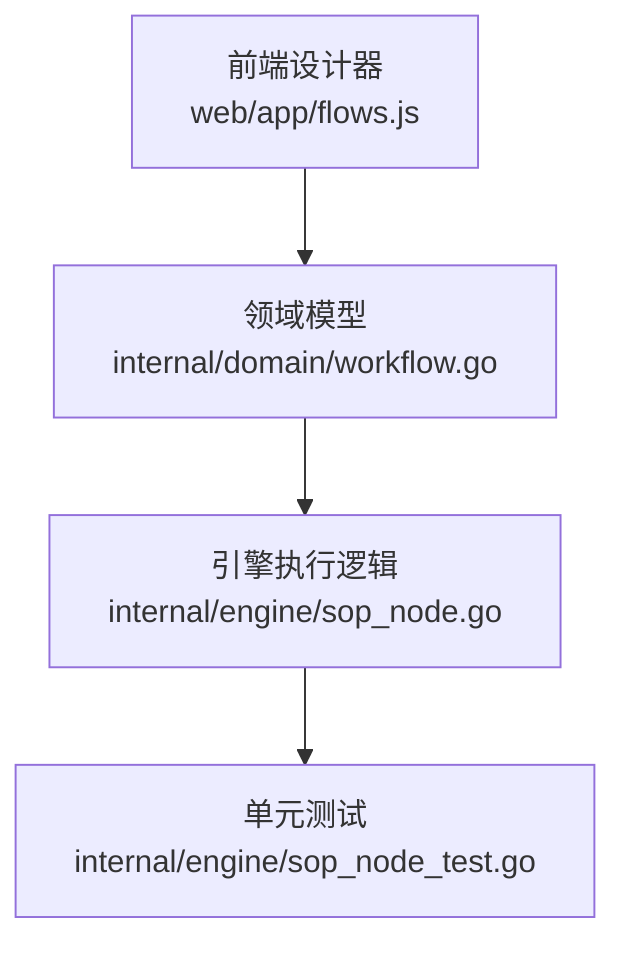
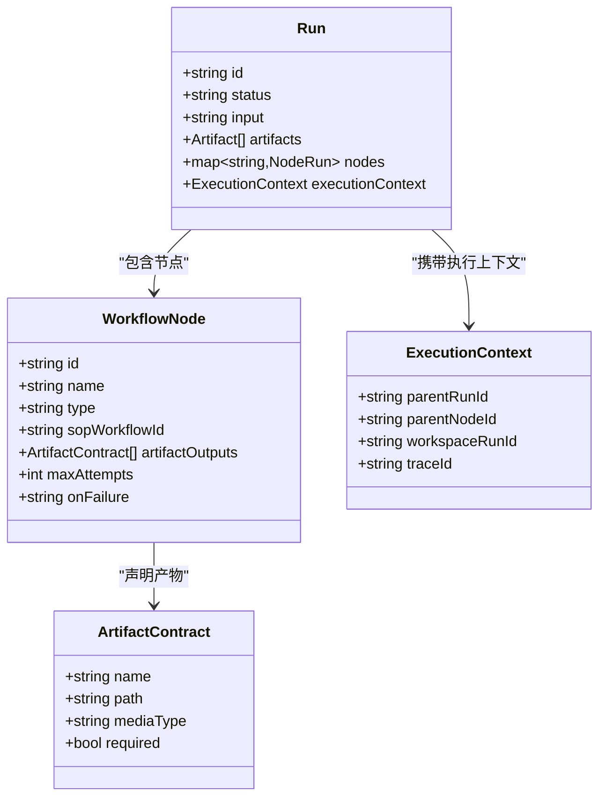
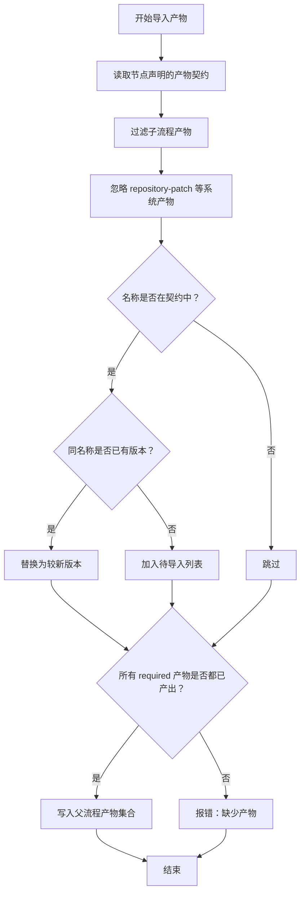
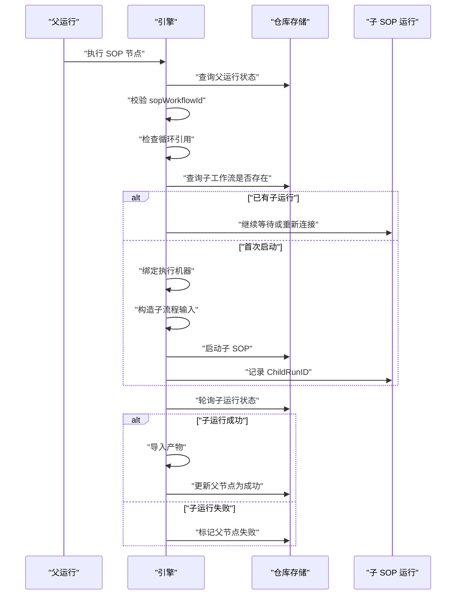
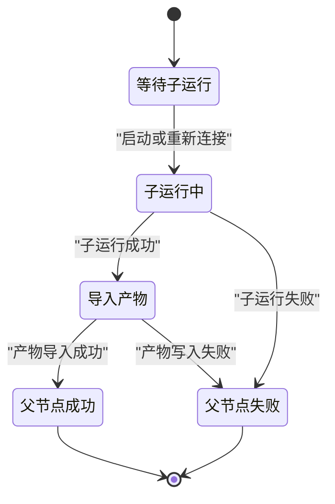
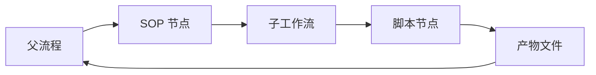
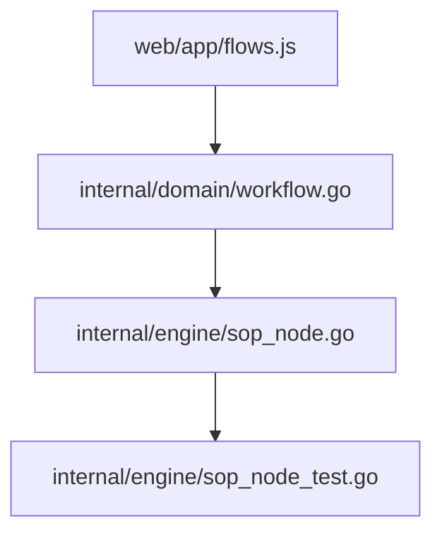

# SOP 节点

<cite>
**本文引用的文件**   
- [sop_node.go](file://internal/engine/sop_node.go)
- [workflow.go](file://internal/domain/workflow.go)
- [flows.js](file://web/app/flows.js)
- [sop_node_test.go](file://internal/engine/sop_node_test.go)
</cite>

## 目录
1. [简介](#简介)
2. [项目结构定位](#项目结构定位)
3. [核心概念与数据模型](#核心概念与数据模型)
4. [SOP 节点配置选项详解](#sop-节点配置选项详解)
5. [子流程调用执行流程](#子流程调用执行流程)
6. [产物映射与数据流转机制](#产物映射与数据流转机制)
7. [参数传递规则](#参数传递规则)
8. [错误传播与重试语义](#错误传播与重试语义)
9. [嵌套工作流示例与复杂场景](#嵌套工作流示例与复杂场景)
10. [依赖关系分析](#依赖关系分析)
11. [性能与稳定性特征](#性能与稳定性特征)
12. [故障排查指南](#故障排查指南)
13. [最佳实践建议](#最佳实践建议)
14. [结论](#结论)

## 简介
SOP 节点是 LoopForge 工作流中的一种“子流程调用”节点。它不直接执行业务脚本，而是引用另一个已发布的 SOP 工作流，并在父流程中等待其完成，再把子流程产出的“产物”导入到父流程，供后续节点使用。该机制支持：
- 通过 `sopWorkflowId` 引用其他 SOP；
- 通过 `artifactOutputs` 声明并约束子流程需要交付的产物；
- 将上游节点的上下文和产物以提示文本的方式传递给子流程；
- 在失败、暂停、取消、重跑等生命周期中保持父子运行状态一致；
- 防止循环引用和过深嵌套。

## 项目结构定位
SOP 节点涉及前端设计器、领域模型和引擎执行三个层面：
- 前端设计器负责让用户选择 `sopWorkflowId`、维护 `artifactOutputs` 列表，并在保存时把节点定义写入工作流；
- 领域模型定义了 `WorkflowNode`、`ArtifactContract` 等数据结构；
- 引擎在执行阶段解析节点、启动子运行、等待结果、导入产物并更新父节点状态。

**图表来源**
- [flows.js:1040-1065](file://web/app/flows.js#L1040-L1065)
- [workflow.go:39-94](file://internal/domain/workflow.go#L39-L94)
- [sop_node.go:18-155](file://internal/engine/sop_node.go#L18-L155)

**章节来源**
- [flows.js:1040-1065](file://web/app/flows.js#L1040-L1065)
- [workflow.go:39-94](file://internal/domain/workflow.go#L39-L94)
- [sop_node.go:18-155](file://internal/engine/sop_node.go#L18-L155)

## 核心概念与数据模型
SOP 节点的核心数据集中在两个结构中：

| 概念 | 字段或含义 | 说明 |
|---|---|---|
| `WorkflowNode` | `type` | 节点类型，SOP 节点为 `sop` |
| `WorkflowNode` | `sopWorkflowId` | 被调用的子 SOP 工作流 ID |
| `WorkflowNode` | `artifactOutputs` | 本节点期望子流程交付的产物契约 |
| `ArtifactContract` | `name` | 产物名称，用于匹配和校验 |
| `ArtifactContract` | `path` | 产物在工作区中的相对路径 |
| `ArtifactContract` | `mediaType` | 产物媒体类型，默认 Markdown |
| `ArtifactContract` | `required` | 是否要求必须产出 |

此外，引擎还维护以下运行时信息：
- `ChildRunID`：子 SOP 的运行实例 ID；
- `ExecutionContext.ParentRunID` / `ParentNodeID`：记录父子关系；
- `WorkspaceRunID`：子 SOP 复用父流程的工作区，避免远程同步代码变更；
- `GroupSOPHandoff`：用于恢复时的历史交接上下文，不作为子流程交付产物。

**图表来源**
- [workflow.go:39-94](file://internal/domain/workflow.go#L39-L94)
- [workflow.go:139-180](file://internal/domain/workflow.go#L139-L180)
- [sop_node.go:62-81](file://internal/engine/sop_node.go#L62-L81)

**章节来源**
- [workflow.go:39-94](file://internal/domain/workflow.go#L39-L94)
- [workflow.go:139-180](file://internal/domain/workflow.go#L139-L180)
- [sop_node.go:62-81](file://internal/engine/sop_node.go#L62-L81)

## SOP 节点配置选项详解

### `sopWorkflowId`：选择子流程
- 作用：指定当前 SOP 节点要调用的子工作流 ID。
- 前端行为：当用户在属性面板中选择某个 SOP 时，设计器会尝试自动填充节点名称和产物声明；如果已有产物列表为空，或产物结构与所选 SOP 的声明一致，则自动继承。
- 后端校验：执行时会检查是否为空、是否存在、是否形成循环引用。

**章节来源**
- [flows.js:1051-1062](file://web/app/flows.js#L1051-L1062)
- [sop_node.go:33-45](file://internal/engine/sop_node.go#L33-L45)
- [sop_node.go:157-187](file://internal/engine/sop_node.go#L157-L187)

### `artifactOutputs`：产物映射
- 作用：声明本 SOP 节点期望子流程交付的产物清单。
- 字段含义：
  - `name`：产物名称，用于匹配子流程产出的同名产物；
  - `path`：产物在工作区中的路径；
  - `mediaType`：产物媒体类型；
  - `required`：是否必填。
- 前端交互：提供“添加产物”按钮，新增条目默认使用 Markdown 类型且标记为必填。
- 后端处理：
  - 只导入名称匹配的产物；
  - 忽略系统内部产物如 `repository-patch`；
  - 如果声明了必填产物但子流程未产出，则报错；
  - 同一名称多次产出时取最新版本。

**图表来源**
- [sop_node.go:256-307](file://internal/engine/sop_node.go#L256-L307)

**章节来源**
- [flows.js:1064-1065](file://web/app/flows.js#L1064-L1065)
- [sop_node.go:256-307](file://internal/engine/sop_node.go#L256-L307)

### 输入输出参数绑定
SOP 节点没有传统 API 意义上的强类型输入参数对象。它的“输入绑定”主要通过以下方式实现：
- 父流程的原始 `input` 会作为子流程的初始输入；
- 上游节点产出的产物名称会被汇总成一段提示文本，附加到子流程输入中；
- 如果当前 SOP 节点声明了 `artifactOutputs`，这段信息也会写入子流程输入，帮助子流程理解需要交付哪些产物；
- 下游节点通过工作流边和产物路径访问子流程导出的产物。

因此，SOP 的参数传递更偏向“上下文提示 + 产物契约”，而不是 JSON Schema 类型的参数绑定。

**章节来源**
- [sop_node.go:189-216](file://internal/engine/sop_node.go#L189-L216)
- [sop_node.go:256-307](file://internal/engine/sop_node.go#L256-L307)

## 子流程调用执行流程
SOP 节点的执行由引擎统一调度，关键步骤如下：

1. 读取父运行状态；
2. 校验 `sopWorkflowId` 是否为空；
3. 检查循环引用；
4. 检查子工作流是否存在；
5. 如果已有 `ChildRunID`，则复用或重新连接子运行；
6. 否则绑定池执行机器、构造子输入、启动子 SOP；
7. 轮询等待子运行结束；
8. 如果子运行成功，导入产物并标记父节点成功；
9. 如果子运行失败，标记父节点失败。

**图表来源**
- [sop_node.go:18-155](file://internal/engine/sop_node.go#L18-L155)

**章节来源**
- [sop_node.go:18-155](file://internal/engine/sop_node.go#L18-L155)

## 产物映射与数据流转机制
SOP 节点的产物流转遵循“声明式契约 + 名称匹配”的规则：

| 阶段 | 行为 |
|---|---|
| 声明阶段 | 在 SOP 节点上配置 `artifactOutputs`，列出期望产出的名称、路径和类型 |
| 执行阶段 | 子 SOP 在工作区中生成产物文件 |
| 导入阶段 | 引擎按名称匹配产物，忽略系统产物，保留最新一次产出 |
| 校验阶段 | 如果声明了必填产物但未产出，则报错 |
| 发布阶段 | 产物被添加到父运行的产物集合，并触发遥测事件 |
| 消费阶段 | 后续节点可通过工作流边和产物路径读取产物 |

**图表来源**
- [sop_node.go:120-154](file://internal/engine/sop_node.go#L120-L154)
- [sop_node.go:256-307](file://internal/engine/sop_node.go#L256-L307)

**章节来源**
- [sop_node.go:120-154](file://internal/engine/sop_node.go#L120-L154)
- [sop_node.go:256-307](file://internal/engine/sop_node.go#L256-L307)

## 参数传递规则
SOP 节点的参数传递不是显式的 JSON 参数绑定，而是基于“输入文本 + 产物名称”的组合：

1. **父输入透传**：父流程的 `input` 会作为子流程的初始输入。
2. **上游产物提示**：引擎会收集父流程中已经产出的产物名称，并以列表形式追加到子流程输入中。
3. **产物目标提示**：如果 SOP 节点声明了 `artifactOutputs`，引擎会把这些产物名称也写入子流程输入，帮助子流程知道应该产出什么。
4. **产物消费**：下游节点通过工作流边和产物路径访问产物，而不是从输入文本中解析。

这种设计适合 AI Agent 类工作流：子流程更像是一个“智能执行者”，通过自然语言提示理解上下文，并通过结构化产物对外暴露结果。

**章节来源**
- [sop_node.go:189-216](file://internal/engine/sop_node.go#L189-L216)

## 错误传播与重试语义
SOP 节点的错误传播具有明确的父子语义：

| 场景 | 行为 |
|---|---|
| 子 SOP 成功 | 父节点导入产物后标记成功 |
| 子 SOP 失败 | 父节点失败，但不会自动把整个需求标记为已交付 |
| 产物写入失败 | 子 SOP 可能已成功，但父节点因无法导入产物而失败 |
| 父流程暂停 | 子 SOP 也会被暂停 |
| 父流程取消 | 子 SOP 会被取消 |
| 子 SOP 重跑 | 父流程重新连接同一个子运行，而不是新建子运行 |
| 子 SOP 手动通过失败节点 | 父流程继续执行后续节点 |
| 循环引用 | 执行前拒绝 |
| 嵌套过深 | 超过最大嵌套层数时报错 |

**图表来源**
- [sop_node.go:116-154](file://internal/engine/sop_node.go#L116-L154)
- [sop_node.go:157-187](file://internal/engine/sop_node.go#L157-L187)

**章节来源**
- [sop_node.go:116-154](file://internal/engine/sop_node.go#L116-L154)
- [sop_node.go:157-187](file://internal/engine/sop_node.go#L157-L187)

## 嵌套工作流示例与复杂场景

### 基础嵌套示例
一个典型的基础嵌套结构包括：
- 父流程包含一个 SOP 节点；
- SOP 节点指向子工作流；
- 子工作流包含一个脚本节点，生成产物；
- 父流程后续节点消费该产物。

**图表来源**
- [sop_node_test.go:75-111](file://internal/engine/sop_node_test.go#L75-L111)

**章节来源**
- [sop_node_test.go:75-111](file://internal/engine/sop_node_test.go#L75-L111)

### 产物缺失场景
如果子流程没有产出声明为必填的产物，引擎会报错。测试覆盖了：
- 子流程成功但产物未导出；
- 产物写入失败时父节点失败；
- 子运行仍保留成功状态，但父节点不可用。

**章节来源**
- [sop_node_test.go:43-73](file://internal/engine/sop_node_test.go#L43-L73)
- [sop_node.go:301-305](file://internal/engine/sop_node.go#L301-L305)

### 暂停、取消与重连场景
测试覆盖了多种中断恢复场景：
- 父流程暂停时子 SOP 也被暂停；
- 子 SOP 在父暂停期间完成，父继续时复用结果；
- 父流程取消时子 SOP 被取消；
- 子 SOP 重跑后父流程重新连接；
- 子 SOP 手动通过后父流程继续。

**章节来源**
- [sop_node_test.go:159-238](file://internal/engine/sop_node_test.go#L159-L238)
- [sop_node_test.go:250-310](file://internal/engine/sop_node_test.go#L250-L310)
- [sop_node_test.go:386-456](file://internal/engine/sop_node_test.go#L386-L456)
- [sop_node_test.go:458-507](file://internal/engine/sop_node_test.go#L458-L507)
- [sop_node_test.go:597-637](file://internal/engine/sop_node_test.go#L597-L637)

### 循环引用保护
SOP 节点不能引用自身，也不能形成嵌套循环。引擎会沿父链向上检查，发现循环即拒绝执行。

**章节来源**
- [sop_node_test.go:639-657](file://internal/engine/sop_node_test.go#L639-L657)
- [sop_node.go:157-187](file://internal/engine/sop_node.go#L157-L187)

### 多版本产物继承
如果子 SOP 的某个节点被重做并再次产出同名产物，父流程应继承最新版本，而不是旧版本。

**章节来源**
- [sop_node_test.go:659-675](file://internal/engine/sop_node_test.go#L659-L675)
- [sop_node.go:264-284](file://internal/engine/sop_node.go#L264-L284)

## 依赖关系分析
SOP 节点的关键依赖如下：

- `flows.js` 负责用户交互和节点属性编辑；
- `workflow.go` 定义节点和工作流的领域模型；
- `sop_node.go` 实现执行、校验、产物导入和错误处理；
- `sop_node_test.go` 覆盖主要执行路径和边界情况。

**图表来源**
- [flows.js:1040-1065](file://web/app/flows.js#L1040-L1065)
- [workflow.go:39-94](file://internal/domain/workflow.go#L39-L94)
- [sop_node.go:18-155](file://internal/engine/sop_node.go#L18-L155)
- [sop_node_test.go:16-41](file://internal/engine/sop_node_test.go#L16-L41)

**章节来源**
- [flows.js:1040-1065](file://web/app/flows.js#L1040-L1065)
- [workflow.go:39-94](file://internal/domain/workflow.go#L39-L94)
- [sop_node.go:18-155](file://internal/engine/sop_node.go#L18-L155)
- [sop_node_test.go:16-41](file://internal/engine/sop_node_test.go#L16-L41)

## 性能与稳定性特征
- **嵌套深度限制**：最大嵌套层数为 6，防止无限递归和栈爆炸；
- **工作区复用**：子 SOP 使用父流程的工作区，减少远程同步开销；
- **轮询间隔**：等待子运行使用固定时间间隔轮询，避免频繁查询；
- **幂等性**：如果已有 `ChildRunID`，引擎优先复用已有子运行，避免重复启动；
- **可观测性**：启动、重新连接、产物发布等关键动作都会产生遥测事件；
- **事务性更新**：产物导入和节点状态更新在同一运行更新回调中处理，避免部分成功导致的状态不一致。

**章节来源**
- [sop_node.go:14-14](file://internal/engine/sop_node.go#L14-L14)
- [sop_node.go:62-81](file://internal/engine/sop_node.go#L62-L81)
- [sop_node.go:228-254](file://internal/engine/sop_node.go#L228-L254)
- [sop_node.go:126-154](file://internal/engine/sop_node.go#L126-L154)

## 故障排查指南

| 问题现象 | 可能原因 | 排查建议 |
|---|---|---|
| SOP 节点未选择流程 | `sopWorkflowId` 为空 | 检查节点属性中是否选择了子工作流 |
| 子工作流不存在 | 子 SOP 被删除或未发布 | 确认子工作流 ID 存在且可访问 |
| 循环引用错误 | SOP 直接或间接引用自身 | 检查嵌套链路，移除自引用 |
| 嵌套过深 | 超过 6 层嵌套 | 拆分工作流，降低嵌套层级 |
| 子 SOP 失败导致父失败 | 子流程节点失败 | 查看子运行日志，修复子流程 |
| 产物缺失报错 | 子流程未产出声明的必填产物 | 检查 `artifactOutputs` 和子流程产物生成逻辑 |
| 产物写入失败 | 数据库或存储层写入异常 | 检查产物写入相关错误，确认子运行仍可成功 |
| 子运行被意外取消 | 父流程取消或更早节点重跑 | 检查父流程控制操作和重跑范围 |
| 子运行未复用 | 节点被重新指向或刷新 | 检查是否修改了 `sopWorkflowId` 并刷新运行 |

**章节来源**
- [sop_node.go:33-45](file://internal/engine/sop_node.go#L33-L45)
- [sop_node.go:157-187](file://internal/engine/sop_node.go#L157-L187)
- [sop_node.go:256-307](file://internal/engine/sop_node.go#L256-L307)
- [sop_node_test.go:43-73](file://internal/engine/sop_node_test.go#L43-L73)

## 最佳实践建议
1. **明确产物契约**：在 SOP 节点上清晰声明 `artifactOutputs`，避免隐式依赖。
2. **命名规范**：产物名称应具有业务含义，便于上下游协作。
3. **控制嵌套深度**：尽量保持 SOP 嵌套不超过 3 层，超过 6 层会被拒绝。
4. **避免循环引用**：不要设计 A 调用 B、B 又调用 A 的结构。
5. **使用产物而非文本传递复杂数据**：结构化产物比纯文本更易维护和消费。
6. **谨慎修改正在运行的 SOP 节点**：暂停期间修改 `sopWorkflowId` 并刷新会导致旧子运行失效。
7. **关注必填产物**：如果子流程可能失败，确保产物生成逻辑健壮，或在上游增加验证节点。
8. **利用遥测事件**：通过 `sop.child.started`、`sop.child.reattached`、`artifact.published` 等事件追踪执行过程。

[本节为通用指导，不直接分析具体文件]

## 结论
SOP 节点是 LoopForge 中实现工作流复用的重要机制。它通过 `sopWorkflowId` 引用子流程，通过 `artifactOutputs` 声明产物契约，并通过引擎层的执行、校验、导入和错误处理保证父子运行的一致性。相比传统的函数调用，SOP 节点更适合 AI Agent 工作流：它以自然语言提示传递上下文，以结构化产物交换结果，同时具备暂停、取消、重跑、重连等生产级运行能力。

正确使用 SOP 节点的关键在于：
- 明确子流程职责；
- 清晰声明产物契约；
- 控制嵌套深度；
- 关注错误传播；
- 利用遥测和测试验证复杂场景。

[本节为总结性内容，不直接分析具体文件]