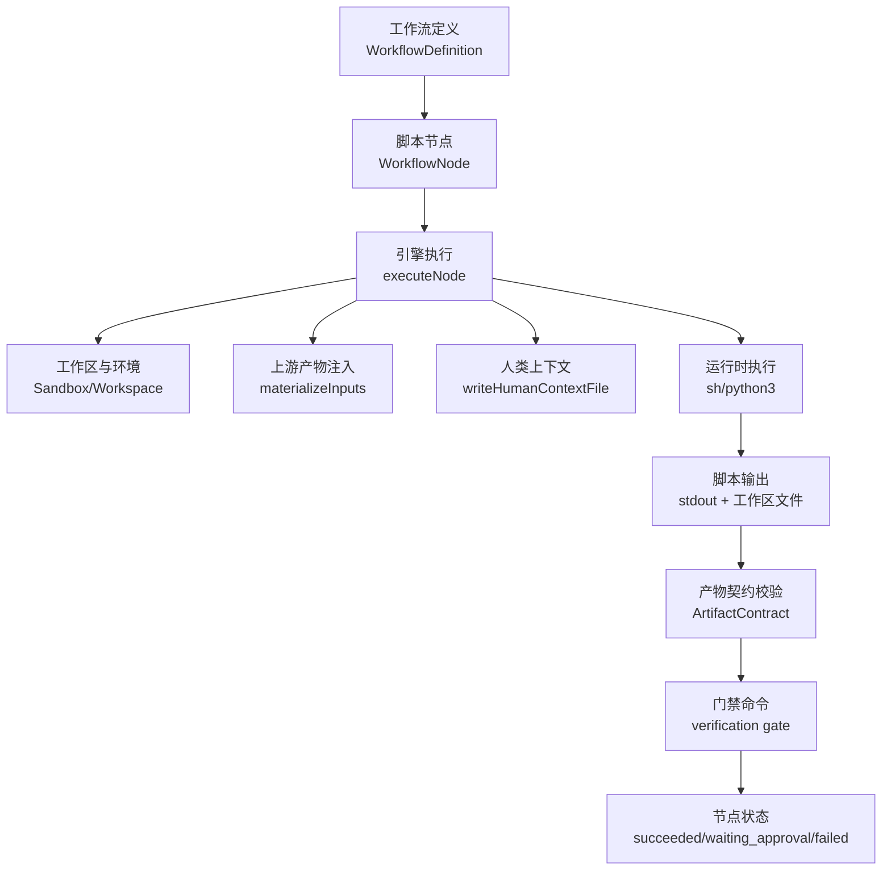
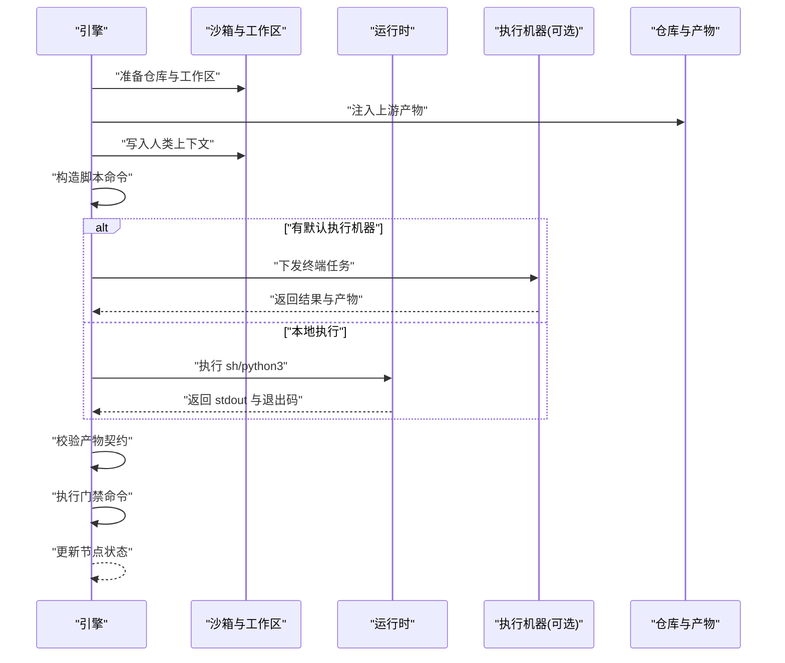
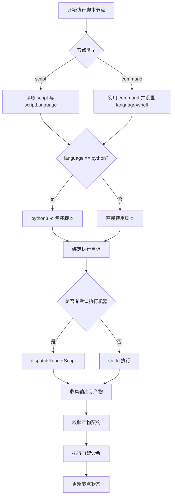
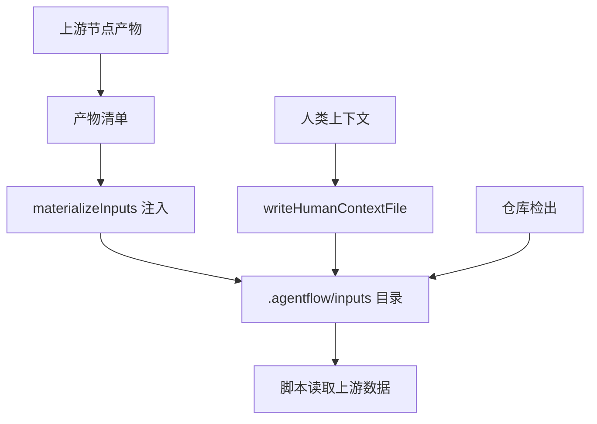
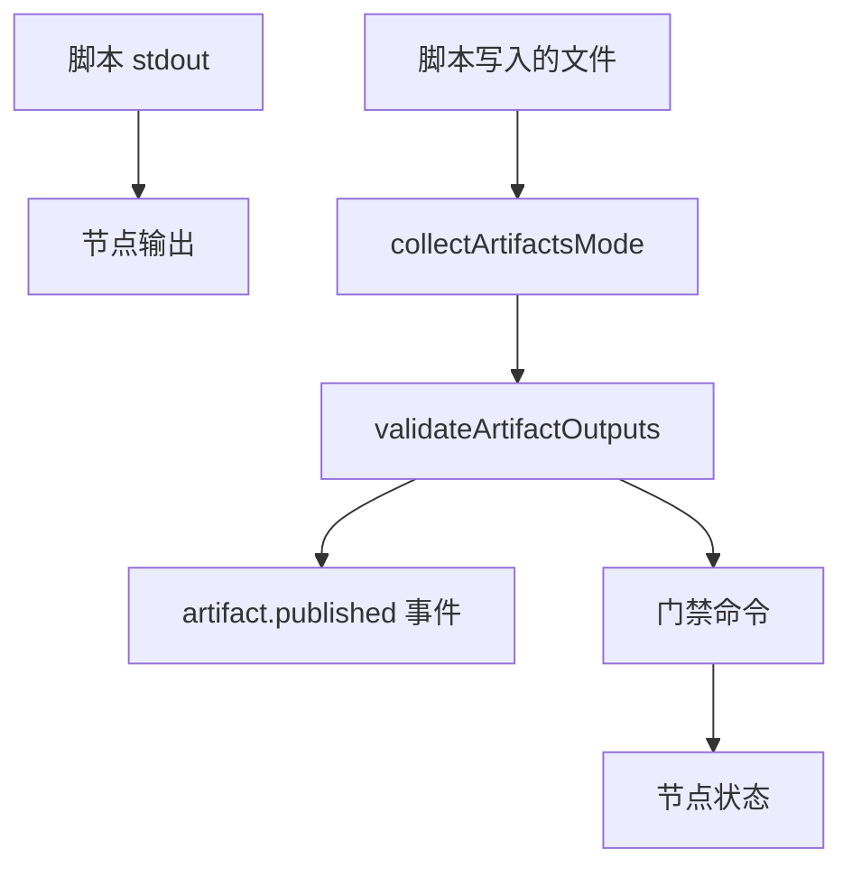
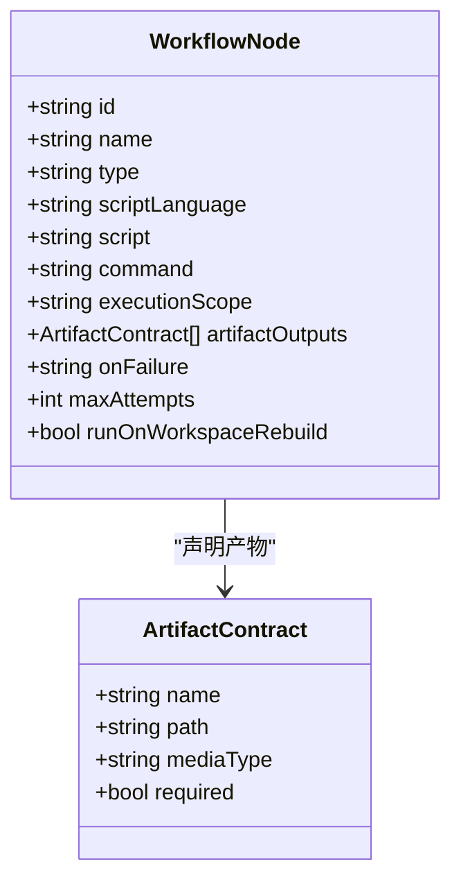
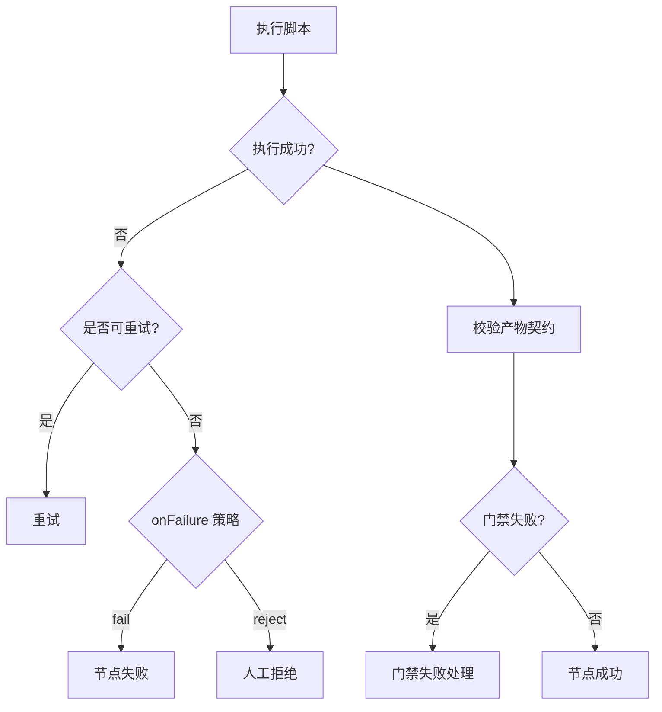
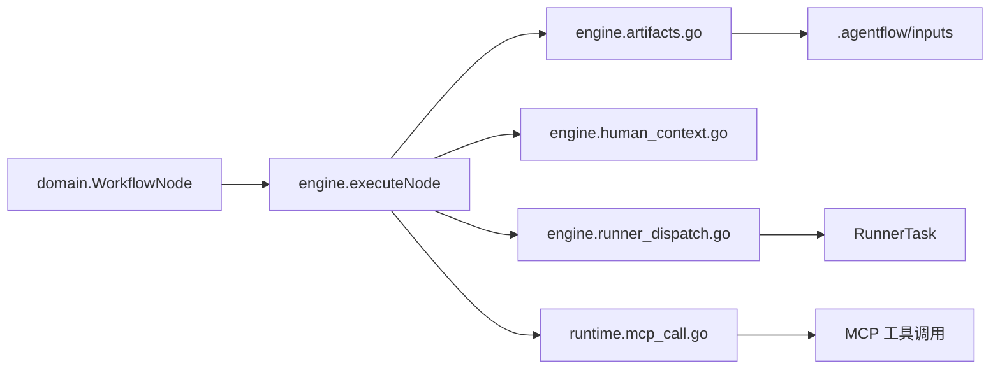

# Script 节点

<cite>
**本文引用的文件**   
- [internal/engine/node_execute.go](file://internal/engine/node_execute.go)
- [internal/engine/runner_dispatch.go](file://internal/engine/runner_dispatch.go)
- [internal/domain/workflow.go](file://internal/domain/workflow.go)
- [internal/engine/artifacts.go](file://internal/engine/artifacts.go)
- [internal/engine/human_context.go](file://internal/engine/human_context.go)
- [internal/engine/node_outputs.go](file://internal/engine/node_outputs.go)
- [internal/runtime/mcp_call.go](file://internal/runtime/mcp_call.go)
- [docs/api/openapi.yaml](file://docs/api/openapi.yaml)
</cite>

## 目录
1. [简介](#简介)
2. [项目结构定位](#项目结构定位)
3. [核心概念与配置项](#核心概念与配置项)
4. [架构总览](#架构总览)
5. [脚本执行流程详解](#脚本执行流程详解)
6. [输入数据与上游产物访问](#输入数据与上游产物访问)
7. [输出结果与产物契约](#输出结果与产物契约)
8. [脚本语言与环境](#脚本语言与环境)
9. [工作区、工作目录与制品路径](#工作区工作目录与制品路径)
10. [错误处理与重试机制](#错误处理与重试机制)
11. [最佳实践](#最佳实践)
12. [依赖关系分析](#依赖关系分析)
13. [故障排查指南](#故障排查指南)
14. [结论](#结论)

## 简介
Script 节点是 LoopForge 流水线中用于执行用户自定义逻辑的基础节点。它支持两种脚本语言：Shell 和 Python，并负责把上游节点的产物、仓库上下文、人类上下文以及可选的 MCP 能力注入到脚本运行环境中。脚本的标准输出会被收集为节点输出；脚本写入工作区的文件可被声明为“产物”，供下游节点或门禁验证使用。

该文档聚焦以下目标：
- 解释 Script 节点的配置选项，包括脚本语言、脚本内容、执行范围、产物契约、失败策略等。
- 说明 Shell 与 Python 在运行时如何被包装和执行。
- 说明环境变量、MCP 调用、Git 凭证、仓库检出、工作目录等执行环境。
- 说明如何在脚本中读取上游节点的数据和产物。
- 说明脚本输出、产物校验、门禁命令和错误处理机制。
- 提供面向实际使用的最佳实践和常见问题排查思路。

## 项目结构定位
Script 节点的核心实现位于引擎层，主要涉及以下模块：
- 领域模型定义：WorkflowNode 描述脚本节点的结构，包括 `scriptLanguage`、`script`、`command`、`artifactOutputs`、`executionScope`、`onFailure`、`maxAttempts` 等字段。
- 节点执行器：Engine 在执行节点时识别 script/command 类型，准备工作区、上游产物、人类上下文，然后以 Shell 或 Python 方式执行脚本。
- 执行机器分发：当存在默认执行机器时，脚本会作为终端任务下发到执行机器，而不是直接在控制面沙箱中执行。
- 产物与输入：上游产物通过 `.agentflow/inputs` 布局注入，脚本输出通过工作区文件和标准输出收集。
- API 规范：OpenAPI 定义了 WorkflowNode 的 `scriptLanguage`、`script`、`command` 等字段，明确支持的枚举值。

**图表来源**
- [internal/domain/workflow.go:39-73](file://internal/domain/workflow.go#L39-L73)
- [internal/engine/node_execute.go:584-640](file://internal/engine/node_execute.go#L584-L640)
- [internal/engine/artifacts.go:25-91](file://internal/engine/artifacts.go#L25-L91)
- [internal/engine/human_context.go:50-60](file://internal/engine/human_context.go#L50-L60)
- [docs/api/openapi.yaml:4878-4909](file://docs/api/openapi.yaml#L4878-L4909)

**章节来源**
- [internal/domain/workflow.go:39-73](file://internal/domain/workflow.go#L39-L73)
- [docs/api/openapi.yaml:4878-4909](file://docs/api/openapi.yaml#L4878-L4909)

## 核心概念与配置项
Script 节点由 `WorkflowNode` 描述，关键字段如下：

| 配置项 | 含义 | 行为说明 |
|---|---|---|
| `type` | 节点类型 | `script` 表示脚本节点；`command` 是历史兼容字段，保存时会迁移为 shell 脚本节点。 |
| `scriptLanguage` | 脚本语言 | 支持 `shell` 和 `python`。Python 脚本会被包装为 `python3 -c` 执行。 |
| `script` | 脚本内容 | 当 `type=script` 时使用；Shell 脚本直接执行，Python 脚本通过 Python 解释器执行。 |
| `command` | 旧版命令字段 | 已废弃；保存时会被规范化为 shell 脚本节点。 |
| `executionScope` | 执行范围 | 对脚本和门禁命令有效，支持 `run` 和 `repositories`。`run` 表示在工作区执行一次；`repositories` 表示每个仓库检出后执行一次。 |
| `artifactOutputs` | 产物契约 | 声明脚本产出的文件路径、媒体类型、是否必填。引擎会在节点完成后校验这些文件是否存在且符合预期。 |
| `onFailure` | 失败策略 | 支持 `fail` 和 `reject`。`reject` 通常用于人工拒绝场景。 |
| `maxAttempts` | 最大尝试次数 | 控制节点重试上限。 |
| `RunOnWorkspaceRebuild` | 工作区重建时重跑 | 若启用，工作区恢复时会重新执行该脚本，常用于环境初始化或索引构建。 |

API 层面，`WorkflowNode` 的 `scriptLanguage` 枚举为 `shell` 或 `python`，`script` 是字符串，`command` 标记为已废弃。

**章节来源**
- [internal/domain/workflow.go:39-73](file://internal/domain/workflow.go#L39-L73)
- [docs/api/openapi.yaml:4878-4909](file://docs/api/openapi.yaml#L4878-L4909)

## 架构总览
Script 节点的执行可以分为三个阶段：
1. **准备阶段**：分配沙箱、克隆仓库、准备工作区、注入上游产物、写入人类上下文。
2. **执行阶段**：根据 `scriptLanguage` 构造命令，选择本地执行或下发到执行机器，运行 Shell 或 Python 脚本。
3. **收尾阶段**：收集标准输出、恢复归档产物、校验产物契约、执行门禁命令、更新节点状态。

**图表来源**
- [internal/engine/node_execute.go:480-544](file://internal/engine/node_execute.go#L480-L544)
- [internal/engine/node_execute.go:584-640](file://internal/engine/node_execute.go#L584-L640)
- [internal/engine/runner_dispatch.go:387-478](file://internal/engine/runner_dispatch.go#L387-L478)

## 脚本执行流程详解
### 节点类型识别
引擎在 `executeNode` 中识别节点类型。对于 `script` 或 `command` 类型，引擎进入脚本执行分支：
- 如果 `type=command`，则使用 `node.Command` 作为脚本内容，并将语言强制设为 `shell`。
- 如果 `type=script`，则使用 `node.Script` 和 `node.ScriptLanguage`。

### 脚本命令构造
- 当 `scriptLanguage=python` 时，引擎将脚本内容用单引号包裹，并通过 `python3 -c` 执行。
- 当 `scriptLanguage=shell` 或未指定 Python 时，脚本作为 Shell 命令执行。

### 执行目标与执行范围
脚本执行通过 `executeForTargets` 绑定执行目标：
- 默认目标是当前工作区。
- 如果 `executionScope=repositories`，引擎会为每个仓库上下文分别执行一次。

### 本地执行与执行机器分发
- 如果没有默认执行机器，引擎在当前沙箱中通过 `sh -lc` 执行命令。
- 如果有默认执行机器，引擎调用 `dispatchRunnerScript`，将脚本作为终端任务下发到执行机器。

**图表来源**
- [internal/engine/node_execute.go:584-640](file://internal/engine/node_execute.go#L584-L640)
- [internal/engine/runner_dispatch.go:387-478](file://internal/engine/runner_dispatch.go#L387-L478)

**章节来源**
- [internal/engine/node_execute.go:584-640](file://internal/engine/node_execute.go#L584-L640)
- [internal/engine/runner_dispatch.go:387-478](file://internal/engine/runner_dispatch.go#L387-L478)

## 输入数据与上游产物访问
### 上游产物注入位置
上游节点的产物会被注入到当前节点的工作区中，路径遵循 `.agentflow/inputs/<上游节点标识>/<仓库目录(可选)>/<产物名称>.<扩展名>` 的规则。例如：
- `.agentflow/inputs/source/notes.md`
- `.agentflow/inputs/source/backend/pipeline.json`

产物文件的权限会被设置为只读，防止脚本误改上游产物。

### 人类上下文
引擎还会写入人类上下文文件，包含用户在运行过程中补充的背景信息。这对需要结合业务背景判断的脚本很有帮助。

### 仓库上下文
脚本执行前，引擎会根据工作流配置克隆仓库。脚本可以在工作区中访问仓库代码、分支信息和 Git 配置。

### 执行机器模式下的输入
当使用执行机器时，上游产物可能通过“上报产物”机制传递，而不是直接复制到控制面工作区。引擎会记录输入清单，并在执行机器上恢复产物。

**图表来源**
- [internal/engine/artifacts.go:25-91](file://internal/engine/artifacts.go#L25-L91)
- [internal/engine/artifacts.go:94-103](file://internal/engine/artifacts.go#L94-L103)
- [internal/engine/human_context.go:50-60](file://internal/engine/human_context.go#L50-L60)
- [internal/engine/node_execute.go:514-523](file://internal/engine/node_execute.go#L514-L523)

**章节来源**
- [internal/engine/artifacts.go:25-91](file://internal/engine/artifacts.go#L25-L91)
- [internal/engine/artifacts.go:94-103](file://internal/engine/artifacts.go#L94-L103)
- [internal/engine/human_context.go:50-60](file://internal/engine/human_context.go#L50-L60)
- [internal/engine/node_execute.go:514-523](file://internal/engine/node_execute.go#L514-L523)

## 输出结果与产物契约
### 标准输出
脚本的标准输出会被收集为节点输出。如果脚本没有输出，引擎会生成一段包含语言、状态、耗时等信息的 Markdown 摘要。

### 产物契约
`artifactOutputs` 声明了脚本必须产出的文件。引擎在节点成功后会：
1. 收集工作区中的候选产物。
2. 校验必需产物是否存在。
3. 记录产物元数据，如名称、路径、媒体类型、大小、哈希。
4. 将产物关联到运行记录，供下游节点或外部系统消费。

### 产物恢复
如果脚本因中断或其他原因导致部分产物未正确落盘，引擎会尝试从归档文件中恢复缺失的产物。

**图表来源**
- [internal/engine/node_execute.go:1027-1055](file://internal/engine/node_execute.go#L1027-L1055)
- [internal/engine/node_execute.go:527-538](file://internal/engine/node_execute.go#L527-L538)

**章节来源**
- [internal/engine/node_execute.go:1027-1055](file://internal/engine/node_execute.go#L1027-L1055)
- [internal/engine/node_execute.go:527-538](file://internal/engine/node_execute.go#L527-L538)

## 脚本语言与环境
### 支持的脚本语言
- **Shell**：默认语言。脚本直接通过 Shell 执行。
- **Python**：脚本内容会被包装为 `python3 -c` 执行。

引擎会对无效的语言进行校验，非 `shell` 或 `python` 的值会导致节点配置错误。

### 环境变量与 MCP
脚本执行环境会注入以下内容：
- Git 凭证：包括 Token、用户名、邮箱。
- MCP 服务器配置：脚本可通过 MCP 调用平台提供的工具或服务。
- 仓库上下文：脚本可以访问已检出的仓库。
- 人类上下文：脚本可以读取用户补充的业务背景。

MCP 相关的环境变量和调用封装由运行时模块提供，确保脚本能够安全地调用受控工具。

### 工作目录
脚本的工作目录是当前节点的工作区。上游产物位于 `.agentflow/inputs`，仓库代码位于对应仓库目录，产物应写入工作区根目录或约定子目录。

**图表来源**
- [internal/domain/workflow.go:39-94](file://internal/domain/workflow.go#L39-L94)

**章节来源**
- [internal/domain/workflow.go:39-94](file://internal/domain/workflow.go#L39-L94)
- [internal/runtime/mcp_call.go:310-318](file://internal/runtime/mcp_call.go#L310-L318)

## 工作区、工作目录与制品路径
### 工作区生命周期
- 引擎为每次运行分配沙箱和工作区。
- 脚本执行期间，工作区包含上游产物、人类上下文、仓库代码和脚本产物。
- 如果启用了执行机器，工作区可能冻结在执行机器侧，控制面仅保留编排和产物同步逻辑。

### 制品路径约定
- 上游产物：`.agentflow/inputs/<上游节点>/<仓库目录>/<文件名>`
- 人类上下文：由引擎写入，脚本可读。
- 脚本产物：建议写入工作区根目录或明确子目录，并在 `artifactOutputs` 中声明。

### 执行范围对工作目录的影响
- `executionScope=run`：脚本在工作区执行一次。
- `executionScope=repositories`：脚本在每个仓库检出后执行一次，适合按仓库处理的脚本。

**章节来源**
- [internal/engine/node_execute.go:480-544](file://internal/engine/node_execute.go#L480-L544)
- [internal/engine/artifacts.go:94-103](file://internal/engine/artifacts.go#L94-L103)

## 错误处理与重试机制
### 脚本失败
脚本退出码非零时，引擎认为脚本失败。失败后会：
1. 记录节点错误。
2. 根据 `onFailure` 决定是失败还是进入人工拒绝流程。
3. 如果启用了重试，引擎会根据 `maxAttempts` 决定是否重试。

### 门禁失败
门禁命令失败时，引擎会记录门禁名称、命令和输出片段，并根据门禁配置的失败策略决定后续动作。

### 中断与恢复
如果脚本执行被沙箱中断或会话丢失，引擎会尝试恢复或重新开始节点。对于 Agent 类节点，引擎会检测会话丢失并丢弃不可恢复的会话 ID。

### 产物校验失败
如果声明的产物不存在或不满足契约，节点会被视为失败。引擎会记录产物校验错误，并阻止节点成功完成。

**图表来源**
- [internal/engine/node_execute.go:626-640](file://internal/engine/node_execute.go#L626-L640)
- [internal/engine/node_execute.go:935-953](file://internal/engine/node_execute.go#L935-L953)
- [internal/engine/node_execute.go:966-1014](file://internal/engine/node_execute.go#L966-L1014)

**章节来源**
- [internal/engine/node_execute.go:626-640](file://internal/engine/node_execute.go#L626-L640)
- [internal/engine/node_execute.go:935-953](file://internal/engine/node_execute.go#L935-L953)
- [internal/engine/node_execute.go:966-1014](file://internal/engine/node_execute.go#L966-L1014)

## 最佳实践
### 脚本编写建议
- 优先使用 Shell 处理简单命令链；复杂逻辑建议使用 Python。
- 不要修改上游产物；上游产物位于 `.agentflow/inputs`，应为只读。
- 将脚本产物写入明确路径，并在 `artifactOutputs` 中声明。
- 避免在脚本中硬编码敏感信息，使用环境变量或 MCP 工具获取凭据。
- 使用 `executionScope=repositories` 时，确保脚本能正确处理多个仓库上下文。

### 产物设计建议
- 产物名称应具有业务语义，例如 `pipeline-report.md`、`test-results.json`。
- 对 JSON 产物设置正确的 `mediaType`，便于下游解析。
- 对必需产物设置 `required=true`，确保关键产出不会遗漏。

### 错误处理建议
- 在脚本中显式输出错误信息，便于日志追踪。
- 对关键步骤添加检查，提前失败比静默失败更容易排查。
- 使用门禁命令做最终验证，例如检查产物格式、仓库状态或外部服务响应。

### 执行机器建议
- 如果脚本依赖本地工具或大体积依赖，考虑使用执行机器。
- 注意执行机器与控制面的工作区布局差异，避免路径假设错误。
- 对长时间运行的脚本设置合理超时和重试策略。

[本节为通用实践建议，不直接分析具体源码文件]

## 依赖关系分析
Script 节点依赖以下组件：
- **领域模型**：`WorkflowNode`、`ArtifactContract` 定义脚本节点结构和产物契约。
- **引擎执行**：`executeNode` 负责节点调度、环境准备、脚本执行和结果处理。
- **产物管理**：`materializeInputs` 注入上游产物，`collectArtifactsMode` 收集脚本产物。
- **人类上下文**：`writeHumanContextFile` 写入业务背景。
- **执行机器**：`dispatchRunnerScript` 将脚本下发到执行机器。
- **MCP 环境**：`ScriptMCPEnvironment` 注入 MCP 调用能力。

**图表来源**
- [internal/domain/workflow.go:39-94](file://internal/domain/workflow.go#L39-L94)
- [internal/engine/node_execute.go:584-640](file://internal/engine/node_execute.go#L584-L640)
- [internal/engine/artifacts.go:25-91](file://internal/engine/artifacts.go#L25-L91)
- [internal/engine/human_context.go:50-60](file://internal/engine/human_context.go#L50-L60)
- [internal/engine/runner_dispatch.go:387-478](file://internal/engine/runner_dispatch.go#L387-L478)
- [internal/runtime/mcp_call.go:310-318](file://internal/runtime/mcp_call.go#L310-L318)

**章节来源**
- [internal/domain/workflow.go:39-94](file://internal/domain/workflow.go#L39-L94)
- [internal/engine/node_execute.go:584-640](file://internal/engine/node_execute.go#L584-L640)
- [internal/engine/artifacts.go:25-91](file://internal/engine/artifacts.go#L25-L91)
- [internal/engine/human_context.go:50-60](file://internal/engine/human_context.go#L50-L60)
- [internal/engine/runner_dispatch.go:387-478](file://internal/engine/runner_dispatch.go#L387-L478)
- [internal/runtime/mcp_call.go:310-318](file://internal/runtime/mcp_call.go#L310-L318)

## 故障排查指南
### 脚本无法找到上游产物
- 检查上游节点是否正确声明产物。
- 确认当前节点是否能访问 `.agentflow/inputs`。
- 如果使用执行机器，确认产物是否通过上报机制同步。

### 脚本执行失败但无详细错误
- 查看节点输出和日志，确认脚本是否输出了错误信息。
- 检查脚本退出码和门禁命令输出。
- 如果是 Python 脚本，确认 `python3` 可用且语法正确。

### 产物校验失败
- 检查 `artifactOutputs` 中的路径是否与脚本写入路径一致。
- 确认产物文件是否存在且未被删除。
- 检查产物媒体类型是否符合预期。

### 执行机器连接失败
- 确认执行机器在线且支持终端 provider。
- 检查工作区布局是否匹配。
- 查看执行机器任务状态和错误消息。

**章节来源**
- [internal/engine/node_execute.go:626-640](file://internal/engine/node_execute.go#L626-L640)
- [internal/engine/node_execute.go:935-953](file://internal/engine/node_execute.go#L935-L953)
- [internal/engine/node_execute.go:1027-1055](file://internal/engine/node_execute.go#L1027-L1055)
- [internal/engine/runner_dispatch.go:458-478](file://internal/engine/runner_dispatch.go#L458-L478)

## 结论
Script 节点是 LoopForge 流水线中最灵活的执行单元之一。它通过统一的引擎入口支持 Shell 和 Python 脚本，自动注入上游产物、人类上下文和仓库环境，并提供产物契约、门禁命令、重试和失败策略等完整生命周期管理能力。在实际使用中，建议明确产物路径、合理使用执行范围、谨慎处理错误，并结合门禁命令保证交付质量。

[本节为总结性内容，不直接分析具体源码文件]