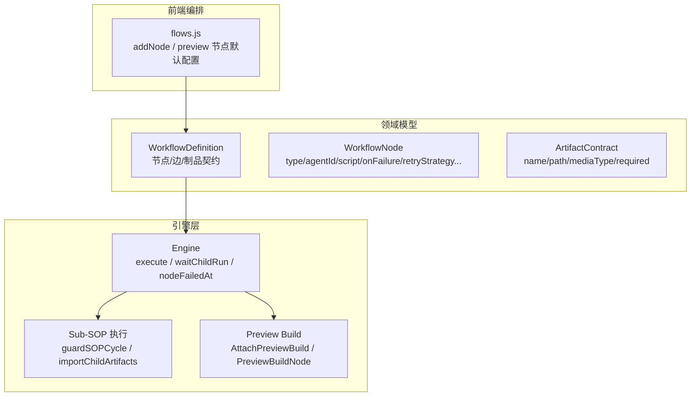
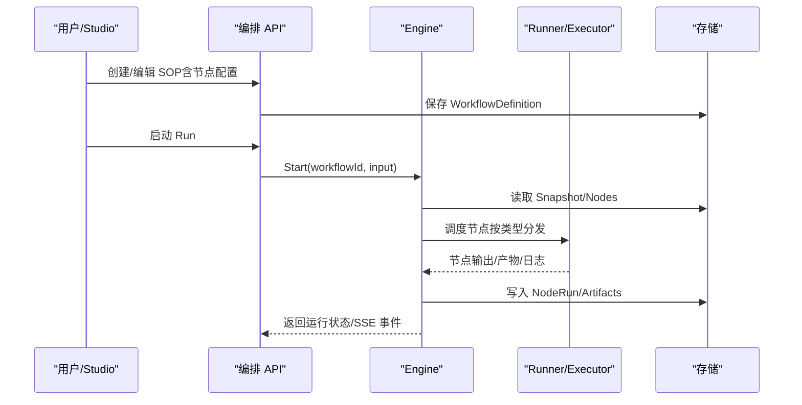
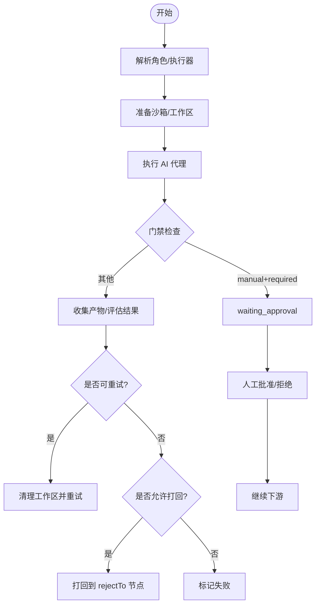
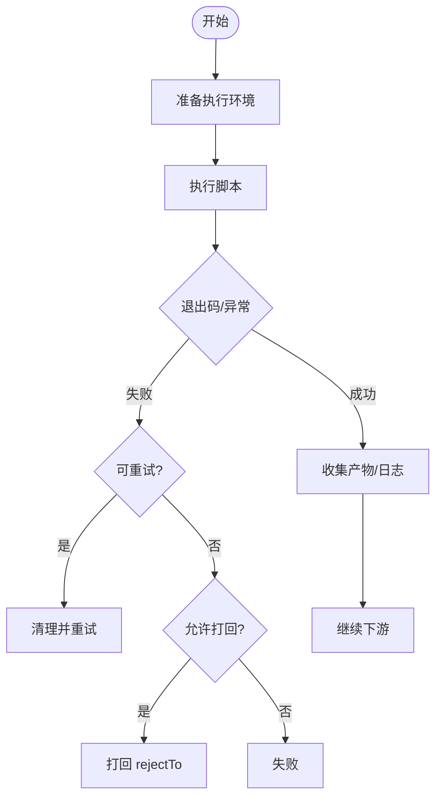
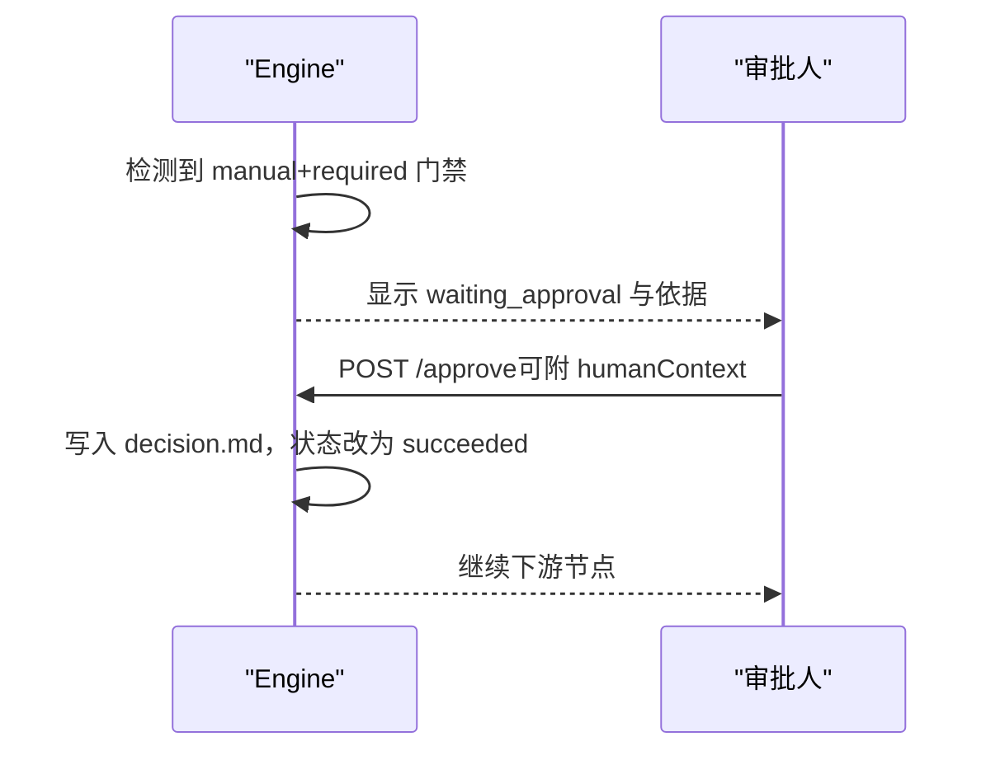
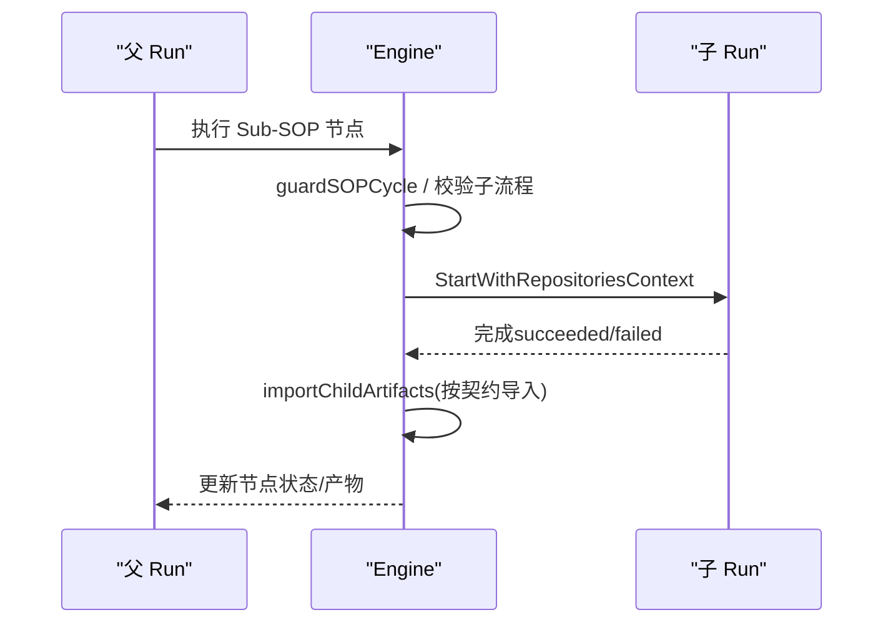
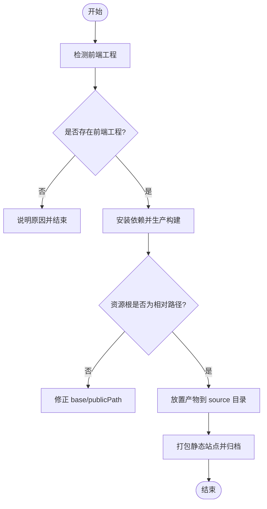
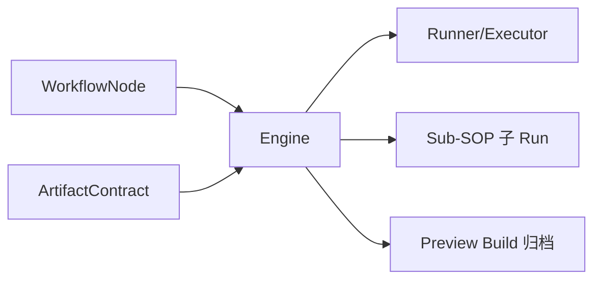

# 节点类型详解

<cite>
**本文引用的文件**   
- [internal/domain/workflow.go](file://internal/domain/workflow.go)
- [internal/engine/sop_node.go](file://internal/engine/sop_node.go)
- [internal/domain/preview_build.go](file://internal/domain/preview_build.go)
- [web/app/flows.js](file://web/app/flows.js)
- [docs/api/orchestration.md](file://docs/api/orchestration.md)
- [internal/engine/node_execute.go](file://internal/engine/node_execute.go)
- [internal/engine/node_outcome.go](file://internal/engine/node_outcome.go)
- [internal/engine/run_ops.go](file://internal/engine/run_ops.go)
</cite>

## 目录
1. [引言](#引言)
2. [项目结构](#项目结构)
3. [核心组件](#核心组件)
4. [架构总览](#架构总览)
5. [详细组件分析](#详细组件分析)
6. [依赖关系分析](#依赖关系分析)
7. [性能与可靠性](#性能与可靠性)
8. [故障排查指南](#故障排查指南)
9. [结论](#结论)

## 引言
本文面向 SOP（工作流）使用者与维护者，系统性说明以下五类节点的配置、执行机制、输入输出、错误处理与重试策略：
- Agent 节点（AI 代理执行）
- Script 节点（脚本执行）
- Human gate 节点（人工审批）
- Sub-SOP 节点（子流程调用）
- Preview build 节点（预览构建）

SOP 由“节点 + 边”构成，节点类型包括 agent、script、approval、sop；引擎根据节点配置选择执行器、沙箱、门禁和重试策略，并在运行中维护产物契约、状态机与可恢复性。

## 项目结构
围绕节点类型的核心代码分布在领域模型、引擎执行逻辑与前端编排界面三部分：
- 领域模型：定义 WorkflowNode、ArtifactContract、WorkflowDefinition 等数据结构。
- 引擎实现：负责节点调度、结果收敛、重试/打回、子 SOP 启动与产物导入、预览构建注入。
- 前端编排：提供添加节点、绑定角色/脚本、声明产物、设置失败与重试策略的交互。

**图表来源**
- [internal/domain/workflow.go:39-73](file://internal/domain/workflow.go#L39-L73)
- [internal/domain/workflow.go:87-101](file://internal/domain/workflow.go#L87-L101)
- [internal/engine/sop_node.go:18-155](file://internal/engine/sop_node.go#L18-L155)
- [internal/domain/preview_build.go:30-78](file://internal/domain/preview_build.go#L30-L78)
- [web/app/flows.js:190-212](file://web/app/flows.js#L190-L212)

**章节来源**
- [internal/domain/workflow.go:39-101](file://internal/domain/workflow.go#L39-L101)
- [web/app/flows.js:190-212](file://web/app/flows.js#L190-L212)

## 核心组件
- WorkflowNode：描述一个 SOP 节点的完整配置，包括类型、Agent/脚本、产物契约、失败处理、重试策略、携带上下文、最大尝试次数与返工次数等。
- ArtifactContract：声明节点产物的名称、路径、媒体类型与是否必填。
- Engine：统一调度节点执行、管理并发分支、处理等待/失败/重试/打回、启动子 SOP、接入预览构建。
- Preview Build：在启用静态站点预览时自动注入一个 Agent 节点，负责构建并归档静态站点。

关键要点：
- 节点类型：agent、script、approval、sop。
- 失败处理：onFailure 支持 fail、reject；门禁级别还支持 loop、human。
- 重试策略：retryStrategy 支持 targeted_fix、full_redo；MaxAttempts 控制重试上限。
- 产物契约：节点通过 ArtifactOutputs 声明产出，引擎校验 required 字段。

**章节来源**
- [internal/domain/workflow.go:39-73](file://internal/domain/workflow.go#L39-L73)
- [internal/domain/workflow.go:87-101](file://internal/domain/workflow.go#L87-L101)
- [docs/api/orchestration.md:25-25](file://docs/api/orchestration.md#L25-L25)

## 架构总览
下图展示从编排到执行的端到端流程，涵盖五种节点类型的关键路径。

**图表来源**
- [docs/api/orchestration.md:90-120](file://docs/api/orchestration.md#L90-L120)
- [internal/engine/node_execute.go:16-186](file://internal/engine/node_execute.go#L16-L186)

## 详细组件分析

### Agent 节点（AI 代理执行）
- 配置项
  - type=agent
  - agentId：绑定角色定义
  - executorId：可选覆盖执行器
  - artifactOutputs：产物契约（可覆盖/合并角色声明）
  - onFailure：fail、reject（门禁级别另有 loop/human）
  - retryStrategy：targeted_fix、full_redo
  - carryOver：跨轮次携带上下文（如 last_error、failed_checks、upstream_artifacts）
  - maxAttempts、maxReworks：重试与返工预算
- 执行机制
  - 引擎解析角色与执行器，准备沙箱环境，执行 AI 代理任务。
  - 若门禁为 manual 且 required，则进入 waiting_approval。
  - 自修正耗尽或达到最大轮次时，可能转人工判断或失败。
- 输入输出
  - 输入：上游产物、父级 input、carryOver 上下文。
  - 输出：文本/结构化产物，按 ArtifactContract 归档。
- 错误处理与重试
  - 非配置类错误且未达 MaxAttempts 时自动重试。
  - 当允许 reject 且配置了 rejectTo，失败可自动打回上游。
  - 门禁 on_failure 优先级高于节点 onFailure。
- 常见模式
  - 单轮 Agent：maxAttempts=1，不重试。
  - 自修复 Agent：retryStrategy=targeted_fix，配合 carryOver=last_error。
  - 需要人工把关：门禁 mode=manual，required=true。

**图表来源**
- [internal/engine/node_execute.go:1004-1044](file://internal/engine/node_execute.go#L1004-L1044)
- [internal/engine/node_outcome.go:50-117](file://internal/engine/node_outcome.go#L50-L117)
- [internal/engine/node_outcome.go:144-166](file://internal/engine/node_outcome.go#L144-L166)

**章节来源**
- [internal/domain/workflow.go:39-73](file://internal/domain/workflow.go#L39-L73)
- [internal/engine/node_execute.go:189-224](file://internal/engine/node_execute.go#L189-L224)
- [internal/engine/node_execute.go:1004-1044](file://internal/engine/node_execute.go#L1004-L1044)
- [internal/engine/node_outcome.go:50-117](file://internal/engine/node_outcome.go#L50-L117)

### Script 节点（脚本执行）
- 配置项
  - type=script
  - scriptLanguage：shell、python
  - script：脚本内容
  - executionScope：run、repositories
  - runOnWorkspaceRebuild：在工作区重建时重放脚本
  - artifactOutputs、onFailure、retryStrategy、maxAttempts、maxReworks 同通用节点
- 执行机制
  - 引擎在 Runner 环境中执行脚本，捕获 stdout/stderr 与退出码。
  - 失败时可重试；若允许 reject 且配置了 rejectTo，可自动打回。
- 输入输出
  - 输入：工作区代码、环境变量、上游产物。
  - 输出：文件/日志/制品（按契约归档）。
- 错误处理与重试
  - 非致命错误（如临时挂载失败）不会触发无限重试。
  - 达到 MaxAttempts 后失败；若允许 reject 且存在 budget，可打回上游。
- 常见模式
  - 构建/测试脚本：executionScope=repositories，确保仓库上下文可用。
  - 预检脚本：onFailure=fail，快速失败并阻断下游。

**图表来源**
- [internal/domain/workflow.go:58-70](file://internal/domain/workflow.go#L58-L70)
- [internal/engine/node_outcome.go:89-98](file://internal/engine/node_outcome.go#L89-L98)
- [internal/engine/node_outcome.go:144-166](file://internal/engine/node_outcome.go#L144-L166)

**章节来源**
- [internal/domain/workflow.go:58-70](file://internal/domain/workflow.go#L58-L70)
- [internal/engine/node_outcome.go:89-98](file://internal/engine/node_outcome.go#L89-L98)

### Human gate 节点（人工审批）
- 配置项
  - type=approval
  - taskPrompt：向审批人说明「需要确认什么」
  - rejectTo：不通过时打回的目标节点
  - 门禁级别：mode=manual，required=true 时强制人工确认
- 执行机制
  - 当门禁为 manual 且 required，节点进入 waiting_approval。
  - 人工 approve 后继续下游；reject 按 targetId 路由。
- 输入输出
  - 输入：上游产物、门禁证据（截图/差异/摘要）。
  - 输出：决策产物 decision.md，记录人工上下文。
- 错误处理与重试
  - 人工审批不是重试点；对 Agent 应使用 retry 接口补充上下文。
  - 脚本节点可在失败后 pass 以跳过阻塞。
- 常见模式
  - 发布前验收：taskPrompt 明确检查清单，rejectTo=测试节点。
  - 安全门禁：mode=manual，required=true，必须人工批准。

**图表来源**
- [internal/engine/run_ops.go:140-175](file://internal/engine/run_ops.go#L140-L175)
- [internal/engine/node_execute.go:1016-1044](file://internal/engine/node_execute.go#L1016-L1044)

**章节来源**
- [internal/domain/workflow.go:39-50](file://internal/domain/workflow.go#L39-L50)
- [internal/engine/run_ops.go:140-175](file://internal/engine/run_ops.go#L140-L175)
- [internal/engine/node_execute.go:1016-1044](file://internal/engine/node_execute.go#L1016-L1044)

### Sub-SOP 节点（子流程调用）
- 配置项
  - type=sop
  - sopWorkflowId：被调用的子流程 ID
  - artifactOutputs：声明子 SOP 需交出的产物名称
- 执行机制
  - 引擎校验循环引用与嵌套深度（最多 6 层）。
  - 启动子 Run，复用父级工作区与仓库上下文。
  - 子 SOP 成功后，按契约导入产物到父 Run。
- 输入输出
  - 输入：父级 input、上游产物（仅传递相关产物）。
  - 输出：子 SOP 产物（按 name 匹配），缺失时报错。
- 错误处理与重试
  - 子 SOP 失败直接导致本节点失败。
  - 产物缺失会报错并阻止继续。
- 常见模式
  - 将独立职责拆分为子 SOP，父 SOP 只关注编排与产物交接。
  - 通过 artifactOutputs 约束子 SOP 交付物，避免隐式耦合。

**图表来源**
- [internal/engine/sop_node.go:18-155](file://internal/engine/sop_node.go#L18-L155)
- [internal/engine/sop_node.go:157-187](file://internal/engine/sop_node.go#L157-L187)
- [internal/engine/sop_node.go:256-307](file://internal/engine/sop_node.go#L256-L307)

**章节来源**
- [internal/engine/sop_node.go:18-155](file://internal/engine/sop_node.go#L18-L155)
- [internal/engine/sop_node.go:157-187](file://internal/engine/sop_node.go#L157-L187)
- [internal/engine/sop_node.go:256-307](file://internal/engine/sop_node.go#L256-L307)

### Preview build 节点（预览构建）
- 功能概述
  - 当 SOP 启用静态站点预览时，引擎自动注入一个 Agent 节点用于构建静态站点。
  - 该节点不可持久化到目录模板中；每次运行前附加，运行后剥离。
- 配置项（系统生成）
  - type=agent，agentId=PreviewBuildAgentID，executorId=PreviewBuildExecutor
  - executionScope=run
  - artifactOutputs=[{name:"frontend-preview", path:入口文件}]
  - onFailure=fail，retryStrategy=targeted_fix，carryOver=["last_error"]
  - maxAttempts=2，maxReworks=1
- 执行机制
  - 识别前端工程（Vite/webpack/rspack/Next 静态导出等）。
  - 安装依赖并生产构建，禁止开发服务器。
  - 要求资源根为相对路径，产物放入指定 source 目录。
  - 构建完成后平台打包静态目录并归档，供下载与预览。
- 常见模式
  - 多仓库工作区：每个仓库独立构建，最终聚合到工作区根的 source 目录。
  - 无前端工程：直接说明原因并结束，不伪造产物。

**图表来源**
- [internal/domain/preview_build.go:30-78](file://internal/domain/preview_build.go#L30-L78)
- [internal/domain/preview_build.go:80-129](file://internal/domain/preview_build.go#L80-L129)
- [web/app/flows.js:194-202](file://web/app/flows.js#L194-L202)

**章节来源**
- [internal/domain/preview_build.go:30-78](file://internal/domain/preview_build.go#L30-L78)
- [internal/domain/preview_build.go:80-129](file://internal/domain/preview_build.go#L80-L129)
- [web/app/flows.js:194-202](file://web/app/flows.js#L194-L202)

## 依赖关系分析
- 领域模型与引擎解耦：WorkflowNode/ArtifactContract 作为稳定契约，Engine 在其上实现执行语义。
- 节点类型与执行器：Agent 节点通过角色与执行器映射到具体 CLI/Provider；Script 节点由 Runner 执行。
- 子 SOP 与工作区共享：子 Run 复用父级 checkout，避免远程同步开销。
- 预览构建与归档：预览构建产物在 Run 结束后归档，支持离线下载。

**图表来源**
- [internal/domain/workflow.go:39-73](file://internal/domain/workflow.go#L39-L73)
- [internal/engine/sop_node.go:18-155](file://internal/engine/sop_node.go#L18-L155)
- [internal/domain/preview_build.go:30-78](file://internal/domain/preview_build.go#L30-L78)

**章节来源**
- [internal/domain/workflow.go:39-101](file://internal/domain/workflow.go#L39-L101)
- [internal/engine/sop_node.go:18-155](file://internal/engine/sop_node.go#L18-L155)
- [internal/domain/preview_build.go:30-78](file://internal/domain/preview_build.go#L30-L78)

## 性能与可靠性
- 并发与租约：Engine 维护运行租约与心跳，实例切换时能恢复中断节点。
- 重试与防抖：shouldRetryFailedAttempt 排除配置错误与特定运行时错误，避免无效重试。
- 打回与预算：gateReworkReject 结合 MaxReworks 预算，防止无限打回；预算耗尽转人工决策。
- 子 SOP 嵌套限制：guardSOPCycle 限制循环与最大嵌套层数，防止栈爆炸。
- 预览归档：Run 成功后异步归档静态站点，不影响主流程完成。

**章节来源**
- [internal/engine/node_outcome.go:89-98](file://internal/engine/node_outcome.go#L89-L98)
- [internal/engine/node_outcome.go:100-117](file://internal/engine/node_outcome.go#L100-L117)
- [internal/engine/sop_node.go:157-187](file://internal/engine/sop_node.go#L157-L187)
- [internal/engine/node_outcome.go:320-377](file://internal/engine/node_outcome.go#L320-L377)

## 故障排查指南
- 节点一直 waiting_approval
  - 检查是否配置了 manual 且 required 的门禁。
  - 使用 approve/pass/reject 接口推进流程。
- 子 SOP 失败或缺少产物
  - 检查 sopWorkflowId 是否正确，子流程是否成功。
  - 核对 artifactOutputs 名称是否与子 SOP 实际产物一致。
- 预览构建失败
  - 检查工作区是否存在前端工程与依赖。
  - 确认资源根为相对路径，产物位于预期 source 目录。
- 重试风暴或无效重试
  - 查看 onFailure 与 retryStrategy 配置。
  - 注意配置错误或特定运行时错误不会触发重试。

**章节来源**
- [internal/engine/run_ops.go:140-175](file://internal/engine/run_ops.go#L140-L175)
- [internal/engine/sop_node.go:256-307](file://internal/engine/sop_node.go#L256-L307)
- [internal/domain/preview_build.go:80-129](file://internal/domain/preview_build.go#L80-L129)
- [internal/engine/node_outcome.go:89-98](file://internal/engine/node_outcome.go#L89-L98)

## 结论
- Agent 节点适合复杂推理与工具调用，建议搭配 carryOver 与 targeted_fix 提升自愈能力。
- Script 节点适合确定性任务，注意 executionScope 与失败快速阻断。
- Human gate 节点用于关键决策点，明确 taskPrompt 与 rejectTo 提升协作效率。
- Sub-SOP 节点用于职责拆分与产物契约化，注意嵌套深度与产物命名一致性。
- Preview build 节点简化静态站点构建与归档，遵循相对资源根与产物位置约定。