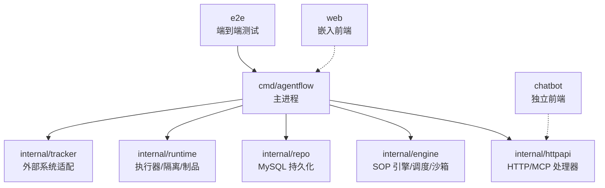
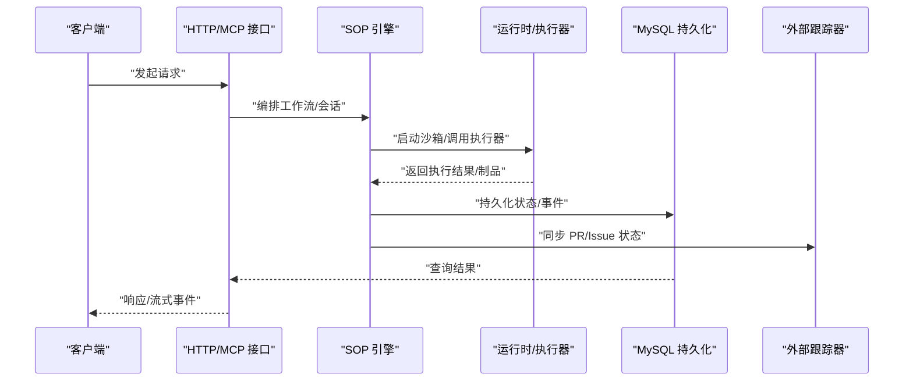
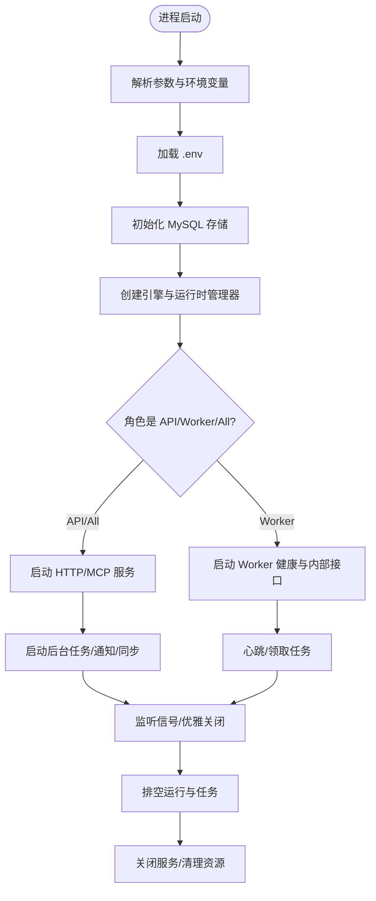
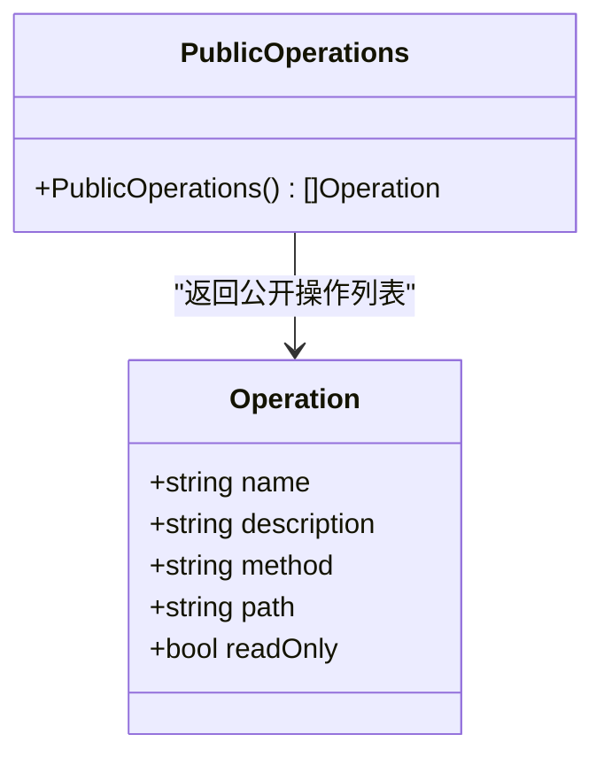
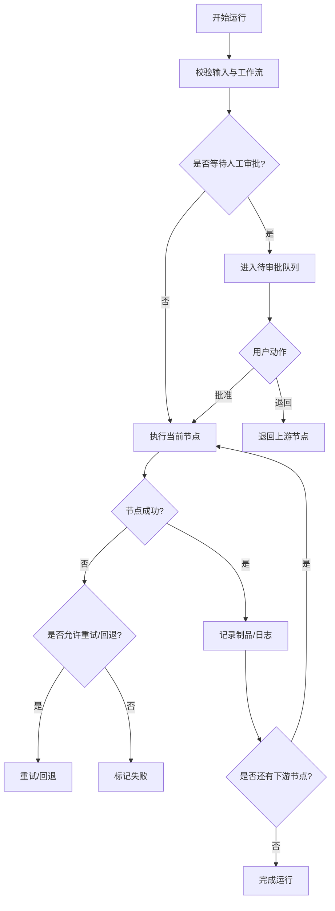
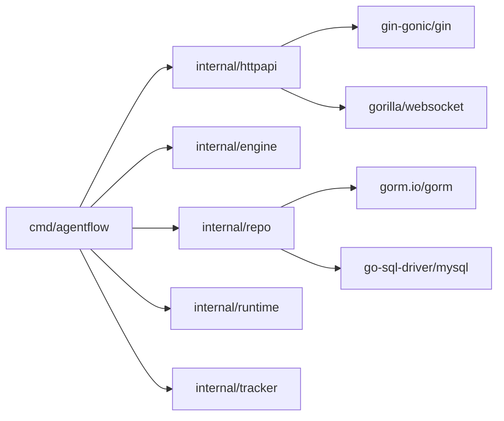

# 开发指南

<cite>
**本文引用的文件**   
- [README.md](file://README.md)
- [CONTRIBUTING.md](file://CONTRIBUTING.md)
- [Makefile](file://Makefile)
- [go.mod](file://go.mod)
- [cmd/agentflow/main.go](file://cmd/agentflow/main.go)
- [internal/application/operations.go](file://internal/application/operations.go)
- [docs/architecture.md](file://docs/architecture.md)
- [scripts/dev.sh](file://scripts/dev.sh)
</cite>

## 目录
1. [简介](#简介)
2. [项目结构](#项目结构)
3. [核心组件](#核心组件)
4. [架构总览](#架构总览)
5. [详细组件分析](#详细组件分析)
6. [依赖关系分析](#依赖关系分析)
7. [性能与可观测性](#性能与可观测性)
8. [测试指南](#测试指南)
9. [调试技巧](#调试技巧)
10. [代码规范与审查标准](#代码规范与审查标准)
11. [版本管理、分支策略与发布流程](#版本管理分支策略与发布流程)
12. [故障排查](#故障排查)
13. [结论](#结论)

## 简介
LoopForge 是一个自托管的软件开发交付平台，围绕“聊天工作区 + 标准化流程（SOP）”组织编码代理、脚本和人工审批。它通过 Docker 沙箱、工作空间、执行器协议、持久化存储和 HTTP/MCP API 将需求到交付的过程标准化、可观测且可恢复。

本指南面向开发者，覆盖环境搭建、代码规范、贡献流程、模块职责、依赖关系、测试方法、调试技巧、性能分析、代码审查标准以及版本管理与发布流程。

## 项目结构
仓库采用 Go 后端为主、前端嵌入与独立前端并存的结构：
- `cmd`：可执行程序入口，包括主服务、Runner、MCP 网关等。
- `internal`：内部实现，包含引擎、HTTP API、运行时、仓库、跟踪器等。
- `web`：嵌入上游 Web 界面与公共登录页。
- `chatbot`：独立的聊天机器人前端工程。
- `e2e`：端到端测试套件，包含 API、UI、浏览器自动化等。
- `local`：本地工作流与宿主集成资产。
- `migrations`：数据库迁移与种子数据。
- `scripts`：构建、安装、测试与运维脚本。
- `docs`：架构、部署、API 与使用文档。

**图示来源**
- [docs/architecture.md:5-17](file://docs/architecture.md#L5-L17)
- [cmd/agentflow/main.go:19-28](file://cmd/agentflow/main.go#L19-L28)

**章节来源**
- [docs/architecture.md:1-22](file://docs/architecture.md#L1-L22)

## 核心组件
- 主进程 `cmd/agentflow`：解析参数与环境变量，加载配置，初始化引擎、HTTP 服务、后台任务、通知、预览、同步与受管 CLI 更新；支持 API、Worker、All 三种角色，并处理优雅关闭与端口接管。
- HTTP/MCP 接口层 `internal/httpapi`：按业务域拆分处理器，暴露公开能力清单与 OpenAPI 契约。
- SOP 引擎 `internal/engine`：负责工作流图、租约、调度、沙箱生命周期与交付编排。
- 持久化层 `internal/repo`：基于 MySQL 的数据访问与领域仓库。
- 运行时与执行器 `internal/runtime`、`internal/runner`：执行器协议、凭据、隔离与制品管理。
- 外部跟踪器 `internal/tracker`：远程 Issue/PR 适配器与状态同步。
- Web 前端 `web`：嵌入上游界面与偏好设置。
- 聊天机器人前端 `chatbot`：独立的前端应用与测试。

**章节来源**
- [docs/architecture.md:5-17](file://docs/architecture.md#L5-L17)
- [internal/application/operations.go:1-16](file://internal/application/operations.go#L1-L16)

## 架构总览
LoopForge 以“进程角色 + 模块化内部包”的方式组织：
- 进程角色：API、Worker、All。
- 数据源：MySQL（唯一数据源）。
- 通信：HTTP API 与 MCP。
- 执行：Docker 沙箱或连接执行机。
- 可观测：运行日志、遥测、制品快照与指标。

**图示来源**
- [cmd/agentflow/main.go:133-180](file://cmd/agentflow/main.go#L133-L180)
- [internal/application/operations.go:17-136](file://internal/application/operations.go#L17-L136)

## 详细组件分析

### 主进程与服务生命周期
主进程负责：
- 解析命令行参数与环境变量。
- 加载 `.env` 配置。
- 初始化 MySQL 存储与引擎实例。
- 根据角色启动 API 或 Worker 服务。
- 启动后台任务、通知、预览、同步与受管 CLI 更新。
- 监听信号，执行优雅关闭、任务排空与端口接管。

**图示来源**
- [cmd/agentflow/main.go:77-180](file://cmd/agentflow/main.go#L77-L180)
- [cmd/agentflow/main.go:246-341](file://cmd/agentflow/main.go#L246-L341)

**章节来源**
- [cmd/agentflow/main.go:31-75](file://cmd/agentflow/main.go#L31-L75)
- [cmd/agentflow/main.go:77-180](file://cmd/agentflow/main.go#L77-L180)
- [cmd/agentflow/main.go:246-341](file://cmd/agentflow/main.go#L246-L341)

### HTTP/MCP 能力清单
公开能力清单由 `PublicOperations` 维护，涵盖健康检查、OpenAPI、项目、仓库、问题、工作流、运行、调度、助手会话等。该清单用于 MCP 能力发现与客户端导航。

**图示来源**
- [internal/application/operations.go:1-16](file://internal/application/operations.go#L1-L16)
- [internal/application/operations.go:17-136](file://internal/application/operations.go#L17-L136)

**章节来源**
- [internal/application/operations.go:1-136](file://internal/application/operations.go#L1-L136)

### 工作流与运行控制
SOP 引擎协调 Agent、Script、Human Gate、Sub-SOP 与 Preview 节点，按依赖顺序执行，并在失败时支持回退、重试与从任意节点重跑。运行控制包括开始、暂停、恢复、取消、批准、拒绝、重试与刷新 SOP 定义。

**图示来源**
- [internal/application/operations.go:93-113](file://internal/application/operations.go#L93-L113)

**章节来源**
- [internal/application/operations.go:93-113](file://internal/application/operations.go#L93-L113)

## 依赖关系分析
Go 模块依赖关键库：
- Gin：HTTP 路由与中间件。
- GORM/MySQL 驱动：数据库访问。
- Gorilla WebSocket：实时通信。
- SQLite 驱动：嵌入式数据库（测试/轻量场景）。
- Compress/Crypto/Net/System：压缩、加密、网络与系统工具。

**图示来源**
- [go.mod:5-18](file://go.mod#L5-L18)
- [cmd/agentflow/main.go:19-28](file://cmd/agentflow/main.go#L19-L28)

**章节来源**
- [go.mod:1-58](file://go.mod#L1-L58)
- [cmd/agentflow/main.go:19-28](file://cmd/agentflow/main.go#L19-L28)

## 性能与可观测性
- 并发与并行：Go 测试默认并行度可通过环境变量调整；覆盖率命令提供 `COVERAGE_P` 控制包级并行。
- 运行租约与超时：通过 `AGENTFLOW_RUN_LEASE_TTL` 与 `AGENTFLOW_DRAIN_TIMEOUT` 控制运行租约与优雅关闭时长。
- 遥测与指标：运行遥测、日志下载、工作流指标与业务域报告。
- 观察性契约：提供 `/api/observability/spec` 描述可观测性契约。

建议：
- 在高负载环境下优先调优 `worker-concurrency` 与 `AGENTFLOW_RUN_LEASE_TTL`。
- 使用运行遥测与日志下载定位慢节点与失败路径。
- 结合业务域报告评估交付效率与成本。

**章节来源**
- [Makefile:9-27](file://Makefile#L9-L27)
- [cmd/agentflow/main.go:145-172](file://cmd/agentflow/main.go#L145-L172)
- [cmd/agentflow/main.go:343-353](file://cmd/agentflow/main.go#L343-L353)
- [internal/application/operations.go:90-103](file://internal/application/operations.go#L90-L103)

## 测试指南

### 单元测试
- Go 单测：使用 `go test`，默认并行度可通过 `GOCACHE` 与 Makefile 目标控制。
- Chatbot 单测：使用 Vitest，通过 `npm --prefix chatbot run coverage` 生成覆盖率。
- Web 单测：使用 c8，通过 `npm --prefix webtest run coverage` 生成覆盖率。

推荐实践：
- 对函数与边界逻辑编写表驱动测试。
- 对错误路径与异常分支补充回归用例。
- 保持测试数据隔离与可重复。

**章节来源**
- [Makefile:9-27](file://Makefile#L9-L27)
- [CONTRIBUTING.md:9-15](file://CONTRIBUTING.md#L9-L15)

### 集成测试
- MySQL 集成测试：通过 `make test-mysql` 启动临时 MySQL 容器并运行 `internal/repo` 集成测试。
- API 合同测试：复用现有 e2e/api 用例验证路由与行为。

推荐实践：
- 使用临时数据库与固定 DSN。
- 在测试结束后清理容器与数据。
- 区分静态检查与真实集成执行结果。

**章节来源**
- [Makefile:34-52](file://Makefile#L34-L52)
- [CONTRIBUTING.md:19-21](file://CONTRIBUTING.md#L19-L21)

### 端到端测试
- e2e 套件：包含 API、UI、浏览器自动化与公共浏览器验收用例。
- 公共浏览器验收：需显式配置付费模型与外部知识，准确报告 passed/failed/skipped/not-run。

推荐实践：
- 优先选择能覆盖风险的最窄层级；跨边界行为才上升到 E2E。
- 复用现有 fixture/helper 与 runner。
- 不引入重型依赖以满足流程形式。

**章节来源**
- [CONTRIBUTING.md:19-21](file://CONTRIBUTING.md#L19-L21)
- [README.md:240-250](file://README.md#L240-L250)

## 调试技巧
- 本地开发脚本：`scripts/dev.sh` 自动配置、初始化 schema、安装目录、创建管理员账户、注入种子数据并启动平台。
- 环境变量：`.env` 由 dev 脚本加载；主进程会搜索当前目录及父目录的 `.env`。
- 端口与地址：可通过 `-addr` 指定监听地址；默认端口由 `AGENTFLOW_HTTP_PORT` 控制。
- 工作空间根：通过 `-workspaces` 指定沙箱工作空间根目录。
- TLS：提供 `-tls-cert` 与 `-tls-key` 启用 HTTPS。
- 角色分离：通过 `-role` 指定 api/worker/all，便于隔离调试。

建议：
- 使用 `./start.sh dev` 快速启动源码模式。
- 使用 `./start.sh logs`、`stop`、`restart`、`pull` 管理服务。
- 在 Worker 模式下仅关注健康与内部接口。

**章节来源**
- [scripts/dev.sh:1-24](file://scripts/dev.sh#L1-L24)
- [cmd/agentflow/main.go:81-94](file://cmd/agentflow/main.go#L81-L94)
- [cmd/agentflow/main.go:379-407](file://cmd/agentflow/main.go#L379-L407)
- [README.md:72-90](file://README.md#L72-L90)

## 代码规范与审查标准
- Go 语言规范：遵循 Google Golang 规范；格式化使用 `gofmt` + `goimports`；错误处理必须明确；禁止滥用 panic；导出符号必须有注释。
- 提交信息：遵循 Conventional Commits。
- 安全基线：禁止硬编码凭证；对外请求需做 SSRF 校验；敏感字段在公开清单中红acted。
- 架构一致性：变更应尊重上游引擎、仓库与处理器边界；身份、提供者与部署适配需显式。
- 代码审查维度：命名/格式/注释/复杂度、安全检查、性能问题、SQL 规范、架构一致性、错误处理、计划完成度与 API 文档质量。

建议：
- 新增行为必须补充回归测试。
- 涉及 Schema 或 Runner 协议兼容性变更需文档化。
- 公共 PR 不得包含凭据、私有基础设施或生产数据集。

**章节来源**
- [CONTRIBUTING.md:3-17](file://CONTRIBUTING.md#L3-L17)
- [CONTRIBUTING.md:38-41](file://CONTRIBUTING.md#L38-L41)
- [local/.claude/rules/lang-golang.md:1-53](file://local/.claude/rules/lang-golang.md#L1-L53)

## 版本管理、分支策略与发布流程
- 分支保护：稳定检查 `platform-required` 必须通过；仓库管理员需在 GitHub 分支保护中将其设为必需状态检查。
- CI 作业：平台 PR 运行 `core`、`browser`、`first-run` 作业。
- 构建产物：`make build` 构建主二进制与 MCP 网关多平台二进制；`make build-chatbot` 构建聊天前端。
- 发布镜像：`./start.sh` 拉取 GHCR 已固定版本的镜像；支持 `MIRROR` 镜像加速。
- 升级流程：设置 `MIRROR` 后执行 `./start.sh pull` 升级镜像。

建议：
- 在合并前确保所有必需检查通过。
- 发布前验证 OpenAPI 契约与公共能力清单。
- 升级时确认镜像摘要一致。

**章节来源**
- [CONTRIBUTING.md:21-23](file://CONTRIBUTING.md#L21-L23)
- [Makefile:57-73](file://Makefile#L57-L73)
- [README.md:82-88](file://README.md#L82-L88)

## 故障排查
常见问题与定位方法：
- 会话密钥缺失：启动时报错要求 `AGENTFLOW_SESSION_SECRET`，需使用 openssl 生成。
- 端口占用或绑定失败：检查 `-addr` 与 `AGENTFLOW_HTTP_PORT`。
- Worker 无法领取任务：检查控制端 URL、Token 与角色配置。
- 数据库连接失败：检查 MySQL DSN 与容器状态。
- 优雅关闭卡住：调整 `AGENTFLOW_DRAIN_TIMEOUT` 并查看活跃运行数。
- 浏览器侧车镜像：使用 `-browser-image` 构建或拉取。

建议：
- 使用健康检查 `/api/health` 与 Worker 健康接口。
- 查看运行遥测与日志下载。
- 使用 `./start.sh logs` 获取服务日志。

**章节来源**
- [cmd/agentflow/main.go:107-109](file://cmd/agentflow/main.go#L107-L109)
- [cmd/agentflow/main.go:187-200](file://cmd/agentflow/main.go#L187-L200)
- [cmd/agentflow/main.go:293-320](file://cmd/agentflow/main.go#L293-L320)
- [cmd/agentflow/main.go:364-377](file://cmd/agentflow/main.go#L364-L377)

## 结论
LoopForge 通过清晰的进程角色、模块化内部包与完善的测试体系，提供了可重复、可观测且可恢复的软件交付流水线。开发者应遵循 Go 规范与贡献流程，优先使用现有测试框架与命令，确保变更具备最小必要测试覆盖，并通过 CI 与 E2E 保障质量。在生产环境中，合理配置并发、租约与超时参数，结合遥测与日志进行性能分析与故障定位。