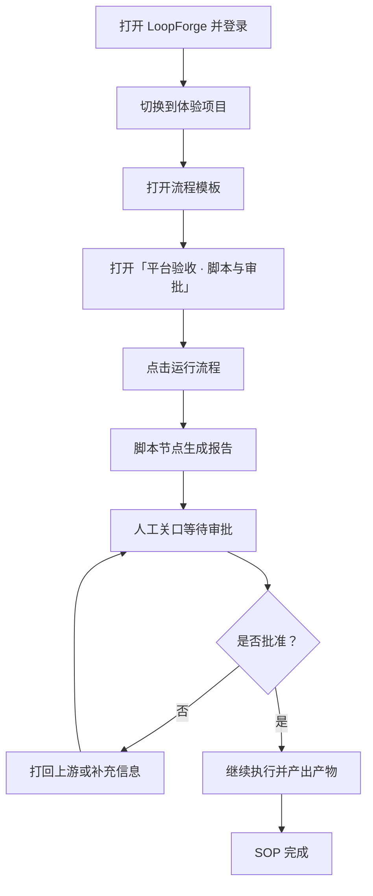

# 快速开始

<cite>
**本文引用的文件**   
- [README.zh-CN.md](file://README.zh-CN.md)
- [compose.yaml](file://compose.yaml)
- [start.sh](file://start.sh)
- [scripts/install.sh](file://scripts/install.sh)
- [scripts/configure.sh](file://scripts/configure.sh)
- [web/app/approvals.js](file://web/app/approvals.js)
- [web/app/sops.js](file://web/app/sops.js)
</cite>

## 目录
1. [简介](#简介)
2. [环境要求](#环境要求)
3. [安装步骤](#安装步骤)
4. [初始配置与账户创建](#初始配置与账户创建)
5. [两种工作方式](#两种工作方式)
6. [免 API Key 的十分钟 SOP 演示](#免-api-key-的十分钟-sop-演示)
7. [镜像与网络配置](#镜像与网络配置)
8. [常见问题解答](#常见问题解答)
9. [故障排查](#故障排查)
10. [下一步](#下一步)

## 简介
LoopForge 是一个可自主部署的团队工作台，让你和编程 Agent 一起交付软件。你可以：
- 在对话里把需求告诉 **Main Bot**，它会按需打开 Docker 沙箱、检出仓库、调用项目角色并生成 PR/MR；
- 把验证过的做法保存为 **SOP**（标准流程），让后续需求按固定阶段、评审和人工关口重复交付。

对于新用户，最关键的起点是：**先跑通一个不需要模型 API Key 的体验 SOP**，再逐步接入执行器、仓库和团队账号。

**章节来源**
- [README.zh-CN.md:38-51](file://README.zh-CN.md#L38-L51)

## 环境要求
LoopForge 的安装脚本会检查并尝试补装以下依赖：
- **Git**：用于克隆仓库。
- **Docker**：平台服务、MySQL 和 SOP 沙箱都运行在容器中。
- **Docker Compose**：默认通过官方插件安装，支持 x86_64 和 arm64。
- **Python 3**：安装脚本需要 Python 3 来生成配置、拉取地址信息和应用数据库种子。
- **curl**：用于下载 Docker 安装脚本、Compose 插件和发布镜像。

Linux 上支持 apt、dnf、yum；macOS 可通过 Homebrew 安装缺失组件。普通 Linux 用户可通过 Docker 组或 sudo 使用 Docker。设置 `LOOPFORGE_YES=1` 可以自动接受安装提示。

| 依赖 | 用途 | 是否必须 |
|---|---|---|
| Git | 克隆 LoopForge 源码 | 是 |
| Docker | 运行平台、数据库和沙箱 | 是 |
| Docker Compose | 启动 compose.yaml 中的服务 | 是 |
| Python 3 | 生成 `.env`、打印访问地址、导入种子数据 | 是 |
| curl | 下载安装器和镜像 | 是 |

如果你已经安装了这些工具，可以直接进入安装步骤；如果缺少部分工具，安装脚本会在确认后尝试自动安装。

**章节来源**
- [README.zh-CN.md:72-82](file://README.zh-CN.md#L72-L82)
- [scripts/install.sh:26-52](file://scripts/install.sh#L26-L52)
- [scripts/install.sh:78-98](file://scripts/install.sh#L78-L98)
- [scripts/install.sh:105-116](file://scripts/install.sh#L105-L116)

## 安装步骤
### 第一步：克隆仓库
```bash
git clone https://github.com/Tencent/LoopForge.git
cd LoopForge
```

### 第二步：启动安装
```bash
./start.sh
```
默认行为是后台安装并启动平台。它不会在本地构建 Go 或前端代码，而是直接拉取 `compose.yaml` 中固定的 GHCR 发布镜像。

### 第三步：等待服务就绪
安装完成后，脚本会：
1. 生成 `.env`，包含数据库密码、会话密钥、端口和数据目录；
2. 启动 MySQL 和 LoopForge 平台服务；
3. 安装数据库扩展列；
4. 导入内置沙箱、通用 SOP 和体验项目；
5. 打印可访问的地址，并提示你创建管理员账号或登录。

```bash
# 查看日志
./start.sh logs

# 停止服务（保留数据）
./start.sh stop

# 重启平台容器
./start.sh restart

# 刷新镜像并重建变更的服务
./start.sh pull
```

**章节来源**
- [README.zh-CN.md:76-82](file://README.zh-CN.md#L76-L82)
- [start.sh:1-17](file://start.sh#L1-L17)
- [start.sh:28-56](file://start.sh#L28-L56)
- [scripts/install.sh:194-206](file://scripts/install.sh#L194-L206)

## 初始配置与账户创建
### 首次访问
安装脚本会输出访问地址。默认情况下，平台监听 `0.0.0.0:8090`，即本机 `http://localhost:8090`。在云主机上，安装脚本还会尝试从云厂商元数据服务读取公网 IP 并打印出来。

打开浏览器后，第一个创建的账号会自动成为**管理员**。

### 关键环境变量
| 变量 | 默认值 | 作用 |
|---|---:|---|
| `AGENTFLOW_HTTP_PORT` | `8090` | 平台 HTTP 端口 |
| `LOOPFORGE_BIND` | `0.0.0.0` | 绑定网卡地址 |
| `LOOPFORGE_MYSQL_PORT` | `33315` | MySQL 映射端口 |
| `LOOPFORGE_DATA_DIR` | `.data` | 平台数据目录 |
| `AGENTFLOW_ALLOW_SIGNUP` | `true` | 是否允许自助注册 |
| `AGENTFLOW_SECURE_COOKIES` | `false` | 是否在反向代理 HTTPS 时启用安全 Cookie |
| `AGENTFLOW_GITHUB_CLIENT_ID` | 空 | GitHub OAuth 客户端 ID |
| `MIRROR` | 空 | 替换 `ghcr.io` 的镜像站主机名 |

`.env` 由安装脚本生成，包含随机生成的数据库密码和会话密钥。重新运行安装是安全的，已有数据和配置会被保留。

**章节来源**
- [README.zh-CN.md:90-92](file://README.zh-CN.md#L90-L92)
- [compose.yaml:20-46](file://compose.yaml#L20-L46)
- [scripts/configure.sh:5-22](file://scripts/configure.sh#L5-L22)
- [scripts/install.sh:118-143](file://scripts/install.sh#L118-L143)

## 两种工作方式
LoopForge 提供两条主要路径，它们共享同一套需求和运行记录：

| 方式 | 适合场景 | 如何运行 | 你如何把控 | 交付结果 |
|---|---|---|---|---|
| **与 Main Bot 对话** | 探索、快速修复、与 Agent 反复迭代 | Main Bot 按需打开对话工作区，调用项目角色作为子 Agent | 回复中途排队或引导消息；暂停、恢复或接管 SOP | PR/MR，或直推合入共享分支 |
| **运行 SOP** | 阶段固定、需要签字确认的可重复交付 | 引擎按顺序执行 Agent、脚本、人工关口和子 SOP | 审批、打回指定环节、重试或从任意节点重跑 | 文档、代码或 PR，以及每个节点的产物和日志 |

### 与 Main Bot 对话
- 在对话首页描述需求；
- 用 `@` 引用角色、技能、需求、SOP 或仓库；
- 每个会话可选择执行器、模型和权限模式；
- 生成的文件在侧边产物面板中预览、查看源码和下载。

### 运行 SOP
- SOP 是 Agent、脚本和人工关口的组合流程；
- 每个节点声明产物和依赖，引擎自动推进；
- 人工关口暂停运行，等人检查后再放行或打回；
- 所有运行状态、日志和产物集中展示。

**章节来源**
- [README.zh-CN.md:42-51](file://README.zh-CN.md#L42-L51)
- [README.zh-CN.md:137-170](file://README.zh-CN.md#L137-L170)

## 免 API Key 的十分钟 SOP 演示
这是新用户在 10 分钟内完成第一个 SOP 的最短路径。该体验不需要模型 API Key，也不需要连接 GitHub。

### 目标
- 启动 LoopForge；
- 切换到体验项目；
- 运行一条只包含脚本和人工审批的 SOP；
- 在人工关口审批通过，观察流程继续执行。

### 操作步骤
1. 完成安装并打开浏览器；
2. 创建管理员账号；
3. 切换到 **LoopForge 体验项目**；
4. 打开 **流程模板**；
5. 找到 **平台验收 · 脚本与审批**；
6. 点击 **运行流程**；
7. 真实脚本会生成报告，流程停在人工关口；
8. 在 **待我确认** 或运行详情页点击 **确认通过**；
9. 观察流程继续执行并产出最终产物。



**图表来源**
- [README.zh-CN.md:94-100](file://README.zh-CN.md#L94-L100)
- [web/app/approvals.js:29-50](file://web/app/approvals.js#L29-L50)
- [web/app/sops.js:116-132](file://web/app/sops.js#L116-L132)

### 为什么这个 SOP 不需要 API Key
体验 SOP 只包含：
- **脚本节点**：执行确定性 Shell 命令，生成报告；
- **人工关口**：暂停运行，等待成员检查并确认。

只有涉及 AI 生成、Agent 执行或调用外部模型时，才需要所选执行器的 API Key。

**章节来源**
- [README.zh-CN.md:94-108](file://README.zh-CN.md#L94-L108)
- [web/app/sops.js:116-132](file://web/app/sops.js#L116-L132)

## 镜像与网络配置
### 镜像来源
默认发布镜像由 `compose.yaml` 固定：
```yaml
image: ${LOOPFORGE_IMAGE:-ghcr.io/tencent/loopforge:0.4.0}
```
这意味着 `./start.sh` 和 `docker compose --profile platform up` 都会拉取该固定版本，而不是从当前源码构建。

### 国内镜像加速
如果 `ghcr.io` 下载中断，可以设置 `MIRROR`：
```bash
MIRROR=ghcr.nju.edu.cn ./start.sh
```
这会从指定镜像站拉取镜像，并将其改标为 `compose.yaml` 中的官方名称。设置 `MIRROR` 表示信任该主机，因为下载结果会被标记为官方镜像名。升级时使用：
```bash
MIRROR=ghcr.nju.edu.cn ./start.sh pull
```

注意：Docker 引擎的 `registry-mirrors`（例如 `https://docker.nju.edu.cn`）只加速 Docker Hub，不能填到 `MIRROR` 中。

### 开发模式
如果需要从源码构建：
```bash
./start.sh dev
```
这会使用 `compose.dev.yaml` 构建本地镜像，并保存 `COMPOSE_FILE=compose.yaml:compose.dev.yaml`，使后续普通 `docker compose` 命令继续使用源码构建。

### 端口与访问
| 配置 | 默认值 | 说明 |
|---|---:|---|
| 平台端口 | `8090` | 可通过 `AGENTFLOW_HTTP_PORT` 修改 |
| 绑定地址 | `0.0.0.0` | 可通过 `LOOPFORGE_BIND` 改为 `127.0.0.1` |
| MySQL 端口 | `33315` | 仅映射到 `127.0.0.1` |
| 数据目录 | `.data` | 通过 `LOOPFORGE_DATA_DIR` 修改 |

**章节来源**
- [compose.yaml:20-26](file://compose.yaml#L20-L26)
- [compose.yaml:43-46](file://compose.yaml#L43-L46)
- [README.zh-CN.md:84-88](file://README.zh-CN.md#L84-L88)
- [scripts/install.sh:152-193](file://scripts/install.sh#L152-L193)

## 常见问题解答

### 是否需要 API Key？
- **体验 SOP**：不需要。体验流程只包含脚本和人工审批。
- **与 Main Bot 对话或运行 Agent 节点**：需要所选执行器的 API Key。
- **平台不附带模型额度**，凭据由你自己配置。

### 必须连接 GitHub 吗？
- **不是必须的**。对话、文档和新项目可以在任务工作区完成。
- 只有当你需要修改已有仓库、提交 PR/MR 或对接 Issue 自动化时，才需要连接 GitHub。
- GitHub 连接支持设备码授权，无需手动申请 PAT；也可手动填写 PAT。

### 第一次运行应该选对话还是 SOP？
- 探索和迭代用**对话**；
- 当某个做法被验证有效，且希望每个需求都按固定流程交付时，把它做成 **SOP**；
- 两种方式可以配合使用：Main Bot 可以启动、暂停和接管 SOP 运行。

### 可以直接暴露到公网吗？
不建议直接暴露。新安装默认监听所有网卡，面向可信团队。开放前请：
- 限制访问来源；
- 配置 HTTPS 反向代理；
- 如需关闭自助注册，设置 `AGENTFLOW_ALLOW_SIGNUP=false`；
- 阅读账号与访问边界文档。

### 如何更换镜像源？
使用 `MIRROR` 环境变量，例如：
```bash
MIRROR=ghcr.nju.edu.cn ./start.sh
```

### 如何查看日志？
```bash
./start.sh logs
```

### 如何停止或重启？
```bash
./start.sh stop
./start.sh restart
```

**章节来源**
- [README.zh-CN.md:94-108](file://README.zh-CN.md#L94-L108)
- [README.zh-CN.md:220-238](file://README.zh-CN.md#L220-L238)
- [compose.yaml:32-35](file://compose.yaml#L32-L35)

## 故障排查

### 安装失败：缺少 Python 3 或 curl
安装脚本会检测并尝试安装缺失组件。如果自动安装失败，请手动安装后重试：
```bash
# Linux apt
sudo apt-get update && sudo apt-get install python3 curl

# macOS Homebrew
brew install python3 curl
```

### Docker 未运行或权限不足
错误通常表现为无法访问 Docker socket。解决方法：
```bash
# Linux：将用户加入 docker 组并重新登录
sudo usermod -aG docker $USER

# 或直接使用 sudo 运行
sudo ./start.sh
```

### 端口被占用
如果 `8090` 被占用，修改 `.env` 中的端口：
```bash
AGENTFLOW_HTTP_PORT=8091
./start.sh restart
```

### 镜像拉取失败
使用 `MIRROR` 环境变量：
```bash
MIRROR=ghcr.nju.edu.cn ./start.sh pull
```

### 无法访问页面
检查：
1. 服务是否启动：`./start.sh logs`；
2. 端口是否正确：`AGENTFLOW_HTTP_PORT`；
3. 绑定地址：`LOOPFORGE_BIND=0.0.0.0` 或 `127.0.0.1`；
4. 云主机安全组是否放通端口；
5. 是否已创建管理员账号。

**章节来源**
- [scripts/install.sh:26-52](file://scripts/install.sh#L26-L52)
- [scripts/install.sh:100-116](file://scripts/install.sh#L100-L116)
- [scripts/install.sh:145-150](file://scripts/install.sh#L145-L150)
- [README.zh-CN.md:84-90](file://README.zh-CN.md#L84-L90)

## 下一步
成功运行第一个 SOP 后，你可以：
1. 配置所选执行器的 API Key；
2. 连接 GitHub 以提交 PR/MR；
3. 复制内置 SOP 并根据项目调整角色、规则和流程；
4. 邀请团队成员创建账号；
5. 使用对话工作台与 Main Bot 协作；
6. 将常用流程固化为项目级 SOP。

如果你只需要个人开发者体验，也可以了解 **LoopForge Local**，它把内置工作流直接带进 Claude Code、CodeBuddy、Codex、Cursor 等编程助手。

**章节来源**
- [README.zh-CN.md:102-135](file://README.zh-CN.md#L102-L135)
- [README.zh-CN.md:193-219](file://README.zh-CN.md#L193-L219)