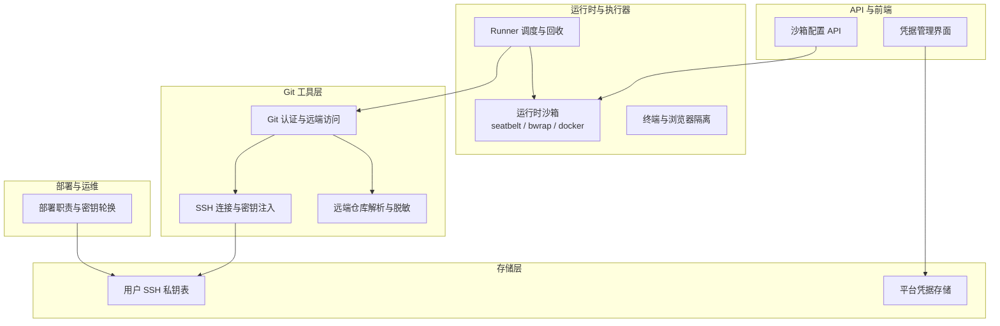
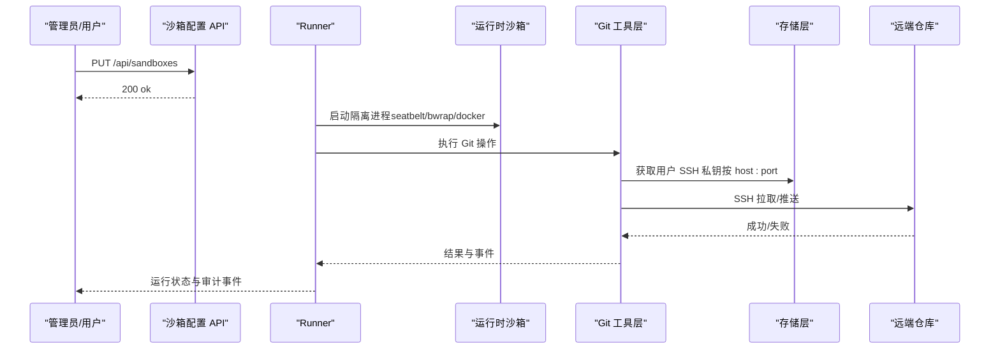
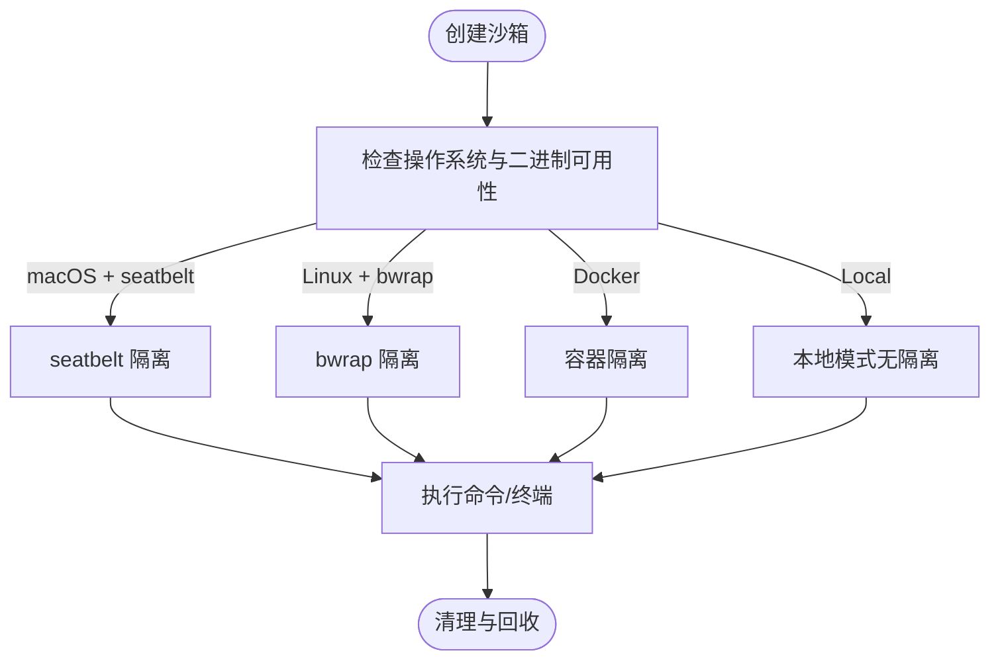
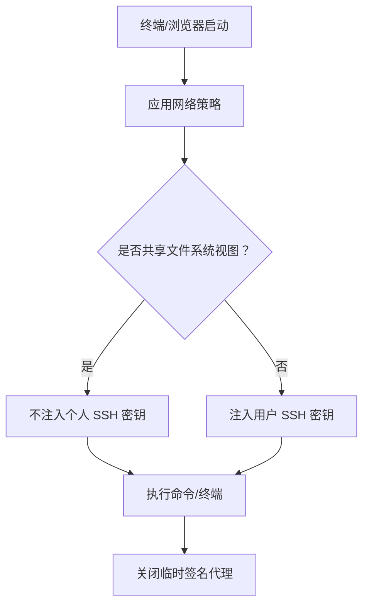
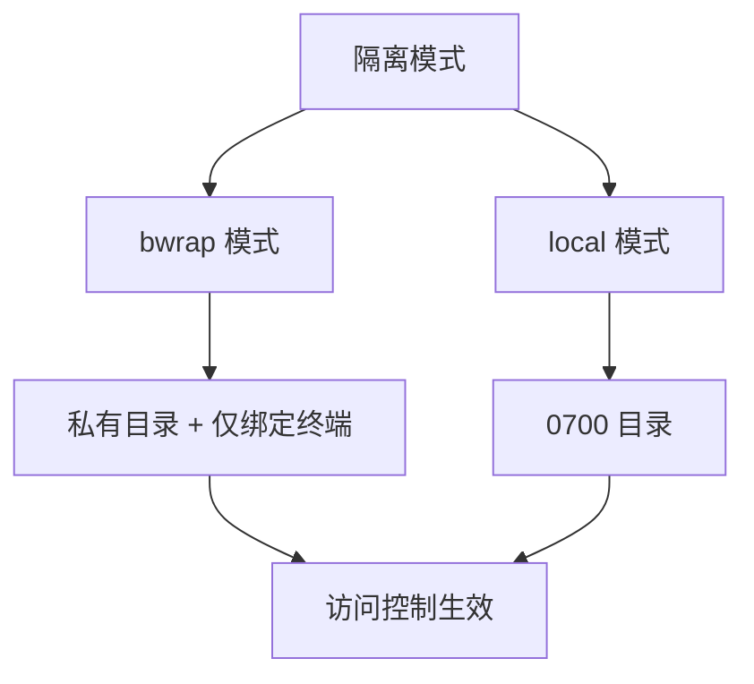
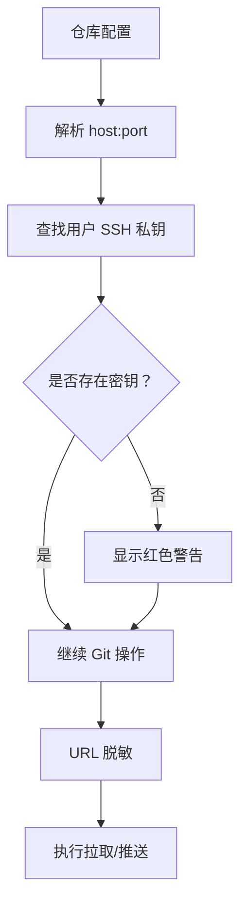
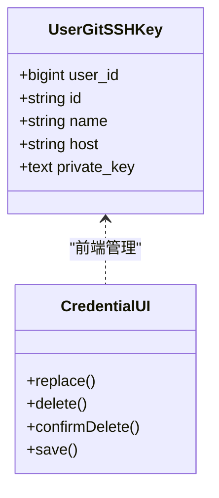
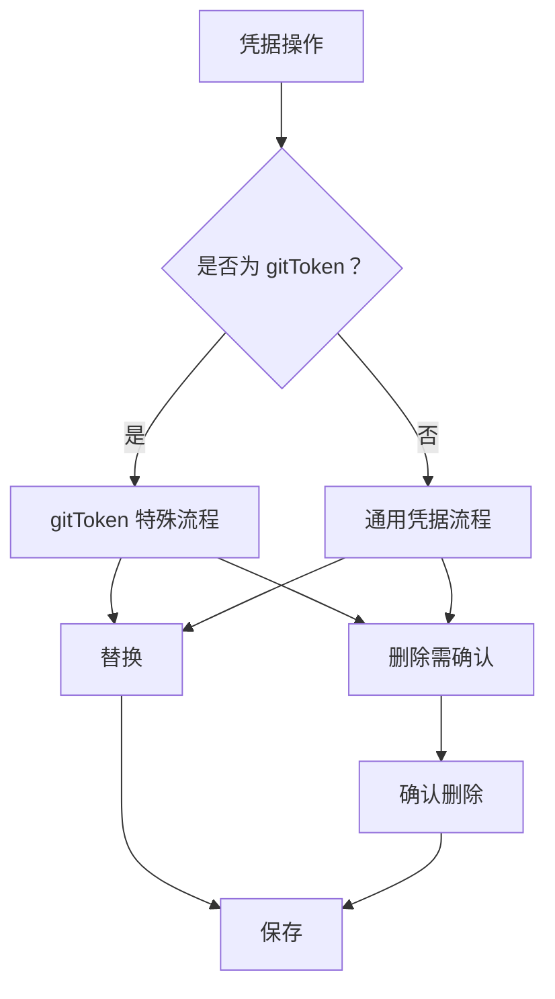
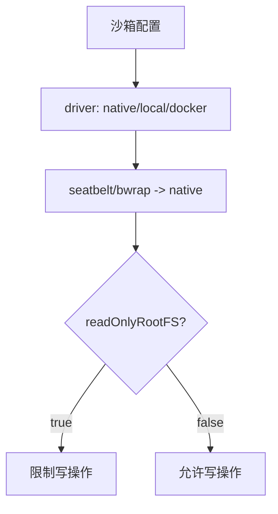
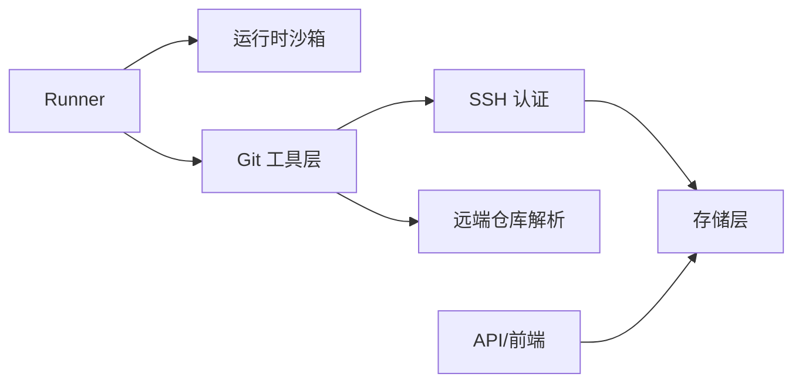

# 安全配置

<cite>
**本文引用的文件**   
- [SECURITY.md](file://SECURITY.md)
- [SECURITY.zh-CN.md](file://SECURITY.zh-CN.md)
- [028_git_ssh_credentials.sql](file://migrations/028_git_ssh_credentials.sql)
- [deployment.md](file://docs/deployment.md)
- [registry.md](file://docs/api/registry.md)
- [sandbox_process.go](file://internal/runtime/sandbox_process.go)
- [process_sandbox_ctor_test.go](file://internal/runtime/process_sandbox_ctor_test.go)
- [git_ssh_credentials.go](file://internal/repo/git_ssh_credentials.go)
- [mysql_live_test.go](file://internal/repo/mysql_live_test.go)
- [auth.go](file://internal/gitwork/auth.go)
- [ssh.go](file://internal/gitwork/ssh.go)
- [ssh_remote.go](file://internal/gitwork/ssh_remote.go)
- [remote.go](file://internal/gitwork/remote.go)
- [run_sandbox.go](file://internal/runner/run_sandbox.go)
- [workspace_terminal_sandbox.go](file://internal/runtime/workspace_terminal_sandbox.go)
- [assistant_sandbox.go](file://internal/httpapi/assistant_sandbox.go)
</cite>

## 目录
1. [引言](#引言)
2. [项目结构](#项目结构)
3. [核心组件](#核心组件)
4. [架构总览](#架构总览)
5. [详细组件分析](#详细组件分析)
6. [依赖关系分析](#依赖关系分析)
7. [性能与安全权衡](#性能与安全权衡)
8. [故障排查指南](#故障排查指南)
9. [结论](#结论)
10. [附录：生产环境加固清单](#附录生产环境加固清单)

## 引言
本文件聚焦 LoopForge 的安全配置与实现，覆盖沙箱隔离、网络访问控制、文件系统权限管理、Git 操作安全限制、SSH 密钥管理、凭据保护机制、安全策略与访问控制、审计日志记录，以及生产环境加固与常见威胁防护。文档以仓库实际代码和迁移脚本为依据，提供从架构到实现的系统化说明，并给出可操作的实践建议。

## 项目结构
安全相关能力横跨多个子系统：
- 运行时与执行器：负责进程级沙箱（seatbelt/bwrap）、Docker 沙箱、终端与浏览器隔离、工作区权限控制。
- Git 工具层：封装 SSH 认证、远程仓库访问、URL 脱敏与基线安全检查。
- 存储层：持久化用户 SSH 私钥、平台凭据等敏感信息。
- API 与前端：暴露沙箱配置管理、凭据编辑界面与提示。
- 部署与运维：提供部署职责、密钥轮换与使用约束说明。

**图示来源** 
- [sandbox_process.go:109-127](file://internal/runtime/sandbox_process.go#L109-L127)
- [registry.md:204-224](file://docs/api/registry.md#L204-L224)
- [028_git_ssh_credentials.sql:1-10](file://migrations/028_git_ssh_credentials.sql#L1-L10)
- [deployment.md:105-105](file://docs/deployment.md#L105-L105)

**章节来源**
- [sandbox_process.go:109-127](file://internal/runtime/sandbox_process.go#L109-L127)
- [registry.md:204-224](file://docs/api/registry.md#L204-L224)
- [028_git_ssh_credentials.sql:1-10](file://migrations/028_git_ssh_credentials.sql#L1-L10)
- [deployment.md:105-105](file://docs/deployment.md#L105-L105)

## 核心组件
- 沙箱隔离机制：通过 seatbelt（macOS）与 bwrap（Linux）在进程级别进行隔离；Docker 模式提供容器级隔离；本地模式无隔离但受工作区权限约束。
- 网络访问控制：终端与浏览器会话在网络层面受限，避免任意出站访问；Docker 与 seatbelt 共享文件系统视图，终端不持有个人 SSH 密钥。
- 文件系统权限管理：bwrap 模式下终端位于私有目录并仅绑定到该终端；local 模式下终端位于 0700 目录，避免被其他进程读取。
- Git 操作安全限制：按主机+端口选择用户 SSH 密钥；临时签名代理随命令或终端结束关闭；禁止仓库级默认回退密钥。
- SSH 密钥管理：用户级私钥表，主键为用户 ID 与密钥 ID；私钥不通过仓库配置或凭据 API 返回。
- 凭据保护机制：Git Token 与平台凭据分离管理；前端提供替换、删除、确认删除等操作；测试覆盖生命周期与状态标志。
- 安全策略与访问控制：沙箱配置支持只读根文件系统、驱动类型映射（seatbelt/bwrap 归一为 native），内置 local 沙箱不可删除且受保护。
- 审计日志记录：运行期事件、助手生成与检查点等具备观测与审计能力（详见“架构总览”中的观测链路）。

**章节来源**
- [sandbox_process.go:109-127](file://internal/runtime/sandbox_process.go#L109-L127)
- [process_sandbox_ctor_test.go:46-57](file://internal/runtime/process_sandbox_ctor_test.go#L46-L57)
- [deployment.md:105-105](file://docs/deployment.md#L105-L105)
- [028_git_ssh_credentials.sql:1-10](file://migrations/028_git_ssh_credentials.sql#L1-L10)
- [registry.md:204-224](file://docs/api/registry.md#L204-L224)

## 架构总览
下图展示安全关键路径的交互：API 创建或更新沙箱配置，Runner 根据配置启动隔离进程，Git 工具层通过 SSH 访问远端仓库，存储层保存用户 SSH 私钥，部署侧提供密钥轮换与最小权限指导。

**图示来源** 
- [registry.md:204-224](file://docs/api/registry.md#L204-L224)
- [sandbox_process.go:109-127](file://internal/runtime/sandbox_process.go#L109-L127)
- [028_git_ssh_credentials.sql:1-10](file://migrations/028_git_ssh_credentials.sql#L1-L10)
- [deployment.md:105-105](file://docs/deployment.md#L105-L105)

## 详细组件分析

### 沙箱隔离机制
- 驱动选择与校验：seatbelt 仅在 macOS 可用，bwrap 仅在 Linux 可用；若二进制不在 PATH 则报错。
- 进程级隔离：通过系统提供的 sandbox-exec 与 bwrap 对子进程施加资源与权限限制。
- Docker 隔离：容器级隔离，适合需要完整依赖环境的场景；与 seatbelt 共享文件系统视图，终端不持有个人 SSH 密钥。
- 本地模式：无隔离，但终端位于 0700 目录，降低横向越权风险。

**图示来源** 
- [sandbox_process.go:109-127](file://internal/runtime/sandbox_process.go#L109-L127)
- [process_sandbox_ctor_test.go:46-57](file://internal/runtime/process_sandbox_ctor_test.go#L46-L57)

**章节来源**
- [sandbox_process.go:109-127](file://internal/runtime/sandbox_process.go#L109-L127)
- [process_sandbox_ctor_test.go:46-57](file://internal/runtime/process_sandbox_ctor_test.go#L46-L57)

### 网络访问控制
- 终端与浏览器会话在网络层面受限，避免任意出站访问。
- Docker 与 seatbelt 的工作区共享文件系统视图，终端不持有个人 SSH 密钥；推送应通过平台的提交动作完成。
- 临时签名代理的生命周期与命令/终端一致，结束后自动关闭。

**图示来源** 
- [deployment.md:105-105](file://docs/deployment.md#L105-L105)

**章节来源**
- [deployment.md:105-105](file://docs/deployment.md#L105-L105)

### 文件系统权限管理
- bwrap 模式下，终端位于私有目录，仅绑定到该终端，防止跨终端访问。
- local 模式下，终端位于 0700 目录，确保只有当前用户可读写。
- Docker 与 seatbelt 共享文件系统视图，需配合网络与密钥策略降低越权风险。

**图示来源** 
- [deployment.md:105-105](file://docs/deployment.md#L105-L105)

**章节来源**
- [deployment.md:105-105](file://docs/deployment.md#L105-L105)

### Git 操作的安全限制
- 按主机+端口选择用户 SSH 密钥；同一主机+端口共享密钥。
- 仓库表单仅在缺少个人密钥时显示红色警告，但不阻止保存或完成设置。
- 不存在仓库级或默认回退密钥；checkout 与 SOP 执行使用责任用户的密钥；对话提交与工作区终端使用请求用户的密钥。
- URL 处理包含脱敏逻辑，避免敏感信息泄露。

**图示来源** 
- [deployment.md:105-105](file://docs/deployment.md#L105-L105)
- [remote.go](file://internal/gitwork/remote.go)

**章节来源**
- [deployment.md:105-105](file://docs/deployment.md#L105-L105)
- [remote.go](file://internal/gitwork/remote.go)

### SSH 密钥管理
- 用户级 SSH 私钥表：主键为用户 ID 与密钥 ID；每主机+端口一个密钥。
- 私钥不通过仓库配置或凭据 API 返回，避免泄露。
- 前端提供替换、删除、确认删除等操作；测试覆盖生命周期与状态标志。

**图示来源** 
- [028_git_ssh_credentials.sql:1-10](file://migrations/028_git_ssh_credentials.sql#L1-L10)
- [git_ssh_credentials.go](file://internal/repo/git_ssh_credentials.go)
- [mysql_live_test.go:205-240](file://internal/repo/mysql_live_test.go#L205-L240)

**章节来源**
- [028_git_ssh_credentials.sql:1-10](file://migrations/028_git_ssh_credentials.sql#L1-L10)
- [git_ssh_credentials.go](file://internal/repo/git_ssh_credentials.go)
- [mysql_live_test.go:205-240](file://internal/repo/mysql_live_test.go#L205-L240)

### 凭据保护机制
- Git Token 与平台凭据分离管理；前端区分 gitToken 与其他凭据类型。
- 凭据编辑支持替换、取消、删除、确认删除、保存等操作；gitToken 的删除行为有特殊处理。
- 后端测试覆盖凭据生命周期与状态标志，确保一致性。

**图示来源** 
- [workbench.js:830-855](file://web/app/workbench.js#L830-L855)

**章节来源**
- [workbench.js:830-855](file://web/app/workbench.js#L830-L855)

### 安全策略配置与访问控制列表
- 沙箱配置 API 支持创建、更新与删除；内置 local 沙箱不可删除且受保护。
- 驱动类型映射：seatbelt 与 bwrap 统一归一为 native；运行时在 macOS 解析为 seatbelt，在 Linux 解析为 bwrap。
- 只读根文件系统选项用于限制写入面。

**图示来源** 
- [registry.md:204-224](file://docs/api/registry.md#L204-L224)

**章节来源**
- [registry.md:204-224](file://docs/api/registry.md#L204-L224)

### 审计日志记录
- 运行期事件、助手生成、检查点与观察指标贯穿执行链路，便于审计与排障。
- 建议在部署侧启用结构化日志与集中收集，结合告警规则识别异常行为。

[本节为概念性说明，不直接分析具体文件]

## 依赖关系分析
安全相关模块之间的耦合如下：
- Runner 依赖运行时沙箱与 Git 工具层。
- Git 工具层依赖 SSH 认证与远端仓库解析。
- 存储层提供用户 SSH 私钥与平台凭据。
- API 与前端负责配置管理与凭据编辑。

**图示来源** 
- [run_sandbox.go](file://internal/runner/run_sandbox.go)
- [auth.go](file://internal/gitwork/auth.go)
- [ssh.go](file://internal/gitwork/ssh.go)
- [ssh_remote.go](file://internal/gitwork/ssh_remote.go)
- [remote.go](file://internal/gitwork/remote.go)

**章节来源**
- [run_sandbox.go](file://internal/runner/run_sandbox.go)
- [auth.go](file://internal/gitwork/auth.go)
- [ssh.go](file://internal/gitwork/ssh.go)
- [ssh_remote.go](file://internal/gitwork/ssh_remote.go)
- [remote.go](file://internal/gitwork/remote.go)

## 性能与安全权衡
- 进程级隔离（seatbelt/bwrap）开销较低，适合频繁短任务；容器隔离（docker）开销较高但隔离更强。
- 终端与浏览器隔离会增加资源分配与上下文切换成本，但能显著降低越权风险。
- 只读根文件系统可减少误写与恶意修改，但可能影响构建与安装流程，需按需开启。
- SSH 密钥按主机+端口复用可降低密钥数量，但需注意同主机多租户隔离。

[本节为一般性讨论，不直接分析具体文件]

## 故障排查指南
- 沙箱不可用：检查 seatbelt/bwrap 是否在 PATH 且系统匹配；错误消息会明确指示所需 OS 与二进制。
- SSH 密钥缺失：仓库表单会显示红色警告；请补充用户 SSH 私钥并完成主机信任配置。
- 凭据操作失败：确认前端操作序列（替换/删除/确认删除/保存）与后端状态标志一致。
- 网络访问受限：确认终端/浏览器会话的网络策略；Docker 与 seatbelt 共享文件系统视图时，终端不持有个人 SSH 密钥。

**章节来源**
- [process_sandbox_ctor_test.go:46-57](file://internal/runtime/process_sandbox_ctor_test.go#L46-L57)
- [deployment.md:105-105](file://docs/deployment.md#L105-L105)
- [mysql_live_test.go:205-240](file://internal/repo/mysql_live_test.go#L205-L240)

## 结论
LoopForge 的安全配置围绕“最小权限、强隔离、可审计”展开：通过 seatbelt/bwrap/docker 实现多层隔离，按主机+端口管理 SSH 密钥，严格限制网络与文件系统访问，并提供完善的凭据管理与沙箱配置 API。部署侧需遵循最小权限原则与密钥轮换策略，结合审计日志与告警提升整体安全性。

[本节为总结性内容，不直接分析具体文件]

## 附录：生产环境加固清单
- 身份与凭据
  - 使用最小权限身份与短期凭证；接入安全的 Secret Manager。
  - 定期轮换 SSH 私钥与 Git Token；撤销旧公钥。
  - 确保本地配置与凭据被 .gitignore 排除。
- 沙箱与隔离
  - 优先使用 native（seatbelt/bwrap）或 docker 驱动；必要时开启只读根文件系统。
  - 避免在共享文件系统视图中注入个人 SSH 密钥；通过平台提交动作进行推送。
- 网络与文件系统
  - 限制终端/浏览器的出站访问；仅开放必要域名与端口。
  - 将终端置于私有目录（bwrap）或 0700 目录（local）。
- 审计与监控
  - 启用结构化日志与集中收集；配置异常行为告警。
  - 定期检查沙箱配置变更与凭据访问记录。

**章节来源**
- [SECURITY.zh-CN.md:19-22](file://SECURITY.zh-CN.md#L19-L22)
- [deployment.md:105-105](file://docs/deployment.md#L105-L105)