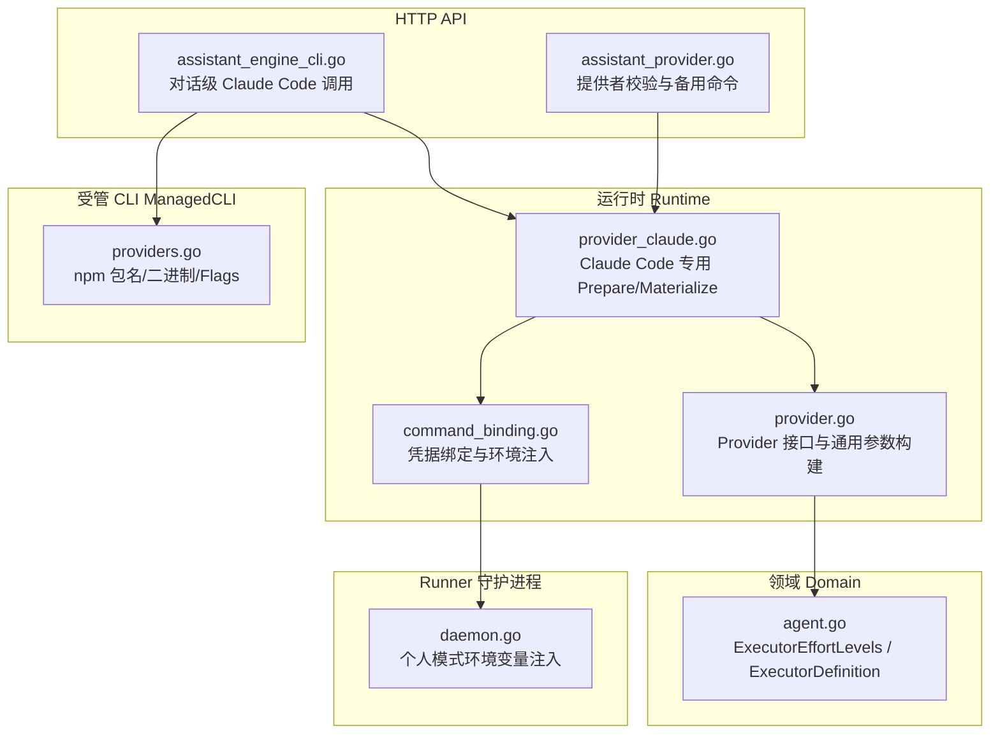
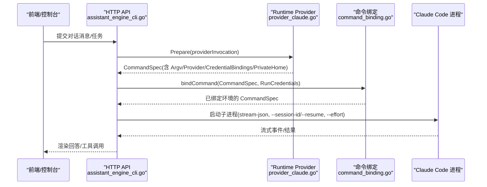
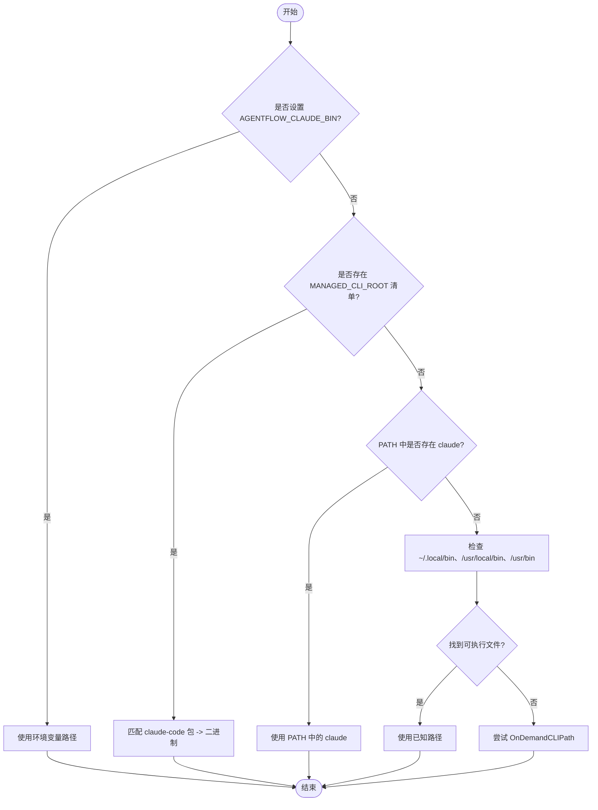
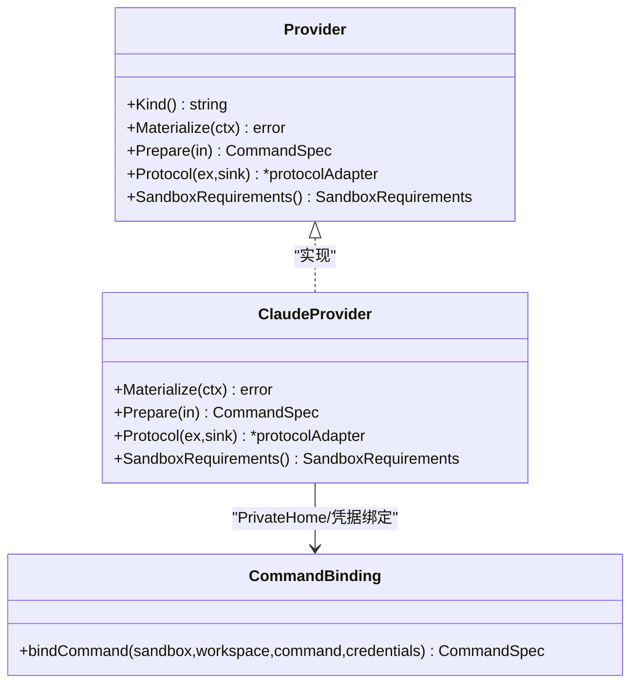
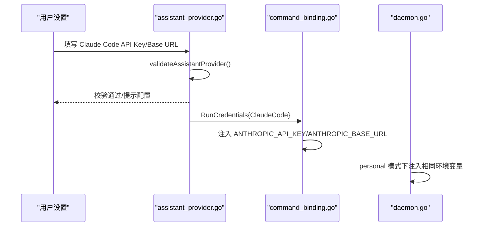
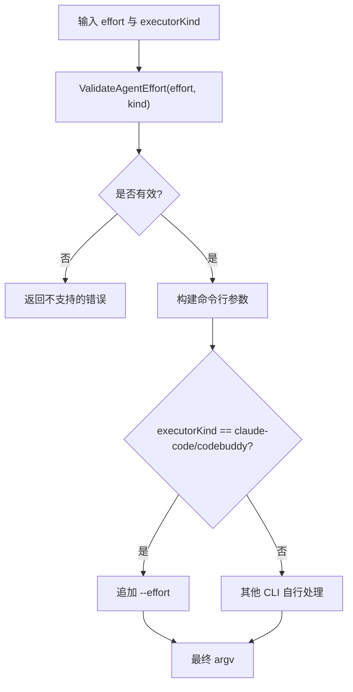
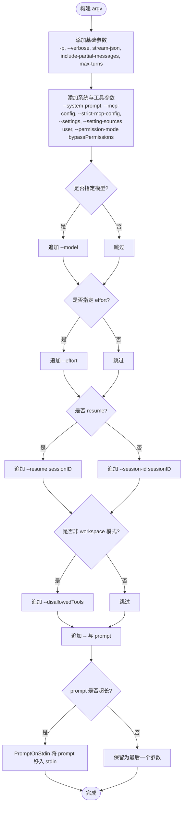
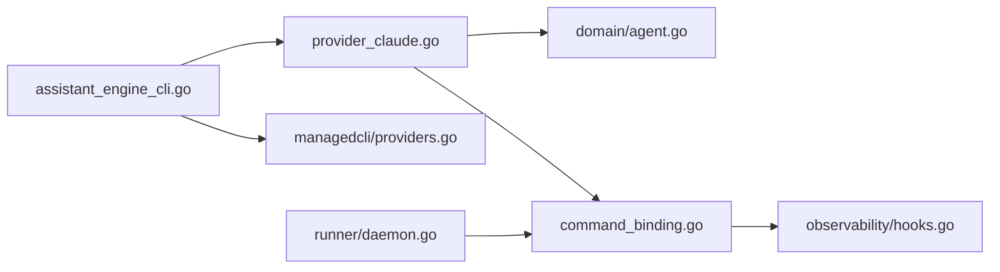

# Claude Code 执行器

<cite>
**本文引用的文件**   
- [internal/runtime/provider.go](file://internal/runtime/provider.go)
- [internal/runtime/provider_claude.go](file://internal/runtime/provider_claude.go)
- [internal/domain/agent.go](file://internal/domain/agent.go)
- [internal/httpapi/assistant_engine_cli.go](file://internal/httpapi/assistant_engine_cli.go)
- [internal/httpapi/assistant_provider.go](file://internal/httpapi/assistant_provider.go)
- [internal/managedcli/providers.go](file://internal/managedcli/providers.go)
- [internal/runtimе/command_binding.go](file://internal/runtimе/command_binding.go)
- [internal/runner/daemon.go](file://internal/runner/daemon.go)
</cite>

## 目录
1. [简介](#简介)
2. [项目结构](#项目结构)
3. [核心组件](#核心组件)
4. [架构总览](#架构总览)
5. [详细组件分析](#详细组件分析)
6. [依赖关系分析](#依赖关系分析)
7. [性能与容量考虑](#性能与容量考虑)
8. [故障排除指南](#故障排除指南)
9. [结论](#结论)

## 简介
本文面向 Claude Code CLI 在 LoopForge 中的执行器实现，聚焦以下目标：
- 安装检测与可管理安装路径解析
- 配置管理与私有 HOME、MCP、技能插件注入
- 认证流程与环境变量绑定（API Key、Base URL、OAuth）
- --effort 参数映射机制及与其他执行器的差异
- 命令参数构建逻辑、提示词长度处理与 stdin 分流
- 环境变量配置、本地安装验证与运行时沙箱隔离
- 故障排除与性能优化建议

## 项目结构
Claude Code 执行器涉及多个层次：
- 领域层定义执行器能力与思考强度枚举
- 运行时 Provider 负责按执行器种类准备命令、协议适配和沙箱需求
- HTTP API 层负责对话场景下的 Claude Code 调用、会话 ID 映射、MCP 注入与错误诊断
- 受管 CLI 清单提供 npm 包名、二进制名与帮助标志
- 命令绑定层负责安全地注入凭据、HOME、TMPDIR、Git/MCP 环境
- Runner 守护进程在个人凭据模式下注入 Anthropic 环境变量

**图表来源**
- [internal/httpapi/assistant_engine_cli.go:174-227](file://internal/httpapi/assistant_engine_cli.go#L174-L227)
- [internal/httpapi/assistant_provider.go:77-138](file://internal/httpapi/assistant_provider.go#L77-L138)
- [internal/runtime/provider.go:48-84](file://internal/runtime/provider.go#L48-L84)
- [internal/runtime/provider_claude.go:16-90](file://internal/runtime/provider_claude.go#L16-L90)
- [internal/runtimе/command_binding.go:32-161](file://internal/runtimе/command_binding.go#L32-L161)
- [internal/domain/agent.go:10-49](file://internal/domain/agent.go#L10-L49)
- [internal/managedcli/providers.go:24-37](file://internal/managedcli/providers.go#L24-L37)
- [internal/runner/daemon.go:1094-1107](file://internal/runner/daemon.go#L1094-L1107)

**章节来源**
- [internal/runtime/provider.go:48-84](file://internal/runtime/provider.go#L48-L84)
- [internal/runtime/provider_claude.go:16-90](file://internal/runtime/provider_claude.go#L16-L90)
- [internal/httpapi/assistant_engine_cli.go:174-227](file://internal/httpapi/assistant_engine_cli.go#L174-L227)
- [internal/httpapi/assistant_provider.go:77-138](file://internal/httpapi/assistant_provider.go#L77-L138)
- [internal/domain/agent.go:10-49](file://internal/domain/agent.go#L10-L49)
- [internal/managedcli/providers.go:24-37](file://internal/managedcli/providers.go#L24-L37)
- [internal/runtimе/command_binding.go:32-161](file://internal/runtimе/command_binding.go#L32-L161)
- [internal/runner/daemon.go:1094-1107](file://internal/runner/daemon.go#L1094-L1107)

## 核心组件
- 领域模型
  - 执行器思考强度枚举：为 claude-code、codebuddy、codex 等内置 CLI 声明支持的 effort 级别。
  - 执行器定义：包含 kind、binary、args、model、effort 等字段。
- 运行时 Provider
  - baseProvider：通用参数构建、PromptOnStdin、协议适配器选择。
  - claudeProvider：Materialize 注入 MCP、系统提示、技能插件；Prepare 注入 --effort、权限模式、resume、plugin-dir 等。
- HTTP API
  - assistant_engine_cli.go：对话级 Claude Code 调用，写入 mcp.json、claude-settings.json，构造 stream-json 输出、--session-id/--resume、--effort、--disallowedTools 等。
  - assistant_provider.go：用户凭据校验、备用命令构建、Codex/Claude Code 差异化参数。
- 受管 CLI
  - providers.go：声明 @anthropic-ai/claude-code 包名、二进制 claude、帮助命令与允许的标志。
- 命令绑定
  - command_binding.go：清空宿主敏感环境变量，按需注入 ANTHROPIC_API_KEY、ANTHROPIC_BASE_URL、CLAUDE_CONFIG_DIR、IS_SANDBOX 等。
- Runner 守护进程
  - daemon.go：个人凭据模式下设置 ANTHROPIC_API_KEY 与 ANTHROPIC_BASE_URL。

**章节来源**
- [internal/domain/agent.go:10-49](file://internal/domain/agent.go#L10-L49)
- [internal/runtime/provider.go:48-128](file://internal/runtime/provider.go#L48-L128)
- [internal/runtime/provider_claude.go:16-98](file://internal/runtime/provider_claude.go#L16-L98)
- [internal/httpapi/assistant_engine_cli.go:174-227](file://internal/httpapi/assistant_engine_cli.go#L174-L227)
- [internal/httpapi/assistant_provider.go:27-65](file://internal/httpapi/assistant_provider.go#L27-L65)
- [internal/managedcli/providers.go:24-37](file://internal/managedcli/providers.go#L24-L37)
- [internal/runtimе/command_binding.go:32-161](file://internal/runtimе/command_binding.go#L32-L161)
- [internal/runner/daemon.go:1094-1107](file://internal/runner/daemon.go#L1094-L1107)

## 架构总览
Claude Code 执行器在“对话执行”和“工作节点执行”两条路径上复用同一套 Provider 与命令绑定策略：
- 对话执行：HTTP API 直接准备 Claude Code 子进程，注入 MCP、settings、stream-json、session-id/resume、effort 等。
- 工作节点执行：Engine 通过 runtime.Provider.Prepare 生成 CommandSpec，再由 runner 或 sandbox 执行并注入凭据与环境。

**图表来源**
- [internal/httpapi/assistant_engine_cli.go:174-227](file://internal/httpapi/assistant_engine_cli.go#L174-L227)
- [internal/runtime/provider_claude.go:58-90](file://internal/runtime/provider_claude.go#L58-L90)
- [internal/runtimе/command_binding.go:32-161](file://internal/runtimе/command_binding.go#L32-L161)

## 详细组件分析

### 安装检测与可管理安装
Claude Code 二进制查找顺序：
1. 环境变量 AGENTFLOW_CLAUDE_BIN 显式覆盖
2. 受管 CLI 清单 managedcli.ReadInventory(AgentFlow_MANAGED_CLI_ROOT) 中匹配 claude-code 包对应的二进制
3. PATH 中查找 claude
4. 常见安装位置 ~/.local/bin/claude、/usr/local/bin/claude、/usr/bin/claude
5. 按需安装路径 OnDemandCLIPath(engine)

受管清单中 claude-code 对应 npm 包 @anthropic-ai/claude-code，二进制名为 claude，帮助命令为 --help，支持 --print、--output-format、--verbose、--permission-mode、--setting-sources、--system-prompt-file、--mcp-config、--settings、--resume、--plugin-dir 等标志。

**图表来源**
- [internal/httpapi/assistant_engine_cli.go:61-101](file://internal/httpapi/assistant_engine_cli.go#L61-L101)
- [internal/managedcli/providers.go:24-37](file://internal/managedcli/providers.go#L24-L37)

**章节来源**
- [internal/httpapi/assistant_engine_cli.go:61-101](file://internal/httpapi/assistant_engine_cli.go#L61-L101)
- [internal/managedcli/providers.go:24-37](file://internal/managedcli/providers.go#L24-L37)

### 配置管理与私有 HOME
- Materialize 阶段为 Claude Code 注入：
  - MCP 配置文件路径
  - setting-sources=user
  - system-prompt-file=agent-system.md
  - 当存在 Hooks 时，写入 claude-settings.json 并通过 --settings 引用
  - 当存在 Skills 时，通过 --plugin-dir 指向 AgentRoot
- Private Home：
  - claudeProvider.SandboxRequirements 要求 PrivateHome=true 与 BunFS=true
  - command_binding.go 在 PrivateHome 模式下创建 .claude 目录，并设置 CLAUDE_CONFIG_DIR 指向该目录
  - 在 Docker 驱动下，HOME/TMPDIR 映射到容器内路径

**图表来源**
- [internal/runtime/provider.go:48-61](file://internal/runtime/provider.go#L48-L61)
- [internal/runtime/provider_claude.go:16-98](file://internal/runtime/provider_claude.go#L16-L98)
- [internal/runtimе/command_binding.go:57-85](file://internal/runtimе/command_binding.go#L57-L85)

**章节来源**
- [internal/runtime/provider_claude.go:16-36](file://internal/runtime/provider_claude.go#L16-L36)
- [internal/runtime/provider_claude.go:96-98](file://internal/runtime/provider_claude.go#L96-L98)
- [internal/runtimе/command_binding.go:57-85](file://internal/runtimе/command_binding.go#L57-L85)

### 认证流程与环境变量
- 用户侧凭据校验：
  - assistant_provider.go 校验 Claude Code API Key 是否为空，否则返回配置提示
  - assistantProviderCredentials 将 ClaudeCodeAPIKey 与 ClaudeCodeBaseURL 放入 RunCredentials
- 命令绑定注入：
  - command_binding.go 清空宿主敏感环境变量后，根据 BindClaudeCode 注入：
    - ANTHROPIC_API_KEY
    - ANTHROPIC_BASE_URL（默认 https://api.anthropic.com）
  - PrivateHome 模式下设置 CLAUDE_CONFIG_DIR 指向 .claude
- Runner 守护进程：
  - daemon.go 在 personal 模式下设置 ANTHROPIC_API_KEY 与 ANTHROPIC_BASE_URL

**图表来源**
- [internal/httpapi/assistant_provider.go:27-65](file://internal/httpapi/assistant_provider.go#L27-L65)
- [internal/runtimе/command_binding.go:120-129](file://internal/runtimе/command_binding.go#L120-L129)
- [internal/runner/daemon.go:1094-1107](file://internal/runner/daemon.go#L1094-L1107)

**章节来源**
- [internal/httpapi/assistant_provider.go:27-65](file://internal/httpapi/assistant_provider.go#L27-L65)
- [internal/runtimе/command_binding.go:120-129](file://internal/runtimе/command_binding.go#L120-L129)
- [internal/runner/daemon.go:1094-1107](file://internal/runner/daemon.go#L1094-L1107)

### --effort 参数映射机制
- 领域层维护各 CLI 支持的 effort 值：
  - claude-code/codebuddy 支持 low/medium/high/xhigh/max/ultracode
  - codex 支持 low/medium/high/xhigh/max/ultra
- 运行时 Provider：
  - baseProvider.appendEffortArgs 仅在未显式传入 --effort 时追加
  - claudeProvider.Prepare 调用 appendEffortArgs 注入 --effort
- HTTP API 对话路径：
  - assistant_engine_cli.go 在构造 argv 时，若 Effort 非空则追加 --effort
- 测试断言：
  - provider_test.go 断言 claude-code 与 codebuddy 的 effort 以 --effort high 形式注入；codex 则以 -c model_reasoning_effort="high" 形式注入

**图表来源**
- [internal/domain/agent.go:10-49](file://internal/domain/agent.go#L10-L49)
- [internal/runtime/provider.go:86-95](file://internal/runtime/provider.go#L86-L95)
- [internal/runtime/provider_claude.go:58-63](file://internal/runtime/provider_claude.go#L58-L63)
- [internal/httpapi/assistant_engine_cli.go:208-210](file://internal/httpapi/assistant_engine_cli.go#L208-L210)

**章节来源**
- [internal/domain/agent.go:10-49](file://internal/domain/agent.go#L10-L49)
- [internal/runtime/provider.go:86-95](file://internal/runtime/provider.go#L86-L95)
- [internal/runtime/provider_claude.go:58-63](file://internal/runtime/provider_claude.go#L58-L63)
- [internal/httpapi/assistant_engine_cli.go:208-210](file://internal/httpapi/assistant_engine_cli.go#L208-L210)

### 命令参数构建逻辑
Claude Code 对话级参数要点：
- 基础参数：-p、--verbose、--output-format stream-json、--include-partial-messages、--max-turns unlimited
- 系统与工具：--system-prompt、--mcp-config、--strict-mcp-config、--settings、--setting-sources user、--permission-mode bypassPermissions
- 模型与强度：--model（可选）、--effort（可选）
- 会话控制：--session-id 或 --resume
- 工具限制：--disallowedTools（非 workspace 模式）
- 提示词超长：PromptOnStdin 将末尾 prompt 移至 stdin，避免 Linux MAX_ARG_STRLEN 限制

**图表来源**
- [internal/httpapi/assistant_engine_cli.go:198-227](file://internal/httpapi/assistant_engine_cli.go#L198-L227)
- [internal/runtime/provider.go:101-128](file://internal/runtime/provider.go#L101-L128)

**章节来源**
- [internal/httpapi/assistant_engine_cli.go:198-227](file://internal/httpapi/assistant_engine_cli.go#L198-L227)
- [internal/runtime/provider.go:101-128](file://internal/runtime/provider.go#L101-L128)

### 与其他执行器的差异
- Claude Code vs CodeBuddy
  - 两者均支持 --effort，但 Claude Code 额外支持 --verbose 与更严格的 permission-mode 控制
  - Claude Code 使用 stream-json 协议与 anthropic-stream-v1 适配器
- Claude Code vs Codex
  - Codex 不直接使用 --effort，而是通过 -c model_reasoning_effort="..." 注入
  - Codex 使用 JSONL item.completed 事件格式，需单独的事件解析逻辑
  - Codex 禁用大量内置特性，并通过 hooks.PreToolUse 钩子进行二次工具访问控制

**章节来源**
- [internal/runtime/provider.go:146-164](file://internal/runtime/provider.go#L146-L164)
- [internal/runtime/provider_claude.go:92-94](file://internal/runtime/provider_claude.go#L92-L94)
- [internal/httpapi/assistant_provider.go:140-166](file://internal/httpapi/assistant_provider.go#L140-L166)

## 依赖关系分析
- HTTP API 依赖 runtime.Provider 与 managedcli 清单
- runtime.Provider 依赖 domain.ExecutorDefinition 与 protocol 适配器
- command_binding.go 依赖 observability 与 gitwork 相关辅助函数
- runner/daemon.go 在个人模式下注入 Anthropic 环境变量

**图表来源**
- [internal/httpapi/assistant_engine_cli.go:174-227](file://internal/httpapi/assistant_engine_cli.go#L174-L227)
- [internal/runtime/provider_claude.go:16-90](file://internal/runtime/provider_claude.go#L16-L90)
- [internal/runtimе/command_binding.go:164-181](file://internal/runtimе/command_binding.go#L164-L181)
- [internal/runner/daemon.go:1094-1107](file://internal/runner/daemon.go#L1094-L1107)

**章节来源**
- [internal/httpapi/assistant_engine_cli.go:174-227](file://internal/httpapi/assistant_engine_cli.go#L174-L227)
- [internal/runtime/provider_claude.go:16-90](file://internal/runtime/provider_claude.go#L16-L90)
- [internal/runtimе/command_binding.go:164-181](file://internal/runtimе/command_binding.go#L164-L181)
- [internal/runner/daemon.go:1094-1107](file://internal/runner/daemon.go#L1094-L1107)

## 性能与容量考虑
- 提示词长度限制
  - 单个 argv 字符串超过 Linux MAX_ARG_STRLEN 会触发 E2BIG，导致进程无法启动
  - PromptOnStdin 将超长 prompt 移至 stdin，避免 fork/exec 失败
- 流式输出与 verbose
  - Claude Code 在 print/stream-json 模式下需要 --verbose，确保输出稳定可读
- 私有 HOME 与缓存
  - PrivateHome 隔离 .claude 目录，避免多会话互相污染；Docker 驱动下映射到容器路径
- 遥测开销
  - 启用 OTEL 导出可能带来少量网络开销，可通过 InvocationOptions.Telemetry 控制

**章节来源**
- [internal/runtime/provider.go:97-128](file://internal/runtime/provider.go#L97-L128)
- [internal/runtime/provider_claude.go:66-74](file://internal/runtime/provider_claude.go#L66-L74)
- [internal/runtimе/command_binding.go:57-85](file://internal/runtimе/command_binding.go#L57-L85)
- [internal/runtimе/command_binding.go:164-181](file://internal/runtimе/command_binding.go#L164-L181)

## 故障排除指南
常见问题与定位步骤：
- “服务器没有安装 Claude Code”
  - 检查 AGENTFLOW_CLAUDE_BIN 是否指向正确二进制
  - 检查 MANAGED_CLI_ROOT 下清单是否包含 claude-code 包
  - 检查 PATH 与常见安装路径是否存在 claude
- “Claude Code 拒绝了你的 API Key（401/403）”
  - 确认用户设置中 Claude Code API Key 与 Base URL 已配置
  - 确认 command_binding.go 已注入 ANTHROPIC_API_KEY 与 ANTHROPIC_BASE_URL
  - 在 Runner 个人模式下确认 daemon.go 已注入相同环境变量
- “思考强度取值不被当前 CLI 支持”
  - 使用 domain.ValidateAgentEffort 校验 effort 是否在 ExecutorEffortLevels 中
  - 对 claude-code/codebuddy 使用 low/medium/high/xhigh/max/ultracode
- “参数过长导致进程无法启动”
  - 检查是否触发 PromptOnStdin 条件，确保超长 prompt 被移入 stdin
- “Claude Code 拒绝 bypassPermissions”
  - 在 docker/bwrap/seatbelt/root 环境下设置 IS_SANDBOX=1

**章节来源**
- [internal/httpapi/assistant_engine_cli.go:103-136](file://internal/httpapi/assistant_engine_cli.go#L103-L136)
- [internal/httpapi/assistant_provider.go:27-55](file://internal/httpapi/assistant_provider.go#L27-L55)
- [internal/domain/agent.go:34-49](file://internal/domain/agent.go#L34-L49)
- [internal/runtime/provider.go:101-128](file://internal/runtime/provider.go#L101-L128)
- [internal/runtime/provider_claude.go:82-88](file://internal/runtime/provider_claude.go#L82-L88)

## 结论
Claude Code 执行器在 LoopForge 中通过 Provider 抽象统一了不同 CLI 的参数构建与协议适配，同时借助命令绑定层实现了安全的凭据注入与私有 HOME 隔离。--effort 参数在领域层集中声明并在运行时按执行器种类注入，保证行为一致且可扩展。对话与工作节点两条路径共享相同的安装检测、配置注入与认证流程，便于运维与排障。在生产环境中，建议优先使用受管 CLI 清单与 PrivateHome 模式，配合 PromptOnStdin 与严格 MCP 配置，以获得稳定、安全且可观测的执行体验。