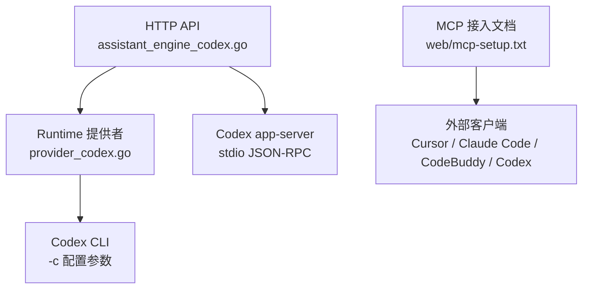
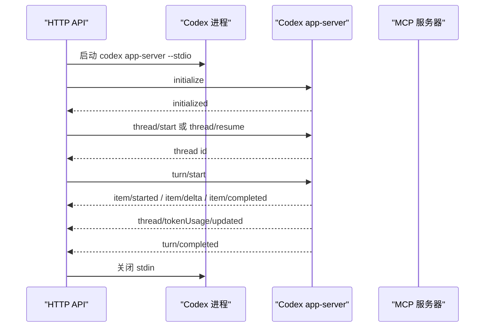
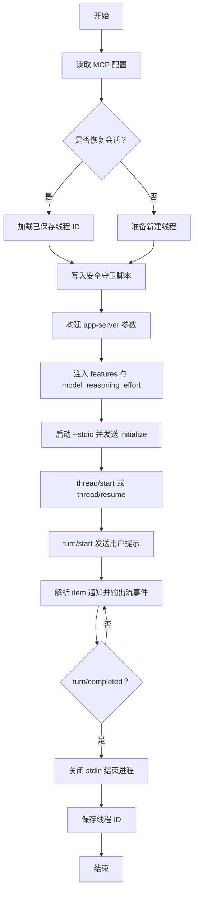
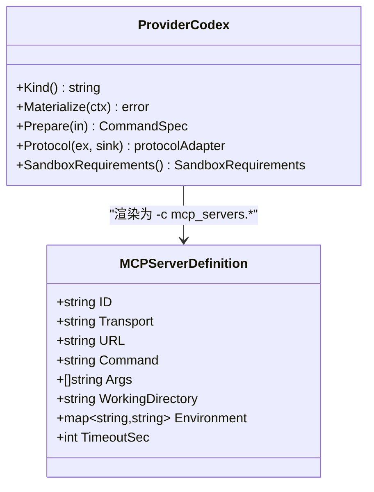
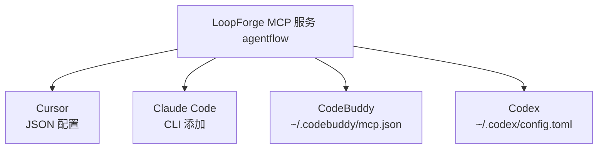
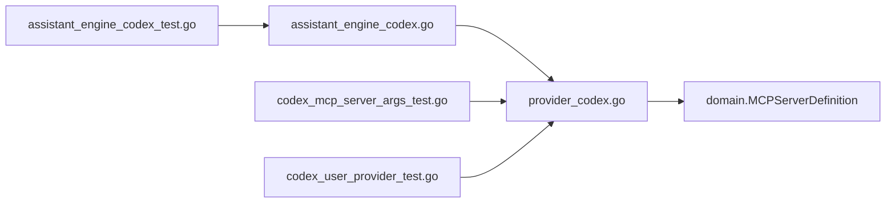

# Codex 执行器

<cite>
**本文引用的文件**   
- [assistant_engine_codex.go](file://internal/httpapi/assistant_engine_codex.go)
- [assistant_engine_cli.go](file://internal/httpapi/assistant_engine_cli.go)
- [provider_codex.go](file://internal/runtime/provider_codex.go)
- [codex_mcp_server_args_test.go](file://internal/runtime/codex_mcp_server_args_test.go)
- [codex_user_provider_test.go](file://internal/runtime/codex_user_provider_test.go)
- [assistant_engine_codex_test.go](file://internal/httpapi/assistant_engine_codex_test.go)
- [mcp-setup.txt](file://web/mcp-setup.txt)
</cite>

## 目录
1. [引言](#引言)
2. [项目结构定位](#项目结构定位)
3. [核心组件](#核心组件)
4. [架构总览](#架构总览)
5. [详细组件分析](#详细组件分析)
6. [依赖关系分析](#依赖关系分析)
7. [性能与行为特征](#性能与行为特征)
8. [配置与参数指南](#配置与参数指南)
9. [API 密钥与模型版本管理](#api-密钥与模型版本管理)
10. [开发调试技巧](#开发调试技巧)
11. [常见问题排查](#常见问题排查)
12. [结论](#结论)

## 引言
本文面向需要深入理解 LoopForge 中 OpenAI Codex CLI 集成实现的技术读者，重点说明：
- Codex 执行器的两种运行模式：`app-server` 对话模式与 `exec` 命令模式。
- MCP 服务器参数如何被注入到 Codex 的 `-c` 配置中。
- 模型选择机制、思考强度（effort）覆盖策略。
- 配置文件覆盖策略，以及与 Claude Code、CodeBuddy 的差异点。
- API 密钥配置、模型版本管理、自定义配置模板。
- 开发调试技巧与常见问题解决方案。

## 项目结构定位
Codex 执行能力主要分布在以下模块：
- HTTP API 层负责构造一次对话调用，并驱动 Codex app-server 的 JSON-RPC 会话。
- Runtime 层负责将 MCP 服务器定义、技能路径、钩子等编译为 Codex CLI 可接受的 `-c` 参数。
- Web 文档提供外部客户端（Cursor、Claude Code、CodeBuddy、Codex）接入 MCP 的配置示例。

**图表来源**
- [assistant_engine_codex.go:15-68](file://internal/httpapi/assistant_engine_codex.go#L15-L68)
- [provider_codex.go:142-199](file://internal/runtime/provider_codex.go#L142-L199)
- [mcp-setup.txt:89-106](file://web/mcp-setup.txt#L89-L106)

**章节来源**
- [assistant_engine_codex.go:15-68](file://internal/httpapi/assistant_engine_codex.go#L15-L68)
- [provider_codex.go:142-199](file://internal/runtime/provider_codex.go#L142-L199)
- [mcp-setup.txt:89-106](file://web/mcp-setup.txt#L89-L106)

## 核心组件
- **Codex app-server 对话执行器**：负责启动 `codex app-server --stdio`，通过 stdin 发送 JSON-RPC 消息，并将 stdout 流转换为平台内部的消息格式。
- **Codex exec 提供者**：负责将 MCP 服务器、技能、钩子、沙箱模式、恢复会话等编译为 `codex exec` 的参数。
- **MCP 服务器参数生成器**：将 MCP 服务器定义渲染为 `-c mcp_servers.<id>.*` 配置片段。
- **外部客户端 MCP 配置文档**：给出 Cursor、Claude Code、CodeBuddy、Codex 各自的配置文件位置与合并策略。

**章节来源**
- [assistant_engine_codex.go:15-68](file://internal/httpapi/assistant_engine_codex.go#L15-L68)
- [provider_codex.go:16-45](file://internal/runtime/provider_codex.go#L16-L45)
- [provider_codex.go:142-199](file://internal/runtime/provider_codex.go#L142-L199)
- [mcp-setup.txt:50-106](file://web/mcp-setup.txt#L50-L106)

## 架构总览
Codex 执行器在 LoopForge 中有两条关键路径：

1. **对话模式（app-server）**
   - HTTP API 构造 argv：`codex app-server -c web_search="disabled" ... --stdio`。
   - 写入安全守卫脚本，禁用原生工具或限制工作区权限。
   - 通过 stdin 发送 initialize、thread/start 或 thread/resume、turn/start。
   - 解析 item 通知，映射为 tool_use、tool_result、thinking、text 等流事件。
   - turn/completed 时关闭 stdin，结束进程。

2. **命令模式（exec）**
   - Runtime 将 MCP 服务器、技能、钩子、环境策略、沙箱模式、恢复会话等编译为 `codex exec` 参数。
   - 使用私有 HOME，避免宿主登录信息泄露。
   - 在 Docker/bwrap 隔离环境中强制设置 sandbox 模式。

**图表来源**
- [assistant_engine_codex.go:15-68](file://internal/httpapi/assistant_engine_codex.go#L15-L68)
- [assistant_engine_codex.go:172-233](file://internal/httpapi/assistant_engine_codex.go#L172-L233)
- [assistant_engine_codex.go:235-296](file://internal/httpapi/assistant_engine_codex.go#L235-L296)

**章节来源**
- [assistant_engine_codex.go:15-68](file://internal/httpapi/assistant_engine_codex.go#L15-L68)
- [assistant_engine_codex.go:172-296](file://internal/httpapi/assistant_engine_codex.go#L172-L296)

## 详细组件分析

### Codex app-server 对话执行器
该组件负责一次对话轮次的完整生命周期：
- 读取 MCP 配置，解析出要注入的 MCP 服务器列表。
- 根据是否恢复会话，决定使用 `thread/start` 还是 `thread/resume`。
- 默认禁用 web_search，并根据工作区模式决定是否启用部分功能。
- 非工作区模式下写入 Python 守卫脚本，拒绝原生工具调用。
- 将 Codex 的 JSON-RPC 通知翻译为平台 stream_event、assistant、user、result 等行格式。
- 记录最终线程 ID，便于后续恢复。

**图表来源**
- [assistant_engine_codex.go:18-68](file://internal/httpapi/assistant_engine_codex.go#L18-L68)
- [assistant_engine_codex.go:172-233](file://internal/httpapi/assistant_engine_codex.go#L172-L233)
- [assistant_engine_codex.go:235-296](file://internal/httpapi/assistant_engine_codex.go#L235-L296)

**章节来源**
- [assistant_engine_codex.go:18-68](file://internal/httpapi/assistant_engine_codex.go#L18-L68)
- [assistant_engine_codex.go:172-296](file://internal/httpapi/assistant_engine_codex.go#L172-L296)
- [assistant_engine_codex_test.go:96-207](file://internal/httpapi/assistant_engine_codex_test.go#L96-L207)

### Codex exec 提供者与 MCP 参数生成
exec 提供者负责将高层 executor 定义编译为底层 CLI 参数：
- 注入开发者指令、shell 环境变量继承策略。
- 注入 skills.config，允许指定技能目录。
- 将每个 MCP 服务器渲染为 `-c mcp_servers.<id>.*` 配置片段。
- 支持 http 与 stdio 两种传输方式。
- 支持超时、工作目录、参数数组、环境变量。
- 在隔离驱动下强制 sandbox 模式，并处理 resume 子命令的位置。

**图表来源**
- [provider_codex.go:16-45](file://internal/runtime/provider_codex.go#L16-L45)
- [provider_codex.go:142-199](file://internal/runtime/provider_codex.go#L142-L199)

**章节来源**
- [provider_codex.go:16-45](file://internal/runtime/provider_codex.go#L16-L45)
- [provider_codex.go:142-199](file://internal/runtime/provider_codex.go#L142-L199)
- [codex_mcp_server_args_test.go:10-65](file://internal/runtime/codex_mcp_server_args_test.go#L10-L65)

### 与 Claude Code、CodeBuddy 的差异点
外部客户端接入 MCP 时，LoopForge 提供了统一的服务名 `agentflow`，但各客户端配置文件不同：
- **Cursor**：使用 JSON 配置文件，包含 `mcpServers.agentflow`。
- **Claude Code**：优先使用官方 CLI 添加服务，不要手工覆盖全局配置。
- **CodeBuddy**：配置文件位于 `~/.codebuddy/mcp.json`，需保留原字段并合并 `agentflow`。
- **Codex**：配置文件位于 `~/.codex/config.toml`，新增或更新 `[mcp_servers.agentflow]` 段落。

**图表来源**
- [mcp-setup.txt:50-106](file://web/mcp-setup.txt#L50-L106)

**章节来源**
- [mcp-setup.txt:50-106](file://web/mcp-setup.txt#L50-L106)

## 依赖关系分析
- HTTP API 层依赖 runtime 提供的命令规格与凭证绑定。
- runtime 层依赖 domain 中的 MCP 服务器定义。
- 测试文件验证了参数拼接、MCP 服务器渲染、用户 provider 插入等行为。

**图表来源**
- [assistant_engine_codex.go:15-68](file://internal/httpapi/assistant_engine_codex.go#L15-L68)
- [provider_codex.go:142-199](file://internal/runtime/provider_codex.go#L142-L199)
- [assistant_engine_codex_test.go:22-46](file://internal/httpapi/assistant_engine_codex_test.go#L22-L46)
- [codex_mcp_server_args_test.go:10-65](file://internal/runtime/codex_mcp_server_args_test.go#L10-L65)
- [codex_user_provider_test.go:8-46](file://internal/runtime/codex_user_provider_test.go#L8-L46)

**章节来源**
- [assistant_engine_codex.go:15-68](file://internal/httpapi/assistant_engine_codex.go#L15-L68)
- [provider_codex.go:142-199](file://internal/runtime/provider_codex.go#L142-L199)
- [assistant_engine_codex_test.go:22-46](file://internal/httpapi/assistant_engine_codex_test.go#L22-L46)
- [codex_mcp_server_args_test.go:10-65](file://internal/runtime/codex_mcp_server_args_test.go#L10-L65)
- [codex_user_provider_test.go:8-46](file://internal/runtime/codex_user_provider_test.go#L8-L46)

## 性能与行为特征
- **流式响应**：Codex app-server 通过 item delta 推送文本与思考内容，平台将其转为 stream_event，减少等待延迟。
- **令牌用量统计**：通过 `thread/tokenUsage/updated` 收集输入、缓存输入、输出 token，并在 result 中返回。
- **沙箱与安全**：非工作区模式禁用原生工具；工作区模式允许 shell、命令执行、补丁应用等功能，但由平台控制审批策略。
- **隔离环境**：Docker/bwrap 下强制 sandbox 模式，避免嵌套命名空间问题。

**章节来源**
- [assistant_engine_codex.go:235-296](file://internal/httpapi/assistant_engine_codex.go#L235-L296)
- [provider_codex.go:30-45](file://internal/runtime/provider_codex.go#L30-L45)

## 配置与参数指南

### -c 配置参数的使用方式
Codex 大量使用 `-c` 注入运行时配置。常见用途包括：
- 禁用功能：`features.<feature>=false`。
- 设置思考强度：`model_reasoning_effort=<level>`。
- 配置 MCP 服务器：`mcp_servers.<id>.url=...` 或 `mcp_servers.<id>.command=...`。
- 设置环境变量继承策略：`shell_environment_policy.inherit="core"`。
- 设置开发者指令：`developer_instructions="..."`。

这些参数由两部分生成：
- HTTP API 层针对 app-server 对话模式追加功能开关、思考强度、MCP 服务器。
- Runtime 层针对 exec 模式将 MCP 服务器、技能、钩子、沙箱模式等编译为 `-c` 片段。

**章节来源**
- [assistant_engine_codex.go:33-48](file://internal/httpapi/assistant_engine_codex.go#L33-L48)
- [provider_codex.go:142-199](file://internal/runtime/provider_codex.go#L142-L199)

### 模型选择机制
- 在 app-server 模式中，若传入 Model，则将其放入 thread/start 或 thread/resume 的 params.model。
- 在 exec 模式中，可通过 effort 覆盖 `model_reasoning_effort`，且不会重复注入已有配置。
- 用户 provider 模式支持自定义 base_url、env_key、wire_api 等，用于对接非 OpenAI 兼容后端。

**章节来源**
- [assistant_engine_codex.go:193-198](file://internal/httpapi/assistant_engine_codex.go#L193-L198)
- [provider_codex.go:22-45](file://internal/runtime/provider_codex.go#L22-L45)
- [codex_user_provider_test.go:8-46](file://internal/runtime/codex_user_provider_test.go#L8-L46)

### 配置文件覆盖策略
- **Cursor**：JSON 配置，新增 `mcpServers.agentflow`。
- **Claude Code**：使用 CLI 添加服务，避免手工覆盖全局配置。
- **CodeBuddy**：保留原 JSON 字段，仅合并 `agentflow`。
- **Codex**：TOML 配置，新增或更新 `[mcp_servers.agentflow]`。

**章节来源**
- [mcp-setup.txt:50-106](file://web/mcp-setup.txt#L50-L106)

### 自定义配置模板
- 对于 MCP 服务器，可根据 transport 类型生成 url 或 command、cwd、args、env、tool_timeout_sec。
- 对于技能目录，可生成 skills.config 数组。
- 对于隔离环境，可注入 shell_environment_policy.set.* 环境变量。

**章节来源**
- [provider_codex.go:142-199](file://internal/runtime/provider_codex.go#L142-L199)
- [codex_mcp_server_args_test.go:10-65](file://internal/runtime/codex_mcp_server_args_test.go#L10-L65)

## API 密钥与模型版本管理

### API 密钥配置
- 外部客户端通过 Authorization Bearer Token 访问 LoopForge MCP 端点。
- Codex 用户 provider 模式支持通过环境变量读取密钥，例如 `CODEX_API_KEY`。
- 若未正确配置，可能出现 401 或 token invalid。

**章节来源**
- [mcp-setup.txt:33-46](file://web/mcp-setup.txt#L33-L46)
- [mcp-setup.txt:125-129](file://web/mcp-setup.txt#L125-L129)
- [codex_user_provider_test.go:8-46](file://internal/runtime/codex_user_provider_test.go#L8-L46)

### 模型版本管理
- app-server 模式支持在 thread/start/resume 中指定 model。
- exec 模式支持通过 effort 控制推理强度，但不直接指定模型名称。
- 前端与后端可能维护模型目录，供用户选择具体模型 ID。

**章节来源**
- [assistant_engine_codex.go:193-198](file://internal/httpapi/assistant_engine_codex.go#L193-L198)
- [provider_codex.go:22-45](file://internal/runtime/provider_codex.go#L22-L45)

## 开发调试技巧
- **检查 argv**：确认 app-server 模式不包含 exec 子命令，且包含 `--stdio`。
- **校验 MCP 注入**：确认 argv 中包含 `mcp_servers.<id>.url=...` 或 `mcp_servers.<id>.command=...`。
- **观察流事件**：通过测试用例中的 line types 判断 thinking、text、tool_use、tool_result 是否正确输出。
- **恢复会话**：确认 thread/resume 携带正确的 threadId，且失败时返回“找不到会话”的错误。
- **隔离环境**：在 Docker/bwrap 下确认 sandbox 模式被强制设置为 full-access。

**章节来源**
- [assistant_engine_codex_test.go:96-114](file://internal/httpapi/assistant_engine_codex_test.go#L96-L114)
- [assistant_engine_codex_test.go:228-260](file://internal/httpapi/assistant_engine_codex_test.go#L228-L260)
- [provider_codex.go:30-45](file://internal/runtime/provider_codex.go#L30-L45)

## 常见问题排查
- **401 / token invalid**：检查 Authorization 头格式，确保没有多余引号、空格或换行；必要时重新生成 Token。
- **404 / 无法连接**：确认 ENDPOINT 是完整的 `/mcp` 地址，不要重复拼接。
- **客户端没有工具**：检查配置文件语法、配置作用域和服务名；重启客户端后重试。
- **Codex 未安装**：当 executor 为 codex 时，若系统 PATH 中找不到 codex，会返回未安装错误。
- **恢复会话失败**：若本地未保存线程 ID，或线程 ID 不合法，会返回缺少会话错误。

**章节来源**
- [mcp-setup.txt:125-129](file://web/mcp-setup.txt#L125-L129)
- [assistant_engine_codex.go:24-28](file://internal/httpapi/assistant_engine_codex.go#L24-L28)
- [assistant_engine_codex_test.go:243-260](file://internal/httpapi/assistant_engine_codex_test.go#L243-L260)

## 结论
LoopForge 的 Codex 执行器通过 HTTP API 与 Runtime 两层协作，将 MCP 服务器、技能、钩子、沙箱策略等编译为 Codex CLI 可接受的 `-c` 参数，并在 app-server 与 exec 两种模式下分别实现流式对话与命令执行。对外部客户端而言，需按各自配置文件格式注入 `agentflow` MCP 服务；对开发者而言，应重点关注 argv 构造、MCP 参数渲染、流事件翻译与隔离环境行为，以便准确调试与扩展。