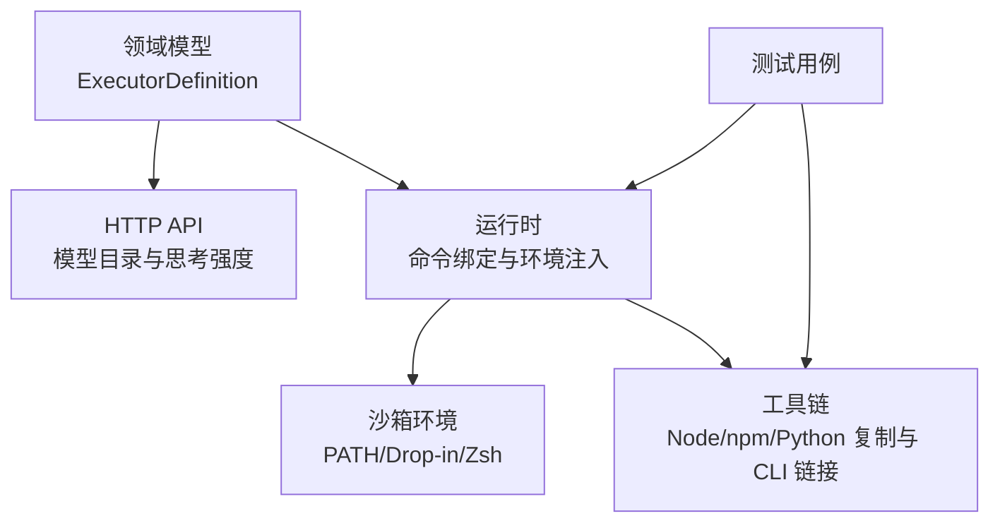
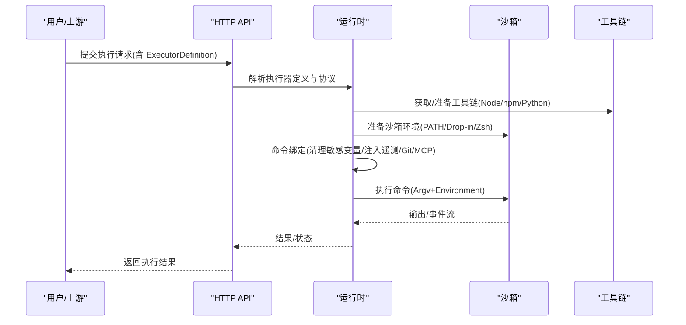
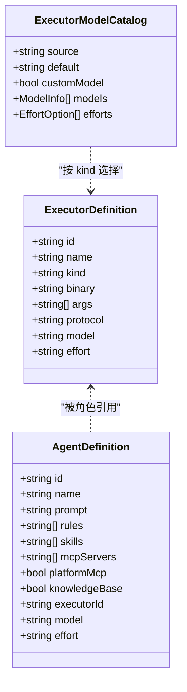
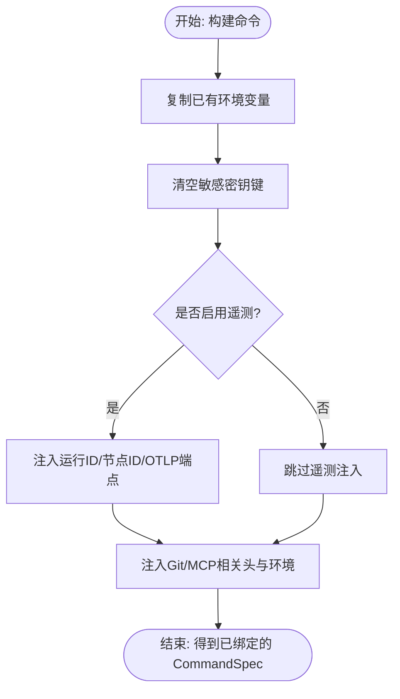
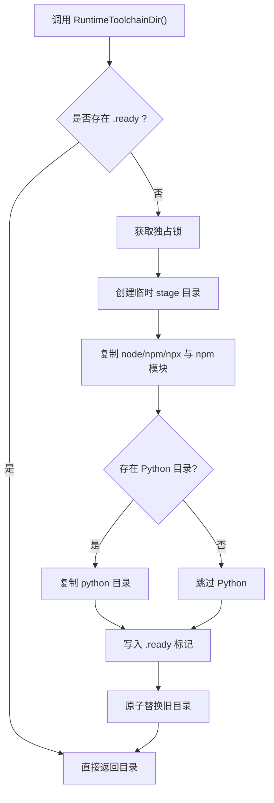
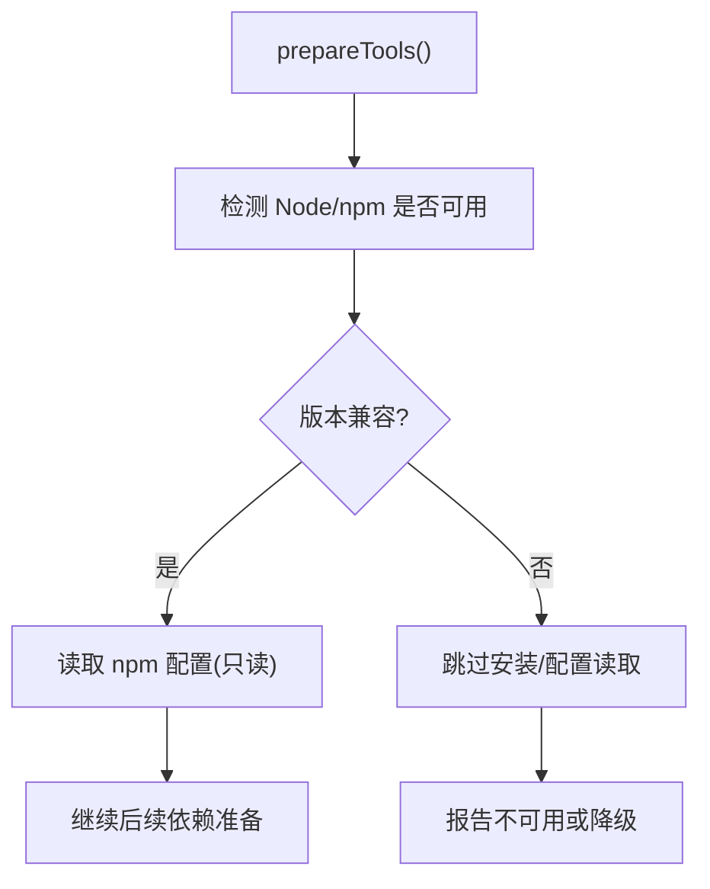
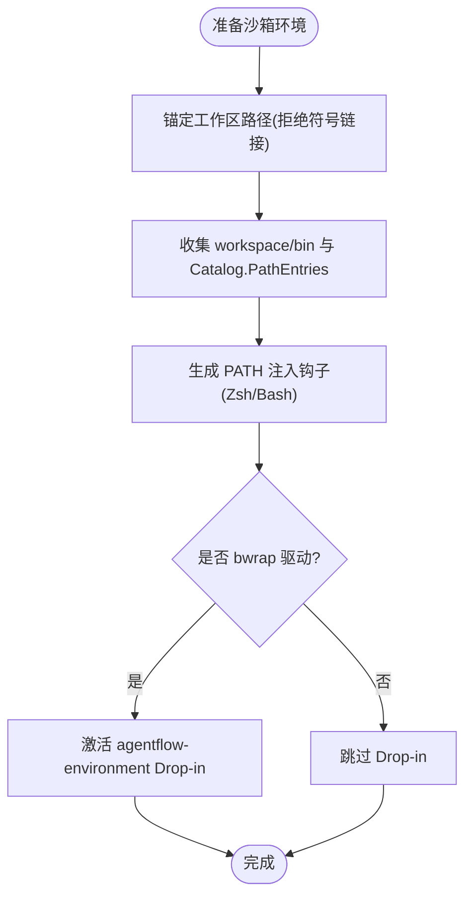
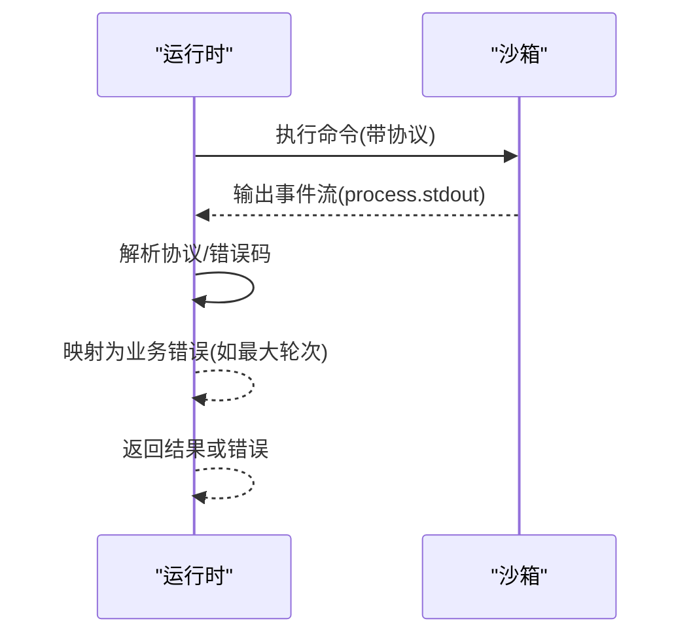
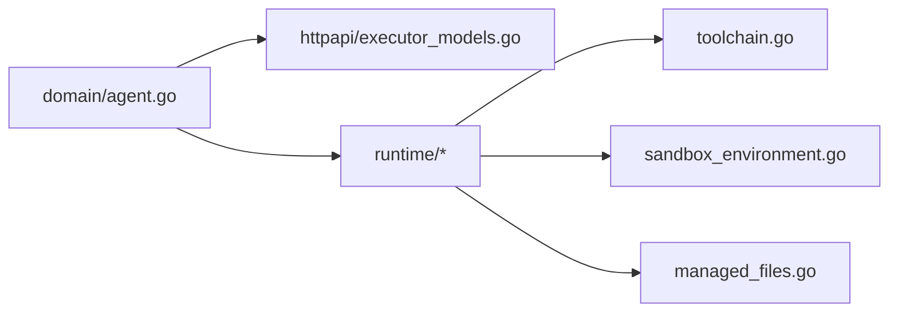

# 执行器配置管理

<cite>
**本文引用的文件**   
- [internal/domain/agent.go](file://internal/domain/agent.go)
- [internal/httpapi/executor_models.go](file://internal/httpapi/executor_models.go)
- [internal/runtimе/command_binding.go](file://internal/runtime/command_binding.go)
- [internal/runtimе/toolchain.go](file://internal/runtimе/toolchain.go)
- [internal/runtimе/sandbox_environment.go](file://internal/runtimе/sandbox_environment.go)
- [internal/runtimе/managed_files.go](file://internal/runtimе/managed_files.go)
- [internal/runtimе/runtime_test.go](file://internal/runtimе/runtime_test.go)
- [internal/runtimе/executor_cases_test.go](file://internal/runtimе/executor_cases_test.go)
- [internal/runtimе/toolchain_paths_test.go](file://internal/runtimе/toolchain_paths_test.go)
- [internal/runtimе/command_binding_telemetry_test.go](file://internal/runtimе/command_binding_telemetry_test.go)
- [internal/managedcli/npm_test.go](file://internal/managedcli/npm_test.go)
</cite>

## 目录
1. [简介](#简介)
2. [项目结构](#项目结构)
3. [核心组件](#核心组件)
4. [架构总览](#架构总览)
5. [详细组件分析](#详细组件分析)
6. [依赖关系分析](#依赖关系分析)
7. [性能与可扩展性](#性能与可扩展性)
8. [故障排查指南](#故障排查指南)
9. [结论](#结论)
10. [附录：配置模板与默认值](#附录配置模板与默认值)

## 简介
本文面向“执行器配置管理”，聚焦以下目标：
- 解释执行器定义的 YAML/JSON 配置格式，包括二进制路径、命令行参数、环境变量、工作区绑定。
- 说明工具链自动检测与安装机制、依赖管理与版本兼容性检查。
- 提供配置模板、默认值继承与环境特定配置策略。
- 给出配置验证规则、错误处理与调试方法。

本项目的执行器由领域模型 ExecutorDefinition 描述，运行时通过命令绑定、沙箱环境准备和工具链复制/链接完成最终可执行命令的构造与安全隔离。内置执行器（如 Claude Code、Codex、CodeBuddy）与自定义执行器共享同一套准备流程，但内置执行器还提供模型目录、思考强度等能力。

## 项目结构
围绕执行器配置的关键代码分布在如下模块：
- 领域模型：ExecutorDefinition、AgentDefinition、Effort 校验等。
- HTTP API：内置执行器的模型目录与思考强度选项暴露给前端。
- 运行时：命令绑定、环境变量注入、工作区安全访问、工具链复制与 CLI 链接。
- 沙箱环境：PATH 注入、Drop-in 环境激活、Zsh/Bash 钩子。
- 测试：覆盖协议、遥测、工具链复制、NPM 兼容版本等关键分支。

**图示来源**
- [internal/domain/agent.go:134-144](file://internal/domain/agent.go#L134-L144)
- [internal/httpapi/executor_models.go:61-151](file://internal/httpapi/executor_models.go#L61-L151)
- [internal/runtimе/command_binding.go:32-47](file://internal/runtimе/command_binding.go#L32-L47)
- [internal/runtimе/toolchain.go:76-118](file://internal/runtimе/toolchain.go#L76-L118)
- [internal/runtimе/sandbox_environment.go:226-258](file://internal/runtimе/sandbox_environment.go#L226-L258)

**章节来源**
- [internal/domain/agent.go:10-49](file://internal/domain/agent.go#L10-L49)
- [internal/httpapi/executor_models.go:61-151](file://internal/httpapi/executor_models.go#L61-L151)

## 核心组件
- 执行器定义 ExecutorDefinition
  - id/name/kind/binary/args/protocol/model/effort
  - kind 决定内置或自定义执行器；binary 指定可执行文件名；args 为附加参数；protocol 控制输出协议；model/effort 用于内置执行器。
- 内置执行器模型目录与思考强度
  - 通过 HTTP API 暴露每个内置 CLI 支持的模型列表与思考强度级别。
- 命令绑定与环境注入
  - 清理敏感环境变量，注入运行标识、遥测端点、Git/MCP 头信息等。
- 工具链管理
  - 在平台镜像中复制 Node/npm/Python，按需复制并链接 CLI 包，保证沙箱内 PATH 优先使用受控工具链。
- 沙箱环境
  - 将 bin 目录与 Catalog 中的 PathEntries 加入 PATH；支持 Drop-in 环境与 Zsh/Bash 登录钩子。

**章节来源**
- [internal/domain/agent.go:134-144](file://internal/domain/agent.go#L134-L144)
- [internal/httpapi/executor_models.go:61-151](file://internal/httpapi/executor_models.go#L61-L151)
- [internal/runtimе/command_binding.go:32-47](file://internal/runtimе/command_binding.go#L32-L47)
- [internal/runtimе/toolchain.go:76-118](file://internal/runtimе/toolchain.go#L76-L118)
- [internal/runtimе/sandbox_environment.go:226-258](file://internal/runtimе/sandbox_environment.go#L226-L258)

## 架构总览
执行器从配置到执行的典型流程如下：

**图示来源**
- [internal/httpapi/executor_models.go:162-200](file://internal/httpapi/executor_models.go#L162-L200)
- [internal/runtimе/toolchain.go:76-118](file://internal/runtimе/toolchain.go#L76-L118)
- [internal/runtimе/sandbox_environment.go:226-258](file://internal/runtimе/sandbox_environment.go#L226-L258)
- [internal/runtimе/command_binding.go:32-47](file://internal/runtimе/command_binding.go#L32-L47)

## 详细组件分析

### 执行器定义与协议
- ExecutorDefinition 字段
  - id/name/kind/binary/args/protocol/model/effort
  - kind 区分内置执行器(mock/claude-code/codex/codebuddy/custom 等)，protocol 指定消息协议(jsonl/stream-json)。
- 内置执行器模型目录
  - HTTP API 暴露各内置 CLI 的模型列表与思考强度；部分 CLI 允许自定义模型 ID。
- 思考强度校验
  - 根据 executorKind 校验 effort 是否属于该 CLI 支持的级别集合。

**图示来源**
- [internal/domain/agent.go:134-144](file://internal/domain/agent.go#L134-L144)
- [internal/httpapi/executor_models.go:61-151](file://internal/httpapi/executor_models.go#L61-L151)

**章节来源**
- [internal/domain/agent.go:10-49](file://internal/domain/agent.go#L10-L49)
- [internal/domain/agent.go:134-144](file://internal/domain/agent.go#L134-L144)
- [internal/httpapi/executor_models.go:61-151](file://internal/httpapi/executor_models.go#L61-L151)

### 命令绑定与环境注入
- 敏感信息清理
  - 对 CODEBUDDY_API_KEY、AGENTFLOW_GIT_TOKEN、GH_TOKEN、GITHUB_TOKEN 等键进行清空，避免泄露到子进程。
- 遥测与环境标识
  - 当启用遥测时，注入 AGENTFLOW_RUN_ID、AGENTFLOW_NODE_ID、OTEL_EXPORTER_OTLP_TRACES_ENDPOINT 等。
- Git/MCP 头信息
  - 根据沙箱类型注入 GIT_ASKPASS、GIT_TERMINAL_PROMPT 等；MCP Headers 支持 ${secret:...} 占位符解析。

**图示来源**
- [internal/runtimе/command_binding.go:32-47](file://internal/runtimе/command_binding.go#L32-L47)
- [internal/runtimе/command_binding_telemetry_test.go:38-55](file://internal/runtimе/command_binding_telemetry_test.go#L38-L55)

**章节来源**
- [internal/runtimе/command_binding.go:32-47](file://internal/runtimе/command_binding.go#L32-L47)
- [internal/runtimе/command_binding_telemetry_test.go:38-55](file://internal/runtimе/command_binding_telemetry_test.go#L38-L55)

### 工具链自动检测与安装
- 工具链位置与锁定
  - RuntimeToolchainDir 计算平台镜像的工具链目录，首次使用时加锁并复制到 .ready 标记目录。
- 基础工具复制
  - 复制 node、npm、npx、npm 模块与可选 Python 目录；写入 .interp 以便沙箱识别 ELF 解释器。
- CLI 按需复制与链接
  - EnsureToolchainCLI 仅复制实际需要的 CLI 包，并将所有指向该包的 launcher 链接到 toolchain/bin。
- 沙箱 PATH 注入
  - 若检测到 .interp，则在沙箱 login shell 中将 toolchain/bin 与 python/bin 追加到 PATH。

**图示来源**
- [internal/runtimе/toolchain.go:76-118](file://internal/runtimе/toolchain.go#L76-L118)
- [internal/runtimе/toolchain.go:157-186](file://internal/runtimе/toolchain.go#L157-L186)
- [internal/runtimе/toolchain.go:188-217](file://internal/runtimе/toolchain.go#L188-L217)
- [internal/runtimе/toolchain.go:321-361](file://internal/runtimе/toolchain.go#L321-L361)

**章节来源**
- [internal/runtimе/toolchain.go:76-118](file://internal/runtimе/toolchain.go#L76-L118)
- [internal/runtimе/toolchain.go:157-186](file://internal/runtimе/toolchain.go#L157-L186)
- [internal/runtimе/toolchain.go:188-217](file://internal/runtimе/toolchain.go#L188-L217)
- [internal/runtimе/toolchain.go:321-361](file://internal/runtimе/toolchain.go#L321-L361)

### 依赖管理与版本兼容性
- NPM 工具链兼容
  - 测试覆盖 Node v22/v24 兼容判断；仅在存在兼容 Node/npm 时才读取真实 npm 配置。
- 包管理器行为
  - 不修改全局配置，仅读取 registry 设置以验证工具链可用性。

**图示来源**
- [internal/managedcli/npm_test.go:68-107](file://internal/managedcli/npm_test.go#L68-L107)

**章节来源**
- [internal/managedcli/npm_test.go:68-107](file://internal/managedcli/npm_test.go#L68-L107)

### 工作区绑定与路径安全
- 工作区路径锚定
  - openWorkspacePath 拒绝符号链接，确保操作限制在工作区内。
- PATH 注入与 Drop-in
  - environmentPathHook 将 workspace/bin 与 Catalog.PathEntries 加入 PATH；bwrap 驱动下自动激活 agentflow-environment Drop-in。
- Zsh/Bash 钩子
  - 生成登录脚本片段，确保隔离的二进制优先于系统 PATH。

**图示来源**
- [internal/runtimе/managed_files.go:13-38](file://internal/runtimе/managed_files.go#L13-L38)
- [internal/runtimе/sandbox_environment.go:226-258](file://internal/runtimе/sandbox_environment.go#L226-L258)
- [internal/runtimе/runtime_test.go:407-423](file://internal/runtimе/runtime_test.go#L407-L423)

**章节来源**
- [internal/runtimе/managed_files.go:13-38](file://internal/runtimе/managed_files.go#L13-L38)
- [internal/runtimе/sandbox_environment.go:226-258](file://internal/runtimе/sandbox_environment.go#L226-L258)
- [internal/runtimе/runtime_test.go:407-423](file://internal/runtimе/runtime_test.go#L407-L423)

### 协议与执行结果
- 协议支持
  - jsonl/stream-json 等协议；不同内置执行器有各自的行为与错误映射。
- 最大轮次与失败语义
  - 达到最大轮次返回特定错误；进程错误前仍会返回部分输出。

**图示来源**
- [internal/runtimе/executor_cases_test.go:81-137](file://internal/runtimе/executor_cases_test.go#L81-L137)

**章节来源**
- [internal/runtimе/executor_cases_test.go:81-137](file://internal/runtimе/executor_cases_test.go#L81-L137)

## 依赖关系分析
- 低耦合高内聚
  - 领域模型与运行时解耦；HTTP API 仅消费领域模型与运行时能力。
- 外部依赖
  - Node/npm/Python 作为平台镜像工具链；沙箱可能为 musl/ARM 架构，需通过 .interp 检测决定是否注入 PATH。
- 潜在循环依赖
  - 当前实现未见循环导入；工具链复制与 CLI 链接均位于 runtime 包内部。

**图示来源**
- [internal/domain/agent.go:134-144](file://internal/domain/agent.go#L134-L144)
- [internal/httpapi/executor_models.go:61-151](file://internal/httpapi/executor_models.go#L61-L151)
- [internal/runtimе/toolchain.go:76-118](file://internal/runtimе/toolchain.go#L76-L118)
- [internal/runtimе/sandbox_environment.go:226-258](file://internal/runtimе/sandbox_environment.go#L226-L258)
- [internal/runtimе/managed_files.go:13-38](file://internal/runtimе/managed_files.go#L13-L38)

**章节来源**
- [internal/domain/agent.go:134-144](file://internal/domain/agent.go#L134-L144)
- [internal/httpapi/executor_models.go:61-151](file://internal/httpapi/executor_models.go#L61-L151)
- [internal/runtimе/toolchain.go:76-118](file://internal/runtimе/toolchain.go#L76-L118)
- [internal/runtimе/sandbox_environment.go:226-258](file://internal/runtimе/sandbox_environment.go#L226-L258)
- [internal/runtimе/managed_files.go:13-38](file://internal/runtimе/managed_files.go#L13-L38)

## 性能与可扩展性
- 工具链复制优化
  - 使用 .ready 标记与原子替换减少重复复制；独占锁避免并发竞争。
- 按需 CLI 复制
  - EnsureToolchainCLI 仅复制实际使用的 CLI 包，降低 I/O 与空间占用。
- PATH 注入最小化
  - 仅在检测到 .interp 时注入 toolchain/bin，避免不必要的 PATH 污染。
- 可扩展点
  - 新增内置执行器可在 HTTP API 的模型目录中添加条目；新增 CLI 可通过 EnsureToolchainCLI 自动链接。

[本节为通用指导，无需列出具体文件来源]

## 故障排查指南
- 常见错误与定位
  - 工具链复制失败：检查平台镜像 Node 是否存在、.interp 是否可读、磁盘空间是否充足。
  - CLI 未找到：确认 EnsureToolchainCLI 是否被调用，launcher 是否成功链接到 toolchain/bin。
  - 敏感信息泄露：检查 bindCommand 是否清除了已知密钥键；确认遥测开关是否正确。
  - PATH 未生效：确认沙箱是否为 musl/ARM 架构导致无法识别 .interp；检查 Drop-in 是否激活。
- 调试建议
  - 启用遥测查看 AGENTFLOW_RUN_ID/AGENTFLOW_NODE_ID 是否注入。
  - 打印沙箱启动时的 PATH 与 Zsh/Bash 钩子内容，确认 bin 目录优先级。
  - 使用测试用例对照：toolchain_paths_test、command_binding_telemetry_test、runtime_test。

**章节来源**
- [internal/runtimе/toolchain_paths_test.go:104-204](file://internal/runtimе/toolchain_paths_test.go#L104-L204)
- [internal/runtimе/command_binding_telemetry_test.go:38-55](file://internal/runtimе/command_binding_telemetry_test.go#L38-L55)
- [internal/runtimе/runtime_test.go:396-427](file://internal/runtimе/runtime_test.go#L396-L427)

## 结论
执行器配置管理通过清晰的领域模型、严格的命令绑定与环境注入、安全的工具链复制与 CLI 链接、以及健壮的沙箱 PATH 管理，实现了跨平台、可移植且安全的执行环境。内置执行器提供模型目录与思考强度，自定义执行器复用相同的安全与可观测性能力。建议在扩展新执行器时遵循现有模式，并在必要时补充模型目录与协议支持。

[本节为总结性内容，无需列出具体文件来源]

## 附录：配置模板与默认值
以下为基于仓库实现的配置要点与默认值说明（非代码片段，仅供理解）：

- 执行器定义 ExecutorDefinition
  - id: 唯一标识
  - name: 显示名称
  - kind: 执行器类型(mock/claude-code/codex/codebuddy/custom/opencode/cursor/agy/kimi/pi/dsh/zcode)
  - binary: 可执行文件名
  - args: 附加参数数组
  - protocol: 协议(jsonl/stream-json)
  - model: 模型 ID（内置执行器常用）
  - effort: 思考强度（需匹配对应 kind 的支持集合）

- 默认值与继承
  - 内置执行器模型目录由 HTTP API 提供；未显式设置 model 时使用内置默认。
  - effort 为空表示使用 CLI 默认；非空时需通过 ValidateAgentEffort 校验。
  - 自定义执行器可自由设置 args/protocol，但需遵循安全约束（敏感变量清理）。

- 环境变量与工作区绑定
  - 环境变量在 bindCommand 中复制并清理敏感键；遥测开启时注入运行标识与 OTLP 端点。
  - PATH 注入包含 workspace/bin 与 Catalog.PathEntries；bwrap 驱动下自动激活 agentflow-environment Drop-in。
  - Zsh/Bash 登录钩子确保隔离 bin 优先。

- 工具链与依赖
  - 平台镜像工具链包含 Node/npm/Python；按需复制 CLI 包并链接 launcher。
  - NPM 工具链兼容 Node v22/v24；仅在存在兼容工具链时读取 npm 配置。

- 配置验证规则
  - effort 必须属于 ExecutorEffortLevels 中对应 kind 的集合。
  - 工作区路径必须锚定且拒绝符号链接。
  - MCP Headers 支持 ${secret:...} 占位符，缺失密钥应报错。

- 调试方法
  - 启用遥测观察 AGENTFLOW_RUN_ID/AGENTFLOW_NODE_ID。
  - 检查 toolchain/.ready 与 toolchain/bin 下的 launcher 链接。
  - 打印沙箱 PATH 与 Zsh/Bash 钩子，确认 Drop-in 激活。

**章节来源**
- [internal/domain/agent.go:10-49](file://internal/domain/agent.go#L10-L49)
- [internal/domain/agent.go:134-144](file://internal/domain/agent.go#L134-L144)
- [internal/httpapi/executor_models.go:61-151](file://internal/httpapi/executor_models.go#L61-L151)
- [internal/runtimе/command_binding.go:32-47](file://internal/runtimе/command_binding.go#L32-L47)
- [internal/runtimе/sandbox_environment.go:226-258](file://internal/runtimе/sandbox_environment.go#L226-L258)
- [internal/runtimе/toolchain.go:76-118](file://internal/runtimе/toolchain.go#L76-L118)
- [internal/managedcli/npm_test.go:68-107](file://internal/managedcli/npm_test.go#L68-L107)