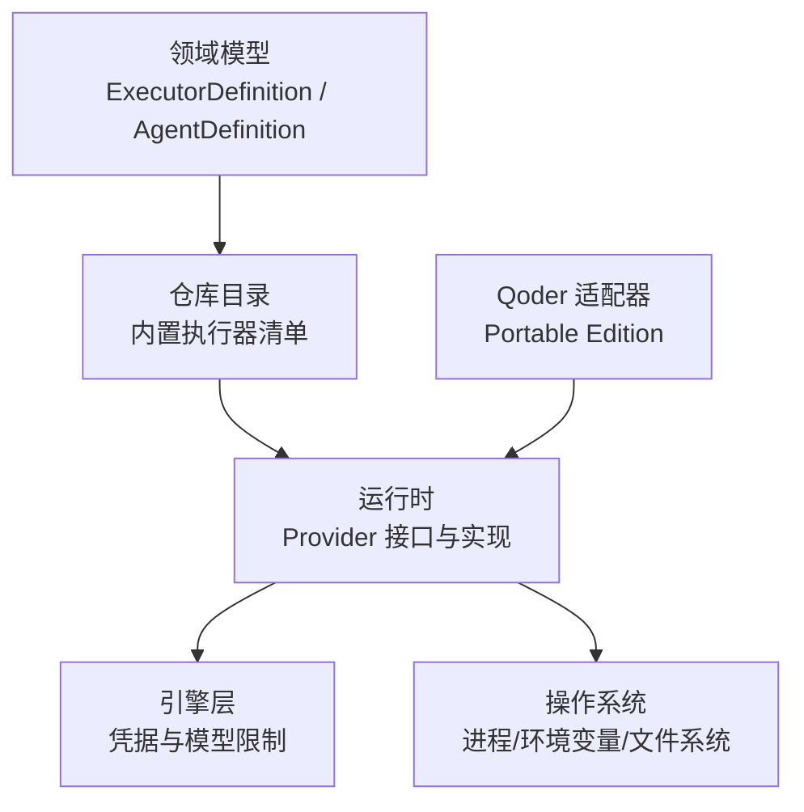
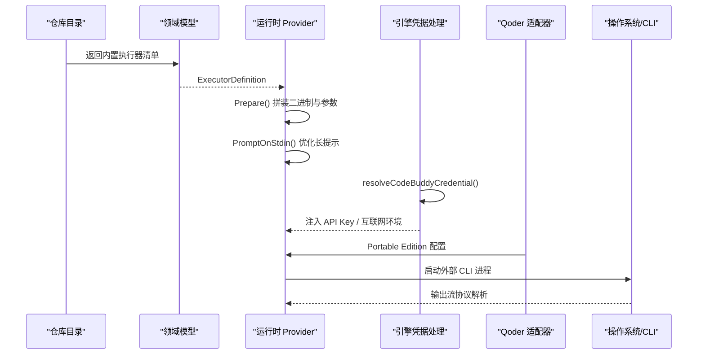
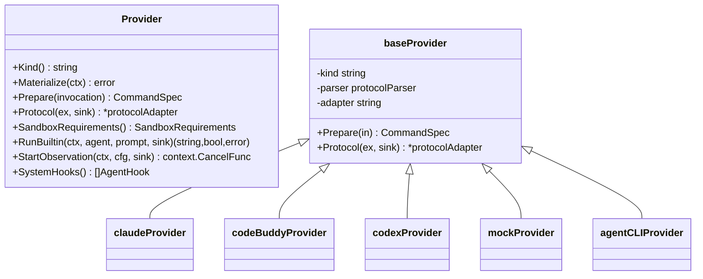
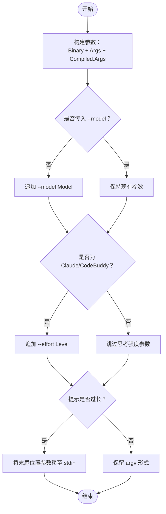
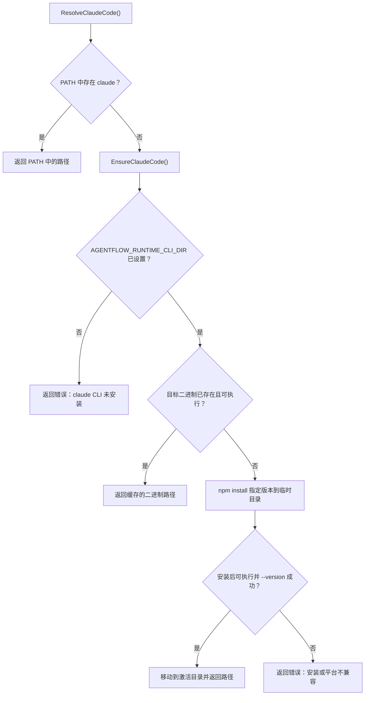
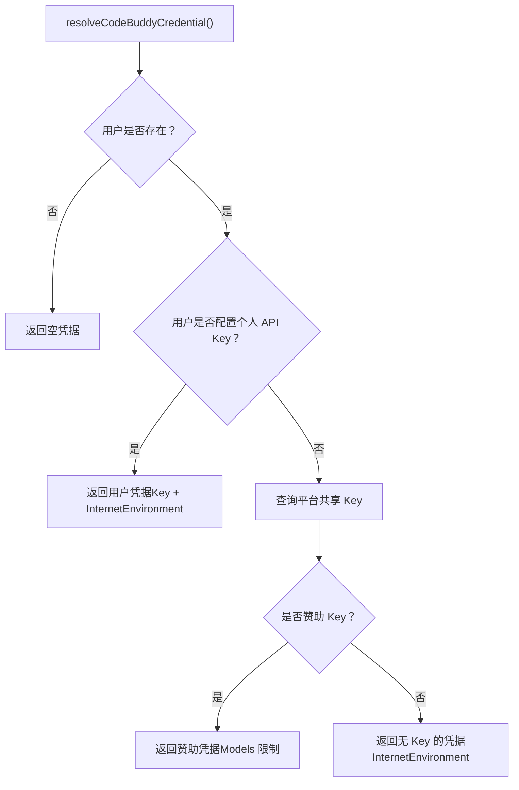
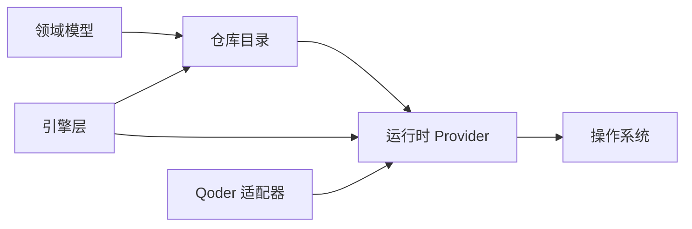

# 执行器集成

<cite>
**本文引用的文件**   
- [internal/domain/agent.go](file://internal/domain/agent.go)
- [internal/repo/catalog.go](file://internal/repo/catalog.go)
- [internal/runtime/provider.go](file://internal/runtime/provider.go)
- [internal/runtime/claude_install.go](file://internal/runtime/claude_install.go)
- [internal/engine/codebuddy_auth.go](file://internal/engine/codebuddy_auth.go)
- [local/skills/devflow/adapters/qoder/adapter.md](file://local/skills/devflow/adapters/qoder/adapter.md)
- [local/skills/devflow/adapters/qoder/manifest.json](file://local/skills/devflow/adapters/qoder/manifest.json)
- [local/src/devflow_cli/targets/qoder.py](file://local/src/devflow_cli/targets/qoder.py)
</cite>

## 更新摘要
**变更内容**   
- 新增 Qoder 作为支持的宿主，与 CodeBuddy、Cursor、Claude Code、Codex、Pi、DeepSeek Harness、Hermes Agent 并列
- 更新内置执行器清单以包含 Qoder 适配器配置
- 扩展 Qoder 专用适配器文档和安装说明
- 补充 Qoder Portable Edition 的安装和使用指南

## 目录
1. [简介](#简介)
2. [项目结构](#项目结构)
3. [核心组件](#核心组件)
4. [架构总览](#架构总览)
5. [详细组件分析](#详细组件分析)
6. [依赖关系分析](#依赖关系分析)
7. [性能与可靠性考虑](#性能与可靠性考虑)
8. [故障排查指南](#故障排查指南)
9. [结论](#结论)
10. [附录：配置模板与环境变量](#附录配置模板与环境变量)

## 简介
本文面向"执行器集成"，系统性说明 LoopForge 如何统一接入多种 AI 编程代理，包括 CodeBuddy、Codex、Claude Code、Qoder 以及更多 Agent CLI。文档覆盖以下主题：
- 执行器协议定义与适配机制
- 命令绑定与参数拼装策略
- 工具链自动检测与按需安装
- 认证方式与凭据注入（含平台共享 Key）
- 环境变量与沙箱要求
- 自定义执行器的开发与集成步骤

**新增** Qoder 作为最新支持的宿主，采用 Portable Edition 模式，通过 `Agent` 工具派发阶段执行者。

## 项目结构
围绕执行器集成的关键代码分布在领域模型、仓库目录、运行时提供者与引擎侧的凭据处理中：
- 领域模型：定义执行器、Agent、思考强度等抽象
- 仓库目录：内置执行器清单与持久化接口
- 运行时：按执行器种类提供命令准备、协议解析、沙箱需求与标准输入优化
- 引擎侧：CodeBuddy 凭据解析与赞助模型限制
- Qoder 适配器：Portable Edition 专用配置和安装脚本

图表来源
- [internal/domain/agent.go:134-144](file://internal/domain/agent.go#L134-L144)
- [internal/repo/catalog.go:235-247](file://internal/repo/catalog.go#L235-L247)
- [internal/runtime/provider.go:48-61](file://internal/runtime/provider.go#L48-L61)
- [internal/engine/codebuddy_auth.go:17-35](file://internal/engine/codebuddy_auth.go#L17-L35)
- [local/skills/devflow/adapters/qoder/manifest.json:1-38](file://local/skills/devflow/adapters/qoder/manifest.json#L1-L38)

章节来源
- [internal/domain/agent.go:1-145](file://internal/domain/agent.go#L1-L145)
- [internal/repo/catalog.go:213-257](file://internal/repo/catalog.go#L213-L257)
- [internal/runtime/provider.go:1-200](file://internal/runtime/provider.go#L1-L200)
- [internal/engine/codebuddy_auth.go:1-71](file://internal/engine/codebuddy_auth.go#L1-L71)
- [local/skills/devflow/adapters/qoder/adapter.md:1-26](file://local/skills/devflow/adapters/qoder/adapter.md#L1-L26)

## 核心组件
- 执行器定义 ExecutorDefinition：描述 ID、名称、Kind、二进制名、默认参数、协议、模型与思考强度
- 内置执行器清单：CodeBuddy、Codex、Claude Code、Qoder 及多个 Agent CLI 的默认命令与协议
- Provider 接口：按 Kind 提供 Materialize、Prepare、Protocol、SandboxRequirements、RunBuiltin、StartObservation、SystemHooks
- 标准输入优化 PromptOnStdin：避免超长命令行参数导致系统调用失败
- Claude Code 按需安装：通过 npm 安装指定版本并缓存到运行时目录
- CodeBuddy 凭据解析：优先用户个人 Key，否则回退平台共享 Key，并对赞助模型进行限制
- Qoder 适配器：Portable Edition 专用配置，使用 `Agent` 工具派发子 Agent

**新增** Qoder 适配器支持，包含专用的 manifest.json 配置和 adapter.md 文档。

章节来源
- [internal/domain/agent.go:134-144](file://internal/domain/agent.go#L134-L144)
- [internal/repo/catalog.go:235-247](file://internal/repo/catalog.go#L235-L247)
- [internal/runtime/provider.go:48-61](file://internal/runtime/provider.go#L48-L61)
- [internal/runtime/provider.go:108-128](file://internal/runtime/provider.go#L108-L128)
- [internal/runtime/claude_install.go:14-91](file://internal/runtime/claude_install.go#L14-L91)
- [internal/engine/codebuddy_auth.go:17-35](file://internal/engine/codebuddy_auth.go#L17-L35)
- [local/skills/devflow/adapters/qoder/manifest.json:1-38](file://local/skills/devflow/adapters/qoder/manifest.json#L1-L38)

## 架构总览
下图展示从"执行器定义"到"外部 CLI 进程"的端到端流程，包括协议适配、参数拼装、标准输入优化与凭据注入。

图表来源
- [internal/repo/catalog.go:235-247](file://internal/repo/catalog.go#L235-L247)
- [internal/runtime/provider.go:73-84](file://internal/runtime/provider.go#L73-L84)
- [internal/runtime/provider.go:108-128](file://internal/runtime/provider.go#L108-L128)
- [internal/engine/codebuddy_auth.go:17-35](file://internal/engine/codebuddy_auth.go#L17-L35)
- [local/skills/devflow/adapters/qoder/adapter.md:17-26](file://local/skills/devflow/adapters/qoder/adapter.md#L17-L26)

## 详细组件分析

### 执行器协议与适配器
- 协议选择：不同 CLI 使用不同输出协议，如 stream-json、jsonl；运行时根据 ExecutorDefinition.Protocol 选择解析器与适配器
- 协议适配：Provider.Protocol 返回 protocolAdapter，将 CLI 原始输出转换为平台内部事件流
- 通用协议：未识别的 Kind 会回退到 generic-json-v1 适配器，便于扩展新 CLI
- Qoder 适配器：使用 `Agent` 工具派发子 Agent，需要完整的阶段提示和独立的执行者 ID

**新增** Qoder 适配器采用 spawn 拓扑，通过宿主提供的 `Agent` 工具创建新的子 Agent。

图表来源
- [internal/runtime/provider.go:48-61](file://internal/runtime/provider.go#L48-L61)
- [internal/runtime/provider.go:63-84](file://internal/runtime/provider.go#L63-L84)
- [internal/runtime/provider.go:130-132](file://internal/runtime/provider.go#L130-L132)
- [internal/runtime/provider.go:146-164](file://internal/runtime/provider.go#L146-L164)

章节来源
- [internal/runtime/provider.go:48-61](file://internal/runtime/provider.go#L48-L61)
- [internal/runtime/provider.go:130-164](file://internal/runtime/provider.go#L130-L164)
- [local/skills/devflow/adapters/qoder/manifest.json:8-18](file://local/skills/devflow/adapters/qoder/manifest.json#L8-L18)

### 命令绑定与参数拼装
- 基础参数：Executor.Binary + Executor.Args + Compiled.Args
- 模型参数：若 Executor.Model 非空且未显式传入 --model，则追加 --model
- 思考强度：对 Claude Code 与 CodeBuddy 追加 --effort（由各自 Provider 控制）
- 位置参数与标准输入：当提示过长时，PromptOnStdin 将末尾位置参数移至 stdin，避免 E2BIG

图表来源
- [internal/runtime/provider.go:77-84](file://internal/runtime/provider.go#L77-L84)
- [internal/runtime/provider.go:86-95](file://internal/runtime/provider.go#L86-L95)
- [internal/runtime/provider.go:108-128](file://internal/runtime/provider.go#L108-L128)

章节来源
- [internal/runtime/provider.go:77-95](file://internal/runtime/provider.go#L77-L95)
- [internal/runtime/provider.go:108-128](file://internal/runtime/provider.go#L108-L128)

### 工具链自动检测与安装
- Claude Code 按需安装：
  - 优先 PATH 中的 claude
  - 否则在 AGENTFLOW_RUNTIME_CLI_DIR 下以固定版本安装 @anthropic-ai/claude-code
  - 安装后校验可执行性并通过 --version 验证
- 其他 CLI：通过 Executor.Binary 与系统 PATH 查找；未找到时由上层错误反馈
- Qoder 安装：通过 `loopforge skills install qoder` 安装到项目的 `.qoder/skills/` 与 `.qoder/agents/`

**新增** Qoder 仅支持 Portable Edition，安装后需重开 Qoder 会话让 Skill 与 Agent 列表刷新。

图表来源
- [internal/runtime/claude_install.go:39-46](file://internal/runtime/claude_install.go#L39-L46)
- [internal/runtime/claude_install.go:48-91](file://internal/runtime/claude_install.go#L48-L91)

章节来源
- [internal/runtime/claude_install.go:14-91](file://internal/runtime/claude_install.go#L14-L91)
- [local/skills/devflow/adapters/qoder/adapter.md:5-15](file://local/skills/devflow/adapters/qoder/adapter.md#L5-L15)

### 认证方式与凭据注入
- CodeBuddy 凭据解析：
  - 优先用户个人 CODEBUDDY_API_KEY
  - 若无个人 Key，尝试平台共享 Key（可能附带赞助模型列表）
  - 将凭据与互联网环境注入运行上下文
- 赞助模型限制：
  - 当使用平台共享 Key 时，仅允许管理员配置的模型集合
  - 若角色配置的模型不在允许列表中，降级为允许的默认模型并记录事件
- Qoder 认证：通过宿主提供的 `Agent` 工具，无需额外的 API Key 配置

**新增** Qoder 使用宿主签发的执行者 ID，不需要单独的凭据配置。

图表来源
- [internal/engine/codebuddy_auth.go:17-35](file://internal/engine/codebuddy_auth.go#L17-L35)

章节来源
- [internal/engine/codebuddy_auth.go:1-71](file://internal/engine/codebuddy_auth.go#L1-L71)

### 内置执行器清单与协议
- CodeBuddy：stream-json 协议，默认启用部分消息输出与静默模式
- Codex：jsonl 协议，启用 JSON 输出与工作区写入沙箱
- Claude Code：stream-json 协议，禁用交互式权限询问
- Qoder：Portable Edition，使用 `Agent` 工具派发子 Agent
- 其他 Agent CLI：统一 stream-json 协议，便于平台统一解析

**新增** Qoder 适配器配置，包含 stage-executor 和 research-helper 两个 Agent 类型。

章节来源
- [internal/repo/catalog.go:235-247](file://internal/repo/catalog.go#L235-L247)
- [local/skills/devflow/adapters/qoder/manifest.json:19-36](file://local/skills/devflow/adapters/qoder/manifest.json#L19-L36)

### Qoder 适配器详解
Qoder 采用独特的 Portable Edition 模式，具有以下特点：
- 仅支持 Portable Edition，不支持 Classic 宿主包
- 通过 `Agent` 工具派发阶段执行者，而非直接调用 CLI
- 每个阶段使用独立的子 Agent 实例，不得复用
- 需要完整的阶段提示，协调者负责所有 helper 派发
- 安装后必须重开 Qoder 会话以刷新 Skill 与 Agent 列表

**新增** Qoder 适配器的工作流程：
1. medium/large 阶段使用 `--execution-mode isolated --host-adapter qoder` 初始化
2. REQUIREMENT 阶段由主 Agent 调用 `devflow-clarify-requirements` 技能
3. 其他阶段通过 `Agent` 工具选择 `devflow-stage-executor` 创建子 Agent
4. 只读调研选择 `devflow-research-helper`，以 `helper` 方式登记

章节来源
- [local/skills/devflow/adapters/qoder/adapter.md:1-26](file://local/skills/devflow/adapters/qoder/adapter.md#L1-L26)
- [local/skills/devflow/adapters/qoder/manifest.json:1-38](file://local/skills/devflow/adapters/qoder/manifest.json#L1-L38)
- [local/src/devflow_cli/targets/qoder.py:1-11](file://local/src/devflow_cli/targets/qoder.py#L1-L11)

### 自定义执行器开发指南
- 新增执行器步骤：
  1. 在内置清单中添加 ExecutorDefinition（ID、Name、Kind、Binary、Args、Protocol）
  2. 若需要特殊参数注入（如 --effort），在对应 Provider.Prepare 中追加逻辑
  3. 若需额外沙箱需求（如私有 HOME、特定目录状态），在 Provider.SandboxRequirements 中声明
  4. 如需标准输入优化，确保命令尾部包含 "--" 以便 PromptOnStdin 生效
  5. 如需认证注入，参考 CodeBuddy 凭据解析模式，在引擎层注入环境变量
  6. 对于类似 Qoder 的新宿主，添加对应的适配器配置和安装脚本
- 协议适配：
  - 若 CLI 输出为 JSONL 或 Stream-JSON，直接使用内置协议解析器
  - 若为新协议，需在 Provider.Protocol 中注册新的 parser 与 adapter

**新增** Qoder 类型的开发参考：
- 添加 Portable Edition 支持，使用 `skills install qoder` 命令
- 配置 manifest.json 定义 host_agents 和 required_tools
- 实现 adapter.md 文档说明执行步骤和约束条件

章节来源
- [internal/repo/catalog.go:235-247](file://internal/repo/catalog.go#L235-L247)
- [internal/runtime/provider.go:73-84](file://internal/runtime/provider.go#L73-L84)
- [internal/runtime/provider.go:108-128](file://internal/runtime/provider.go#L108-L128)
- [internal/engine/codebuddy_auth.go:17-35](file://internal/engine/codebuddy_auth.go#L17-L35)
- [local/skills/devflow/adapters/qoder/manifest.json:1-38](file://local/skills/devflow/adapters/qoder/manifest.json#L1-L38)

## 依赖关系分析
- 领域模型依赖仓库目录提供的内置执行器清单
- 运行时 Provider 依赖领域模型与操作系统（进程、环境变量、文件系统）
- 引擎层依赖仓库目录获取用户信息与共享 Key
- Claude Code 安装依赖 npm 与网络访问
- Qoder 适配器依赖宿主提供的 `Agent` 工具和 Qoder Desktop 环境

图表来源
- [internal/domain/agent.go:134-144](file://internal/domain/agent.go#L134-L144)
- [internal/repo/catalog.go:235-247](file://internal/repo/catalog.go#L235-L247)
- [internal/runtime/provider.go:48-61](file://internal/runtime/provider.go#L48-L61)
- [internal/engine/codebuddy_auth.go:17-35](file://internal/engine/codebuddy_auth.go#L17-L35)
- [local/skills/devflow/adapters/qoder/manifest.json:12-18](file://local/skills/devflow/adapters/qoder/manifest.json#L12-L18)

章节来源
- [internal/domain/agent.go:134-144](file://internal/domain/agent.go#L134-L144)
- [internal/repo/catalog.go:235-247](file://internal/repo/catalog.go#L235-L247)
- [internal/runtime/provider.go:48-61](file://internal/runtime/provider.go#L48-L61)
- [internal/engine/codebuddy_auth.go:17-35](file://internal/engine/codebuddy_auth.go#L17-L35)
- [local/skills/devflow/adapters/qoder/manifest.json:1-38](file://local/skills/devflow/adapters/qoder/manifest.json#L1-L38)

## 性能与可靠性考虑
- 避免超长命令行参数：PromptOnStdin 将大提示移至 stdin，防止 E2BIG
- 并行安装保护：Claude Code 安装使用互斥锁，避免并发重复安装
- 协议解析稳定性：内置协议解析器针对 stream-json 与 jsonl 优化，减少解析开销
- 模型与思考强度校验：在领域层校验支持的取值，提前拒绝非法配置
- Qoder 适配器隔离：每个阶段使用独立的子 Agent 实例，避免状态污染

**新增** Qoder 适配器的可靠性考虑：
- 强制使用独立的子 Agent 实例，不得跨阶段复用
- 通过宿主真实创建的 Agent ID 进行审计追踪
- 禁止嵌套创建 helper，避免复杂的代理层级

章节来源
- [internal/runtime/provider.go:108-128](file://internal/runtime/provider.go#L108-L128)
- [internal/runtime/claude_install.go:19-20](file://internal/runtime/claude_install.go#L19-L20)
- [internal/domain/agent.go:34-49](file://internal/domain/agent.go#L34-L49)
- [local/skills/devflow/adapters/qoder/adapter.md:21-26](file://local/skills/devflow/adapters/qoder/adapter.md#L21-L26)

## 故障排查指南
- Claude Code 未安装：
  - 检查 AGENTFLOW_RUNTIME_CLI_DIR 是否设置
  - 确认 npm 可用且网络可达
  - 查看安装日志与 --version 校验结果
- CodeBuddy 认证失败：
  - 确认用户是否配置 CODEBUDDY_API_KEY
  - 若使用平台共享 Key，检查赞助模型是否包含所选模型
  - 查看赞助事件与降级日志
- 命令启动失败（E2BIG）：
  - 确认提示是否被正确移至 stdin
  - 检查命令尾部是否包含 "--"
- Qoder 相关问题：
  - 确认已安装 Qoder Portable Edition
  - 检查是否已重开 Qoder 会话
  - 验证 `.qoder/skills/` 和 `.qoder/agents/` 目录是否正确生成
  - 确认宿主提供了 `Agent` 工具

**新增** Qoder 故障排查要点：
- 安装后必须重开 Qoder 会话以刷新 Skill 与 Agent 列表
- 检查 Qoder Desktop 是否实际提供 `Agent` 工具
- 验证每个阶段的执行者 ID 是否由宿主真实创建

章节来源
- [internal/runtime/claude_install.go:48-91](file://internal/runtime/claude_install.go#L48-L91)
- [internal/engine/codebuddy_auth.go:42-66](file://internal/engine/codebuddy_auth.go#L42-L66)
- [internal/runtime/provider.go:108-128](file://internal/runtime/provider.go#L108-L128)
- [local/skills/devflow/adapters/qoder/adapter.md:5-15](file://local/skills/devflow/adapters/qoder/adapter.md#L5-L15)

## 结论
LoopForge 通过统一的 Provider 接口与协议适配器，将多种 AI 编程代理无缝集成到执行管线中。内置执行器清单简化了常见 CLI 的配置，而 PromptOnStdin 与 Claude Code 按需安装提升了鲁棒性与可用性。CodeBuddy 凭据解析与赞助模型限制确保了多租户场景下的安全与合规。Qoder 的加入进一步扩展了宿主支持范围，其 Portable Edition 模式和 `Agent` 工具派发机制为新的宿主集成提供了参考范式。开发者可通过扩展内置清单与 Provider 实现，快速接入新的执行器。

**新增** Qoder 作为最新支持的宿主，展示了如何通过适配器模式支持不同的宿主实现，为未来的宿主集成提供了清晰的指导。

## 附录：配置模板与环境变量
- 环境变量
  - AGENTFLOW_RUNTIME_CLI_DIR：Claude Code 运行时 CLI 安装根目录
  - CODEBUDDY_API_KEY：CodeBuddy 用户个人 API Key
  - CODEBUDDY_INTERNET_ENVIRONMENT：CodeBuddy 互联网环境标识
- 执行器配置字段
  - id、name、kind、binary、args、protocol、model、effort
- 建议实践
  - 为每个执行器明确指定 protocol，便于平台解析
  - 对需要交互的 CLI，确保命令尾部包含 "--" 以支持 PromptOnStdin
  - 在生产环境中固定 Claude Code 版本，避免上游变更影响
  - 对于 Qoder，确保安装后重开会话以刷新 Skill 与 Agent 列表

**新增** Qoder 配置要点：
- 使用 `loopforge skills install qoder` 命令安装
- 配置文件位于项目的 `.qoder/skills/` 和 `.qoder/agents/` 目录
- 跨项目使用时，可将 Skill 复制到用户资源目录 `~/.qoder/skills/`

章节来源
- [internal/runtime/claude_install.go:21-26](file://internal/runtime/claude_install.go#L21-L26)
- [internal/engine/codebuddy_auth.go:12-15](file://internal/engine/codebuddy_auth.go#L12-L15)
- [internal/domain/agent.go:134-144](file://internal/domain/agent.go#L134-L144)
- [local/skills/devflow/adapters/qoder/adapter.md:5-15](file://local/skills/devflow/adapters/qoder/adapter.md#L5-L15)