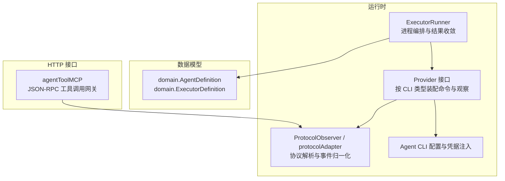
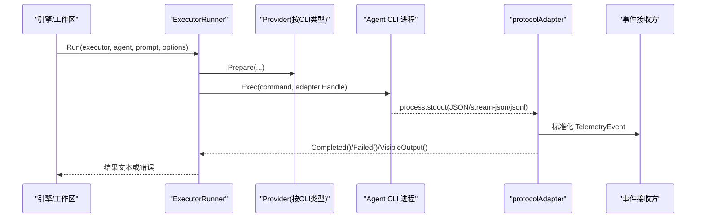
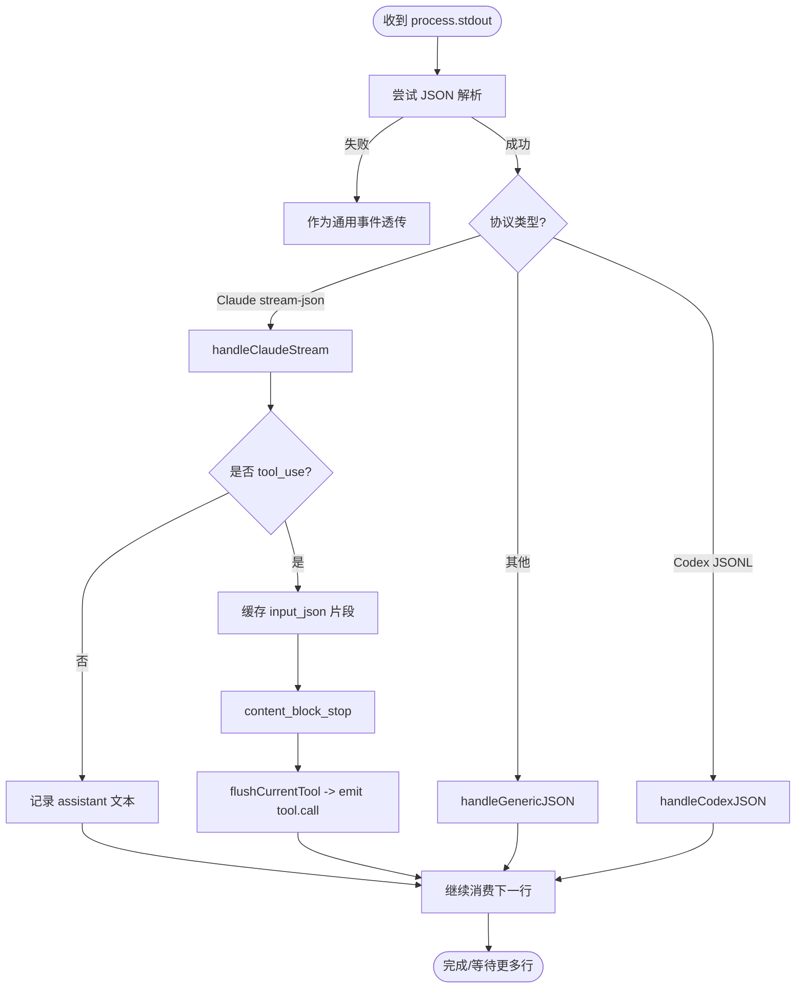
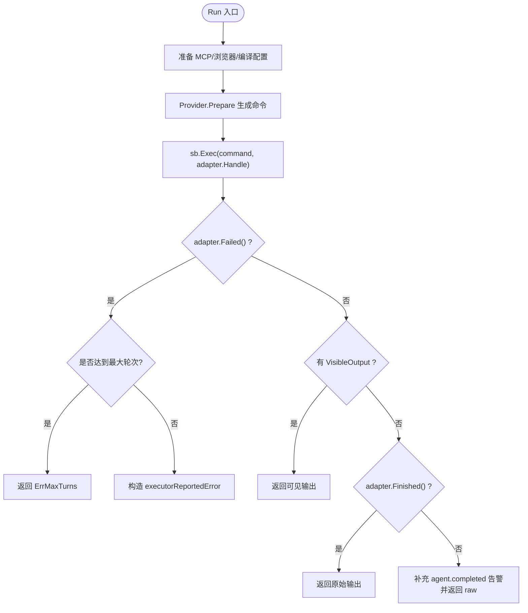
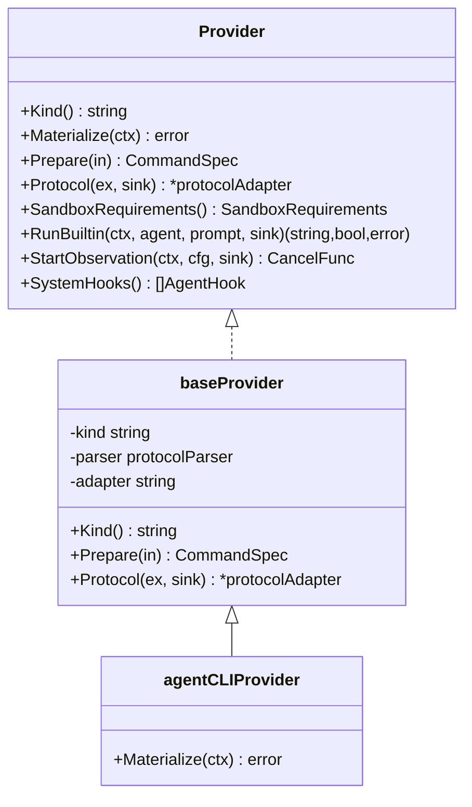
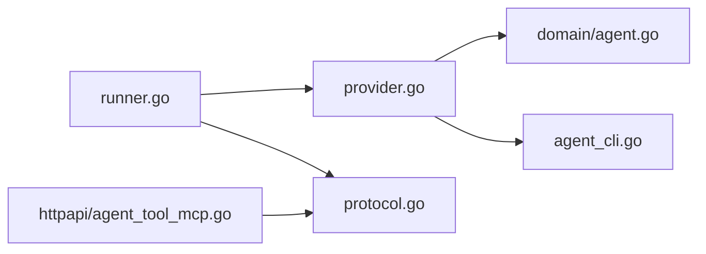

# 通用 Agent CLI 执行器

<cite>
**本文引用的文件**   
- [README.md](file://README.md)
- [protocol.go](file://internal/runtime/protocol.go)
- [provider.go](file://internal/runtime/provider.go)
- [runner.go](file://internal/runtime/runner.go)
- [agent_cli.go](file://internal/runtime/agent_cli.go)
- [provider_agentcli.go](file://internal/runtime/provider_agentcli.go)
- [agent_tool_mcp.go](file://internal/httpapi/agent_tool_mcp.go)
- [merge_mr_test.go](file://internal/tracker/merge_mr_test.go)
- [executor_cases_test.go](file://internal/runtime/executor_cases_test.go)
- [agent_cli_integration_test.go](file://internal/runtime/agent_cli_integration_test.go)
- [agent.go](file://internal/domain/agent.go)
</cite>

## 目录
1. [引言](#引言)
2. [项目结构](#项目结构)
3. [核心组件](#核心组件)
4. [架构总览](#架构总览)
5. [详细组件分析](#详细组件分析)
6. [依赖关系分析](#依赖关系分析)
7. [性能与可观测性](#性能与可观测性)
8. [协议扩展与插件化指南](#协议扩展与插件化指南)
9. [自定义执行器开发指南](#自定义执行器开发指南)
10. [测试方法与调试技巧](#测试方法与调试技巧)
11. [故障排查](#故障排查)
12. [结论](#结论)

## 引言
本文件面向希望为新的 AI 代理 CLI 开发集成适配器的工程师，系统性说明 LoopForge 的“通用 Agent CLI 执行器”如何工作。重点包括：
- 协议适配器机制：将不同 CLI 的原生输出统一为标准遥测事件。
- JSON-RPC 工具调用处理：通过 HTTP Streamable JSON-RPC 暴露 MCP 工具调用入口。
- 事件流管理：生命周期、模型请求、推理、输出、工具调用、用量等事件的标准化与传播。
- 协议定义规范与消息格式标准：stream-json、jsonl 以及通用 JSON 三类解析路径。
- 自定义执行器与协议扩展：新增 Provider、Protocol 和 CLI 类型的方法。
- 测试与调试：端到端用例、Mock 行为、错误收敛与日志定位。

## 项目结构
围绕 Agent CLI 执行的关键代码集中在 runtime 层，并通过 domain 层的数据模型对外暴露；HTTP API 层提供 JSON-RPC 工具调用网关；domain 层定义 ExecutorDefinition、AgentDefinition 等核心数据结构。

**图示来源**
- [runner.go:20-145](file://internal/runtime/runner.go#L20-L145)
- [provider.go:50-164](file://internal/runtime/provider.go#L50-L164)
- [protocol.go:28-91](file://internal/runtime/protocol.go#L28-L91)
- [agent_cli.go:368-487](file://internal/runtime/agent_cli.go#L368-L487)
- [agent_tool_mcp.go:58-87](file://internal/httpapi/agent_tool_mcp.go#L58-L87)

**章节来源**
- [README.md:38-70](file://README.md#L38-L70)
- [runner.go:20-145](file://internal/runtime/runner.go#L20-L145)
- [provider.go:50-164](file://internal/runtime/provider.go#L50-L164)
- [protocol.go:28-91](file://internal/runtime/protocol.go#L28-L91)
- [agent_cli.go:368-487](file://internal/runtime/agent_cli.go#L368-L487)
- [agent_tool_mcp.go:58-87](file://internal/httpapi/agent_tool_mcp.go#L58-L87)

## 核心组件
- 执行器运行器（ExecutorRunner）：负责准备资源、组装命令、启动进程、消费 stdout、收敛结果与错误。
- Provider 抽象：按 CLI 类型（如 claude-code、codex、codebuddy、agent-cli-*）决定参数、沙箱需求、内置运行能力与协议解析器。
- 协议观察者（ProtocolObserver / protocolAdapter）：将 process.stdout 中的原生 JSON/stream-json/jsonl 行解析为统一的 TelemetryEvent。
- Agent CLI 配置与凭据注入：为 OpenCode、Cursor、Antigravity、Kimi、Pi、DeepSeek Harness、ZCode 等生成私有 HOME、MCP 配置与模型配置。
- JSON-RPC 工具调用网关：以无状态 Streamable HTTP 暴露 MCP 工具调用，内部复用协议适配器的事件语义。

**章节来源**
- [runner.go:20-145](file://internal/runtime/runner.go#L20-L145)
- [provider.go:50-164](file://internal/runtime/provider.go#L50-L164)
- [protocol.go:28-91](file://internal/runtime/protocol.go#L28-L91)
- [agent_cli.go:368-487](file://internal/runtime/agent_cli.go#L368-L487)
- [agent_tool_mcp.go:58-87](file://internal/httpapi/agent_tool_mcp.go#L58-L87)

## 架构总览
下图展示一次 Agent CLI 调用的完整链路：控制面准备 Provider 与命令，运行器启动子进程，协议适配器将原生输出归一化为标准事件，最终收敛为节点输出或错误。

**图示来源**
- [runner.go:20-145](file://internal/runtime/runner.go#L20-L145)
- [provider.go:130-164](file://internal/runtime/provider.go#L130-L164)
- [protocol.go:182-212](file://internal/runtime/protocol.go#L182-L212)

## 详细组件分析

### 协议适配器与事件流
协议适配器是“通用执行器”的核心：它不关心具体 CLI，只消费 process.stdout 中的结构化行，并输出统一的 TelemetryEvent。支持的解析模式包括：
- Claude 风格 stream-json
- Codex JSONL
- 通用 JSON（fallback）
- 翻译模式：先将第三方 CLI 的行改写为 Claude 风格 stream-json，再走同一解析路径

关键流程：
- Handle 仅对 process.stdout 进行协议分发，其他事件直接透传。
- handleClaudeStream/handleCodexJSON/handleGenericJSON 分别映射到 lifecycle/model/reasoning/output/tool/usage 等类别。
- toolUse 采用缓冲聚合：content_block_start 开始，input_json_delta 累积，content_block_stop 时 flush 并触发 tool.call start/finish。
- VisibleOutput 优先返回显式 result 帧，否则回退到最近 assistant 文本，避免向用户暴露原始 stream-json 信封。
- Finalize 在无 terminal result 时补充 agent.completed 生命周期事件，便于上层判定结束。

**图示来源**
- [protocol.go:182-212](file://internal/runtime/protocol.go#L182-L212)
- [protocol.go:229-336](file://internal/runtime/protocol.go#L229-L336)
- [protocol.go:338-426](file://internal/runtime/protocol.go#L338-L426)

**章节来源**
- [protocol.go:28-91](file://internal/runtime/protocol.go#L28-L91)
- [protocol.go:182-212](file://internal/runtime/protocol.go#L182-L212)
- [protocol.go:229-336](file://internal/runtime/protocol.go#L229-L336)
- [protocol.go:338-426](file://internal/runtime/protocol.go#L338-L426)

### 执行器运行器与结果收敛
ExecutorRunner 的职责：
- 准备 MCP 资产与浏览器 MCP（按需）。
- 根据 Provider 生成 CommandSpec，必要时将超长 Prompt 写入文件并通过 stdin 传递。
- 启动进程并注册协议适配器回调。
- 处理最大轮次、认证失败、无 terminal result 等边界情况。
- 裁剪输出长度，保证 UI 与存储可控。

**图示来源**
- [runner.go:20-145](file://internal/runtime/runner.go#L20-L145)
- [runner.go:290-315](file://internal/runtime/runner.go#L290-L315)

**章节来源**
- [runner.go:20-145](file://internal/runtime/runner.go#L20-L145)
- [runner.go:260-315](file://internal/runtime/runner.go#L260-L315)

### Provider 抽象与 Agent CLI 支持
Provider 接口封装了 CLI 差异：
- Kind/Materialize/Prepare/Protocol/SandboxRequirements/RunBuiltin/StartObservation/SystemHooks。
- baseProvider 默认实现将 Executor.Binary + Args + Compiled.Args 拼接为命令行，并在需要时追加 --model。
- providerForKind 根据 kind 选择具体 Provider；未知 kind 回退为 generic-json-v1。
- Agent CLI 类型（opencode、cursor、agy、kimi、pi、dsh、zcode）通过 newAgentCLIProvider 注册，使用 protocolTranslated 将各自原生流转换为 Claude 风格 stream-json 后统一解析。

**图示来源**
- [provider.go:50-85](file://internal/runtime/provider.go#L50-L85)
- [provider.go:130-164](file://internal/runtime/provider.go#L130-L164)
- [provider_agentcli.go:13-37](file://internal/runtime/provider_agentcli.go#L13-L37)

**章节来源**
- [provider.go:50-164](file://internal/runtime/provider.go#L50-L164)
- [provider_agentcli.go:13-37](file://internal/runtime/provider_agentcli.go#L13-L37)

### Agent CLI 配置与凭据注入
针对多种 Agent CLI，系统会：
- 在每运行私有的 HOME 下写入 MCP 配置文件，隔离宿主登录态与配置。
- 根据 CLI 特性注入 API Key、Base URL、模型 ID、思考强度、权限策略等。
- 清理可能泄露宿主状态的敏感环境变量，确保每次运行独立安全。

典型行为：
- OpenCode/Pi/Antigravity/Kimi/DeepSeek/ZCode 均通过 WriteAgentCLIMCPConfig 与 ApplyAgentCLICredential 组合完成配置。
- DeepSeek Harness 支持官方 endpoint 与 OpenAI-compatible gateway 两种模式。
- Cursor 支持通过 --model 指定模型 ID，并可结合 effort 选择模型族。

**章节来源**
- [agent_cli.go:129-222](file://internal/runtime/agent_cli.go#L129-L222)
- [agent_cli.go:368-487](file://internal/runtime/agent_cli.go#L368-L487)
- [agent_cli.go:495-538](file://internal/runtime/agent_cli.go#L495-L538)

### JSON-RPC 工具调用网关
HTTP API 提供无状态 Streamable HTTP 的 JSON-RPC 入口：
- 路由接受 POST/DELETE，校验 token 与会话。
- 限制请求体大小，解析 JSON-RPC 2.0 请求。
- 将工具调用委托给内部会话处理器，并以标准响应格式返回。

该网关与协议适配器共享“工具调用”语义，使外部系统可通过 MCP 方式驱动 Agent 的工具链。

**章节来源**
- [agent_tool_mcp.go:48-87](file://internal/httpapi/agent_tool_mcp.go#L48-L87)
- [merge_mr_test.go:122-149](file://internal/tracker/merge_mr_test.go#L122-L149)

## 依赖关系分析
- runner.go 依赖 provider.go 获取 Provider 实例与命令拼装逻辑。
- provider.go 依赖 domain 层的 ExecutorDefinition/AgentDefinition 等结构。
- protocol.go 依赖 domain.TelemetryEvent 输出标准化事件。
- agent_cli.go 依赖 domain 的 AgentCLIExecutorKinds 与协议常量。
- httpapi/agent_tool_mcp.go 依赖协议适配器的事件语义，但不直接持有进程。

**图示来源**
- [runner.go:20-145](file://internal/runtime/runner.go#L20-L145)
- [provider.go:50-164](file://internal/runtime/provider.go#L50-L164)
- [protocol.go:28-91](file://internal/runtime/protocol.go#L28-L91)
- [agent_cli.go:368-487](file://internal/runtime/agent_cli.go#L368-L487)
- [agent_tool_mcp.go:58-87](file://internal/httpapi/agent_tool_mcp.go#L58-L87)

**章节来源**
- [runner.go:20-145](file://internal/runtime/runner.go#L20-L145)
- [provider.go:50-164](file://internal/runtime/provider.go#L50-L164)
- [protocol.go:28-91](file://internal/runtime/protocol.go#L28-L91)
- [agent_cli.go:368-487](file://internal/runtime/agent_cli.go#L368-L487)
- [agent_tool_mcp.go:58-87](file://internal/httpapi/agent_tool_mcp.go#L58-L87)

## 性能与可观测性
- 输出裁剪：ExecutorRunner 对最终输出进行 UTF-8 安全的截断，避免超大输出影响 UI 与存储。
- 事件规范：ObservabilitySpec 定义了类别、阶段、度量单位与适配器描述，便于跨 Provider 对比与成本核算。
- 用量指标：token/cost/duration/calls 等指标在 usage.update/final 中上报，区分“真实零成本”与“未识别成本”。
- 超时与轮次：当 CLI 报告 max turns 时，Runner 返回 ErrMaxTurns，交由上层人工决策重试或终止。

**章节来源**
- [runner.go:260-315](file://internal/runtime/runner.go#L260-L315)
- [protocol.go:114-128](file://internal/runtime/protocol.go#L114-L128)
- [protocol.go:214-227](file://internal/runtime/protocol.go#L214-L227)

## 协议扩展与插件化指南
### 新增 Provider
- 在 provider.go 的 providers 映射中注册新 kind，或让 init 自动发现 AgentCLIKinds。
- 若为新 CLI，建议实现 agentCLIProvider 风格的 Materialize 与 Prepare，并使用 protocolTranslated 将原生流转为 Claude 风格 stream-json。
- 如需特殊沙箱需求（如 PrivateHome、CLIStates），重写 SandboxRequirements。

### 新增协议解析
- 若 CLI 输出不是 stream-json/jsonl，可在 protocol.go 中添加新的 protocolParser 分支，并在 Handle 中分发。
- 保持事件分类与 phase 一致：lifecycle/model/reasoning/output/tool/usage/process/error。
- 对于工具调用，务必实现 beginToolUse/appendToolJSON/flushCurrentTool 的语义，确保 tool.call 的 start/finish 成对出现。

### 扩展 Agent CLI 类型
- 在 domain/agent.go 的 AgentCLIExecutorKinds 中登记新 kind。
- 在 agent_cli.go 中补充 WriteAgentCLIMCPConfig 与 ApplyAgentCLICredential 的实现，处理密钥、Base URL、模型与权限。
- 若 CLI 需要额外环境变量或私有 HOME 路径，加入 agentCLIHostEnv 与 agentCLIMCPPaths。

**章节来源**
- [provider.go:146-164](file://internal/runtime/provider.go#L146-L164)
- [protocol.go:17-26](file://internal/runtime/protocol.go#L17-L26)
- [protocol.go:182-212](file://internal/runtime/protocol.go#L182-L212)
- [agent_cli.go:21-49](file://internal/runtime/agent_cli.go#L21-L49)
- [agent_cli.go:129-222](file://internal/runtime/agent_cli.go#L129-L222)
- [agent_cli.go:368-487](file://internal/runtime/agent_cli.go#L368-L487)
- [agent.go:22-32](file://internal/domain/agent.go#L22-L32)

## 自定义执行器开发指南
### 步骤概览
1. 确定 CLI 类型与协议：
   - 若 CLI 输出 stream-json/jsonl，可直接使用现有解析器。
   - 若为其他格式，实现 protocolTranslated 或新增 parser 分支。
2. 注册 Provider：
   - 在 providers 映射中注册 kind，或复用 agentCLIProvider 模板。
3. 配置与凭据：
   - 实现 Materialize 写入 MCP 配置。
   - 实现 ApplyAgentCLICredential 注入 API Key/Base URL/Model。
4. 命令拼装：
   - 通过 Provider.Prepare 生成 CommandSpec，必要时使用 PromptOnStdin 处理超长 Prompt。
5. 事件与结果：
   - 确保 emit lifecycle/model/tool/usage 事件。
   - 在 Finalize 或 adapter.Finished 时补充 agent.completed。

### 关键注意事项
- 安全隔离：所有敏感变量必须从子进程环境清除，私有 HOME 必须受控。
- 输出收敛：VisibleOutput 优先 result，其次 assistant 文本；raw 输出用于兜底。
- 错误语义：401 Unauthorized 等错误需明确上报，max turns 需返回 ErrMaxTurns。

**章节来源**
- [provider.go:73-85](file://internal/runtime/provider.go#L73-L85)
- [provider.go:120-132](file://internal/runtime/provider.go#L120-L132)
- [agent_cli.go:368-487](file://internal/runtime/agent_cli.go#L368-L487)
- [runner.go:56-79](file://internal/runtime/runner.go#L56-L79)
- [runner.go:101-145](file://internal/runtime/runner.go#L101-L145)

## 测试方法与调试技巧
- 单元测试覆盖：
  - 通用成功/失败、无 terminal result、最大轮次、401 Unauthorized 等场景。
  - 参考 executor_cases_test.go 的用例组织。
- 集成测试：
  - 通过 AGENTFLOW_TEST_AGENT_CLIS=1 启用真实 CLI 集成测试，按 kind 设置 KEY/BASE_URL/PROTOCOL/MODEL。
  - 参考 agent_cli_integration_test.go 的探针与服务模拟。
- 调试建议：
  - 关注 process.stdout 的首行是否为合法 JSON。
  - 检查 adapter.Finished()/Failed() 与 VisibleOutput() 的值。
  - 确认 MCP 配置与私有 HOME 是否正确写入。
  - 对 JSON-RPC 网关，验证请求体大小、token 与会话有效性。

**章节来源**
- [executor_cases_test.go:81-101](file://internal/runtime/executor_cases_test.go#L81-L101)
- [agent_cli_integration_test.go:91-113](file://internal/runtime/agent_cli_integration_test.go#L91-L113)
- [agent_tool_mcp.go:58-87](file://internal/httpapi/agent_tool_mcp.go#L58-L87)

## 故障排查
常见问题与定位要点：
- CLI 未输出 terminal result：
  - Runner 会补充 agent.completed 告警，VisibleOutput 回退到 assistant 文本。
  - 检查协议解析分支是否正确匹配。
- 401 Unauthorized：
  - executorReportedError 会包装错误信息，提示认证失败。
  - 检查 ApplyAgentCLICredential 是否注入正确的 API Key/Base URL。
- 超过最大轮次：
  - Runner 返回 ErrMaxTurns，上层应引导人工重试或终止。
- MCP 工具调用失败：
  - 检查 JSON-RPC 请求体结构与 token 有效性。
  - 确认工具名称与参数是否符合服务端契约。

**章节来源**
- [runner.go:101-145](file://internal/runtime/runner.go#L101-L145)
- [runner.go:290-315](file://internal/runtime/runner.go#L290-L315)
- [agent_tool_mcp.go:58-87](file://internal/httpapi/agent_tool_mcp.go#L58-L87)

## 结论
LoopForge 的通用 Agent CLI 执行器通过 Provider 抽象与协议适配器，将多源 CLI 的输出统一为标准事件流，既保证了可观测性与成本核算的一致性，又为新增 CLI 提供了清晰的扩展点。配合 JSON-RPC 工具调用网关与严格的凭据隔离，平台能够在安全、可观测、可扩展的前提下，编排各类 AI 代理 CLI 的工作流。