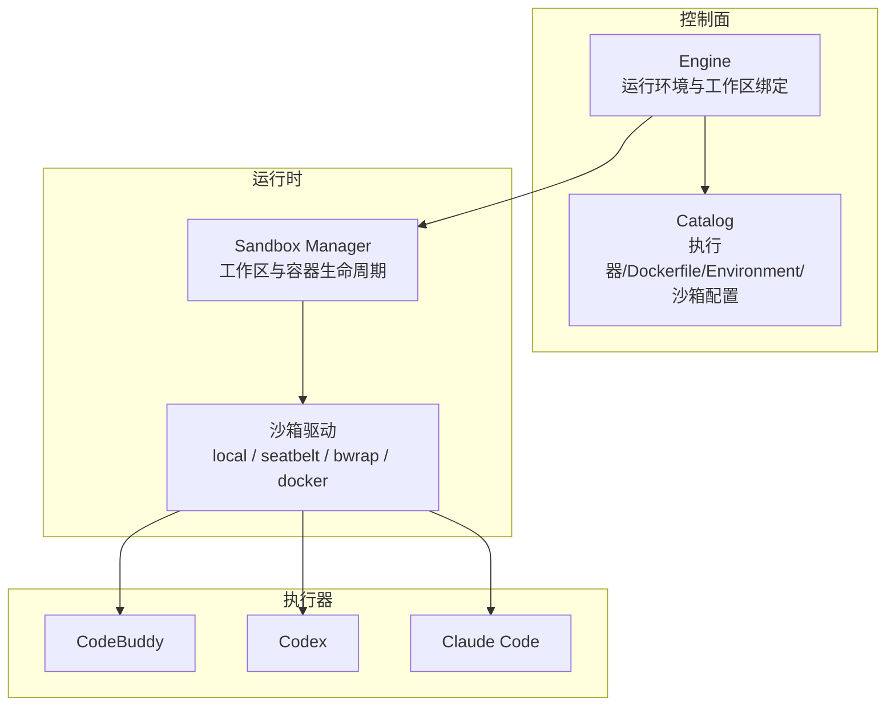
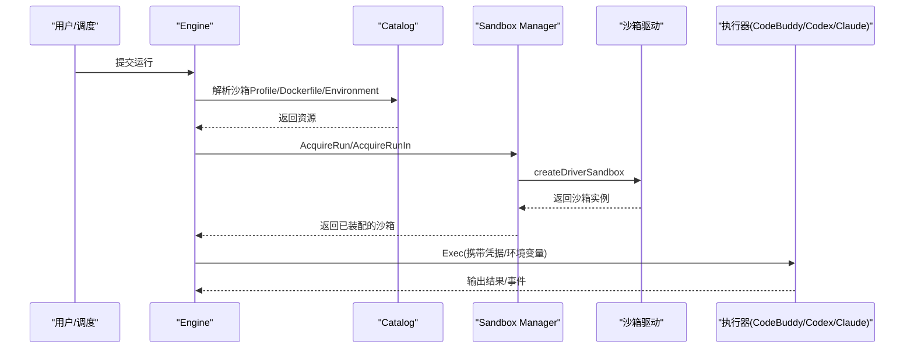
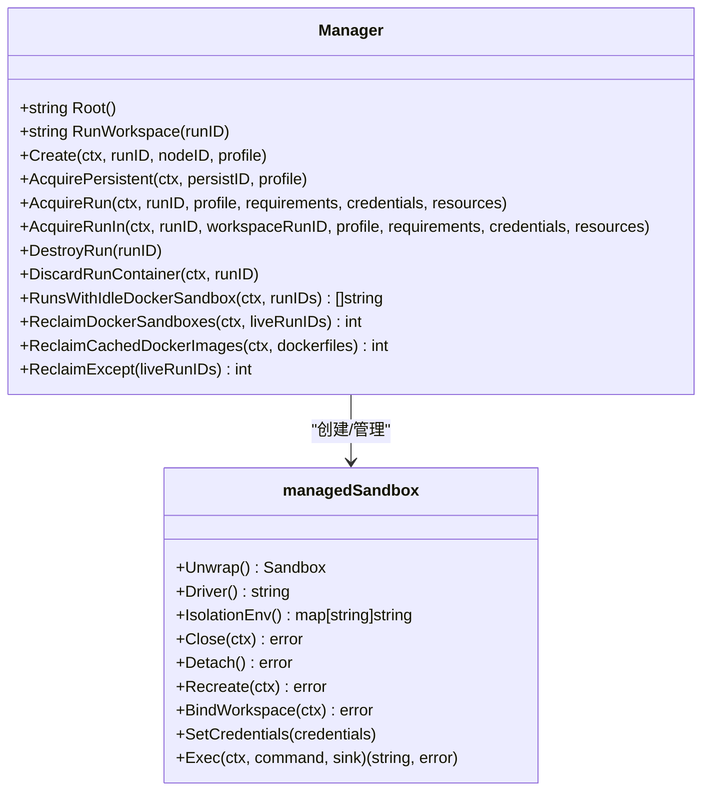
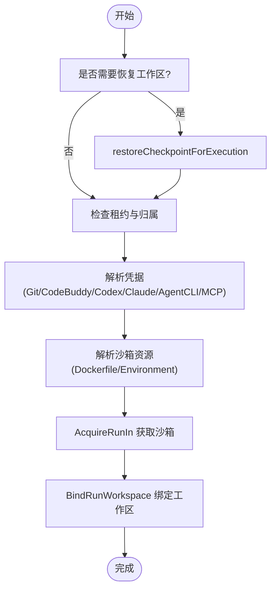
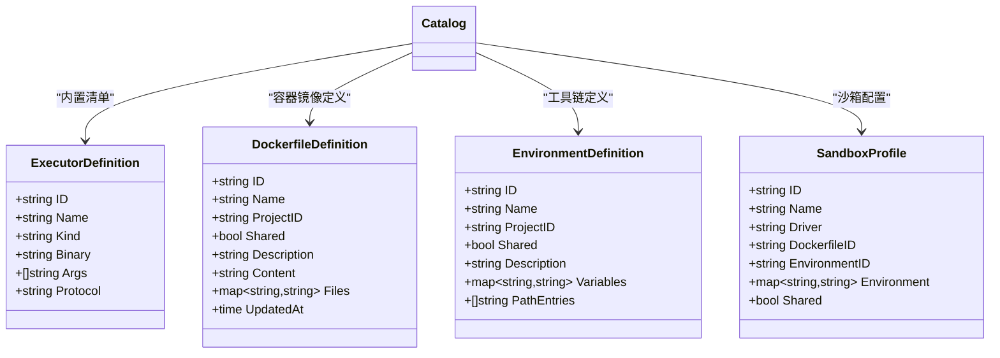
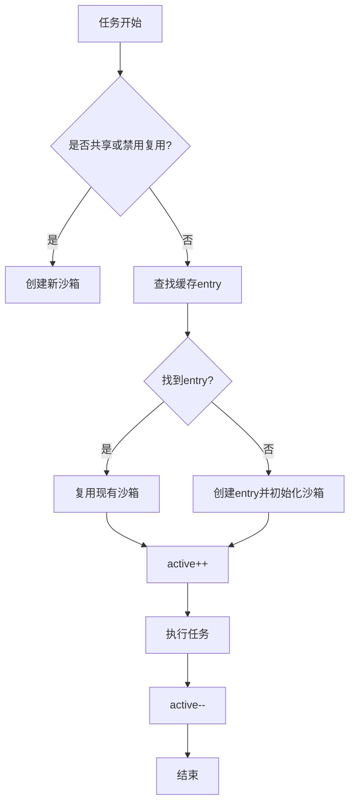
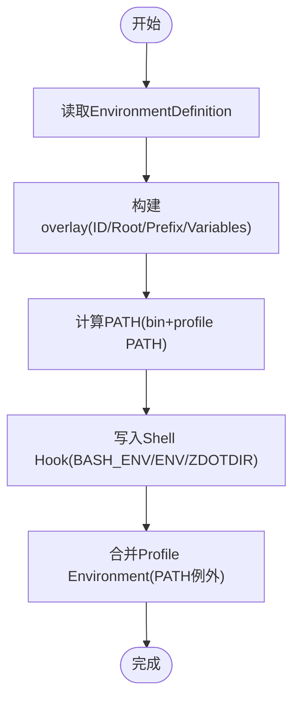
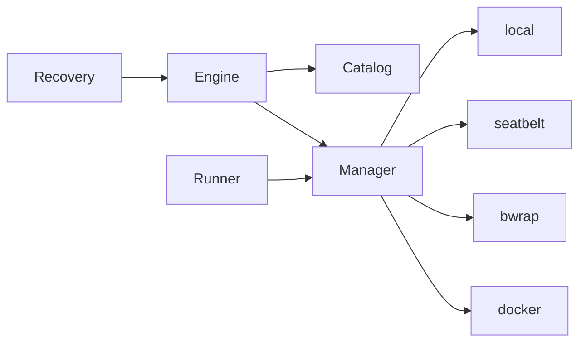
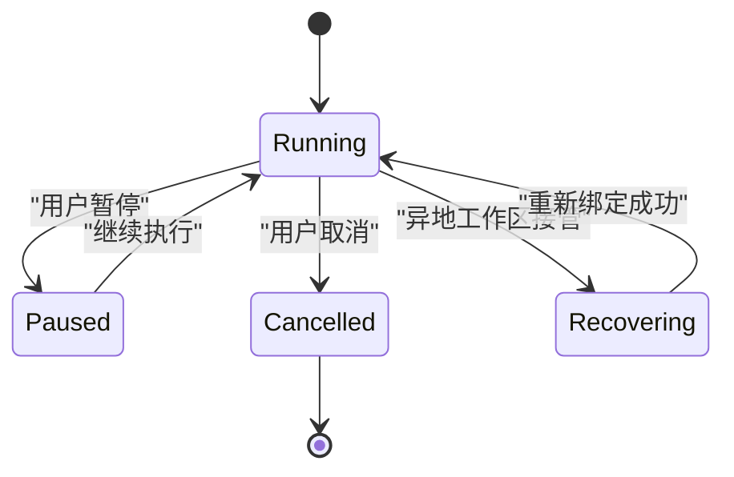
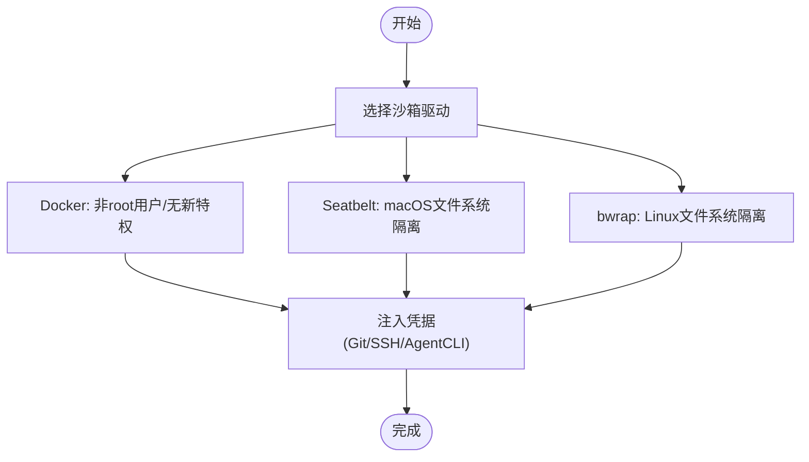

# 执行环境

<cite>
**本文引用的文件**   
- [sandbox_manager.go](file://internal/runtime/sandbox_manager.go)
- [run_environment.go](file://internal/engine/run_environment.go)
- [catalog.go](file://internal/repo/catalog.go)
- [sandbox_owner_linux_test.go](file://internal/rustime/sandbox_owner_linux_test.go)
- [run_sandbox.go](file://internal/runner/run_sandbox.go)
- [run_recovery.go](file://internal/engine/run_recovery.go)
- [run_ops.go](file://internal/engine/run_ops.go)
- [sandbox_environment.go](file://internal/rustime/sandbox_environment.go)
- [assets.go](file://internal/domain/assets.go)
- [main.go](file://cmd/agentflow-runner/main.go)
</cite>

## 目录
1. [简介](#简介)
2. [项目结构](#项目结构)
3. [核心组件](#核心组件)
4. [架构总览](#架构总览)
5. [详细组件分析](#详细组件分析)
6. [依赖关系分析](#依赖关系分析)
7. [性能与资源特性](#性能与资源特性)
8. [故障恢复与可观测性](#故障恢复与可观测性)
9. [安全与隔离策略](#安全与隔离策略)
10. [部署模式与配置示例](#部署模式与配置示例)
11. [排错指南](#排错指南)
12. [结论](#结论)

## 简介
本文面向“执行环境”这一主题，系统性说明 LoopForge 的执行机、沙箱管理、资源调度与隔离策略，并覆盖 CodeBuddy、Codex、Claude Code 等执行器的集成方式、环境变量装配、工具链管理与安全边界。文档同时给出不同部署模式的配置建议、最佳实践和常见问题排查路径。

## 项目结构
围绕执行环境的代码主要分布在以下层次：
- 运行时沙箱管理器：负责创建、复用、清理工作区与容器，统一驱动选择与环境装配。
- 引擎执行环境：将运行任务与工作区绑定，解析 Dockerfile、Environment、凭据，并在多实例间迁移工作区绑定。
- 仓库目录与定义：内置执行器清单、Dockerfile 与 Environment 定义、沙箱配置文件。
- Runner 侧沙箱复用：按任务维度复用远程沙箱，避免重复构建。
- 恢复与操作：处理暂停、取消、租约、异地工作区接管与清理。
- 环境变量装配：为进程级沙箱注入 PATH、Shell Hook、变量前缀等。
- Runner 启动加载：支持 .env 注入本地执行机环境变量。

**图表来源**
- [run_environment.go:113-157](file://internal/engine/run_environment.go#L113-L157)
- [sandbox_manager.go:73-110](file://internal/rustime/sandbox_manager.go#L73-L110)
- [catalog.go:235-247](file://internal/repo/catalog.go#L235-L247)

**章节来源**
- [run_environment.go:17-104](file://internal/engine/run_environment.go#L17-L104)
- [sandbox_manager.go:14-110](file://internal/rustime/sandbox_manager.go#L14-L110)
- [catalog.go:235-247](file://internal/repo/catalog.go#L235-L247)

## 核心组件
- 沙箱管理器（Manager）：提供工作区根目录、按 runID/workspaceRunID 打开或重建沙箱、共享/持久化工作区、回收容器与镜像、并发槽位限制。
- 运行环境（runEnvironment）：封装单个 Workflow Run 的 Sandbox，负责仓库准备、凭据注入、工作区绑定与释放。
- 仓库目录（Catalog）：维护内置执行器、Dockerfile、Environment、沙箱 Profile 等定义，并提供校验与默认值。
- Runner 沙箱复用：在 Runner 侧对同一任务的沙箱进行缓存复用，减少重复构建成本。
- 恢复与操作：实现暂停、取消、租约抢占、异地工作区接管、空闲容器回收。
- 环境变量装配：基于 EnvironmentDefinition 生成 overlay，注入 PATH、Shell Hook、变量前缀等。
- Runner 启动加载：从 .env 读取键值，仅当系统未设置时注入，便于本地执行机配置。

**章节来源**
- [sandbox_manager.go:14-110](file://internal/rustime/sandbox_manager.go#L14-L110)
- [run_environment.go:17-104](file://internal/engine/run_environment.go#L17-L104)
- [catalog.go:235-247](file://internal/repo/catalog.go#L235-L247)
- [run_sandbox.go:40-84](file://internal/runner/run_sandbox.go#L40-L84)
- [run_recovery.go:183-338](file://internal/engine/run_recovery.go#L183-L338)
- [run_ops.go:95-139](file://internal/engine/run_ops.go#L95-L139)
- [sandbox_environment.go:90-130](file://internal/rustime/sandbox_environment.go#L90-L130)
- [main.go:112-135](file://cmd/agentflow-runner/main.go#L112-L135)

## 架构总览
下图展示一次典型执行的端到端流程：Engine 根据 Run 与沙箱 Profile 解析资源，Manager 创建或复用沙箱，Runner 通过 Exec 调用具体执行器；在执行过程中，凭据、Git 信息、MCP 服务器等被注入到沙箱环境中。

**图表来源**
- [run_environment.go:159-224](file://internal/engine/run_environment.go#L159-L224)
- [sandbox_manager.go:56-110](file://internal/rustime/sandbox_manager.go#L56-L110)
- [catalog.go:235-247](file://internal/repo/catalog.go#L235-L247)

## 详细组件分析

### 沙箱管理器（Manager）
职责与关键点：
- 工作区根目录与命名：RunWorkspace 计算宿主路径，safeID 保证 ID 安全。
- 沙箱生命周期：Create/AcquirePersistent/AcquireRun/AcquireRunIn 分别对应一次性、持久化、Run 级别与跨节点共享工作区的场景。
- 驱动选择与隔离：createDriverSandbox 根据 profile.Driver 选择 local/seatbelt/bwrap/docker；对本地驱动进行隔离处理。
- 环境装配：prepareSandboxEnvironment 与 overlayEnvironment 合并 Profile 与 Environment 的环境变量，PATH 优先使用 overlay。
- 并发控制：slots 通道限制并行 Exec 数量，避免资源争用。
- 清理与回收：DestroyRun/DiscardRunContainer/ReclaimDockerSandboxes/ReclaimCachedDockerImages/ReclaimExcept 提供多种清理策略。

**图表来源**
- [sandbox_manager.go:14-110](file://internal/rustime/sandbox_manager.go#L14-L110)
- [sandbox_manager.go:314-433](file://internal/rustime/sandbox_manager.go#L314-L433)

**章节来源**
- [sandbox_manager.go:14-110](file://internal/rustime/sandbox_manager.go#L14-L110)
- [sandbox_manager.go:112-225](file://internal/rustime/sandbox_manager.go#L112-L225)
- [sandbox_manager.go:314-433](file://internal/rustime/sandbox_manager.go#L314-L433)

### 运行环境（runEnvironment）
职责与关键点：
- 单 Run 沙箱拥有者：封装 Sandbox，暴露 Workspace、Exec、BindWorkspace、Close 等方法。
- 仓库准备与状态：prepareRepositoriesOnce 确保仓库 checkout 只执行一次，activeExecutions 统计并行分支。
- 凭据解析：resolveRunCredentials 从 Store 获取 Git/GitSSHKeys/Identity、CodeBuddy/Codex/Claude Code/AgentCLI 凭据，并准备 MCP 服务器。
- 工作区绑定与迁移：adoptForeignWorkspace/rebindWorkspaceHere 处理异地主机丢失后的重新绑定与提示。
- 资源解析：resolveSandboxResources 从 Catalog 解析 Dockerfile 与 Environment，并校验 docker sandbox 必须指定 dockerfileId。

**图表来源**
- [run_environment.go:159-224](file://internal/engine/run_environment.go#L159-L224)
- [run_environment.go:226-244](file://internal/engine/run_environment.go#L226-L244)
- [run_environment.go:263-310](file://internal/engine/run_environment.go#L263-L310)

**章节来源**
- [run_environment.go:17-104](file://internal/engine/run_environment.go#L17-L104)
- [run_environment.go:113-157](file://internal/engine/run_environment.go#L113-L157)
- [run_environment.go:159-224](file://internal/engine/run_environment.go#L159-L224)
- [run_environment.go:226-244](file://internal/engine/run_environment.go#L226-L244)
- [run_environment.go:263-310](file://internal/engine/run_environment.go#L263-L310)

### 仓库目录（Catalog）与执行器
内置执行器清单：
- CodeBuddy：二进制 codebuddy，协议 stream-json。
- Codex：二进制 codex，协议 jsonl。
- Claude Code：二进制 claude，协议 stream-json。
- 其他如 OpenCode、Cursor CLI、Antigravity、Kimi Code、Pi、DeepSeek Harness、ZCode。

Dockerfile 与 Environment：
- DockerfileDefinition：包含内容、文件映射、更新时间等，用于构建容器镜像。
- EnvironmentDefinition：包含变量、PATH 条目、安装脚本，用于进程级沙箱的工具链装配。

沙箱 Profile：
- 支持 driver 类型：local/native/seatbelt/bwrap/docker。
- docker sandbox 必须指定 dockerfileId，environmentId 可选。

**图表来源**
- [catalog.go:235-247](file://internal/repo/catalog.go#L235-L247)
- [assets.go:117-141](file://internal/domain/assets.go#L117-L141)
- [catalog.go:320-389](file://internal/repo/catalog.go#L320-L389)

**章节来源**
- [catalog.go:235-247](file://internal/repo/catalog.go#L235-L247)
- [assets.go:117-141](file://internal/domain/assets.go#L117-L141)
- [catalog.go:320-389](file://internal/repo/catalog.go#L320-L389)

### Runner 侧沙箱复用
Runner 层对任务维度的沙箱进行缓存复用：
- 若共享或禁用复用，则直接创建新沙箱。
- 否则按 key 查找已有 entry，增加 active 引用计数，延迟释放。
- closeRunSandboxes 在 Run 结束时关闭所有共享沙箱。

**图表来源**
- [run_sandbox.go:40-84](file://internal/runner/run_sandbox.go#L40-L84)

**章节来源**
- [run_sandbox.go:40-84](file://internal/runner/run_sandbox.go#L40-L84)

### 环境变量装配
环境变量装配逻辑：
- environmentOverlay 生成 overlay，注入 environmentID/root/prefix、Variables、PATH、Shell Hook（BASH_ENV/ENV/ZDOTDIR）。
- PATH 组装规则：优先使用 overlay 的 bin 目录，再拼接 Profile 的 PATH。
- Shell Hook 写入 bashEnv，确保 login shell 重置 PATH 后仍能找到隔离工具。

**图表来源**
- [sandbox_environment.go:90-130](file://internal/rustime/sandbox_environment.go#L90-L130)
- [sandbox_environment.go:220-270](file://internal/rustime/sandbox_environment.go#L220-L270)

**章节来源**
- [sandbox_environment.go:90-130](file://internal/rustime/sandbox_environment.go#L90-L130)
- [sandbox_environment.go:220-270](file://internal/rustime/sandbox_environment.go#L220-L270)

### Runner 启动加载
Runner 启动时从 .env 加载环境变量：
- 逐行解析，忽略空行与注释。
- 去除 export 前缀，按 key=value 拆分。
- 仅当系统未设置该 key 时才注入，避免覆盖系统环境变量。

**章节来源**
- [main.go:112-135](file://cmd/agentflow-runner/main.go#L112-L135)

## 依赖关系分析
- Engine 依赖 Catalog 解析沙箱资源与执行器定义。
- Engine 依赖 Manager 创建与管理沙箱。
- Manager 依赖具体驱动（local/seatbelt/bwrap/docker），并通过 createDriverSandbox 分发。
- Runner 依赖 Manager 提供的沙箱接口，并对任务级沙箱进行复用。
- 恢复与操作模块依赖 Engine 的状态与 Repo 的租约机制。

**图表来源**
- [run_environment.go:159-224](file://internal/engine/run_environment.go#L159-L224)
- [sandbox_manager.go:449-464](file://internal/rustime/sandbox_manager.go#L449-L464)
- [run_recovery.go:183-338](file://internal/engine/run_recovery.go#L183-L338)

**章节来源**
- [run_environment.go:159-224](file://internal/engine/run_environment.go#L159-L224)
- [sandbox_manager.go:449-464](file://internal/rustime/sandbox_manager.go#L449-L464)
- [run_recovery.go:183-338](file://internal/engine/run_recovery.go#L183-L338)

## 性能与资源特性
- 并发限制：Manager 通过 slots 通道限制并行 Exec 数量，防止资源争用。
- 沙箱复用：Runner 层对任务级沙箱进行缓存复用，减少重复构建成本。
- 容器回收：ReclaimDockerSandboxes 与 ReclaimCachedDockerImages 定期清理闲置容器与镜像，释放磁盘空间。
- 工作区清理：DestroyRun 与 ReclaimExcept 提供按 runID 与白名单的清理策略。

**章节来源**
- [sandbox_manager.go:14-26](file://internal/rustime/sandbox_manager.go#L14-L26)
- [run_sandbox.go:40-84](file://internal/runner/run_sandbox.go#L40-L84)
- [sandbox_manager.go:183-225](file://internal/rustime/sandbox_manager.go#L183-L225)
- [sandbox_manager.go:246-312](file://internal/rustime/sandbox_manager.go#L246-L312)

## 故障恢复与可观测性
- 暂停与取消：Pause 中断当前节点但不销毁工作区，Cancel 终止运行并清理任务。
- 租约机制：acquireLease 与 releaseRunLease 确保多实例下只有一个 Worker 持有运行。
- 异地工作区接管：adoptForeignWorkspace 检测原主机离线后重新绑定，必要时重建 checkout。
- 空闲容器回收：ReclaimDockerSandboxes 扫描 Docker 中的容器，移除不再属于任何 run 的容器。

**图表来源**
- [run_ops.go:95-139](file://internal/engine/run_ops.go#L95-L139)
- [run_recovery.go:183-338](file://internal/engine/run_recovery.go#L183-L338)
- [run_environment.go:263-310](file://internal/engine/run_environment.go#L263-L310)

**章节来源**
- [run_ops.go:95-139](file://internal/engine/run_ops.go#L95-L139)
- [run_recovery.go:183-338](file://internal/engine/run_recovery.go#L183-L338)
- [run_environment.go:263-310](file://internal/engine/run_environment.go#L263-L310)

## 安全与隔离策略
- Docker 沙箱所有者：测试验证容器内进程以非 root 用户运行，且 CapEff=0、NoNewPrivs=1，确保权限最小化。
- 进程级沙箱：seatbelt（macOS）与 bwrap（Linux）提供文件系统与写权限隔离。
- 环境变量隔离：overlayEnvironment 确保 PATH 优先使用隔离工具链，避免污染宿主环境。
- 凭据注入：Git Token、SSH Keys、AgentCLI 凭据仅在沙箱内可见，避免泄露到宿主。

**图表来源**
- [sandbox_owner_linux_test.go:15-52](file://internal/rustime/sandbox_owner_linux_test.go#L15-L52)
- [sandbox_process.go:104-128](file://internal/rustime/sandbox_process.go#L104-L128)
- [sandbox_environment.go:90-130](file://internal/rustime/sandbox_environment.go#L90-L130)

**章节来源**
- [sandbox_owner_linux_test.go:15-52](file://internal/rustime/sandbox_owner_linux_test.go#L15-L52)
- [sandbox_process.go:104-128](file://internal/rustime/sandbox_process.go#L104-L128)
- [sandbox_environment.go:90-130](file://internal/rustime/sandbox_environment.go#L90-L130)

## 部署模式与配置示例

### 本地开发模式
- 驱动：local 或 bwrap（Linux）/ seatbelt（macOS）。
- 环境变量：通过 .env 注入 AGENTFLOW_* 相关变量。
- 工作区：Manager.Root 指向本地目录，RunWorkspace 按 runID 划分子目录。

配置建议：
- 使用 bwrap/seatbelt 提供基础隔离。
- 通过 EnvironmentDefinition 安装常用工具链，PATH 自动注入。
- 启用沙箱复用以减少构建时间。

### 生产部署模式
- 驱动：docker，必须指定 dockerfileId。
- 资源：通过 DockerfileDefinition 定义镜像内容与文件。
- 环境：通过 EnvironmentDefinition 注入变量与 PATH。
- 清理：定期运行 ReclaimDockerSandboxes 与 ReclaimCachedDockerImages。

配置建议：
- 使用专用 Dockerfile 构建最小化镜像，减少攻击面。
- 限制容器资源（CPU/内存）通过外部编排平台（如 Kubernetes）。
- 启用工作区快照与恢复，提升容错能力。

### 混合模式
- 控制面与执行面分离：Engine 与控制面部署在同一实例，Runner 部署在独立机器。
- 远程沙箱：Runner 通过 OpenRemoteSandbox 连接远程 Manager。
- 凭据：通过 AgentCLI 或 Provider Credential 注入到远程沙箱。

配置建议：
- 使用 SSH 或 API 网关保护远程访问。
- 启用日志与监控，追踪远程沙箱生命周期。
- 定期同步 Dockerfile 与 Environment 定义，保持一致性。

**章节来源**
- [sandbox_manager.go:14-110](file://internal/rustime/sandbox_manager.go#L14-L110)
- [run_environment.go:113-157](file://internal/engine/run_environment.go#L113-L157)
- [catalog.go:235-247](file://internal/repo/catalog.go#L235-L247)
- [main.go:112-135](file://cmd/agentflow-runner/main.go#L112-L135)

## 排错指南
- 沙箱驱动不支持：检查 profile.Driver 是否为 local/seatbelt/bwrap/docker。
- Docker 沙箱缺少 dockerfileId：确保沙箱配置中指定有效的 DockerfileID。
- 工作区占用：ReclaimExcept 会跳过正在使用的 workspaces，需等待任务结束。
- 凭据缺失：检查用户配置中是否设置了 CodeBuddy/Codex/Claude Code/AgentCLI 的 API Key。
- 远程沙箱不可用：确认远程 Manager 可达，且 bwrap/seatbelt 已安装。

**章节来源**
- [sandbox_manager.go:449-464](file://internal/rustime/sandbox_manager.go#L449-L464)
- [run_environment.go:113-157](file://internal/engine/run_environment.go#L113-L157)
- [catalog.go:320-389](file://internal/repo/catalog.go#L320-L389)

## 结论
LoopForge 的执行环境通过分层设计实现了灵活、安全、可扩展的沙箱管理。Engine 负责运行环境与工作区绑定，Manager 统一管理沙箱生命周期，Catalog 提供执行器与工具链定义。通过 Docker、seatbelt、bwrap 等多种驱动，系统能够适配本地开发与生产部署的不同需求。结合凭据注入、环境变量隔离、资源回收与故障恢复机制，系统在安全性与可靠性方面提供了坚实保障。