# 沙箱管理

<cite>
**本文引用的文件**   
- [sandbox_manager.go](file://internal/runtime/sandbox_manager.go)
- [sandbox_docker.go](file://internal/runtime/sandbox_docker.go)
- [sandbox_local.go](file://internal/runtime/sandbox_local.go)
- [sandbox_process.go](file://internal/runtime/sandbox_process.go)
- [sandbox_environment.go](file://internal/runtime/sandbox_environment.go)
- [assets.go](file://internal/domain/assets.go)
- [command_binding.go](file://internal/runtime/command_binding.go)
- [browser.go](file://internal/runtime/browser.go)
- [workspace_terminal_sandbox.go](file://internal/runtime/workspace_terminal_sandbox.go)
- [conversation_sandbox.go](file://internal/runtime/conversation_sandbox.go)
- [remote_sandbox.go](file://internal/runtime/remote_sandbox.go)
</cite>

## 目录
1. [简介](#简介)
2. [项目结构](#项目结构)
3. [核心组件](#核心组件)
4. [架构总览](#架构总览)
5. [详细组件分析](#详细组件分析)
6. [依赖关系分析](#依赖关系分析)
7. [性能与并发特性](#性能与并发特性)
8. [故障排查指南](#故障排查指南)
9. [结论](#结论)
10. [附录：配置与最佳实践](#附录配置与最佳实践)

## 简介
本文件面向 LoopForge 的沙箱管理系统，系统性说明沙箱的生命周期、隔离策略、资源限制、环境变量注入、文件挂载与权限控制，并对比 Docker 沙箱与本地（含原生进程）沙箱的实现差异。文档同时给出不同部署场景下的配置建议与最佳实践，帮助读者在开发、调试和生产环境中安全、稳定地使用沙箱执行工作区任务。

## 项目结构
沙箱相关代码集中在 `internal/runtime` 包中，由统一的 Manager 负责创建、获取、销毁和回收；具体执行由多种 Driver 实现：
- Docker 沙箱：通过容器运行命令，适合需要完整工具链或网络访问的场景。
- 本地沙箱：直接在宿主机进程执行，适合快速开发和调试。
- 原生进程沙箱：基于 seatbelt（macOS）或 bwrap（Linux）的轻量级进程隔离。
- 远程沙箱：供 Runner 端复用环境安装流程。

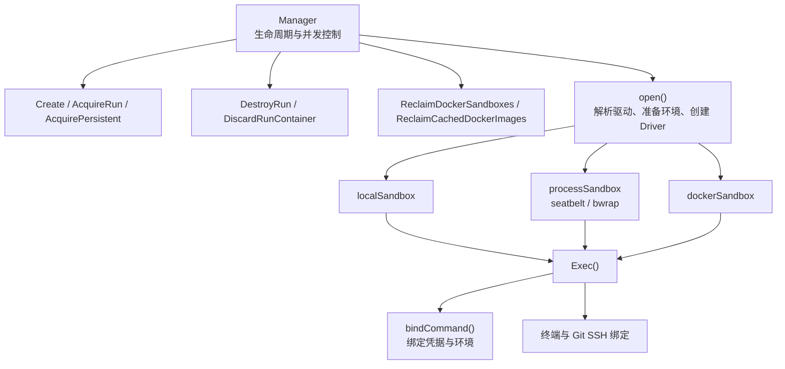

**图表来源**
- [sandbox_manager.go:44-110](file://internal/runtime/sandbox_manager.go#L44-L110)
- [sandbox_manager.go:451-464](file://internal/runtime/sandbox_manager.go#L451-L464)
- [sandbox_docker.go:133-164](file://internal/runtime/sandbox_docker.go#L133-L164)
- [sandbox_local.go:30-36](file://internal/runtime/sandbox_local.go#L30-L36)
- [sandbox_process.go:130-136](file://internal/runtime/sandbox_process.go#L130-L136)
- [command_binding.go:32-162](file://internal/runtime/command_binding.go#L32-L162)

**章节来源**
- [sandbox_manager.go:14-110](file://internal/runtime/sandbox_manager.go#L14-L110)
- [sandbox_docker.go:22-35](file://internal/runtime/sandbox_docker.go#L22-L35)
- [sandbox_local.go:12-16](file://internal/runtime/sandbox_local.go#L12-L16)
- [sandbox_process.go:93-128](file://internal/runtime/sandbox_process.go#L93-L128)

## 核心组件
- Manager：沙箱管理器，负责并发槽位、工作区路径、锁、生命周期清理与资源回收。
- Sandbox 接口：统一 ID、Workspace、Exec、Close 等能力，被 managedSandbox 包装以增强功能。
- Driver 实现：
  - dockerSandbox：容器化执行，支持镜像缓存、工作区挂载、会话根目录挂载、只读根文件系统。
  - localSandbox：宿主进程直接执行，设置 PWD、GIT_CEILING_DIRECTORIES 等。
  - processSandbox：seatbelt/bwrap 进程级隔离，提供最小权限与私有临时目录。
- 环境与资源：
  - SandboxResources：包含 DockerfileDefinition 与 EnvironmentDefinition。
  - SandboxProfile：描述 driver、dockerfileId、environmentId、readOnlyRootFS、环境变量等。
- 命令绑定：
  - bindCommand：清理敏感环境变量，按需注入 Git、MCP、Codex、Claude Code、AgentCLI 等凭据。
  - BindTerminalGitSSH：为终端会话注入 Git SSH 密钥与协议白名单。

**章节来源**
- [sandbox_manager.go:14-110](file://internal/runtime/sandbox_manager.go#L14-L110)
- [assets.go:116-156](file://internal/domain/assets.go#L116-L156)
- [assets.go:146-200](file://internal/domain/assets.go#L146-L200)
- [command_binding.go:32-162](file://internal/runtime/command_binding.go#L32-L162)

## 架构总览
沙箱从 Manager 进入 open()，根据 profile.Driver 选择具体 Driver，再执行环境准备与安装脚本，最终返回 managedSandbox。managedSandbox 在执行时进行凭据绑定、Git SSH 绑定，并通过底层 Driver 执行命令。

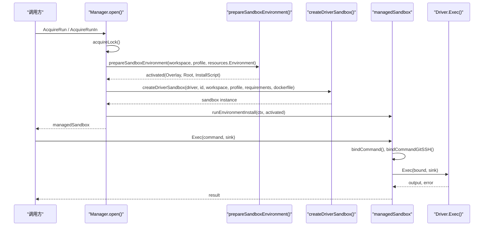

**图表来源**
- [sandbox_manager.go:73-110](file://internal/runtime/sandbox_manager.go#L73-L110)
- [sandbox_environment.go:43-88](file://internal/runtime/sandbox_environment.go#L43-L88)
- [sandbox_manager.go:451-464](file://internal/runtime/sandbox_manager.go#L451-L464)
- [sandbox_manager.go:409-433](file://internal/runtime/sandbox_manager.go#L409-L433)

## 详细组件分析

### 沙箱生命周期管理
- 创建：
  - Create：为节点创建一次性沙箱，清空工作区并标记为临时。
  - AcquireRun / AcquireRunIn：为工作流 Run 创建或重建沙箱，聚合所有 Provider 的 requirements，确保 Docker 挂载一致性。
  - AcquirePersistent：跨 SOP 节点复用工作区，保留 Git checkout。
- 获取：
  - 通过 Manager 方法返回 managedSandbox，内部持有底层 Driver 实例。
- 销毁：
  - DestroyRun：删除宿主机工作区，并清理对应 Docker 容器与镜像。
  - DiscardRunContainer：仅丢弃容器与临时镜像，保留工作区以便重跑。
- 回收：
  - ReclaimDockerSandboxes：扫描宿主机 Docker 容器，移除不再属于任何活跃 Run 的闲置容器。
  - ReclaimCachedDockerImages：清理未被当前 Catalog Dockerfile 生成且未被容器使用的缓存镜像。
  - ReclaimExcept：按活跃 RunID 列表保留必要工作区，删除其余。

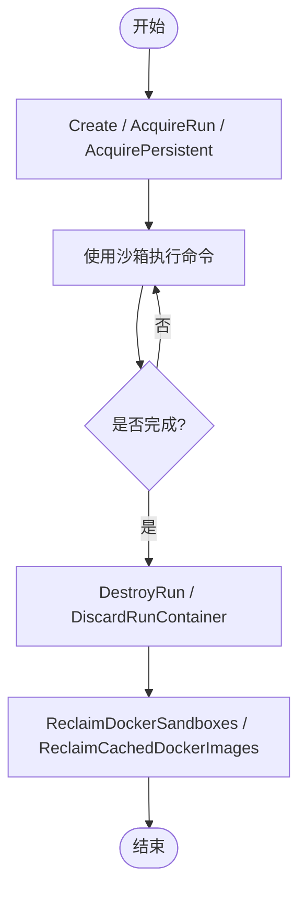

**图表来源**
- [sandbox_manager.go:44-71](file://internal/runtime/sandbox_manager.go#L44-L71)
- [sandbox_manager.go:112-143](file://internal/runtime/sandbox_manager.go#L112-L143)
- [sandbox_manager.go:183-225](file://internal/runtime/sandbox_manager.go#L183-L225)

**章节来源**
- [sandbox_manager.go:44-110](file://internal/runtime/sandbox_manager.go#L44-L110)
- [sandbox_manager.go:112-225](file://internal/runtime/sandbox_manager.go#L112-L225)

### Docker 沙箱 vs 本地沙箱 vs 原生进程沙箱
- Docker 沙箱：
  - 首次 Exec 才创建容器，避免 git 替换工作区 inode 导致的 cwd 错误。
  - 支持镜像缓存（内容哈希），临时镜像随容器销毁，缓存镜像可复用。
  - 支持只读根文件系统、对话根目录挂载、运行时 CLI 目录挂载。
  - 自动检测 cwd 不安全并触发 Recreate。
- 本地沙箱：
  - 直接 exec 宿主进程，设置 PWD、GIT_CEILING_DIRECTORIES。
  - 支持 OwnProcessGroup 终止子进程组。
- 原生进程沙箱：
  - macOS 使用 seatbelt，Linux 使用 bwrap。
  - 最小权限模型：默认 deny file-write*，允许工作区与临时目录写入。
  - 支持 BunFS 虚拟挂载点、私有临时目录、会话保护钩子。

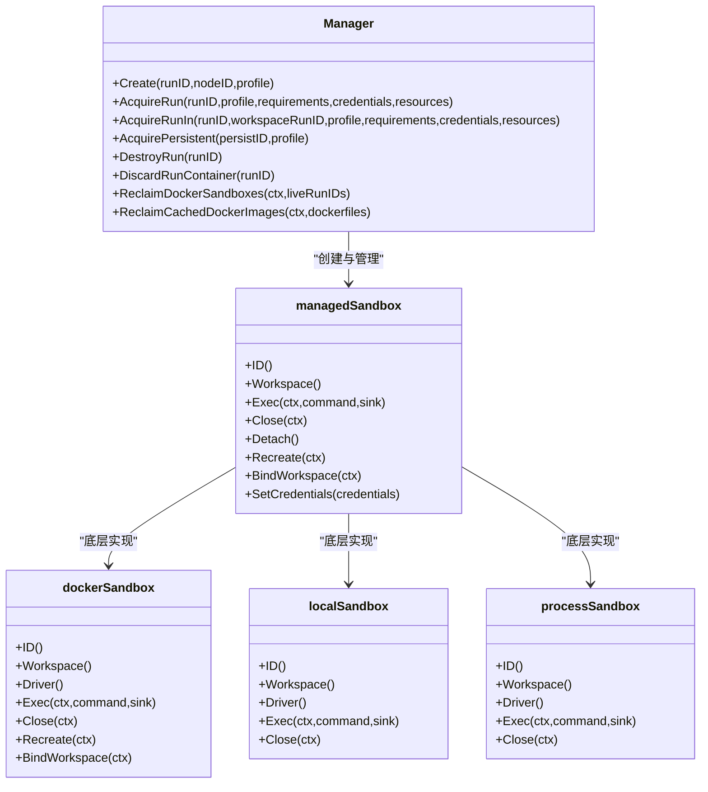

**图表来源**
- [sandbox_manager.go:14-110](file://internal/runtime/sandbox_manager.go#L14-L110)
- [sandbox_manager.go:314-433](file://internal/runtime/sandbox_manager.go#L314-L433)
- [sandbox_docker.go:22-57](file://internal/runtime/sandbox_docker.go#L22-L57)
- [sandbox_local.go:12-36](file://internal/runtime/sandbox_local.go#L12-L36)
- [sandbox_process.go:93-136](file://internal/runtime/sandbox_process.go#L93-L136)

**章节来源**
- [sandbox_docker.go:133-164](file://internal/runtime/sandbox_docker.go#L133-L164)
- [sandbox_docker.go:672-783](file://internal/runtime/sandbox_docker.go#L672-L783)
- [sandbox_local.go:30-70](file://internal/runtime/sandbox_local.go#L30-L70)
- [sandbox_process.go:130-197](file://internal/runtime/sandbox_process.go#L130-L197)

### 工作空间隔离策略
- 路径隔离：
  - Docker：将宿主机工作区挂载到容器内 `/workspace`，必要时挂载对话根目录与状态目录。
  - 本地：设置 PWD 与 GIT_CEILING_DIRECTORIES，防止误操作父仓库。
  - 原生进程：bwrap 将根文件系统只读绑定，仅允许工作区与必要目录写入；seatbelt 生成最小权限策略。
- 临时目录隔离：
  - Docker：可选只读根文件系统，使用 tmpfs 作为 `/tmp`。
  - 原生进程：bwrap 使用私有 `/tmp`；seatbelt 限定可写临时目录。
- 会话保护：
  - 对话工作区通过 guard mounts 与 deny rules 阻止覆盖审批钩子。

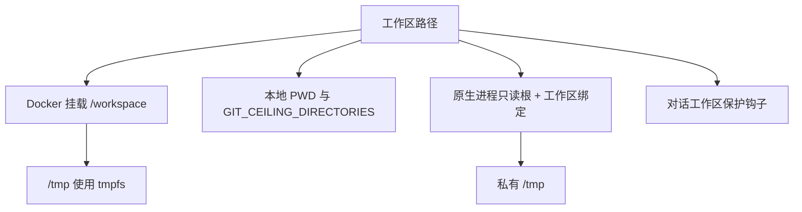

**图表来源**
- [sandbox_docker.go:706-756](file://internal/runtime/sandbox_docker.go#L706-L756)
- [sandbox_local.go:50-59](file://internal/runtime/sandbox_local.go#L50-L59)
- [sandbox_process.go:471-518](file://internal/runtime/sandbox_process.go#L471-L518)
- [sandbox_process.go:335-387](file://internal/runtime/sandbox_process.go#L335-L387)

**章节来源**
- [sandbox_docker.go:706-756](file://internal/runtime/sandbox_docker.go#L706-L756)
- [sandbox_local.go:50-69](file://internal/runtime/sandbox_local.go#L50-L69)
- [sandbox_process.go:471-518](file://internal/runtime/sandbox_process.go#L471-L518)

### 并发控制与资源限制
- 并发控制：
  - Manager 使用 slots 通道限制并发 Exec 数量。
  - dockerSandbox 使用 execGate 读写锁，保证并行分支可并发执行，但 Recreate 会等待正在执行的命令。
- 资源限制：
  - Docker：可选只读根文件系统，限制 `/tmp` 大小与权限；容器启动参数包含 cap-drop=ALL、no-new-privileges。
  - 原生进程：seatbelt 默认 deny file-write*，仅允许工作区与临时目录写入；bwrap 使用私有命名空间与只读根。
- 镜像缓存：
  - 基于 Dockerfile 内容与附加文件的哈希生成缓存镜像名，避免重复构建。

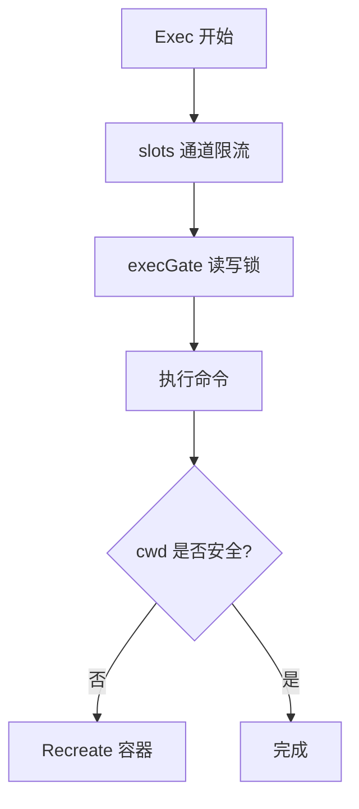

**图表来源**
- [sandbox_manager.go:409-433](file://internal/runtime/sandbox_manager.go#L409-L433)
- [sandbox_docker.go:133-164](file://internal/runtime/sandbox_docker.go#L133-L164)
- [sandbox_docker.go:706-756](file://internal/runtime/sandbox_docker.go#L706-L756)

**章节来源**
- [sandbox_manager.go:409-433](file://internal/runtime/sandbox_manager.go#L409-L433)
- [sandbox_docker.go:133-164](file://internal/runtime/sandbox_docker.go#L133-L164)

### 配置文件格式与资源定义
- SandboxProfile：
  - id、name、projectId、shared、driver、dockerfileId、environmentId、readOnlyRootFS、environment。
- DockerfileDefinition：
  - id、name、projectId、shared、description、content、files。
- EnvironmentDefinition：
  - id、name、projectId、shared、description、variables、pathEntries、installScript。
- MCPServerDefinition：
  - id、name、transport、command、args、url、environment、headers、installScript、workingDirectory、pathEntries、fileRefs、authType、timeoutSec。

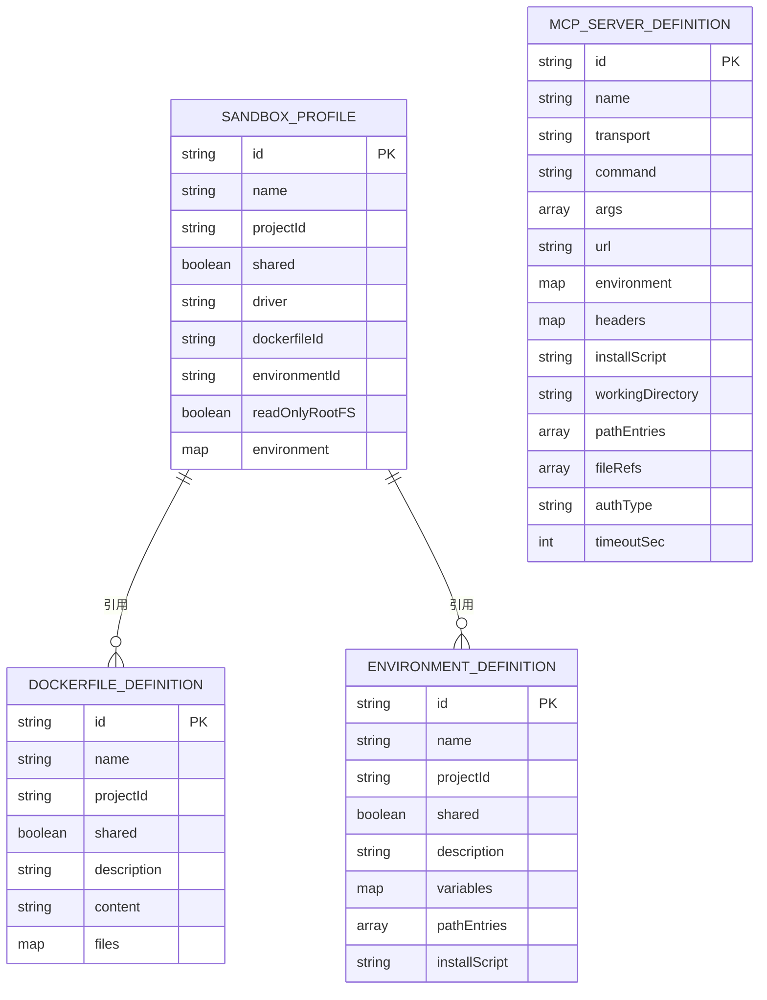

**图表来源**
- [assets.go:116-156](file://internal/domain/assets.go#L116-L156)
- [assets.go:131-144](file://internal/domain/assets.go#L131-L144)
- [assets.go:73-95](file://internal/domain/assets.go#L73-L95)

**章节来源**
- [assets.go:116-156](file://internal/domain/assets.go#L116-L156)
- [assets.go:131-144](file://internal/domain/assets.go#L131-L144)
- [assets.go:73-95](file://internal/domain/assets.go#L73-L95)

### 环境变量注入与工作区准备
- 环境准备：
  - prepareSandboxEnvironment：根据 driver 与 catalog 决定是否需要准备环境；对 Docker 不准备 overlay。
  - environmentOverlay：为进程沙箱注入 AGENTFLOW_ENVIRONMENT、AGENTFLOW_ENVIRONMENT_ROOT、PREFIX、PATH、ZDOTDIR、BASH_ENV 等变量。
  - writeEnvironmentShellHooks：为 zsh/bash 登录 shell 注入 PATH 前缀，避免 Homebrew 等覆盖。
- 安装脚本：
  - runEnvironmentInstall：若存在 install.sh，则在工作区执行一次，并以脚本内容的哈希作为 stamp 去重。
- 远程沙箱：
  - OpenRemoteSandbox：Runner 端打开沙箱并执行环境安装，便于远程执行器复用环境。

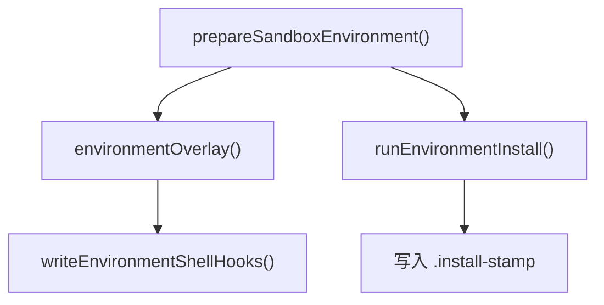

**图表来源**
- [sandbox_environment.go:43-88](file://internal/runtime/sandbox_environment.go#L43-L88)
- [sandbox_environment.go:90-131](file://internal/runtime/sandbox_environment.go#L90-L131)
- [sandbox_environment.go:165-184](file://internal/runtime/sandbox_environment.go#L165-L184)
- [remote_sandbox.go:16-41](file://internal/runtime/remote_sandbox.go#L16-L41)

**章节来源**
- [sandbox_environment.go:43-131](file://internal/runtime/sandbox_environment.go#L43-L131)
- [sandbox_environment.go:165-184](file://internal/runtime/sandbox_environment.go#L165-L184)
- [remote_sandbox.go:16-41](file://internal/runtime/remote_sandbox.go#L16-L41)

### 文件挂载与权限控制
- Docker 挂载：
  - 工作区挂载到 `/workspace`。
  - 对话根目录挂载到 `/root` 与 `/ws`，并添加 host.docker.internal。
  - Agent CLI 状态目录与文件按需挂载到 `/root`。
- 原生进程挂载：
  - bwrap 将根文件系统只读绑定，仅绑定工作区与对话根目录；必要时挂载 BunFS 虚拟目录。
  - seatbelt 生成最小权限策略，默认 deny file-write*，仅允许工作区与临时目录写入。
- 权限控制：
  - Docker 容器启动参数包含 cap-drop=ALL、no-new-privileges。
  - 可选只读根文件系统，限制 `/tmp` 大小与权限。

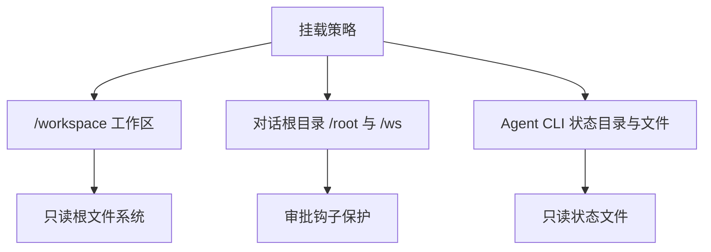

**图表来源**
- [sandbox_docker.go:706-756](file://internal/runtime/sandbox_docker.go#L706-L756)
- [sandbox_process.go:471-518](file://internal/runtime/sandbox_process.go#L471-L518)
- [sandbox_process.go:335-387](file://internal/runtime/sandbox_process.go#L335-L387)

**章节来源**
- [sandbox_docker.go:706-756](file://internal/runtime/sandbox_docker.go#L706-L756)
- [sandbox_process.go:471-518](file://internal/runtime/sandbox_process.go#L471-L518)

### 凭据绑定与 Git 集成
- 凭据绑定：
  - bindCommand：清理敏感环境变量，按需注入 CodeBuddy、Git、MCP、Codex、Claude Code、AgentCLI 等凭据。
  - BindTerminalGitSSH：为终端会话注入 Git SSH 密钥与协议白名单。
- Git 环境：
  - bindGitEnvironment：设置 GIT_TERMINAL_PROMPT、insteadOf 重写、GIT_ASKPASS、SSH_ASKPASS。
  - bindWorkspaceGitEnvironment：为工作区 Git 配置注入 SSH 主机密钥与代理。

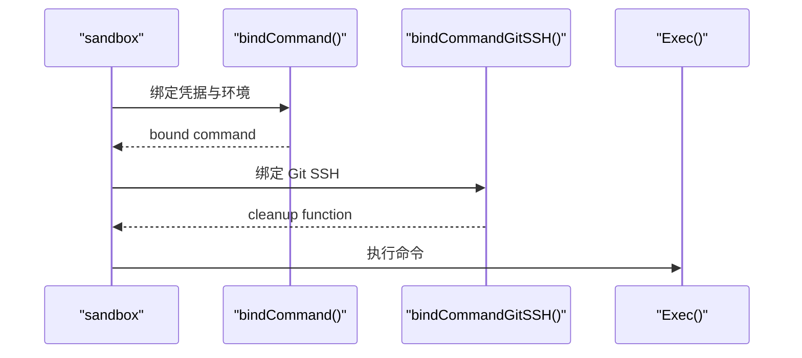

**图表来源**
- [command_binding.go:32-162](file://internal/runtime/command_binding.go#L32-L162)
- [command_binding.go:286-326](file://internal/runtime/command_binding.go#L286-L326)
- [command_binding.go:332-371](file://internal/runtime/command_binding.go#L332-L371)

**章节来源**
- [command_binding.go:32-162](file://internal/runtime/command_binding.go#L32-L162)
- [command_binding.go:286-326](file://internal/runtime/command_binding.go#L286-L326)
- [command_binding.go:332-371](file://internal/runtime/command_binding.go#L332-L371)

### 浏览器与 MCP 集成
- 浏览器：
  - EnsureSandboxBrowser：根据沙箱类型决定是否启用浏览器 MCP；Docker 沙箱通过 ensureBrowser 启动，其他类型尝试宿主浏览器。
- MCP：
  - ProvisionMCPAssets：准备 MCP 服务器与文件，必要时执行安装脚本；要求隔离沙箱（docker、bwrap、seatbelt）。
  - BindMCPCallArgv：根据沙箱类型注入 MCP 调用前缀或包装执行。

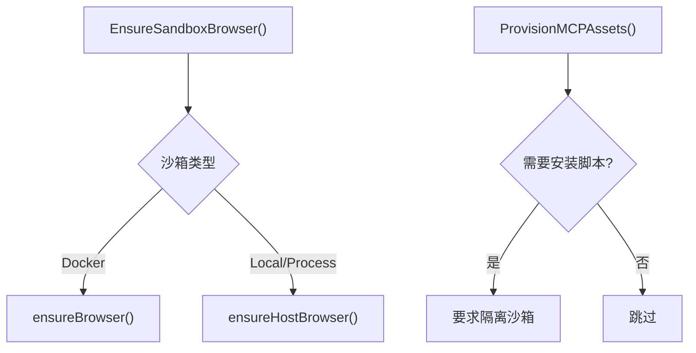

**图表来源**
- [browser.go:87-114](file://internal/runtime/browser.go#L87-L114)
- [mcp_provision.go:158-211](file://internal/runtime/mcp_provision.go#L158-L211)
- [mcp_call.go:264-278](file://internal/runtime/mcp_call.go#L264-L278)

**章节来源**
- [browser.go:87-114](file://internal/runtime/browser.go#L87-L114)
- [mcp_provision.go:158-211](file://internal/runtime/mcp_provision.go#L158-L211)
- [mcp_call.go:264-278](file://internal/runtime/mcp_call.go#L264-L278)

### 终端与会话
- 终端：
  - HandleSandboxWithGitSSH：为终端会话注入 Git SSH 密钥，创建命令与 home 目录，并在关闭时清理。
  - sandboxTerminalCleanup：针对 Docker 沙箱，通过 docker exec 停止特定终端进程。
- 对话工作区：
  - ConfigureConversationSandbox：为 Docker 或原生沙箱配置对话根目录，必要时触发 Recreate。

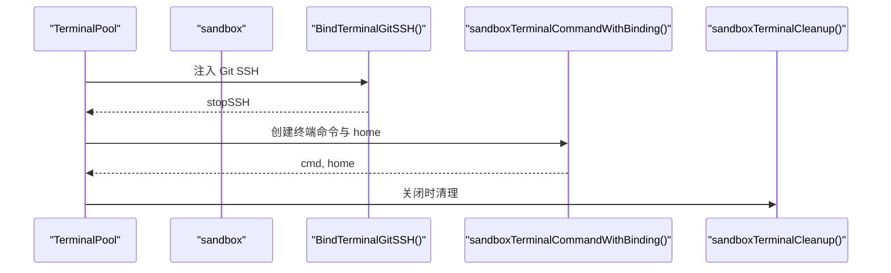

**图表来源**
- [workspace_terminal_sandbox.go:77-114](file://internal/runtime/workspace_terminal_sandbox.go#L77-L114)
- [workspace_terminal_sandbox.go:279-296](file://internal/runtime/workspace_terminal_sandbox.go#L279-L296)
- [conversation_sandbox.go:20-47](file://internal/runtime/conversation_sandbox.go#L20-L47)

**章节来源**
- [workspace_terminal_sandbox.go:77-114](file://internal/runtime/workspace_terminal_sandbox.go#L77-L114)
- [workspace_terminal_sandbox.go:279-296](file://internal/runtime/workspace_terminal_sandbox.go#L279-L296)
- [conversation_sandbox.go:20-47](file://internal/runtime/conversation_sandbox.go#L20-L47)

## 依赖关系分析
- Manager 依赖 domain.SandboxProfile、domain.DockerfileDefinition、domain.EnvironmentDefinition。
- Driver 实现依赖 runtime.CommandSpec、runtime.RunCredentials、runtime.EventSink。
- 命令绑定依赖 Git、MCP、Codex、Claude Code、AgentCLI 等外部凭据与工具。
- 浏览器与 MCP 集成依赖宿主或容器的外部服务。

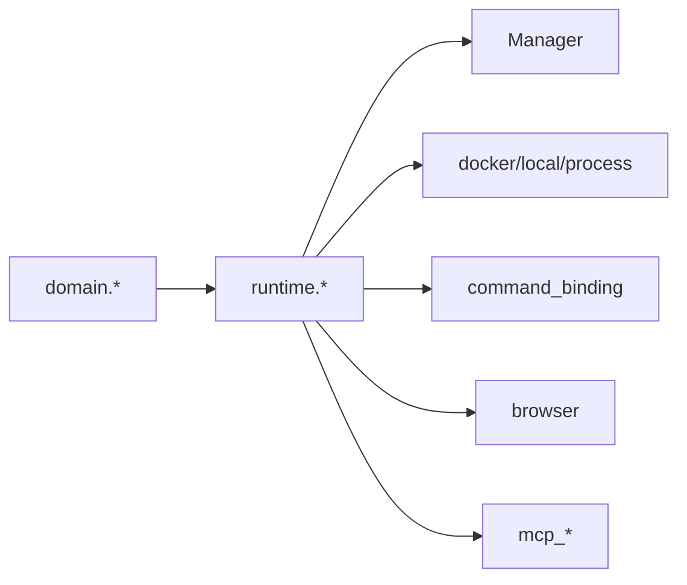

**图表来源**
- [assets.go:116-156](file://internal/domain/assets.go#L116-L156)
- [sandbox_manager.go:451-464](file://internal/runtime/sandbox_manager.go#L451-L464)
- [command_binding.go:32-162](file://internal/runtime/command_binding.go#L32-L162)
- [browser.go:87-114](file://internal/runtime/browser.go#L87-L114)

**章节来源**
- [assets.go:116-156](file://internal/domain/assets.go#L116-L156)
- [sandbox_manager.go:451-464](file://internal/runtime/sandbox_manager.go#L451-L464)
- [command_binding.go:32-162](file://internal/runtime/command_binding.go#L32-L162)
- [browser.go:87-114](file://internal/runtime/browser.go#L87-L114)

## 性能与并发特性
- 并发：
  - Manager 的 slots 通道限制并发 Exec 数量，避免过多命令同时执行导致资源竞争。
  - dockerSandbox 的 execGate 读写锁允许并行分支执行，但 Recreate 会阻塞写侧，避免破坏正在运行的命令。
- 镜像缓存：
  - 基于 Dockerfile 内容与附加文件哈希生成缓存镜像名，减少重复构建时间。
- 工作区准备：
  - 环境安装脚本通过 stamp 去重，避免重复执行。
- 终端与浏览器：
  - 终端会话清理与浏览器启动均考虑超时与失败处理，避免长时间阻塞。

[本节为通用性能讨论，不直接分析具体文件]

## 故障排查指南
- Docker 相关错误：
  - “current working directory is outside of container mount namespace”：检查工作区是否被 git 替换 inode，触发 Recreate。
  - “no such exec instance”、“container not found”：容器或 exec 实例已不存在，可能是部署重启或上下文取消。
- 凭据绑定错误：
  - 缺少 CodeBuddy/Codex/Claude Code API Key：检查个人配置是否正确。
  - Git Token 无效：检查 insteadOf 重写与 askpass 脚本是否正确生成。
- 环境安装失败：
  - install.sh 执行失败：检查工作区权限与脚本内容，确认 stamp 是否更新。
- 原生进程沙箱不可用：
  - seatbelt/bwrap 未安装或不在 PATH：检查系统依赖与 OS 兼容性。

**章节来源**
- [sandbox_docker.go:300-381](file://internal/runtime/sandbox_docker.go#L300-L381)
- [command_binding.go:87-155](file://internal/runtime/command_binding.go#L87-L155)
- [sandbox_environment.go:165-184](file://internal/runtime/sandbox_environment.go#L165-L184)
- [sandbox_process.go:119-128](file://internal/runtime/sandbox_process.go#L119-L128)

## 结论
LoopForge 的沙箱管理系统通过统一的 Manager 与多 Driver 实现，提供了灵活、安全、可扩展的执行环境。Docker 沙箱适合复杂工具链与网络访问，本地沙箱适合快速开发，原生进程沙箱提供轻量级隔离。通过严格的环境变量注入、文件挂载与权限控制，系统在保障安全的同时兼顾了性能与易用性。合理配置 SandboxProfile、DockerfileDefinition 与 EnvironmentDefinition，并结合 Reclaim 机制，可在不同部署场景中实现高效稳定的沙箱管理。

[本节为总结性内容，不直接分析具体文件]

## 附录：配置与最佳实践

### 配置示例与场景建议
- 开发调试（本地沙箱）：
  - driver: "local"
  - 优点：启动快、无容器开销。
  - 注意：避免泄露敏感环境变量，建议使用 ExecuteLocalCommand 并启用 PrivateHome。
- 生产执行（Docker 沙箱）：
  - driver: "docker"
  - 建议：使用内容哈希缓存镜像，启用只读根文件系统，限制 `/tmp` 大小。
  - 注意：确保工作区 inode 不被替换，必要时触发 Recreate。
- 轻量隔离（原生进程沙箱）：
  - driver: "native"（解析为 seatbelt 或 bwrap）
  - 优点：无需容器，最小权限模型。
  - 注意：确保 seatbelt/bwrap 可用，配置合适的临时目录与状态目录。

### 环境变量注入最佳实践
- 使用 EnvironmentDefinition 的 variables 与 pathEntries 注入工具链。
- 避免将敏感信息放入环境变量，优先使用凭据绑定（Git、MCP、Codex、Claude Code、AgentCLI）。
- 对于登录 shell，确保 ZDOTDIR/BASH_ENV 正确设置，避免 PATH 被覆盖。

### 文件挂载与权限控制最佳实践
- Docker：
  - 仅挂载必要目录，避免暴露敏感数据。
  - 使用只读根文件系统与 tmpfs 限制写权限。
- 原生进程：
  - 使用 bwrap 的只读根与私有临时目录。
  - 使用 seatbelt 的最小权限策略，仅允许工作区与临时目录写入。

### 资源回收与清理最佳实践
- 定期调用 ReclaimDockerSandboxes 与 ReclaimCachedDockerImages，释放闲置容器与镜像。
- 使用 DestroyRun 清理已完成的工作流 Run 的工作区与容器。
- 使用 DiscardRunContainer 仅丢弃容器，保留工作区以便重跑。

[本节为通用指导，不直接分析具体文件]