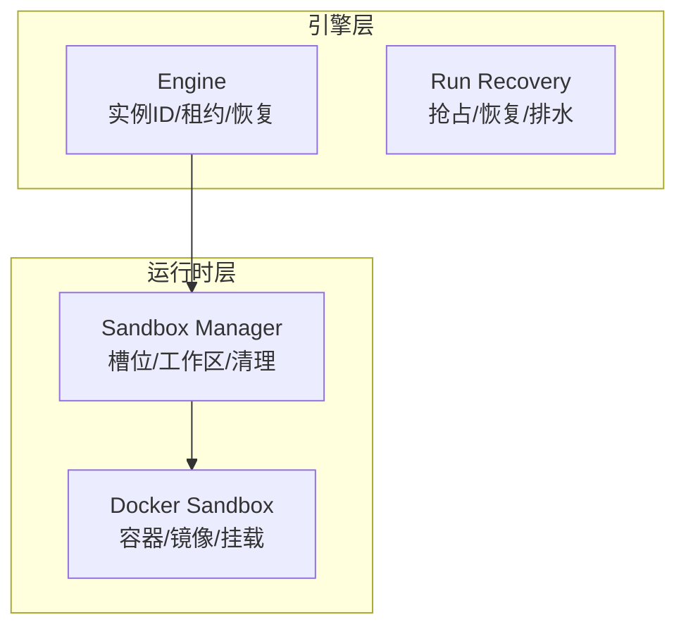
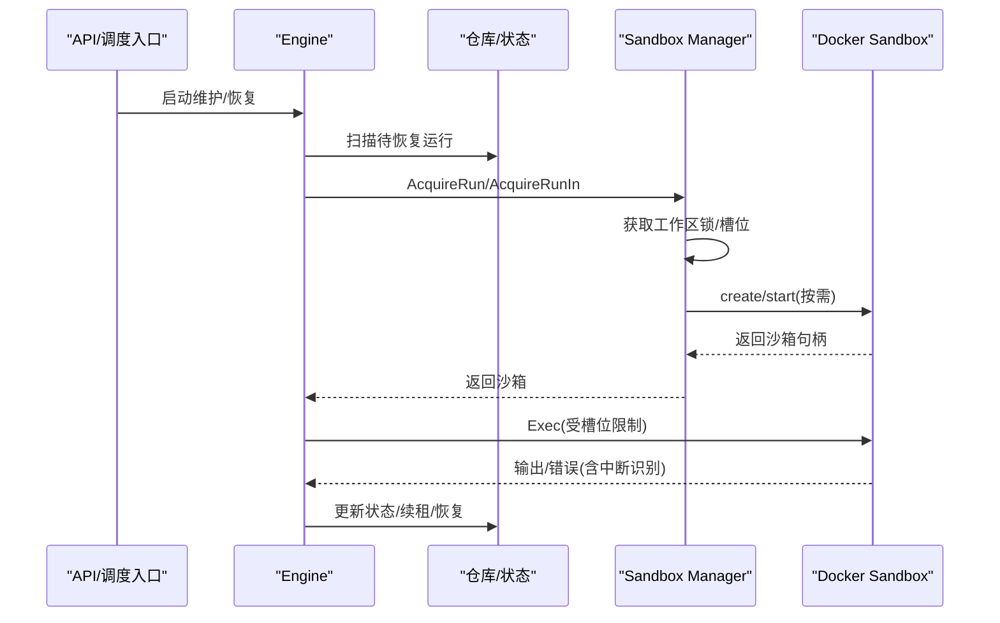
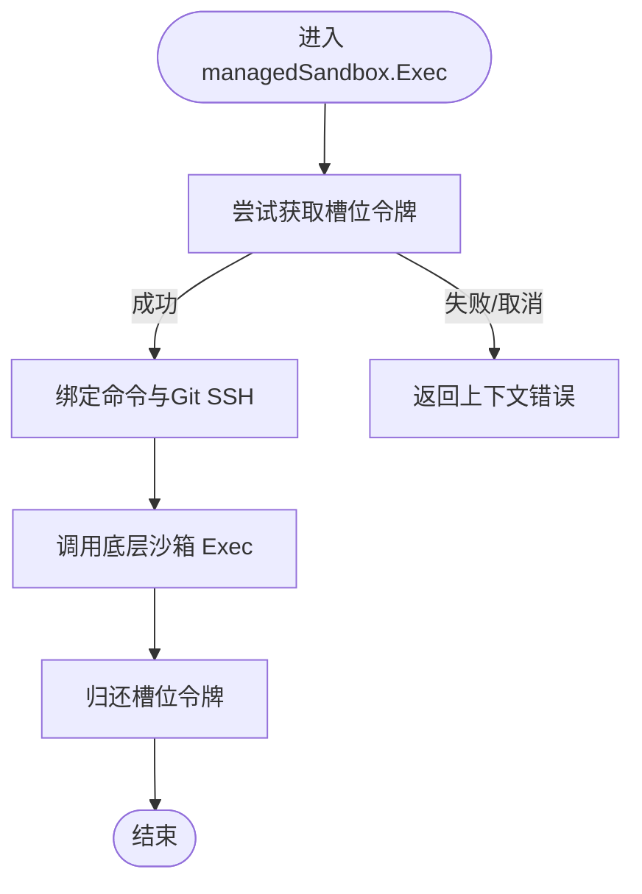
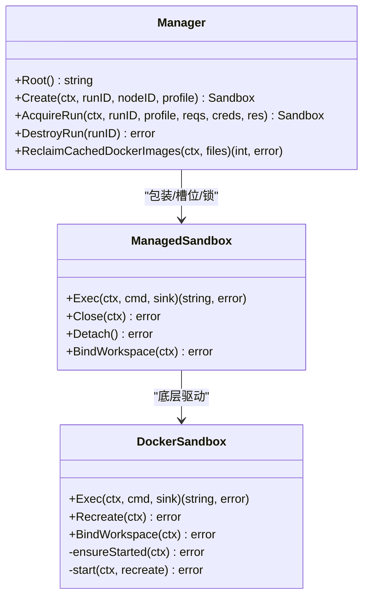
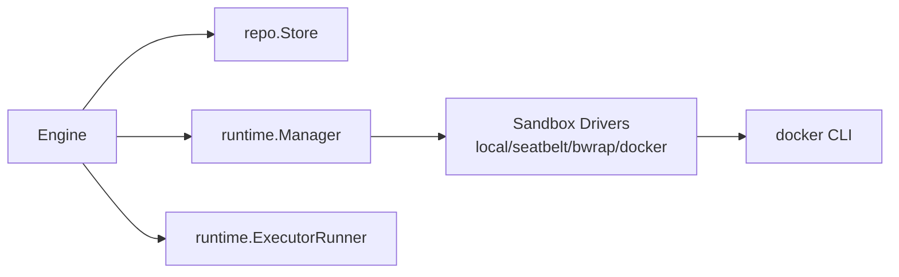
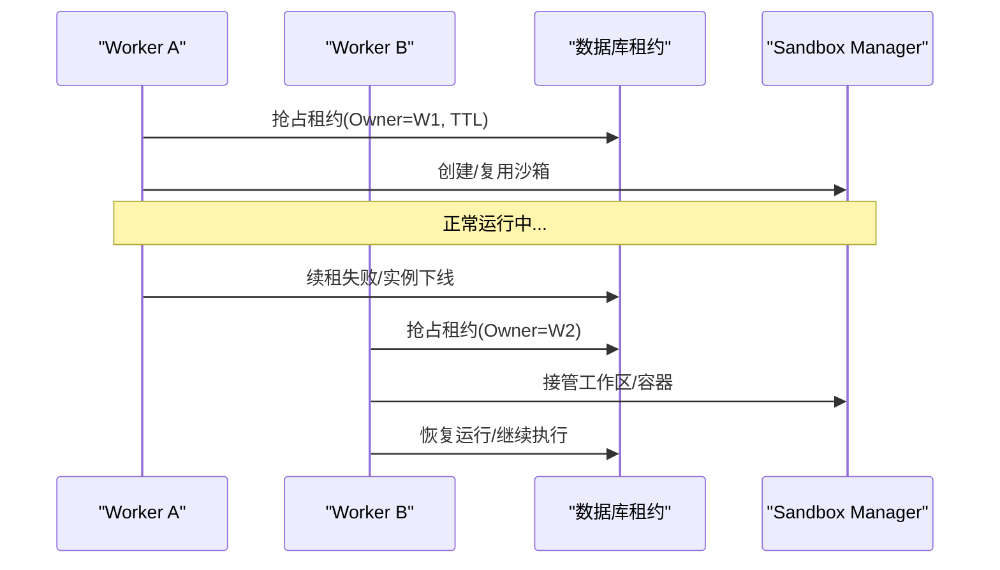

# 资源调度

<cite>
**本文引用的文件**   
- [engine.go](file://internal/engine/engine.go)
- [run_recovery.go](file://internal/engine/run_recovery.go)
- [sandbox_manager.go](file://internal/runtime/sandbox_manager.go)
- [sandbox_docker.go](file://internal/runtime/sandbox_docker.go)
- [deployment.md](file://docs/deployment.md)
</cite>

## 目录
1. [引言](#引言)
2. [项目结构](#项目结构)
3. [核心组件](#核心组件)
4. [架构总览](#架构总览)
5. [详细组件分析](#详细组件分析)
6. [依赖关系分析](#依赖关系分析)
7. [性能与并发特性](#性能与并发特性)
8. [故障转移与高可用](#故障转移与高可用)
9. [Docker 容器资源限制与隔离](#docker-容器资源限制与隔离)
10. [监控、告警与可观测性](#监控告警与可观测性)
11. [部署与优化建议](#部署与优化建议)
12. [故障排查指南](#故障排查指南)
13. [结论](#结论)

## 引言
本文面向资源调度子系统，围绕执行槽位管理、并发控制、资源分配策略展开，重点说明 Docker 沙箱的生命周期、工作区绑定、镜像缓存与清理，以及多实例间的租约、抢占与恢复。文档同时给出负载均衡思路、故障转移机制、监控告警接入点和高可用部署配置建议，帮助读者在本地或集群环境中稳定运行并优化资源使用。

## 项目结构
资源调度相关代码主要分布在两个层次：
- 引擎层：负责运行生命周期、实例租约、任务恢复、工作区归属判断与调度协调。
- 运行时层：负责沙箱抽象、驱动选择（local/seatbelt/bwrap/docker）、容器创建与回收、工作区锁与并发槽位控制。

图表来源
- [engine.go:19-104](file://internal/engine/engine.go#L19-L104)
- [run_recovery.go:14-363](file://internal/engine/run_recovery.go#L14-L363)
- [sandbox_manager.go:14-110](file://internal/runtime/sandbox_manager.go#L14-L110)
- [sandbox_docker.go:22-80](file://internal/runtime/sandbox_docker.go#L22-L80)

章节来源
- [engine.go:19-104](file://internal/engine/engine.go#L19-L104)
- [run_recovery.go:14-363](file://internal/engine/run_recovery.go#L14-L363)
- [sandbox_manager.go:14-110](file://internal/runtime/sandbox_manager.go#L14-L110)
- [sandbox_docker.go:22-80](file://internal/runtime/sandbox_docker.go#L22-L80)

## 核心组件
- Engine：维护实例标识、工作区主机、租约 TTL、执行开关、后台维护协程；提供启动维护、配置执行、平台 MCP 绑定等能力。
- Run Recovery：实现运行抢占、续租、中断恢复、排水停止、工作区归属与丢失判定。
- Sandbox Manager：统一创建/获取沙箱、持久化工作区、槽位并发控制、工作区锁、容器与镜像回收。
- Docker Sandbox：封装 docker 命令调用、工作区挂载、镜像构建与缓存、CWD 安全检测、中断识别与重建。

章节来源
- [engine.go:19-104](file://internal/engine/engine.go#L19-L104)
- [run_recovery.go:14-363](file://internal/engine/run_recovery.go#L14-L363)
- [sandbox_manager.go:14-110](file://internal/runtime/sandbox_manager.go#L14-L110)
- [sandbox_docker.go:22-80](file://internal/runtime/sandbox_docker.go#L22-L80)

## 架构总览
资源调度的关键流程如下：
- 引擎启动后台维护协程，扫描并恢复中断的运行。
- 通过 Sandbox Manager 获取沙箱，按驱动创建容器或进程环境。
- 对 Docker 驱动，延迟到首次 Exec 时创建容器，避免工作区 inode 变化导致 CWD 错误。
- 使用槽位通道限制并发 Exec，结合工作区文件锁保证同一工作区的串行访问。
- 多实例间通过数据库租约与实例 ID 进行抢占与恢复，支持优雅排水。

图表来源
- [engine.go:101-120](file://internal/engine/engine.go#L101-L120)
- [run_recovery.go:103-250](file://internal/engine/run_recovery.go#L103-L250)
- [sandbox_manager.go:44-110](file://internal/runtime/sandbox_manager.go#L44-L110)
- [sandbox_docker.go:133-164](file://internal/runtime/sandbox_docker.go#L133-L164)

## 详细组件分析

### 执行槽位管理与并发控制
- 槽位模型：Sandbox Manager 内部使用带缓冲的 channel 作为全局槽位池，默认并发度为 8，可通过 NewManagerWithLimit 调整。
- 槽位获取：managedSandbox.Exec 在进入实际执行前从槽位通道取一个令牌，执行结束后归还；若上下文取消则直接返回。
- 工作区串行：每个沙箱持有工作区文件锁，Close/Detach 释放锁；Exec 前先绑定命令与 Git SSH，确保并行分支写入安全。
- 并发边界：槽位限制的是“进入 Exec”的并发数，不是容器数量；同一工作区仍由文件锁串行化。

图表来源
- [sandbox_manager.go:409-433](file://internal/runtime/sandbox_manager.go#L409-L433)
- [sandbox_manager.go:314-324](file://internal/runtime/sandbox_manager.go#L314-L324)

章节来源
- [sandbox_manager.go:14-26](file://internal/runtime/sandbox_manager.go#L14-L26)
- [sandbox_manager.go:314-433](file://internal/runtime/sandbox_manager.go#L314-L433)

### 资源分配策略
- 工作区路径：Manager.RunWorkspace 根据 runID 生成宿主路径，Create 会清空并新建，AcquireRun/AcquireRunIn 复用已有工作区。
- 驱动选择：createDriverSandbox 根据 profile.Driver 选择 local/seatbelt/bwrap/docker；未指定时回退到 local。
- 环境准备：prepareSandboxEnvironment 激活环境 overlay，合并 PATH 等环境变量；isolateLocalDriver 隔离本地驱动。
- 资源聚合：AcquireRun 要求上游聚合所有 provider 的 requirements，避免首个节点先建容器导致后续 mount 缺失。

章节来源
- [sandbox_manager.go:28-71](file://internal/runtime/sandbox_manager.go#L28-L71)
- [sandbox_manager.go:73-110](file://internal/runtime/sandbox_manager.go#L73-L110)
- [sandbox_manager.go:449-464](file://internal/runtime/sandbox_manager.go#L449-L464)

### Docker 容器生命周期与镜像缓存
- 延迟创建：dockerSandbox 在首次 Exec 时才 ensureStarted，避免 git checkout 替换工作区 inode 导致的 CWD 错误。
- 容器命名：容器名以固定前缀 + id 命名；临时镜像以 agentflow-tmp-* 命名，内容哈希镜像以 agentflow-img-* 命名。
- 镜像缓存：基于 Dockerfile 内容与附加文件计算哈希，命中则复用缓存镜像；清理时保留被 catalog 引用且未被使用的镜像。
- 工作区挂载：始终将宿主 workspace 挂载到 /workspace；必要时额外挂载 conversation root 与只读 host-gateway。
- 用户与权限：当服务非 root 运行时，默认/root 镜像会以服务 UID/GID 启动，避免权限问题；显式非 root 用户保持不变。

图表来源
- [sandbox_manager.go:14-110](file://internal/runtime/sandbox_manager.go#L14-L110)
- [sandbox_manager.go:314-433](file://internal/runtime/sandbox_manager.go#L314-L433)
- [sandbox_docker.go:22-80](file://internal/runtime/sandbox_docker.go#L22-L80)
- [sandbox_docker.go:512-583](file://internal/runtime/sandbox_docker.go#L512-L583)
- [sandbox_docker.go:672-783](file://internal/runtime/sandbox_docker.go#L672-L783)

章节来源
- [sandbox_docker.go:59-77](file://internal/runtime/sandbox_docker.go#L59-L77)
- [sandbox_docker.go:512-583](file://internal/runtime/sandbox_docker.go#L512-L583)
- [sandbox_docker.go:672-783](file://internal/runtime/sandbox_docker.go#L672-L783)

### 工作区锁定与空闲回收
- 工作区占用检测：manager.workspaceInUse 检查是否仍有进程打开该目录；用于避免删除正在使用的 workdir。
- 空闲容器发现：RunsWithIdleDockerSandbox 列出宿主的 sandbox 容器，过滤掉仍被占用的工作区。
- 僵尸容器回收：ReclaimDockerSandboxes 遍历 liveRunIDs，删除不属于任何活跃运行的容器；ReclaimExcept 仅保留指定运行对应的工作区。
- 镜像回收：ReclaimCachedDockerImages 删除不再被 catalog 引用且未被容器使用的缓存镜像。

章节来源
- [sandbox_manager.go:145-208](file://internal/runtime/sandbox_manager.go#L145-L208)
- [sandbox_manager.go:246-312](file://internal/runtime/sandbox_manager.go#L246-L312)
- [sandbox_manager.go:210-225](file://internal/runtime/sandbox_manager.go#L210-L225)

## 依赖关系分析
- Engine 依赖 repo.Store 读写运行状态与租约，依赖 runtime.Manager 管理沙箱，依赖 runtime.ExecutorRunner 执行任务。
- Sandbox Manager 是运行时抽象的统一入口，屏蔽不同驱动差异，向上暴露统一的 Sandbox 接口。
- Docker Sandbox 依赖外部 docker CLI，并通过 procwatch 等工具辅助进程观察。

图表来源
- [engine.go:19-104](file://internal/engine/engine.go#L19-L104)
- [sandbox_manager.go:449-464](file://internal/runtime/sandbox_manager.go#L449-L464)
- [sandbox_docker.go:101-131](file://internal/runtime/sandbox_docker.go#L101-L131)

章节来源
- [engine.go:19-104](file://internal/engine/engine.go#L19-L104)
- [sandbox_manager.go:449-464](file://internal/runtime/sandbox_manager.go#L449-L464)
- [sandbox_docker.go:101-131](file://internal/runtime/sandbox_docker.go#L101-L131)

## 性能与并发特性
- 并发上限：默认 8 个并发 Exec 槽位，适合大多数单机场景；可根据 CPU/IO 负载通过 NewManagerWithLimit 调整。
- 延迟创建：Docker 容器仅在首次 Exec 时创建，减少冷启动开销；镜像缓存避免重复构建。
- 工作区锁：同一工作区串行执行，避免 Git 冲突与文件系统竞争。
- 清理路径：后台定时回收僵尸容器与无用镜像，降低磁盘与镜像空间占用。

[本节为通用指导，不直接分析具体文件]

## 故障转移与高可用
- 实例租约：Engine.acquireLease 通过数据库原子更新 OwnerInstanceID 与 LeaseUntil，TTL 到期后其他实例可抢占。
- 恢复流程：ResumeInterruptedRuns 扫描 running/waiting 运行，对无主或过期租约的运行重新抢占并恢复；对 cancel/pause 请求进行结算。
- 工作区归属：foreignWorkspaceBind/workspaceBlocked/workspaceLost 判断运行是否绑定到其他主机或已下线主机；对丢失工作区的运行提示从头重跑。
- 排水模式：Drain 停止新任务抢占，取消现有运行协程，等待 active runs 归零后 detach 工作区环境，便于替换 worker。

图表来源
- [run_recovery.go:66-101](file://internal/engine/run_recovery.go#L66-L101)
- [run_recovery.go:103-250](file://internal/engine/run_recovery.go#L103-L250)
- [run_recovery.go:258-296](file://internal/engine/run_recovery.go#L258-L296)

章节来源
- [run_recovery.go:14-363](file://internal/engine/run_recovery.go#L14-L363)

## Docker 容器资源限制与隔离
- 网络隔离：默认 --network none；可通过 AGENTFLOW_DOCKER_NETWORK 设置自定义网络；conversation 模式下额外添加 host.docker.internal 与只读挂载。
- 权限最小化：--cap-drop=ALL 与 --security-opt no-new-privileges；可选 --read-only 根文件系统配合 tmpfs。
- 用户映射：非 root 服务运行时，默认/root 镜像以服务 UID/GID 启动；显式非 root 用户保持不变。
- 工作区挂载：-v workspace:/workspace；必要时挂载 conversation root 与工作区副本。
- 磁盘空间：tmpfs 大小可配置（例如 256m）；镜像缓存与临时镜像分离，便于清理。

章节来源
- [sandbox_docker.go:706-756](file://internal/runtime/sandbox_docker.go#L706-L756)
- [deployment.md:78-78](file://docs/deployment.md#L78-L78)

## 监控、告警与可观测性
- 运行恢复事件：run.resumed 事件记录实例切换与 generation 信息，可用于审计与告警。
- 中断识别：IsSandboxInterrupt 识别 context canceled、信号终止、docker exec 消失等中断，避免消耗 MaxAttempts。
- 工作区丢失告警：workspaceLostMessage 提供明确提示，引导用户从头重跑。
- 指标采集：Engine.StartMaintenance 启动 observationFlushLoop，可将遥测数据批量刷新。

章节来源
- [run_recovery.go:241-247](file://internal/engine/run_recovery.go#L241-L247)
- [sandbox_docker.go:304-319](file://internal/runtime/sandbox_docker.go#L304-L319)
- [engine.go:107-120](file://internal/engine/engine.go#L107-L120)

## 部署与优化建议
- 并发参数：根据机器 CPU/内存与 IO 能力调整槽位并发；I/O 密集型可适当提高，CPU 密集型需保守。
- 镜像缓存：保持 Dockerfile 稳定，利用内容哈希缓存；定期清理无用缓存镜像。
- 工作区路径：确保 Manager.Root 指向足够大的磁盘分区；避免与其他服务共享易变目录。
- 网络与安全：生产环境建议使用独立网络与最小权限；开启只读根文件系统与 tmpfs。
- 高可用：多实例部署时合理设置 leaseTTL；启用 Drain 支持滚动升级；对外暴露 ResumeInterruptedRuns 以便重启后恢复。

[本节为通用指导，不直接分析具体文件]

## 故障排查指南
- 容器无法启动：检查 docker 可用性、镜像是否存在、工作区挂载是否正确；查看 start/create 的错误输出。
- CWD 错误：当出现 “cwd outside of container mount” 或 exit status 126，系统会自动 Recreate；确认 git checkout 完成后再 Exec。
- 中断导致反复重试：IsSandboxInterrupt 会将中断视为可恢复；检查是否为 deploy/restart 引起的中断。
- 工作区被占用：ReclaimExcept/RemoveMatching 会跳过被占用的工作区；确认没有进程持有目录句柄。
- 镜像空间不足：清理临时镜像与无用缓存镜像；确认 catalog 中仍引用的镜像不被误删。

章节来源
- [sandbox_docker.go:133-164](file://internal/runtime/sandbox_docker.go#L133-L164)
- [sandbox_docker.go:300-381](file://internal/runtime/sandbox_docker.go#L300-L381)
- [sandbox_manager.go:271-312](file://internal/runtime/sandbox_manager.go#L271-L312)
- [sandbox_manager.go:210-225](file://internal/runtime/sandbox_manager.go#L210-L225)

## 结论
本资源调度方案通过 Engine 的实例租约与恢复机制、Sandbox Manager 的槽位与工作区锁、以及 Docker Sandbox 的延迟创建与镜像缓存，实现了高内聚、低耦合的执行环境管理。在多实例环境下，租约与恢复保证了故障转移与高可用；在单机环境下，槽位与锁保障了并发安全与资源可控。结合监控与告警，可在复杂场景中保持稳定运行与持续优化。