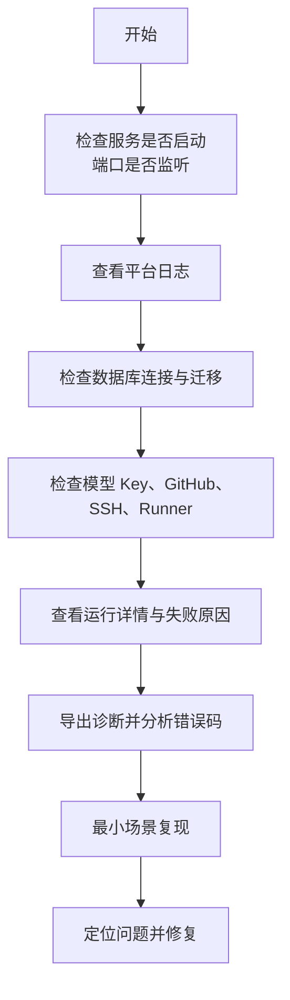
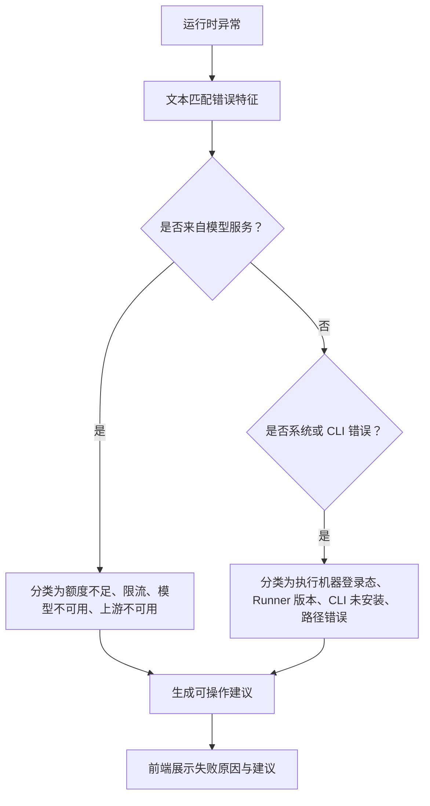
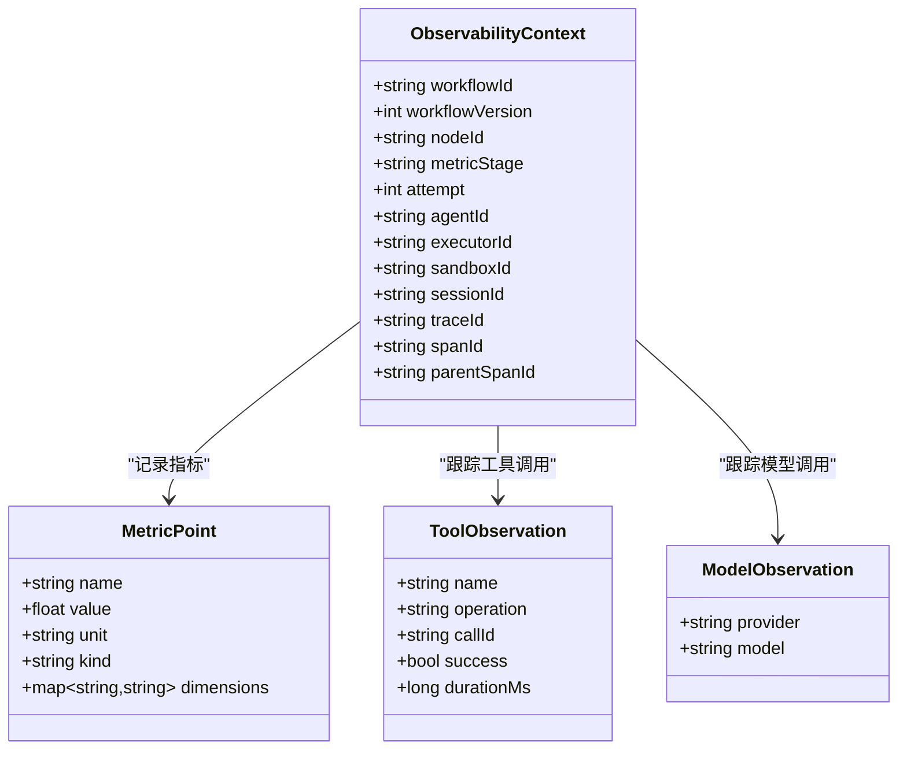

# 故障排除

<cite>
**本文引用的文件**   
- [README.md](file://README.md)
- [docs/deployment.md](file://docs/deployment.md)
- [docs/local/usage.zh-CN.md](file://docs/local/usage.zh-CN.md)
- [internal/httpapi/assistant_failure.go](file://internal/httpapi/assistant_failure.go)
- [internal/httpapi/assistant_run_view.go](file://internal/httpapi/assistant_run_view.go)
- [internal/domain/observability.go](file://internal/domain/observability.go)
- [web/app/observability.js](file://web/app/observability.js)
- [internal/runtime/sandbox_environment.go](file://internal/runtime/sandbox_environment.go)
- [cmd/agentflow/main.go](file://cmd/agentflow/main.go)
- [cmd/loopforge-account/main.go](file://cmd/loopforge-account/main.go)
</cite>

## 目录
1. [引言](#引言)
2. [快速定位问题](#快速定位问题)
3. [安装与部署问题](#安装与部署问题)
4. [配置错误排查](#配置错误排查)
5. [运行时异常与失败分类](#运行时异常与失败分类)
6. [日志分析方法](#日志分析方法)
7. [性能瓶颈识别与优化建议](#性能瓶颈识别与优化建议)
8. [调试工具使用指南](#调试工具使用指南)
9. [监控指标解读](#监控指标解读)
10. [已知问题与临时解决方案](#已知问题与临时解决方案)
11. [常见问题清单](#常见问题清单)
12. [结论](#结论)

## 引言
本故障排除文档面向 LoopForge 的安装、部署、配置和运行阶段，覆盖常见安装问题、配置错误、运行时异常、日志分析、性能瓶颈、调试工具、监控指标以及已知问题和临时解决方案。文档内容基于仓库中的安装说明、部署文档、HTTP API 失败处理、可观测性数据结构和前端观察页面实现整理而成，适合运维人员、平台管理员和一线支持人员使用。

## 快速定位问题
遇到问题时，建议按以下顺序快速定位：
1. 确认服务是否启动：查看容器状态、端口监听、健康检查。
2. 查看平台日志：使用 `./start.sh logs` 或 Compose 日志命令。
3. 检查数据库连接和迁移：确认 MySQL DSN、端口、权限和 schema 扩展列是否存在。
4. 检查凭据：模型 API Key、GitHub Token、Git SSH 密钥、执行机器 Runner 版本。
5. 查看运行详情：在 Web 界面打开具体 Run，查看节点状态、失败原因、重试次数和诊断信息。
6. 使用诊断能力：对失败的 Assistant 生成或 SOP 节点导出诊断包，结合错误码判断根因。
7. 复现最小场景：先跑内置脚本 + 人工审批 Demo，再逐步接入模型、仓库和执行机器。

[本节为通用排障流程，不直接分析具体代码文件]

## 安装与部署问题

### 容器安装与镜像拉取
- 现象：`./start.sh` 卡住、镜像拉不下来、端口冲突。
- 可能原因：
  - Docker、Compose、Python 3、curl 未安装或不可用。
  - ghcr.io 镜像拉取缓慢或被阻断。
  - 默认端口 `8090` 或 MySQL 端口被占用。
  - 非交互模式缺少 sudo 或 Docker 访问权限。
- 处理建议：
  - 使用 `./start.sh` 自动检测并安装缺失组件；必要时设置 `LOOPFORGE_YES=1`。
  - 通过 `MIRROR` 指定镜像代理主机，例如 `MIRROR=ghcr.nju.edu.cn ./start.sh`。
  - 修改 `.env` 中的 `LOOPFORGE_HTTP_PORT` 或 `LOOPFORGE_MYSQL_PORT` 避免端口冲突。
  - 在非 root 用户下安装时，确保具备 Docker 访问权限或 sudo 能力；无权限时会给出明确提示。
  - 升级时使用 `git fetch --tags && git checkout vX.Y.Z && ./start.sh pull`，保持 compose.yaml 与镜像版本一致。

**章节来源**
- [README.md:72-90](file://README.md#L72-L90)
- [docs/deployment.md:24-61](file://docs/deployment.md#L24-L61)

### 原生开发与本地服务
- 现象：原生开发环境无法启动、MySQL 未初始化、CLI 找不到。
- 可能原因：
  - Node.js、Go、MySQL 未安装或 PATH 配置不正确。
  - 未执行依赖初始化、schema 扩展或 seed 数据。
  - CodeBuddy CLI 未安装或不在 PATH 中。
- 处理建议：
  - 使用 `bash scripts/dev.sh` 启动本地开发栈，它会配置本地 secret、启动 MySQL、构建平台、创建 admin 账户、安装 observability generated columns 并应用 seed。
  - 如需外部 MySQL，设置 `AGENTFLOW_MYSQL_DSN`，并确保数据库有正确权限。
  - 安装所需 CLI，例如 CodeBuddy、Codex、Claude Code；若对话失败提示 CLI 未安装，可通过界面自动安装或手动安装到 PATH。

**章节来源**
- [docs/deployment.md:3-22](file://docs/deployment.md#L3-L22)

### Docker 沙箱与工作区路径
- 现象：SOP 或对话工作区无法写入、终端报错、workspace 路径不存在。
- 可能原因：
  - 平台容器没有 Docker socket 访问权限。
  - `LOOPFORGE_DATA_DIR` 未正确挂载，导致 workspace 和 CLI 状态丢失。
  - 自定义 Dockerfile 缺少 Node.js、npm、Python 3，或 musl 镜像未提供必要工具链。
- 处理建议：
  - Compose 默认将宿主机 Docker socket 挂载进平台容器；如需隔离，移除该 volume 并连接具备 Docker 能力的 worker 或执行机器。
  - 确保 `LOOPFORGE_DATA_DIR` 在宿主机和平台容器中路径一致，workspace 和 CLI 状态才能持久化。
  - 对于 Alpine/musl 镜像，需要自行安装 Node.js、npm、Python 3；glibc 镜像可使用平台提供的 toolchain。
  - 对话工作区根目录由 `AGENTFLOW_CONVERSATION_DIR` 控制，未设置时可能落在只读文件系统导致创建失败。

**章节来源**
- [docs/deployment.md:74-83](file://docs/deployment.md#L74-L83)
- [internal/runtime/sandbox_environment.go:115-131](file://internal/runtime/sandbox_environment.go#L115-L131)

### Git SSH 与仓库访问
- 现象：clone 失败、push 失败、认证失败、SSH 主机未知。
- 可能原因：
  - 非 GitHub 主机未加入 `known_hosts`。
  - 未配置 `AGENTFLOW_GIT_SSH_KNOWN_HOSTS`。
  - 个人 Git SSH 私钥缺失、端口错误或权限过大。
  - 托管平台需要 MCP 或 API Token 才支持 Issue/PR 自动化。
- 处理建议：
  - 非 GitHub 主机需先在管理员侧添加可信 host key，并通过 `AGENTFLOW_GIT_SSH_KNOWN_HOSTS` 指向平台、worker、runner 均可访问的绝对路径。
  - 在“个人配置 → Git SSH 密钥”中添加无口令私钥，同一主机共用一个密钥。
  - 推送分支或提交 PR/MR 需要写权限；Issue 导入和 PR 同步需要托管平台 MCP 或 API 凭证。
  - 终端内 SSH 操作受 sandbox 驱动影响：Docker 和 seatbelt 工作区共享文件系统，终端无独立 SSH 密钥时应使用平台提交动作。

**章节来源**
- [docs/deployment.md:97-107](file://docs/deployment.md#L97-L107)

## 配置错误排查

### 模型与执行器配置
- 现象：对话失败、SOP 角色无法调用模型、提示模型不存在。
- 可能原因：
  - 未选择正确的 executor（CodeBuddy、Codex、Claude Code 等）。
  - 模型 Key 属于第三方提供商而非 CodeBuddy Key。
  - CodeBuddy 账号站点与所选网络环境不一致。
  - 模型名称无效或当前账号无权使用。
- 处理建议：
  - 在首页 composer 旁选择 executor，并在“个人配置”中粘贴对应模型的 API Key。
  - CodeBuddy Key 必须与站点匹配：国际站、国内站、iOA 的 Key 不能混用。
  - 第三方模型 Key 不能当作 CodeBuddy Key 使用。
  - 若提示模型不存在，切换可用模型或检查 provider 权限。

**章节来源**
- [docs/deployment.md:128-137](file://docs/deployment.md#L128-L137)
- [docs/deployment.md:186-198](file://docs/deployment.md#L186-L198)

### 会话安全与反向代理
- 现象：登录后失效、跨域失败、WebSocket 断开。
- 可能原因：
  - 未启用 HTTPS 或未设置 `AGENTFLOW_SECURE_COOKIES=true`。
  - 反向代理未转发 WebSocket 和流式请求。
  - `AGENTFLOW_SESSION_SECRET` 在多实例间不一致。
- 处理建议：
  - 生产环境应通过 HTTPS 反向代理终止 TLS，并设置 `AGENTFLOW_SECURE_COOKIES=true`。
  - 确保代理转发 `/api/*`、WebSocket 和 SSE 流。
  - 多实例部署时保持 `AGENTFLOW_SESSION_SECRET` 稳定。

**章节来源**
- [docs/deployment.md:67-73](file://docs/deployment.md#L67-L73)

### 账户与安全策略
- 现象：任意用户可注册、内部网络暴露风险。
- 可能原因：
  - `AGENTFLOW_ALLOW_SIGNUP=true` 且服务暴露给不受信网络。
  - 首次管理员账户尚未创建。
- 处理建议：
  - 对外暴露前设置 `AGENTFLOW_ALLOW_SIGNUP=false`，仅由管理员创建账户。
  - 限制云安全组或防火墙至操作员 IP。
  - 首次管理员账户创建前不要开放登录页给公网。

**章节来源**
- [docs/deployment.md:65-66](file://docs/deployment.md#L65-L66)
- [docs/deployment.md:109-116](file://docs/deployment.md#L109-L116)

## 运行时异常与失败分类

LoopForge 会将 Assistant 生成、SOP 节点、CLI 执行和网络调用的异常归类为结构化失败，便于前端展示和用户自助修复。核心逻辑包括：
- 根据错误文本匹配上游 provider 返回的状态码、限流、额度不足、模型不存在、网络中断等关键词。
- 将系统级错误（如 CLI 未找到、路径错误）映射为更明确的失败阶段和建议。
- 对诊断日志中的结构化 ERROR/WARN 行进行采样，提升根因可见性。

**图表来源**
- [internal/httpapi/assistant_failure.go:135-176](file://internal/httpapi/assistant_failure.go#L135-L176)

**章节来源**
- [internal/httpapi/assistant_failure.go:135-176](file://internal/httpapi/assistant_failure.go#L135-L176)

### 常见失败码与含义
- `AUTHENTICATION_FAILED`：认证失败，通常与 Token、Key、SSH 私钥或托管平台权限有关。
- `RATE_LIMITED`：上游限流，HTTP 429 或 provider 返回 rate limit。
- `QUOTA_EXCEEDED`：额度不足、余额不足。
- `MODEL_UNAVAILABLE`：模型不存在或无权使用。
- `UPSTREAM_UNAVAILABLE`：上游服务不可用，HTTP 502/503/504 或服务繁忙。
- `NETWORK_ERROR`：连接失败、连接重置、TLS 握手失败、I/O 超时等。
- `RUNNER_LOGIN_REQUIRED`：执行机器上 CLI 本机登录态不可用。
- `EXECUTION_MACHINE_UPDATE_REQUIRED`：Runner 版本过低。
- `INTERNAL_ERROR`：服务端异常中断，需携带诊断编号联系管理员。

**章节来源**
- [internal/httpapi/assistant_failure.go:135-176](file://internal/httpapi/assistant_failure.go#L135-L176)
- [internal/httpapi/assistant_run_view.go:116-132](file://internal/httpapi/assistant_run_view.go#L116-L132)

## 日志分析方法

### 平台日志
- 使用 `./start.sh logs` 查看平台容器日志。
- 关注启动阶段的错误、数据库连接失败、镜像拉取失败、端口冲突、权限拒绝。
- 若日志中出现 `log.Fatal`，表示进程已退出，需立即修复配置或环境问题。

**章节来源**
- [docs/deployment.md:24-35](file://docs/deployment.md#L24-L35)
- [cmd/agentflow/main.go:102-205](file://cmd/agentflow/main.go#L102-L205)

### 运行与节点日志
- 在 Web 界面打开具体 Run，查看每个节点的输出、工具调用、产物和失败原因。
- 对失败的 Assistant 生成，可导出诊断包，包含 stderr 结构化日志、协议错误、重试信息和根因线索。
- 诊断逻辑会忽略部分 benign 警告，但会把实质性错误（如 401 Unauthorized、request id）升级为根因。

**章节来源**
- [internal/httpapi/assistant_diagnostics_test.go:170-189](file://internal/httpapi/assistant_diagnostics_test.go#L170-L189)

### 沙箱环境变量与 PATH
- 沙箱会为特定环境注入 PATH、ZDOTDIR、BASH_ENV、ENV，确保 login shell 能加载正确工具链。
- 如果 CLI 在沙箱中找不到，检查环境目录、install script、PATH 前缀是否正确。

**章节来源**
- [internal/runtime/sandbox_environment.go:115-131](file://internal/runtime/sandbox_environment.go#L115-L131)

## 性能瓶颈识别与优化建议

### 克隆与构建超时
- 现象：git clone 或 docker build 长时间无输出后被判定为挂起。
- 原因：慢网络、镜像源慢、编译步骤静默。
- 优化：
  - 调整 `AGENTFLOW_GIT_CLONE_STALL_TIMEOUT`、`AGENTFLOW_GIT_CLONE_TIMEOUT`。
  - 调整 `AGENTFLOW_DOCKER_BUILD_STALL_TIMEOUT`、`AGENTFLOW_DOCKER_BUILD_TIMEOUT`。
  - 配置 git proxy 和就近镜像源，避免盲目提高超时。

**章节来源**
- [docs/deployment.md:84-96](file://docs/deployment.md#L84-L96)

### 慢节点与重试率
- 现象：某些节点平均耗时高、P95 延迟大、重试率高。
- 原因：模型响应慢、工具调用频繁、上游限流、沙箱启动开销。
- 优化：
  - 在可观测性页面查看“慢节点”和“重试率”。
  - 拆分长任务，减少单次生成范围。
  - 选择合适的 executor 和模型，避免在高并发时段集中调用。
  - 对重复步骤使用缓存或预构建镜像。

**章节来源**
- [web/app/observability.js:1330-1332](file://web/app/observability.js#L1330-L1332)

### 资源与并发
- 现象：多 Run 同时执行时 CPU、内存、磁盘 IO 压力大。
- 原因：并行分支、多个 sandbox、大量附件、长生命周期会话。
- 优化：
  - 控制并发 Run 数量，避免所有 SOP 同时触发。
  - 清理历史附件和旧 checkpoint。
  - 将重型任务分配到专用 worker 或执行机器。

[本节为通用性能指导，不直接分析具体代码文件]

## 调试工具使用指南

### start.sh 管理命令
- `./start.sh logs`：查看平台日志。
- `./start.sh stop`：停止服务。
- `./start.sh restart`：重启平台容器。
- `./start.sh pull`：刷新镜像并重建变更容器。
- `./start.sh dev`：从源码构建并启动开发环境。

**章节来源**
- [docs/deployment.md:24-35](file://docs/deployment.md#L24-L35)

### 账户管理
- 无浏览器时可通过命令行创建或重置密码账户。
- 注意：密码长度、stdin 输入格式、bcrypt 哈希存储。

**章节来源**
- [docs/deployment.md:117-126](file://docs/deployment.md#L117-L126)
- [cmd/loopforge-account/main.go:21-37](file://cmd/loopforge-account/main.go#L21-L37)

### Local 可观测看板
- 适用于 LoopForge Local 的 CodeBuddy Classic Edition。
- 通过 Python 脚本聚合本地日志和产物，生成可视化看板。
- 看板数据聚合和本机页面服务不依赖外部遥测服务。

**章节来源**
- [docs/local/usage.zh-CN.md:95-117](file://docs/local/usage.zh-CN.md#L95-L117)

## 监控指标解读

LoopForge 的可观测性数据结构包含运行上下文、追踪 ID、Span、工具调用、模型调用和指标点。前端观察页面会展示：
- 节点质量明细：执行次数、成功/失败/返工、重试率、平均耗时、Tokens、工具调用数。
- 慢节点：按平均执行耗时排序，辅助定位 P95 延迟高的步骤。
- 失败原因：归一化后的高频错误，帮助快速识别凭据、限流、网络等问题。

**图表来源**
- [internal/domain/observability.go:55-88](file://internal/domain/observability.go#L55-L88)

**章节来源**
- [internal/domain/observability.go:55-88](file://internal/domain/observability.go#L55-L88)
- [web/app/observability.js:1330-1332](file://web/app/observability.js#L1330-L1332)

## 已知问题与临时解决方案

### 镜像拉取缓慢或失败
- 现象：`./start.sh` 卡在镜像拉取。
- 临时方案：
  - 设置 `MIRROR` 为兼容镜像代理主机。
  - 确认 `docker image inspect` 的 digest 与 release 一致。
  - 避免把 Docker Hub 的 `registry-mirrors` 误当 `MIRROR`。

**章节来源**
- [README.md:84-88](file://README.md#L84-L88)
- [docs/deployment.md:52-57](file://docs/deployment.md#L52-L57)

### 首次管理员账户未创建前的安全风险
- 现象：登录页可被公网访问。
- 临时方案：
  - 限制安全组或防火墙至操作员 IP。
  - 尽快创建第一个管理员账户。
  - 关闭允许自注册：`AGENTFLOW_ALLOW_SIGNUP=false`。

**章节来源**
- [docs/deployment.md:65-66](file://docs/deployment.md#L65-L66)
- [docs/deployment.md:109-116](file://docs/deployment.md#L109-L116)

### CLI 自动安装未完成导致再次失败
- 现象：对话失败提示 CLI 未安装，点击自动安装后仍失败。
- 临时方案：
  - 等待安装完成，不要关闭或重载浏览器。
  - 安装完成后重新发送消息复用安装结果。
  - 若仍失败，检查 npm/provider 访问、PATH 和 `$LOOPFORGE_DATA_DIR/cli` 权限。

**章节来源**
- [docs/deployment.md:16-18](file://docs/deployment.md#L16-L18)

### 沙箱中找不到 Node.js、npm、Python 3
- 现象：自定义 Dockerfile 的 sandbox 无法执行脚本。
- 临时方案：
  - 使用 glibc 镜像以复用平台 toolchain。
  - 对 Alpine/musl 镜像自行安装 Node.js、npm、Python 3。
  - 清理旧 toolchain 目录以减少磁盘占用。

**章节来源**
- [docs/deployment.md:18-19](file://docs/deployment.md#L18-L19)

## 常见问题清单

| 问题 | 可能原因 | 处理建议 |
|---|---|---|
| 启动失败，日志出现 `log.Fatal` | 环境变量缺失、端口冲突、数据库不可达 | 检查 `.env`、端口、MySQL DSN 和权限 |
| 镜像拉取失败 | ghcr.io 不可达或镜像代理未配置 | 设置 `MIRROR`，或使用兼容镜像源 |
| 对话失败提示 CLI 未安装 | CodeBuddy/Codex/Claude Code 未安装或不在 PATH | 使用界面自动安装或手动安装到 PATH |
| 模型调用报 401 或模型不存在 | Key 站点不匹配、Token 过期、模型无权 | 检查 CodeBuddy 站点、Key 类型和模型名称 |
| Git clone/push 失败 | SSH known_hosts 缺失、私钥未配置、权限不足 | 添加 host key、配置 SSH 私钥、授予仓库写权限 |
| 运行被判定为挂起 | 网络慢、构建无输出、编译时间长 | 调整 stall/timeout 配置，配置代理和镜像源 |
| 可观测页面无数据 | observability generated columns 未安装 | 运行 `scripts/install-schema-extensions.sh` |
| 控制台无法创建账户 | 无浏览器或首次管理员未创建 | 使用命令行账户命令或浏览器创建管理员 |

**章节来源**
- [docs/deployment.md:24-61](file://docs/deployment.md#L24-L61)
- [docs/deployment.md:84-96](file://docs/deployment.md#L84-L96)
- [docs/deployment.md:138-142](file://docs/deployment.md#L138-L142)
- [cmd/loopforge-account/main.go:21-37](file://cmd/loopforge-account/main.go#L21-L37)

## 结论
LoopForge 的故障排除应以“服务状态 → 日志 → 配置 → 凭据 → 运行详情 → 诊断 → 最小复现”为主线。安装与部署问题优先通过 `./start.sh` 和部署文档解决；配置错误重点检查模型 Key、GitHub、SSH、Runner 和反向代理；运行时异常通过结构化失败码和诊断包定位根因；性能问题通过可观测性页面的慢节点、重试率和指标进行分析。遇到已知问题时，优先采用文档中的临时解决方案，并记录后续改进项。