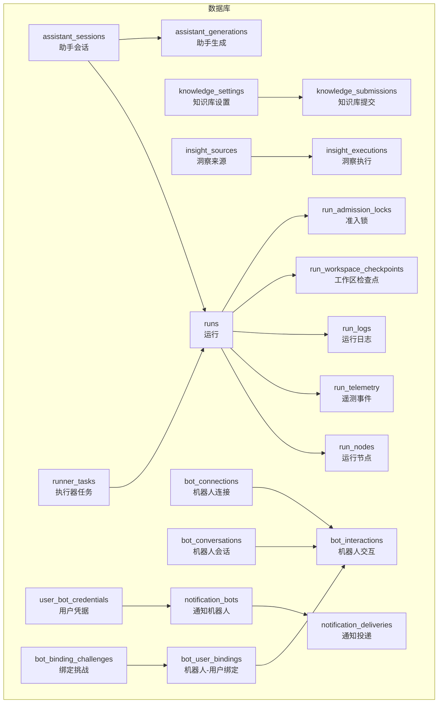
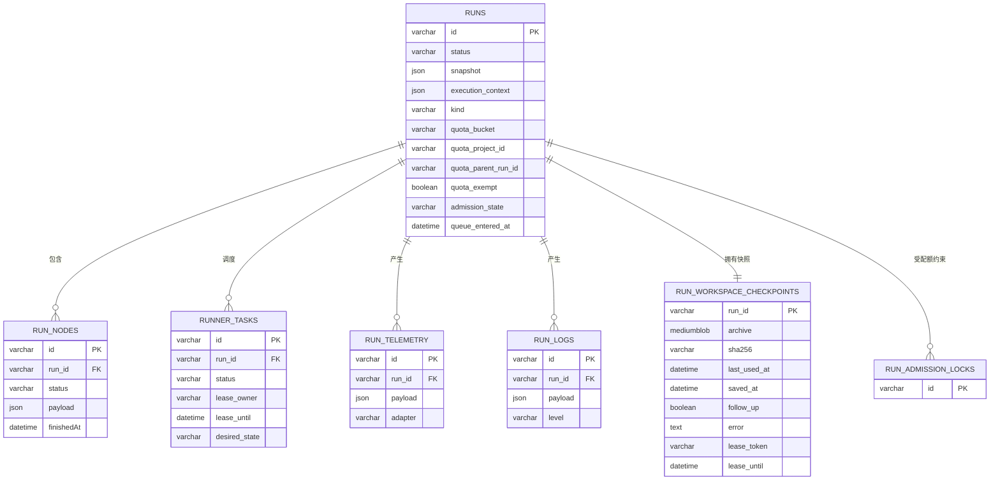
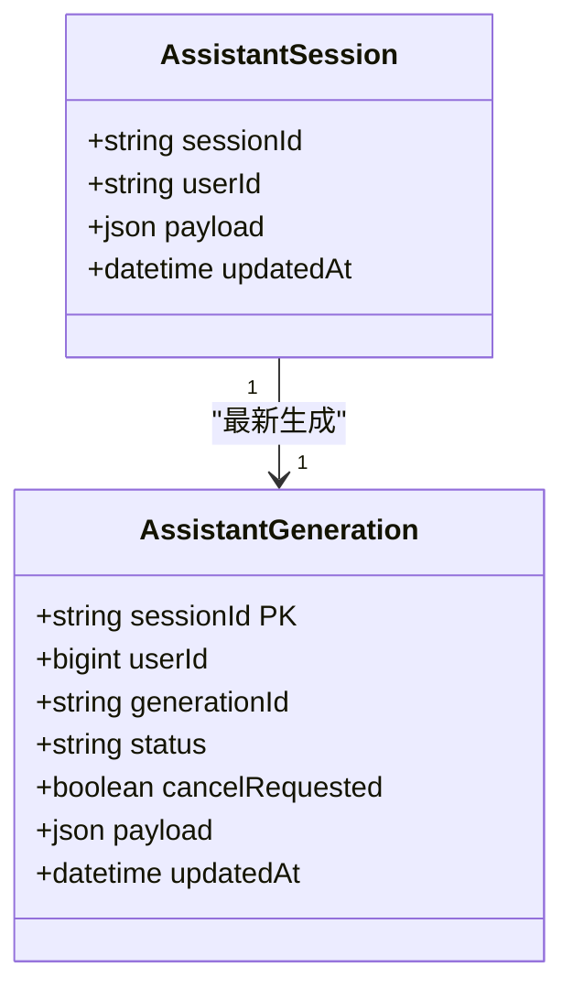
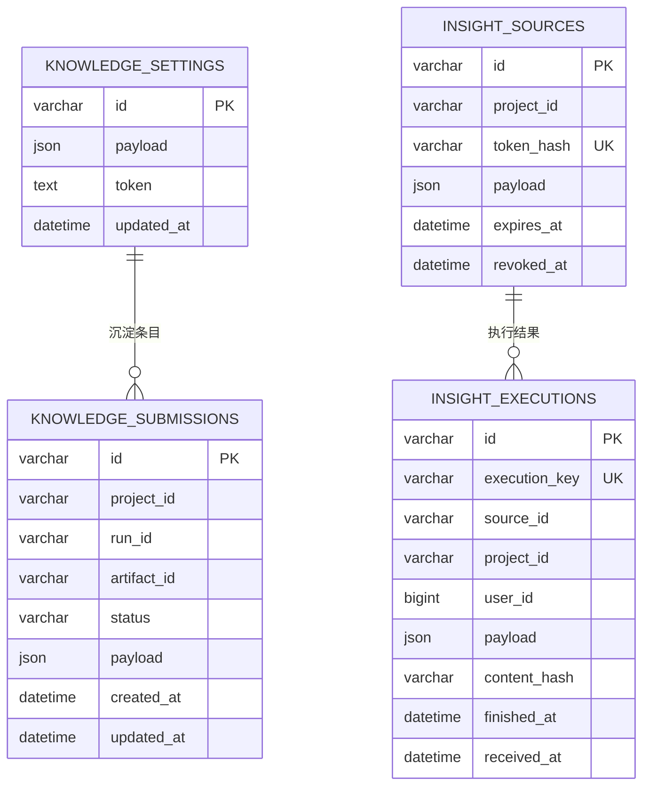
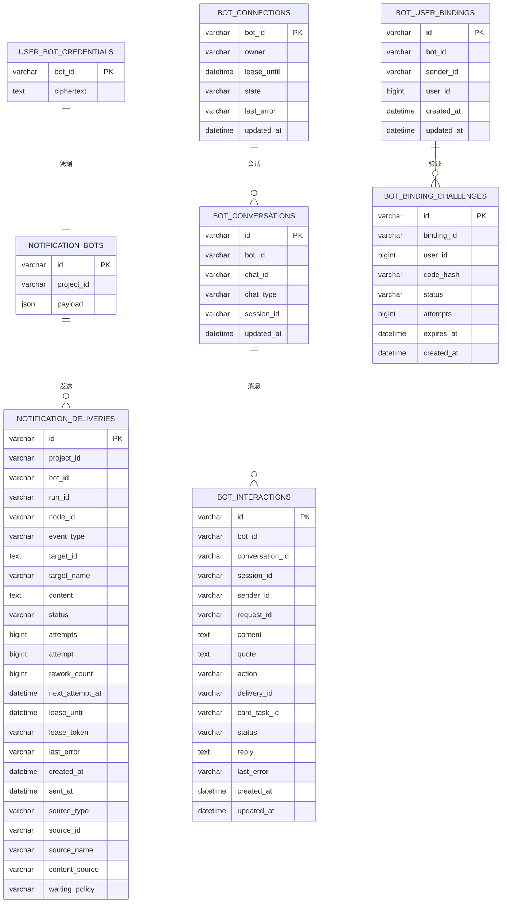
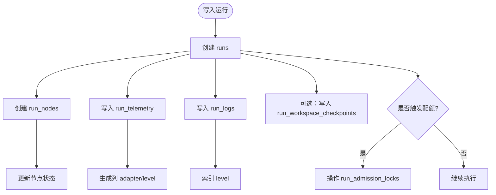

# 数据库设计

<cite>
**本文引用的文件**   
- [README.md](file://README.md)
- [deployment.md](file://docs/deployment.md)
- [001_run_obs_generated_columns.sql](file://migrations/001_run_obs_generated_columns.sql)
- [002_knowledge_base.sql](file://migrations/002_knowledge_base.sql)
- [003_external_workflow_usage.sql](file://migrations/003_external_workflow_usage.sql)
- [004_notification_bots.sql](file://migrations/004_notification_bots.sql)
- [005_notification_sources.sql](file://migrations/005_notification_sources.sql)
- [006_notification_waiting_policy.sql](file://migrations/006_notification_waiting_policy.sql)
- [007_bot_interactions.sql](file://migrations/007_bot_interactions.sql)
- [008_bot_user_bindings.sql](file://migrations/008_bot_user_bindings.sql)
- [010_project_run_admission.sql](file://migrations/010_project_run_admission.sql)
- [012_assistant_generations.sql](file://migrations/012_assistant_generations.sql)
- [013_workspace_checkpoints.sql](file://migrations/013_workspace_checkpoints.sql)
- [020_conversation_workspaces.sql](file://migrations/020_conversation_workspaces.sql)
</cite>

## 目录
1. [引言](#引言)
2. [项目结构](#项目结构)
3. [核心组件](#核心组件)
4. [架构总览](#架构总览)
5. [详细组件分析](#详细组件分析)
6. [依赖关系分析](#依赖关系分析)
7. [性能考虑](#性能考虑)
8. [故障排查指南](#故障排查指南)
9. [结论](#结论)
10. [附录](#附录)

## 引言
本文件面向 LoopForge 平台的数据库设计与运维，聚焦实体关系、字段定义与数据类型、主键/外键与索引、约束与校验规则、数据访问模式、缓存策略、性能优化、生命周期与归档、迁移路径与版本管理。LoopForge 以 MySQL 为主要持久化存储，通过 migrations 目录中的 SQL 脚本进行增量式演进；同时结合 GORM AutoMigrate 在应用启动时补齐缺失对象。平台支持聊天工作区、SOP 编排、通知与机器人集成、知识库沉淀、外部流程使用统计、运行配额与准入控制等能力，这些能力在数据库中均有对应的表结构与索引支撑。

## 项目结构
数据库相关资产集中在 migrations 目录，按版本号命名，涵盖：
- 观测列与生成列（run_telemetry/run_logs）
- 知识库设置与提交
- 外部工作流使用统计
- 通知体系（Bot、投递、来源、等待策略）
- 机器人交互与会话绑定
- 助手会话最新生成记录
- 工作区检查点快照
- 对话工作区迁移与旧协作组清理
- 运行配额与准入控制

图表来源
- [001_run_obs_generated_columns.sql:17-25](file://migrations/001_run_obs_generated_columns.sql#L17-L25)
- [002_knowledge_base.sql:11-31](file://migrations/002_knowledge_base.sql#L11-L31)
- [003_external_workflow_usage.sql:3-28](file://migrations/003_external_workflow_usage.sql#L3-L28)
- [004_notification_bots.sql:3-38](file://migrations/004_notification_bots.sql#L3-L38)
- [007_bot_interactions.sql:4-19](file://migrations/007_bot_interactions.sql#L4-L19)
- [008_bot_user_bindings.sql:3-14](file://migrations/008_bot_user_bindings.sql#L3-L14)
- [010_project_run_admission.sql:18-33](file://migrations/010_project_run_admission.sql#L18-L33)
- [012_assistant_generations.sql:3-12](file://migrations/012_assistant_generations.sql#L3-L12)
- [013_workspace_checkpoints.sql:3-13](file://migrations/013_workspace_checkpoints.sql#L3-L13)
- [020_conversation_workspaces.sql:1-63](file://migrations/020_conversation_workspaces.sql#L1-L63)

章节来源
- [README.md:72-90](file://README.md#L72-L90)
- [deployment.md:142-162](file://docs/deployment.md#L142-L162)

## 核心组件
本节梳理数据库中的关键实体及其职责、关键字段与索引。

- 运行与执行
  - runs：SOP 或聊天工作区的运行记录，包含状态、快照、上下文、配额与队列信息。新增 kind 字段区分“workspace”类型，并用于旧协作组的清理与迁移。
  - run_nodes：运行节点，承载各步骤的状态、产物、活动与完成时间。
  - runner_tasks：执行器任务，关联运行，承载排队、租约与状态。
  - run_telemetry / run_logs：运行遥测与日志，MySQL 上通过生成列提取 adapter/level 以便筛选与分析。
  - run_workspace_checkpoints：运行工作区快照与空闲租约，支持恢复与续租。
  - run_admission_locks：配额与准入控制锁行，按 project:<id> 或 runner:<id> 维度限流。

- 助手与会话
  - assistant_sessions：助手会话，与工作区运行关联。
  - assistant_generations：每个私聊会话的最新生成记录，含状态、取消请求与负载。

- 知识库
  - knowledge_settings：平台级上游连接配置与 Token。
  - knowledge_submissions：待审核的沉淀条目，按项目/运行/产物维度索引。

- 外部工作流与洞察
  - insight_sources：外部洞察来源，含 token_hash 唯一键与过期/撤销时间。
  - insight_executions：洞察执行结果，去重 key 与来源/用户/项目索引。

- 通知与机器人
  - notification_bots：项目级 Bot 配置。
  - user_bot_credentials：用户拥有的明文加密凭据。
  - notification_deliveries：通知投递队列，含重试、租约、来源与等待策略。
  - bot_connections / bot_conversations / bot_interactions：机器人连接、会话与消息交互。
  - bot_user_bindings / bot_binding_challenges：机器人-用户绑定与验证码挑战。

章节来源
- [020_conversation_workspaces.sql:1-63](file://migrations/020_conversation_workspaces.sql#L1-L63)
- [001_run_obs_generated_columns.sql:17-25](file://migrations/001_run_obs_generated_columns.sql#L17-L25)
- [013_workspace_checkpoints.sql:3-13](file://migrations/013_workspace_checkpoints.sql#L3-L13)
- [010_project_run_admission.sql:18-33](file://migrations/010_project_run_admission.sql#L18-L33)
- [012_assistant_generations.sql:3-12](file://migrations/012_assistant_generations.sql#L3-L12)
- [002_knowledge_base.sql:11-31](file://migrations/002_knowledge_base.sql#L11-L31)
- [003_external_workflow_usage.sql:3-28](file://migrations/003_external_workflow_usage.sql#L3-L28)
- [004_notification_bots.sql:3-38](file://migrations/004_notification_bots.sql#L3-L38)
- [007_bot_interactions.sql:4-19](file://migrations/007_bot_interactions.sql#L4-L19)
- [008_bot_user_bindings.sql:3-14](file://migrations/008_bot_user_bindings.sql#L3-L14)

## 架构总览
下图展示数据库层与上层业务模块的关系：运行引擎驱动 SOP 与聊天工作区，产出遥测与日志；通知子系统消费运行事件并通过 Bot 投递；知识库与洞察系统沉淀与聚合外部数据；助手会话与生成记录支撑聊天体验；工作区检查点提供快照与恢复能力；配额与准入控制保障资源安全。

```mermaid
graph TB
Engine["运行引擎<br/>SOP/聊天工作区"] --> Runs["runs"]
Engine --> Nodes["run_nodes"]
Engine --> Telemetry["run_telemetry"]
Engine --> Logs["run_logs"]
Engine --> Checkpoints["run_workspace_checkpoints"]
Engine --> Admission["run_admission_locks"]
Notify["通知子系统"] --> Deliveries["notification_deliveries"]
Notify --> Bots["notification_bots"]
Notify --> Credentials["user_bot_credentials"]
BotSvc["机器人服务"] --> Connections["bot_connections"]
BotSvc --> Conversations["bot_conversations"]
BotSvc --> Interactions["bot_interactions"]
BotSvc --> Bindings["bot_user_bindings"]
BotSvc --> Challenges["bot_binding_challenges"]
KB["知识库"] --> KSettings["knowledge_settings"]
KB --> KSubmissions["knowledge_submissions"]
Insights["洞察/外部工作流"] --> ISources["insight_sources"]
Insights --> IExecs["insight_executions"]
Assistant["助手会话"] --> ASessions["assistant_sessions"]
Assistant --> AGens["assistant_generations"]
```

图表来源
- [001_run_obs_generated_columns.sql:17-25](file://migrations/001_run_obs_generated_columns.sql#L17-L25)
- [002_knowledge_base.sql:11-31](file://migrations/002_knowledge_base.sql#L11-L31)
- [003_external_workflow_usage.sql:3-28](file://migrations/003_external_workflow_usage.sql#L3-L28)
- [004_notification_bots.sql:3-38](file://migrations/004_notification_bots.sql#L3-L38)
- [007_bot_interactions.sql:4-19](file://migrations/007_bot_interactions.sql#L4-L19)
- [008_bot_user_bindings.sql:3-14](file://migrations/008_bot_user_bindings.sql#L3-L14)
- [010_project_run_admission.sql:18-33](file://migrations/010_project_run_admission.sql#L18-L33)
- [012_assistant_generations.sql:3-12](file://migrations/012_assistant_generations.sql#L3-L12)
- [013_workspace_checkpoints.sql:3-13](file://migrations/013_workspace_checkpoints.sql#L3-L13)
- [020_conversation_workspaces.sql:1-63](file://migrations/020_conversation_workspaces.sql#L1-L63)

## 详细组件分析

### 运行与执行模型
- runs
  - 主键：id（VARCHAR(64)）
  - 关键字段：status、snapshot、execution_context、kind、quota_bucket、quota_project_id、quota_parent_run_id、quota_exempt、admission_state、queue_entered_at
  - 索引：idx_runs_quota_bucket(quota_bucket, status, queue_entered_at)
  - 说明：新增 kind 字段标识“workspace”，用于对话工作区与旧协作组区分；配额字段用于项目/机器维度的并发限制。

- run_nodes
  - 主键：id（VARCHAR(64)）
  - 关键字段：run_id、status、payload、finishedAt
  - 说明：承载各步骤状态与产物，迁移脚本中会批量更新旧协作组节点为 cancelled。

- runner_tasks
  - 主键：id（VARCHAR(64)）
  - 关键字段：run_id、status、lease_owner、lease_until、desired_state
  - 说明：与 runs 关联，承载执行器任务的排队与租约。

- run_telemetry / run_logs
  - 生成列：adapter（从 payload.source.adapter 解析）、level（从 payload.level 解析）
  - 索引：idx_run_telemetry_run_adapter(run_id, adapter)、idx_run_logs_run_level(run_id, level)
  - 说明：MySQL 上通过 STORED 生成列提升筛选与分析性能；SQLite/内存测试走代码内 JSON 解析兜底。

- run_workspace_checkpoints
  - 主键：run_id（VARCHAR(64)）
  - 关键字段：archive(MEDIUMBLOB)、sha256、last_used_at、saved_at、follow_up、error、lease_token、lease_until
  - 说明：每个运行一个快照，支持空闲租约与续租。

- run_admission_locks
  - 主键：id（VARCHAR(128)），值形如 project:<id> 或 runner:<id>
  - 说明：配合 runs.quota_* 字段实现项目/机器维度的并发限制。

图表来源
- [010_project_run_admission.sql:18-33](file://migrations/010_project_run_admission.sql#L18-L33)
- [001_run_obs_generated_columns.sql:17-25](file://migrations/001_run_obs_generated_columns.sql#L17-L25)
- [013_workspace_checkpoints.sql:3-13](file://migrations/013_workspace_checkpoints.sql#L3-L13)
- [020_conversation_workspaces.sql:1-63](file://migrations/020_conversation_workspaces.sql#L1-L63)

章节来源
- [010_project_run_admission.sql:1-62](file://migrations/010_project_run_admission.sql#L1-L62)
- [001_run_obs_generated_columns.sql:1-26](file://migrations/001_run_obs_generated_columns.sql#L1-L26)
- [013_workspace_checkpoints.sql:1-14](file://migrations/013_workspace_checkpoints.sql#L1-L14)
- [020_conversation_workspaces.sql:1-63](file://migrations/020_conversation_workspaces.sql#L1-L63)

### 助手与会话模型
- assistant_sessions
  - 与 runs 通过 workspaceRunId 关联，用于对话工作区场景。
- assistant_generations
  - 主键：session_id（VARCHAR(64)）
  - 关键字段：user_id、generation_id、status、cancel_requested、payload、updated_at
  - 索引：idx_assistant_generations_user_id(user_id)
  - 说明：保存每个私聊会话的最新生成记录，便于快速读取当前生成状态。

图表来源
- [012_assistant_generations.sql:3-12](file://migrations/012_assistant_generations.sql#L3-L12)
- [020_conversation_workspaces.sql:14-23](file://migrations/020_conversation_workspaces.sql#L14-L23)

章节来源
- [012_assistant_generations.sql:1-13](file://migrations/012_assistant_generations.sql#L1-L13)
- [020_conversation_workspaces.sql:14-23](file://migrations/020_conversation_workspaces.sql#L14-L23)

### 知识库与洞察模型
- knowledge_settings
  - 主键：id（VARCHAR(64)）
  - 关键字段：payload(JSON)、token(TEXT)、updated_at
  - 说明：存储上游知识库地址、MCP Token 等配置。
- knowledge_submissions
  - 主键：id（VARCHAR(64)）
  - 关键字段：project_id、run_id、artifact_id、status、payload、created_at、updated_at
  - 索引：idx_knowledge_submissions_project、idx_knowledge_submissions_run、idx_knowledge_submissions_artifact、idx_knowledge_submissions_status
- insight_sources
  - 主键：id（VARCHAR(64)）
  - 关键字段：project_id、token_hash(UNIQUE)、payload、expires_at、revoked_at
  - 索引：idx_insight_sources_project_id、idx_insight_sources_token_hash
- insight_executions
  - 主键：id（VARCHAR(64)）
  - 关键字段：execution_key(UNIQUE)、source_id、project_id、user_id、payload、content_hash、finished_at、received_at
  - 索引：idx_insight_executions_execution_key、idx_insight_executions_source_id、idx_insight_executions_user_id、idx_insight_project_finished

图表来源
- [002_knowledge_base.sql:11-31](file://migrations/002_knowledge_base.sql#L11-L31)
- [003_external_workflow_usage.sql:3-28](file://migrations/003_external_workflow_usage.sql#L3-L28)

章节来源
- [002_knowledge_base.sql:1-32](file://migrations/002_knowledge_base.sql#L1-L32)
- [003_external_workflow_usage.sql:1-29](file://migrations/003_external_workflow_usage.sql#L1-L29)

### 通知与机器人模型
- notification_bots
  - 主键：id（VARCHAR(191)）
  - 关键字段：project_id、payload(JSON)
  - 索引：idx_notification_bots_project_id(project_id)
- user_bot_credentials
  - 主键：bot_id（VARCHAR(191)）
  - 关键字段：ciphertext(TEXT)
- notification_deliveries
  - 主键：id（VARCHAR(64)）
  - 关键字段：project_id、bot_id、run_id、node_id、event_type、target_id、target_name、content、status、attempts、attempt、rework_count、next_attempt_at、lease_until、lease_token、last_error、created_at、sent_at
  - 索引：idx_notification_deliveries_project_id、idx_notification_deliveries_bot_id、idx_notification_due(status,next_attempt_at)、idx_notification_source(source_type,source_id)
  - 扩展字段：source_type、source_id、source_name、content_source、waiting_policy
- bot_connections / bot_conversations / bot_interactions
  - 主键：各自 id（VARCHAR(64)/VARCHAR(191)）
  - 关键字段：bot_id、chat_id、chat_type、session_id、sender_id、request_id、content、quote、action、delivery_id、card_task_id、status、reply、last_error、created_at、updated_at
  - 索引：idx_bot_queue(bot_id,status,created_at)、idx_bot_interactions_conversation_id(conversation_id)、idx_bot_interactions_session_id(session_id)
- bot_user_bindings / bot_binding_challenges
  - 主键：各自 id（VARCHAR(64)）
  - 关键字段：binding_id、user_id、code_hash、status、attempts、expires_at、created_at
  - 索引：idx_bot_user_bindings_user_id、idx_bot_binding_challenges_binding_id、idx_bot_binding_challenges_expires_at

图表来源
- [004_notification_bots.sql:3-38](file://migrations/004_notification_bots.sql#L3-L38)
- [005_notification_sources.sql:3-8](file://migrations/005_notification_sources.sql#L3-L8)
- [006_notification_waiting_policy.sql:2-3](file://migrations/006_notification_waiting_policy.sql#L2-L3)
- [007_bot_interactions.sql:4-19](file://migrations/007_bot_interactions.sql#L4-L19)
- [008_bot_user_bindings.sql:3-14](file://migrations/008_bot_user_bindings.sql#L3-L14)

章节来源
- [004_notification_bots.sql:1-39](file://migrations/004_notification_bots.sql#L1-L39)
- [005_notification_sources.sql:1-9](file://migrations/005_notification_sources.sql#L1-L9)
- [006_notification_waiting_policy.sql:1-4](file://migrations/006_notification_waiting_policy.sql#L1-L4)
- [007_bot_interactions.sql:1-20](file://migrations/007_bot_interactions.sql#L1-L20)
- [008_bot_user_bindings.sql:1-15](file://migrations/008_bot_user_bindings.sql#L1-L15)

## 依赖关系分析
- 运行与遥测/日志：run_telemetry 与 run_logs 通过 run_id 与 runs 关联；生成列 adapter/level 提升查询效率。
- 运行与工作区快照：run_workspace_checkpoints 以 run_id 为主键，提供快照与租约。
- 运行与配额：runs.quota_bucket/quota_project_id/quota_exempt 与 run_admission_locks 共同实现项目/机器维度的并发限制。
- 助手与会话：assistant_sessions 与 runs 通过 workspaceRunId 关联；assistant_generations 以 session_id 为主键保存最新生成。
- 通知与 Bot：notification_deliveries 依赖 notification_bots 与 user_bot_credentials；bot_interactions 可关联 delivery_id。
- 知识库与洞察：knowledge_submissions 与 insight_executions 分别由 knowledge_settings 与 insight_sources 驱动。

图表来源
- [001_run_obs_generated_columns.sql:17-25](file://migrations/001_run_obs_generated_columns.sql#L17-L25)
- [010_project_run_admission.sql:18-33](file://migrations/010_project_run_admission.sql#L18-L33)
- [013_workspace_checkpoints.sql:3-13](file://migrations/013_workspace_checkpoints.sql#L3-L13)

章节来源
- [001_run_obs_generated_columns.sql:1-26](file://migrations/001_run_obs_generated_columns.sql#L1-L26)
- [010_project_run_admission.sql:1-62](file://migrations/010_project_run_admission.sql#L1-L62)
- [013_workspace_checkpoints.sql:1-14](file://migrations/013_workspace_checkpoints.sql#L1-L14)

## 性能考虑
- 生成列与索引
  - run_telemetry.adapter 与 run_logs.level 使用 STORED 生成列，避免运行时 JSON 解析开销；配套 (run_id, adapter/level) 复合索引加速筛选。
  - 注意：STORED 生成列在大表上新增会触发表重建，需选择维护窗口执行。
- 索引设计
  - 通知投递：idx_notification_due(status,next_attempt_at) 提升定时拉取即将到期的投递；idx_notification_source(source_type,source_id) 支持按来源过滤。
  - 洞察执行：idx_insight_project_finished(project_id, finished_at) 支持按项目与完成时间聚合。
  - 知识库提交：多列单列索引覆盖常见查询维度（project/run/artifact/status）。
- 大字段与分表建议
  - run_workspace_checkpoints.archive 使用 MEDIUMBLOB，适合快照归档；若频繁查询应拆分至独立表或对象存储。
- 并发与锁
  - run_admission_locks 作为分布式锁行，避免超并发；配合 runs.quota_* 字段实现项目/机器维度限流。
- 查询优化
  - 优先使用生成列与复合索引进行筛选；对 JSON payload 的查询尽量下推到生成列或衍生字段。

章节来源
- [001_run_obs_generated_columns.sql:1-26](file://migrations/001_run_obs_generated_columns.sql#L1-L26)
- [004_notification_bots.sql:14-38](file://migrations/004_notification_bots.sql#L14-L38)
- [003_external_workflow_usage.sql:14-28](file://migrations/003_external_workflow_usage.sql#L14-L28)
- [002_knowledge_base.sql:18-31](file://migrations/002_knowledge_base.sql#L18-L31)
- [013_workspace_checkpoints.sql:3-13](file://migrations/013_workspace_checkpoints.sql#L3-L13)
- [010_project_run_admission.sql:18-33](file://migrations/010_project_run_admission.sql#L18-L33)

## 故障排查指南
- 生成列缺失
  - 现象：MySQL 上无法按 adapter/level 筛选遥测/日志。
  - 处理：确认已执行 001_run_obs_generated_columns.sql；若已存在则跳过；SQLite/内存测试走代码内 JSON 解析兜底。
- 通知投递堆积
  - 现象：next_attempt_at 大量未到期或状态不更新。
  - 处理：检查 idx_notification_due 是否存在；核对 waiting_policy 与 source_type/source_id 是否正确；查看 last_error 定位失败原因。
- 机器人交互丢失
  - 现象：bot_interactions 无记录或会话中断。
  - 处理：检查 bot_connections.state 与 last_error；确认 bot_conversations.session_id 与 bot_interactions.session_id 一致；核查 bot_user_bindings 绑定状态。
- 配额超限导致排队
  - 现象：新运行长时间处于排队状态。
  - 处理：检查 runs.quota_bucket/quota_project_id/quota_exempt；确认 run_admission_locks 对应锁行；必要时调整 runners.run_limit 或释放占用。
- 旧协作组遗留
  - 现象：历史 group 协作运行未清理。
  - 处理：确认 020_conversation_workspaces.sql 已执行；该脚本会将旧协作组标记为 cancelled 并清理相关任务与节点。

章节来源
- [001_run_obs_generated_columns.sql:1-26](file://migrations/001_run_obs_generated_columns.sql#L1-L26)
- [004_notification_bots.sql:14-38](file://migrations/004_notification_bots.sql#L14-L38)
- [007_bot_interactions.sql:4-19](file://migrations/007_bot_interactions.sql#L4-L19)
- [008_bot_user_bindings.sql:3-14](file://migrations/008_bot_user_bindings.sql#L3-L14)
- [010_project_run_admission.sql:18-33](file://migrations/010_project_run_admission.sql#L18-L33)
- [020_conversation_workspaces.sql:14-63](file://migrations/020_conversation_workspaces.sql#L14-L63)

## 结论
LoopForge 的数据库设计围绕运行引擎、助手会话、通知与机器人、知识库与洞察、配额与准入控制展开，采用稳定的主键/索引策略与生成列优化查询性能。migrations 目录提供了清晰的演进路径，配合 GORM AutoMigrate 与应用逻辑保证向后兼容。建议在变更时遵循幂等原则，谨慎对待大字段与生成列的变更，并结合业务指标持续优化索引与查询计划。

## 附录

### 数据生命周期、保留与归档
- 运行遥测与日志
  - 建议按 run_id 与时间范围归档；生成列已优化筛选，归档后可降低在线表压力。
- 工作区快照
  - run_workspace_checkpoints.archive 为大字段，建议定期归档至对象存储并保留最近若干快照。
- 通知投递
  - 成功投递后保留一定审计期；失败投递根据 waiting_policy 与重试次数决定清理策略。
- 机器人交互与会话
  - 可按 bot_id/session_id 与时间范围归档；敏感内容脱敏后再归档。
- 洞察执行
  - 按 project_id 与 finished_at 归档，保留聚合所需的 content_hash 与元数据。

[本节为通用指导，不直接分析具体文件]

### 数据迁移路径与版本管理
- 迁移分类
  - 安装器与 start.sh 自动应用的基线脚本（例如 001_run_obs_generated_columns.sql、seed 脚本、031_generic_backend_openssh.sql）。
  - 升级时必须手动运行的脚本（例如 009_bot_interactions_utf8mb4.sql、新增表/列）。
  - 回填与一次性重写（例如 016_public_optional_repositories.sql、021_assistant_session_sources.sql）。
- 执行顺序
  - 先停止旧 API/Worker，再执行 SQL，最后启动新版本服务。
- 幂等性
  - 部分脚本具备幂等性（IF NOT EXISTS、information_schema 检查）；不可重复执行的脚本需先确认列/表是否存在。
- 公共 SOP 指令更新
  - 可通过显式执行 migrations/016_public_optional_repositories.sql 更新公开目录指令，保留操作员编辑与项目副本。

章节来源
- [deployment.md:142-162](file://docs/deployment.md#L142-L162)
- [020_conversation_workspaces.sql:1-63](file://migrations/020_conversation_workspaces.sql#L1-L63)
- [001_run_obs_generated_columns.sql:1-26](file://migrations/001_run_obs_generated_columns.sql#L1-L26)