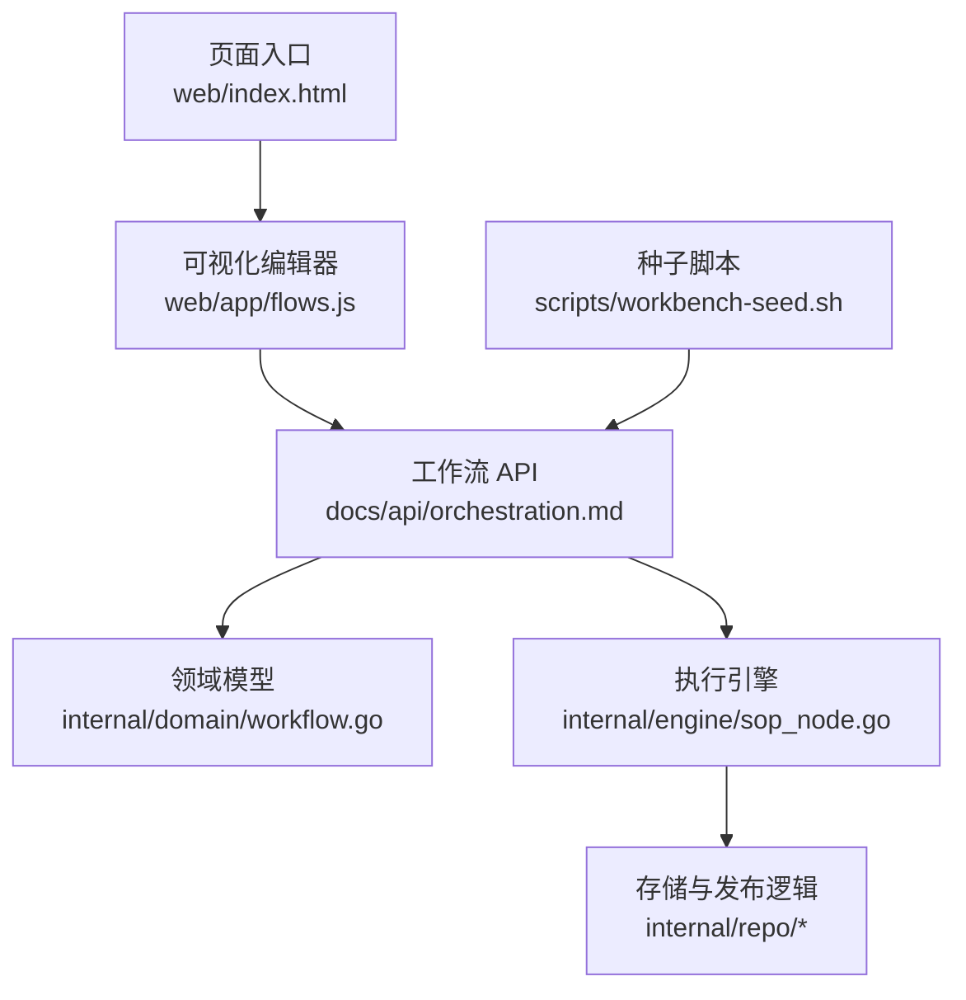
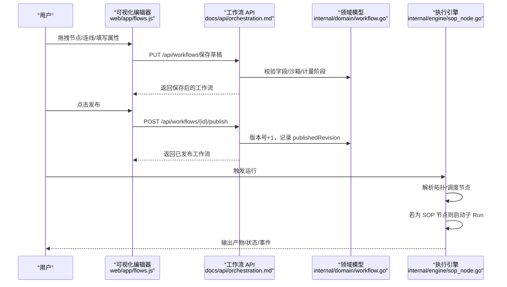
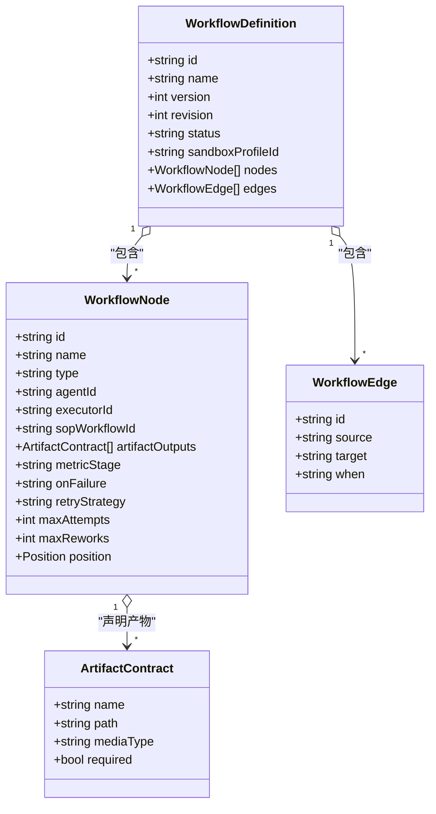
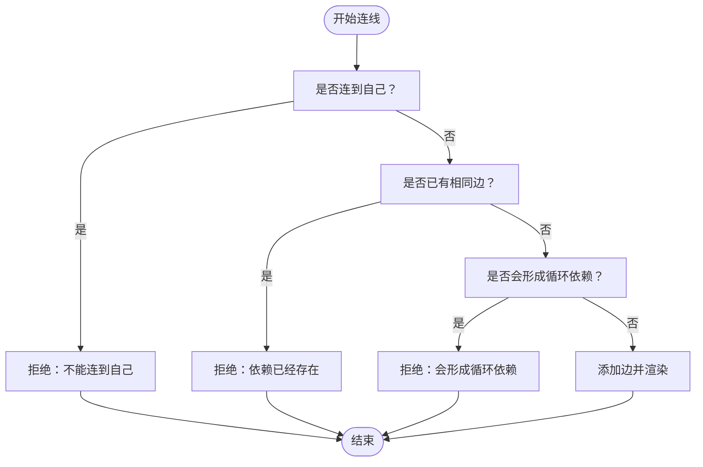
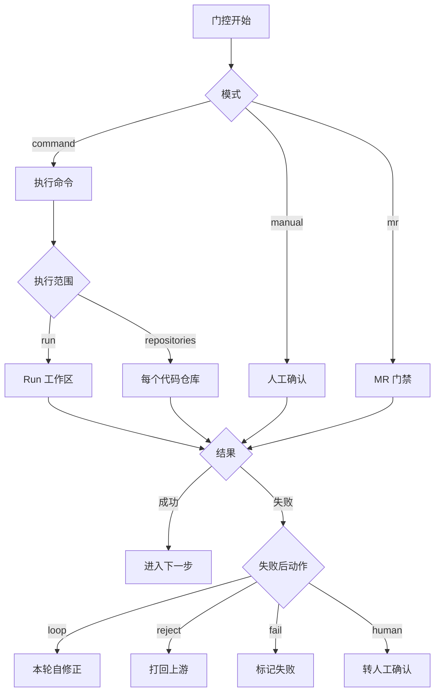
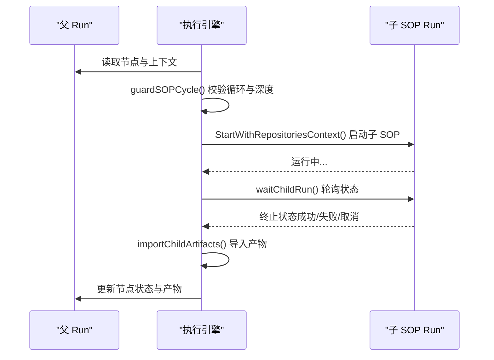
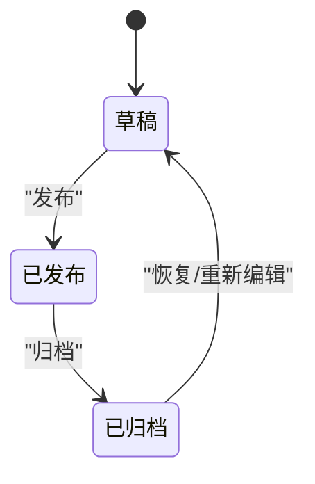
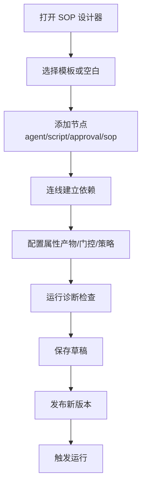
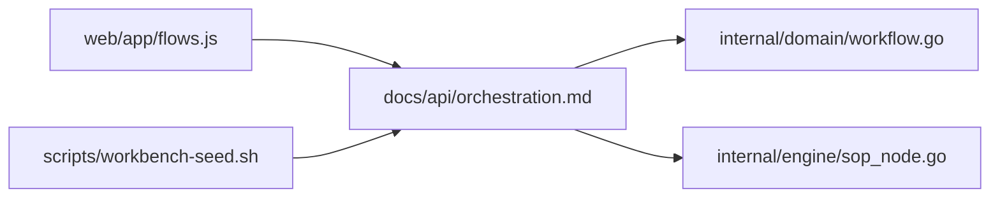

# SOP 设计器

<cite>
**本文引用的文件**   
- [internal/domain/workflow.go](file://internal/domain/workflow.go)
- [internal/engine/sop_node.go](file://internal/engine/sop_node.go)
- [web/app/flows.js](file://web/app/flows.js)
- [docs/api/orchestration.md](file://docs/api/orchestration.md)
- [e2e/api/10-catalog.test.mjs](file://e2e/api/10-catalog.test.mjs)
- [internal/httpapi/workflow_save_error_guard_test.go](file://internal/httpapi/workflow_save_error_guard_test.go)
- [internal/repo/workflow_publish_test.go](file://internal/repo/workflow_publish_test.go)
- [scripts/workbench-seed.sh](file://scripts/workbench-seed.sh)
- [web/index.html](file://web/index.html)
</cite>

## 目录
1. [简介](#简介)
2. [项目结构](#项目结构)
3. [核心组件](#核心组件)
4. [架构总览](#架构总览)
5. [详细组件分析](#详细组件分析)
6. [依赖关系分析](#依赖关系分析)
7. [性能与可扩展性](#性能与可扩展性)
8. [故障排查指南](#故障排查指南)
9. [结论](#结论)
10. [附录：SOP 设计示例与最佳实践](#附录sop-设计示例与最佳实践)

## 简介
本文件面向 SOP（标准操作流程）设计器的使用者与维护者，系统性说明工作流定义的结构、节点类型、边连接关系、验证门控机制、生命周期状态转换、可视化编辑器用法、执行策略、版本控制以及嵌套子 SOP 的执行语义。文档同时给出可操作的流程图与时序图，帮助读者从“如何设计”到“如何运行和排错”形成完整认知。

## 项目结构
SOP 设计器由前端可视化编辑器和后端领域模型、引擎执行、API 接口共同组成：
- 前端编辑器：负责画布交互、节点配置、连线校验、保存与发布。
- 领域模型：定义工作流、节点、边、产物契约、验证门控、版本与指标等数据结构。
- 引擎执行：负责节点调度、子 SOP 启动与产物导入、循环与深度保护。
- API 与测试：提供保存、发布、克隆、修订等接口，并通过端到端测试覆盖关键路径。

**图示来源**
- [web/app/flows.js:1-800](file://web/app/flows.js#L1-L800)
- [docs/api/orchestration.md:33-72](file://docs/api/orchestration.md#L33-L72)
- [internal/domain/workflow.go:10-180](file://internal/domain/workflow.go#L10-L180)
- [internal/engine/sop_node.go:18-187](file://internal/engine/sop_node.go#L18-L187)
- [scripts/workbench-seed.sh:96-109](file://scripts/workbench-seed.sh#L96-L109)
- [web/index.html:389-398](file://web/index.html#L389-L398)

**章节来源**
- [web/app/flows.js:1-800](file://web/app/flows.js#L1-L800)
- [docs/api/orchestration.md:33-72](file://docs/api/orchestration.md#L33-L72)
- [internal/domain/workflow.go:10-180](file://internal/domain/workflow.go#L10-L180)
- [internal/engine/sop_node.go:18-187](file://internal/engine/sop_node.go#L18-L187)
- [scripts/workbench-seed.sh:96-109](file://scripts/workbench-seed.sh#L96-L109)
- [web/index.html:389-398](file://web/index.html#L389-L398)

## 核心组件
- 工作流定义与工作流节点：描述流程拓扑、节点行为、产物契约、统计阶段、失败处理、重试策略、通知等。
- 边连接关系：定义成功路径的有向边，支持多入口并行启动。
- 验证门控：命令型、手动型、MR 型门禁，支持执行范围与失败后动作。
- 子 SOP 节点：引用另一个工作流，具备产物交接、循环保护与最大嵌套层数限制。
- 版本与生命周期：草稿、已发布、已归档；revision/version/publishedRevision 协同保证并发安全与可恢复性。
- 可视化编辑器：拖拽节点、连线、属性面板、诊断检查、撤销重做、保存与发布。

**章节来源**
- [internal/domain/workflow.go:10-180](file://internal/domain/workflow.go#L10-L180)
- [internal/engine/sop_node.go:18-187](file://internal/engine/sop_node.go#L18-L187)
- [web/app/flows.js:190-212](file://web/app/flows.js#L190-L212)
- [docs/api/orchestration.md:33-72](file://docs/api/orchestration.md#L33-L72)

## 架构总览
SOP 设计器采用“前端编辑 + 后端领域模型 + 引擎执行 + API 接口”的分层架构。前端通过 API 读写工作流定义，引擎在运行时解析拓扑并调度节点，子 SOP 以独立 Run 的形式执行并与父流程进行产物交接。

**图示来源**
- [web/app/flows.js:1053-1176](file://web/app/flows.js#L1053-L1176)
- [docs/api/orchestration.md:33-72](file://docs/api/orchestration.md#L33-L72)
- [internal/domain/workflow.go:139-180](file://internal/domain/workflow.go#L139-L180)
- [internal/engine/sop_node.go:18-155](file://internal/engine/sop_node.go#L18-L155)

## 详细组件分析

### 工作流定义与节点类型
工作流定义包含元数据（ID、名称、版本、状态、项目、标签、描述）、沙箱配置、产物预览契约、节点列表与边列表。节点类型包括：
- agent：绑定角色（Agent），可配置 Loop、产物契约、验证门控、通知等。
- script：Shell 或 Python 脚本，支持执行范围与重试策略。
- approval：人工门禁，等待审批通过后继续。
- sop：引用另一个工作流，作为子流程执行，支持产物交接与循环保护。

**图示来源**
- [internal/domain/workflow.go:39-101](file://internal/domain/workflow.go#L39-L101)
- [internal/domain/workflow.go:139-180](file://internal/domain/workflow.go#L139-L180)

**章节来源**
- [internal/domain/workflow.go:39-101](file://internal/domain/workflow.go#L39-L101)
- [internal/domain/workflow.go:139-180](file://internal/domain/workflow.go#L139-L180)

### 边连接关系与拓扑校验
- 边表示成功路径上的依赖关系，when 通常为 success。
- 前端在连线时禁止自环、重复边与形成循环依赖；失败打回使用 rejectTo 单独管理。
- 多入口节点会并行启动，需通过边明确顺序。

**图示来源**
- [web/app/flows.js:404-470](file://web/app/flows.js#L404-L470)

**章节来源**
- [web/app/flows.js:404-470](file://web/app/flows.js#L404-L470)

### 验证门控机制
验证门控用于在 Agent 或脚本产出后增加质量关卡，支持：
- mode：command、manual、mr。
- stage：after_execution（执行后）、before_publish（发布前）。
- executionScope：run（Run 工作区）或 repositories（每个代码仓库）。
- onFailure：loop（自修正）、reject（打回上游）、fail（失败）、human（转人工）。

**图示来源**
- [internal/domain/workflow.go:10-20](file://internal/domain/workflow.go#L10-L20)
- [web/app/flows.js:795-800](file://web/app/flows.js#L795-L800)

**章节来源**
- [internal/domain/workflow.go:10-20](file://internal/domain/workflow.go#L10-L20)
- [web/app/flows.js:795-800](file://web/app/flows.js#L795-L800)

### 子 SOP 执行与产物交接
子 SOP 节点在执行时会：
- 校验目标 SOP 是否存在且不构成循环引用。
- 绑定池执行机，继承父流程的工作区上下文。
- 启动子 Run，并在父节点中记录 ChildRunID。
- 等待子 Run 完成，将子流程产物按契约导入父流程。
- 对未声明的必需产物进行校验，缺失则失败。

**图示来源**
- [internal/engine/sop_node.go:18-155](file://internal/engine/sop_node.go#L18-L155)
- [internal/engine/sop_node.go:157-187](file://internal/engine/sop_node.go#L157-L187)
- [internal/engine/sop_node.go:228-307](file://internal/engine/sop_node.go#L228-L307)

**章节来源**
- [internal/engine/sop_node.go:18-155](file://internal/engine/sop_node.go#L18-L155)
- [internal/engine/sop_node.go:157-187](file://internal/engine/sop_node.go#L157-L187)
- [internal/engine/sop_node.go:228-307](file://internal/engine/sop_node.go#L228-L307)

### 生命周期管理与版本控制
- 状态：draft（草稿）、published（已发布）、archived（已归档）。
- 版本：version 在发布时递增；revision 每次保存递增；publishedRevision 指向当前发布的 revision。
- 发布：POST /api/workflows/{id}/publish 设置 status=published，version+1，并持久化 publishedRevision。
- 修订：GET/POST 修订接口支持查看历史与恢复。
- 冲突：revision 冲突返回 409；通用模板只读；删除受运行中的 Run 或 Issue 绑定保护。

**图示来源**
- [internal/domain/workflow.go:139-180](file://internal/domain/workflow.go#L139-L180)
- [docs/api/orchestration.md:33-72](file://docs/api/orchestration.md#L33-L72)

**章节来源**
- [internal/domain/workflow.go:139-180](file://internal/domain/workflow.go#L139-L180)
- [docs/api/orchestration.md:33-72](file://docs/api/orchestration.md#L33-L72)

### 可视化编辑器使用指南
- 新建 SOP：可从空白或内置模板创建；内置模板复制后在本项目内可编辑。
- 节点操作：添加、删除、复制、重命名、拖拽移动、连线、失败打回。
- 属性面板：Agent 任务书、产物契约、验证门控、Loop 策略、通知绑定。
- 诊断检查：入口数量、沙箱选择、产物契约、返工路径、循环依赖检测。
- 快捷键：Ctrl/Cmd+S 保存，Ctrl/Cmd+Z/Y 撤销重做，F2 重命名，Delete 删除节点。

**图示来源**
- [web/app/flows.js:190-212](file://web/app/flows.js#L190-L212)
- [web/app/flows.js:388-396](file://web/app/flows.js#L388-L396)
- [web/app/flows.js:620-643](file://web/app/flows.js#L620-L643)

**章节来源**
- [web/app/flows.js:190-212](file://web/app/flows.js#L190-L212)
- [web/app/flows.js:388-396](file://web/app/flows.js#L388-L396)
- [web/app/flows.js:620-643](file://web/app/flows.js#L620-L643)

### 执行策略设置
- onFailure：fail（失败）、reject（打回上游）。
- retryStrategy：targeted_fix（定向修复）、full_redo（全量重做）。
- carryOver：跨轮次携带上下文（如 failed_checks、last_error、upstream_artifacts）。
- maxAttempts/maxReworks：最大尝试次数与最大返工次数。
- notification：完成报告与通知绑定。

**章节来源**
- [internal/domain/workflow.go:39-73](file://internal/domain/workflow.go#L39-L73)
- [web/app/flows.js:653-657](file://web/app/flows.js#L653-L657)

## 依赖关系分析
- 前端依赖 API 进行工作流的保存、发布、克隆与修订查询。
- 领域模型被 API 与引擎共享，确保数据结构一致性。
- 引擎依赖存储层进行 Run 状态查询与事件上报。
- 种子脚本提供预置 SOP 与节点样例，便于快速体验。

**图示来源**
- [web/app/flows.js:1053-1176](file://web/app/flows.js#L1053-L1176)
- [docs/api/orchestration.md:33-72](file://docs/api/orchestration.md#L33-L72)
- [internal/domain/workflow.go:139-180](file://internal/domain/workflow.go#L139-L180)
- [internal/engine/sop_node.go:18-155](file://internal/engine/sop_node.go#L18-L155)
- [scripts/workbench-seed.sh:96-109](file://scripts/workbench-seed.sh#L96-L109)

**章节来源**
- [web/app/flows.js:1053-1176](file://web/app/flows.js#L1053-L1176)
- [docs/api/orchestration.md:33-72](file://docs/api/orchestration.md#L33-L72)
- [internal/domain/workflow.go:139-180](file://internal/domain/workflow.go#L139-L180)
- [internal/engine/sop_node.go:18-155](file://internal/engine/sop_node.go#L18-L155)
- [scripts/workbench-seed.sh:96-109](file://scripts/workbench-seed.sh#L96-L109)

## 性能与可扩展性
- 子 SOP 嵌套深度限制为固定上限，防止无限递归与资源耗尽。
- 子 SOP 轮询间隔为 200ms，兼顾响应性与负载。
- 产物导入按名称去重并保留最新产物，避免重复写入。
- 前端布局自动展开拥挤节点，减少连线遮挡，提升编辑效率。

**章节来源**
- [internal/engine/sop_node.go:14-15](file://internal/engine/sop_node.go#L14-L15)
- [internal/engine/sop_node.go:228-254](file://internal/engine/sop_node.go#L228-L254)
- [internal/engine/sop_node.go:256-307](file://internal/engine/sop_node.go#L256-L307)
- [web/app/flows.js:256-276](file://web/app/flows.js#L256-L276)

## 故障排查指南
- 保存错误：
  - 沙箱 ID 为空或不存在：返回 400，提示缺少沙箱。
  - 计量阶段非法：返回 400，提示不支持的阶段值。
  - revision 冲突：返回 409，提示需要合并最新版本。
- 发布错误：
  - 无变更时发布不会改变版本；仅当内容变化时才递增 version。
  - 并发发布通过数据库事务保证最终一致。
- 子 SOP 错误：
  - 未选择要跑的流程：节点失败。
  - 子 SOP 不存在：节点失败。
  - 循环引用或超过嵌套层数：节点失败。
  - 子 SOP 未交出必需产物：节点失败。

**章节来源**
- [internal/httpapi/workflow_save_error_guard_test.go:23-51](file://internal/httpapi/workflow_save_error_guard_test.go#L23-L51)
- [internal/httpapi/workflow_save_error_guard_test.go:86-100](file://internal/httpapi/workflow_save_error_guard_test.go#L86-L100)
- [internal/repo/workflow_publish_test.go:67-125](file://internal/repo/workflow_publish_test.go#L67-L125)
- [internal/engine/sop_node.go:18-45](file://internal/engine/sop_node.go#L18-L45)
- [internal/engine/sop_node.go:157-187](file://internal/engine/sop_node.go#L157-L187)
- [internal/engine/sop_node.go:256-307](file://internal/engine/sop_node.go#L256-L307)

## 结论
SOP 设计器通过清晰的领域模型、严格的拓扑与门控校验、稳健的子 SOP 执行机制以及完善的版本控制，提供了从设计到运行再到归档的全链路能力。前端可视化编辑器降低了复杂流程的设计门槛，后端引擎保证了执行的可靠性与可观测性。建议在设计时优先使用内置模板，明确产物契约与门控策略，并通过诊断检查与试运行逐步完善流程。

## 附录：SOP 设计示例与最佳实践
- 示例流程：
  - 方案 → 评审 → 实现 → 验证（前后端分别有对应 SOP）。
  - 需求分析 → 确认分析（真实 AI 场景）。
- 最佳实践：
  - 明确每个节点的产物契约，避免下游歧义。
  - 使用验证门控在关键步骤加入质量关卡。
  - 合理设置 onFailure 与 retryStrategy，平衡自动化与人工介入。
  - 使用子 SOP 拆分职责，但注意嵌套深度与循环保护。
  - 发布前运行诊断检查，确保入口唯一、沙箱有效、产物完备。

**章节来源**
- [scripts/workbench-seed.sh:96-109](file://scripts/workbench-seed.sh#L96-L109)
- [web/index.html:389-398](file://web/index.html#L389-L398)
- [web/app/flows.js:388-396](file://web/app/flows.js#L388-L396)
- [e2e/api/10-catalog.test.mjs:164-187](file://e2e/api/10-catalog.test.mjs#L164-L187)