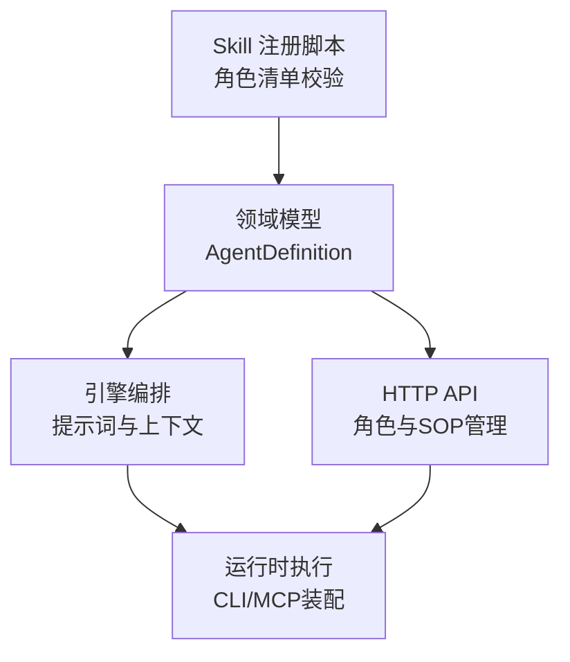
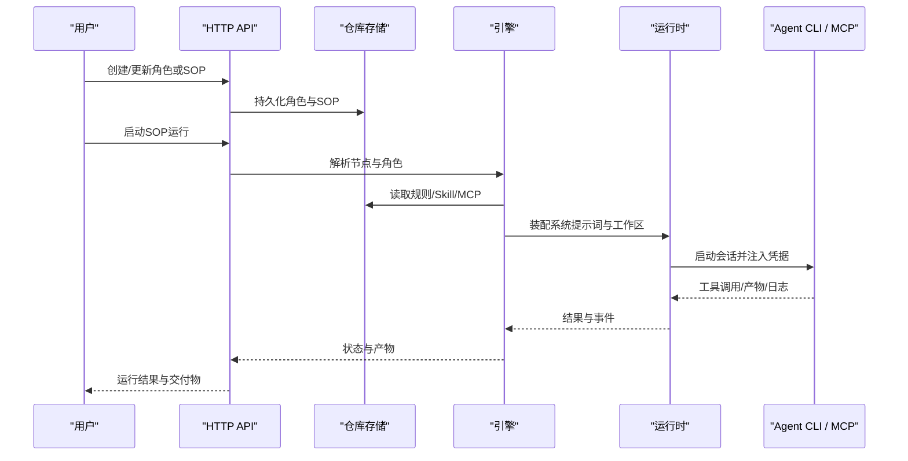
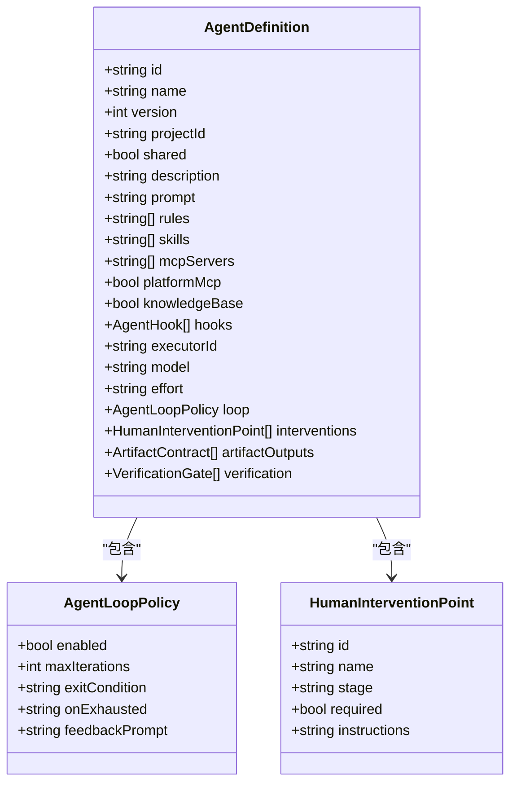
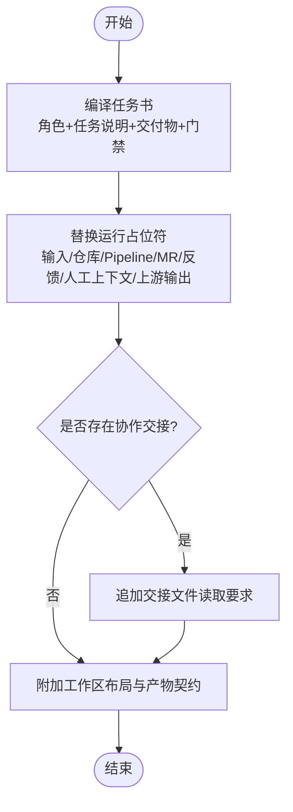
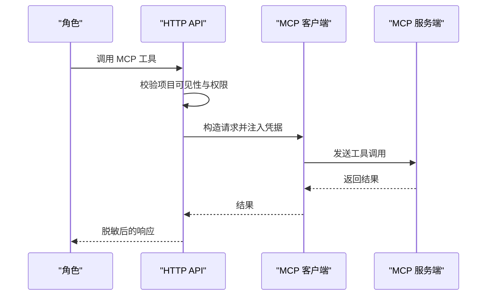
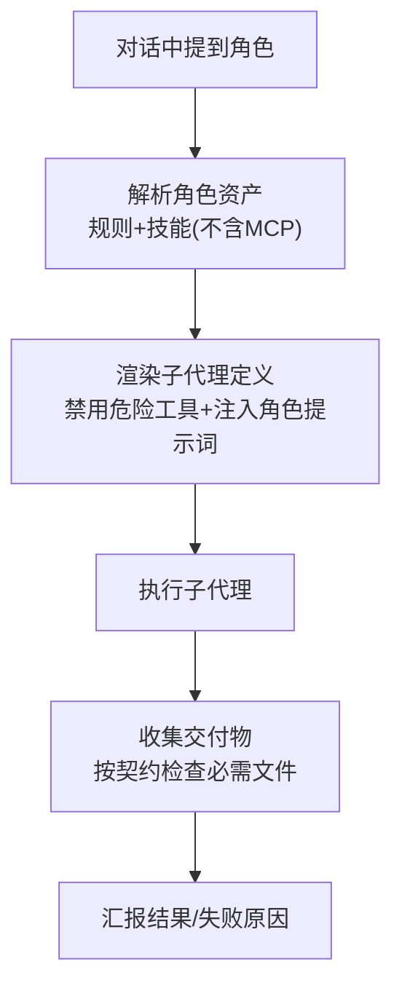
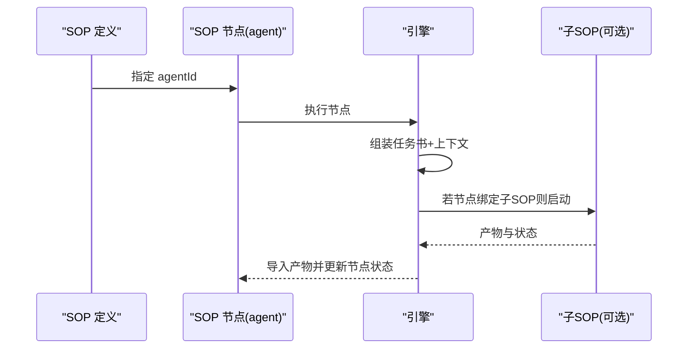
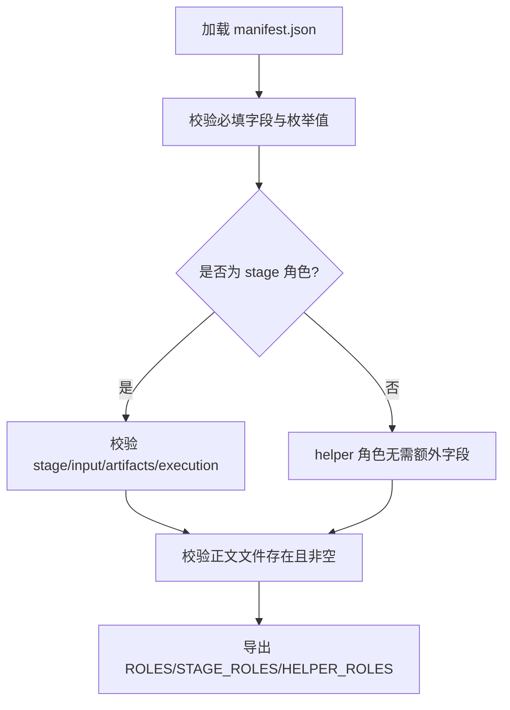
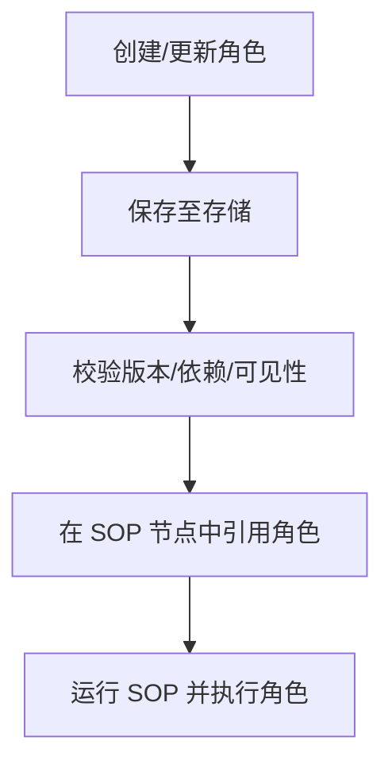
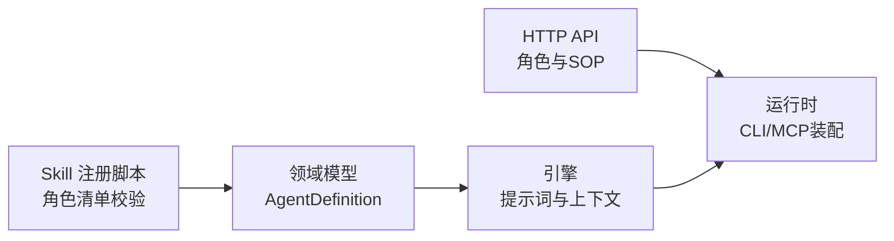

# 代理角色

<cite>
**本文引用的文件**   
- [internal/domain/agent.go](file://internal/domain/agent.go)
- [internal/engine/prompt.go](file://internal/engine/prompt.go)
- [internal/engine/assets.go](file://internal/engine/assets.go)
- [internal/engine/sop_node.go](file://internal/engine/sop_node.go)
- [internal/httpapi/assistant_subagents.go](file://internal/httpapi/assistant_subagents.go)
- [internal/httpapi/assistant_engine_agentcli.go](file://internal/httpapi/assistant_engine_agentcli.go)
- [internal/httpapi/assistant_mcp.go](file://internal/httpapi/assistant_mcp.go)
- [internal/mcpserver/server.go](file://internal/mcpserver/server.go)
- [local/skills/devflow/scripts/agent_registry.py](file://local/skills/devflow/scripts/agent_registry.py)
- [docs/api/registry.md](file://docs/api/registry.md)
- [docs/api/orchestration.md](file://docs/api/orchestration.md)
</cite>

## 目录
1. [引言](#引言)
2. [项目结构](#项目结构)
3. [核心组件](#核心组件)
4. [架构总览](#架构总览)
5. [详细组件分析](#详细组件分析)
6. [依赖关系分析](#依赖关系分析)
7. [性能与可观测性](#性能与可观测性)
8. [故障排查指南](#故障排查指南)
9. [结论](#结论)
10. [附录：角色设计最佳实践](#附录角色设计最佳实践)

## 引言
本文件面向“代理角色”的设计、配置与运行，覆盖以下目标：
- 解释 Agent 的定义、字段含义与生命周期。
- 梳理不同角色类型（开发者、测试工程师、架构师等）的职责划分与常见模式。
- 说明角色提示词工程、工具调用权限、上下文管理能力。
- 给出角色的创建与配置流程、行为定制选项，以及与 SOP 节点的关联方式。
- 提供角色设计的最佳实践与常见问题定位方法。

## 项目结构
围绕“代理角色”，代码主要分布在领域模型、引擎编排、HTTP API、运行时执行和 Skill 注册脚本中：
- 领域模型定义 Agent 的结构、循环策略、人工干预点、执行器能力等。
- 引擎负责将角色与 SOP 节点结合，生成任务书、注入上下文、处理产物与门禁。
- HTTP API 暴露角色管理、SOP 编排、MCP 工具调用等接口。
- 运行时将角色装配为 CLI 或 MCP 会话，并控制工作区、凭据与沙箱。
- Skill 侧的 Python 注册脚本用于校验和管理一组预置角色清单。

**图表来源** 
- [internal/domain/agent.go:61-94](file://internal/domain/agent.go#L61-L94)
- [internal/engine/prompt.go:10-22](file://internal/engine/prompt.go#L10-L22)
- [internal/httpapi/assistant_subagents.go:31-49](file://internal/httpapi/assistant_subagents.go#L31-L49)
- [local/skills/devflow/scripts/agent_registry.py:12-49](file://local/skills/devflow/scripts/agent_registry.py#L12-L49)

**章节来源**
- [internal/domain/agent.go:61-94](file://internal/domain/agent.go#L61-L94)
- [docs/api/registry.md:37-93](file://docs/api/registry.md#L37-L93)

## 核心组件
- AgentDefinition：描述一个可复用的角色，包括标识、名称、版本、归属项目、共享标记、描述、提示词、规则/Skill/MCP 绑定、平台 MCP 开关、知识库开关、钩子、执行器、模型、思考强度、循环策略、人工干预点、产物契约、验证门禁等。
- AgentLoopPolicy：控制单次 Agent 调用内的自修正循环，包括是否启用、最大迭代次数、退出条件、耗尽后的处理策略以及反馈提示词。
- HumanInterventionPoint：声明可在执行前/后、发布前或失败时触发的人工审批点。
- Engine 提示词与资产装配：将角色与 SOP 节点结合，生成任务书，注入输入、仓库、上游输出、MR 信息、人工补充上下文等。
- HTTP API：提供角色 CRUD、修订恢复、SOP 编排、MCP 工具代理等能力。
- Skill 注册脚本：校验预置角色清单，区分 stage/helper 角色，约束访问级别与阶段输入。

**章节来源**
- [internal/domain/agent.go:61-145](file://internal/domain/agent.go#L61-L145)
- [internal/engine/prompt.go:10-94](file://internal/engine/prompt.go#L10-L94)
- [docs/api/registry.md:37-93](file://docs/api/registry.md#L37-L93)
- [local/skills/devflow/scripts/agent_registry.py:12-71](file://local/skills/devflow/scripts/agent_registry.py#L12-L71)

## 架构总览
下图展示从用户操作到角色执行的端到端路径：用户在 Studio 或 API 中创建/编辑角色与 SOP；引擎在运行时解析角色、装配规则/Skill/MCP；最终通过 CLI 或 MCP 执行任务，产出交付物并通过门禁验证。

**图表来源** 
- [docs/api/registry.md:37-93](file://docs/api/registry.md#L37-L93)
- [docs/api/orchestration.md:5-25](file://docs/api/orchestration.md#L5-L25)
- [internal/engine/prompt.go:10-94](file://internal/engine/prompt.go#L10-L94)
- [internal/httpapi/assistant_engine_agentcli.go:13-84](file://internal/httpapi/assistant_engine_agentcli.go#L13-L84)

## 详细组件分析

### 角色定义与数据模型
AgentDefinition 是角色能力的核心载体，关键字段包括：
- 标识与元数据：id、name、version、projectId、shared、description。
- 提示词与规则：prompt（自由文本）、rules（规则引用）、skills（技能引用）。
- 外部能力：mcpServers（MCP 服务器列表）、platformMcp（平台公共操作开关）、knowledgeBase（只读知识库开关）。
- 生命周期钩子：hooks（按事件触发的脚本，支持 shell/python，可限定执行范围）。
- 执行参数：executorId、model、effort（受执行器支持的思考强度集合限制）。
- 循环策略：loop（enabled、maxIterations、exitCondition、onExhausted、feedbackPrompt）。
- 人工干预：interventions（before_execution、after_execution、before_publish、on_failure）。
- 产物与门禁：artifactOutputs（文件契约）、verification（命令/脚本门禁）。

**图表来源** 
- [internal/domain/agent.go:61-145](file://internal/domain/agent.go#L61-L145)

**章节来源**
- [internal/domain/agent.go:61-145](file://internal/domain/agent.go#L61-L145)

### 角色提示词工程与上下文注入
引擎将角色 prompt 与 SOP 节点、运行上下文组合成任务书，关键步骤：
- 编译任务书：写入执行角色、任务说明、交付物清单、完成条件与门禁证据、失败反馈与重试策略。
- 占位符替换：{{input}}、{{repository}}、{{pipelineUrl}}、{{existingMR}}、{{rejectTo}}、{{subject}}、{{feedback}}、{{humanContext}}、{{upstream}}、{{node.*.output}}、{{artifact.*.*}}。
- 协作交接：当存在自由协作交接时，追加必须读取的文件与注意事项。
- 工作区布局：附加仓库检出目录与产物契约，确保 Agent 知道代码与产物位置。

**图表来源** 
- [internal/engine/prompt.go:10-94](file://internal/engine/prompt.go#L10-L94)
- [internal/engine/prompt.go:194-274](file://internal/engine/prompt.go#L194-L274)

**章节来源**
- [internal/engine/prompt.go:10-94](file://internal/engine/prompt.go#L10-L94)
- [internal/engine/prompt.go:194-274](file://internal/engine/prompt.go#L194-L274)

### 工具调用权限与 MCP 集成
- 角色可通过 mcpServers 绑定多个 MCP 服务；平台还提供 PlatformMCPServerID 作为合成绑定，开启 platformMcp 后每次调用都会注入平台公共操作（如 issue/task/run/project 等）。
- HTTP API 提供 MCP 工具代理，按项目可见性与用户权限过滤，并在返回前脱敏敏感头。
- 运行时为 Agent CLI 准备私有 HOME 与 MCP 配置，注入凭据与协议参数，并以只读模式限制危险工具。

**图表来源** 
- [internal/httpapi/assistant_mcp.go:30-52](file://internal/httpapi/assistant_mcp.go#L30-L52)
- [internal/httpapi/assistant_mcp.go:346-381](file://internal/httpapi/assistant_mcp.go#L346-L381)
- [internal/httpapi/assistant_engine_agentcli.go:13-84](file://internal/httpapi/assistant_engine_agentcli.go#L13-L84)

**章节来源**
- [internal/domain/agent.go:75-84](file://internal/domain/agent.go#L75-L84)
- [internal/httpapi/assistant_mcp.go:30-52](file://internal/httpapi/assistant_mcp.go#L30-L52)
- [internal/httpapi/assistant_mcp.go:346-381](file://internal/httpapi/assistant_mcp.go#L346-L381)
- [internal/httpapi/assistant_engine_agentcli.go:13-84](file://internal/httpapi/assistant_engine_agentcli.go#L13-L84)

### 上下文管理能力
- 对话子角色：在聊天场景中，被提及的角色会作为原生子代理运行，附带其绑定的规则与技能，但不会挂载 MCP 服务；Main Bot 仅代理项目的 HTTP MCP。
- 工作区与产物收集：对话模式下，角色仍可按 artifactOutputs 写出交付物，平台自动收集并展示；缺失必需产物会标记失败步骤。
- 工作区模式切换：在 workspace 模式下，子角色可直接在工作区内读写，但仍禁止打开/切换工作区与切回平台模式。

**图表来源** 
- [internal/httpapi/assistant_subagents.go:31-49](file://internal/httpapi/assistant_subagents.go#L31-L49)
- [internal/httpapi/assistant_subagents.go:59-100](file://internal/httpapi/assistant_subagents.go#L59-L100)
- [internal/httpapi/assistant_subagents.go:286-330](file://internal/httpapi/assistant_subagents.go#L286-L330)

**章节来源**
- [internal/httpapi/assistant_subagents.go:31-49](file://internal/httpapi/assistant_subagents.go#L31-L49)
- [internal/httpapi/assistant_subagents.go:59-100](file://internal/httpapi/assistant_subagents.go#L59-L100)
- [internal/httpapi/assistant_subagents.go:286-330](file://internal/httpapi/assistant_subagents.go#L286-L330)

### 与 SOP 节点的关联方式
- SOP 节点类型为 agent/script/approval；agent 节点只引用角色 ID，任务说明写在角色的 prompt 上。
- 引擎在执行 SOP 节点时，使用角色名称、产物契约、门禁与重试策略包装节点任务书。
- 子 SOP 节点支持嵌套执行、产物导入、循环保护与深度限制。

**图表来源** 
- [docs/api/orchestration.md:5-25](file://docs/api/orchestration.md#L5-L25)
- [internal/engine/sop_node.go:18-155](file://internal/engine/sop_node.go#L18-L155)

**章节来源**
- [docs/api/orchestration.md:5-25](file://docs/api/orchestration.md#L5-L25)
- [internal/engine/sop_node.go:18-155](file://internal/engine/sop_node.go#L18-L155)

### 角色清单与预置角色（Skill 侧）
Skill 侧的 Python 注册脚本维护一组预置角色清单，校验：
- 必填字段：id、kind、file、description、access。
- kind 取值：stage 或 helper。
- access 取值：read、report、write、test-write。
- stage 角色需声明 stage、input_stages、workspace_evidence、input_artifacts、execution（agent/coordinator）。
- 正文文件必须存在且非空。

**图表来源** 
- [local/skills/devflow/scripts/agent_registry.py:12-71](file://local/skills/devflow/scripts/agent_registry.py#L12-L71)

**章节来源**
- [local/skills/devflow/scripts/agent_registry.py:12-71](file://local/skills/devflow/scripts/agent_registry.py#L12-L71)

### 角色创建与配置流程
- 通过 API 创建/更新角色：必填 id、name、projectId，version 为 0 时自动升版；支持 rules、skills、mcpServers、loop、verification 等。
- 获取完整角色详情：GET /api/agents/{id}；查看历史版本与恢复。
- 删除角色：需满足未被流程引用且不处于共享状态。
- 在 SOP 中引用角色：节点 type=agent，设置 agentId；任务说明写在角色 prompt 中。

**图表来源** 
- [docs/api/registry.md:37-93](file://docs/api/registry.md#L37-L93)
- [docs/api/orchestration.md:5-25](file://docs/api/orchestration.md#L5-L25)

**章节来源**
- [docs/api/registry.md:37-93](file://docs/api/registry.md#L37-L93)
- [docs/api/orchestration.md:5-25](file://docs/api/orchestration.md#L5-L25)

### 行为定制选项
- 循环策略：控制 Agent 内部自修正，支持按门禁通过或执行器成功退出，耗尽后可选择失败或转人工。
- 人工干预点：在 before_execution、after_execution、before_publish、on_failure 插入审批。
- 钩子脚本：按 SessionStart、UserPromptSubmit、PreToolUse、PostToolUse、Stop 等事件执行 shell/python 脚本，支持超时与执行范围。
- 执行器与模型：每个角色可指定 executorId、model、effort；effort 受执行器支持的级别限制。

**章节来源**
- [internal/domain/agent.go:96-145](file://internal/domain/agent.go#L96-L145)

## 依赖关系分析
- 领域模型与引擎：引擎依赖 AgentDefinition 的 prompt、rules、skills、artifactOutputs、verification 等字段生成任务书与上下文。
- HTTP API 与运行时：API 负责角色与 SOP 的管理与可见性控制，运行时负责 CLI/MCP 装配、凭据注入与工作区管理。
- Skill 注册脚本与领域模型：脚本校验预置角色清单，约束角色类型与访问级别，辅助平台内置角色分发。

**图表来源** 
- [internal/domain/agent.go:61-145](file://internal/domain/agent.go#L61-L145)
- [internal/engine/prompt.go:10-94](file://internal/engine/prompt.go#L10-L94)
- [internal/httpapi/assistant_engine_agentcli.go:13-84](file://internal/httpapi/assistant_engine_agentcli.go#L13-L84)
- [local/skills/devflow/scripts/agent_registry.py:12-71](file://local/skills/devflow/scripts/agent_registry.py#L12-L71)

**章节来源**
- [internal/domain/agent.go:61-145](file://internal/domain/agent.go#L61-L145)
- [internal/engine/prompt.go:10-94](file://internal/engine/prompt.go#L10-L94)
- [internal/httpapi/assistant_engine_agentcli.go:13-84](file://internal/httpapi/assistant_engine_agentcli.go#L13-L84)
- [local/skills/devflow/scripts/agent_registry.py:12-71](file://local/skills/devflow/scripts/agent_registry.py#L12-L71)

## 性能与可观测性
- 子 SOP 嵌套保护：防止循环引用与过深嵌套，避免资源膨胀。
- 产物导入与去重：按名称取最新产物，稳定键名，避免重复与冲突。
- 观察指标：引擎在子 SOP 启动、重新附着、产物发布等阶段记录遥测事件，便于追踪。

**章节来源**
- [internal/engine/sop_node.go:157-187](file://internal/engine/sop_node.go#L157-L187)
- [internal/engine/sop_node.go:256-307](file://internal/engine/sop_node.go#L256-L307)

## 故障排查指南
- 角色未绑定可用规则/Skill：检查角色 rules/skills 是否指向有效资产，且具备项目可见性或共享标记。
- MCP 工具调用失败：确认 MCP URL 合法、凭据已注入、项目可见性与用户权限正确；注意返回体中的敏感头已被脱敏。
- 子 SOP 无法启动：检查节点是否绑定有效的 workflowId，是否存在循环引用或超过嵌套层数限制。
- 产物缺失：核对节点 artifactOutputs 契约与角色实际写出的文件路径；对话模式下也会按契约收集并报告缺失。
- 思考强度无效：确认 effort 取值在当前 executorKind 的支持列表中。

**章节来源**
- [internal/httpapi/assistant_mcp.go:346-381](file://internal/httpapi/assistant_mcp.go#L346-L381)
- [internal/engine/sop_node.go:18-45](file://internal/engine/sop_node.go#L18-L45)
- [internal/httpapi/assistant_subagents.go:286-330](file://internal/httpapi/assistant_subagents.go#L286-L330)
- [internal/domain/agent.go:34-49](file://internal/domain/agent.go#L34-L49)

## 结论
代理角色以 AgentDefinition 为核心，贯穿 SOP 编排、提示词工程、工具调用与产物契约。通过规则/Skill/MCP 的组合、循环策略与人工干预点的灵活配置，平台能够支撑开发者、测试工程师、架构师等多类角色的职责分工与协作。建议在角色设计中坚持最小权限、明确交付物、可观测与可恢复的原则，并结合 SOP 节点进行分层解耦与复用。

## 附录：角色设计最佳实践
- 职责单一：每个角色聚焦一个职责域（需求定型、方案设计、实现、评审、测试、发起 MR、交付汇总等），避免职责混杂。
- 明确交付物：在 artifactOutputs 中声明必需/可选产物，配合 verification 门禁保证质量。
- 可控循环：合理设置 loop.maxIterations 与 exitCondition，避免无限重试；必要时启用 onExhausted=human。
- 安全边界：谨慎绑定 MCP 服务，优先使用 project-scoped 或 personal-scoped 配置；利用 platformMcp 仅暴露必要公共操作。
- 可观测性：在钩子与门禁中记录关键证据，便于回溯与审计。
- 模板复用：通过通用模板与克隆机制快速落地标准 SOP 与角色集，保持团队一致性。