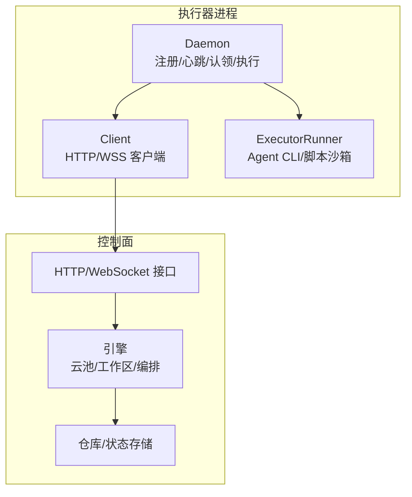
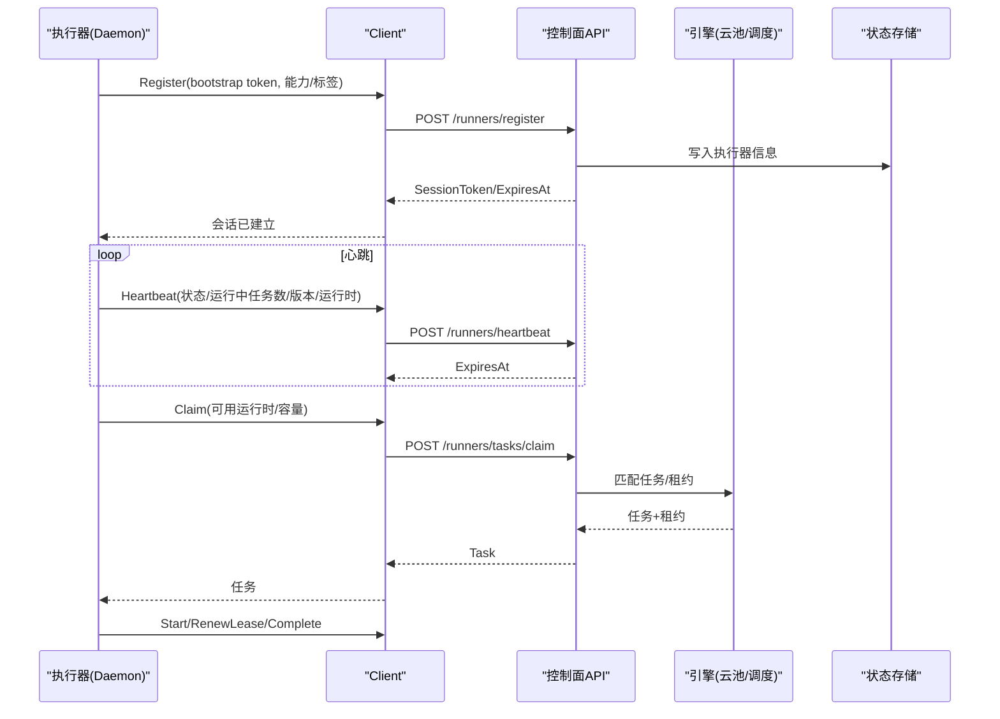
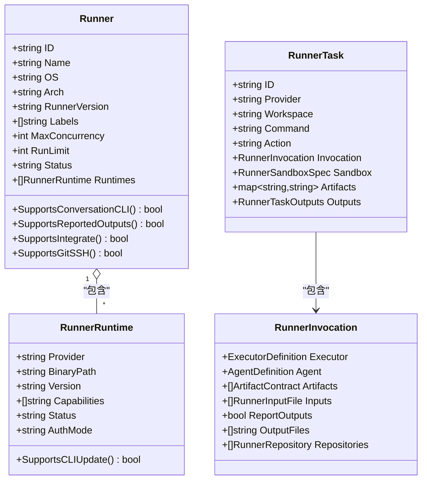
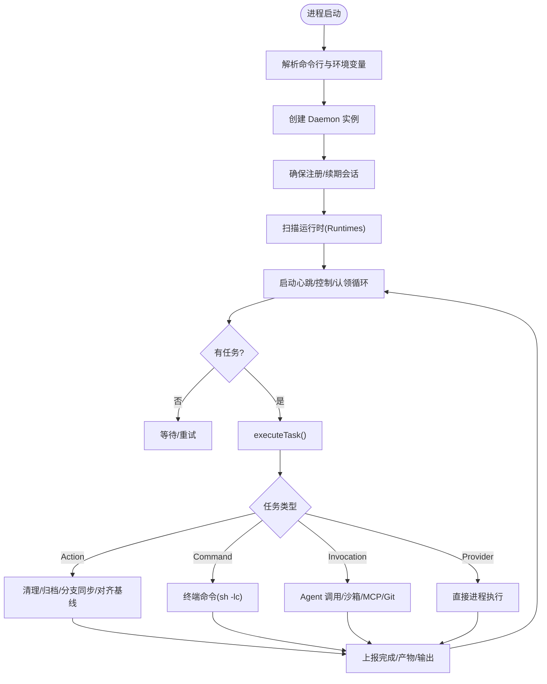
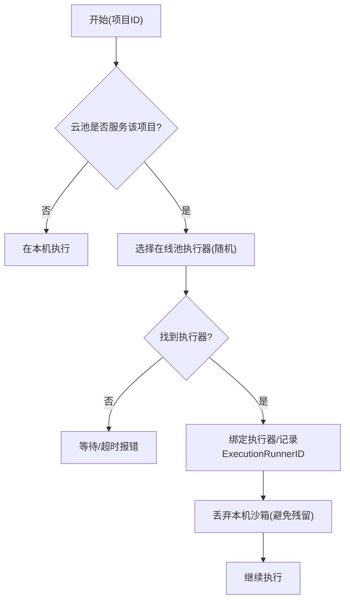
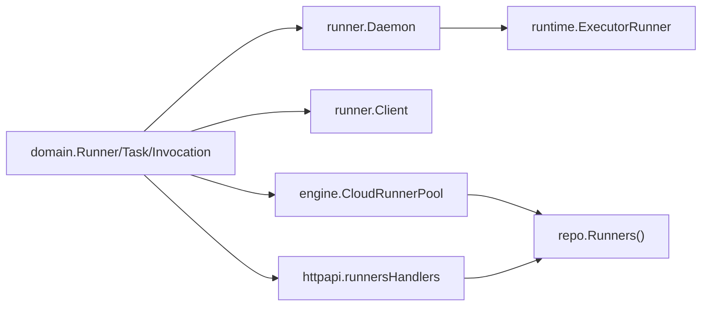

# 执行器系统

<cite>
**本文引用的文件**   
- [internal/domain/runner.go](file://internal/domain/runner.go)
- [cmd/agentflow-runner/main.go](file://cmd/agentflow-runner/main.go)
- [internal/runner/daemon.go](file://internal/runner/daemon.go)
- [internal/runner/client.go](file://internal/runner/client.go)
- [internal/engine/cloud_pool.go](file://internal/engine/cloud_pool.go)
- [internal/httpapi/runners.go](file://internal/httpapi/runners.go)
</cite>

## 目录
1. [简介](#简介)
2. [项目结构](#项目结构)
3. [核心组件](#核心组件)
4. [架构总览](#架构总览)
5. [详细组件分析](#详细组件分析)
6. [依赖关系分析](#依赖关系分析)
7. [性能与调度](#性能与调度)
8. [故障恢复与可观测性](#故障恢复与可观测性)
9. [配置与部署](#配置与部署)
10. [自定义执行器开发指南](#自定义执行器开发指南)
11. [排障指南](#排障指南)
12. [结论](#结论)

## 简介
本文件系统性地梳理 LoopForge 的执行器（Runner）体系，覆盖以下主题：
- 执行器的概念、角色与生命周期
- 支持的执行环境：本地机器、Docker 隔离、云端执行池
- 执行器的注册、心跳、发现与绑定机制
- 执行环境选择策略与资源分配
- 任务调度、租约与并发控制
- 配置项、监控指标与可观测性
- 故障恢复与自动更新
- 自定义执行器扩展点与集成示例

## 项目结构
执行器系统由“控制面 + 执行器进程”两部分组成：
- 控制面负责注册、调度、状态持久化、云池路由与事件桥接
- 执行器是运行在用户机器或 CVM 上的长驻守护进程，仅发起出站 HTTPS/WSS 连接，不暴露入站端口

图表来源
- [internal/runner/daemon.go:26-62](file://internal/runner/daemon.go#L26-L62)
- [internal/runner/client.go:21-39](file://internal/runner/client.go#L21-L39)
- [internal/engine/cloud_pool.go:14-26](file://internal/engine/cloud_pool.go#L14-L26)

章节来源
- [internal/runner/daemon.go:26-62](file://internal/runner/daemon.go#L26-L62)
- [internal/runner/client.go:21-39](file://internal/runner/client.go#L21-L39)
- [internal/engine/cloud_pool.go:14-26](file://internal/engine/cloud_pool.go#L14-L26)

## 核心组件
- Runner 领域模型：描述执行器身份、能力、运行时、任务、工作区与产物等
- Runner Daemon：执行器守护进程，负责注册、心跳、任务认领与执行
- Runner Client：封装与控制面的 HTTP/WSS 通信
- Cloud Runner Pool：云端执行池路由与绑定逻辑
- HTTP API：执行器注册、绑定码、心跳、任务认领等接口

章节来源
- [internal/domain/runner.go:147-168](file://internal/domain/runner.go#L147-L168)
- [internal/runner/daemon.go:26-62](file://internal/runner/daemon.go#L26-L62)
- [internal/runner/client.go:27-39](file://internal/runner/client.go#L27-L39)
- [internal/engine/cloud_pool.go:22-26](file://internal/engine/cloud_pool.go#L22-L26)
- [internal/httpapi/runners.go:538-633](file://internal/httpapi/runners.go#L538-L633)

## 架构总览
执行器采用“控制面调度 + 执行器拉取”的异步模式。执行器通过长轮询领取任务，使用租约保活；控制面维护执行器在线状态、标签与能力，并可将特定项目的工作路由到云端执行池。

图表来源
- [internal/runner/client.go:124-151](file://internal/runner/client.go#L124-L151)
- [internal/runner/client.go:164-170](file://internal/runner/client.go#L164-L170)
- [internal/runner/client.go:211-222](file://internal/runner/client.go#L211-L222)
- [internal/runner/client.go:224-239](file://internal/runner/client.go#L224-L239)
- [internal/runner/client.go:298-300](file://internal/runner/client.go#L298-L300)

## 详细组件分析

### Runner 领域模型与能力矩阵
Runner 模型承载执行器元数据、运行时、任务与工作区语义，并通过版本能力开关实现向后兼容。关键要点：
- 状态：online/offline；任务状态：queued/leased/running/success/failed/canceled
- 能力探测：是否支持对话 CLI、Git SSH、共享推送、工作区准备、输出上报等
- 认证模式：local/personal，按 Provider 与运行时配置决定
- 任务载荷：Invocation、Command、Action、Sandbox、Artifacts、Outputs 等

图表来源
- [internal/domain/runner.go:147-168](file://internal/domain/runner.go#L147-L168)
- [internal/domain/runner.go:327-336](file://internal/domain/runner.go#L327-L336)
- [internal/domain/runner.go:338-397](file://internal/domain/runner.go#L338-L397)
- [internal/domain/runner.go:469-530](file://internal/domain/runner.go#L469-L530)

章节来源
- [internal/domain/runner.go:20-77](file://internal/domain/runner.go#L20-L77)
- [internal/domain/runner.go:147-168](file://internal/domain/runner.go#L147-L168)
- [internal/domain/runner.go:338-397](file://internal/domain/runner.go#L338-L397)
- [internal/domain/runner.go:469-530](file://internal/domain/runner.go#L469-L530)

### 执行器守护进程（Daemon）
Daemon 是执行器进程的核心，职责包括：
- 启动参数解析与配置校验
- 注册与会话管理（持久化 state.json）
- 运行时发现（本地 CLI/受管 CLI）
- 心跳循环、控制通道、任务认领循环
- 任务执行：Agent 调用、脚本命令、内置 Action（清理、归档、分支同步、合并基线等）
- 沙箱与 MCP/Git 凭据准备、工作区栅栏与输出收集

图表来源
- [cmd/agentflow-runner/main.go:23-78](file://cmd/agentflow-runner/main.go#L23-L78)
- [internal/runner/daemon.go:101-139](file://internal/runner/daemon.go#L101-L139)
- [internal/runner/daemon.go:148-180](file://internal/runner/daemon.go#L148-L180)
- [internal/runner/daemon.go:527-607](file://internal/runner/daemon.go#L527-L607)

章节来源
- [cmd/agentflow-runner/main.go:23-78](file://cmd/agentflow-runner/main.go#L23-L78)
- [internal/runner/daemon.go:64-85](file://internal/runner/daemon.go#L64-L85)
- [internal/runner/daemon.go:101-139](file://internal/runner/daemon.go#L101-L139)
- [internal/runner/daemon.go:148-180](file://internal/runner/daemon.go#L148-L180)
- [internal/runner/daemon.go:527-607](file://internal/runner/daemon.go#L527-L607)

### 执行器客户端（Client）
Client 封装所有与控制面的出站通信：
- Register/Heartbeat/Disconnect/Deregister
- 任务认领：WaitForTask/Claim
- 任务控制：Start/RenewLease/TaskControl
- 事件上报：SendEvents
- 预览上传：UploadPreview/CompletePreview
- WebSocket 控制通道：OpenControl

错误处理：
- 统一返回 ErrUnauthorized（会话失效需重新注册）
- 任务租约丢失时返回 ErrTaskLeaseLost

章节来源
- [internal/runner/client.go:21-39](file://internal/runner/client.go#L21-L39)
- [internal/runner/client.go:55-101](file://internal/runner/client.go#L55-L101)
- [internal/runner/client.go:124-151](file://internal/runner/client.go#L124-L151)
- [internal/runner/client.go:164-170](file://internal/runner/client.go#L164-L170)
- [internal/runner/client.go:211-222](file://internal/runner/client.go#L211-L222)
- [internal/runner/client.go:224-239](file://internal/runner/client.go#L224-L239)
- [internal/runner/client.go:249-283](file://internal/runner/client.go#L249-L283)
- [internal/runner/client.go:285-327](file://internal/runner/client.go#L285-L327)

### 云端执行池（Cloud Runner Pool）
云端执行池用于将无默认执行机器的用户任务路由到平台侧带 Label 的执行器，支持：
- 项目级白名单（* 表示全部）
- Required 模式：强制走云端，本机不执行
- 随机选择在线且具备能力的执行器
- 绑定与重绑定：当原执行器离线但工作区存在时，等待原机器恢复；否则切换到新机器并提示

图表来源
- [internal/engine/cloud_pool.go:50-61](file://internal/engine/cloud_pool.go#L50-L61)
- [internal/engine/cloud_pool.go:85-118](file://internal/engine/cloud_pool.go#L85-L118)
- [internal/engine/cloud_pool.go:159-259](file://internal/engine/cloud_pool.go#L159-L259)

章节来源
- [internal/engine/cloud_pool.go:14-26](file://internal/engine/cloud_pool.go#L14-L26)
- [internal/engine/cloud_pool.go:50-61](file://internal/engine/cloud_pool.go#L50-L61)
- [internal/engine/cloud_pool.go:85-118](file://internal/engine/cloud_pool.go#L85-L118)
- [internal/engine/cloud_pool.go:159-259](file://internal/engine/cloud_pool.go#L159-L259)

### 执行器注册与发现
- 注册入口：/runners/register，支持一次性绑定码、服务器引导令牌、用户个人令牌三种方式
- 绑定码流程：用户在控制台生成一次性码，执行器使用该码注册并绑定到该用户
- 心跳：/runners/heartbeat，上报状态、运行中任务数、版本与运行时
- 断开/注销：/runners/disconnect（保留注册）、/runners/deregister（彻底移除）

章节来源
- [internal/httpapi/runners.go:494-536](file://internal/httpapi/runners.go#L494-L536)
- [internal/httpapi/runners.go:538-633](file://internal/httpapi/runners.go#L538-L633)

## 依赖关系分析
- Runner 领域模型被 Daemon、Client、Engine、HTTP API 共同引用
- Daemon 依赖 runtime.ExecutorRunner 执行 Agent CLI 与脚本
- Engine 通过 Repository 访问执行器列表与状态，进行云池路由
- HTTP API 提供外部管理接口，内部委托 Engine 与 Repository

图表来源
- [internal/domain/runner.go:147-168](file://internal/domain/runner.go#L147-L168)
- [internal/runner/daemon.go:26-62](file://internal/runner/daemon.go#L26-L62)
- [internal/runner/client.go:27-39](file://internal/runner/client.go#L27-L39)
- [internal/engine/cloud_pool.go:50-61](file://internal/engine/cloud_pool.go#L50-L61)
- [internal/httpapi/runners.go:538-633](file://internal/httpapi/runners.go#L538-L633)

章节来源
- [internal/domain/runner.go:147-168](file://internal/domain/runner.go#L147-L168)
- [internal/runner/daemon.go:26-62](file://internal/runner/daemon.go#L26-L62)
- [internal/runner/client.go:27-39](file://internal/runner/client.go#L27-L39)
- [internal/engine/cloud_pool.go:50-61](file://internal/engine/cloud_pool.go#L50-L61)
- [internal/httpapi/runners.go:538-633](file://internal/httpapi/runners.go#L538-L633)

## 性能与调度
- 并发控制
  - 执行器侧：MaxConcurrency 限制同时运行的任务数，默认 1，上限 32
  - 认领循环根据当前运行中任务数计算剩余容量
- 任务租约
  - 认领后持有租约，定期续租；若租约丢失则放弃任务
- 沙箱复用
  - 可按运行定义复用沙箱，减少容器/隔离层开销
- 云池选择
  - 在线池执行器随机选择，要求具备输出上报与合并能力，且为平台引导令牌注册（非用户私有机器）

章节来源
- [cmd/agentflow-runner/main.go:32-37](file://cmd/agentflow-runner/main.go#L32-L37)
- [internal/runner/daemon.go:117-122](file://internal/runner/daemon.go#L117-L122)
- [internal/runner/daemon.go:429-489](file://internal/runner/daemon.go#L429-L489)
- [internal/engine/cloud_pool.go:105-118](file://internal/engine/cloud_pool.go#L105-L118)

## 故障恢复与可观测性
- 会话失效
  - 心跳或认领返回未授权时自动重新注册
- 任务中断
  - 通过租约续期与 DesiredState（取消、清理、归档、分支同步、对齐基线）维持可控恢复
- 工作区栅栏
  - 对每个 run 加读锁，防止并发写冲突
- 自动更新
  - 认领前检查更新，准备好新版本后优雅退出并由主进程重启
- 事件上报
  - 标准事件流（stdout/stderr/system/observation），序列号去重

章节来源
- [internal/runner/daemon.go:390-425](file://internal/runner/daemon.go#L390-L425)
- [internal/runner/daemon.go:429-489](file://internal/runner/daemon.go#L429-L489)
- [internal/runner/daemon.go:527-607](file://internal/runner/daemon.go#L527-L607)
- [internal/runner/client.go:285-300](file://internal/runner/client.go#L285-L300)

## 配置与部署
- 命令行参数与环境变量
  - server/token/name/state/workspace/concurrency/heartbeat/long-poll/auto-update/labels/reuse-run-sandbox
  - AGENTFLOW_SERVER_URL、AGENTFLOW_RUNNER_BOOTSTRAP_TOKEN、AGENTFLOW_RUNNER_STATE_PATH、AGENTFLOW_RUNNER_NAME、AGENTFLOW_RUNNER_WORKSPACE、AGENTFLOW_RUNNER_CONCURRENCY、AGENTFLOW_MANAGED_CLI_ROOT
- 执行器配置对象
  - ServerURL、BootstrapToken、StatePath、Name、Labels、MaxConcurrency、DefaultWorkspaceRoot、HeartbeatInterval、LongPollTimeout、DisableAutoUpdate、ManagedCLIRoot、DisableRunSandboxReuse

章节来源
- [cmd/agentflow-runner/main.go:27-55](file://cmd/agentflow-runner/main.go#L27-L55)
- [cmd/agentflow-runner/main.go:80-101](file://cmd/agentflow-runner/main.go#L80-L101)
- [internal/runner/daemon.go:64-85](file://internal/runner/daemon.go#L64-L85)

## 自定义执行器开发指南
本节面向希望扩展执行环境的开发者，给出基于现有 Runner 协议的集成思路与步骤。

- 目标
  - 在不修改控制面的前提下，通过 Runner 协议接入新的执行后端（例如第三方容器平台、远程作业系统）
- 基本步骤
  1) 实现 Runner 端
     - 实现注册、心跳、认领、任务执行、事件上报、完成上报
     - 支持必要的 Action（如清理、归档、分支同步、对齐基线）
     - 支持沙箱与 MCP/Git 凭据注入
  2) 对接控制面
     - 使用 Runner Client 提供的 Register/Heartbeat/Claim/Complete 等接口
     - 通过 WebSocket 控制通道接收取消/清理等指令
  3) 适配云池
     - 如需加入云端执行池，需在注册时携带 Label，并确保具备 ReportedOutputs 与 Integrate 能力
  4) 安全与权限
     - 使用一次性绑定码或服务器引导令牌完成注册
     - 敏感凭据仅在内存中使用，完成后清理
- 参考路径
  - 执行器进程入口与配置：[cmd/agentflow-runner/main.go:23-78](file://cmd/agentflow-runner/main.go#L23-L78)
  - 守护进程生命周期与任务分发：[internal/runner/daemon.go:148-180](file://internal/runner/daemon.go#L148-L180)、[internal/runner/daemon.go:527-607](file://internal/runner/daemon.go#L527-L607)
  - 控制面通信接口：[internal/runner/client.go:124-151](file://internal/runner/client.go#L124-L151)、[internal/runner/client.go:211-222](file://internal/runner/client.go#L211-L222)、[internal/runner/client.go:285-300](file://internal/runner/client.go#L285-L300)
  - 云池路由与能力要求：[internal/engine/cloud_pool.go:105-118](file://internal/engine/cloud_pool.go#L105-L118)

章节来源
- [cmd/agentflow-runner/main.go:23-78](file://cmd/agentflow-runner/main.go#L23-L78)
- [internal/runner/daemon.go:148-180](file://internal/runner/daemon.go#L148-L180)
- [internal/runner/daemon.go:527-607](file://internal/runner/daemon.go#L527-L607)
- [internal/runner/client.go:124-151](file://internal/runner/client.go#L124-L151)
- [internal/runner/client.go:211-222](file://internal/runner/client.go#L211-L222)
- [internal/runner/client.go:285-300](file://internal/runner/client.go#L285-L300)
- [internal/engine/cloud_pool.go:105-118](file://internal/engine/cloud_pool.go#L105-L118)

## 排障指南
- 无法注册
  - 检查 bootstrap token 或一次性绑定码是否有效
  - 确认 server URL 与网络可达
  - 参考注册接口与错误响应
- 心跳失败/显示离线
  - 检查会话是否过期，Daemon 会自动重新注册
  - 关注心跳间隔与长轮询超时设置
- 任务认领不到
  - 确认执行器已报告可用的 Provider/Runtime
  - 检查云池是否启用且 Label 匹配
- 任务执行失败
  - 查看事件上报与错误字段
  - 检查沙箱创建、MCP/Git 凭据注入是否成功
- 云端执行池不可用
  - 检查云池配置与在线执行器数量
  - 观察绑定等待与切换日志

章节来源
- [internal/httpapi/runners.go:538-633](file://internal/httpapi/runners.go#L538-L633)
- [internal/runner/daemon.go:390-425](file://internal/runner/daemon.go#L390-L425)
- [internal/runner/daemon.go:429-489](file://internal/runner/daemon.go#L429-L489)
- [internal/engine/cloud_pool.go:159-259](file://internal/engine/cloud_pool.go#L159-L259)

## 结论
LoopForge 的执行器系统以“控制面调度 + 执行器拉取”为核心，通过 Runner 领域模型与 Daemon/Client 协作，实现了本地、Docker 与云端执行池的统一抽象。其设计强调：
- 安全性：仅出站连接、凭据最小化暴露
- 可靠性：会话与租约机制、事件去重、工作区栅栏
- 可扩展性：版本能力开关、Action 扩展点、云池标签路由
- 可观测性：心跳、事件流、云端绑定与切换日志

通过这些机制，系统能够在多执行环境下稳定地调度与执行复杂工作流任务，并为后续扩展与运维提供了清晰的边界与工具链。