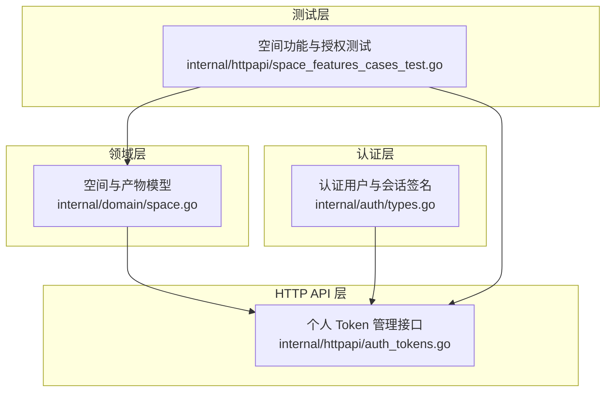
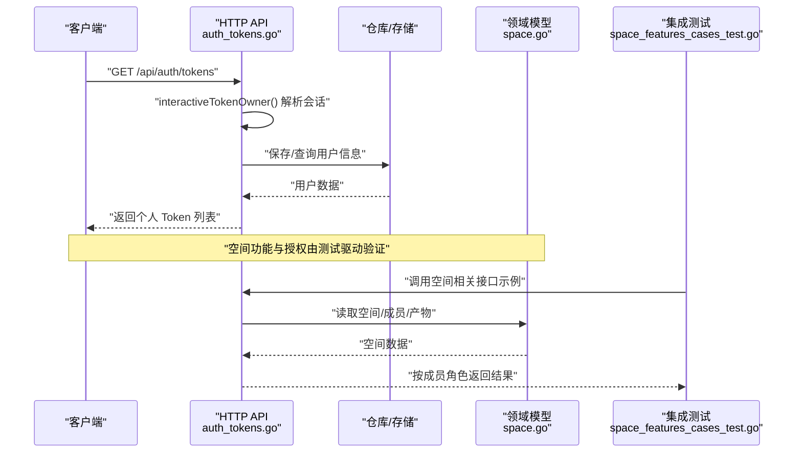
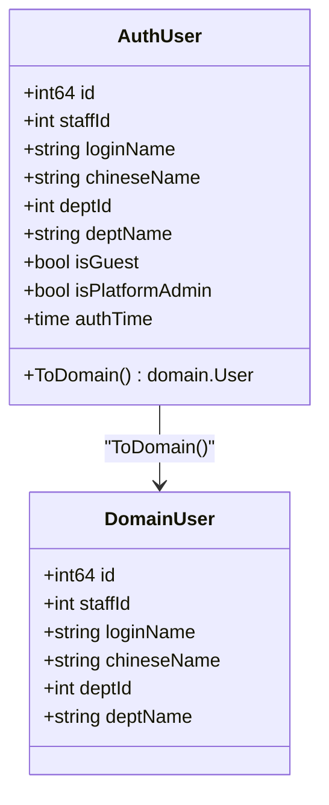
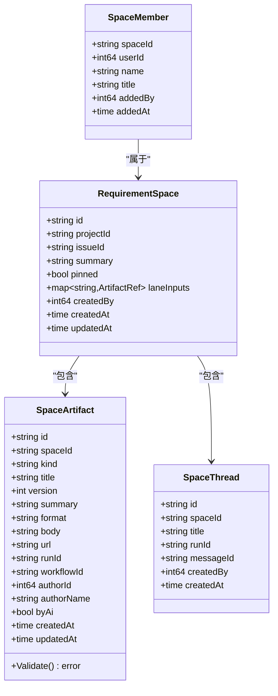
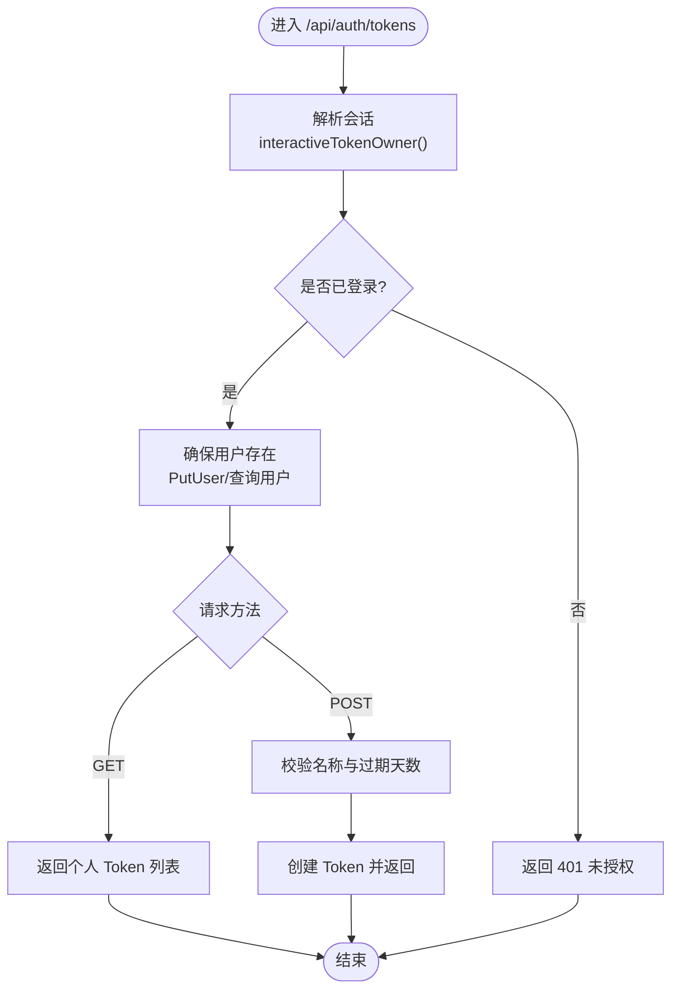
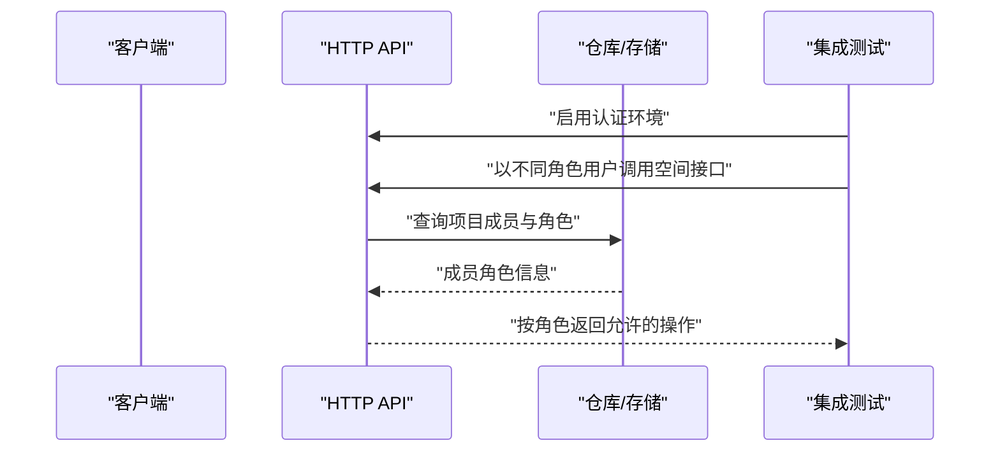
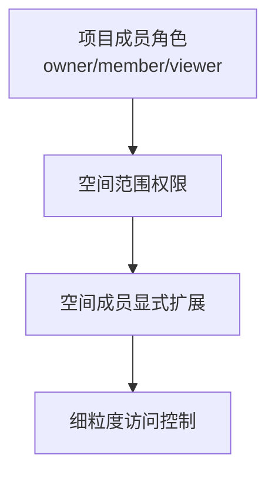
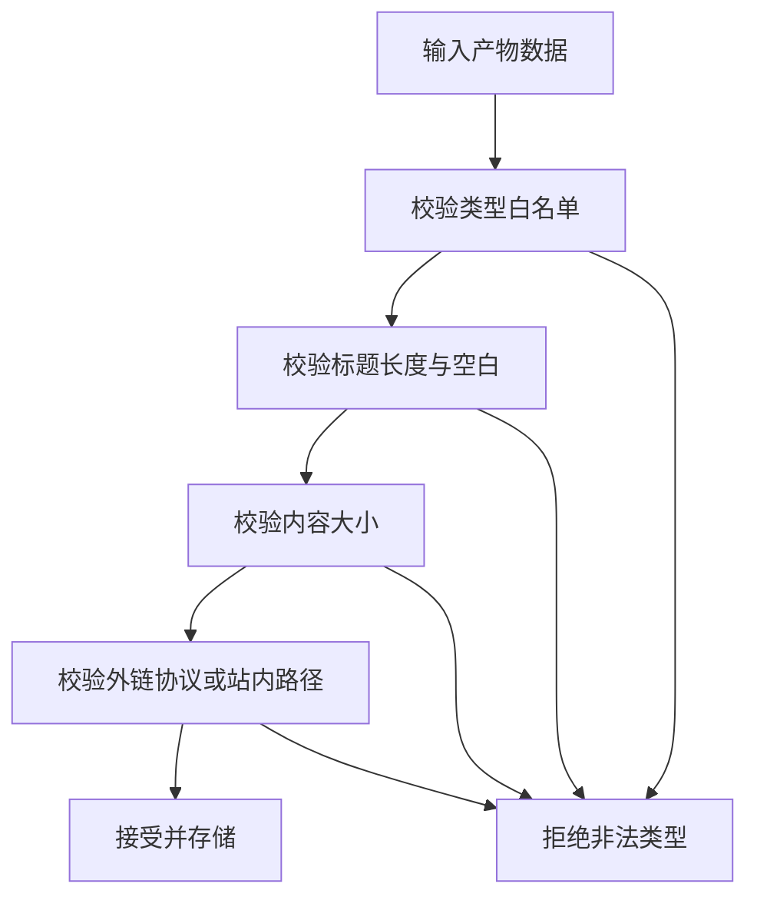
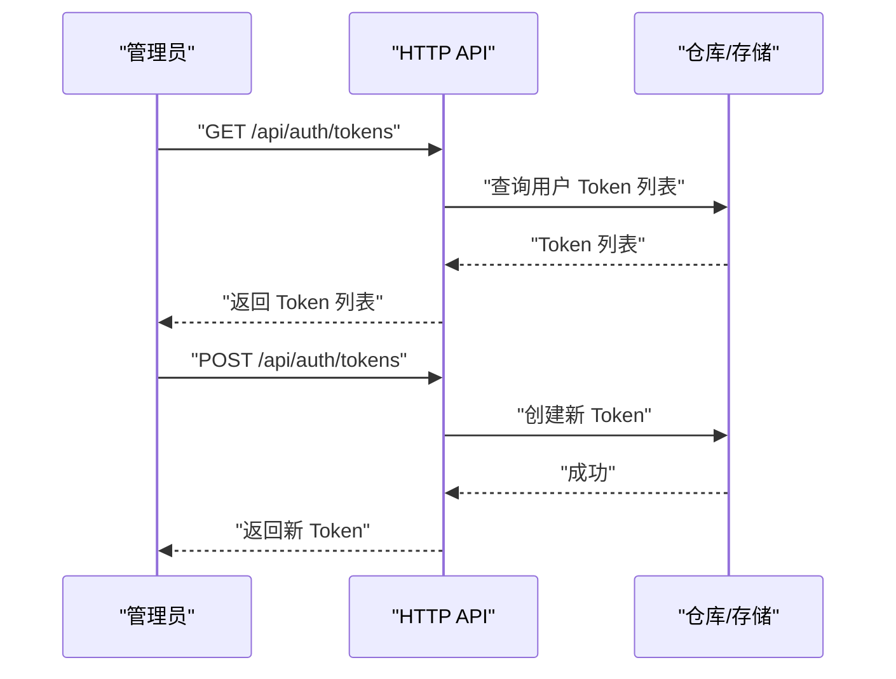
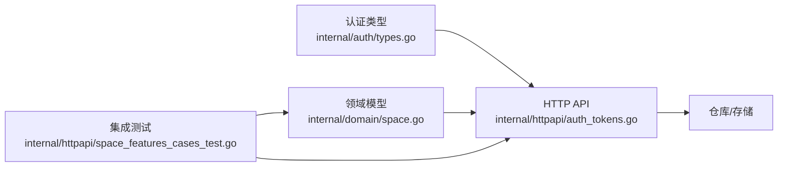

# 权限模型

<cite>
**本文引用的文件**   
- [internal/domain/space.go](file://internal/domain/space.go)
- [internal/auth/types.go](file://internal/auth/types.go)
- [internal/httpapi/auth_tokens.go](file://internal/httpapi/auth_tokens.go)
- [internal/httpapi/space_features_cases_test.go](file://internal/httpapi/space_features_cases_test.go)
</cite>

## 目录
1. [引言](#引言)
2. [项目结构](#项目结构)
3. [核心组件](#核心组件)
4. [架构总览](#架构总览)
5. [详细组件分析](#详细组件分析)
6. [依赖关系分析](#依赖关系分析)
7. [性能考虑](#性能考虑)
8. [故障排查指南](#故障排查指南)
9. [结论](#结论)
10. [附录](#附录)

## 引言
本文件系统化梳理 LoopForge 的权限模型，围绕用户角色体系、空间（Space）权限边界、细粒度访问控制策略展开，覆盖认证流程、授权检查机制、API 级别权限验证、权限继承规则、批量权限管理与审计日志记录，并给出权限配置最佳实践与安全建议。文档面向不同技术背景的读者，既提供高层概览，也深入到具体实现与测试用例所体现的行为。

## 项目结构
与权限模型直接相关的代码主要分布在以下模块：
- 领域模型：空间、成员、产物等实体定义
- 认证类型与会话签名：用户身份结构与签名校验
- HTTP API：个人 Token 管理接口与平台管理员判定
- 集成测试：空间功能生命周期与授权行为验证

**图表来源**
- [internal/domain/space.go:1-128](file://internal/domain/space.go#L1-L128)
- [internal/auth/types.go:1-111](file://internal/auth/types.go#L1-L111)
- [internal/httpapi/auth_tokens.go:194-240](file://internal/httpapi/auth_tokens.go#L194-L240)
- [internal/httpapi/space_features_cases_test.go:19-40](file://internal/httpapi/space_features_cases_test.go#L19-L40)

**章节来源**
- [internal/domain/space.go:1-128](file://internal/domain/space.go#L1-L128)
- [internal/auth/types.go:1-111](file://internal/auth/types.go#L1-L111)
- [internal/httpapi/auth_tokens.go:194-240](file://internal/httpapi/auth_tokens.go#L194-L240)
- [internal/httpapi/space_features_cases_test.go:19-40](file://internal/httpapi/space_features_cases_test.go#L19-L40)

## 核心组件
- 用户与角色
  - 认证层定义了当前登录或降级后的员工身份，包含用户标识、部门信息、访客标记、平台管理员标记等字段，并提供将认证用户转换为持久化领域用户的工具方法。
  - 平台管理员判定在 HTTP API 层通过仓库接口或白名单进行判断，用于控制敏感能力。
- 空间（Space）与成员
  - 领域层定义了需求空间、空间成员、空间产物、空间线程等实体，明确空间是“带有工作态的会话”，可关联平台需求、版本化产物和 SOP 运行。
  - 空间成员表示在空间中协作的人员及其可见职位信息。
- 个人 Token 管理
  - HTTP API 暴露了获取与创建个人 Token 的接口，要求交互式登录用户身份，并对名称长度、过期天数等进行校验。

**章节来源**
- [internal/auth/types.go:17-44](file://internal/auth/types.go#L17-L44)
- [internal/httpapi/auth_tokens.go:194-240](file://internal/httpapi/auth_tokens.go#L194-L240)
- [internal/domain/space.go:15-45](file://internal/domain/space.go#L15-L45)

## 架构总览
下图展示认证与授权在系统中的关键路径：浏览器/客户端发起请求，HTTP API 解析并校验会话，必要时落库用户信息；Token 管理接口对交互式用户进行鉴权；空间相关能力由领域模型承载并由测试用例验证授权边界。

**图表来源**
- [internal/httpapi/auth_tokens.go:203-240](file://internal/httpapi/auth_tokens.go#L203-L240)
- [internal/domain/space.go:15-45](file://internal/domain/space.go#L15-L45)
- [internal/httpapi/space_features_cases_test.go:19-40](file://internal/httpapi/space_features_cases_test.go#L19-L40)

## 详细组件分析

### 用户与角色体系
- 认证用户结构
  - 包含用户 ID、工号、登录名、中文名、部门信息与访客标记，以及平台管理员标记与认证时间戳。
  - 提供 ToDomain 方法将认证用户映射为领域层用户实体，便于持久化与后续权限计算。
- 平台管理员判定
  - HTTP API 层通过仓库接口或白名单判定用户是否为平台管理员，用于限制高权限操作。

**图表来源**
- [internal/auth/types.go:17-44](file://internal/auth/types.go#L17-L44)

**章节来源**
- [internal/auth/types.go:17-44](file://internal/auth/types.go#L17-L44)
- [internal/httpapi/auth_tokens.go:194-198](file://internal/httpapi/auth_tokens.go#L194-L198)

### 空间（Space）权限边界
- 空间概念
  - 空间是“带有工作态的会话”，可关联平台需求、拥有版本化产物、侧线程与 SOP 运行。
- 成员与可见性
  - 空间成员包含用户 ID、姓名、可见职位、添加人与添加时间，用于表达谁在空间中协作以及其可见信息。
- 产物与线程
  - 空间产物支持多种类型（文档、原型、API、差异、报告、PPT、SOP、浏览器、文件），并具备标题、内容、外链、作者等信息与校验逻辑。
  - 空间线程用于组织讨论或 SOP 流程，独立于主时间线。

**图表来源**
- [internal/domain/space.go:15-45](file://internal/domain/space.go#L15-L45)
- [internal/domain/space.go:61-98](file://internal/domain/space.go#L61-L98)
- [internal/domain/space.go:100-110](file://internal/domain/space.go#L100-L110)

**章节来源**
- [internal/domain/space.go:15-45](file://internal/domain/space.go#L15-L45)
- [internal/domain/space.go:61-98](file://internal/domain/space.go#L61-L98)
- [internal/domain/space.go:100-110](file://internal/domain/space.go#L100-L110)

### 认证流程
- 会话解析与交互式用户
  - HTTP API 使用 interactiveTokenOwner 解析会话，若未登录则返回未授权响应。
  - 首次登录的用户会被保存到存储中，随后根据登录名回填用户 ID。
- 个人 Token 管理
  - GET 返回当前用户的 Token 列表。
  - POST 创建新 Token，需校验名称非空且不超过字符上限，并可设置过期天数。

**图表来源**
- [internal/httpapi/auth_tokens.go:203-240](file://internal/httpapi/auth_tokens.go#L203-L240)

**章节来源**
- [internal/httpapi/auth_tokens.go:203-240](file://internal/httpapi/auth_tokens.go#L203-L240)

### 授权检查机制与 API 级别权限验证
- 交互式用户强制校验
  - 所有个人 Token 管理操作均要求交互式登录用户，未登录直接拒绝。
- 平台管理员判定
  - 通过仓库接口或白名单判定平台管理员，用于限制高权限能力。
- 空间功能授权
  - 集成测试设置了 AGENTFLOW_AUTH_REQUIRED=true，并以 owner/member/viewer/outsider 四类用户构造项目成员关系，验证空间功能的生命周期与授权边界。

**图表来源**
- [internal/httpapi/space_features_cases_test.go:19-40](file://internal/httpapi/space_features_cases_test.go#L19-L40)
- [internal/httpapi/auth_tokens.go:194-198](file://internal/httpapi/auth_tokens.go#L194-L198)

**章节来源**
- [internal/httpapi/space_features_cases_test.go:19-40](file://internal/httpapi/space_features_cases_test.go#L19-L40)
- [internal/httpapi/auth_tokens.go:194-198](file://internal/httpapi/auth_tokens.go#L194-L198)

### 权限继承规则
- 基于项目的成员角色继承到空间
  - 测试用例中以项目成员角色（owner/member/viewer）作为基础，验证空间功能在不同角色下的可用性与边界。
- 空间内成员的显式扩展
  - 领域模型中的 SpaceMember 允许在空间层面进一步指定成员与其可见职位，形成从项目到空间的权限叠加。

**图表来源**
- [internal/httpapi/space_features_cases_test.go:31-33](file://internal/httpapi/space_features_cases_test.go#L31-L33)
- [internal/domain/space.go:37-45](file://internal/domain/space.go#L37-L45)

**章节来源**
- [internal/httpapi/space_features_cases_test.go:31-33](file://internal/httpapi/space_features_cases_test.go#L31-L33)
- [internal/domain/space.go:37-45](file://internal/domain/space.go#L37-L45)

### 细粒度的访问控制策略
- 产物校验与类型白名单
  - 空间产物支持多种类型，并通过 ValidSpaceArtifactKind 进行白名单校验，防止非法类型写入。
- 内容与链接安全
  - 产物标题长度、内容大小、外链协议与站内路径均有校验，避免注入与越界存储。
- 成员可见性
  - SpaceMember 的 title 字段用于展示可见职位，结合空间上下文控制信息的可见范围。

**图表来源**
- [internal/domain/space.go:47-53](file://internal/domain/space.go#L47-L53)
- [internal/domain/space.go:80-98](file://internal/domain/space.go#L80-L98)

**章节来源**
- [internal/domain/space.go:47-53](file://internal/domain/space.go#L47-L53)
- [internal/domain/space.go:80-98](file://internal/domain/space.go#L80-L98)

### 批量权限管理
- 个人 Token 批量管理
  - 通过 GET 列出当前用户的所有 Token，POST 创建新的 Token，便于集中管理个人凭证。
- 项目成员批量维护
  - 测试用例中以项目成员数组形式初始化成员与角色，体现批量维护成员关系的模式。

**图表来源**
- [internal/httpapi/auth_tokens.go:203-240](file://internal/httpapi/auth_tokens.go#L203-L240)

**章节来源**
- [internal/httpapi/auth_tokens.go:203-240](file://internal/httpapi/auth_tokens.go#L203-L240)

### 审计日志记录
- 当前代码片段未直接展示审计日志写入逻辑。建议在以下关键点增加审计记录：
  - 用户登录与会话创建
  - 个人 Token 的创建、删除与更新
  - 空间成员的增加、移除与角色变更
  - 平台管理员判定的变更
- 审计事件应包含操作者、时间、资源标识、动作类型、结果与原因，以便追踪与合规审查。

[本节为通用建议，不直接分析具体文件]

## 依赖关系分析
- 组件耦合
  - HTTP API 层依赖认证类型与领域模型，负责解析会话、校验输入、调用仓库与返回结果。
  - 领域模型提供空间、成员、产物的数据结构与校验逻辑，被 API 与测试共同使用。
- 外部依赖
  - 仓库接口用于用户与 Token 的持久化，以及平台管理员判定。
  - 测试依赖环境变量 AGENTFLOW_AUTH_REQUIRED 开启认证场景。

**图表来源**
- [internal/auth/types.go:1-111](file://internal/auth/types.go#L1-L111)
- [internal/domain/space.go:1-128](file://internal/domain/space.go#L1-L128)
- [internal/httpapi/auth_tokens.go:194-240](file://internal/httpapi/auth_tokens.go#L194-L240)
- [internal/httpapi/space_features_cases_test.go:19-40](file://internal/httpapi/space_features_cases_test.go#L19-L40)

**章节来源**
- [internal/auth/types.go:1-111](file://internal/auth/types.go#L1-L111)
- [internal/domain/space.go:1-128](file://internal/domain/space.go#L1-L128)
- [internal/httpapi/auth_tokens.go:194-240](file://internal/httpapi/auth_tokens.go#L194-L240)
- [internal/httpapi/space_features_cases_test.go:19-40](file://internal/httpapi/space_features_cases_test.go#L19-L40)

## 性能考虑
- 会话解析与用户落库
  - 首次登录用户落库可能带来额外 I/O，建议缓存用户基本信息以减少重复查询。
- Token 列表与创建
  - Token 列表查询应避免全表扫描，建议使用索引与分页；创建 Token 时注意并发冲突处理。
- 空间产物校验
  - 产物校验在入库前执行，避免无效数据进入存储；对大体积内容进行流式校验与限流。

[本节为通用建议，不直接分析具体文件]

## 故障排查指南
- 未授权错误
  - 若 /api/auth/tokens 返回未授权，检查会话是否有效、interactiveTokenOwner 是否正确解析 Cookie。
- 用户信息缺失
  - 首次登录用户 ID 为空时，确认 PutUser 与 UserByLoginName 的逻辑是否正常回填。
- 空间权限异常
  - 检查项目成员角色是否正确设置，AGENTFLOW_AUTH_REQUIRED 是否开启，以及 SpaceMember 的可见性是否符合预期。

**章节来源**
- [internal/httpapi/auth_tokens.go:203-240](file://internal/httpapi/auth_tokens.go#L203-L240)
- [internal/httpapi/space_features_cases_test.go:19-40](file://internal/httpapi/space_features_cases_test.go#L19-L40)

## 结论
LoopForge 的权限模型以认证用户为基础，通过 HTTP API 层进行会话解析与交互式用户校验，结合领域模型的空间、成员与产物定义，形成从项目到空间的权限继承与细粒度访问控制。个人 Token 管理提供了批量凭证管理能力，集成测试覆盖了空间功能的生命周期与授权边界。建议在关键操作点补充审计日志，完善权限配置的可视化与自动化校验，以提升安全性与可运维性。

[本节为总结性内容，不直接分析具体文件]

## 附录
- 权限配置最佳实践
  - 最小权限原则：仅授予完成工作所需的最小角色与空间访问。
  - 定期审计：定期审查项目成员与空间成员，清理不再需要的权限。
  - Token 生命周期：为个人 Token 设置合理过期时间，避免长期有效凭证。
  - 安全边界：严格校验产物类型、内容大小与外链协议，防止注入与越界存储。
- 安全建议
  - 会话安全：使用 HMAC-SHA256 签名保护会话，避免篡改。
  - 平台管理员：严格控制平台管理员名单，采用白名单与仓库接口双重判定。
  - 审计与监控：对所有敏感操作进行审计记录与告警，及时发现异常行为。

[本节为通用建议，不直接分析具体文件]