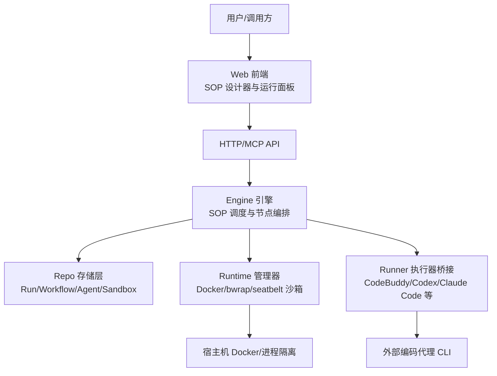
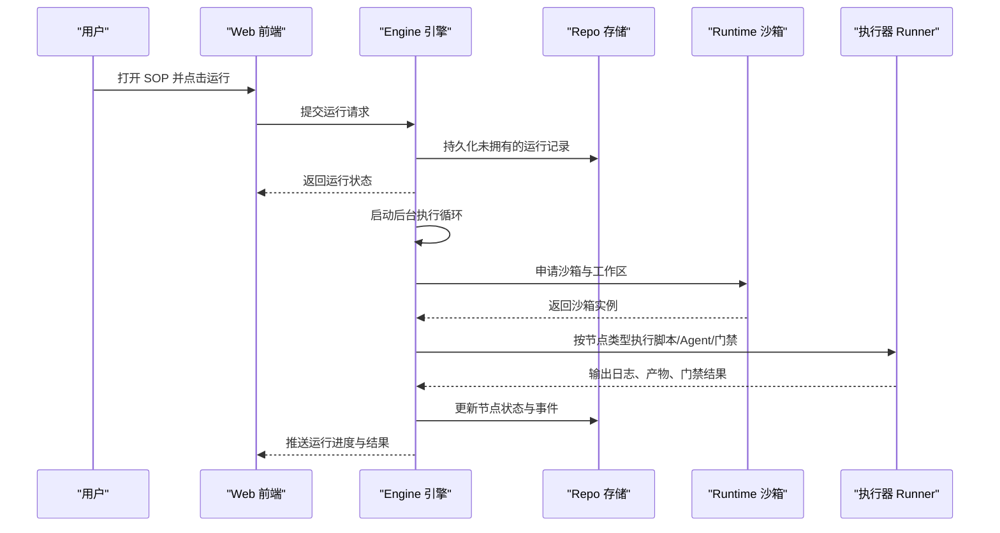
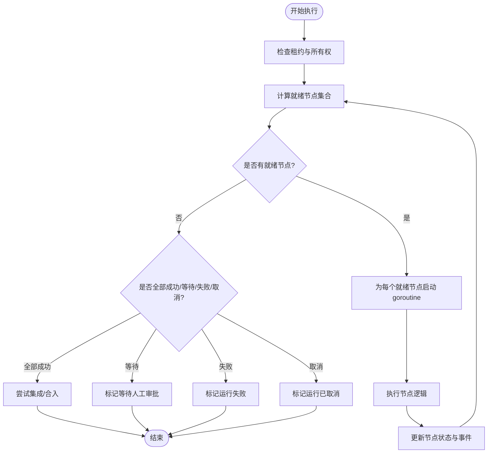
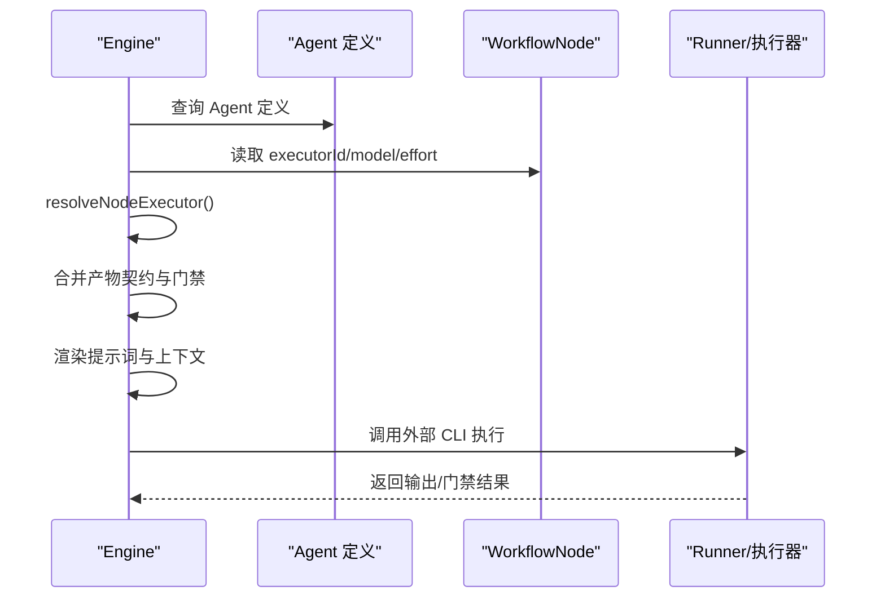
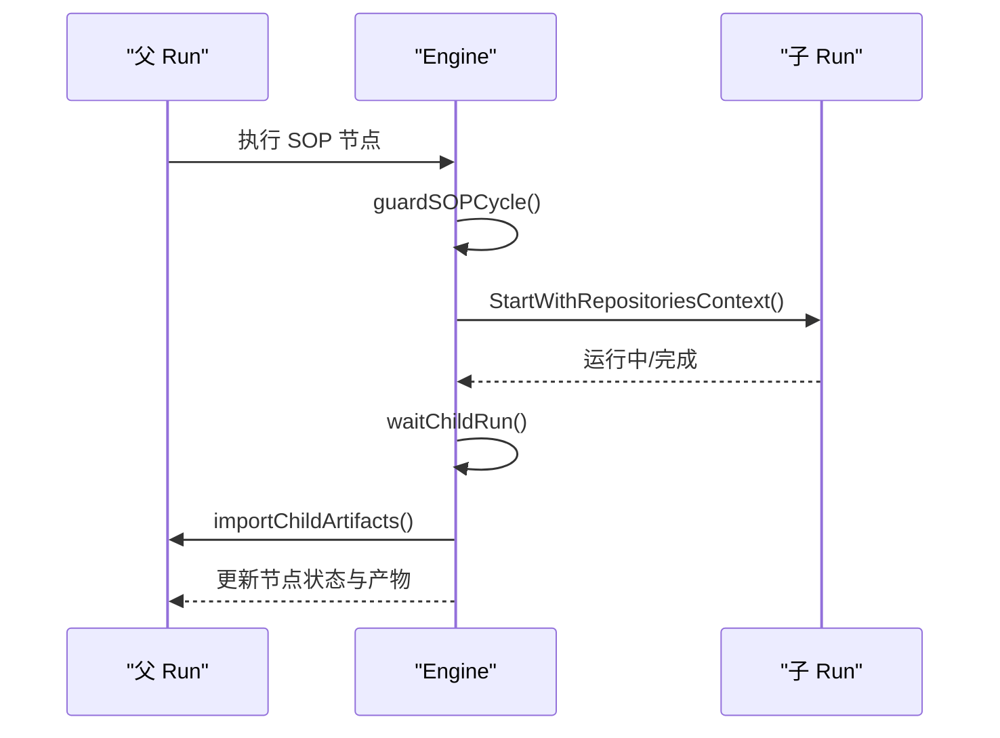
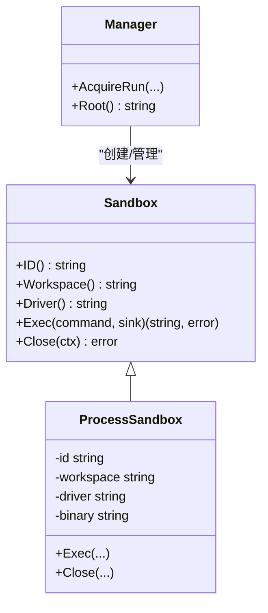
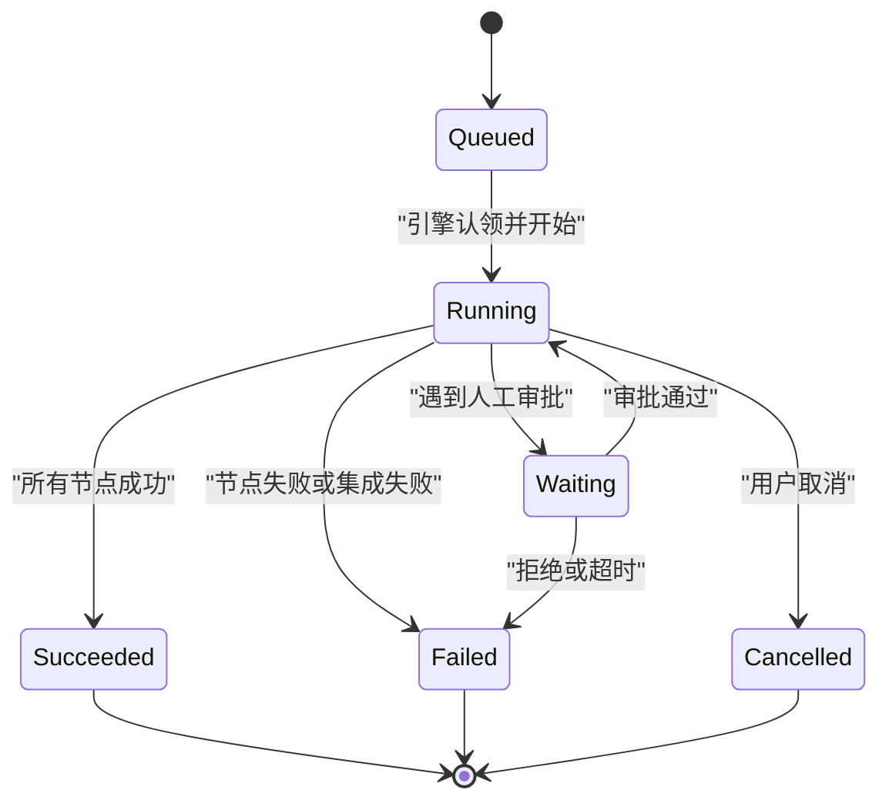
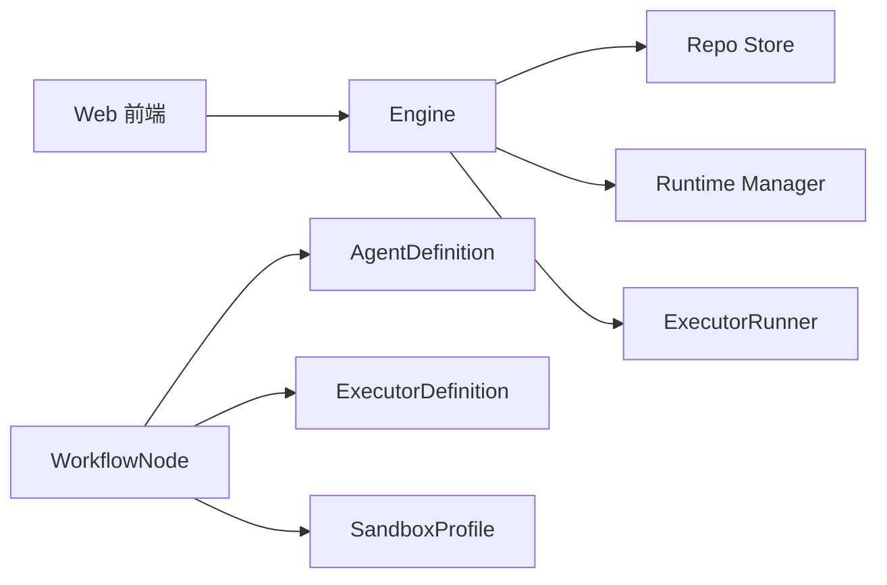

# 核心概念

<cite>
**本文引用的文件**   
- [README.md](file://README.md)
- [internal/domain/agent.go](file://internal/domain/agent.go)
- [internal/domain/workflow.go](file://internal/domain/workflow.go)
- [internal/domain/sop_lane.go](file://internal/domain/sop_lane.go)
- [internal/engine/engine.go](file://internal/engine/engine.go)
- [internal/engine/run_start.go](file://internal/engine/run_start.go)
- [internal/engine/node_execute.go](file://internal/engine/node_execute.go)
- [internal/engine/sop_node.go](file://internal/engine/sop_node.go)
- [internal/runtime/sandbox_process.go](file://internal/runtime/sandbox_process.go)
- [internal/rust/core_cases_test.go](file://internal/rust/core_cases_test.go)
- [web/index.html](file://web/index.html)
- [web/app/flows.js](file://web/app/flows.js)
</cite>

## 目录
1. [引言](#引言)
2. [项目结构](#项目结构)
3. [核心组件](#核心组件)
4. [架构总览](#架构总览)
5. [详细组件分析](#详细组件分析)
6. [依赖关系分析](#依赖关系分析)
7. [性能与可观测性](#性能与可观测性)
8. [故障排查指南](#故障排查指南)
9. [结论](#结论)

## 引言
本文件面向开发者，系统性解释 LoopForge 的核心概念：SOP（标准操作流程）、执行器（Executors）、沙箱环境（Sandboxes）、权限模型、角色（Agents）、工作流节点类型与关系、会话（Sessions）生命周期。文档以仓库中的领域模型、引擎编排、运行时沙箱和前端界面为依据，配合架构图与时序图，帮助读者从“业务意图”到“代码实现”建立完整认知。

## 项目结构
LoopForge 由后端 Go 服务、前端 Web 应用、本地 CLI 工具与文档组成。与核心概念直接相关的代码主要分布在以下位置：
- 领域模型：`internal/domain/*`，定义 Agent、Workflow、Run、SandboxProfile 等核心实体。
- 引擎编排：`internal/engine/*`，负责 SOP 调度、节点执行、子流程嵌套、门禁与重试。
- 运行时沙箱：`internal/runtime/*`，提供 Docker、bwrap、seatbelt 等隔离能力。
- 前端界面：`web/*`，提供 SOP 设计器、运行详情、审批入口等交互。
- 顶层说明：`README.md`，给出产品定位、SOP 工作方式与部署要点。

图表来源
- [internal/engine/engine.go:19-47](file://internal/engine/engine.go#L19-L47)
- [internal/engine/node_execute.go:316-444](file://internal/engine/node_execute.go#L316-L444)
- [internal/runtime/sandbox_process.go:109-127](file://internal/runtime/sandbox_process.go#L109-L127)
- [web/index.html:389-398](file://web/index.html#L389-L398)

章节来源
- [README.md:38-70](file://README.md#L38-L70)
- [internal/engine/engine.go:19-47](file://internal/engine/engine.go#L19-L47)

## 核心组件
本节聚焦五个关键概念：SOP、执行器、沙箱、权限模型、角色与工作流节点。

- SOP（标准操作流程）
  - 定义：可复用的交付流水线，包含 Agent、脚本、人工审批、子 SOP 等节点，按依赖顺序执行。
  - 数据模型：`WorkflowDefinition`、`WorkflowNode`、`WorkflowEdge`、`ArtifactContract`、`VerificationGate`。
  - 指标与分类：支持 `metricCategory`、`sopLane`、`metricStage`，用于统计与角色链归类。
  - 版本化：通过 `DefinitionRevision` 保存不可变快照，便于回滚与对比。

- 执行器（Executors）
  - 定义：封装具体编码代理 CLI 的启动参数、协议、模型与思考强度。
  - 内置清单：如 `codebuddy`、`codex`、`claude-code` 等；可通过 `ExecutorDefinition` 扩展。
  - 选择策略：优先使用 Agent 上配置的 `executorId`，其次节点级配置，最后回退默认值。

- 沙箱环境（Sandboxes）
  - 驱动：Docker、Linux bwrap、macOS seatbelt、本地进程模式。
  - 隔离：每个 Run/节点拥有独立工作区，必要时构建镜像并挂载仓库检出。
  - 资源与要求：根据节点中使用的 Agent/CLI 推导 `SandboxRequirements`。

- 权限模型
  - 账户与访问：默认面向可信团队，管理员创建后开放注册或关闭。
  - 执行上下文：`ExecutionContext` 携带项目、责任人、父 Run、工作区 RunID 等。
  - 工具与凭据：Git Token、SSH Key、MCP 服务器在沙箱内按需绑定，避免泄露。

- 角色（Agents）与工作流节点
  - Agent：可复用角色，包含 Prompt、规则、Skill、MCP、验证门禁、产物契约、循环策略等。
  - 节点类型：`agent`、`script`/`command`、`approval`、`sop`、预览构建等。
  - 关系：节点通过边连接，引擎根据依赖并发调度，失败可退回上游或重试。

章节来源
- [internal/domain/workflow.go:10-20](file://internal/domain/workflow.go#L10-L20)
- [internal/domain/workflow.go:39-73](file://internal/domain/workflow.go#L39-L73)
- [internal/domain/workflow.go:139-180](file://internal/domain/workflow.go#L139-L180)
- [internal/domain/agent.go:61-94](file://internal/domain/agent.go#L61-L94)
- [internal/domain/agent.go:134-144](file://internal/domain/agent.go#L134-L144)
- [internal/domain/sop_lane.go:5-12](file://internal/domain/sop_lane.go#L5-L12)
- [README.md:137-162](file://README.md#L137-L162)

## 架构总览
下图展示一次 SOP 运行的端到端路径：前端触发 → 引擎持久化 Run → 分配沙箱 → 调度节点 → 调用执行器 → 产出产物与事件。

图表来源
- [internal/engine/run_start.go:189-209](file://internal/engine/run_start.go#L189-L209)
- [internal/engine/node_execute.go:316-444](file://internal/engine/node_execute.go#L316-L444)
- [internal/engine/node_execute.go:584-759](file://internal/engine/node_execute.go#L584-L759)

## 详细组件分析

### SOP 与节点执行
SOP 是 LoopForge 的可复用交付流程。引擎维护一个运行主循环，持续扫描就绪节点，并发执行，并在所有分支完成后进入集成或结束阶段。

图表来源
- [internal/engine/node_execute.go:16-186](file://internal/engine/node_execute.go#L16-L186)
- [internal/engine/node_execute.go:316-444](file://internal/engine/node_execute.go#L316-L444)

章节来源
- [internal/engine/node_execute.go:16-186](file://internal/engine/node_execute.go#L16-L186)
- [internal/engine/node_execute.go:316-444](file://internal/engine/node_execute.go#L316-L444)

### 执行器解析与 Agent 调用
节点类型为 `agent` 时，引擎会：
- 解析 Agent 定义与节点配置，确定最终执行器。
- 合并产物契约与验证门禁。
- 渲染提示词，注入产物上下文与提交门禁指令。
- 通过 Runner 调用外部 CLI，或在连接执行机器模式下派发任务。

图表来源
- [internal/engine/node_execute.go:189-224](file://internal/engine/node_execute.go#L189-L224)
- [internal/engine/node_execute.go:641-759](file://internal/engine/node_execute.go#L641-L759)
- [internal/domain/agent.go:61-94](file://internal/domain/agent.go#L61-L94)

章节来源
- [internal/engine/node_execute.go:189-224](file://internal/engine/node_execute.go#L189-L224)
- [internal/engine/node_execute.go:641-759](file://internal/engine/node_execute.go#L641-L759)
- [internal/domain/agent.go:61-94](file://internal/domain/agent.go#L61-L94)

### 子 SOP 嵌套与产物交接
SOP 节点可以启动另一个 SOP，形成父子运行关系。引擎会：
- 校验循环引用与最大嵌套深度。
- 继承父 Run 的执行上下文与工作区。
- 等待子 SOP 完成，并将声明的产物导入父 Run。

图表来源
- [internal/engine/sop_node.go:18-155](file://internal/engine/sop_node.go#L18-L155)
- [internal/engine/sop_node.go:157-186](file://internal/engine/sop_node.go#L157-L186)
- [internal/engine/sop_node.go:256-307](file://internal/engine/sop_node.go#L256-L307)

章节来源
- [internal/engine/sop_node.go:18-155](file://internal/engine/sop_node.go#L18-L155)
- [internal/engine/sop_node.go:157-186](file://internal/engine/sop_node.go#L157-L186)
- [internal/engine/sop_node.go:256-307](file://internal/engine/sop_node.go#L256-L307)

### 沙箱隔离机制
沙箱负责将 Node 的执行限制在受控环境中，防止对宿主造成破坏。支持的驱动包括：
- Docker：容器化隔离，适合通用环境与镜像缓存。
- bwrap：Linux 下基于 bubblewrap 的进程级隔离。
- seatbelt：macOS 下的系统沙盒。
- local：本地进程模式，适用于调试或连接执行机 staging。

图表来源
- [internal/runtime/sandbox_process.go:109-127](file://internal/runtime/sandbox_process.go#L109-L127)

章节来源
- [internal/runtime/sandbox_process.go:109-127](file://internal/runtime/sandbox_process.go#L109-L127)

### 权限模型与会话生命周期
- 权限模型
  - 账户与项目：新用户加入演示项目，管理员可控制注册开关。
  - 执行上下文：`ExecutionContext` 携带项目 ID、责任人、父 Run、工作区 RunID、TraceID 等。
  - 凭据绑定：Git Token、SSH Key、MCP 服务器在沙箱内按需注入，避免跨 Run 泄漏。
- 会话生命周期
  - 运行创建：引擎持久化未拥有的运行记录，随后后台执行。
  - 运行状态：queued、running、waiting、succeeded、failed、cancelled。
  - 节点状态：pending、running、succeeded、failed、waiting。
  - 恢复与续跑：支持中断续跑、从任意节点重跑、暂停与恢复。

图表来源
- [internal/engine/run_start.go:189-209](file://internal/engine/run_start.go#L189-L209)
- [internal/engine/node_execute.go:16-186](file://internal/engine/node_execute.go#L16-L186)

章节来源
- [README.md:102-131](file://README.md#L102-L131)
- [internal/engine/run_start.go:189-209](file://internal/engine/run_start.go#L189-L209)
- [internal/engine/node_execute.go:16-186](file://internal/engine/node_execute.go#L16-L186)

## 依赖关系分析
- Engine 依赖 Repo、Runtime.Manager、Runner.ExecutorRunner，负责编排与状态同步。
- Node 执行依赖 Agent 定义、Executor 清单、SandboxProfile 与 RepositoryContexts。
- 沙箱驱动依赖宿主环境与二进制可用性（如 bwrap、seatbelt）。
- 前端通过 Web 页面与 flows.js 管理 SOP 模板选择、节点属性编辑与画布渲染。

图表来源
- [internal/engine/engine.go:19-47](file://internal/engine/engine.go#L19-L47)
- [internal/engine/node_execute.go:189-243](file://internal/engine/node_execute.go#L189-L243)
- [web/app/flows.js:1053-1153](file://web/app/flows.js#L1053-L1153)

章节来源
- [internal/engine/engine.go:19-47](file://internal/engine/engine.go#L19-L47)
- [internal/engine/node_execute.go:189-243](file://internal/engine/node_execute.go#L189-L243)
- [web/app/flows.js:1053-1153](file://web/app/flows.js#L1053-L1153)

## 性能与可观测性
- 并发调度：引擎为就绪节点并发启动 goroutine，并通过 inflight 集合避免重复执行。
- 心跳与租约：定期续租 Run 租约，防止多实例竞争；丢失租约时安全退出。
- 观察点：沙箱构建、工作区准备、产物物化、脚本执行、Agent 调用、门禁结果等均产生 TelemetryEvent。
- 指标统计：WorkflowMetrics 汇总运行数、成功率、耗时、Token 用量、工具调用次数与产物数量。

章节来源
- [internal/engine/node_execute.go:16-186](file://internal/engine/node_execute.go#L16-L186)
- [internal/engine/node_execute.go:458-526](file://internal/engine/node_execute.go#L458-L526)
- [internal/domain/workflow.go:228-273](file://internal/domain/workflow.go#L228-L273)

## 故障排查指南
- 运行无法启动
  - 检查实例是否启用执行：`executeRuns` 标志位。
  - 确认 Run 状态是否为 queued 且未被其他实例占用。
- 节点一直 pending
  - 检查前置节点是否成功；查看边条件 `when=success` 是否满足。
  - 查看是否有人工审批节点处于 waiting。
- 沙箱创建失败
  - 确认驱动可用（Docker socket、bwrap、seatbelt）。
  - 检查镜像构建与仓库检出凭据。
- 子 SOP 失败
  - 检查循环引用保护与嵌套深度限制。
  - 查看子 Run 状态与产物交接是否满足契约。

章节来源
- [internal/engine/engine.go:99-125](file://internal/engine/engine.go#L99-L125)
- [internal/engine/node_execute.go:316-444](file://internal/engine/node_execute.go#L316-L444)
- [internal/engine/sop_node.go:157-186](file://internal/engine/sop_node.go#L157-L186)

## 结论
LoopForge 以 SOP 为中心，将角色、执行器、沙箱、门禁与产物契约组织成可复用的交付流水线。引擎负责可靠地调度与编排，运行时提供安全的隔离环境，前端提供可视化的设计与运行体验。通过版本化、指标统计与可观测性，团队可以在可控范围内快速迭代并稳定交付。