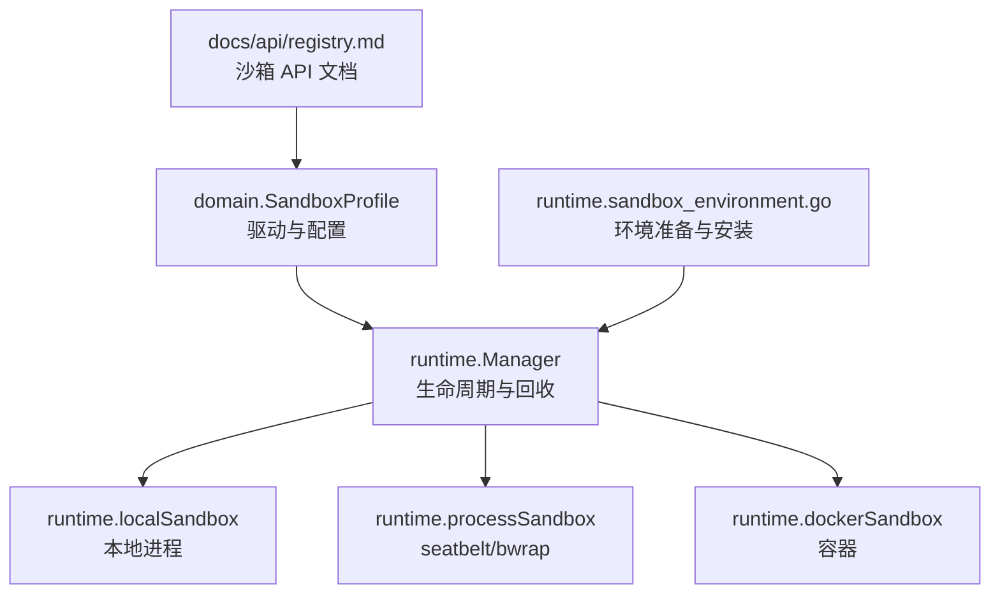
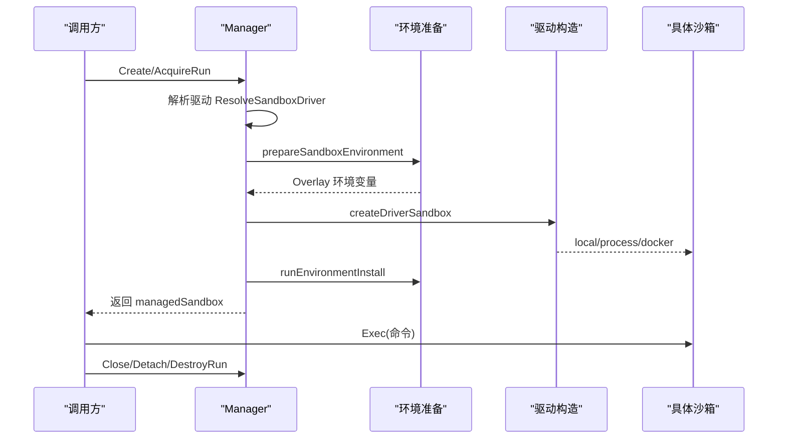
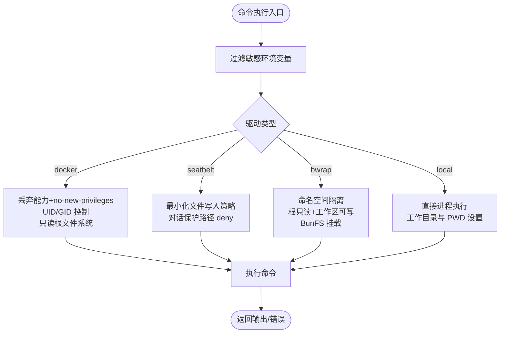
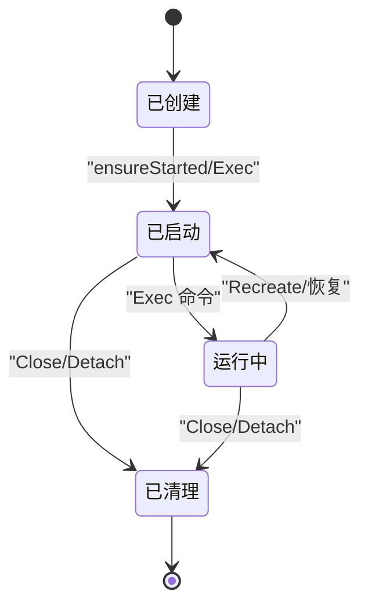
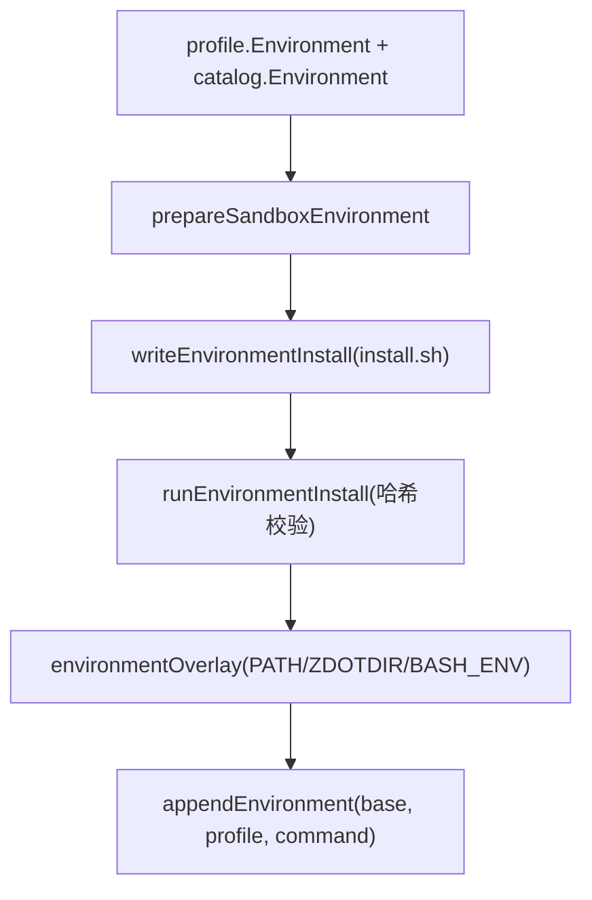
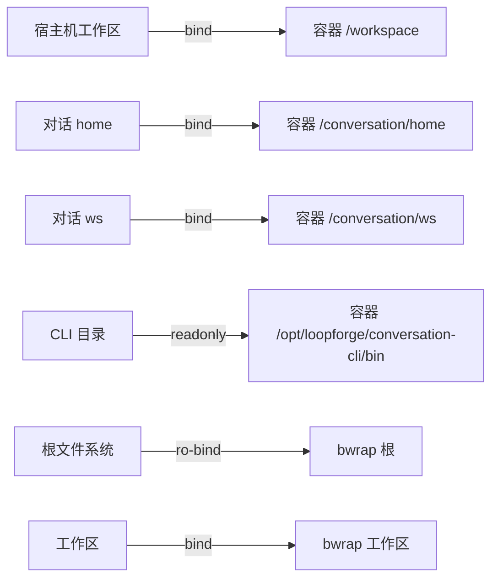
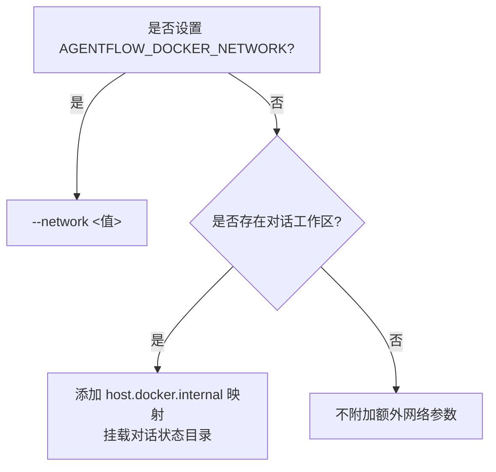
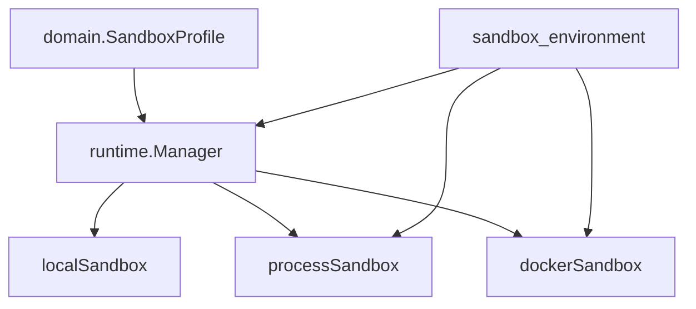

# 沙箱环境

<cite>
**本文引用的文件**   
- [sandbox_manager.go](file://internal/runtime/sandbox_manager.go)
- [sandbox_docker.go](file://internal/runtime/sandbox_docker.go)
- [sandbox_local.go](file://internal/runtime/sandbox_local.go)
- [sandbox_process.go](file://internal/runtime/sandbox_process.go)
- [sandbox_environment.go](file://internal/runtime/sandbox_environment.go)
- [assets.go](file://internal/domain/assets.go)
- [registry.md](file://docs/api/registry.md)
</cite>

## 目录
1. [简介](#简介)
2. [项目结构](#项目结构)
3. [核心组件](#核心组件)
4. [架构总览](#架构总览)
5. [详细组件分析](#详细组件分析)
6. [依赖关系分析](#依赖关系分析)
7. [性能与容量规划](#性能与容量规划)
8. [故障排查指南](#故障排查指南)
9. [结论](#结论)

## 简介
本文面向 LoopForge 的沙箱子系统，系统性说明其隔离机制、安全模型、支持的驱动类型（Docker、本地进程）、生命周期管理（创建、启动、监控、清理）、环境变量配置、文件系统挂载、网络隔离策略，以及沙箱配置文件格式、性能优化建议与常见故障排查方法。

沙箱在运行时负责为工作流节点提供可重复、可回收的执行环境：
- Docker 驱动通过容器实现强隔离，适合需要稳定镜像和工具链的场景。
- 本地进程驱动包括直接本地执行、macOS seatbelt、Linux bwrap，用于轻量级隔离或调试。
- Manager 统一管理沙箱实例、工作区目录、锁、并发上限与资源回收。

## 项目结构
沙箱相关代码集中在 `internal/runtime`，类型定义与驱动常量位于 `internal/domain`，API 文档在 `docs/api/registry.md`。

**图表来源**
- [assets.go:146-200](file://internal/domain/assets.go#L146-L200)
- [sandbox_manager.go:14-110](file://internal/runtime/sandbox_manager.go#L14-L110)
- [sandbox_local.go:12-36](file://internal/runtime/sandbox_local.go#L12-L36)
- [sandbox_process.go:93-136](file://internal/runtime/sandbox_process.go#L93-L136)
- [sandbox_docker.go:22-57](file://internal/runtime/sandbox_docker.go#L22-L57)
- [sandbox_environment.go:29-88](file://internal/runtime/sandbox_environment.go#L29-L88)
- [registry.md:204-224](file://docs/api/registry.md#L204-L224)

**章节来源**
- [assets.go:146-200](file://internal/domain/assets.go#L146-L200)
- [sandbox_manager.go:14-110](file://internal/runtime/sandbox_manager.go#L14-L110)
- [registry.md:204-224](file://docs/api/registry.md#L204-L224)

## 核心组件
- SandboxProfile：描述沙箱驱动、Dockerfile、Environment、只读根文件系统、环境变量等。
- Manager：创建、获取、销毁、回收沙箱与工作区；控制并发槽位；封装锁与临时目录。
- localSandbox：直接在宿主机进程执行命令，设置工作目录、环境变量、进程组。
- processSandbox：基于 seatbelt（macOS）或 bwrap（Linux）的轻量进程隔离。
- dockerSandbox：基于 Docker 容器的强隔离执行，支持镜像缓存、工作区绑定、网络隔离。
- sandbox_environment：准备 Environment 安装脚本、PATH 覆盖、登录 shell 钩子。

**章节来源**
- [assets.go:146-200](file://internal/domain/assets.go#L146-L200)
- [sandbox_manager.go:14-110](file://internal/runtime/sandbox_manager.go#L14-L110)
- [sandbox_local.go:12-36](file://internal/runtime/sandbox_local.go#L12-L36)
- [sandbox_process.go:93-136](file://internal/runtime/sandbox_process.go#L93-L136)
- [sandbox_docker.go:22-57](file://internal/runtime/sandbox_docker.go#L22-L57)
- [sandbox_environment.go:29-88](file://internal/runtime/sandbox_environment.go#L29-L88)

## 架构总览
沙箱的生命周期由 Manager 统一编排：解析驱动、创建工作区、准备环境、选择具体驱动实现、执行命令、关闭并释放资源。

**图表来源**
- [sandbox_manager.go:73-110](file://internal/runtime/sandbox_manager.go#L73-L110)
- [assets.go:182-200](file://internal/domain/assets.go#L182-L200)
- [sandbox_environment.go:43-88](file://internal/runtime/sandbox_environment.go#L43-L88)
- [sandbox_manager.go:449-464](file://internal/runtime/sandbox_manager.go#L449-L464)

## 详细组件分析

### 隔离机制与安全模型
- Docker 驱动：
  - 默认丢弃所有能力并启用 no-new-privileges。
  - 非 root 服务用户下，若镜像未显式指定非 root 用户，则强制以当前服务 UID/GID 运行，避免 root 镜像访问其他 UID 的工作区。
  - 可选只读根文件系统，仅允许 /tmp 写且限制大小。
  - 工作区以 bind mount 方式挂载到 /workspace，并通过内部 shell 切换目录，规避 runc cwd 检查失败。
  - 支持 AGENTFLOW_DOCKER_NETWORK 指定网络；当存在对话工作区时，额外挂载状态目录与守卫路径。
- 本地进程驱动：
  - 过滤敏感环境变量（如各类 API Key、Git SSH 配置），防止泄露到子进程。
  - macOS seatbelt：生成最小化权限策略，仅允许工作区与必要临时目录写入，并对对话保护路径做 deny 规则。
  - Linux bwrap：使用 user/pid/ipc/uts 命名空间，根文件系统只读绑定，工作区可写，/proc 与 /dev 按需暴露；支持 BunFS 虚拟挂载点。
- 环境变量注入：
  - 基础环境经 controlledBaseEnvironment 过滤后叠加 profile.Environment 与 command.environment。
  - PATH 优先采用环境激活后的 overlay，确保隔离工具链优先于宿主 PATH。

**图表来源**
- [sandbox_process.go:21-91](file://internal/runtime/sandbox_process.go#L21-L91)
- [sandbox_docker.go:706-756](file://internal/runtime/sandbox_docker.go#L706-L756)
- [sandbox_process.go:335-387](file://internal/runtime/sandbox_process.go#L335-L387)
- [sandbox_process.go:471-518](file://internal/runtime/sandbox_process.go#L471-L518)
- [sandbox_local.go:38-70](file://internal/runtime/sandbox_local.go#L38-L70)

**章节来源**
- [sandbox_docker.go:706-756](file://internal/runtime/sandbox_docker.go#L706-L756)
- [sandbox_process.go:21-91](file://internal/runtime/sandbox_process.go#L21-L91)
- [sandbox_process.go:335-387](file://internal/runtime/sandbox_process.go#L335-L387)
- [sandbox_process.go:471-518](file://internal/runtime/sandbox_process.go#L471-L518)
- [sandbox_local.go:38-70](file://internal/runtime/sandbox_local.go#L38-L70)

### 支持的沙箱驱动类型
- Docker：需要 Dockerfile；支持镜像缓存、工作区绑定、网络隔离、CLI 按需安装。
- 本地进程：
  - local：直接执行，无额外隔离。
  - seatbelt：macOS 专用，需 sandbox-exec。
  - bwrap：Linux 专用，需 bwrap。
- native：抽象驱动，运行时根据操作系统解析为 seatbelt（macOS）或 bwrap（Linux）。

```mermaid
classDiagram
class SandboxProfile {
+string ID
+string Name
+string ProjectID
+bool Shared
+string Driver
+string DockerfileID
+string EnvironmentID
+bool ReadOnlyRootFS
+map~string,string~ Environment
}
class Manager {
+Create(ctx, runID, nodeID, profile)
+AcquireRun(ctx, runID, profile, requirements, credentials, resources)
+DestroyRun(runID)
+ReclaimDockerSandboxes(ctx, liveRunIDs)
}
class localSandbox {
+ID()
+Workspace()
+Driver()
+Exec(ctx, command, sink)
+Close(ctx)
}
class processSandbox {
+ID()
+Workspace()
+Driver()
+Exec(ctx, command, sink)
+Close(ctx)
}
class dockerSandbox {
+ID()
+Workspace()
+Driver()
+Exec(ctx, command, sink)
+Close(ctx)
+BindWorkspace(ctx)
+Recreate(ctx)
}
Manager --> localSandbox : "创建"
Manager --> processSandbox : "创建"
Manager --> dockerSandbox : "创建"
SandboxProfile --> Manager : "输入"
```

**图表来源**
- [assets.go:146-200](file://internal/domain/assets.go#L146-L200)
- [sandbox_manager.go:14-110](file://internal/runtime/sandbox_manager.go#L14-L110)
- [sandbox_local.go:12-36](file://internal/runtime/sandbox_local.go#L12-L36)
- [sandbox_process.go:93-136](file://internal/runtime/sandbox_process.go#L93-L136)
- [sandbox_docker.go:22-57](file://internal/runtime/sandbox_docker.go#L22-L57)

**章节来源**
- [assets.go:146-200](file://internal/domain/assets.go#L146-L200)
- [sandbox_manager.go:449-464](file://internal/runtime/sandbox_manager.go#L449-L464)

### 生命周期管理
- 创建：
  - Manager.Create：为节点创建独立沙箱与工作区，wipe=true、ephemeral=true。
  - Manager.AcquireRun/AcquireRunIn：复用运行级工作区，聚合 requirements 后再打开，避免首个节点决定 Docker 挂载顺序。
- 启动：
  - Docker：首次 Exec 时 ensureStarted，构建或复用镜像，创建并启动容器，等待 /workspace 就绪。
  - 本地进程：直接构造 exec.Cmd，设置工作目录与环境。
- 监控：
  - Docker：exec 错误检测 cwd 不安全、容器消失、中断信号；必要时 Recreate。
  - 本地进程：进程组管理与取消回调。
- 清理：
  - ManagedSandbox.Close：关闭底层沙箱，删除临时工作区（ephemeral），解锁。
  - Manager.DestroyRun：删除容器与镜像，清理匹配的工作区目录。
  - Manager.ReclaimDockerSandboxes：扫描宿主机 Docker，回收不属于任何活跃运行的容器。
  - Manager.ReclaimCachedDockerImages：清理不再被任何 Dockerfile 使用的缓存镜像。

**图表来源**
- [sandbox_manager.go:73-110](file://internal/runtime/sandbox_manager.go#L73-L110)
- [sandbox_manager.go:366-392](file://internal/runtime/sandbox_manager.go#L366-L392)
- [sandbox_docker.go:133-164](file://internal/runtime/sandbox_docker.go#L133-L164)
- [sandbox_docker.go:672-783](file://internal/runtime/sandbox_docker.go#L672-L783)

**章节来源**
- [sandbox_manager.go:73-110](file://internal/runtime/sandbox_manager.go#L73-L110)
- [sandbox_manager.go:112-143](file://internal/runtime/sandbox_manager.go#L112-L143)
- [sandbox_manager.go:183-225](file://internal/runtime/sandbox_manager.go#L183-L225)
- [sandbox_docker.go:133-164](file://internal/runtime/sandbox_docker.go#L133-L164)
- [sandbox_docker.go:672-783](file://internal/runtime/sandbox_docker.go#L672-L783)

### 环境变量配置
- 基础环境过滤：controlledBaseEnvironment 移除敏感变量，防止泄露到子进程。
- 环境激活：prepareSandboxEnvironment 根据 EnvironmentDefinition 写入 install.sh，计算哈希校验，仅在变更时重新执行。
- PATH 覆盖：environmentOverlay 将环境 bin 目录置于 PATH 首位，并为 zsh/bash 登录 shell 写入钩子，保证 login shell 重置 PATH 后仍优先加载隔离工具。
- 环境变量注入：appendEnvironment 合并 base、profile.Environment、command.environment，保持键唯一性与有序性。

**图表来源**
- [sandbox_environment.go:43-88](file://internal/runtime/sandbox_environment.go#L43-L88)
- [sandbox_environment.go:141-184](file://internal/runtime/sandbox_environment.go#L141-L184)
- [sandbox_environment.go:90-131](file://internal/runtime/sandbox_environment.go#L90-L131)
- [sandbox_process.go:21-52](file://internal/runtime/sandbox_process.go#L21-L52)

**章节来源**
- [sandbox_environment.go:43-88](file://internal/runtime/sandbox_environment.go#L43-L88)
- [sandbox_environment.go:141-184](file://internal/runtime/sandbox_environment.go#L141-L184)
- [sandbox_environment.go:90-131](file://internal/runtime/sandbox_environment.go#L90-L131)
- [sandbox_process.go:21-52](file://internal/runtime/sandbox_process.go#L21-L52)

### 文件系统挂载
- Docker：
  - 工作区绑定到 /workspace。
  - 对话工作区额外挂载 home 与 ws，并加入守卫路径，防止篡改审批钩子。
  - 可选 CLI 目录只读挂载，供 on-demand CLI 安装。
  - 只读根文件系统配合 tmpfs /tmp。
- 本地进程：
  - 设置 Dir=workspace，PWD=workspace 或 WorkingDir。
  - Git 天花板目录设置为 workspace 父目录，避免意外操作仓库外内容。
- bwrap：
  - 根文件系统只读绑定，工作区可写，/proc 与 /dev 按需暴露。
  - 对话工作区按相同布局挂载，并保留只读守卫文件。
  - BunFS 虚拟挂载点用于某些编译型 CLI。

**图表来源**
- [sandbox_docker.go:706-756](file://internal/runtime/sandbox_docker.go#L706-L756)
- [sandbox_process.go:471-518](file://internal/runtime/sandbox_process.go#L471-L518)
- [sandbox_local.go:38-70](file://internal/runtime/sandbox_local.go#L38-L70)

**章节来源**
- [sandbox_docker.go:706-756](file://internal/runtime/sandbox_docker.go#L706-L756)
- [sandbox_process.go:471-518](file://internal/runtime/sandbox_process.go#L471-L518)
- [sandbox_local.go:38-70](file://internal/runtime/sandbox_local.go#L38-L70)

### 网络隔离策略
- Docker：
  - 可通过 AGENTFLOW_DOCKER_NETWORK 指定网络；若无对话工作区，则使用该网络。
  - 有对话工作区时，额外添加 host.docker.internal 映射，并挂载对话状态目录。
- 本地进程：
  - 不直接控制网络，但通过 HOME 重定向与 DOCKER_HOST 推导，避免泄露 Docker 上下文凭据。

**图表来源**
- [sandbox_docker.go:720-737](file://internal/runtime/sandbox_docker.go#L720-L737)
- [sandbox_process.go:209-259](file://internal/runtime/sandbox_process.go#L209-L259)

**章节来源**
- [sandbox_docker.go:720-737](file://internal/runtime/sandbox_docker.go#L720-L737)
- [sandbox_process.go:209-259](file://internal/runtime/sandbox_process.go#L209-L259)

### 沙箱配置文件格式
- SandboxProfile 字段：
  - id：必填，唯一标识。
  - name：显示名称。
  - projectId：所属项目。
  - shared：是否共享。
  - driver：local/native/docker；native 在运行时解析为 seatbelt（macOS）或 bwrap（Linux）。
  - dockerfileId：Docker 驱动关联的 Dockerfile。
  - environmentId：Environment 定义 ID。
  - readOnlyRootFS：是否启用只读根文件系统。
  - environment：环境变量覆盖。
- API：
  - GET /api/sandboxes：返回沙箱配置列表。
  - PUT /api/sandboxes：创建或更新沙箱配置。
  - DELETE /api/sandboxes?id={id}：删除沙箱配置（受约束）。

**章节来源**
- [assets.go:146-200](file://internal/domain/assets.go#L146-L200)
- [registry.md:204-224](file://docs/api/registry.md#L204-L224)

## 依赖关系分析
- domain.SandboxProfile 作为配置输入，被 runtime.Manager 消费。
- Manager 根据驱动名选择具体实现：localSandbox、processSandbox、dockerSandbox。
- sandbox_environment 为 process 与 docker 驱动提供环境准备与安装逻辑。
- dockerSandbox 依赖外部 Docker CLI，具备镜像缓存与容器生命周期管理能力。
- processSandbox 依赖系统工具（sandbox-exec、bwrap）与 OS 特性。

**图表来源**
- [assets.go:146-200](file://internal/domain/assets.go#L146-L200)
- [sandbox_manager.go:449-464](file://internal/runtime/sandbox_manager.go#L449-L464)
- [sandbox_environment.go:29-88](file://internal/runtime/sandbox_environment.go#L29-L88)

**章节来源**
- [assets.go:146-200](file://internal/domain/assets.go#L146-L200)
- [sandbox_manager.go:449-464](file://internal/runtime/sandbox_manager.go#L449-L464)
- [sandbox_environment.go:29-88](file://internal/runtime/sandbox_environment.go#L29-L88)

## 性能与容量规划
- 并发控制：
  - Manager 使用带缓冲通道 slots 限制并行 Exec 数量，避免同时过多命令竞争资源。
- 镜像缓存：
  - 对 Dockerfile 内容哈希生成缓存镜像标签，避免重复构建；ReclaimCachedDockerImages 清理无用缓存。
- 工作区复用：
  - AcquireRun/AcquireRunIn 复用 git checkout，减少克隆与分支切换开销。
- 容器重建：
  - 检测到 cwd 不安全或 exec 实例丢失时触发 Recreate，避免长时间阻塞。
- 清理策略：
  - DestroyRun 先删容器与镜像再删工作区，避免“active”容器无法 prune。
  - ReclaimDockerSandboxes 定期回收孤儿容器，降低磁盘与内存占用。

**章节来源**
- [sandbox_manager.go:21-26](file://internal/runtime/sandbox_manager.go#L21-L26)
- [sandbox_manager.go:112-143](file://internal/runtime/sandbox_manager.go#L112-L143)
- [sandbox_manager.go:183-225](file://internal/runtime/sandbox_manager.go#L183-L225)
- [sandbox_docker.go:542-602](file://internal/runtime/sandbox_docker.go#L542-L602)
- [sandbox_docker.go:133-164](file://internal/runtime/sandbox_docker.go#L133-L164)

## 故障排查指南
- Docker 不可用：
  - 现象：创建 Docker 沙箱失败或清理跳过。
  - 排查：确认 docker 二进制存在且 daemon 响应；DockerReady 会缓存结果。
- 工作区目录不在容器挂载命名空间：
  - 现象：exit status 126 或 “outside of container mount”。
  - 处理：触发 Recreate；确保 git checkout 完成后才创建容器。
- 容器或 exec 实例丢失：
  - 现象：“no such exec instance”、“no such container”。
  - 处理：标记 IsSandboxInterrupt，暂停节点而非消耗重试次数；必要时 invalidate 并重试。
- 镜像构建失败：
  - 现象：docker create 或 start 报错。
  - 处理：检查 Dockerfile 内容与文件引用；确认缓存镜像可用。
- 环境变量污染：
  - 现象：子进程读到敏感变量。
  - 处理：检查 controlledBaseEnvironment 过滤规则；确认 profile.Environment 与 command.environment 未注入密钥。
- seatbelt/bwrap 不可用：
  - 现象：native 驱动解析成功但创建失败。
  - 处理：确认 sandbox-exec 或 bwrap 在 PATH；检查 OS 是否匹配。
- 网络问题：
  - 现象：容器内无法访问外部网络。
  - 处理：检查 AGENTFLOW_DOCKER_NETWORK；确认对话工作区网络挂载。

**章节来源**
- [sandbox_docker.go:101-131](file://internal/runtime/sandbox_docker.go#L101-L131)
- [sandbox_docker.go:375-381](file://internal/runtime/sandbox_docker.go#L375-L381)
- [sandbox_docker.go:304-334](file://internal/runtime/sandbox_docker.go#L304-L334)
- [sandbox_docker.go:672-783](file://internal/runtime/sandbox_docker.go#L672-L783)
- [sandbox_process.go:21-91](file://internal/runtime/sandbox_process.go#L21-L91)
- [sandbox_process.go:117-128](file://internal/runtime/sandbox_process.go#L117-L128)
- [sandbox_docker.go:720-737](file://internal/runtime/sandbox_docker.go#L720-L737)

## 结论
LoopForge 的沙箱子系统通过 Manager 统一编排，结合 Docker 与本地进程驱动，提供了从强隔离到轻量隔离的多层次执行环境。其安全模型强调最小权限、敏感信息过滤与文件系统/网络可控挂载；生命周期管理涵盖创建、启动、监控与清理，确保资源可回收与系统稳定。通过 Environment 与 Dockerfile 的组合，用户可在不同场景下灵活配置工具链与运行环境，并在性能与安全性之间取得平衡。