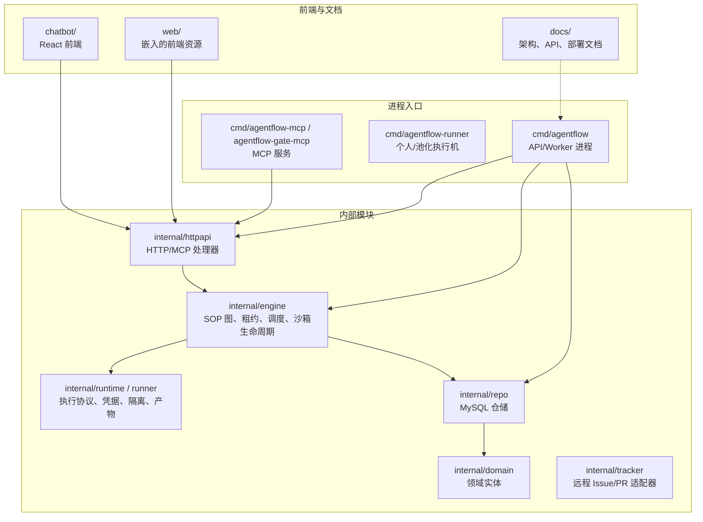
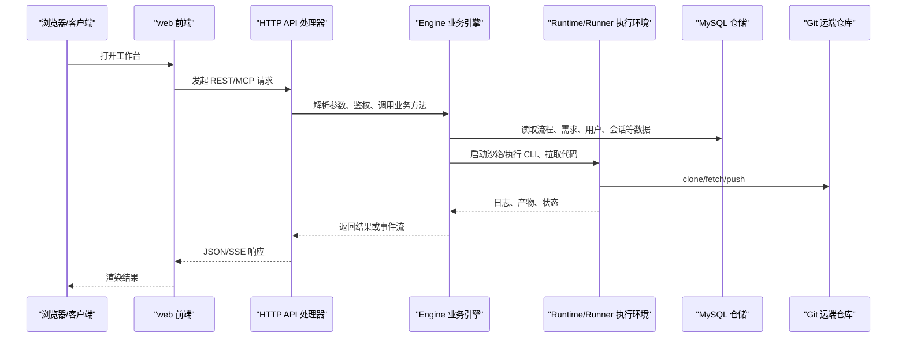
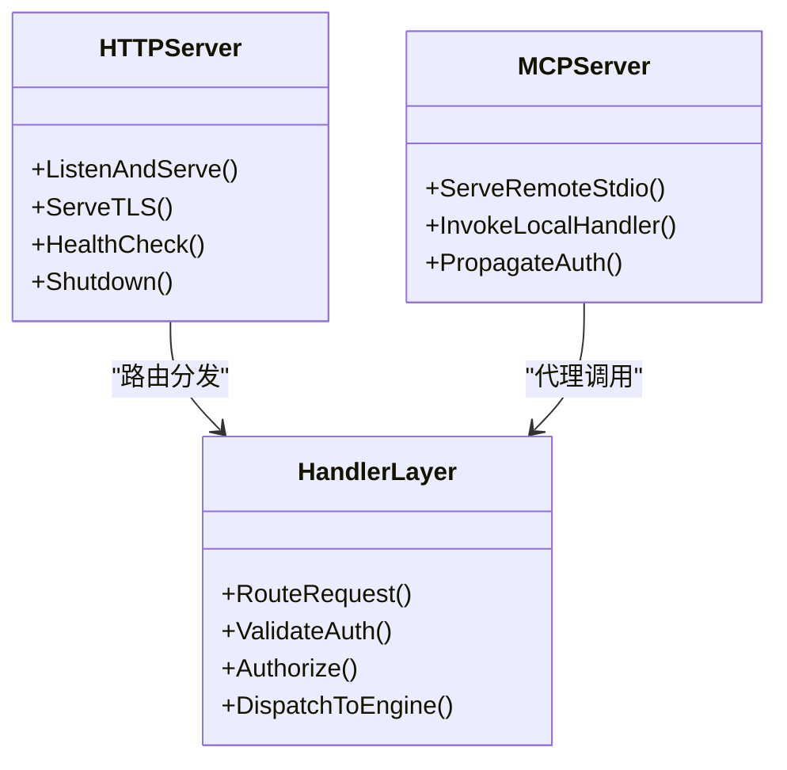
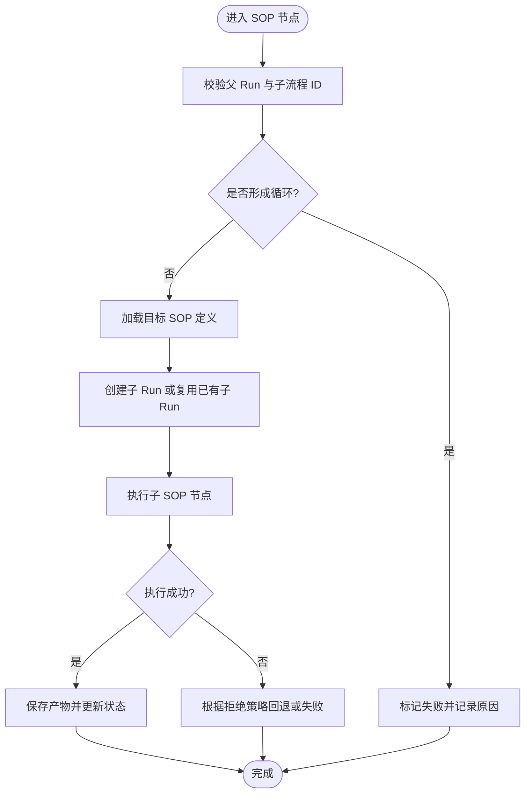
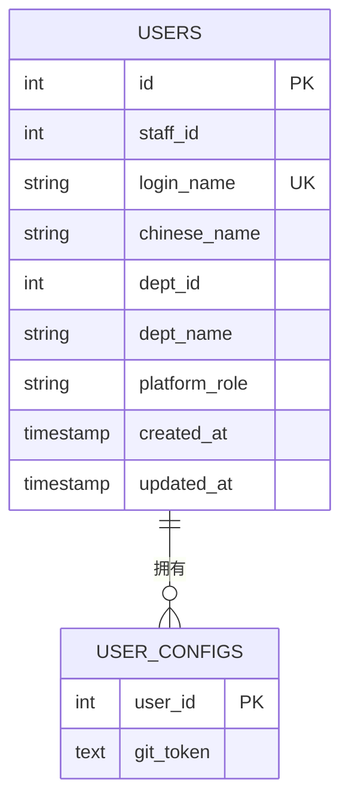
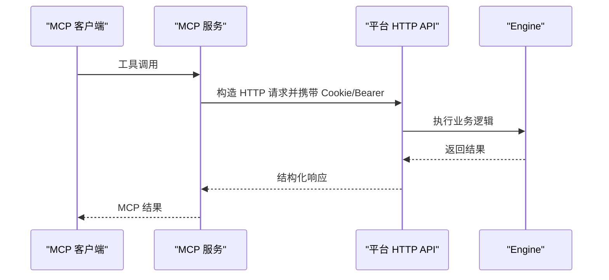
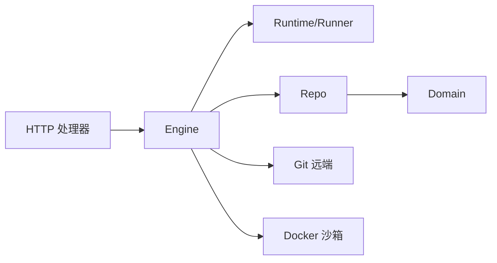

# 系统架构

<cite>
**本文引用的文件**   
- [README.md](file://README.md)
- [architecture.md](file://docs/architecture.md)
- [deployment.md](file://docs/deployment.md)
- [design.md](file://design.md)
- [compose.yaml](file://compose.yaml)
- [main.go](file://cmd/agentflow/main.go)
- [agentflow-mcp main.go](file://cmd/agentflow-mcp/main.go)
- [mcpserver server.go](file://internal/mcpserver/server.go)
- [engine sop_node.go](file://internal/engine/sop_node.go)
- [httpapi assistant_acceptance.go](file://internal/httpapi/assistant_acceptance.go)
- [repo models.go](file://internal/repo/models.go)
- [repo users.go](file://internal/repo/users.go)
</cite>

## 目录
1. [简介](#简介)
2. [项目结构](#项目结构)
3. [核心组件](#核心组件)
4. [架构总览](#架构总览)
5. [详细组件分析](#详细组件分析)
6. [依赖关系分析](#依赖关系分析)
7. [性能与可扩展性](#性能与可扩展性)
8. [横切关注点：安全、监控与灾难恢复](#横切关注点安全监控与灾难恢复)
9. [故障排查指南](#故障排查指南)
10. [结论](#结论)

## 简介
LoopForge 是一个自托管的软件开发交付平台，围绕“对话工作区”和“标准操作流程（SOP）”两条路径组织代码智能体、脚本与人工审批。它通过 HTTP API 暴露能力，使用 MySQL 持久化业务数据，并通过 Docker 沙箱或连接执行机运行外部编码 CLI。前端由 Go 嵌入静态资源并提供 Web 工作台；同时提供 MCP 服务用于结构化工具调用。

本架构文档从 HTTP API 层、业务逻辑层、数据访问层三个维度说明组件职责、交互关系和数据流向，并给出部署拓扑、扩展策略与横切关注点的实践建议。

## 项目结构
仓库采用“进程角色 + 内部包边界”的组织方式：
- `cmd/` 下按进程角色划分入口：API/Worker 组合进程、Runner 执行机、MCP 服务。
- `internal/` 下按职责划分内部包：HTTP 处理器、引擎与编排、领域模型、MySQL 仓储、运行时与执行器协议、远程问题跟踪适配等。
- `web/` 为嵌入的前端资源与原生页面；`chatbot/` 为 React 前端工程。
- `migrations/` 管理数据库迁移与种子数据；`local/` 提供本地工作流与宿主集成。

**图表来源**
- [architecture.md:5-17](file://docs/architecture.md#L5-L17)
- [main.go:314-354](file://cmd/agentflow/main.go#L314-L354)
- [agentflow-mcp main.go:14-26](file://cmd/agentflow-mcp/main.go#L14-L26)

**章节来源**
- [architecture.md:1-22](file://docs/architecture.md#L1-L22)
- [README.md:38-51](file://README.md#L38-L51)

## 核心组件
- HTTP API 层：负责认证、路由、请求校验、权限控制，并将请求委派给业务引擎或仓储。
- 业务逻辑层：引擎负责 SOP 图执行、节点状态、租约、调度、工作区准备、分支合并与交付；运行时负责执行器协议、凭据注入、沙箱隔离与产物收集。
- 数据访问层：MySQL 仓储按业务域拆分，将领域实体映射到物理表，提供查询、写入、锁与审计字段。
- 前端与 MCP：Go 嵌入 web 静态资源；MCP 服务转发工具调用到平台 API，支持 Cookie/Bearer 透传。

关键职责边界：
- HTTP 处理器不直接实现复杂编排逻辑，而是调用 Engine 与 Repo。
- Engine 不直接操作网络协议细节，委托 Runner/Runtime 执行外部 CLI 与沙箱。
- Repo 只暴露仓储接口，领域对象在 domain 中定义。

**章节来源**
- [architecture.md:5-17](file://docs/architecture.md#L5-L17)
- [main.go:314-354](file://cmd/agentflow/main.go#L314-L354)
- [mcpserver server.go:55-103](file://internal/mcpserver/server.go#L55-L103)

## 架构总览
下图展示典型请求从浏览器到后端处理、再到执行环境与数据库的完整链路。

**图表来源**
- [main.go:314-354](file://cmd/agentflow/main.go#L314-L354)
- [mcpserver server.go:55-103](file://internal/mcpserver/server.go#L55-L103)
- [engine sop_node.go:18-51](file://internal/engine/sop_node.go#L18-L51)

## 详细组件分析

### HTTP API 层
- 进程入口：`cmd/agentflow/main.go` 启动 HTTP 服务器，支持 TLS、健康检查、优雅关闭与 Worker 模式。
- 处理器组织：`internal/httpapi` 按业务域拆分处理器，例如助手、SOP、运行、审批、模型目录等。
- 认证与令牌：生产环境启用认证后，Cookie 登录与 Bearer Token 并存；Token 支持有效期、撤销与 WWW-Authenticate 提示。
- MCP 集成：`internal/mcpserver` 将 MCP 调用转为内部 HTTP 调用，透传 Cookie/Bearer，保证身份一致。

**图表来源**
- [main.go:314-354](file://cmd/agentflow/main.go#L314-L354)
- [mcpserver server.go:55-103](file://internal/mcpserver/server.go#L55-L103)

**章节来源**
- [main.go:314-354](file://cmd/agentflow/main.go#L314-L354)
- [README.md:22-33](file://README.md#L22-L33)
- [deployment.md:67-73](file://docs/deployment.md#L67-L73)

### 业务逻辑层（Engine 与 Runtime）
- Engine 负责 SOP 图执行、节点状态机、并发分支、工作区准备、分支与 MR/PR 交付、恢复与重试。
- Runtime/Runner 负责执行器协议、凭据注入、沙箱隔离、产物归档、终端与日志采集。
- SOP 子流程执行包含循环保护、父子 Run 关联、失败回退与产物保存。

**图表来源**
- [engine sop_node.go:18-51](file://internal/engine/sop_node.go#L18-L51)

**章节来源**
- [architecture.md:10-13](file://docs/architecture.md#L10-L13)
- [engine sop_node.go:1-51](file://internal/engine/sop_node.go#L1-L51)

### 数据访问层（Repo 与 Domain）
- Domain 定义业务实体，如用户、项目、需求、运行、SOP、通知等。
- Repo 按业务域拆分仓储，使用 GORM 映射物理表；时间字段显式赋值避免自动填充。
- 用户仓储提供按 ID/登录名查询、列表、更新与配置关联。

**图表来源**
- [repo models.go:8-14](file://internal/repo/models.go#L8-L14)
- [repo users.go:100-133](file://internal/repo/users.go#L100-L133)

**章节来源**
- [repo models.go:1-37](file://internal/repo/models.go#L1-L37)
- [repo users.go:91-133](file://internal/repo/users.go#L91-L133)

### 前端与 MCP 集成
- 前端通过 web 嵌入资源提供服务端渲染与静态资源；React 前端位于 `chatbot/`。
- MCP 服务通过 `AGENTFLOW_API_URL` 指向平台 API，并在调用时透传 Cookie/Bearer，确保工具调用具备相同身份上下文。

**图表来源**
- [agentflow-mcp main.go:14-26](file://cmd/agentflow-mcp/main.go#L14-L26)
- [mcpserver server.go:55-103](file://internal/mcpserver/server.go#L55-L103)

**章节来源**
- [architecture.md:9-15](file://docs/architecture.md#L9-L15)
- [design.md:454-484](file://design.md#L454-L484)

## 依赖关系分析
- 进程耦合：API/Worker 进程依赖 HTTP 处理器、Engine、Repo；Runner 作为独立进程被 Engine 调度。
- 模块内聚：HTTP 处理器按业务域拆分，Engine 聚合编排逻辑，Repo 按域拆分仓储，Domain 保持纯实体。
- 外部依赖：MySQL、Docker、Git 远端仓库、GitHub/GitLab 等托管平台、外部编码 CLI。

**图表来源**
- [architecture.md:5-17](file://docs/architecture.md#L5-L17)

**章节来源**
- [architecture.md:5-17](file://docs/architecture.md#L5-L17)

## 性能与可扩展性
- 水平扩展：API 实例可多副本部署，共享 MySQL 与配置；会话授权需亲和或集中存储。
- 执行分离：通过 `-role worker` 与 Runner 分离控制面与执行面，提升吞吐与隔离性。
- 沙箱隔离：默认使用 Docker 沙箱，避免宿主机风险；自定义镜像按需构建。
- 缓存与索引：观察列与生成列用于遥测与日志级别索引，减少全表扫描。
- 限流与超时：克隆与构建设置 stall/timeout 防止长时间阻塞。

[本节为通用指导，不直接分析具体文件]

## 横切关注点：安全、监控与灾难恢复
- 认证与授权
  - 生产环境启用认证，支持 Cookie 与 Bearer Token；Token 支持有效期与撤销。
  - 企业网关可通过可信头签名登录，需配合随机密钥与反向代理头部覆盖。
- 网络安全
  - 默认监听所有接口，建议使用 HTTPS 反向代理；敏感 Cookie 应开启 Secure。
  - GitHub OAuth Device Flow 需要亲和会话；Token 与设备码不返回浏览器。
- 数据安全
  - 凭据存储在数据库，仅展示一次；SSH 私钥按主机分片绑定。
  - 工作区与附件路径隔离，沙箱不挂载 Docker socket（默认沙箱除外）。
- 监控与可观测性
  - 安装观察列与索引；运行遥测与日志级别便于排障。
  - 健康检查与 Compose 依赖确保服务就绪后再应用扩展。
- 灾难恢复
  - 数据卷持久化 MySQL 与平台数据；迁移脚本分三类：已应用、升级必需、回填重写。
  - 优雅关闭与 Drain Timeout 允许长任务在停机前完成。

**章节来源**
- [README.md:237-239](file://README.md#L237-L239)
- [deployment.md:67-73](file://docs/deployment.md#L67-L73)
- [deployment.md:138-152](file://docs/deployment.md#L138-L152)
- [deployment.md:172-184](file://docs/deployment.md#L172-L184)
- [main.go:314-354](file://cmd/agentflow/main.go#L314-L354)

## 故障排查指南
- 无法连接数据库
  - 检查 DSN、端口与密码环境变量；Compose 健康检查失败时先确认 MySQL 就绪。
- 沙箱执行失败
  - 确认 Docker socket 挂载与权限；CLI 是否安装；执行机 Runner 是否可达。
- 认证失败
  - 检查 Cookie/Bearer 是否有效；网关信任头是否配置正确；HTTPS 终止是否设置 Secure Cookie。
- 克隆/构建卡住
  - 调整克隆与构建的 stall/timeout 配置；检查网络代理与镜像源。
- 运行中断恢复
  - 查看节点失败原因与回退策略；必要时从任意节点重跑或发送回上游步骤。

**章节来源**
- [compose.yaml:3-20](file://compose.yaml#L3-L20)
- [deployment.md:84-95](file://docs/deployment.md#L84-L95)
- [deployment.md:109-127](file://docs/deployment.md#L109-L127)

## 结论
LoopForge 以 HTTP API 为统一入口，Engine 作为编排中枢，Repo 作为持久化边界，Runtime/Runner 负责执行隔离与产物收集。该架构在保证安全与可观测性的前提下，支持多进程扩展、沙箱隔离与外部工具集成。建议在团队信任边界内部署，结合 HTTPS、网关认证与最小权限原则，逐步引入 Runner 集群与专用沙箱镜像，以满足规模化交付需求。