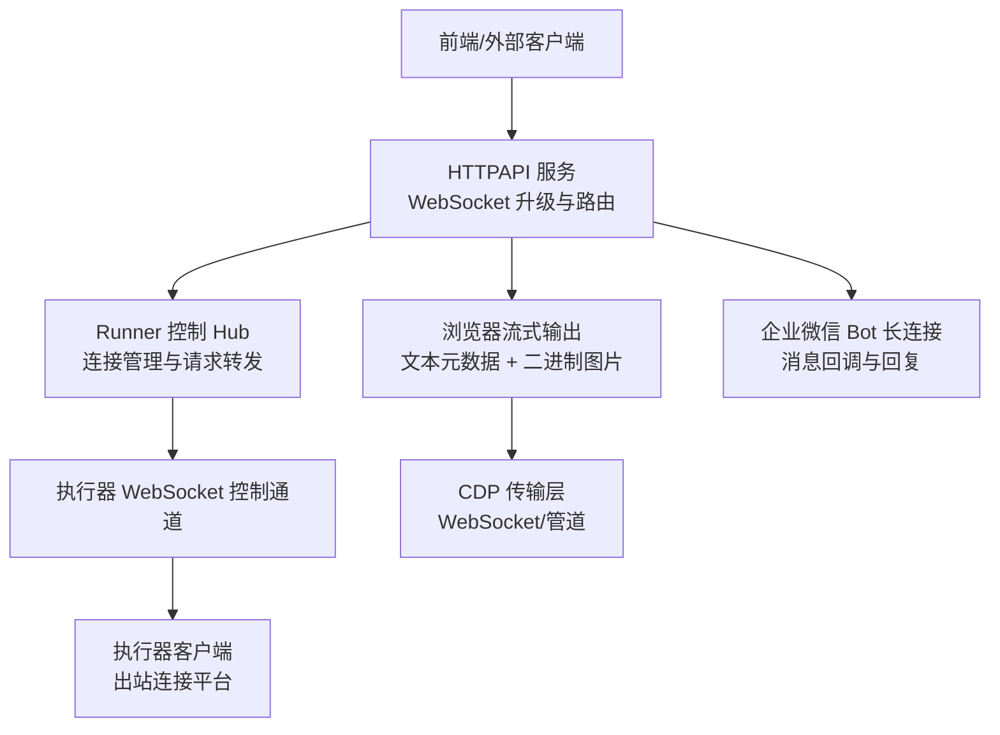
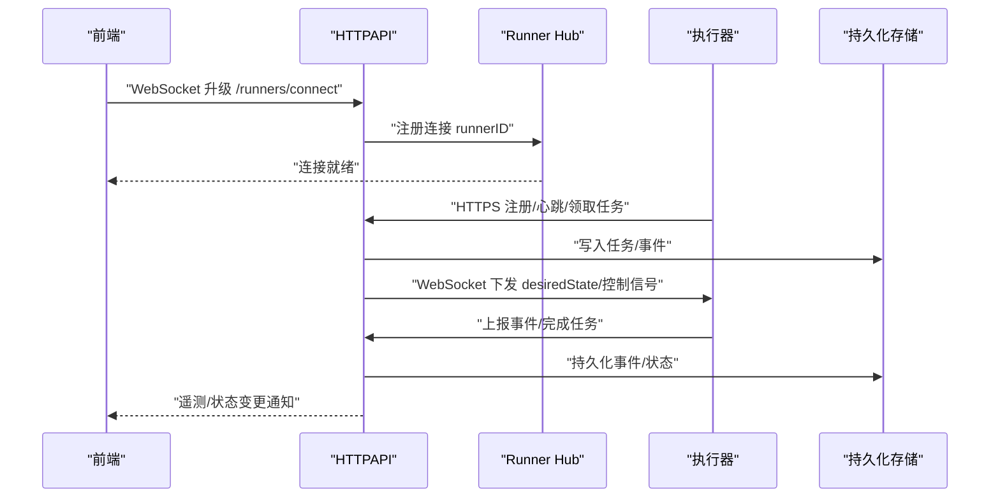
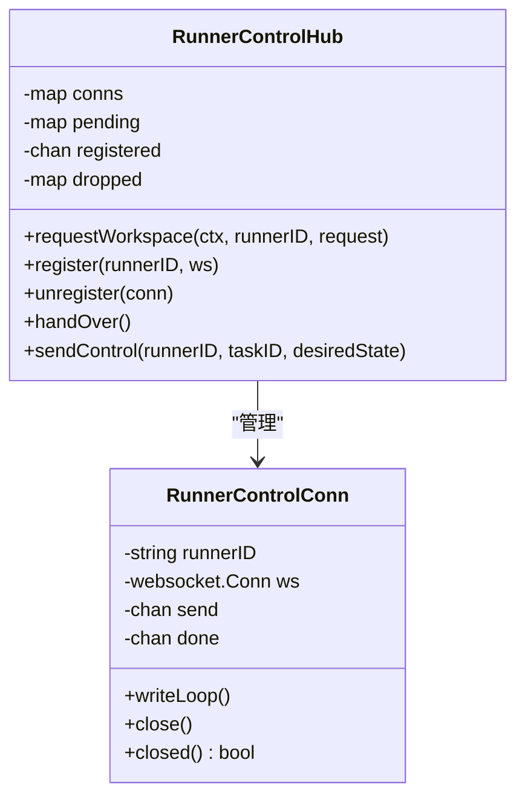
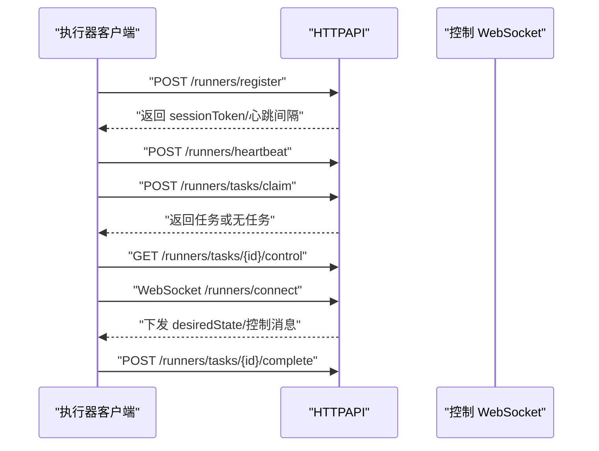
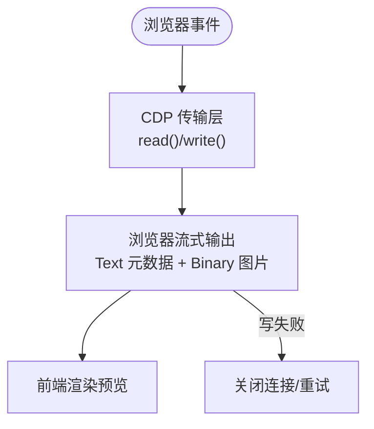
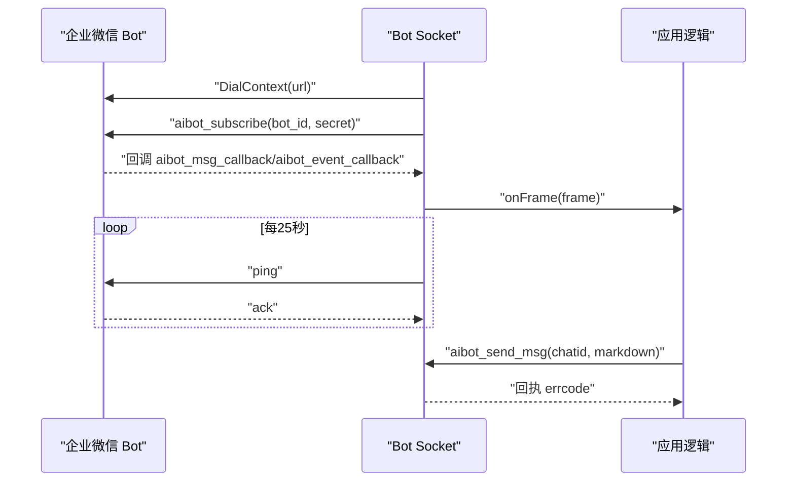
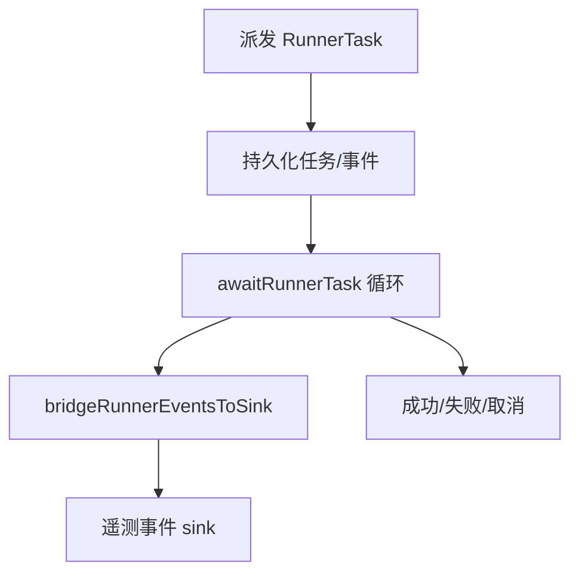
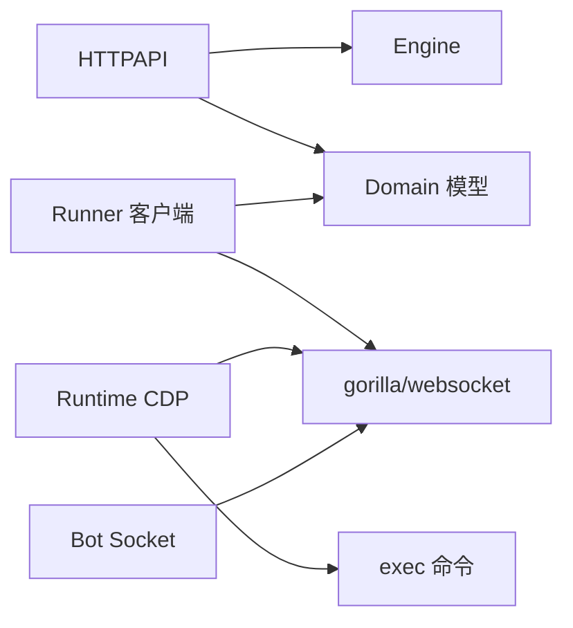

# 实时通信

<cite>
**本文引用的文件**   
- [internal/botinteraction/socket.go](file://internal/botinteraction/socket.go)
- [internal/httpapi/runner_ws.go](file://internal/httpapi/runner_ws.go)
- [internal/engine/runner_dispatch.go](file://internal/engine/runner_dispatch.go)
- [internal/runner/client.go](file://internal/runner/client.go)
- [internal/runtime/browser_cdp.go](file://internal/runtime/browser_cdp.go)
- [internal/httpapi/browser_stream.go](file://internal/httpapi/browser_stream.go)
</cite>

## 目录
1. [引言](#引言)
2. [项目结构](#项目结构)
3. [核心组件](#核心组件)
4. [架构总览](#架构总览)
5. [详细组件分析](#详细组件分析)
6. [依赖关系分析](#依赖关系分析)
7. [性能与可靠性](#性能与可靠性)
8. [故障排查指南](#故障排查指南)
9. [结论](#结论)
10. [附录：客户端集成与调试建议](#附录客户端集成与调试建议)

## 引言
本文件面向需要理解并集成 LoopForge 实时通信能力的开发者，聚焦以下目标：
- WebSocket 连接管理：服务端与执行器、浏览器、企业微信 Bot 的长连接建立、心跳、重连与生命周期。
- 事件推送机制：任务状态、遥测事件、工作区 RPC、工具调用、浏览器流式画面等。
- 消息协议：控制面 JSON 帧、二进制流、CDP 协议封装。
- 流式数据传输：进度更新、状态同步、大对象分片与取消语义。
- 连接重连、错误处理与性能优化策略。
- 客户端集成示例、调试方法与监控指标。

## 项目结构
LoopForge 的实时通信能力分布在多个子系统：
- 控制面 API 进程通过 HTTP + WebSocket 暴露对外接口，并与执行器维护低延迟控制通道。
- 执行器作为受控端，仅主动出站连接平台，不暴露监听端口。
- 浏览器 CDP 传输通过 WebSocket 或本地管道桥接，将浏览器事件以流式方式推送到上层。
- 企业微信 Bot 使用独立的 WebSocket 长连接进行消息回调与回复。

**图表来源**
- [internal/httpapi/runner_ws.go:494-583](file://internal/httpapi/runner_ws.go#L494-L583)
- [internal/runner/client.go:249-283](file://internal/runner/client.go#L249-L283)
- [internal/httpapi/browser_stream.go:316-355](file://internal/httpapi/browser_stream.go#L316-L355)
- [internal/runtime/browser_cdp.go:208-230](file://internal/runtime/browser_cdp.go#L208-L230)
- [internal/botinteraction/socket.go:94-147](file://internal/botinteraction/socket.go#L94-L147)

**章节来源**
- [internal/httpapi/runner_ws.go:1-584](file://internal/httpapi/runner_ws.go#L1-L584)
- [internal/runner/client.go:1-328](file://internal/runner/client.go#L1-L328)
- [internal/runtime/browser_cdp.go:1-230](file://internal/runtime/browser_cdp.go#L1-L230)
- [internal/httpapi/browser_stream.go:316-355](file://internal/httpapi/browser_stream.go#L316-L355)
- [internal/botinteraction/socket.go:1-196](file://internal/botinteraction/socket.go#L1-L196)

## 核心组件
- Runner 控制 Hub：维护执行器 WebSocket 连接、请求队列、重连窗口、进程切换时的中继转发。
- 执行器客户端：负责注册、心跳、任务领取、续租、完成、以及打开控制 WebSocket。
- 浏览器 CDP 传输：抽象 CDP 消息读写，支持 WebSocket 与 Docker 管道两种后端。
- 浏览器流式输出：向客户端推送文本元数据与二进制图片帧，实现实时预览。
- 企业微信 Bot Socket：建立长连接、订阅回调、定时 ping、带回执的请求应答。

**章节来源**
- [internal/httpapi/runner_ws.go:47-102](file://internal/httpapi/runner_ws.go#L47-L102)
- [internal/runner/client.go:27-39](file://internal/runner/client.go#L27-L39)
- [internal/runtime/browser_cdp.go:18-51](file://internal/runtime/browser_cdp.go#L18-L51)
- [internal/httpapi/browser_stream.go:316-355](file://internal/httpapi/browser_stream.go#L316-L355)
- [internal/botinteraction/socket.go:61-69](file://internal/botinteraction/socket.go#L61-L69)

## 架构总览
实时通信由“控制面”和“执行侧”组成：
- 控制面（HTTPAPI）提供 WebSocket 升级入口，维护 Hub 与连接表，处理工作区 RPC、工具调用、任务控制。
- 执行侧（Runner）通过 HTTPS 注册与轮询任务，并通过 WebSocket 接收低延迟控制信号；所有持久化状态仍落在数据库与任务事件表中。
- 浏览器预览通过 CDP 协议采集页面行为，经 WebSocket 或管道桥接到上层，再按帧推送到前端。
- 企业微信 Bot 使用独立长连接，用于消息回调与 Markdown 回复。

**图表来源**
- [internal/httpapi/runner_ws.go:494-583](file://internal/httpapi/runner_ws.go#L494-L583)
- [internal/runner/client.go:124-170](file://internal/runner/client.go#L124-L170)
- [internal/engine/runner_dispatch.go:711-780](file://internal/engine/runner_dispatch.go#L711-L780)

**章节来源**
- [internal/httpapi/runner_ws.go:494-583](file://internal/httpapi/runner_ws.go#L494-L583)
- [internal/runner/client.go:124-170](file://internal/runner/client.go#L124-L170)
- [internal/engine/runner_dispatch.go:711-780](file://internal/engine/runner_dispatch.go#L711-L780)

## 详细组件分析

### Runner 控制 Hub 与连接管理
Hub 负责：
- 维护每个 runnerID 到 WebSocket 连接的映射。
- 为工作区 RPC 分配 requestID，等待响应，支持超时与取消。
- 在连接断开后设置“重连窗口”，允许短暂等待执行器重连。
- 支持进程切换时中继请求到后继进程，避免重复执行。
- 周期性发送 Ping，并在写失败时关闭连接。

**图表来源**
- [internal/httpapi/runner_ws.go:61-102](file://internal/httpapi/runner_ws.go#L61-L102)
- [internal/httpapi/runner_ws.go:265-287](file://internal/httpapi/runner_ws.go#L265-L287)
- [internal/httpapi/runner_ws.go:463-484](file://internal/httpapi/runner_ws.go#L463-L484)

**章节来源**
- [internal/httpapi/runner_ws.go:106-145](file://internal/httpapi/runner_ws.go#L106-L145)
- [internal/httpapi/runner_ws.go:147-202](file://internal/httpapi/runner_ws.go#L147-L202)
- [internal/httpapi/runner_ws.go:204-263](file://internal/httpapi/runner_ws.go#L204-L263)
- [internal/httpapi/runner_ws.go:265-326](file://internal/httpapi/runner_ws.go#L265-L326)
- [internal/httpapi/runner_ws.go:413-484](file://internal/httpapi/runner_ws.go#L413-L484)

### 执行器客户端与控制通道
执行器客户端职责：
- 通过 HTTPS 注册、心跳、领取任务、续租、完成任务。
- 打开控制 WebSocket，接收低延迟控制信号（如 desiredState）。
- 上传预览内容并完成预览流程。

**图表来源**
- [internal/runner/client.go:124-170](file://internal/runner/client.go#L124-L170)
- [internal/runner/client.go:191-222](file://internal/runner/client.go#L191-L222)
- [internal/runner/client.go:233-247](file://internal/runner/client.go#L233-L247)
- [internal/runner/client.go:249-283](file://internal/runner/client.go#L249-L283)
- [internal/runner/client.go:285-327](file://internal/runner/client.go#L285-L327)

**章节来源**
- [internal/runner/client.go:124-170](file://internal/runner/client.go#L124-L170)
- [internal/runner/client.go:191-222](file://internal/runner/client.go#L191-L222)
- [internal/runner/client.go:233-247](file://internal/runner/client.go#L233-L247)
- [internal/runner/client.go:249-283](file://internal/runner/client.go#L249-L283)
- [internal/runner/client.go:285-327](file://internal/runner/client.go#L285-L327)

### 浏览器 CDP 传输与流式输出
CDP 传输层抽象：
- 统一 read/write/close 接口。
- 支持 WebSocket 与 Docker 管道两种后端。
- 对 CDP 消息进行 ID 匹配、事件分发、错误传播。

浏览器流式输出：
- 向客户端发送文本元数据与二进制图片帧。
- 基于序列号去重与增量更新。
- 写操作加锁并设置写超时，防止半开连接阻塞。

**图表来源**
- [internal/runtime/browser_cdp.go:18-51](file://internal/runtime/browser_cdp.go#L18-L51)
- [internal/runtime/browser_cdp.go:148-184](file://internal/runtime/browser_cdp.go#L148-L184)
- [internal/runtime/browser_cdp.go:208-230](file://internal/runtime/browser_cdp.go#L208-L230)
- [internal/httpapi/browser_stream.go:316-355](file://internal/httpapi/browser_stream.go#L316-L355)

**章节来源**
- [internal/runtime/browser_cdp.go:18-51](file://internal/runtime/browser_cdp.go#L18-L51)
- [internal/runtime/browser_cdp.go:148-184](file://internal/runtime/browser_cdp.go#L148-L184)
- [internal/runtime/browser_cdp.go:208-230](file://internal/runtime/browser_cdp.go#L208-L230)
- [internal/httpapi/browser_stream.go:316-355](file://internal/httpapi/browser_stream.go#L316-L355)

### 企业微信 Bot 长连接
Bot Socket 职责：
- 建立长连接，设置读限制。
- 订阅回调并处理消息与事件。
- 定时 ping 保活，异常时关闭连接。
- 带回执的请求应答机制，支持超时与上下文取消。

**图表来源**
- [internal/botinteraction/socket.go:94-147](file://internal/botinteraction/socket.go#L94-L147)
- [internal/botinteraction/socket.go:150-196](file://internal/botinteraction/socket.go#L150-L196)

**章节来源**
- [internal/botinteraction/socket.go:94-147](file://internal/botinteraction/socket.go#L94-L147)
- [internal/botinteraction/socket.go:150-196](file://internal/botinteraction/socket.go#L150-L196)

### 任务调度与遥测事件桥接
Engine 负责：
- 将运行任务下发到执行机器，持久化为 RunnerTask。
- 通过内部通知与轮询等待任务完成。
- 将任务事件桥接到遥测 sink，输出进度与状态。

**图表来源**
- [internal/engine/runner_dispatch.go:169-316](file://internal/engine/runner_dispatch.go#L169-L316)
- [internal/engine/runner_dispatch.go:711-780](file://internal/engine/runner_dispatch.go#L711-L780)
- [internal/engine/runner_dispatch.go:782-800](file://internal/engine/runner_dispatch.go#L782-L800)

**章节来源**
- [internal/engine/runner_dispatch.go:169-316](file://internal/engine/runner_dispatch.go#L169-L316)
- [internal/engine/runner_dispatch.go:711-780](file://internal/engine/runner_dispatch.go#L711-L780)
- [internal/engine/runner_dispatch.go:782-800](file://internal/engine/runner_dispatch.go#L782-L800)

## 依赖关系分析
- HTTPAPI 依赖 Engine 与 Domain 模型，负责路由与 Hub 管理。
- Runner 客户端依赖 Domain 模型，封装 HTTP 与 WebSocket 调用。
- Runtime CDP 依赖 gorilla/websocket 与 exec 命令，抽象浏览器控制。
- Bot Socket 依赖 gorilla/websocket，封装企业微信协议。

**图表来源**
- [internal/httpapi/runner_ws.go:1-21](file://internal/httpapi/runner_ws.go#L1-L21)
- [internal/runner/client.go:1-19](file://internal/runner/client.go#L1-L19)
- [internal/runtime/browser_cdp.go:1-16](file://internal/runtime/browser_cdp.go#L1-L16)
- [internal/botinteraction/socket.go:1-15](file://internal/botinteraction/socket.go#L1-L15)

**章节来源**
- [internal/httpapi/runner_ws.go:1-21](file://internal/httpapi/runner_ws.go#L1-L21)
- [internal/runner/client.go:1-19](file://internal/runner/client.go#L1-L19)
- [internal/runtime/browser_cdp.go:1-16](file://internal/runtime/browser_cdp.go#L1-L16)
- [internal/botinteraction/socket.go:1-15](file://internal/botinteraction/socket.go#L1-L15)

## 性能与可靠性
- 心跳与超时
  - Runner 控制通道：Ping 周期 30 秒，写超时 10 秒，读超时 75 秒，避免半开连接长期占用。
  - Bot Socket：每 25 秒 ping，写超时 10 秒，读限制 1 MiB。
- 重连与容错
  - Hub 支持启动宽限、重连宽限与进程切换排水期，最多尝试 4 次请求。
  - 执行器客户端对未授权、任务租约丢失等错误进行区分处理。
- 流式传输
  - 浏览器流式输出使用二进制帧与文本元数据分离，写操作加锁并设置超时。
  - CDP 传输层支持 64 MiB 读限制，适合大图或高频事件。
- 资源保护
  - Hub 使用缓冲通道与后台投递，避免阻塞控制路径。
  - Relay 限制请求体大小，防止超大负载。

**章节来源**
- [internal/httpapi/runner_ws.go:23-45](file://internal/httpapi/runner_ws.go#L23-L45)
- [internal/httpapi/runner_ws.go:463-484](file://internal/httpapi/runner_ws.go#L463-L484)
- [internal/botinteraction/socket.go:132-147](file://internal/botinteraction/socket.go#L132-L147)
- [internal/httpapi/browser_stream.go:350-355](file://internal/httpapi/browser_stream.go#L350-L355)
- [internal/runtime/browser_cdp.go:210-217](file://internal/runtime/browser_cdp.go#L210-L217)

## 故障排查指南
- 连接无法建立
  - 检查 Runner 控制 WebSocket 握手是否携带 Authorization 头。
  - 确认 Bot Socket 的 URL、bot_id、secret 是否正确。
- 连接频繁断开
  - 观察 Ping/Pong 是否正常，检查中间代理是否丢弃空闲连接。
  - 查看 Hub 的 dropped 时间戳是否在重连宽限内。
- 任务状态不同步
  - 确认 Engine 的 awaitRunnerTask 是否收到遥测事件。
  - 检查 Runner 客户端是否正确上报事件与完成任务。
- 浏览器预览卡顿
  - 检查 CDP 传输层是否出现读错误或管道命令退出。
  - 确认浏览器流式输出的写超时是否触发。

**章节来源**
- [internal/runner/client.go:249-283](file://internal/runner/client.go#L249-L283)
- [internal/botinteraction/socket.go:94-147](file://internal/botinteraction/socket.go#L94-L147)
- [internal/httpapi/runner_ws.go:196-202](file://internal/httpapi/runner_ws.go#L196-L202)
- [internal/engine/runner_dispatch.go:711-780](file://internal/engine/runner_dispatch.go#L711-L780)
- [internal/runtime/browser_cdp.go:148-184](file://internal/runtime/browser_cdp.go#L148-L184)

## 结论
LoopForge 的实时通信体系围绕“控制面 + 执行侧 + 浏览器 CDP + Bot 长连接”展开，采用 WebSocket 作为低延迟通道，同时保持任务与事件的持久化与可观测性。通过心跳、超时、重连宽限与中继转发，系统在动态环境（进程切换、网络抖动）中具备较强鲁棒性。浏览器预览与企业微信 Bot 分别通过专用通道实现高效流式交互。

## 附录：客户端集成与调试建议
- 客户端集成要点
  - 使用 HTTPS 基础地址，自动转换为 wss/ws 连接控制通道。
  - 在握手时携带 Authorization 头，确保会话有效。
  - 处理 Ping/Pong 与连接关闭事件，实现指数退避重连。
  - 对于浏览器预览，分别处理文本元数据与二进制图片帧，按序列号合并。
- 调试方法
  - 启用遥测事件日志，观察 runner.claimed、runner.started、runner.completed 等阶段。
  - 检查 Hub 的 pending 队列长度与 dropped 时间戳，定位连接断点。
  - 对 Bot Socket，记录 frame cmd 与 body_keys，辅助诊断未知字段。
- 监控指标建议
  - 连接数、重连次数、平均重连耗时。
  - 任务领取延迟、续租成功率、任务完成时长分布。
  - 浏览器帧率、丢帧率、CDP 错误率。
  - Bot 回调成功率、回执超时率。

**章节来源**
- [internal/runner/client.go:249-283](file://internal/runner/client.go#L249-L283)
- [internal/engine/runner_dispatch.go:711-780](file://internal/engine/runner_dispatch.go#L711-L780)
- [internal/botinteraction/socket.go:71-92](file://internal/botinteraction/socket.go#L71-L92)