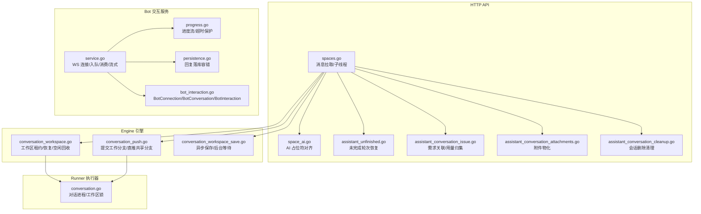
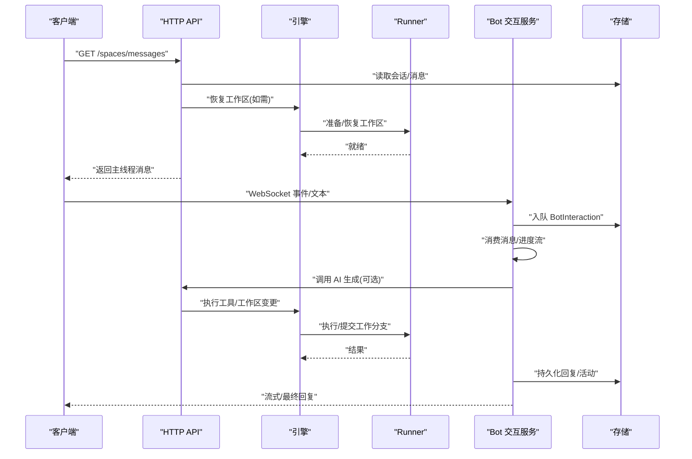
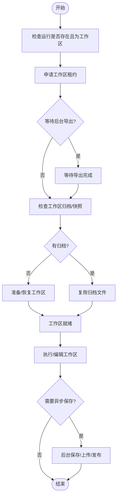
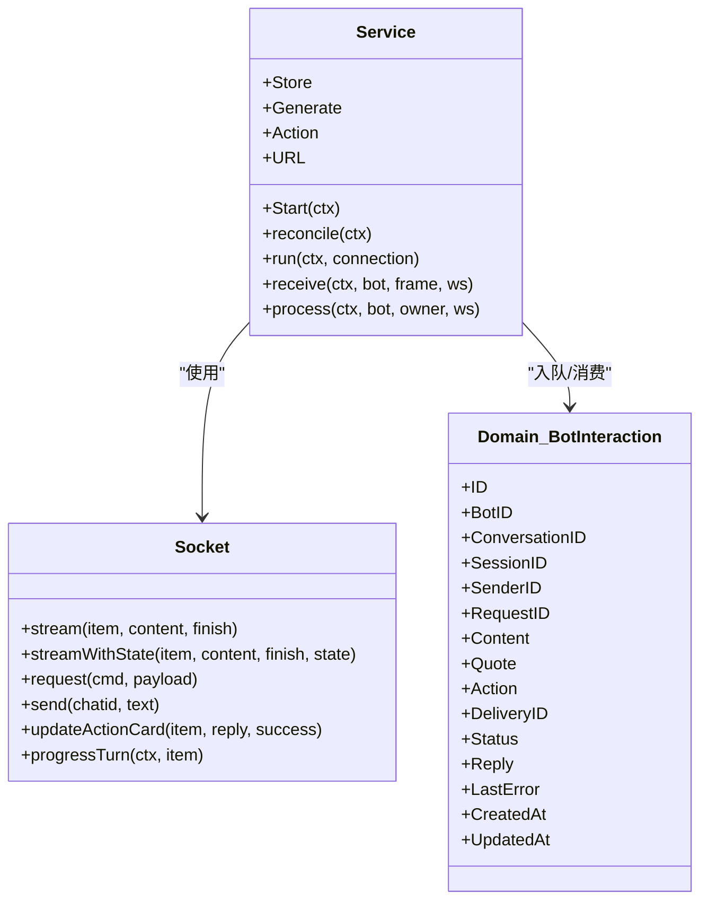
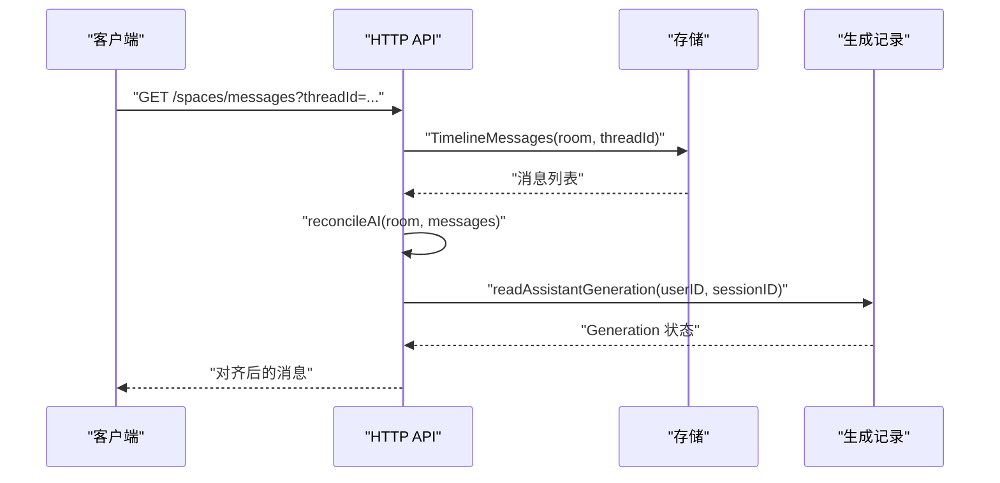
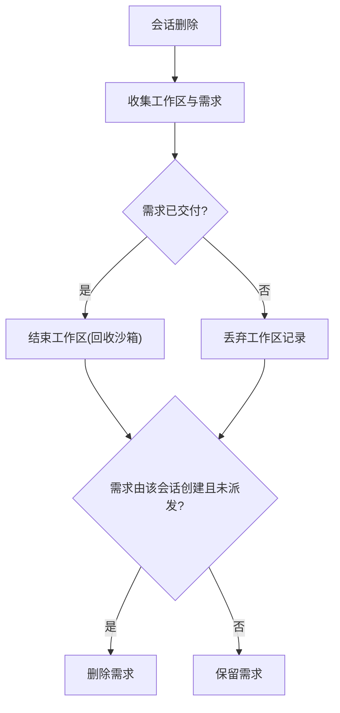
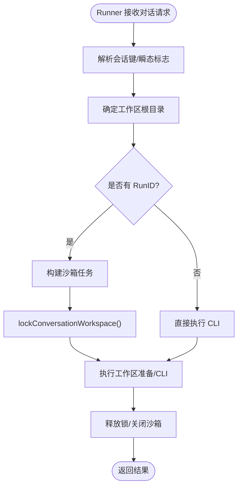
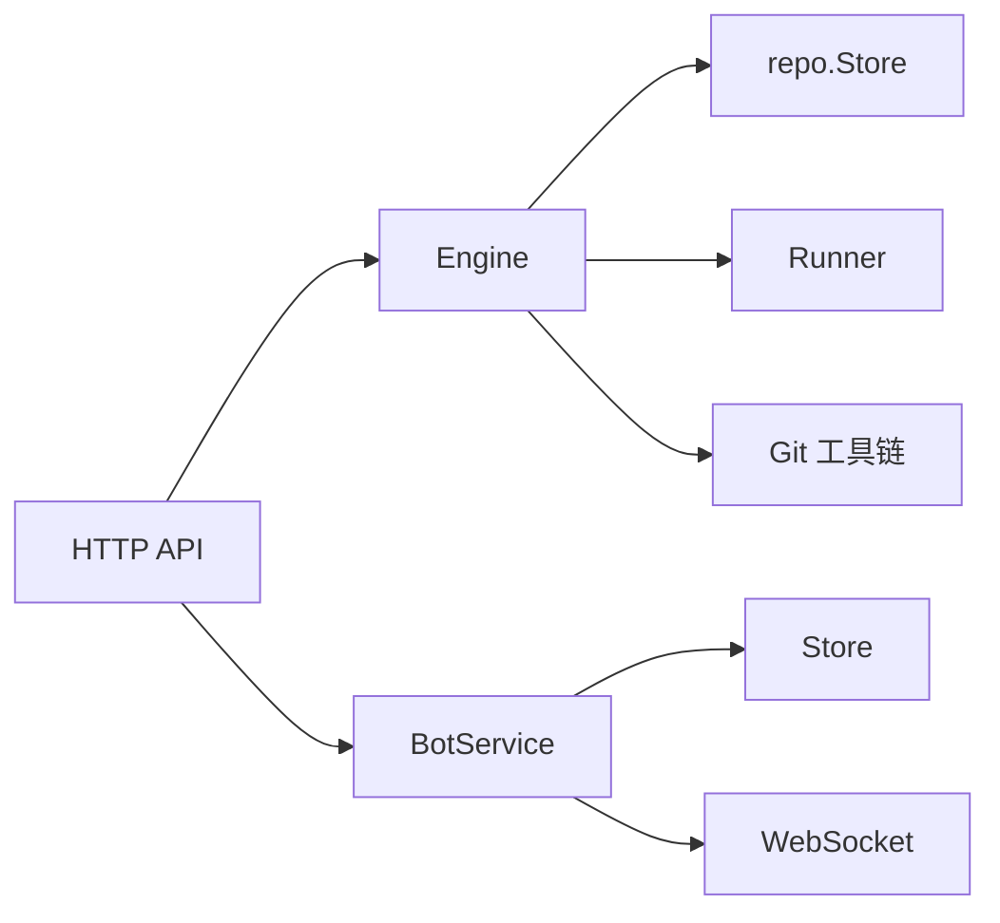
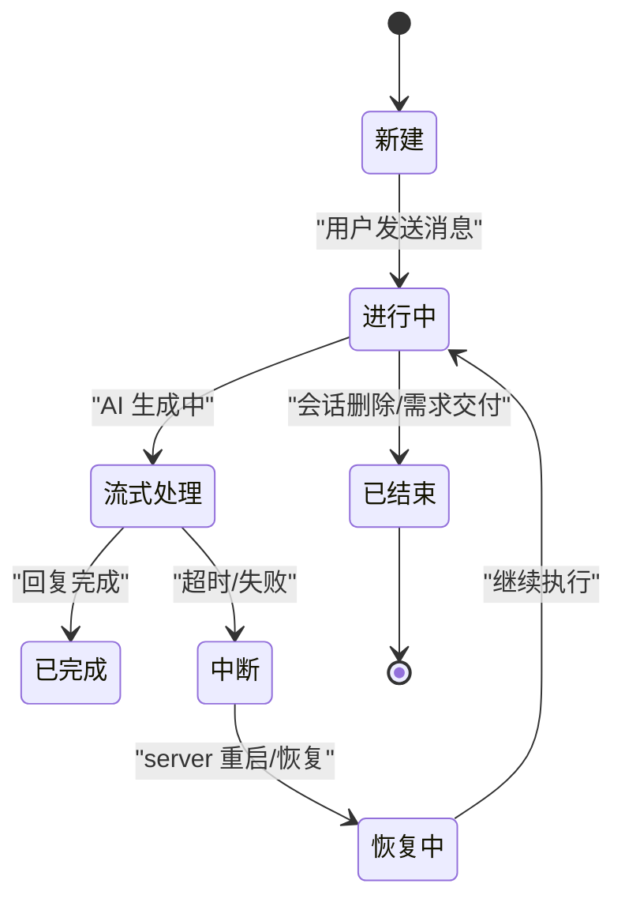

# 对话管理

<cite>
**本文引用的文件**   
- [conversation_workspace.go](file://internal/engine/conversation_workspace.go)
- [conversation_push.go](file://internal/engine/conversation_push.go)
- [conversation_workspace_save.go](file://internal/engine/conversation_workspace_save.go)
- [conversation.go](file://internal/runner/conversation.go)
- [service.go](file://internal/botinteraction/service.go)
- [progress.go](file://internal/botinteraction/progress.go)
- [persistence.go](file://internal/botinteraction/persistence.go)
- [bot_interaction.go](file://internal/domain/bot_interaction.go)
- [assistant_conversation_issue.go](file://internal/httpapi/assistant_conversation_issue.go)
- [assistant_conversation_attachments.go](file://internal/httpapi/assistant_conversation_attachments.go)
- [assistant_conversation_cleanup.go](file://internal/httpapi/assistant_conversation_cleanup.go)
- [spaces.go](file://internal/httpapi/spaces.go)
- [space_ai.go](file://internal/httpapi/space_ai.go)
- [assistant_unfinished.go](file://internal/httpapi/assistant_unfinished.go)
</cite>

## 目录
1. [简介](#简介)
2. [项目结构](#项目结构)
3. [核心组件](#核心组件)
4. [架构总览](#架构总览)
5. [详细组件分析](#详细组件分析)
6. [依赖关系分析](#依赖关系分析)
7. [性能与并发特性](#性能与并发特性)
8. [故障排查指南](#故障排查指南)
9. [结论](#结论)
10. [附录：对话示例与状态图](#附录对话示例与状态图)

## 简介
本文件面向“对话管理”主题，系统性梳理 LoopForge 中会话生命周期、消息队列处理、Main Bot 对话机制、用户输入处理、AI 响应生成与流式传输、工作区持久化与恢复、并发控制、错误处理与调试技巧。文档以代码级实现为依据，提供架构图、时序图、流程图和状态转换图，帮助读者从前端到后端、从 API 到执行器全面理解对话系统。

## 项目结构
围绕对话管理的代码主要分布在以下模块：
- 引擎层：对话工作区创建、占用、保存、恢复、清理、推送等能力
- Runner 层：在远程或本地沙箱中运行对话进程，并协调工作区锁
- Bot 交互服务：接收企业微信事件、入队、消费、流式回复、卡片操作
- HTTP API：会话列表、消息拉取、AI 占位符对齐、未完成任务恢复、附件物化、需求关联与清理
- 领域模型：Bot 连接、对话、交互记录；助手会话、消息、活动事件等

**图示来源** 
- [spaces.go:551-577](file://internal/httpapi/spaces.go#L551-L577)
- [space_ai.go:219-229](file://internal/httpapi/space_ai.go#L219-L229)
- [assistant_unfinished.go:139-164](file://internal/httpapi/assistant_unfinished.go#L139-L164)
- [assistant_conversation_issue.go:193-224](file://internal/httpapi/assistant_conversation_issue.go#L193-L224)
- [assistant_conversation_attachments.go:11-56](file://internal/httpapi/assistant_conversation_attachments.go#L11-L56)
- [assistant_conversation_cleanup.go:11-81](file://internal/httpapi/assistant_conversation_cleanup.go#L11-L81)
- [conversation_workspace.go:45-112](file://internal/engine/conversation_workspace.go#L45-L112)
- [conversation_push.go:20-115](file://internal/engine/conversation_push.go#L20-L115)
- [conversation_workspace_save.go:13-92](file://internal/engine/conversation_workspace_save.go#L13-L92)
- [conversation.go:19-124](file://internal/runner/conversation.go#L19-L124)
- [service.go:44-193](file://internal/botinteraction/service.go#L44-L193)
- [progress.go:47-92](file://internal/botinteraction/progress.go#L47-L92)
- [persistence.go:12-32](file://internal/botinteraction/persistence.go#L12-L32)
- [bot_interaction.go:5-38](file://internal/domain/bot_interaction.go#L5-L38)

**章节来源**
- [spaces.go:551-577](file://internal/httpapi/spaces.go#L551-L577)
- [conversation_workspace.go:45-112](file://internal/engine/conversation_workspace.go#L45-L112)
- [service.go:44-193](file://internal/botinteraction/service.go#L44-L193)

## 核心组件
- 引擎工作区管理器：负责对话工作区的获取、租约、恢复、空闲回收、提交推送、异步保存
- Runner 对话进程：在沙箱内运行 CLI 工具，持有工作区读写锁，避免与导出/快照冲突
- Bot 交互服务：维护 WS 连接、入队/出队消息、流式进度、卡片动作、失败重试与持久化
- HTTP API：会话与消息查询、AI 占位符对齐、未完成轮次恢复、需求关联与用量归集、附件物化、会话删除清理
- 领域模型：Bot 连接、对话、交互记录；助手会话、消息、活动事件等

**章节来源**
- [conversation_workspace.go:45-112](file://internal/engine/conversation_workspace.go#L45-L112)
- [conversation.go:19-124](file://internal/runner/conversation.go#L19-L124)
- [service.go:44-193](file://internal/botinteraction/service.go#L44-L193)
- [assistant_conversation_issue.go:193-224](file://internal/httpapi/assistant_conversation_issue.go#L193-L224)
- [bot_interaction.go:5-38](file://internal/domain/bot_interaction.go#L5-L38)

## 架构总览
下图展示一次典型对话请求的端到端流程：用户通过平台发送消息，API 拉取会话与消息，必要时恢复工作区；Bot 交互服务将消息入队，消费后调用 AI 生成回复，并通过 WebSocket 流式推送；引擎在工作区上执行工具链，必要时提交工作分支；最终消息与活动事件持久化。

**图示来源**
- [spaces.go:551-577](file://internal/httpapi/spaces.go#L551-L577)
- [conversation_workspace.go:204-224](file://internal/engine/conversation_workspace.go#L204-L224)
- [conversation.go:19-124](file://internal/runner/conversation.go#L19-L124)
- [service.go:249-283](file://internal/botinteraction/service.go#L249-L283)
- [service.go:299-463](file://internal/botinteraction/service.go#L299-L463)
- [conversation_push.go:20-115](file://internal/engine/conversation_push.go#L20-L115)

## 详细组件分析

### 会话生命周期与工作区管理
- 会话创建与会话绑定
  - 普通对话与 SOP 对话、定时任务对话通过不同 Source 区分
  - 会话可绑定一个 WorkspaceRunID（Main Bot 绑定的工作区）以及 OwnWorkspaceRunIDs（对话自行打开的工作区）
- 工作区租约与恢复
  - BeginConversationWorkspaceUse 抢占式获取租约，等待后台导出完成
  - EnsureConversationWorkspace/PrepareConversationWorkspace 根据是否已有归档决定直接复用或恢复
  - restoreCheckpointBeforeExecution 在执行前恢复工作区，兼容 Main Bot 轮次与 IDE 心跳创建的元数据
- 空闲回收与异步保存
  - claimIdleConversationWorkspace 判断空闲条件，标记 FollowUp，延迟 TTL 后尝试保存与清理
  - EndConversationWorkspaceUseAsync 将前台使用转交后台保存，压缩/上传/发布独立于轮次
- 提交与推送
  - PushConversationWorkspace 校验仓库与身份，支持本地或 Runner 环境推送，可选择直推共享分支
  - observeConversationPush 记录遥测指标

**图示来源**
- [conversation_workspace.go:45-112](file://internal/engine/conversation_workspace.go#L45-L112)
- [conversation_workspace.go:204-224](file://internal/engine/conversation_workspace.go#L204-L224)
- [conversation_workspace.go:316-397](file://internal/engine/conversation_workspace.go#L316-L397)
- [conversation_workspace_save.go:13-92](file://internal/engine/conversation_workspace_save.go#L13-L92)
- [conversation_push.go:20-115](file://internal/engine/conversation_push.go#L20-L115)

**章节来源**
- [assistant.go:166-216](file://internal/domain/assistant.go#L166-L216)
- [conversation_workspace.go:45-112](file://internal/engine/conversation_workspace.go#L45-L112)
- [conversation_workspace.go:204-224](file://internal/engine/conversation_workspace.go#L204-L224)
- [conversation_workspace.go:316-397](file://internal/engine/conversation_workspace.go#L316-L397)
- [conversation_workspace_save.go:13-92](file://internal/engine/conversation_workspace_save.go#L13-L92)
- [conversation_push.go:20-115](file://internal/engine/conversation_push.go#L20-L115)

### Bot 交互服务与消息队列
- 连接与重连
  - Service.Start 启动周期清理与 reconcile，按机器人配置建立 WS 连接
  - run 方法负责 ClaimBotConnection、RecoverBotInteractions、凭据获取、WS 拨号、断线指数退避重连
- 消息入队与消费
  - receive 标准化 incoming 事件，写入 BotInteraction 队列；非卡片消息先发送“已收到，正在处理…”
  - process 循环取队，区分通知卡片动作与普通消息；普通消息触发 Generate 或 Action
- 流式进度与回复
  - progressTurn 周期性推送阶段提示，避免网络延迟阻塞模型工具
  - stream/streamWithState 将进度与最终回复推送给客户端
- 持久化与容错
  - saveReply 捕获 MySQL utf8mb3 字符集问题，降级为友好提示并重新落库

**图示来源**
- [service.go:44-193](file://internal/botinteraction/service.go#L44-L193)
- [service.go:249-283](file://internal/botinteraction/service.go#L249-L283)
- [service.go:299-463](file://internal/botinteraction/service.go#L299-L463)
- [progress.go:47-92](file://internal/botinteraction/progress.go#L47-L92)
- [persistence.go:12-32](file://internal/botinteraction/persistence.go#L12-L32)
- [bot_interaction.go:21-38](file://internal/domain/bot_interaction.go#L21-L38)

**章节来源**
- [service.go:44-193](file://internal/botinteraction/service.go#L44-L193)
- [service.go:249-283](file://internal/botinteraction/service.go#L249-L283)
- [service.go:299-463](file://internal/botinteraction/service.go#L299-L463)
- [progress.go:47-92](file://internal/botinteraction/progress.go#L47-L92)
- [persistence.go:12-32](file://internal/botinteraction/persistence.go#L12-L32)
- [bot_interaction.go:21-38](file://internal/domain/bot_interaction.go#L21-L38)

### HTTP API 对话入口与 AI 对齐
- 消息拉取与子线程
  - messages 接口支持主线程与子线程消息拉取，返回前对 AI 占位符进行 reconcile
- AI 占位符对齐
  - reconcileAI 遍历消息，若为 AI 类型且仍在运行，则读取 AssistantGeneration 并更新状态
- 未完成轮次恢复
  - currentGeneration 检测 interrupted 状态，保留部分回复；assistantUnfinishedPromptContent 构造提示让模型继续

**图示来源**
- [spaces.go:551-577](file://internal/httpapi/spaces.go#L551-L577)
- [space_ai.go:219-229](file://internal/httpapi/space_ai.go#L219-L229)
- [assistant_unfinished.go:139-164](file://internal/httpapi/assistant_unfinished.go#L139-L164)

**章节来源**
- [spaces.go:551-577](file://internal/httpapi/spaces.go#L551-L577)
- [space_ai.go:219-229](file://internal/httpapi/space_ai.go#L219-L229)
- [assistant_unfinished.go:139-164](file://internal/httpapi/assistant_unfinished.go#L139-L164)

### 需求关联、附件与清理
- 需求关联
  - linkConversationRequirement 将对话工作区与需求关联，优先复用会话已有需求，否则创建新需求
  - attributeConversationUsage 在轮次结束后将用量归集到工作区，并将会话链接到需求
- 附件物化
  - writeConversationAttachments 将所选附件复制到工作区 attachments 目录，限制大小与路径安全
- 会话删除清理
  - deleteConversation 删除会话后，按需求维度结算：已交付的需求仅结束工作区；未交付的需求连同工作区与需求一起清理

**图示来源**
- [assistant_conversation_issue.go:20-86](file://internal/httpapi/assistant_conversation_issue.go#L20-L86)
- [assistant_conversation_issue.go:193-224](file://internal/httpapi/assistant_conversation_issue.go#L193-L224)
- [assistant_conversation_attachments.go:11-56](file://internal/httpapi/assistant_conversation_attachments.go#L11-L56)
- [assistant_conversation_cleanup.go:11-81](file://internal/httpapi/assistant_conversation_cleanup.go#L11-L81)

**章节来源**
- [assistant_conversation_issue.go:20-86](file://internal/httpapi/assistant_conversation_issue.go#L20-L86)
- [assistant_conversation_issue.go:193-224](file://internal/httpapi/assistant_conversation_issue.go#L193-L224)
- [assistant_conversation_attachments.go:11-56](file://internal/httpapi/assistant_conversation_attachments.go#L11-L56)
- [assistant_conversation_cleanup.go:11-81](file://internal/httpapi/assistant_conversation_cleanup.go#L11-L81)

### Runner 对话进程与工作区锁
- 对话进程入口
  - conversationProcess 解析会话键，确定工作区根目录；支持瞬态进程与 Run 工作区
  - 当存在 RunID 时，需通过 workspaceSandboxTask 获取沙箱，并在执行前锁定工作区
- 工作区锁
  - lockConversationWorkspace 使用 RWMutex 短轮询等待，避免与后台导出竞争；超时返回忙错误

**图示来源**
- [conversation.go:19-124](file://internal/runner/conversation.go#L19-L124)
- [conversation.go:128-148](file://internal/runner/conversation.go#L128-L148)

**章节来源**
- [conversation.go:19-124](file://internal/runner/conversation.go#L19-L124)
- [conversation.go:128-148](file://internal/runner/conversation.go#L128-L148)

## 依赖关系分析
- 耦合与内聚
  - Engine 与 repo 强耦合用于工作区元数据与归档；与 runner 通过 requestWorkspaceCheckpoint 协作
  - BotService 与 Store 解耦，通过 domain.BotInteraction 传递消息；ws/socket 封装网络细节
  - HTTP API 聚合多个领域能力，保持对外接口稳定
- 外部依赖
  - WebSocket 与企业微信开放平台通信
  - Git 工具链用于工作分支推送与合并
  - MySQL 存储消息与回复，需 utf8mb4 支持

**图示来源**
- [conversation_workspace.go:45-112](file://internal/engine/conversation_workspace.go#L45-L112)
- [conversation_push.go:20-115](file://internal/engine/conversation_push.go#L20-L115)
- [service.go:44-193](file://internal/botinteraction/service.go#L44-L193)
- [conversation.go:19-124](file://internal/runner/conversation.go#L19-L124)

**章节来源**
- [conversation_workspace.go:45-112](file://internal/engine/conversation_workspace.go#L45-L112)
- [conversation_push.go:20-115](file://internal/engine/conversation_push.go#L20-L115)
- [service.go:44-193](file://internal/botinteraction/service.go#L44-L193)
- [conversation.go:19-124](file://internal/runner/conversation.go#L19-L124)

## 性能与并发特性
- 工作区并发控制
  - 租约机制防止多实例同时写工作区；BeginConversationWorkspaceUse 抢占式获取并等待后台导出
  - Runner 侧使用 RWMutex 短轮询等待，避免长时间阻塞
- 异步保存与后台任务
  - EndConversationWorkspaceUseAsync 将压缩/上传/发布移出前台路径，提升用户体验
  - waitForBackgroundWorkspaceSave 在 API 预检中等待远端工作区空闲
- 流式进度与超时保护
  - progressTurn 每 8 秒推送阶段提示，避免长耗时任务卡死 UI
  - 消息处理上下文设置 2 分钟超时，避免无限等待

**章节来源**
- [conversation_workspace.go:45-112](file://internal/engine/conversation_workspace.go#L45-L112)
- [conversation_workspace_save.go:25-92](file://internal/engine/conversation_workspace_save.go#L25-L92)
- [conversation.go:128-148](file://internal/runner/conversation.go#L128-L148)
- [progress.go:47-92](file://internal/botinteraction/progress.go#L47-L92)
- [service.go:370-408](file://internal/botinteraction/service.go#L370-L408)

## 故障排查指南
- 工作区被占用
  - 现象：恢复工作区时报 ErrWorkspaceInUse
  - 排查：检查 BeginConversationWorkspaceUse 是否成功；确认后台导出是否完成；查看 Runner 工作区锁是否超时
  - 参考：[conversation_workspace.go:226-233](file://internal/engine/conversation_workspace.go#L226-L233)、[conversation.go:128-148](file://internal/runner/conversation.go#L128-L148)
- 数据库字符集导致回复无法保存
  - 现象：MySQL 报错 1366/3988
  - 处理：提示升级 bot_interactions 表为 utf8mb4，并重试
  - 参考：[persistence.go:12-32](file://internal/botinteraction/persistence.go#L12-L32)
- 流式回复不可用
  - 现象：errorsStreamUnavailable
  - 处理：检查 WS 连接状态与回调通道；必要时回退为一次性发送
  - 参考：[progress.go:47-67](file://internal/botinteraction/progress.go#L47-L67)
- 未完成轮次中断
  - 现象：generation 状态为 interrupted
  - 处理：currentGeneration 保留部分回复；assistantUnfinishedPromptContent 构造提示让模型继续
  - 参考：[assistant_unfinished.go:139-164](file://internal/httpapi/assistant_unfinished.go#L139-L164)
- 推送失败
  - 现象：git push 错误或直推共享分支冲突
  - 处理：检查 Git Token/SSH Key；确认工作分支与基础分支差异；查看冲突列表
  - 参考：[conversation_push.go:20-115](file://internal/engine/conversation_push.go#L20-L115)

**章节来源**
- [conversation_workspace.go:226-233](file://internal/engine/conversation_workspace.go#L226-L233)
- [conversation.go:128-148](file://internal/runner/conversation.go#L128-L148)
- [persistence.go:12-32](file://internal/botinteraction/persistence.go#L12-L32)
- [progress.go:47-67](file://internal/botinteraction/progress.go#L47-L67)
- [assistant_unfinished.go:139-164](file://internal/httpapi/assistant_unfinished.go#L139-L164)
- [conversation_push.go:20-115](file://internal/engine/conversation_push.go#L20-L115)

## 结论
LoopForge 的对话管理以“会话—工作区—消息队列—执行器”为主线，通过租约与锁机制保证并发安全，借助异步保存与流式进度提升体验，结合需求关联与清理策略保障数据一致性。Bot 交互服务在企业微信生态中提供稳定的消息收发与卡片操作能力，HTTP API 则在会话与消息层面提供统一入口，并与引擎、Runner 紧密协作。

## 附录：对话示例与状态图

### 典型对话示例
- 用户发送“请帮我优化登录页样式”，Main Bot 识别需求并创建工作区，修改代码后提交工作分支
- 用户在群聊中点击卡片“查看详情”，Bot 交互服务将卡片动作转为内部指令，执行后更新卡片状态
- 会话被删除后，若需求已交付，仅结束工作区；若未交付，清理工作区与需求

### 会话状态转换图

[此图为概念性状态图，不映射具体源码文件]