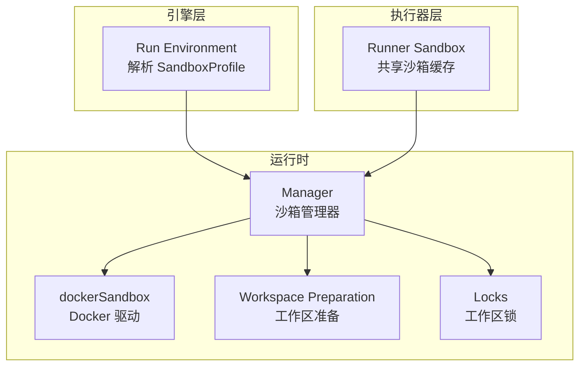
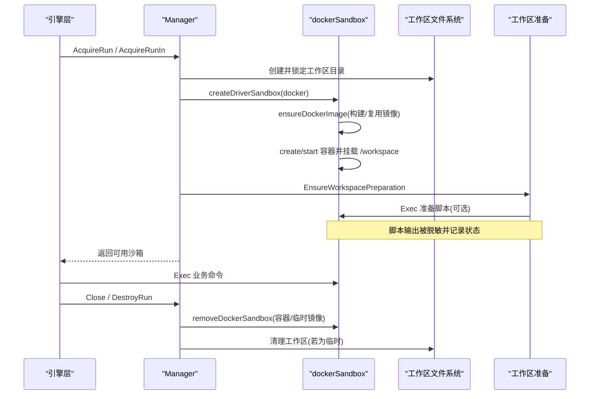
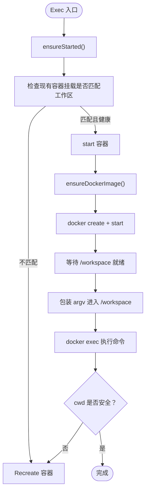
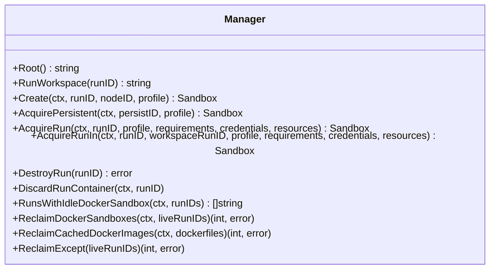
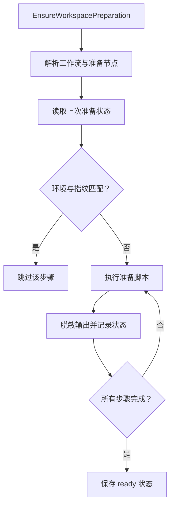
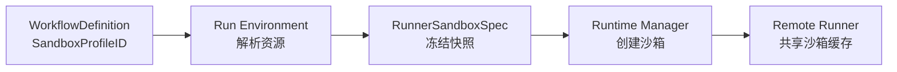

# 沙箱环境

<cite>
**本文引用的文件**   
- [sandbox_docker.go](file://internal/runtime/sandbox_docker.go)
- [sandbox_manager.go](file://internal/runtime/sandbox_manager.go)
- [workspace_preparation.go](file://internal/runtime/workspace_preparation.go)
- [workspace_lock.go](file://internal/runtime/workspace_lock.go)
- [run_environment.go](file://internal/engine/run_environment.go)
- [run_sandbox.go](file://internal/runner/run_sandbox.go)
- [sandbox_migration_test.go](file://internal/domain/sandbox_migration_test.go)
</cite>

## 目录
1. [引言](#引言)
2. [项目结构](#项目结构)
3. [核心组件](#核心组件)
4. [架构总览](#架构总览)
5. [详细组件分析](#详细组件分析)
6. [依赖关系分析](#依赖关系分析)
7. [性能与资源优化](#性能与资源优化)
8. [故障排除指南](#故障排除指南)
9. [结论](#结论)
10. [附录：配置示例与最佳实践](#附录配置示例与最佳实践)

## 引言
本文面向需要理解并运维 LoopForge 沙箱环境的工程师，系统性说明 Docker 沙箱的创建、配置、工作空间准备、仓库检出、依赖安装、权限控制、资源隔离、清理机制以及常见问题排查。文档以代码实现为依据，重点覆盖 runtime 层对沙箱生命周期和 workspace 重建的控制逻辑，并结合 engine 与 runner 层的调用路径给出端到端视图。

## 项目结构
与沙箱直接相关的核心代码集中在 internal/runtime，并由 internal/engine 与 internal/runner 消费：
- internal/runtime：沙箱抽象、Docker 驱动、管理器、工作区准备、锁与清理。
- internal/engine：将工作流中的 SandboxProfile 解析为运行时可用的 SandboxResources，并冻结快照。
- internal/runner：在远端执行器侧复用或释放共享工作区的沙箱实例。
- internal/domain：工作流与运行对象中对沙箱配置的迁移与序列化约束。

**图表来源**
- [sandbox_manager.go:14-110](file://internal/runtime/sandbox_manager.go#L14-L110)
- [sandbox_docker.go:22-57](file://internal/runtime/sandbox_docker.go#L22-L57)
- [workspace_preparation.go:20-55](file://internal/runtime/workspace_preparation.go#L20-L55)
- [workspace_lock.go:11-30](file://internal/runtime/workspace_lock.go#L11-L30)
- [run_environment.go:119-158](file://internal/engine/run_environment.go#L119-L158)
- [run_sandbox.go:40-81](file://internal/runner/run_sandbox.go#L40-L81)

**章节来源**
- [sandbox_manager.go:14-110](file://internal/runtime/sandbox_manager.go#L14-L110)
- [sandbox_docker.go:22-57](file://internal/runtime/sandbox_docker.go#L22-L57)
- [workspace_preparation.go:20-55](file://internal/runtime/workspace_preparation.go#L20-L55)
- [workspace_lock.go:11-30](file://internal/runtime/workspace_lock.go#L11-L30)
- [run_environment.go:119-158](file://internal/engine/run_environment.go#L119-L158)
- [run_sandbox.go:40-81](file://internal/runner/run_sandbox.go#L40-L81)

## 核心组件
- Manager：负责沙箱生命周期管理、工作空间目录分配、并发槽位限制、容器回收与镜像缓存清理。
- dockerSandbox：基于 Docker 的实现，负责镜像构建、容器创建、挂载、命令执行、错误恢复与清理。
- Workspace Preparation：按工作流节点标记“在工作区重建时执行”的步骤，安全地恢复依赖与环境。
- Locks：通过 flock 保证同一工作区不会被并发删除或重复绑定。
- Run Environment：从工作流中解析 SandboxProfile 与 Dockerfile，生成可序列化的 RunnerSandboxSpec。
- Runner Sandbox：远端执行器对共享工作区的沙箱进行引用计数与复用。

**章节来源**
- [sandbox_manager.go:14-110](file://internal/runtime/sandbox_manager.go#L14-L110)
- [sandbox_docker.go:22-57](file://internal/runtime/sandbox_docker.go#L22-L57)
- [workspace_preparation.go:20-55](file://internal/runtime/workspace_preparation.go#L20-L55)
- [workspace_lock.go:11-30](file://internal/runtime/workspace_lock.go#L11-L30)
- [run_environment.go:119-158](file://internal/engine/run_environment.go#L119-L158)
- [run_sandbox.go:40-81](file://internal/runner/run_sandbox.go#L40-L81)

## 架构总览
下图展示一次典型执行的端到端流程：引擎解析沙箱配置，管理器创建工作空间与沙箱，Docker 驱动构建镜像并启动容器，工作区准备脚本按需执行，随后业务命令在容器中执行，最后由管理器统一清理。

**图表来源**
- [sandbox_manager.go:59-110](file://internal/runtime/sandbox_manager.go#L59-L110)
- [sandbox_docker.go:512-521](file://internal/runtime/sandbox_docker.go#L512-L521)
- [sandbox_docker.go:849-872](file://internal/runtime/sandbox_docker.go#L849-L872)
- [sandbox_docker.go:676-783](file://internal/runtime/sandbox_docker.go#L676-L783)
- [workspace_preparation.go:281-397](file://internal/runtime/workspace_preparation.go#L281-L397)

## 详细组件分析

### Docker 沙箱创建与执行
- 延迟创建：为避免 git clone 替换 inode 导致 runc cwd 失败，容器在首次 Exec 时才创建，确保 bind-mount 指向已就绪的工作区。
- 镜像缓存：使用内容哈希命名缓存镜像；同时支持“隔离运行时镜像”，用于预置常用 CLI。
- 容器参数：默认 drop ALL 能力、no-new-privileges；非 root 服务用户下自动以宿主 UID/GID 运行容器，避免 root 镜像无法访问 0700 工作区。
- 工作区挂载：/workspace 绑定宿主工作区；对话模式额外挂载 conversation root 与 home，并添加 host.docker.internal。
- 只读根文件系统：可选启用 --read-only 与 tmpfs /tmp。
- 执行包装：通过 sh -lc 进入 /workspace，注入 PATH 与工具链，必要时切换为 login shell 以兼容 image profile。
- 错误恢复：当检测到 cwd 不在容器挂载命名空间或 exec 实例丢失时，触发 Recreate 重建容器。

**图表来源**
- [sandbox_docker.go:133-164](file://internal/runtime/sandbox_docker.go#L133-L164)
- [sandbox_docker.go:676-783](file://internal/runtime/sandbox_docker.go#L676-L783)
- [sandbox_docker.go:849-872](file://internal/runtime/sandbox_docker.go#L849-L872)

**章节来源**
- [sandbox_docker.go:133-164](file://internal/runtime/sandbox_docker.go#L133-L164)
- [sandbox_docker.go:512-521](file://internal/runtime/sandbox_docker.go#L512-L521)
- [sandbox_docker.go:676-783](file://internal/runtime/sandbox_docker.go#L676-L783)
- [sandbox_docker.go:849-872](file://internal/runtime/sandbox_docker.go#L849-L872)

### 管理器与工作区生命周期
- 工作区路径：RunWorkspace(runID) 返回宿主路径，实际创建由 open 完成。
- 并发控制：slots 通道限制并行 Exec 数量，避免过多容器同时执行。
- 生命周期方法：
  - Create：一次性工作区，ephemeral=true。
  - AcquirePersistent：跨节点复用持久工作区。
  - AcquireRun/AcquireRunIn：按 run 维度打开或重建沙箱，支持父子 SOP 不同 sandbox 但共享 checkout。
  - DestroyRun：删除宿主工作区并清理对应容器与临时镜像。
  - DiscardRunContainer：仅丢弃容器与临时镜像，保留工作区以便重跑。
  - ReclaimDockerSandboxes：回收无工作区归属的遗留容器。
  - ReclaimCachedDockerImages：清理不再被任何 Dockerfile 生成的缓存镜像。
  - ReclaimExcept：保留指定 liveRunIDs 的工作区，删除其余。

**图表来源**
- [sandbox_manager.go:14-110](file://internal/runtime/sandbox_manager.go#L14-L110)
- [sandbox_manager.go:112-225](file://internal/runtime/sandbox_manager.go#L112-L225)
- [sandbox_manager.go:246-312](file://internal/runtime/sandbox_manager.go#L246-L312)

**章节来源**
- [sandbox_manager.go:14-110](file://internal/runtime/sandbox_manager.go#L14-L110)
- [sandbox_manager.go:112-225](file://internal/runtime/sandbox_manager.go#L112-L225)
- [sandbox_manager.go:246-312](file://internal/runtime/sandbox_manager.go#L246-L312)

### 工作区准备与仓库检出
- 准备步骤：工作流节点可标记“在工作区重建时执行”，系统按原依赖图顺序执行这些脚本。
- 指纹与缓存：每个步骤根据节点、仓库上下文与沙箱快照计算指纹，相同环境跳过执行。
- 输出脱敏：对 API Key、Token、Secret、Authorization 等敏感信息进行正则脱敏，并限制输出长度。
- 执行范围：支持 ExecutionScopeRepositories，针对每个仓库分别执行准备脚本。
- 状态持久化：state.json 保存在 .agentflow/workspace-preparation/[scope]/state.json，包含步骤状态、输出、时间与指纹。

**图表来源**
- [workspace_preparation.go:95-154](file://internal/runtime/workspace_preparation.go#L95-L154)
- [workspace_preparation.go:156-174](file://internal/runtime/workspace_preparation.go#L156-L174)
- [workspace_preparation.go:175-216](file://internal/runtime/workspace_preparation.go#L175-L216)
- [workspace_preparation.go:281-397](file://internal/runtime/workspace_preparation.go#L281-L397)

**章节来源**
- [workspace_preparation.go:95-154](file://internal/runtime/workspace_preparation.go#L95-L154)
- [workspace_preparation.go:156-174](file://internal/runtime/workspace_preparation.go#L156-L174)
- [workspace_preparation.go:175-216](file://internal/runtime/workspace_preparation.go#L175-L216)
- [workspace_preparation.go:281-397](file://internal/runtime/workspace_preparation.go#L281-L397)

### 资源隔离与权限控制
- 能力与权限：容器默认 drop ALL 能力，启用 no-new-privileges，防止提权。
- 用户映射：非 root 服务用户运行时，若镜像未显式设置非 root 用户，则强制以宿主 UID/GID 运行，确保能读写 0700 工作区。
- 文件系统隔离：可选 --read-only 根文件系统，/tmp 使用 tmpfs 且 noexec,nosuid。
- 网络隔离：可通过 AGENTFLOW_DOCKER_NETWORK 指定网络；对话模式下额外挂载 host.docker.internal。
- 进程组隔离：OwnProcessGroup 模式下，通过 PID 文件与停止命令管理子进程生命周期。

**章节来源**
- [sandbox_docker.go:676-783](file://internal/runtime/sandbox_docker.go#L676-L783)
- [sandbox_docker.go:189-206](file://internal/runtime/sandbox_docker.go#L189-L206)

### 文件操作与清理机制
- 工作区锁：.locks 目录下的独占锁保证工作区不被并发删除或重复绑定。
- 容器回收：removeDockerSandbox 会移除容器与临时镜像；缓存镜像仅在 stale 且未被使用时删除。
- 工作区清理：DestroyRun 先清理容器与镜像，再删除工作区；ReclaimExcept 保留 liveRunIDs 相关目录。
- 残留清理：ReclaimDockerSandboxes 扫描宿主机上仍存在的容器，若无工作区归属则回收。

**章节来源**
- [workspace_lock.go:11-73](file://internal/runtime/workspace_lock.go#L11-L73)
- [sandbox_docker.go:59-99](file://internal/runtime/sandbox_docker.go#L59-L99)
- [sandbox_docker.go:585-602](file://internal/runtime/sandbox_docker.go#L585-L602)
- [sandbox_manager.go:112-143](file://internal/runtime/sandbox_manager.go#L112-L143)
- [sandbox_manager.go:183-208](file://internal/runtime/sandbox_manager.go#L183-L208)
- [sandbox_manager.go:246-312](file://internal/runtime/sandbox_manager.go#L246-L312)

### 仓库检出与依赖安装
- 仓库检出：prepareRepository 在 Manager.open 之前完成克隆，确保容器首次 Exec 时工作区已就绪。
- 依赖安装：通过工作区准备脚本执行语言特定的依赖安装（如 pip install、npm ci），并可针对多个仓库分别执行。
- 环境初始化：环境变量通过 prepareSandboxEnvironment 与 overlayEnvironment 合并，PATH 优先采用激活后的 overlay。

**章节来源**
- [sandbox_manager.go:73-110](file://internal/runtime/sandbox_manager.go#L73-L110)
- [workspace_preparation.go:258-275](file://internal/runtime/workspace_preparation.go#L258-L275)
- [sandbox_manager.go:435-447](file://internal/runtime/sandbox_manager.go#L435-L447)

## 依赖关系分析
- 引擎层将工作流中的 SandboxProfile 与 Dockerfile 解析为运行时资源，并生成 RunnerSandboxSpec 快照，保证历史执行不受后续配置变更影响。
- 远端执行器对共享工作区的沙箱进行引用计数，避免频繁销毁与重建。
- 工作流与运行对象的 JSON 反序列化会对 legacy 节点级 sandboxProfileId 做提升与冲突检测，确保一致性。

**图表来源**
- [run_environment.go:119-158](file://internal/engine/run_environment.go#L119-L158)
- [run_sandbox.go:136-149](file://internal/runner/run_sandbox.go#L136-L149)
- [sandbox_migration_test.go:9-33](file://internal/domain/sandbox_migration_test.go#L9-L33)

**章节来源**
- [run_environment.go:119-158](file://internal/engine/run_environment.go#L119-L158)
- [run_sandbox.go:136-149](file://internal/runner/run_sandbox.go#L136-L149)
- [sandbox_migration_test.go:9-33](file://internal/domain/sandbox_migration_test.go#L9-L33)

## 性能与资源优化
- 镜像构建超时与停滞保护：
  - AGENTFLOW_DOCKER_BUILD_STALL_TIMEOUT：构建过程中长时间无输出的容忍时间。
  - AGENTFLOW_DOCKER_BUILD_TIMEOUT：构建总超时。
- 预构建隔离镜像：PrebuildIsolatedImage 可在后台预热通用镜像，减少首次 SOP 等待。
- 镜像缓存策略：按 Dockerfile 内容与附加文件哈希命名缓存镜像；清理 stale 缓存镜像以释放磁盘。
- 容器复用：BindWorkspace 在 checkout 完成后复用健康容器，避免不必要的 docker rm。
- 并发限制：Manager.slots 限制并行 Exec，避免资源争用。

**章节来源**
- [sandbox_docker.go:876-895](file://internal/runtime/sandbox_docker.go#L876-L895)
- [sandbox_docker.go:908-926](file://internal/runtime/sandbox_docker.go#L908-L926)
- [sandbox_docker.go:585-602](file://internal/runtime/sandbox_docker.go#L585-L602)
- [sandbox_docker.go:293-298](file://internal/runtime/sandbox_docker.go#L293-L298)
- [sandbox_manager.go:14-26](file://internal/runtime/sandbox_manager.go#L14-L26)

## 故障排除指南
- cwd 不在容器挂载命名空间：
  - 现象：runc 报 exit status 126 或 “outside of container mount”。
  - 处理：系统自动触发 Recreate；确认 prepareRepository 已完成克隆后再 Exec。
- Docker exec 实例丢失：
  - 现象：“no such exec instance”、“no such container”、“container not found”。
  - 处理：视为沙箱中断，挂起节点而非消耗重试次数；检查 Docker daemon 与容器状态。
- 工作区目录被删除：
  - 现象：Node 报 ENOENT uv_cwd。
  - 处理：避免在 Exec 期间删除工作区；使用 DestroyRun 前先关闭沙箱。
- 镜像构建卡住：
  - 现象：长时间无输出或超时。
  - 处理：调整 AGENTFLOW_DOCKER_BUILD_STALL_TIMEOUT 与 AGENTFLOW_DOCKER_BUILD_TIMEOUT；检查网络与源镜像可用性。
- 权限不足：
  - 现象：root 镜像无法访问 0700 工作区。
  - 处理：在非 root 服务用户下，系统会自动以宿主 UID/GID 运行容器；或修改镜像 User。

**章节来源**
- [sandbox_docker.go:300-334](file://internal/runtime/sandbox_docker.go#L300-L334)
- [sandbox_docker.go:375-381](file://internal/runtime/sandbox_docker.go#L375-L381)
- [sandbox_manager.go:298-302](file://internal/runtime/sandbox_manager.go#L298-L302)
- [sandbox_docker.go:876-895](file://internal/runtime/sandbox_docker.go#L876-L895)

## 结论
LoopForge 的沙箱体系以 runtime.Manager 为中心，结合 dockerSandbox 提供强隔离的执行环境，并通过工作区准备脚本实现可复现的依赖安装与环境初始化。系统在镜像缓存、容器复用、权限映射与清理回收方面做了细致设计，兼顾安全性与性能。通过合理的配置与监控，可以在多仓库、多节点的复杂工作流中稳定运行。

## 附录：配置示例与最佳实践
- 基本 Docker 沙箱配置要点：
  - Driver：docker
  - DockerfileID：指向有效的 Dockerfile 定义
  - Environment：设置必要的环境变量（如 PATH）
  - ReadOnlyRootFS：建议开启以提升安全性
- 环境变量：
  - AGENTFLOW_DOCKER_NETWORK：指定容器网络
  - AGENTFLOW_LOCAL_SANDBOX=docker：将 local 驱动隔离到 Docker
  - AGENTFLOW_ISOLATED_IMAGE：指定预置隔离镜像
  - AGENTFLOW_DOCKER_BUILD_STALL_TIMEOUT / AGENTFLOW_DOCKER_BUILD_TIMEOUT：控制构建行为
- 最佳实践：
  - 使用工作区准备脚本安装语言依赖，避免在业务命令中执行耗时安装
  - 为每个仓库单独维护依赖安装脚本，提高可维护性
  - 启用只读根文件系统与最小能力集，降低安全风险
  - 定期清理 stale 缓存镜像与遗留容器，释放磁盘与资源
  - 在非 root 服务用户下运行平台，利用 UID/GID 映射简化权限问题

**章节来源**
- [sandbox_docker.go:897-902](file://internal/runtime/sandbox_docker.go#L897-L902)
- [sandbox_docker.go:928-941](file://internal/runtime/sandbox_docker.go#L928-L941)
- [sandbox_manager.go:435-447](file://internal/runtime/sandbox_manager.go#L435-L447)